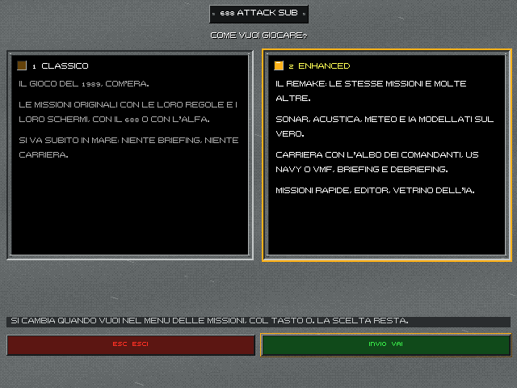
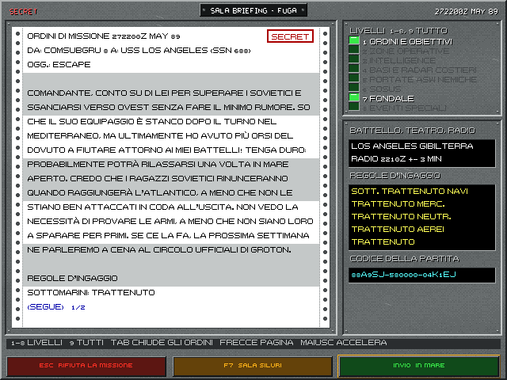
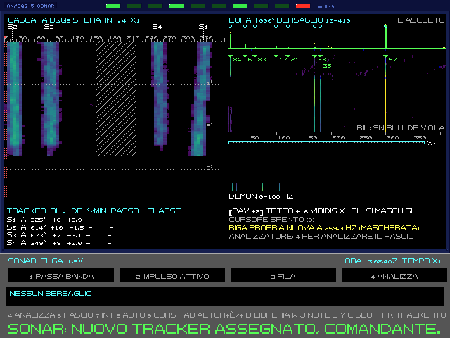
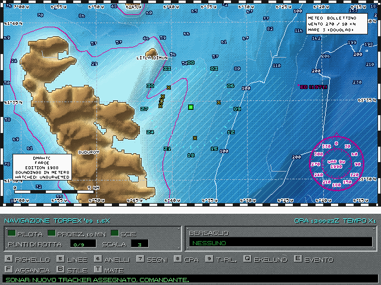
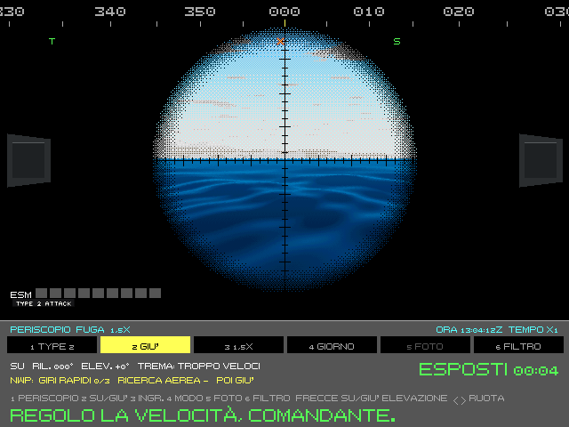
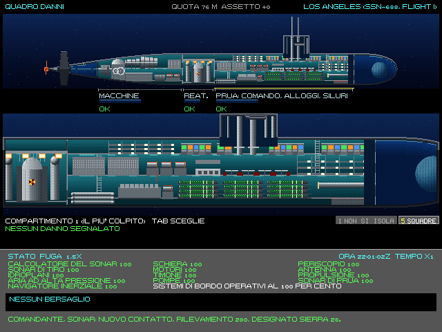
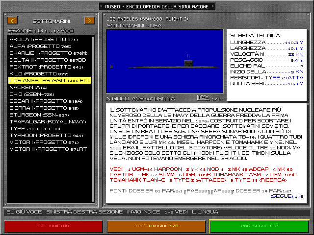
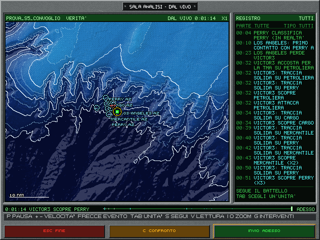
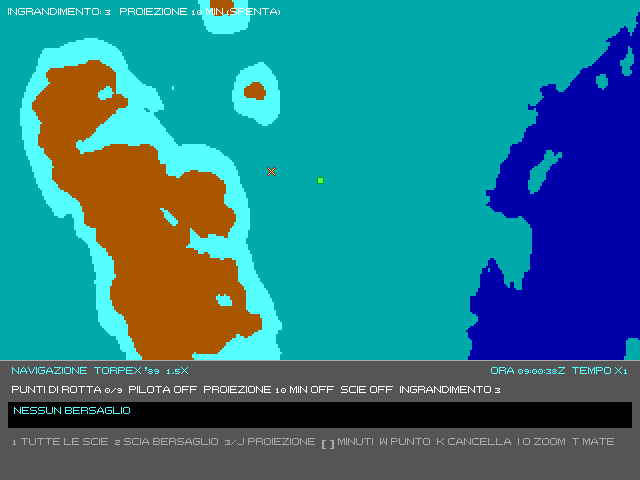
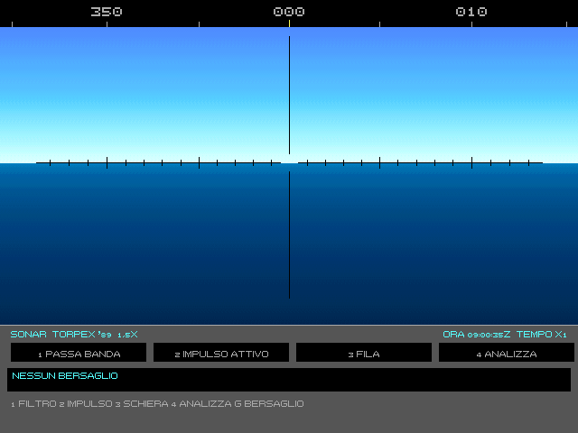

# 688 Attack Sub Enhanced

[]


> **In English, in short.** A fan-made, non-commercial remake of *688 Attack Sub* (1989), written from scratch in
> C++20 with SDL3 and Lua 5.4. It has two modes. **Classic** replays the 1989 game: the same 22 missions, rules and
> screens, rebuilt from a study of the original executable. **Enhanced** keeps those missions and adds 41 new ones,
> plus quick missions, a mission editor and a sandbox with a "god's-eye" view of the AI. Enhanced also models what the
> original only suggested: sonar and acoustics (waterfalls, LOFAR, DEMON, towed arrays), weather and sea state, real
> bathymetry for seven theatres, real periscopes, a radio room, damage and flooding, and an AI that sees and does what
> the player does. Around it come a career with briefings and debriefings, playable as the US Navy or the Soviet Navy,
> and an in-game museum and encyclopedia. Linux x86-64 for now. The first preview package (`v0.1.0-anteprima`) is
> self-contained: binaries, data, FM and MT-32 music, and a four-volume PDF manual.
> Not affiliated with or endorsed by Electronic Arts, who own the *688 Attack Sub* trademark. Documentation and code
> comments are in Italian.

---

**Remake non ufficiale e amatoriale.** Non è affiliato a Electronic Arts, titolare del marchio *688 Attack Sub*, né
approvato da essa. Il gioco originale (Electronic Arts, 1989) resta dei suoi proprietari. Questo repository è privato:
in `data/` ci sono file ricavati dal gioco originale, elencati in [`LICENZE/PROPRIETARI.txt`](LICENZE/PROPRIETARI.txt),
che non vanno ridistribuiti.

## Che cos'è

*688 Attack Sub Enhanced* rifà da zero il simulatore di sottomarini del 1989, in C++20 con SDL3. Le missioni sono in
Lua 5.4. Il gioco si apre con una scelta fra due modi:

- **Classico.** Il gioco del 1989 com'era: le 22 missioni originali con le loro regole e i loro schermi, col 688 o con
  l'Alfa sovietico. Si va subito in mare, senza briefing e senza carriera. Il comportamento viene dallo studio
  dell'eseguibile originale (`docs/01_analisi_tecnica_originale.md`, `docs/04_vm_missioni.md`). Un rilievo
  automatico controlla che resti identico all'originale (vedi [Prove e regressione](#prove-e-regressione)).
- **Enhanced.** Le stesse missioni e molte altre. Sonar, acustica, meteo e IA sono modellati sul vero. C'è una carriera
  con l'albo dei comandanti, per la US Navy o la Marina sovietica (VMF), con briefing e debriefing. Ci sono anche le
  missioni rapide, l'editor delle missioni e il vetrino dell'IA.

Il modo si cambia quando si vuole dal menu delle missioni, col tasto `O`, e la scelta resta.

## Novità rispetto all'originale

- **Sonar.** Cascate (waterfall) nello stile dei ricevitori SDR, LOFAR, DEMON e analizzatore di banda stretta. Le
  schiere sono quattro: sferica BQQ-5, di prua, rimorchiata TB-16 col filo filato e VDS sulle navi. Il sonar attivo ha
  echi e riverbero. Il tracker assegna i contatti. Il sonarista dell'equipaggio ha quattro livelli, da nessuno a
  esperto.
- **Acustica.** Propagazione coi profili del suono di ogni teatro, rumore del mare e del traffico, firme acustiche
  delle classi, cavitazione e transitori. L'audio di bordo cambia stazione per stazione.
- **Fondali veri e carte d'epoca.** Sette teatri (Baltico, Barents, Mar Celtico, Fær Øer, Gibilterra, Kunashir,
  Otranto) con la batimetria EMODnet (ETOPO dove EMODnet non arriva). La carta nautica è quella che una parte aveva nel 1989: rilievi,
  annotazioni e lacune comprese. Ha tre stili: VGA, nautica e foglio. La navigazione può essere perfetta o realistica,
  coi punti nave e, se si vuole, il GPS «1990+».
- **Meteo e mare.** Vento, stato del mare, visibilità, nebbia, giorno e notte col Sole vero. Di notte si vedono le luci
  di navigazione (COLREG 1972).
- **Periscopi veri.** Il Type 2 d'attacco e il Type 18 di ricerca, con 1,5× e 6×, stadimetro, libretto di
  riconoscimento con 47 classi a tre angoli e angolo sulla prora per la TMA. Le foto si giudicano in debriefing.
- **Armi e danni.** Mk 48 filoguidati, Harpoon, Tomahawk e mine, con la sala siluri e il carico. I danni sono per
  compartimento, con allagamento, incendi, assetto e affondamento fisico. Dentro c'è anche lo spaccato del battello.
- **Sala radio.** Le finestre di comunicazione, gli ordini FLASH e IMMEDIATE, l'ELF sotto il ghiaccio e l'ESM, con i
  messaggi della missione da leggere a tempo.
- **IA simmetrica.** Le unità controllate dall'IA vedono e fanno solo ciò che può fare il giocatore, coi loro
  sensori. Questo vale anche fra loro: scorte, ASW aereo con boe e sonar a immersione, artiglieria.
- **Carriera.** Fascicoli, gradi, decorazioni, albo d'onore e statistiche. Briefing e debriefing sono nello stile dei
  simulatori MicroProse dell'epoca, con gli eventi uno alla volta.
- **Missioni.** Le 22 originali portate in Lua, 41 nuove della libreria, le missioni rapide generate da un codice e
  l'editor.
- **Sandbox e vetrino di Dio.** Gli esperimenti `.m688v`, la vista dal vivo con la verità di tutte le unità, il
  registro degli eventi, i replay e le serie di partite con statistiche (`serie_sandbox`, `serie_ab`).
- **Museo ed enciclopedia.** Voci su unità, sensori e armi con foto «alla 1989» e fonti. La scheda tecnica si apre da
  ogni stazione con F1.
- **Musica.** FM dal vivo con un OPL3 emulato (ymfm), i titoli del 1989 per AdLib, Tandy e Covox, oppure MT-32: i brani
  resi con le ROM dell'utente, che stanno nel pacchetto privato. Si sceglie col tasto `M` nel menu.
- **Manuale.** Quattro volumi in PDF: uso, riferimento tecnico, storia e unità, tattiche.

## Schermate

Le schermate sono state prese dal pacchetto di anteprima, sotto X, a 640×480: è la risoluzione del gioco, che in
finestra si ingrandisce a multipli interi.

| | |
|---|---|
|  |  |
| Il menu iniziale: Classico o Enhanced. | La sala briefing: ordini, livelli d'informazione, regole d'ingaggio. |
|  |  |
| Il sonar Enhanced: cascata della sfera, LOFAR, DEMON e tracker. | La carta d'epoca delle Fær Øer (Suðuroy), con i contatti e l'anello dei rilevamenti. |
|  |  |
| Il periscopio d'attacco Type 2, di giorno, a quota periscopica. | Il quadro danni con lo spaccato del battello. |
|  |  |
| Il Museo: la scheda del Los Angeles (SSN-688). | La sandbox: la sala analisi dal vivo, col registro dell'IA. |
|  |  |
| Il Classico: la carta com'era nel 1989. | Il Classico: la vista del sonar del 1989. |

## Scaricare l'anteprima

La release [`v0.1.0-anteprima`](../../releases/tag/v0.1.0-anteprima) contiene il pacchetto per Linux x86-64
`melchior688-anteprima-2026-11-08-linux-x86_64-PRIVATO.tar.xz` (233 MB) e il suo `.sha256`.

```bash
sha256sum -c melchior688-anteprima-2026-11-08-linux-x86_64-PRIVATO.tar.xz.sha256
tar -xJf melchior688-anteprima-2026-11-08-linux-x86_64-PRIVATO.tar.xz
cd melchior688-anteprima-2026-11-08-linux-x86_64-PRIVATO
bin/melchior688
```

Il pacchetto è autonomo: SDL3 e sndio sono in `lib/` (RPATH `$ORIGIN/../lib`), i dati e le missioni in `data/`, la
musica MT-32 in `data/mt32/`, il manuale in `manuale/`. Il gioco cerca tutto accanto al proprio eseguibile e non
scrive mai nella sua cartella. Le partite, la carriera e i replay vanno in `~/.local/share/melchior688/`, le
preferenze e i tasti in `~/.config/melchior688/`.

Requisiti: glibc 2.38 o più recente e libstdc++ con `GLIBCXX_3.4.31` (GCC 13 o più recente). Vanno bene, per
esempio, Debian 13, Ubuntu 24.04 e Fedora 39 o successive. Servono anche le librerie grafiche e audio del desktop:
X11 o Wayland, PulseAudio o PipeWire, ALSA.

## Compilare

Il motore si compila senza installare nulla nel sistema (niente `sudo`):

- **Compilatore C++20**: GCC 14 (Debian 13) è quello usato; GCC 13 o più recente dovrebbe bastare.
- **CMake 3.31 e Ninja** nel venv Python del progetto:
  ```bash
  python3 -m venv tools/venv
  tools/venv/bin/pip install cmake==3.31.6 ninja==1.11.1.4
  ```
- **SDL3 3.2.10** dai pacchetti Debian, estratti in `tools/deps/sysroot` (non sono nel repository):
  ```bash
  mkdir -p tools/deps/deb && cd tools/deps/deb
  apt-get download libsdl3-0=3.2.10+ds-1 libsdl3-dev=3.2.10+ds-1 libsndio7.0
  for p in *.deb; do dpkg -x "$p" ../sysroot; done
  ```
  Con SDL3 3.2 installato nel sistema basta togliere `-DCMAKE_PREFIX_PATH` dalla configurazione.
- **Lua 5.4.7, toml++ 3.4.0, doctest 2.4.11 e ymfm** sono già in `engine/terzi/`.

Poi:

```bash
engine/costruisci.sh            # configura engine/build, compila e lancia le prove
engine/costruisci.sh --pulito   # da una cartella di build vuota
engine/build/melchior688 --menu
```

Le opzioni CMake del progetto:

| Opzione | Predefinita | Effetto |
|---|---|---|
| `M688_FINESTRA` | `ON` | La piattaforma SDL3 e l'eseguibile. Con `OFF` si compilano e si provano nucleo, grafica e missioni senza SDL. |
| `M688_RILASCIO` | `OFF` | Binari per il pacchetto. Niente percorsi del progetto compilati dentro (dati e missioni si cercano in `../data` accanto all'eseguibile), RPATH `$ORIGIN/../lib` come DT_RPATH, che vale anche per libsndio caricata da SDL3. |

### Il pacchetto di rilascio

```bash
cmake -S engine -B engine/build_pacchetto -G Ninja -DCMAKE_BUILD_TYPE=Release -DM688_RILASCIO=ON \
      -DCMAKE_PREFIX_PATH=$PWD/tools/deps/sysroot/usr
cmake --build engine/build_pacchetto -j6 --target melchior688 serie_sandbox serie_ab
tools/rilascio/pacchetto_linux.sh engine/build_pacchetto/melchior688            # data di oggi
tools/rilascio/verifica_pacchetto.sh rilascio/melchior688-anteprima-*.tar.xz      # verifica nell'isola
```

`pacchetto_linux.sh` controlla il RPATH, toglie i simboli di debug e verifica che il codice resti identico. Raccoglie
binari, librerie, dati, i quattro PDF del manuale e la musica MT-32, poi scrive `LICENZE/`
(`tools/pipeline/licenze.py`) e il `LEGGIMI.txt`. Con `BASE=si` fa il pacchetto senza i file dell'originale e senza
MT-32. `verifica_pacchetto.sh` lo estrae e lo fa girare in un namespace con la casa vuota, sotto un tracciatore dei
file aperti, che deve restituire un elenco vuoto.

## Avviare dalla build di sviluppo

```bash
engine/build/melchior688 --menu                                    # le schermate: menu, missioni, carriera
engine/build/melchior688 --missione SCENE1A                        # una missione del Classico, subito in mare
engine/build/melchior688 --missione SCENE5A --regola simulazione --briefing   # Enhanced, con la sala briefing
engine/build/melchior688 --sandbox --esperimento data/motore/esperimenti/burrasca.m688v --seme 1
```

I tasti sono in `data/motore/tasti_predefiniti.toml` e si cambiano in `~/.config/melchior688/tasti.toml`. In partita,
F1 apre la scheda del Museo e F11 l'elenco dei comandi. Il manuale (volume 1) li spiega tutti.

## Struttura del repository

| Cartella | Contenuto |
|---|---|
| `engine/nucleo/` | Simulazione deterministica a passo fisso (1/30 s): geometria nautica, mondo e cinematica, fondali, acustica, sensori, armi, danni, meteo, IA, carriera. Non dipende né dalla grafica né da SDL. |
| `engine/grafica/` | Tela 640×480 a 256 colori, palette, sprite e modelli 3D delle navi, periscopio, carte, effetti. |
| `engine/missioni/` | Esecuzione delle missioni Lua in un ambiente isolato, regole del Classico (la semantica della VM del 1989), stazioni, contatti, radio. |
| `engine/piattaforma/` | Finestra e audio SDL3. |
| `engine/app/` | L'eseguibile `melchior688`: schermate, interfaccia delle stazioni, regia audio e musica. |
| `engine/strumenti/` | `serie_sandbox`, `serie_ab`, il rilievo delle missioni e altri strumenti a riga di comando. |
| `engine/test/` | La suite doctest. |
| `engine/terzi/` | Lua, toml++, doctest, ymfm. |
| `data/motore/` | I dati del gioco esportati dalla pipeline: classi, sprite, modelli, teatri, carte, testi, musica, enciclopedia, crediti. |
| `data/missioni/` | Le 22 missioni originali in Lua, la libreria delle nuove, le prove, l'API (`API.md`). |
| `data/teatri/`, `data/basi/`, `data/suoni/` | Batimetrie sorgenti, basi e fari, campioni sonori. |
| `docs/` | Analisi dell'originale, progetto di ogni sottosistema (`00_ROADMAP.md` e i capitoli numerati), dossier di ricerca, sorgenti del manuale (`manuale_enhanced/`), regole della traduzione, crediti. |
| `tools/pipeline/` | Dai sorgenti ai dati del gioco: `esporta_motore.py`, carte d'epoca, toponimi, crediti e licenze. |
| `tools/navi/` | Il kit delle navi: modelli 3D, sprite, compartimenti. |
| `tools/manuale/`, `tools/pdf/` | Figure del manuale e impaginazione dei PDF (HTML con Node e markdown-it, poi `tools/pipeline/manuale_pdf.py`; caratteri Charis SIL in `tools/pdf/caratteri/`, licenza OFL). |
| `tools/regressione/` | Casi, rilievo del Classico, suite, partite sandbox, verifica completa. |
| `tools/rilascio/` | Pacchetto, verifica nell'isola, questa copia del repository (`esporta_repo.sh`). |
| `tools/mt32/` | Resa dei brani con l'MT-32 emulato (Munt, LGPL), con le ROM dell'utente. Le ROM non sono mai nel repository. |
| `tools/re/` | Gli script dello studio dell'originale (archivi MLB, EXEPACK, VM delle missioni, testi, suoni). |
| `tools/taratura/`, `tools/libreria/`, `tools/lua/`, `tools/ymfm/`, ... | Tarature, prove della libreria, Lua e ymfm per gli strumenti. |

I dati di `data/motore/` si rigenerano con `tools/venv/bin/python -I tools/pipeline/esporta_motore.py .`. Una parte
viene da una copia del gioco originale, che non è nel repository e va messa in `original-game/`
(`docs/02_pipeline_dati.md`).

Restano fuori dal repository anche le trascrizioni dei testi del 1989, cioè manuale, appendici, addendum, briefing e
schede del sonar (`docs/originale/*_EN.txt`), e la traduzione completa dei testi originali (`docs/traduzione/`, di cui
restano il README e il glossario). Alcuni documenti e gli script che li leggono, come `tools/re/manuale_testi.py` e
`tools/re/protezione.py`, li citano: esistono solo nella copia di lavoro di chi ha il gioco originale. I testi tradotti
che il gioco usa sono in `data/`.

## Prove e regressione

- **Suite doctest** (`engine/build*/prove`): unità, dati esportati, missioni, IA, schermate.
- **Casi** (`tools/regressione/casi.sh`): otto partite deterministiche confrontate riga per riga con
  `tools/regressione/riferimento.txt`.
- **Rilievo del Classico** (`tools/regressione/rilievo_classico.sh`): le missioni originali devono restare identiche
  all'originale.
- **Scene della sandbox** (`tools/regressione/sandbox_scene.sh`): ogni scena di prova giocata fino in fondo.
- **Verifica completa** (`tools/regressione/verifica_completa.sh`): build pulita e tutte le prove qui sopra.

Esito della verifica completa sul codice dell'anteprima: casi 0 righe di differenza, rilievo 0 su 110, suite 1367
casi passati, 0 falliti e 20 saltati, 69 scene sandbox tutte con uscita 0. Il pacchetto estratto è stato verificato
nell'isola, con la casa vuota: 0 file aperti fuori dal pacchetto.

## Manuale

Quattro volumi in PDF, nel pacchetto (cartella `manuale/`):

1. **Uso**: menu, stazioni, comandi, missioni, carriera (119 pagine).
2. **Riferimento tecnico**: sensori, acustica, armi, danni, IA, formati (427 pagine).
3. **Storia e unità**: la Guerra Fredda sotto il mare, le classi, gli episodi (296 pagine).
4. **Tattiche** (52 pagine).

I sorgenti sono in `docs/manuale_enhanced/`; i PDF li impagina `tools/pdf/`.

## Crediti e licenze

- [`LICENZE/CREDITI.txt`](LICENZE/CREDITI.txt): tutti i crediti, nelle tre categorie: originale, nostro, terzi. Per
  ogni opera di terzi ci sono autore, licenza, fonte e cosa è stato cambiato. I sorgenti sono
  `data/motore/crediti.toml` e [`docs/CREDITI.md`](docs/CREDITI.md).
- [`LICENZE/`](LICENZE/): i testi delle licenze del codice di terzi (Lua, toml++, ymfm, SDL3, sndio) e dei caratteri
  del manuale (Charis, Liberation, JetBrains Mono, DejaVu).
- [`LICENZE/PROPRIETARI.txt`](LICENZE/PROPRIETARI.txt): i file ricavati dal gioco originale di Electronic Arts (1989).
  Sono per uso personale e non vanno ridistribuiti.
- Suoni e immagini di terzi sono ammessi solo con licenze CC0, pubblico dominio, CC BY o CC BY-SA (questi ultimi come
  file separati), mai NC.
- Le batimetrie vengono da EMODnet Bathymetry ed ETOPO, i toponimi da Natural Earth (pubblico dominio), il clima da ERA5 (Copernicus).
- Il codice del progetto per ora non ha una licenza pubblica: il repository è privato.

*688 Attack Sub* è un marchio dei rispettivi proprietari. Questo è un progetto di appassionati, senza scopo di lucro,
non affiliato a Electronic Arts.
