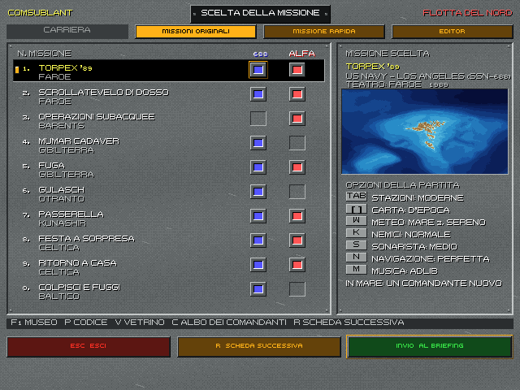
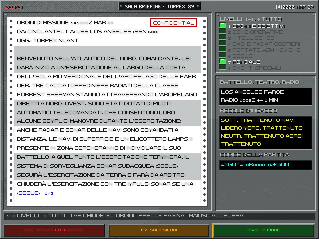
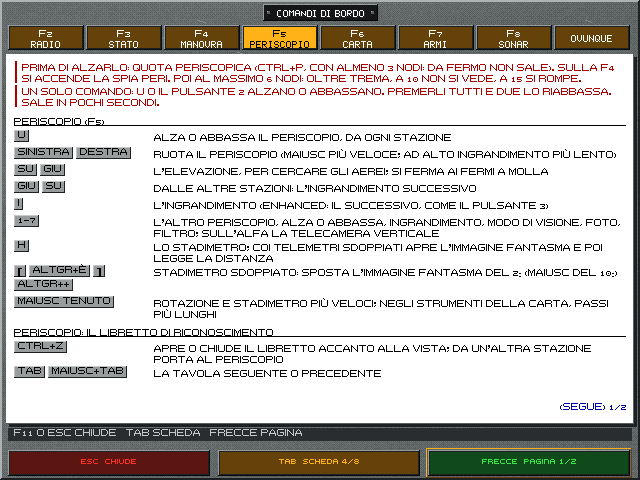

# 1. Introduzione

*688 Attack Sub* uscì nel 1989 per Electronic Arts: un 688 americano o un Alfa sovietico, dieci missioni fra le
Fær Øer, il Mar di Barents, Gibilterra e il Pacifico. Questa edizione **Enhanced** tiene la grafica VGA a 256 colori e
il suono dell'epoca, ma rifà da zero quello che c'è sotto: acustica, sensori, armi, danni, mare, avversari. Lo scopo è
che ogni cosa sullo schermo venga da una fisica documentata, e che le scelte del comandante pesino come pesavano in
mare nel 1989.

Questo capitolo spiega come convivono il gioco originale e quello nuovo, cosa cambia, il principio che regola l'IA e
il percorso dal menu al mare.

## 1.1 Due giochi in uno: il classico e l'Enhanced

Il programma contiene due modi di giocare, separati con cura.

- **Il classico** è il gioco del 1989 com'era: stesse missioni, stesse regole, stessi esiti. Le dieci missioni
  originali sono state convertite dagli script dell'eseguibile e girano su un motore che ne riproduce le regole.
  Una batteria di 110 partite di prova controlla, a ogni modifica, che armi a segno, attacchi riusciti e unità
  distrutte restino identici all'originale. Si avvia dalla riga di comando con `--missione` (per esempio
  `melchior688 --missione SCENE1A`), senza altre opzioni.
- **L'Enhanced** è la simulazione nuova. Si avvia dal menu (`melchior688 --menu`), oppure con
  `--regola simulazione` dalla riga di comando. Usa le stesse missioni, più quelle rapide, quelle dell'editor e
  quelle della libreria, ma tutto quello che succede in mare lo decide il modello nuovo.

Nell'Enhanced le stazioni hanno le consolle disegnate sulle postazioni vere dei due battelli (cap. 2). L'opzione
`--consolle no` riporta ai pannelli semplici delle prime versioni: serve solo per confronto.

> **Nota.** Il manuale originale tradotto (`docs/traduzione/manuale`) resta valido per il classico. Per l'Enhanced
> vale questo manuale: dove i due differiscono, l'appendice C elenca le differenze.

## 1.2 Cosa cambia nell'Enhanced, area per area

| Area | Nel 1989 | Nell'Enhanced |
|---|---|---|
| **Acustica** | una portata di scoperta per classe | equazione del sonar con profili di velocità del suono reali per teatro e mese, strato, zone d'ombra e di convergenza, rumore ambiente di mare, pioggia, traffico e biologici (cap. 3) |
| **Sonar** | un elenco di contatti e un filtro | cascate a banda larga, LOFAR e DEMON, tracker, antenna rimorchiata con le sue curve, cuffia con i suoni generati dalle firme, libreria di riferimento, sonarista dell'equipaggio (cap. 3) |
| **Periscopio** | un'immagine e la distanza | due periscopi sul 688 con le loro ottiche, stadimetro e telemetro, l'angolo di prora (AOB) che va nella TMA, il libretto di riconoscimento, fanali e fari di notte con la luce vera del cielo, onde che coprono il vetro, l'albero che si espone al radar (cap. 4) |
| **Radio ed ESM** | un archivio di messaggi e un livello di segnale | VLF col filo galleggiante, trasmissioni a orari fissi, telescrivente; ricevitore d'allarme radar con le emissioni identificate; l'intercettatore dei sonar attivi e dei siluri (cap. 4) |
| **Carta** | contatti e punti di rotta | carta d'epoca NATO o sovietica, strumenti di plottaggio, TMA con lo strumento MATE; navigazione incerta coi punti nave e, se si vuole, il GPS; il quadro del fondale e della volta di ghiaccio (cap. 5) |
| **Armi** | siluri con quattro comandi | Sala siluri prima della missione, ricarica reale e rumorosa, impostazioni dei siluri, guida via filo, missili con la loro pagina di tiro, esche e mine (cap. 6) |
| **Danni** | percentuali per sistema | compartimenti, falle, allagamento con la quota, incendi, squadre di controllo danni; navi che affondano secondo l'idrostatica (cap. 7) |
| **Nemico** | percorsi fissi degli script | elicotteri e pattugliatori con boe e sonar a immersione, artiglieria, mine, collisioni (cap. 8) |
| **Mare e cielo** | sempre sereno | meteo del teatro e della stagione, stato del mare, giorno e notte con l'astronomia vera, la banchisa con le sue chiglie e l'acqua libera (cap. 9) |
| **Dopo la missione** | un punteggio | debriefing con gli eventi e le minicartoline, replay, carriera con gradi e decorazioni, statistiche (cap. 10) |
| **Missioni** | le dieci del 1989 | anche le missioni rapide, l'editor e la libreria di missioni storiche e inedite (cap. 11) |
| **Guardare l'IA** | — | la sandbox: una missione senza giocatore, con le viste dello spettatore e le statistiche tecniche; il vetrino di Dio per intervenire e confrontare (cap. 12) |

## 1.3 Il principio della simmetria

La regola che guida l'Enhanced è semplice: **quello che può fare e vedere il giocatore, lo può fare e vedere anche
l'IA**, con i mezzi della sua unità e nel suo contesto. Un sottomarino nemico non sa dove sei finché i suoi sensori
non ti sentono; un siluro nemico obbedisce alla stessa fisica dei tuoi.

In pratica, già oggi:

- i sottomarini dell'IA si muovono con la stessa dinamica del battello del giocatore: stessi diametri di virata,
  stessa accelerazione, stessa cavitazione;
- i loro danni usano lo stesso modello a compartimenti del tuo battello, e le navi colpite affondano con la stessa
  idrostatica;
- le navi sparano con l'artiglieria anche ai sottomarini dell'IA che si espongono, non solo a te;
- i radar nemici si accendono e si spengono secondo una disciplina delle emissioni, come faresti tu.

Le unità dell'IA interagiscono anche fra loro, senza il giocatore in mezzo. Un sottomarino alleato viene scoperto, un
gruppo antisommergibile nemico lo caccia, un alleato attacca per conto suo (cap. 8 §8.6, piano in
`docs/18_interazioni_ia.md`). La sandbox permette di guardarle senza giocare (cap. 12).

## 1.4 Il 1989: coerenza storica, modo 1989 e modo moderno

Tutto quello che c'è in mare corrisponde a ciò che era in servizio nel 1989, nel teatro della missione. Dove il
gioco originale sbagliava, l'Enhanced corregge e lo dice:

- il cacciatorpediniere *Forrest Sherman* della prima missione, radiato nel 1982-83, è sostituito dallo *Spruance*;
- le armi entrate in servizio dopo il 1989 (per esempio il siluro Mk 50 e lo Spearfish) sono segnalate come
  anacronismi;
- nelle missioni 7 e 10 sono corretti gli errori geografici del manuale: gli stretti delle Curili e quelli danesi.

Alcune funzioni esistevano solo dopo il 1989. Per queste la partita ha un'opzione, **stazioni 1989 o moderne**
(Tab nella scelta della missione):

- **1989**: le stazioni hanno solo quello che c'era a bordo allora;
- **moderno** (predefinito): sono ammessi gli aiuti degli anni '90. Al sonar ci sono la regolazione automatica del
  contrasto delle cascate (AUTO) e i tracker che si agganciano da soli ai contatti forti; sull'Alfa ci sono gli slot
  del sonar. Alla Sala siluri il 688 può imbarcare l'esca acustica semovente MOSS, marcata «what-if».

## 1.5 Dal menu al mare

*La scelta della missione: le dieci missioni originali con le spie del 688 e dell'Alfa, la scheda col teatro e le
opzioni della partita, in basso la riga d'aiuto e i tre tasti.*

All'avvio parte il video d'apertura, «Lo stesso mare»: circa 1 minuto e 40, recitato dal motore dal 688 e dall'Alfa, senza
parole. Prima c'è qualche secondo di nero, mentre si prepara. Si salta con Esc, Invio, un clic o quasi ogni altro tasto; i tasti senza un comando non lo saltano.
A nella scelta della missione decide quando rivederlo: VIDEO D'APERTURA: SEMPRE, LA PRIMA VOLTA, MAI. La scelta resta nel file
`preferenze.toml` (§1.6): `[avvio] video` vale `sempre`, `prima` o `mai`, e `visto` ricorda se è già passato una volta. Da riga di
comando, `--senza-apertura` lo salta per quell'avvio.

**Classico o Enhanced.** Al primo avvio, dopo il video, il gioco chiede «COME VUOI GIOCARE?»: due pannelli, CLASSICO ed
ENHANCED (frecce, 1 e 2, o il clic; Invio, o un secondo clic, conferma). La scelta resta nelle preferenze
(`[avvio] modo`) e non viene più chiesta. Si cambia quando si vuole nel menu delle missioni: il primo tasto in alto dice
il modo, MODO: ENHANCED o MODO: CLASSICO, e si cambia col clic o col tasto O.

Nel modo classico il menu ha solo le missioni originali e, fra le opzioni, solo musica e video. Rapida, editor, vetrino,
codici e albo sono spenti. Invio manda subito in mare, senza briefing né carriera: è la stessa partita di
`--regola classica`, con varianti e dadi nuovi a ogni partita. Passando all'Enhanced senza nessun comandante, si apre
l'albo. Da riga di comando `--regola classica` o `simulazione` vince sulle preferenze e non le scrive.

Il percorso di una partita dell'Enhanced è questo.

1. **Albo dei comandanti** (C dalla scelta della missione). Fino a otto carriere, ognuna col suo fascicolo. Il
   comandante in carica di ogni marina va in mare con la prossima missione della sua parte: il 688 è della US Navy,
   l'Alfa della VMF. Al primo avvio l'albo si apre da solo.
2. **Scelta della missione.** Tre schede: le missioni originali, la missione rapida (cap. 11) e l'editor. In basso
   c'è il piede di tutte le schermate di contorno: tre tasti, anche col clic (Esc esce, R passa alla scheda
   successiva, Invio va al briefing), e sopra una riga d'aiuto coi tasti degli altri comandi. Nella riga d'aiuto
   compaiono anche il codice mentre lo si scrive e gli avvisi. Per le originali, frecce o cifre scelgono la missione,
   sinistra e destra il battello.
   - Opzioni della partita, ognuna col suo tasto disegnato accanto, e ogni riga si può anche cliccare: Tab stazioni 1989 o moderne, D carta d'epoca o fondale vero, W meteo del teatro
     o fisso, K difficoltà dei nemici (ASW aereo e cannoni), S il sonarista dell'equipaggio, N la navigazione perfetta o
     realistica (cap. 5).
   - M la musica: il tema dell'Enhanced in FM o per MT-32, i titoli del 1989 per AdLib, Tandy o Covox, o spenta (§1.6).
   - A il video d'apertura: sempre, la prima volta o mai.
   - F1 apre il Museo, l'enciclopedia di tutto ciò che è nella simulazione. A sinistra lo schedario: la sezione fra
     due tasti `<` e `>` e, sotto, le voci. Le sezioni sono le tipologie: sottomarini, navi, aerei, siluri, sonar e
     così via. Sinistra e Destra, o il clic su `<` e `>`, passano alla sezione accanto; Su e Giù, o il clic su una
     riga, scelgono la voce. Invio, o il clic sul nome della sezione, apre l'indice di tutte le sezioni: lì Su e Giù
     scorrono, Invio o il clic aprono quella scelta, Esc richiude. A destra la voce: l'immagine (Tab la cambia, «1/8»),
     la scheda tecnica su un cartellino e il testo su carta, a pagine («(SEGUE) 1/3»: Pag Su e Pag Giù le girano).
     «IN GIOCO», il consiglio per la partita, è scritto a penna blu; i rimandi «VEDI» sono in rosso e si aprono con la
     cifra. Ogni base ha la carta della sua zona, col punto al centro. La riga sopra il piede ricorda i tasti. I tasti del piede (Esc, Tab, Pag) rispondono anche al clic, e quelli
     che non servono sono spenti.
   - P fa digitare un codice partita o di una rapida, per rigiocare una partita (cap. 11).
   - V apre la sandbox sulla missione scelta: una partita senza giocatore, da guardare (cap. 12).
   - Ogni partita ha un seme nuovo: anche le originali cambiano a ogni partita, come nel 1989.
3. **Briefing.** Gli ordini della missione arrivano a telescrivente su un modulo continuo, col timbro della
   classifica del messaggio. Sono a pagine: le frecce su e giù le girano, in fondo «(SEGUE) 1/3» o «(FINE)»; Maiuscolo
   accelera la scrittura. Tab chiude gli ordini e scopre la carta del teatro, con la «P» della partenza; chiusi gli
   ordini, le frecce o il trascinamento spostano la carta, I e O o la rotella fanno lo zoom. I livelli d'informazione (1-8, o clic sulla riga; 9
   tutti o nessuno) sono spie verdi: quelli che la missione non ha restano spenti e scritti scuri. La scheda a
   destra dice battello, teatro e finestra radio, le regole d'ingaggio, il meteo previsto e il codice della partita.
   Esc rifiuta la missione; i tre tasti del piede funzionano anche col clic.
4. **Sala siluri** (F7 dal briefing). Il carico: cosa prendere dal deposito e cosa avere nei tubi alla partenza
   (cap. 6).
5. **In mare** (Invio). La missione.
6. **Debriefing, esito e cerimonie.** Gli eventi uno alla volta sulla carta, il rapporto di pattuglia, le
   decorazioni e le promozioni (cap. 10).

*Il briefing di TORPEX '89: la prima pagina degli ordini sul modulo continuo, col timbro «CONFIDENTIAL», sopra la
carta; a destra i livelli (accesi gli ordini e il fondale) e la scheda della missione.*

**In mare, F11 mostra tutti i comandi** (Enhanced e classico): da ogni stazione, sulla scheda di quella stazione, a tempo
fermo. F2-F8 o Tab cambiano scheda, le frecce su e giù girano le pagine, F11 o Esc chiudono. I tasti scritti sono quelli
veri, anche se li hai cambiati (§2.9).

*La schermata dei comandi sulla scheda del periscopio: in rosso che cosa fare prima di alzarlo.*

**Per alzare il periscopio** servono velocità e quota, in quest'ordine: telegrafo avanti, Ctrl+P, si aspetta la spia PERI
alla F4, poi U. Da fermo non si sale. I passi e i tempi sono al §4.1.

## 1.6 La musica e i suoni

M nella scelta della missione fa il giro delle uscite della musica; la riga «M  MUSICA» dice quella in uso:
- **FM**: il tema dell'Enhanced, sul chip FM emulato (OPL2, con ymfm).
- **MT-32**: lo stesso tema per la Roland MT-32. Suona coi campioni resi dalle ROM della MT-32 del giocatore, se ci
  sono (file WAV in `~/.cache/melchior688/mt32`); senza, suona con l'FM.
- **1989 ADLIB**, **1989 TANDY**, **1989 COVOX**: la musica dei titoli del 1989, di Rob Hubbard, nelle tre versioni
  dell'epoca prese dall'eseguibile del 1989 (`CALLS.EXE`). L'AdLib ha nove voci FM, circa 3 minuti, la migliore
  secondo il manuale del 1989. Il Tandy 1000 ha due voci a onda quadra, una di rumore e campioni a 4 bit, circa 2
  minuti e mezzo. Il Covox Speech Thing ha una voce campionata, poco più di un minuto. Suonano una volta sola, come
  all'avvio dell'originale.
- **SPENTA**.

A ogni cambio la musica riparte dall'inizio. Con FM e MT-32 ogni schermata ha la sua musica:
- menu e regolazioni;
- briefing e sala siluri;
- debriefing, riuscito o fallito;
- cerimonia, una volta;
- albo, con fascicolo, bacheca, albo d'onore, statistiche e serie;
- Museo;
- editor.

In pattuglia, nel vetrino di Dio dal vivo e nel replay non c'è musica. I clic dell'interfaccia hanno un suono.

**In mare, nell'Enhanced**, suonano gli allarmi di bordo:
- immersione e immersione rapida;
- collisione, allagamento, incendio, cloro, SCRAM;
- posti di combattimento.

Suonano anche gli avvisi:
- ESM, FLASH e telescrivente, ELF;
- ghiaccio e mine;
- periscopio e antenna;
- lancio e ricarica;
- il fischietto all'inizio della missione.

Sul 688 sono quelli della US Navy, sull'Alfa la sirena (ревун) e le campane sovietiche.

**Ctrl+Q** spegne tutto l'audio, fuori dal mare e in mare nell'Enhanced. Nel classico, in mare, resta il muto del 1989.

La scelta resta da un avvio all'altro, nel file `preferenze.toml` dei dati del giocatore (`~/.local/share/melchior688/`
o `$XDG_DATA_HOME/melchior688/`):
- `[audio] musica_uscita` è l'uscita;
- `[audio] musica` è il volume della musica, da 0 a 1 (predefinito 0,7).

Il vecchio file `musica.txt` si legge una volta sola, per portarne la scelta nelle preferenze. La scelta non entra nel
codice partita. Con `--audio spento`, o senza scheda audio, tutto tace.

Nel 1989 la scheda si sceglieva una volta per tutte all'installazione; qui si cambia dal menu.

## 1.7 Come leggere questo manuale

- I capitoli 2-7 descrivono il battello e le sue stazioni, nell'ordine in cui si usano in una caccia: governare,
  ascoltare, guardare, mettere in carta, lanciare, sopravvivere.
- I capitoli 8-9 descrivono il mondo fuori dallo scafo: il nemico e il mare.
- I capitoli 10-11 descrivono quello che sta attorno alla missione.
- I numeri che vengono da stime (perché le fonti tacciono o sono ancora classificate) sono segnati come tali anche
  nel Museo, con la loro confidenza. Le fonti sono nei dossier di ricerca (`docs/ricerca`) e nell'appendice D.
- **In arrivo** segna una funzione decisa e in lavorazione, che il gioco non ha ancora.
