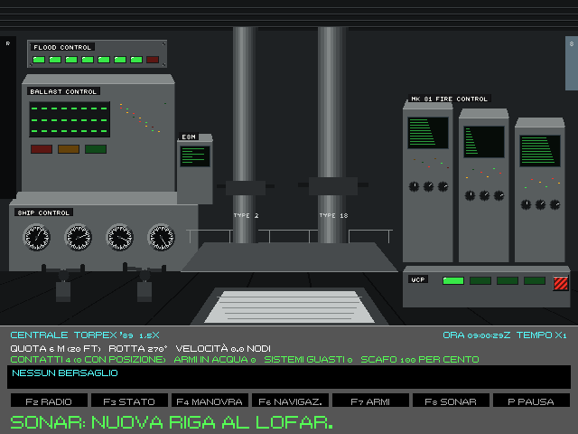
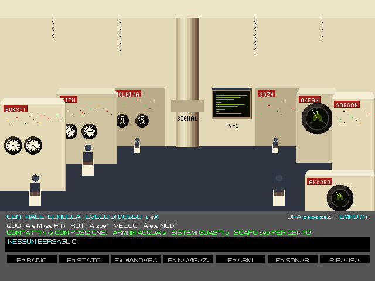
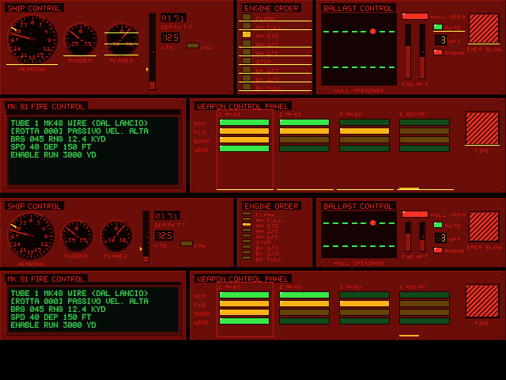
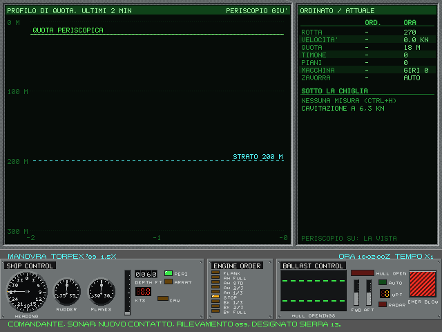
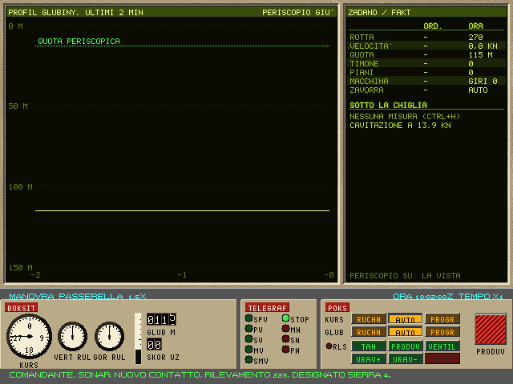
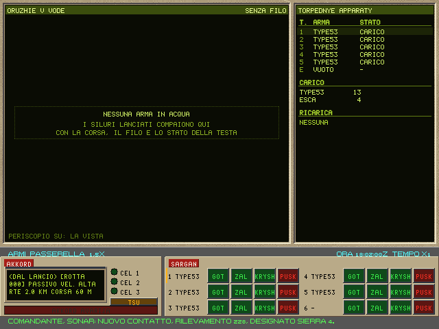

# 2. Il battello e le stazioni

Il comandante non tocca le leve: dà ordini. Ogni tasto, ogni clic su un pulsante della consolle diventa un ordine
all'equipaggio, che risponde («Timone 15 a dritta, Comandante») o spiega perché non può («Troppo veloci per alzare il
periscopio»). Gli ordini restano nello storico della partita: da lì nascono il replay, il debriefing e la ripresa
da un istante qualsiasi (cap. 10).

## 2.1 I due battelli

| | **688** (classe Los Angeles, Flight I) | **Alfa** (Progetto 705 «Lira») |
|---|---|---|
| Marina | US Navy | Marina sovietica (VMF) |
| Lunghezza, larghezza | 110,3 m, 10,1 m | 81,4 m, 9,5 m |
| Velocità massima | 32 nodi | 41 nodi |
| Quota di collaudo | 290 m | 400 m |
| Quota di collasso | 435 m (STIMA) | 600 m (STIMA) |
| Diametro di virata a barra tutta | 5,1 lunghezze (561 m) | 3,3 lunghezze |
| Inizio della cavitazione in superficie | circa 5 nodi | circa 4 nodi |
| Tubi | 4 da 533 mm, più 2 lanciatori di esche | 6 da 533 mm: 5 per le armi, il sesto per le esche |
| Armi in rastrelliera | 21 | 13 |
| Ricarica di un tubo | 300 s, a mano col carrello (STIMA) | 75 s, caricatore automatico (STIMA) |
| Equipaggio | 129 | 31 |
| Unità di misura delle stazioni | piedi e nodi | metri e nodi (uzly) |

**Il 688** è un battello da caccia silenzioso: sotto gli 8 nodi è difficile da sentire, sopra diventa rumoroso in
fretta. Ha la sfera sonar BQQ-5, l'antenna rimorchiata, due periscopi e un equipaggio numeroso che fa a mano molte cose:
la ricarica dei tubi, per esempio, è lenta.

**L'Alfa** è il contrario: scafo in titanio, reattore a metallo liquido, il più veloce e il più agile dei sottomarini
della Guerra Fredda. Bastavano 31 uomini perché quasi tutto era automatico: il governo (Boksit), l'assetto (Tan), il
tiro (Akkord), la ricarica dei tubi. Ad alta velocità però si sente da lontano.

La cavitazione è il limite più importante: quando l'elica gira oltre una certa velocità si formano bolle che
scoppiano, e il battello si sente a grande distanza. Il limite sale con la quota: a 100 m è circa tre volte quello
in superficie, quindi più in profondo si può andare più veloci senza cavitare. Sulla consolle del 688 la spia CAV si accende quando succede.

## 2.2 La Centrale e le altre stazioni



*La Centrale del 688: a sinistra il governo (SHIP CONTROL, BALLAST CONTROL, FLOOD CONTROL), al centro i due
periscopi, a destra la direzione del tiro Mk 81 e l'ESM.*



*La Centrale dell'Alfa: i posti a ferro di cavallo, con Boksit, Ritm, Molnija, il televisore TV-1, Sozh, Okean,
Sargan e Akkord.*

La **Centrale** (F9) è la vista d'insieme. Sotto il disegno della sala c'è lo stato rapido: quota, rotta, velocità,
contatti (e quanti hanno una posizione), armi in acqua, sistemi guasti, integrità dello scafo, bersaglio. Un clic su
un posto della sala apre la stazione corrispondente.

Nel classico la Centrale ferma il tempo, come il CONN dell'originale. Nell'Enhanced no: per fermare il tempo c'è la
pausa (§2.7).

Le stazioni si raggiungono da qualunque punto con i tasti funzione:

| Tasto | Stazione | Cosa si fa | Capitolo |
|---|---|---|---|
| F2 | Radio | messaggi, telescrivente, antenne, ESM | 4 |
| F3 | Stato | quadro danni, spaccato del battello | 7 |
| F4 | Manovra | timone, telegrafo, quota, casse | 2 |
| F5 | Periscopio | i periscopi, lo stadimetro | 4 |
| F6 | Navigazione | la carta, i punti di rotta, la TMA | 5 |
| F7 | Armi | tubi, impostazioni, lancio, guida via filo | 6 |
| F8 | Sonar | cascate, LOFAR, tracker, cuffia | 3 |
| F9 | Centrale | vista d'insieme | 2 |

Nell'Enhanced ogni stazione ha la sua consolle nella parte bassa dello schermo e la vista esterna sopra; la barra dei
messaggi è sempre in fondo. Sull'Alfa le scritte sono in caratteri latini, con un font a stampino nello stile delle
targhette sovietiche: «KURS» per la rotta, «GLUB» per la quota. Anche le testate sono in russo traslitterato: il
quadro danni è il PULT ZHIVUCHESTI, coi compartimenti in numeri romani (OTSEK I-VI); alla Manovra ZADANO e FAKT
(ordinato ed effettivo) e il PROFIL GLUBINY; alle Armi ORUZHIE V VODE e TORPEDNYE APPARATY; l'ecoscandaglio del quadro
del fondale è il NEL-5.

## 2.3 Le luci di bordo

La luce della sala cambia i colori delle consolle, come a bordo:

- **bianca** di giorno;
- **rossa** di notte sul 688, per non perdere l'adattamento al buio prima di andare al periscopio. Si accende da sola
  quando fuori è notte;
- **blu** in sala sonar sul 688, sempre: gli operatori guardano gli schermi in penombra.

Sull'Alfa la luce resta bianca. Lampade, spie e schermi a fosforo restano accesi nei loro colori sotto qualunque luce.



*I pannelli del 688 in luce rossa notturna (tavola del kit grafico).*

## 2.4 Manovra (F4)



*La stazione Manovra del 688: SHIP CONTROL con rotta, timone, timoni orizzontali, quota e velocità; ENGINE ORDER col
telegrafo; BALLAST CONTROL con le aperture dello scafo, le casse, il pilota automatico e l'esaurimento d'emergenza.
Sopra, a periscopio giù, i ripetitori: il profilo di quota degli ultimi due minuti, gli ordini e lo stato attuale.*

I comandi di manovra valgono **da qualunque stazione**, così si può governare mentre si guarda il sonar o la carta.

**Timone** (tastierino 4 e 6, 5 al centro). Nell'Enhanced ogni pressione sposta la barra di 5°, fino a 35°. Il
battello accosta secondo la sua dinamica: con la barra tutta il 688 descrive un cerchio di circa 560 m e perde un
terzo della velocità. Toccare il timone disinserisce il pilota automatico.

**Telegrafo** (`+` e `-`). Nove posizioni: indietro tutta, indietro 2/3, indietro 1/3, stop, avanti 1/3, avanti 2/3,
avanti standard, avanti tutta, massima forza. La turbina insegue i giri ordinati in una ventina di secondi; il 688 passa da
fermo a 20 nodi in poco meno di due minuti.

**Quota** (tastierino 8 e 2, 0 per tenerla). Ogni pressione cambia la quota ordinata di 15 m. Il timoniere ci arriva
con un angolo di immersione fino a 15°, come prescrive la dottrina. Attenzione: i timoni orizzontali governano solo se il
battello si muove. A battello fermo non tengono la quota, e un battello appesantito dall'acqua affonda.

**Quote rapide:**
- Ctrl+P quota periscopica;
- Ctrl+1 150 piedi (45,7 m), la quota di sicurezza sotto le chiglie delle navi.

**Da fermo non si sale.** Sotto i 3 nodi i piani non portano su, e il timoniere lo dice quando si dà Ctrl+P. Il telegrafo
va prima avanti, e il battello accelera piano: da fermo, dopo 4 minuti, una pressione di `+` dà 1,4 nodi e due ne danno
5,1. Quando la quota è raggiunta si accende la spia PERI. I passi per alzare il periscopio sono al §4.1.

**Il tamburo della quota** (Enhanced) segna la quota della chiglia, come sul 688 vero: a quota periscopica legge circa
60 piedi (18,3 m), perché la chiglia sta una dozzina di metri sotto le teste dei periscopi. Risalendo da 60 m il numero
scende senza scalini fino a lì. Più su, verso la superficie, scende col pescaggio.

**Due spie accanto al tamburo**, solo sul 688 dell'Enhanced:
- **PERI** (verde): accesa alla quota periscopica, dove periscopi e antenne escono dall'acqua;
- **ARRAY** (la schiera, se il battello la ha): spenta con la schiera a posto o dentro, ambra se tocca il fondo o è
  danneggiata, rossa se è persa.

Nel classico e sull'Alfa il quadro resta com'era.

**Pilota automatico** (`.`): segue i punti di rotta della carta (cap. 5) uno dopo l'altro.

Ogni pulsante della consolle si può anche cliccare.

## 2.5 Le emergenze

**Emersione d'emergenza** (Ctrl+E, o EMER BLOW sulla consolle). L'aria ad alta pressione svuota le casse principali
e il battello sale in modo incontrollabile fino alla superficie, con la prua alzata al massimo (30° nell'Enhanced).
È rumorosissima e difficile da fermare; sull'Alfa gli sfoghi (VENTIL, §2.6) servono proprio a questo. Serve quando
l'acqua entra più in fretta di quanto le pompe la tolgano.

**Immersione d'emergenza** (Ctrl+D, solo Enhanced). Avanti tutta e piani a scendere, verso una quota di sicurezza
calcolata dall'equipaggio:
- almeno 45,7 m (150 piedi);
- più in basso se ci sono navi entro 5 km: la cima della vela deve passare sotto la chiglia più profonda, con 10 m di
  margine;
- mai oltre la quota massima del battello meno 10 m, né a meno di 15 m dal fondo.
Serve quando si è sorpresi in superficie o a quota periscopica da una nave che si avvicina.

**Posarsi sul fondo** (Ctrl+F, solo Enhanced). Il battello rallenta a circa 3 nodi, scende piano verso il fondo, ferma
le macchine 3 m prima della quota d'arrivo (il fondo meno 1 m), quindi a circa 4 m dal fondo, e si adagia, un po'
appesantito per restare giù. Fermo e senza elica fa pochissimo rumore, e il
sonar attivo nemico fatica a separarne l'eco da quella del fondo. Il MAD degli aerei però lo trova ancora.
L'equipaggio rifiuta l'ordine, e spiega perché, in questi casi:
- con l'antenna rimorchiata filata (la «schiera»);
- se il fondo è oltre la quota di collaudo;
- se il fondo ha una pendenza oltre 5°.
Un ordine di macchina o di quota fa ripartire il battello: le casse si scaricano e si torna su.
**Il fondo non è uguale dappertutto** (solo Enhanced). Il tipo dipende dal teatro e dalla profondità:
- **fango:** dopo un minuto posato comincia a trattenere lo scafo, del tutto in 10 minuti. Ripartendo da fermi si resta
  attaccati fino a 3 minuti; le macchine avanti accorciano l'attesa («Il fango ci trattiene sul fondo»);
- **roccia:** strisciare posati oltre mezzo nodo rischia il timone o la cupola del sonar, e graffia lo scafo («Lo scafo
  striscia sulle rocce»);
- **le prese a mare:** dopo mezz'ora sul fango possono intasarsi. Il raffreddamento va in avaria e la propulsione
  scende a metà («Prese a mare intasate dal fango»). È il motivo per cui i nucleari evitano di posarsi.

Le stesse regole valgono per l'IA. I dettagli sono nel volume 2, capitolo B2.

**Silenzio a bordo** (Ctrl+S, solo Enhanced). L'equipaggio lavora piano: per ora riguarda le ricariche dei tubi, che
durano il doppio ma non fanno rumore (cap. 6).

## 2.6 Il governo dell'Alfa



*La Manovra dell'Alfa: il pulto Boksit con la rotta (KURS), i timoni verticale e orizzontale, la quota (GLUB) e la
velocità (SKOR); il telegrafo; il pannello a pulsanti ПОКС (POKS). Sopra, i ripetitori in russo traslitterato: il
profilo di quota e gli ordini.*

Sull'Alfa il governo è automatico, come era davvero. I comandi di §2.4 valgono anche qui; in più ci sono questi
sistemi (solo nell'Enhanced).

**Boksit**, il sistema di governo. Rotta (KURS) e quota (GLUB) hanno ciascuna tre modi, cambiati coi pulsanti del
pulto o dalla tastiera:
- RUCHN (manuale) e AVTO (automatico): nel gioco sono un'indicazione del modo sul pulto. In tutti e due la rotta e la
  quota ordinate le tiene il motore, come sul 688;
- PROGR (programma): una sequenza di tappe, i punti di rotta della carta. A ogni tappa Boksit accosta, cambia quota e
  regola la velocità da solo.

Ctrl+B cambia il modo della rotta, Ctrl+U quello della quota. Ctrl+T (o PROGR sul pulto) carica nel programma i punti
di rotta della carta, fino a nove, con la quota e la velocità di quel momento; sul pulsante compare la tappa
corrente, per esempio «P 3/7». Toccare il timone lascia il programma.

**Tan**, l'assetto automatico (Ctrl+N, pulsante TAN). Acceso, tiene il battello neutro: compensa il peso delle armi
lanciate e delle mine posate, la compressione dello scafo con la quota e l'acqua delle falle piccole, finché le casse
d'assetto ce la fanno. Si spegne da solo se le pompe scendono sotto metà efficienza. Spento, l'assetto si regola a
mano.

**ПОКС (POKS)**, il pannello a pulsanti delle casse:
- PRODUV (soffia): l'esaurimento d'emergenza, come Ctrl+E. Il grande pulsante rosso coperto fa lo stesso;
- VENTIL (sfoga, Ctrl+G): apre gli sfoghi, l'aria esce dalle casse e rientra l'acqua. Ferma una risalita dopo un
  soffiaggio;
- URAV+ e URAV- (Ctrl+K e Ctrl+J): imbarca o espelle mezzo metro cubo nelle casse d'assetto. Con Tan acceso non
  servono;
- la finestrella AVAR si accende col guasto delle casse.

**Akkord**, la direzione del tiro (alla stazione Armi):



*Le Armi dell'Alfa: Akkord con i tre bersagli (CEL 1-3) e il pulsante ЦУ (TSU, designazione), Sargan coi sei tubi.
Sopra, i ripetitori: le armi in acqua e i tubi col carico.*

- tiene fino a **tre bersagli**. Ctrl+A (o ЦУ) mette il bersaglio corrente nel primo posto libero, altrimenti al
  posto di quello designato da più tempo. Ctrl+5, Ctrl+6 e Ctrl+7 (o i pulsanti CEL) scelgono quale va al lancio. Un
  contatto perso libera il suo posto;
- **l'avaria di Akkord blocca tutte le armi**, com'era davvero: se la direzione del tiro scende sotto metà efficienza
  per i danni, non si arma, non si lancia e non si cambiano le impostazioni. Restano la guida via filo dei siluri già
  in acqua (Z, X, 8, 9, C, D, Y e DIRECT) e la ricarica dei tubi, che è meccanica. Quando le riparazioni la riportano
  su, le armi tornano.

## 2.7 Il tempo

- **Pausa** (P): ferma tutto. Nell'Enhanced la Centrale non ferma il tempo, la pausa sì.
- **Compressione** (Pag Su e Pag Giù): raddoppia o dimezza la velocità del tempo, da 1× a 64×. Oltre 8× l'audio di
  bordo tace, e riprende quando si rallenta.
- **La compressione torna a 1× da sola** (Enhanced) a ogni evento che chiede l'attenzione del comandante: una
  scoperta, un lancio nemico, un colpo, un avvistamento, un danno, un ping subito, un aereo in sorvolo, una salva
  d'artiglieria, e ogni messaggio critico.
- In missione F1 apre la scheda dell'enciclopedia pertinente (l'arma del tubo scelto, il periscopio, il bersaglio o
  il proprio battello) a tempo fermo.

## 2.8 I messaggi di bordo

Nell'originale i messaggi dell'equipaggio scorrevano nella barra in basso e si perdevano. Nell'Enhanced:

- i messaggi entrano in una coda e ognuno resta sullo schermo da 2,5 a 7 secondi, secondo la lunghezza. La coda
  tiene al più sei messaggi: oltre, i normali più vecchi saltano (restano nel registro), e un messaggio ripetuto di
  fila si scarta;
- gli avvisi critici passano davanti agli altri e interrompono un messaggio normale già letto;
- i messaggi lunghi vanno a capo su due righe invece di tagliarsi;
- **Ctrl+L** apre da qualunque stazione il registro di tutti i messaggi della missione, con l'ora di missione e i
  critici in giallo.

Nel classico resta l'ultimo messaggio, come nell'originale.

## 2.9 I tasti

Tabella dei tasti predefiniti, raggruppati per uso. Il riferimento completo, comando per comando, schermata per
schermata e stazione per stazione, è nell'appendice A.

| Uso | Tasti |
|---|---|
| Stazioni | F2 Radio, F3 Stato, F4 Manovra, F5 Periscopio, F6 Navigazione, F7 Armi, F8 Sonar, F9 Centrale |
| Timone | tastierino 4 e 6 (scatto di 5°), 5 al centro |
| Quota | tastierino 8 e 2 (15 m), 0 tiene la quota; Ctrl+P periscopica, Ctrl+1 150 piedi |
| Telegrafo | `+` e `-` |
| Pilota automatico | `.` |
| Emergenze | Ctrl+E emersione, Ctrl+D immersione, Ctrl+F posarsi, Ctrl+S silenzio a bordo |
| Periscopio, antenna e radar | U periscopio, N antenna, H stadimetro, Ctrl+R radar, Ctrl+M BQS-15 (688) |
| Armi | R, A, M tubi 1, 5, 7; L lancio; G bersaglio; S siluro successivo; Z X Y guida via filo |
| Alfa | Ctrl+B, Ctrl+U, Ctrl+T Boksit; Ctrl+N Tan; Ctrl+G sfoga; Ctrl+K, Ctrl+J compensa; Ctrl+A, Ctrl+5-7 Akkord |
| Carta | Ctrl+O punti nave (navigazione realistica), Ctrl+H quadro del fondale, Ctrl+I DIRECT, Ctrl+X pulisce il lucido |
| Tempo | P pausa, Pag Su e Pag Giù compressione |
| Suoni del classico | Ctrl+Q muto, Ctrl+N senza campioni (come nel 1989) |
| Varie | Ctrl+L registro dei messaggi, Ctrl+W intercettazione (allarme siluro), F1 enciclopedia, F10 uscita a schermo (nitida, sharp, sharp col CRT), F12 istantanea, Esc esce |

**Tasti personalizzati.** Tutti i comandi si possono spostare su altri tasti:

1. `melchior688 --scrivi-tasti tasti.toml` scrive il file con tutti i comandi, i tasti predefiniti e una riga di
   spiegazione per ciascuno;
2. si modifica il file: un tasto o un elenco di tasti per comando, `""` per toglierlo; i nomi sono lettere e cifre,
   F1-F12, `Tastierino 0`-`9`, Su, Giu, Pag Su, Invio, Esc, Tab, Spazio, con `Ctrl+` davanti; `Maiusc+` vale per i
   tasti che non sono lettere (le lettere con Maiusc arrivano come lettere semplici);
3. lo si copia in `~/.config/melchior688/tasti.toml`, oppure lo si passa con `--tasti tasti.toml`.

**Preferenze.** Accanto ai tasti, `~/.config/melchior688/preferenze.toml` tiene le scelte che restano fra una partita e
l'altra. Il gioco lo scrive da solo quando una cambia; per ora c'è solo la persistenza del fosforo del sonar 1989
(§3.10):

```toml
[sonar]
persistenza = 1   # 0 breve, 1 normale, 2 lunga
```
