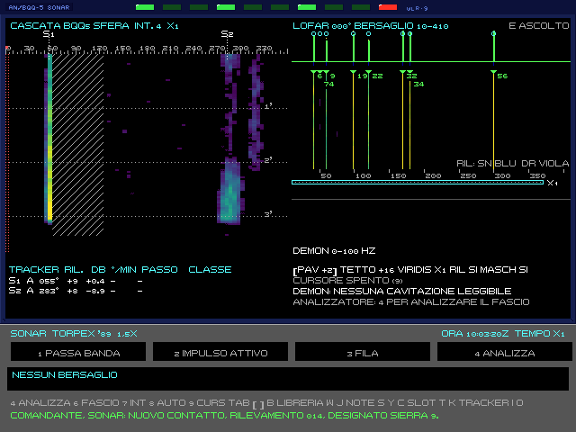
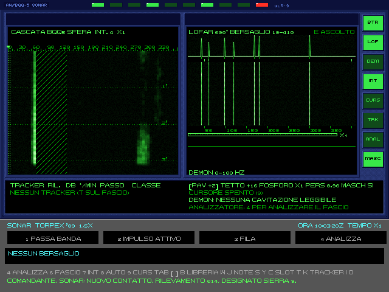
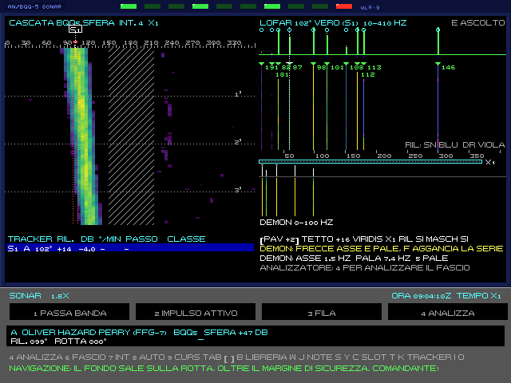
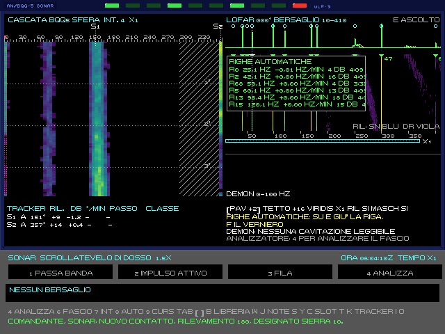
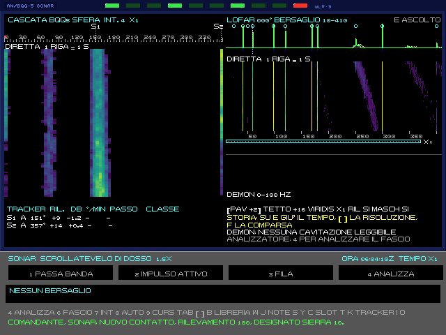
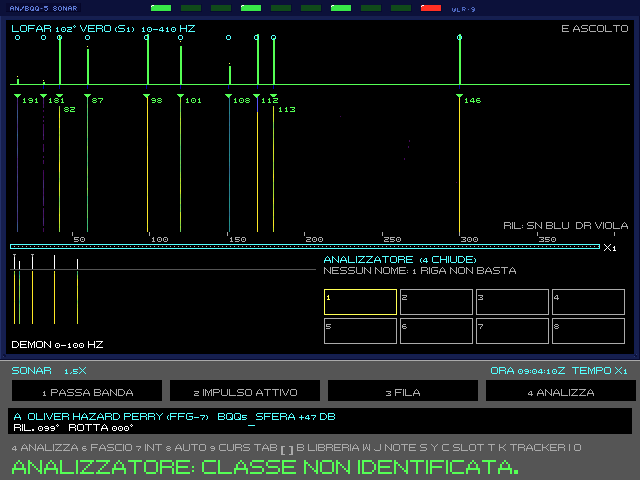
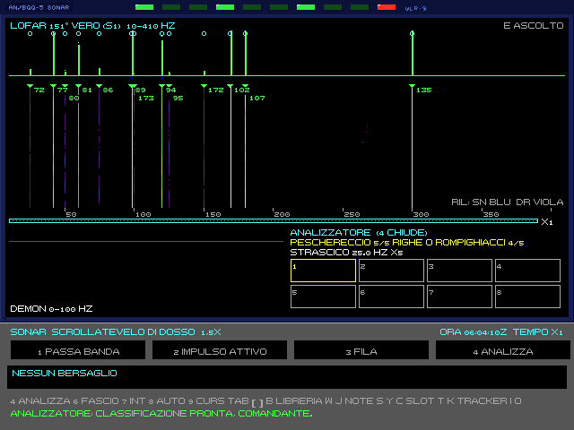
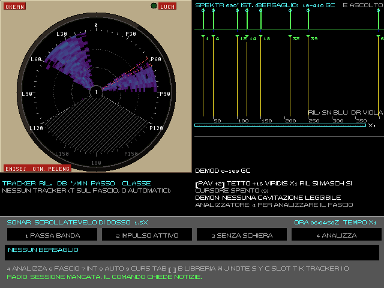

# 3. Sonar e acustica

Sott'acqua si vede con le orecchie. La stazione Sonar (F8) è quella dove si passa più tempo: qui si scopre il
nemico, si capisce chi è e si raccolgono i rilevamenti per la soluzione di tiro. Nell'Enhanced tutto quello che
compare sugli schermi viene dalla stessa fisica: la sorgente emette, il mare attenua, il rumore copre, l'antenna
raccoglie. Il volume 2 (capitoli C1-C8) dà le formule; qui c'è quello che serve per usarle.

## 3.1 Il suono in mare

Un contatto si sente quando il suo rumore, arrivato fin qui, supera il rumore di fondo abbastanza da distinguerlo.
È l'**equazione del sonar**: livello della sorgente, meno la perdita lungo il percorso, meno il rumore che c'è,
più il guadagno dell'antenna. Ogni termine dipende da cose che il comandante può leggere e sfruttare.

**La velocità del suono cambia con la quota.** Dipende da temperatura, pressione e salinità, e piega i raggi del
suono verso l'acqua più lenta. I profili di ogni teatro vengono dalle misure reali dell'oceanografia (atlante
WOA23), mese per mese. Da qui nascono:

- **lo strato** (il termoclino): una quota sotto la quale l'acqua si raffredda in fretta. Il suono che lo attraversa
  perde da 5 a 20 dB. Un battello sotto lo strato sente male chi sta sopra, e viceversa: è il primo nascondiglio;
- **il canale superficiale**: sopra lo strato il suono resta intrappolato e va lontano, ma solo per chi ci sta dentro
  e solo sopra una certa frequenza;
- **le zone d'ombra**: oltre una certa distanza i raggi diretti curvano verso il basso e lasciano un vuoto, dove si
  perdono fino a 25 dB;
- **le zone di convergenza**: in acqua profonda il suono sceso in basso risale in superficie ad anelli regolari, a
  circa 50 km nel Mar di Norvegia d'inverno, 40 km nel Mediterraneo d'estate. Un contatto lontano può comparire,
  sparire avvicinandosi e ricomparire alla zona successiva. Nel Barents, nel Baltico e d'inverno nel Mediterraneo non
  ci sono;
- **il fondo**: in acqua bassa (sotto i 200 m) il suono rimbalza fra fondo e superficie, e la roccia riflette meglio
  del fango.

**L'effetto pomeriggio.** Nelle giornate calme e serene il sole scalda i primi metri dalle 10 alle 18: si forma un
piccolo strato che toglie fino a 9 dB a chi ascolta vicino alla superficie. Col vento oltre 11 nodi o il cielo
coperto non c'è.

**Il rumore di fondo** viene dal mare (vento e onde), dalla pioggia, dal traffico del teatro, dagli animali
(gamberi, balene, pesci) e dal ghiaccio.

**Il traffico civile.** Nell'Enhanced i teatri hanno anche navi civili vere: mercantili e petroliere sulle rotte,
traghetti all'orario, pescherecci sui banchi, rompighiaccio d'inverno. Ognuna è un contatto neutrale con la sua firma,
diversa da quella di ogni altra nave dello stesso tipo, e la sentono il giocatore e l'IA. Il silenzioso va cercato fra
loro. Il traffico è acceso di norma; si spegne da riga di comando (`--traffico no`) e nelle regolazioni della sandbox,
e non c'è mai nelle scene di prova. Il dettaglio è nel volume 2, capitolo E10. Il mare grosso rende tutti più sordi, nemico compreso. Poi c'è il rumore
proprio: più si va veloci, più il flusso sull'antenna copre il resto.

> **Regola pratica.** Per ascoltare bene: andare piano, stare sotto lo strato se il nemico è sopra (o sopra se è
> sotto), non puntare l'orecchio verso poppa.

## 3.2 Le firme acustiche

Ogni classe ha la sua firma, costruita dalle fonti per tipo di macchine:

- **banda larga**: il fruscio di fondo dell'unità, che cresce con la velocità;
- **toni**: righe a frequenza fissa dei macchinari. La rete elettrica è a 60 Hz sulle unità americane e britanniche,
  a 50 Hz sulle sovietiche, a 400 Hz sull'Alfa; poi pompe del reattore, turbine, riduttori, diesel;
- **elica**: la frequenza dell'asse e quella delle pale (giri × numero di pale). Il Trafalgar, con la pompa a getto,
  non ha la riga di pala;
- **cavitazione**: sopra la velocità d'innesco, che cresce con la quota, la banda larga sale di 10 dB e copre i toni;
- **transitori**: colpi brevi, come il lancio di un siluro, un portello, la ricarica di un tubo, un cambio di giri.

Ogni unità ha anche una piccola variazione individuale: due Victor III non suonano identici.

## 3.3 La stazione

*Il modo moderno, come il quadro di una radio SDR. A sinistra la cascata dei rilevamenti, col cono d'ombra poppiero
a tratteggio e il fascio puntato in rosso sulla scala; a destra lo spettro, la striscia delle righe attese e il LOFAR
del fascio puntato, con la barra dello zoom; sotto il DEMON, poi tracker, impostazioni e analizzatore.*

*Il modo 1989, sulla consolle del BQQ-5: gli stessi pezzi su due schermi a fosforo verde incassati nella lamiera, e a
destra la colonna dei tasti a luce.*

La stazione ha due schermi principali e una riga di stato. Le parti sono le stesse nei due modi; cambia l'aspetto:
- **moderno:** un quadro pieno, come una radio SDR, coi colori viridis;
- **1989:** la consolle del BQQ-5, con due CRT verdi e una colonna di tasti a luce (BTR, LOF, DEM, INT, CURS, TRK,
  ANAL, MASC). I tasti non si premono: si accendono quando la funzione è attiva, e i comandi restano quelli della
  tastiera.

Le parti della stazione:
- **La cascata dei rilevamenti** (BTR, a sinistra): una riga ogni 2 secondi, la più recente in alto. In orizzontale
  il rilevamento vero da 0° a 360°, in verticale il tempo. Un contatto è una traccia verticale; se si sposta
  lateralmente, il suo rilevamento cambia. Il cono d'ombra poppiero (i «baffles») è a tratteggio: lì il rumore del
  proprio battello copre tutto. Sopra la scala ci sono il fascio puntato (una barra con i bordi a puntini) e i tracker,
  come segnalibri col loro numero; il tracker seguito dal LOFAR ha la cornice. La cascata e il contatto non vanno sempre
  insieme: un mercantile può dare una striscia senza righe al LOFAR, e un contatto solido può stare appena sopra il fondo
  (volume 2, C5 §2.2).
- **Il LOFAR** (a destra): lo spettro di un solo fascio, quello puntato, da 10 Hz in su. Sopra c'è lo spettro
  dell'ultima riga, coi cerchietti sulle righe trovate dalle righe automatiche (moderno). Sotto lo spettro c'è la
  striscia delle righe attese: nel moderno quelle della voce della libreria sovrapposta, colorate per tipo; nel 1989
  le tacche fisse di 50, 60 e 400 Hz. Poi la cascata nel tempo: i toni sono righe verticali sottili. Sotto la scala
  delle frequenze, la barra dello zoom mostra quale parte della banda si sta guardando.
- **La riga di stato**: pavimento e tetto della scala dei colori, palette, scala dei tempi, RIL nel moderno, MASCH
  quando è accesa, cursore, DEMON e analizzatore. Nei modi STORIA e, nella sala sonar, RIGHE la riga del cursore va a
  capo: finché resta a capo la riga delle FAMIGLIE non si scrive, e la prima famiglia resta nella pagina
  dell'analizzatore.

**Il colore per rilevamento** (RIL, solo nel moderno, acceso di norma) è un aiuto: sulla cascata del LOFAR, a scala
×1, una riga che arriva più forte da un fascio vicino (10° o 20°) si tinge di blu se il fascio vicino è a sinistra,
di viola se è a destra. Così si vede subito se un tono viene dal contatto puntato o da uno accanto. Si spegne dal giro
di Tab (campo RIL, `[` `]`). Averlo acceso conta nel realismo della partita, come gli altri aiuti.

**Comandi della stazione** (solo Enhanced):

| Tasto | Comando |
|---|---|
| 1 | filtro passa-banda o passa-alto |
| 2 | impulso attivo (§3.8) |
| 3 | filare o recuperare l'antenna rimorchiata (§3.6) |
| 4 | ANALIZZA il fascio puntato e apre la pagina dell'analizzatore (§3.5); ripremuto, la chiude |
| 5 | sensore successivo (sfera, antenna rimorchiata) |
| 6 | fascio del LOFAR: il bersaglio, poi i tracker uno dopo l'altro |
| Z, X | fascio fissato a mano, 5° a sinistra o a dritta |
| 7 | integrazione: ogni riga è la media delle ultime 1, 2, 4 o 8 |
| 8 | AUTO: pavimento e tetto regolati da soli (modo moderno) |
| 9 | modo del cursore, a giro: spento, lettura, differenza, famiglia armonica, DEMON, RIGHE (solo moderno), STORIA (§3.4) |
| Tab, `[` `]` | campo e valore: pavimento, tetto, palette, scala dei tempi (×1, ×4, ×16), Doppler della libreria, RIL (il colore per rilevamento, solo moderno), MASCH (le righe del proprio battello, §3.4); nel modo 1989 anche PERS, la persistenza del fosforo |
| frecce | cursore: su e giù nel tempo, sinistra e destra in frequenza (Maiusc più veloce) |
| I, O | ingrandisce o riduce il LOFAR in frequenza |
| T, K | nuovo tracker sul fascio puntato; toglie il tracker seguito |
| F | aggancia il verniero alla riga sotto il cursore, o lo sgancia (§3.4) |
| Q | modo della cuffia (§3.7) |
| E | registra l'ascolto del fascio in un file WAV |
| B | libreria di riferimento (§3.9) |
| W, J | annotazione sulla cascata al cursore; toglie l'ultima |
| S, Y, C | salva lo spettro in uno slot; slot successivo; confronto (§3.9) |

**L'integrazione** abbassa la grana del rumore (la media di 4 righe la dimezza) ma rende più lenta la risposta.
**La scala dei tempi** a ×4 o ×16 mostra più storia nella stessa altezza: le righe si riducono prendendo il massimo,
così i transitori brevi restano visibili.

## 3.4 LOFAR, DEMON e misure

**Il LOFAR** serve a trovare e a leggere i toni. Una riga che resta ferma nel tempo è un macchinario; la sua
frequenza esatta dice di chi è. Il messaggio «nuova riga al LOFAR» arriva quando una tonale del contatto supera la
soglia.

**Il verniero** (F) aggancia una riga e la misura con precisione, dentro l'incertezza che il tempo d'integrazione
permette. Se il contatto passa al traverso, la riga disegna una curva a S per l'effetto Doppler: dalla curva il
verniero ricava l'istante e la distanza del punto di minimo avvicinamento (CPA) e la velocità relativa. Se c'è una
soluzione della TMA sul bersaglio, la confronta con quella.

**Il DEMON** ascolta l'inviluppo del rumore di cavitazione: ne ricava la frequenza dell'asse e delle pale, quindi il
numero di pale e, con i giri per nodo della classe, la velocità. Senza cavitazione non legge niente.

*Il DEMON su una Perry a 15 nodi a 3 km (cursore in modo DEMON): sotto il LOFAR la cascata 0-100 Hz con le frecce
dell'asse e delle pale, e nella riga di testo «ASSE 1,5 HZ PALA 7,4 HZ 5 PALE».*

**Il DEMON a cascata** sta sempre nel terzo basso della colonna del LOFAR:
- **com'è fatto:** in alto lo spettro dell'ultima riga, sotto la cascata nel tempo, in fondo la lettura («ASSE 2,40 HZ
  144 GIRI PALE 7 PALA 16,8 HZ»);
- **a che serve:** quando il bersaglio cambia giri le righe salgono o scendono, e si vede la manovra;
- **i comandi**, col cursore in modo DEMON (9): sinistra e destra spostano l'asse a passo fine (con Maiusc a passo
  grosso), su e giù cambiano le pale. Le armoniche dell'asse sono gialle, la pala e le sue ciano;
- **nel modo moderno** F aggancia i cursori alla serie trovata e, ripremuto, passa alla serie successiva se nel fascio
  ce n'è più d'una. Nel 1989 si mettono a mano.

Le pale lette vanno all'analizzatore (ANALIZZA).

*Le righe automatiche (cursore in modo RIGHE, modo moderno): la finestra sopra la cascata del LOFAR, con frequenza,
deriva, livello ed età di ogni riga trovata.*

**Le righe automatiche** (solo modo moderno) sono un aiuto, come sugli A-RCI veri:
- **le marche:** il rilevatore cerca da solo le righe stabili del LOFAR e le marca in verde sul bordo alto della
  cascata;
- **la lista:** col cursore in modo RIGHE compare in alto a sinistra sul LOFAR. Su e giù scelgono, F aggancia il
  verniero alla riga scelta;
- **gli errori:** il rilevatore sbaglia come un operatore. Qualche riga falsa nasce dalla grana, una riga che svanisce
  si perde e torna con un altro numero, due righe vicine diventano una, e una riga propria non mascherata si marca come
  le altre. Quando il fascio salta, ricomincia da capo.

*La storia lunga (cursore in modo STORIA): in testa alle due cascate «DIRETTA 1 RIGA = 1 S»; su e giù e `[` `]`
scorrono e cambiano la scala dei tempi.*

**La storia lunga.** Col cursore in modo STORIA il LOFAR e la cascata dei rilevamenti mostrano la storia nei loro
riquadri e scorrono insieme. La stazione tiene un secondo a riga per 10 minuti, una riga ogni 10 secondi per 2 ore e
una al minuto per 12 ore.
- **su e giù:** il cursore del tempo, con Maiusc dieci righe alla volta;
- **`[` e `]`:** la risoluzione, cioè 1, 10 o 60 secondi a riga;
- **F:** «quando è comparsa?». Cerca all'indietro quando è comparsa la riga sotto il cursore, o la riga automatica
  scelta.

Uscendo dal modo si torna in diretta. La storia del LOFAR ricomincia quando il fascio salta. Quella della cascata dei
rilevamenti è su 72 fasci fissi rispetto al nord, quindi resta valida anche se il battello accosta.

**Le righe del proprio battello.** Anche il tuo battello ha le sue righe, e la sfera le sente:
- **che cosa sono:** la rete di bordo, le pompe del primario, la turbina, il riduttore. Cambiano con te: le pompe
  quando passano da lente a veloci (sul 688 a 15 nodi) o quando ne forzi il regime, le righe della turbina e del
  riduttore che salgono coi giri, i diesel degli SSK a snorkel;
- **dove si sentono:** sulla sfera in tutti i fasci, un po' più forti verso poppa; sulla schiera trainata solo nei
  fasci verso prua, dove il cavo porta il rumore del battello;
- **sul LOFAR:** fra l'A-scan e la cascata ogni riga propria ha una tacca, ciano se è libera, blu se è mascherata.

**MASCH** (nel giro di Tab, in tutti e due i modi) è la maschera delle righe proprie: accesa di base, perché
l'equipaggio ha il catalogo del proprio rumore. Accesa, ANALIZZA non conta le righe proprie. Spenta, l'analizzatore
le prende per righe del contatto, e può scambiare il tuo battello per un contatto, come succede ai sonaristi veri.

Con MASCH scelto nel giro di Tab, il pannello di testo mostra al posto di DEMON e analizzatore le righe proprie nel
fascio, con la frequenza e la macchina. Quando ne entra una nuova (le pompe che cambiano regime, un generatore che
parte) arriva per 30 secondi «RIGA PROPRIA NUOVA A x HZ».

Le stesse righe le hanno tutti i battelli: sul LOFAR di un sottomarino nucleare vedi salire coi giri anche le righe
della sua turbina e del suo riduttore.

## 3.5 Tracker, classificazione e sonarista

**I tracker** (S1, S2…) seguono il picco di un contatto sulla cascata, con il suo rilevamento e il rateo in gradi al
minuto. Si mettono a mano con T sul fascio puntato; nel modo moderno si agganciano da soli ai contatti forti. Un
tracker senza segnale per 30 secondi si perde.

**ANALIZZA** (4) confronta le righe del fascio con la banca dati delle classi e scrive un nome solo se le righe lo
reggono: almeno 3 righe spiegate, almeno 2 righe diverse della voce, almeno il 60% delle righe lette. La scritta è
«PESCHERECCIO 5/5 RIGHE O ROMPIGHIACCI 4/5»: le prime due voci, con quante righe ciascuna spiega su quante lette.
Altrimenti è «NESSUN NOME: 2 RIGHE NON BASTANO». Non ci sono percentuale né fattore K. Il confronto è per rapporti fra le
frequenze, quindi non lo inganna il Doppler.

**Un nome non è una certezza:** il fascio è largo e le righe possono essere di un'altra sorgente vicina. Nelle prove il
nome era vero il 93% delle volte nelle scene, il 74% con la sfera in moto, l'80% con la TB-16 filata; il bersaglio del
fascio era fra i nomi molto più di rado. Confrontalo con quello che sai del contatto (volume 2, C5 §7).

Sul fascio di un tracker l'analisi dà il passo di classificazione, dalle stesse due voci:

- **PROBSUB**, probabile sottomarino: lo sono tutte e due, o ce n'è una sola ed è un sottomarino;
- **POSSUB**, possibile sottomarino: lo è una delle due;
- **nessun passo e nessun rapporto:** non lo è nessuna delle due. Senza un nome il tracker resta com'era.

La stazione non arriva a CERTSUB e non dice mai NONSUB: le righe di una nave nel fascio non escludono un battello. Il
sonarista ha la sua scala, che resta a parte e può ancora dire NONSUB.

Quando un'analisi arriva a PROBSUB, il contatto più vicino a quel rilevamento, entro 5°, è classificato. La
classificazione resta agli atti: nel debriefing conta se era giusta.

**La stazione tace spesso, anche quando un sottomarino c'è.** Con la sfera in moto, su 119 letture di sottomarini,
nessun allarme, e sui civili l'1,4%. Con la TB-16 filata 7,5% sui sottomarini, tutti Alfa, e 0,8% sui civili. Nelle scene
8,3% e 5,1%, e lì sui civili sono quasi sempre righe di un sottomarino vero, l'Alfa vicinissimo della SCENE5A. Il silenzio
dell'analizzatore non vuol dire che il mare sia vuoto.

*La pagina dell'analizzatore: il LOFAR del fascio a tutta larghezza, sotto a sinistra il DEMON, a destra la scritta e gli
otto slot dello spettro. Il fascio è sulla Perry della figura del DEMON, a 15 nodi: si legge una riga sola, oltre a quelle del
tuo battello, e l'analizzatore non dà un nome.*

*La stessa pagina nella SCENE2A, col fascio verso tre mercantili e un Victor: «PESCHERECCIO 5/5 RIGHE O ROMPIGHIACCI 4/5».
Le righe sono di un peschereccio che sta nello stesso fascio: i mercantili, a 18-22 km, non si sentono. Il nome è vero, ma
non è quello del bersaglio.*

**La pagina dell'analizzatore** si apre con ANALIZZA (4) e si chiude ripremendo 4. Mostra:
- il LOFAR del fascio a tutta larghezza, con lo spettro, la striscia delle righe attese e la barra dello zoom: le
  righe vicine si separano meglio;
- il DEMON, sotto a sinistra;
- a destra l'esito: la scritta con le voci che le righe reggono e la famiglia di righe più chiara (indizio, frequenza,
  pale);
- gli otto slot dello spettro in miniatura (S salva, Y cambia slot, C il confronto, §3.9); l'Alfa non ha il
  registratore.

Tutti i comandi della stazione restano attivi anche sulla pagina.

Anche con la TB-16 filata un nome è raro: nelle prove 75 letture su 1.149 con righe, e il bersaglio era fra i nomi in 17.

**Il sonarista dell'equipaggio** (opzione S nella scelta della missione: nessuno, recluta, medio, esperto) tiene le
sue tracce «Sierra» e fa rapporto al comandante: «Sierra 1 classificato possibile sottomarino», «riacquisito Sierra
2, rilevamento 299». Un sonarista esperto riferisce prima e sbaglia meno; una recluta prende i biologici per
sottomarini, perde le tracce e le scambia negli incroci.

## 3.6 L'antenna rimorchiata

Il 688 traina la TB-16, una schiera di idrofoni lunga 73 m: sente le basse frequenze molto meglio della sfera di
prua. Nei messaggi di bordo si chiama, per brevità, la «schiera».

- **Filare** (3): 60 secondi. L'equipaggio rifiuta con la velocità ordinata da tre quarti di «avanti tutta» in su.
- **Recuperare** (3 di nuovo): 40 secondi.
- **Velocità:** oltre 17 nodi è sorda. Nel classico, con l'antenna fuori, un ordine di macchina da 3/4 in su chiede
  conferma: Invio la taglia e si perde, Esc annulla l'ordine. Nell'Enhanced non c'è la domanda.
- **Virate:** oltre 0,3° al secondo di virata è cieca, e dopo la virata torna a sentire in circa due minuti, mentre si
  raddrizza.
- **Endfire:** nei 25° verso il battello non sente, e i fasci verso prua e poppa sono larghi.
- **Ambiguità:** un'antenna lineare non distingue la dritta dalla sinistra. Ogni contatto ha il suo rilevamento
  speculare, e la cascata mostra la traccia doppia. Per sapere quale è vero si accosta: quello vero si sposta in modo
  coerente con la manovra.
- **Rischi:** una nave che passa a poppa può prenderla in un urto (cap. 8).

**Nell'Enhanced l'antenna ha una quota e si può rovinare:**
- **il cavo** è lungo 790 m ed esce in circa un quarto d'ora;
- **la quota** dipende dalla velocità: più vai piano, più scende. A 5 nodi sta circa 165 m sotto il battello, a 10
  nodi 85 m. Così, andando piano, la schiera può sentire sotto lo strato termico mentre la sfera è sopra. Cambiando
  velocità la quota cambia in qualche minuto;
- **il fondo:** in acqua bassa e a bassa velocità la schiera tocca il fondo («Schiera a contatto col fondo»). Striscia,
  fa rumore e si rovina;
- **i danni:** il fondo, la velocità oltre i 20 nodi, una rete a strascico vicina, un'esplosione entro 500 m.
  Danneggiata, sente peggio e perde le frequenze alte; un secondo danno la perde, e una schiera persa non si fila più;
- **le reti:** stai lontano dai pescherecci che strascicano lentamente; la loro rete è centinaia di metri dietro di
  loro, sul fondo.

Con la schiera filata il riquadro del tasto 3 dice fra parentesi la sua quota, per esempio «RECUPERA (230 M)», oppure
«SUL FONDO» o «DANNEGGIATA»; se il modello la perde, la scritta diventa «PERSA». Sul quadro di manovra la spia ARRAY
dice lo stesso (cap. 2).

I dettagli sono nel volume 2, capitolo C6 §2.9.

Il Progetto 705 non aveva l'antenna rimorchiata: l'Alfa ascolta solo col sonar di scafo. I sovietici di terza
generazione (Victor III, Akula, Oscar, Typhoon) hanno la loro schiera, con le stesse regole.

**In arrivo:** l'antenna che segue la scia e resta curva dopo le virate (specifica in `docs/07_towed_array.md`).

## 3.7 La cuffia

Alla stazione Sonar la cuffia fa sentire il fascio puntato, in tempo reale: il rumore colorato dallo spettro vero,
le righe col Doppler, il battito dell'elica. I suoni sono generati dalle firme, quindi quello che si sente e quello che
si vede sul LOFAR vengono dalla stessa fisica. Il filtro della stazione vale anche per la cuffia.

Q cambia il modo d'ascolto:
- **normale**;
- **ottava**: le righe sotto i 50 Hz salgono di ottave finché si sentono; il resto non cambia;
- **×4** e **×16**: accelerato, per sentire i ritmi lenti, come le pale di un'elica o i treni di canti delle balene.

E registra in un file WAV 8 secondi del fascio puntato, come suona in quel momento, nella cartella `ascolti` accanto ai
fascicoli.

Fuori dalla stazione Sonar si sente il battello: le macchine, la ventilazione, i colpi a bordo. Si sente anche quello
che è abbastanza vicino da passare attraverso lo scafo: le eliche delle navi sopra di noi, i ping nemici come un
ticchettio, i tonfi in acqua, le esplosioni. Gli aerei a bordo non si sentono.

La resa dell'audio si sceglie con `--audio`: piena, Sound Blaster dell'epoca (8 bit), originale del 1989 (4 bit, come
sull'altoparlante del PC) o spento. La cuffia e i suoni di bordo sono dell'Enhanced.

Il classico suona come nel 1989: i sei campioni a 4 bit dell'originale (le esplosioni, il ping, il lancio, le firme di
ANALIZZA) e i bip dell'altoparlante, agli stessi eventi. Nel 1989 ogni suono fermava il gioco; qui il gioco va avanti
e i suoni escono uno dopo l'altro. Ctrl+N toglie i campioni e lascia i bip, Ctrl+Q spegne tutto; ripremuti,
riaccendono. La musica e gli allarmi di bordo sono al §1.6.

## 3.8 Il sonar attivo e il BQS-15

**L'impulso attivo** (2) manda un ping su tutto l'orizzonte, tranne il cono d'ombra a poppa: chi è attorno rimanda
un'eco con distanza e rilevamento, la posizione che il passivo non dà. Ma tutti quelli che ascoltano lo sentono, molto più lontano di quanto arrivi l'eco: il ping ci
rivela. Va usato solo quando la sorpresa non serve più, per esempio per l'ultima distanza prima del lancio.

I battelli col rivestimento anecoico (Victor III, Alfa, Akula) rimandano un'eco più debole di 10 dB.

**Il BQS-15** (Ctrl+M, solo il 688 nell'Enhanced) è il sonar ad alta frequenza per le mine. Acceso, spazza ogni 8
secondi il settore di prua e trova le mine ormeggiate fino a circa 1100 m e quelle sul fondo fino a 450 m, meno se si
va veloci. Le mine scoperte vanno sulla carta. Anche lui è un sonar attivo: chi ascolta lo sente, entro una decina di
chilometri nel suo fascio. Con uno Sturgeon lo stesso tasto accende il **BQS-8**, il sonar da ghiaccio: guarda in alto le chiglie del pack
fino a circa 1.250 m («Sonar del ghiaccio: chiglia a prua!»), ma non vede le mine.

**L'intercettatore** (Ctrl+W, solo Enhanced): il WLR-9 del 688 ascolta i ping degli altri e li misura:
- **le misure:** frequenza, durata, cadenza e livello;
- **le tracce:** lega i ping di uno stesso emettitore in una traccia;
- **l'emettitore:** dice che cosa è: sonar di scafo, boa, sonar a immersione, ricerca ad alta frequenza, testa di
  siluro.

Il suo compito più importante è l'**allarme siluro**:
- **SILURO IN ACQUA** (messaggio «Sonar: siluro in acqua!»): ha sentito i ping brevi e fitti, ad alta frequenza, di una
  testa di siluro;
- **SILURO IN ACQUISIZIONE** («Sonar: SILURO IN ACQUISIZIONE!»): la stessa testa ti ha trovato. I ping si fanno più
  fitti e più forti, il rilevamento resta fermo e il Doppler dice che si avvicina. È il momento delle esche e della
  manovra (capitolo 6).

Con l'allarme acceso una targa lampeggia in alto in ogni stazione, gialla per il siluro in acqua, rossa per
l'acquisizione. Si sente anche: tre bip per il siluro in acqua, due toni alternati per l'acquisizione.

Ctrl+W apre la pagina, da ogni stazione:
- **in alto:** le lampade dell'allarme;
- **a sinistra:** la rosa dei rilevamenti;
- **a destra:** la cascata delle frequenze da 1 a 100 kHz;
- **in basso:** la lista delle tracce.

Le frecce su e giù scelgono la traccia, sinistra e destra la finestra della cascata (2, 5, 10 o 30 minuti); si
può anche cliccare. Esc o Ctrl+W la chiudono.

I sovietici hanno i loro intercettatori: lo Skat dei Victor III, degli Akula, degli Oscar e dei Typhoon misura anche se
il ping è modulato, il vecchio Rubin dell'Alfa no e dà più falsi allarmi. Anche loro sentono i tuoi siluri arrivare, e
scappano. I dettagli sono nel volume 2, capitolo C7 §2.10.

## 3.9 La libreria di riferimento e gli slot

**La libreria** (B) raccoglie le firme di riferimento, in schede: navale, biologico, geofisico, meteo, umano. Tab
cambia scheda, le frecce la voce, Invio sovrappone le righe di quella voce al LOFAR (Invio di nuovo le toglie). Il
fattore Doppler della sovrapposizione si regola con Tab e `[` `]`. Serve a confrontare a occhio: le righe del
contatto cadono su quelle della voce?

**Gli slot** sono otto memorie dello spettro. S salva lo spettro corrente nel primo slot vuoto a partire da quello scelto, Y passa allo slot
successivo, C cambia il confronto fra lo spettro corrente e lo slot: affiancato, sovrapposto o per differenza.

**Le annotazioni** (W) mettono una nota sulla cascata al cursore, per ricordare un evento; J toglie l'ultima.

**In arrivo:** il quaderno del sonarista, con annotazioni, slot e registrazioni salvati su file e ripresi in una
partita successiva, per riconoscere un battello già incontrato.

## 3.10 Modo 1989 e modo moderno

L'opzione «stazioni 1989 o moderne» della scelta della missione (Tab) cambia l'aspetto e gli aiuti della stazione.

| | 1989 | Moderno |
|---|---|---|
| Aspetto | fosforo verde o grigio, come un BQQ-5 | palette a colori (viridis, turbo, caldo) |
| Schermo | il fosforo verde: bagliore, grana, una riga su due più scura, la traccia dell'A-scan che si spegne piano | schermo pulito |
| Scala dei colori | a mano | anche AUTO |
| Tracker | solo a mano | anche automatici sui contatti forti |
| Righe automatiche | no | sì, marcate sulla cascata |
| DEMON a cascata | cursori a mano | anche agganciati alla serie trovata |
| Slot dell'Alfa | no, perché a bordo non c'era un registratore | sì |

**I colori delle cascate.** A stazione piena, e nella sala sonar, le cascate hanno 128 livelli di colore dal pavimento
al tetto, con un fine reticolo (dithering ordinato) fra un livello e l'altro: le sfumature restano lisce, senza le
fasce a gradini. Il reticolo è fermo, non tremola.

**PERS** (solo nel modo 1989, col fosforo verde): quanto resta accesa la traccia dell'A-scan, come sul fosforo di un
CRT. Breve, normale o lunga (0,80, 0,90 o 0,95 a fotogramma); di norma normale. La scelta resta fra una partita e
l'altra, nelle preferenze (§2.9).

## 3.11 Il sonar dell'Alfa

*Okean, il sonar dell'Alfa, nel modo moderno: lo schermo tondo di Enisej come cascata dei rilevamenti relativi, a
destra lo spettro (SPEKTR).*

Sull'Alfa la stazione è Okean. Al posto della cascata dei rilevamenti c'è lo schermo tondo di Enisej, e anche questo
è una cascata, ma polare:
- **l'angolo** è il rilevamento relativo, con la prua in alto: L a sinistra, P a dritta, sul bordo una tacca ogni 5°
  e il numero ogni 30°;
- **il raggio** è il tempo: l'ultima riga sul bordo, le più vecchie verso il centro, con un cerchio di puntini ogni
  minuto. Un contatto fermo è un raggio; uno che si sposta disegna una spirale;
- **il cieco di poppa**, oltre 120° per parte, è a tratteggio, come i fasci ciechi;
- **il fascio puntato** ha le parentesi sul bordo e i lati a puntini, i tracker hanno la tacca e il nome sul bordo.

Le righe vecchie si girano con la prua di adesso: in virata le tracce piegano. Accanto c'è lo spettro, come il LOFAR
del 688, e sotto le stesse righe di stato. Le scritte degli schermi sono in russo traslitterato: SPEKTR per il LOFAR,
IST. per vero, GC per hertz. Nel modo 1989 gli schermi sono a fosforo verde giallino, nel moderno hanno i colori del
688. I comandi sono gli stessi.

Il sonar dell'Alfa è di seconda generazione: sente meno di quello del 688, e l'Alfa ad alta velocità è sordo e
rumoroso. Si usa come lo si usava davvero: corse veloci e soste per ascoltare.
