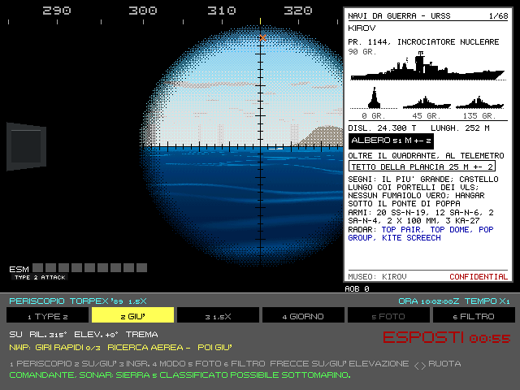
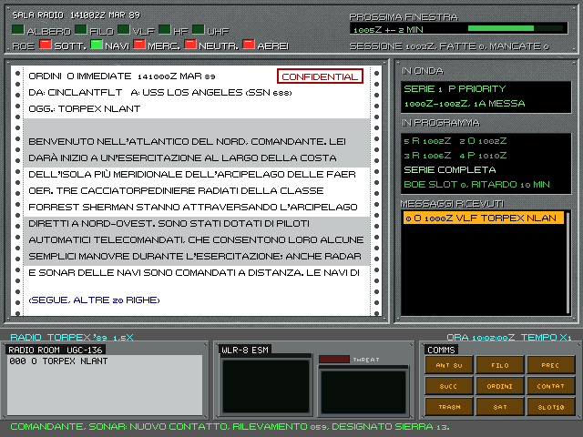

# 4. Periscopi, ESM e radio

Alzare qualcosa sopra l'acqua serve a vedere, ad ascoltare i radar e a parlare col comando. Ogni volta però il
battello lascia la sua parte più sicura: una testa di periscopio, un albero, una scia si vedono, al radar e a occhio.
Questo capitolo spiega cosa si guadagna e cosa si rischia.

Tutto quello che segue vale per l'Enhanced. Nel classico il periscopio e l'antenna funzionano come nel 1989 (manuale
originale, capitolo 5).

## 4.1 I periscopi del 688

*Il periscopio d'attacco Type 2 alzato a quota periscopica, a 1,5 ingrandimenti. Sotto: lo stato (su, rilevamento,
elevazione, tremolio), la lista della guardata e il contatore dell'esposizione. A destra il libretto di
riconoscimento (Ctrl+Z) aperto sulla Kirov, con l'altezza d'albero per il telemetro; sotto la vista la riga dell'AOB.*

Il 688 ha due periscopi, e si sceglie quale alzare: sono diversi apposta.

| | **Type 2** (d'attacco) | **Type 18** (di ricerca) |
|---|---|---|
| Testa | sottile, circa 6 cm | grossa, circa 19 cm |
| Ingrandimenti | 1,5× e 6× | 1,5×, 6× e 12× |
| Modi di visione | giorno | giorno, bassa luminosità, televisione |
| Foto | no | sì |
| ESM in testa | no | sì |
| Alzata | circa 6 s | circa 8 s |

Il **Type 2** si vede poco: è quello per l'attacco, quando il nemico è vicino. Il **Type 18** vede di più, anche di
notte e in alto nel cielo, fotografa e ascolta i radar, ma la sua testa grande si vede di più a occhio e al radar.
Si alza uno solo alla volta: scegliere l'altro abbassa prima quello su.

**Come si alza il periscopio:**

1. Serve la quota periscopica: Ctrl+P. **Da fermo non si sale:** sotto i 3 nodi i piani non portano su, e il timoniere lo
   dice. Il telegrafo va prima avanti, e il battello accelera piano: da fermo, dopo 4 minuti, `+` una volta dà 1,4 nodi,
   `+` due volte 5,1.
2. Si aspetta la spia PERI alla F4; sull'Alfa la spia non c'è e si legge la quota. Partendo da 30-52 m ci vogliono 6-8
   minuti con `+` una volta, circa 5 con `+` due volte.
3. U, o il pulsante 2 alla F5. Sono lo stesso comando: premerli tutti e due lo riabbassa.
4. Al massimo 6 nodi: oltre trema, a 10 non si vede, a 15 si rompe.

Se non si è a quota, il battello lo dice: «Periscopio e antenna si alzano solo a quota periscopica: Ctrl+P e almeno 3
nodi». F11 ricorda questi passi sulla scheda del periscopio.

**Comandi della stazione Periscopio** (F5):

| Tasto | Comando |
|---|---|
| 1 | sceglie l'altro periscopio |
| 2 (o U da ogni stazione) | alza o abbassa |
| 3 | ingrandimento successivo |
| 4 | modo di visione successivo |
| 5 | foto (solo col periscopio che la fa, alzato) |
| 6 | filtro: polaroid, rosso, verde, giallo, nessuno |
| 7 | solo Alfa: la telecamera verticale della vela, accesa o spenta |
| frecce sinistra e destra | ruotano il periscopio (Maiusc più veloce; a 6× la rotazione rallenta) |
| frecce su e giù | elevazione della linea di mira, per cercare gli aerei; si ferma ai fermi a molla |
| I | ingrandimento (come il pulsante 3) |
| H | stadimetro (§4.3) |
| Ctrl+Z | il libretto di riconoscimento accanto alla vista (§4.3), anche da un'altra stazione; Tab sfoglia, Invio identifica, Z X l'angolo sulla prora, Spazio lo manda alla TMA |
| F1 | la scheda del periscopio nell'enciclopedia |

Fuori dalla stazione Periscopio l'immagine del Type 18 arriva in centrale dal monitor televisivo: in bianco e nero,
con la grana del video.

## 4.2 La guardata

La dottrina della US Navy vuole guardate brevi: la testa fuori il meno possibile. La stazione aiuta così:

- **il contatore ESPOSTI** misura da quanto la testa è fuori; dopo 30 secondi diventa rosso e l'equipaggio avverte;
- **la lista della guardata** (NWP) ricorda la sequenza: tre giri rapidi dell'orizzonte, la ricerca aerea in
  elevazione, poi giù. Si spunta da sola mentre si ruota e si alza la linea di mira.

**Velocità.** Fino a 6 nodi il periscopio è fermo. Oltre trema, e a 10 nodi è inservibile. Oltre 15 nodi, con la
testa fuori, rischia di rompersi. Andando veloci la testa fa anche una **piuma**, una scia bianca che si vede da
lontano.

**Il mare.** Le onde vere passano sulla finestra: a mare 3 quasi mai, a mare 6 spesso. Quando l'onda copre la testa
non si vede niente, ma nemmeno si è visti. Dopo l'onda resta un velo d'acqua che scola, con le gocce; col mare grosso
arrivano gli spruzzi, con la pioggia le sue gocce. Nebbia, foschia, pioggia e neve riducono la vista come all'esterno
(cap. 9).

**Chi ci vede.** Ogni secondo le vedette delle navi, gli equipaggi degli aerei e i periscopi nemici alzati possono
vedere la testa. La distanza a cui la vedono cresce con la testa e con la piuma. Il mare grosso e la notte la
riducono, ma meno per chi ha un intensificatore o una camera termica. Il riflesso del sole la allunga. Nessuno vede
oltre l'orizzonte o oltre la visibilità del giorno. Un radar acceso può vedere la testa a ogni giro d'antenna (§4.5).
Chi ci vede ha la nostra posizione.

E vale il contrario: col periscopio su si vedono i periscopi nemici alzati, quando l'IA fa le sue guardate.

**I lanci di missili** (Enhanced). Al periscopio si vedono anche i missili lanciati dagli altri. Da un sottomarino
esce dall'acqua la capsula o il booster, con la fiammata e una scia di fumo che resta. Da una nave c'è una vampa,
poi una nube di fumo che avvolge il ponte, e il missile sale. Il fumo resta in aria fino a mezzo minuto: anche chi
guarda tardi capisce da dove è partito.

## 4.3 Il libretto di riconoscimento e lo stadimetro

Al periscopio si fanno tre domande: **chi è** (per le regole d'ingaggio), **quanto è lontano** e **dove va**. Il
libretto e lo stadimetro rispondono, come sui sottomarini veri, che avevano i manuali di riconoscimento dell'ONI.

**Il libretto** (Enhanced, Ctrl+Z da ogni stazione: porta al Periscopio; Esc lo chiude) si apre nel terzo destro,
accanto all'oculare. Ha 68 tavole: navi da guerra sovietiche e della NATO, sottomarini, aerei ed elicotteri antisom, navi civili. Ogni tavola ha:
- le sagome in inchiostro, di profilo, di prua e di tre quarti (45° e 135°). Dei sottomarini solo la vela e gli
  alberi, che è quello che si vede;
- dislocamento e lunghezza;
- l'**altezza d'albero**, nel riquadro nero, con la sua incertezza: è quella che sapeva l'intelligence nel 1989, non
  per forza quella vera. Le otto navi più alte (Kirov, Slava, Nimitz, Iowa, Sacramento, Kidd, Spruance e il
  portacontainer) hanno l'albero oltre il quadrante dello stadimetro: per loro, sotto «OLTRE IL QUADRANTE, AL
  TELEMETRO», un riquadro a filo dà un secondo punto noto, il tetto della plancia o un fumaiolo, con la sua altezza;
- i segni distintivi, le armi e i sensori che si vedono, i radar da cercare all'ESM, la voce del museo.

Tab e Maiusc+Tab sfogliano le tavole. Si confronta la sagoma con quello che si vede: i fumaioli, i lanciatori, il ponte
di volo, dove sta la plancia.

**Il filtro.** F apre la scheda del filtro al posto della pagina, per restringere le tavole a quelle che possono
essere il bersaglio:
- **le righe:** la parte (Patto, NATO, civili), il tipo (fregata, mercantile…) e, sotto «COSA VEDO», le caselle di
  quello che si vede: ponte di volo, hangar, lanciatori, torri, uno, più o nessun fumaiolo, radomi, gru e bighi,
  container, la plancia a prua, al centro o a poppa, i portali, la vela. Per i sottomarini anche dove sta la vela (a
  prua, al centro, arretrata), se è alta, bassa o raccordata allo scafo, corta o lunga, squadrata o spiovente a
  poppa, i timoni sulla vela, il bulbo sul timone. Due sottomarini non hanno mai le stesse caselle.
  Restano le tavole che hanno tutto quello che avete segnato. L'elenco è lungo e scorre con la riga scelta;
- **i tasti:** su e giù scelgono la riga, sinistra e destra cambiano la parte o il tipo, Invio o Spazio passano al
  valore successivo o segnano la casella, Backspace riporta la riga a TUTTE. F o Esc chiudono la scheda; un altro Esc
  chiude il libretto. Con la scheda aperta le frecce non muovono il periscopio;
- **i numeri:** in alto quante tavole passano; accanto a ogni casella quante ne resterebbero segnandola. In grigio
  le caselle che non ne lascerebbero nessuna;
- **la pagina filtrata:** chiusa la scheda, Tab sfoglia solo le tavole che passano. La testata della pagina diventa una
  fascia nera con il filtro e il numero fra quelle tavole: «PATTO / FREGATA / LANCIATORI  1/2». Se il filtro non ne
  lascia nessuna, resta la scheda con «0 TAVOLE» in rosso: F la riapre per cambiarlo.

**IDENTIFICA** (Invio, col bersaglio designato) dà al contatto la classe della tavola aperta: la vostra
identificazione, che può essere sbagliata e contraddire quella del sonarista. Le regole d'ingaggio leggono la classe
che avete dichiarato: colpire un neutrale identificato male resta un vostro errore. Il debriefing confronta le due
classificazioni con la verità. L'altezza d'albero della tavola va al quadrante dello stadimetro. Per le otto navi più
alte va al quadrante il secondo riferimento, e si mira a quello: al tetto della plancia o al fumaiolo, non all'albero.

**Lo stadimetro** del 688 (Type 2 e Type 18). H apre l'immagine sdoppiata: la copia fantasma si sposta in alto. Con
`[` e `]` (Maiusc per passi più grandi) si porta il galleggiamento della copia sulla cima dell'albero della nave vera;
H di nuovo legge la distanza. La distanza vale quanto l'altezza sul quadrante:
- dopo IDENTIFICA è quella della tavola: l'albero, o il secondo riferimento per le otto navi più alte;
- a stadimetro chiuso, col libretto aperto, `[` e `]` la cambiano a mano di 1 m (Maiusc 5 m), entro i limiti del
  quadrante (4,6-39,6 m); da lì non è più quella della tavola;
- senza identificazione il quadrante sta a 30 m. Solo con i nemici in «facile» il timoniere legge la tavola da sé,
  quando il contatto è noto da un po'.

Con la classe sbagliata, o un'altezza sbagliata, la distanza è sbagliata nella stessa proporzione.

**L'angolo sulla prora** (AOB): confrontate la sagoma con le viste del libretto e impostatelo con Z (sinistra) e X
(dritta), a passi di 10°. Spazio, a periscopio alzato, manda l'osservazione alla TMA: la rotta del bersaglio è il
rilevamento più 180° meno l'AOB, con un'incertezza di ±10° a 6× e di ±15° a 1,5×. Nel MATE, alla carta, compare la
riga «PERISCOPIO» con l'ora, l'AOB, la rotta e lo scarto dalla soluzione, verde se lo scarto sta nell'incertezza.

Sotto la pagina una riga riassume: «AOB 30 DR  ALBERO 29 M  IDENT.». Al posto di ALBERO c'è il punto a cui mirare
quando è il secondo riferimento: «PLANCIA 25 M», «ISOLA 37 M», «FUMAIOLO 20 M». Un «?» dopo i metri vuol dire altezza
presunta o messa a mano; «IDENT.», che la tavola aperta è la classe dichiarata per il bersaglio. La barra del bersaglio dice
«A VISTA» e il nome della tavola. Col libretto aperto le righe dell'ESM si accorciano a sinistra della pagina.

**Sull'Alfa** il Signal non ha l'immagine sdoppiata ma il reticolo graduato. Si porta il galleggiamento del bersaglio
sulla linea di mezzo e la barretta del cursore, a sinistra della scala, sulla testa d'albero con `[` e `]` (un decimo
di divisione; con Maiusc una divisione intera); H legge la distanza dall'altezza e dalle divisioni. L'errore è del 2-3%
a 6× e di più a 1,5×. Il libretto dell'Alfa è un album di sagome sovietico (ALBOM SILUETOV, SOV. SEKRETNO): prima le
navi e i sottomarini della NATO, poi quelli sovietici, poi le civili, con le sezioni in russo traslitterato; la riga
sotto l'albero ricorda di contare le divisioni del reticolo.

**Di notte, le luci di navigazione** (solo Enhanced). Le navi accendono i fanali del regolamento internazionale del
1972 (COLREG), e al periscopio si vedono solo quelli il cui settore guarda verso di voi:
- **i fanali:** il bianco d'albero, verso prua; il rosso a sinistra e il verde a dritta; il bianco di coronamento,
  verso poppa. Dai 50 m di lunghezza c'è un secondo bianco d'albero, più alto e più a poppa;
- **da che parte va:** solo il verde, la vedete dal suo lato dritto; solo il rosso, dal sinistro; rosso e verde
  insieme, vi viene incontro; un bianco solo, basso, la vedete di poppa. Col mercantile, lo scarto fra i due bianchi
  d'albero dice anche quanto è angolata: più sono lontani, più la vedete di fianco, e il bianco basso è dalla parte
  della prua;
- **lo stato:** alla fonda un bianco a prua e niente laterali; i pescherecci al lavoro verde su bianco (strascico) o
  rosso su bianco; la manovra limitata rosso, bianco e rosso; senza governo due rossi;
- **le navi da guerra e i sottomarini,** in guerra, vanno a luci spente. In pace i sottomarini americani in superficie
  hanno anche il faro ambra, che fa tre lampi e tre secondi di buio;
- **quanto si vedono:** ogni fanale ha la portata del regolamento con l'aria limpida; la foschia le accorcia e ne
  allarga l'alone, di giorno non si vedono. A 6x l'ottica raccoglie più luce e i fanali si vedono più lontano, quasi
  il doppio nella foschia; a 1,5x poco meno che a occhio nudo: di notte, per cercare le luci, si passa a 6x. Col periscopio basso e il mare mosso le creste coprono a tratti le luci
  basse: i laterali lontani ammiccano;
- **il riflesso:** sotto le luci vicine il mare luccica, in una colonna di scintille sotto la nave; col mare calmo è
  fitta, col mare mosso si allunga e si dirada.

**I fari della costa** (solo Enhanced): di notte i fari veri dei teatri, quelli accesi nel 1989, lampeggiano col loro
ritmo, per esempio due lampi lunghi ogni 20 secondi o una luce isofase. Si vedono fin dove arriva la loro portata,
anche oltre l'orizzonte se sono alti, e la foschia li accorcia come i fanali. Riconoscere un faro dal suo ritmo dice
dove si è.

La missione «Fanali» della libreria (§11.3) è l'esercizio di notte nello Stretto di Gibilterra.

## 4.4 I periscopi dell'Alfa

L'Alfa ha un solo periscopio, «Signal» (Сигнал), col sistema televisivo TV-1: 1,5× e 6×, modi giorno,
intensificatore e televisione, foto, filtri affumicato e rosso. La quota periscopica dell'Alfa è più bassa, 13 m.

Due cose in più:
- **l'avvisatore radar**: i sovietici alzavano prima un'antenna d'allarme; se sente un radar, la guardata si
  rimanda;
- **la telecamera verticale** sulla vela, che guarda in su: mostra la superficie vista da sotto, o il pack coi canali
  sotto il ghiaccio. Si accende col 7, anche a periscopio giù, e l'immagine è un video a grana: la luce cala con la quota, e sotto
  il pack si vedono lastre e canali. È solo una vista: non cambia niente nella partita, e sopra il battello non espone niente.

Il reticolo segue la scuola sovietica: una griglia con le tacche da un solo lato e il centro vuoto, invece della croce
americana.

## 4.5 L'ESM

L'ESM ascolta i radar: si sentono prima che loro vedano noi, perché il radar deve fare andata e ritorno. Sul 688 è
il WLR-8, sull'Alfa il Bukhta.

**Quando funziona:** con l'antenna alzata (N, o 1 alla Radio) a quota periscopica, oppure con la testa del Type 18,
che ha l'ESM; il Type 2 no.

**Cosa dà:**
- un'intercettazione a ogni passaggio del fascio del radar, finché il radar è sopra l'orizzonte;
- il rilevamento, con un errore che cala passaggio dopo passaggio;
- una stima della distanza e l'ampiezza da 1 a 5;
- l'identificazione del radar al terzo passaggio, dalla banca dati degli emettitori: Top Sail, Head Net, SPS-49, i
  radar dei pattugliatori. Può sbagliare;
- la tendenza, in avvicinamento o in allontanamento;
- il rischio che quel radar veda la nostra testa. La spia THREAT (UGROZA sull'Alfa) si accende quando il rischio è
  probabile.

Un contatto ESM ha solo il rilevamento, mai la posizione.

**I radar del nemico** non sono sempre accesi. Ogni unità segue una disciplina delle emissioni (EMCON): silenzio,
navigazione, ricerca, a intermittenza (gli aerei), ingaggio. Le navi americane di solito navigano col radar di
navigazione, le sovietiche cercano. Quando vedono qualcosa (un albero, un fix di radiogoniometria) passano
all'ingaggio, e tornano indietro dopo venti minuti di calma. Ogni giro d'antenna ha una probabilità di vedere la
nostra testa, che crolla con la distanza. Esempio: a 30 km una Krivak in ricerca si sente all'ESM e non vede l'albero;
a 4 km lo vede.

## 4.6 Il radar del battello

Anche il battello ha un radar (Ctrl+R, solo Enhanced). Emette solo quando l'antenna è fuori dall'acqua: col battello
emerso, oppure con l'albero su a quota periscopica. Scendendo si spegne da solo («radar spento: l'albero è
sott'acqua»).

**Cosa vede:**
- **i sottomarini dell'altra parte, se sono emersi**: il radar del 688 (BPS-15) e quello dell'Alfa (Snoop) sono radar
  di navigazione e non vedono periscopi e alberi;
- **tutte le navi in superficie** entro l'orizzonte radar, che va dall'antenna alle sovrastrutture della nave: più è
  lunga la nave, più è alta e prima si vede. Il BPS-15 arriva al più a 20,4 km (11 miglia). Fino a quattro quinti
  della portata la nave si vede quasi a ogni giro d'antenna; più in là la probabilità cala.

Il contatto è un contatto **radar** e ha la **posizione** (distanza e rilevamento), non solo il rilevamento. Anche i
radar del nemico vedono così le navi dell'altra parte, non solo i nostri alberi.

**Il prezzo:** acceso, è un faro: l'ESM dei sottomarini nemici lo intercetta da lontano, come il nostro ESM sente i
loro radar. Le navi e gli aerei, nel gioco, non hanno l'ESM. L'equipaggio lo ricorda all'accensione («radar acceso: ci possono intercettare»), e la spia **RADAR ACCESO** resta
accesa in centrale, alla manovra e alla radio finché emette.

## 4.7 La sala radio

*La sala radio del 688: sopra la telescrivente con antenne, trasmissioni in onda e in programma, regole d'ingaggio,
gli ordini di missione e l'archivio dei messaggi; sotto la consolle con la radio, l'ESM WLR-8 e i comandi.*

La stazione Radio (F2) mostra cosa si riceve, cosa è in onda e cosa si è perso.

**Le antenne:**
- **albero o periscopio alzati**, a quota periscopica: ricevono tutto (VLF, HF, UHF, satellite). Oltre 10 nodi si
  riceve un messaggio su due;
- **il filo galleggiante** (2): un'antenna che si fila dietro il battello e galleggia, per ricevere in immersione
  fino a 120 m di quota. Solo VLF. Filarlo richiede due minuti. Riceve tutto fino a 8 nodi e metà fino a 12. Dopo una
  virata è cieco per due minuti. Oltre 20 nodi, dopo un minuto, può spezzarsi: il 30% di probabilità a ogni minuto;
- **ELF**: chi ce l'ha (i sovietici, col sistema ZEVS) riceve in profondità solo la chiamata dei messaggi LAMPO, che
  dice di salire a leggerli.

**La trasmissione circolare.** Il comando trasmette ai sottomarini una coda continua di messaggi, numerati in
serie, prima i LAMPO. Ogni messaggio torna in onda più volte: tre i LAMPO e gli IMMEDIATI, due i PRIORITARI, uno gli
ORDINARI. Si riceve solo con l'antenna giusta per tutta la durata. Un buco nella numerazione si vede quando arriva un
numero successivo: la stazione mostra la serie incompleta.

**Le finestre di comunicazione.** Nell'Enhanced il comando ha un ciclo di 15 minuti nelle missioni nuove; le missioni
originali tengono il loro, di 5 o 10 minuti. Le finestre sono ogni mezz'ora (STIMA di gioco: col ritmo vero non si riceverebbe quasi mai
nulla). La stazione dice quando è la prossima finestra.
Il comando sovietico tiene i battelli al guinzaglio: certe sessioni sono obbligatorie e vogliono la ricevuta
trasmessa nella finestra. Una sessione mancata dà l'avviso, e dopo troppe mancate il comando reagisce.

**Il satellite** (8, solo 688): con l'albero, fino a 72° di latitudine, scarica in tre minuti tutto quello che è
andato in onda, compresi i messaggi persi. Più a nord non c'è satellite.

**Cosa portano i messaggi:**
- ordini nuovi, o cambiati: l'avviso dice che gli ordini in vigore sono cambiati;
- **regole d'ingaggio** per categoria (sottomarini, navi, mercantili, neutrali, aerei): libero, stretto, trattenuto.
  La riga ROE della stazione mostra quelle in vigore, secondo i messaggi ricevuti. Un lancio contro le ROE è
  un'infrazione; anche un lancio contro ROE cambiate da un messaggio perso conta;
- **contatti d'intelligence**: un'area dove c'era qualcuno, che sulla carta diventa un'ellisse e si allarga col tempo;
- **zone dello spazio d'acqua**: aree d'azione, libere, protette (anche mobili, attorno a un battello amico). Entrare
  in una zona protetta nota dà l'avviso, e il debriefing lo ricorda;
- **compiti con scadenza**: ricevuti tardi non valgono.

**L'autenticazione.** Un messaggio può essere falso. Invio sul messaggio scelto verifica il gruppo
d'autenticazione: se non torna, l'avviso lo dice. Finché non lo si verifica, a bordo ci si crede.

**Trasmettere** (6 sceglie il tipo, 7 trasmette): rapporto di contatto, rapporto d'attacco, rapporto di situazione,
conferma, richiesta, previsione del tempo (cap. 9). Solo con l'albero. Col satellite basta un secondo e mezzo; in HF servono da uno a tre minuti. I
sovietici trasmettono a raffica, in meno di un secondo. Ogni trasmissione si può intercettare: la radiogoniometria
nemica ci rileva, con un ESM vicino subito, da lontano con un fix di decine o centinaia di chilometri d'errore, dopo
ore. Il comandante non sa se è stato rilevato.

Vale anche per gli altri. Nell'Enhanced un sottomarino dell'IA che riferisce un contatto trasmette, e si può far
localizzare: se il comando ne localizza uno nemico, ti arriva un CONTACT REPORT con un'ellisse larga decine di
chilometri. Ti dice che in quella zona c'è qualcuno, non dove tirare. Non sale apposta per riferire, e non ha né filo né ELF.

**La boa SLOT** (9, ritardo con `[` `]` da 5 a 30 minuti): una boa che trasmette da sola dopo il ritardo, dal punto
di lancio. Serve se c'è un aereo amico che può riceverla; un fix nemico cade sulla boa, non sul battello.

**Gli altri tasti:** 1 antenna, 3 e 4 messaggio precedente e successivo dell'archivio, 5 solo gli ordini di missione
oppure tutto.
