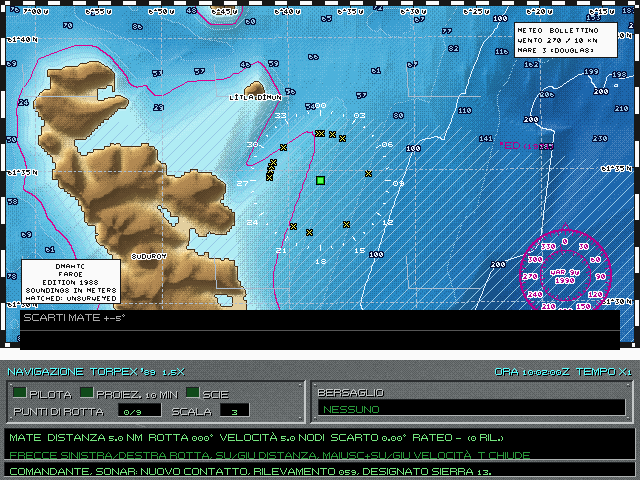
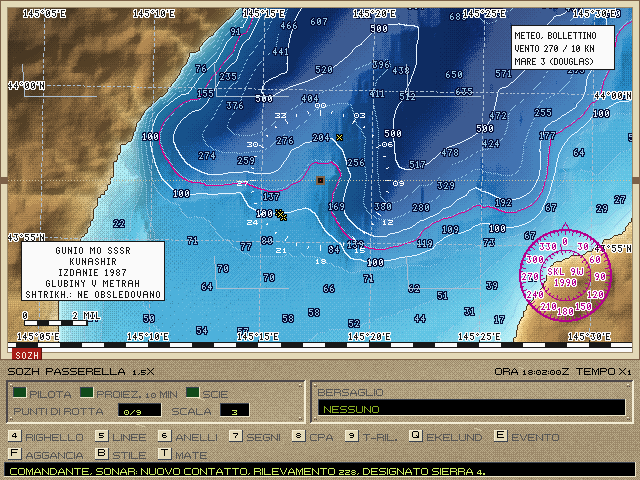
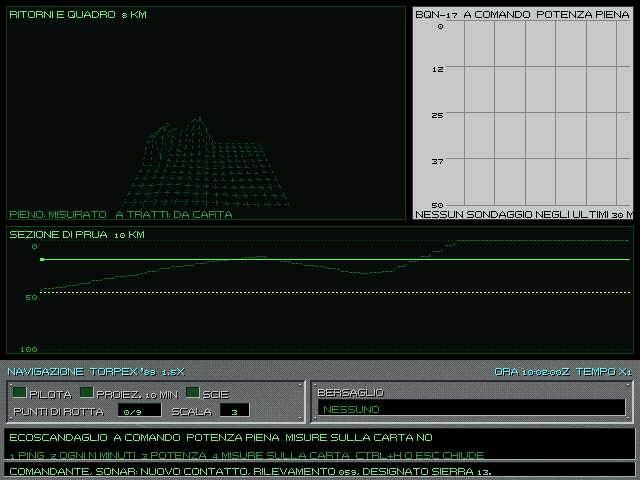

# 5. Carta, navigazione e TMA

La stazione Navigazione (F6) è il tavolo di carteggio. Qui il battello sa dove si trova, dove sono i contatti di cui
ha una posizione, e qui si ricava dai soli rilevamenti la rotta, la velocità e la distanza di un contatto: la TMA,
analisi del moto del bersaglio.

## 5.1 La carta

*La carta NATO delle Fær Øer (edizione 1988), con le isobate, gli scandagli, le zone non rilevate tratteggiate, la
rosa con la declinazione e il cartiglio. In basso lo strumento MATE aperto su un contatto.*

*La carta sovietica (GUNiO MO SSSR, edizione 1987) dell'Alfa, nella cornice del tracciatore Sozh: le profondità e
le zone rilevate non sono quelle della carta NATO.*

**La carta d'epoca.** Nell'Enhanced ogni parte naviga sulla sua carta: il 688 su quella americana (DMAHTC), l'Alfa
su quella sovietica (GUNiO). Sono carte vere nello spirito: ricavate dal fondale reale, ma come lo conoscevano i
rilievi dell'epoca. Ogni zona ha la sua campagna di rilievo (anno, ente, linee di scandaglio), qualche zona non è
mai stata rilevata (tratteggio), la fascia costiera avversaria non è rilevata mai, e i fondi molto profondi hanno
l'errore delle velocità del suono usate allora. Ci sono le annotazioni delle carte nautiche: ED (esistenza dubbia),
PA (posizione approssimata), «profondità minore riportata».

Le due carte non sono ugualmente buone: la NATO conosce meglio le Fær Øer, Gibilterra e il Mar Celtico, i sovietici
il Barents, le Curili e il Baltico orientale. **Il battello però tocca il fondo vero**, non quello della carta. Una
secca che la carta non mostra c'è lo stesso.

Nella scelta della missione, `[` `]` passa alla «carta vera», che mostra il fondale reale: più comodo, meno
realistico.

**Stili** (B alla carta): VGA 1989 in ricordo dell'originale, carta nautica, foglio. La carta ha la sua «mobilia»: la
cornice coi minuti, la rosa con la declinazione magnetica, la scala in miglia, il cartiglio con l'edizione, gli
scandagli. Le isobate principali hanno i numeri, incisi sulla carta NATO e a stampino su quella sovietica. Sulla carta
ci sono anche i nomi: mari, stretti e banchi in blu e inclinati, isole, capi, città e basi navali in nero. Allargando la
vista restano solo i più importanti; ingrandendo ne compaiono di più. La stessa carta, con la cornice e i nomi, si vede
nel briefing e nel debriefing.

**Cosa c'è sulla carta:**
- il proprio battello al centro;
- i contatti: con una traccia, la loro lettera; col solo rilevamento passivo, una X. I colori dicono a che punto è
  la classificazione (§5.6). La posizione la danno solo un'eco attiva, la vista e il radar;
- quando un contatto si perde, il **datum**: l'ultima posizione nota con l'ora, e un cerchio che cresce con la
  velocità possibile del contatto;
- i punti di rotta, la proiezione, le scie;
- le **mine**: quelle posate dal battello col loro stato (in corsa, in armamento con l'ora, armata col cerchio
  d'innesco, inerte, scoppiata) e quelle scoperte dal BQS-15;
- le **zone** e i **contatti d'intelligence** ricevuti dalla radio (cap. 4), con le ellissi che crescono col tempo;
- il **meteo**: una barba del vento grigia ogni tanto (vero vicino al battello, l'ultimo bollettino più lontano), il
  vento e il mare del battello nella legenda in alto a destra, le celle temporalesche e la nebbia quando la testa è
  fuori, il ghiaccio, i fulmini sentiti al sonar.

La carta occupa tutta la parte di sopra. L'ingrandimento e la proiezione stanno nel pannello di sotto. L'edizione
della carta d'epoca e il tratteggio delle zone non rilevate stanno nel cartiglio, in basso a sinistra.

## 5.2 Dove sono?

Nel 1989 non c'è il GPS. Con l'opzione **N, navigazione realistica**, nella scelta della missione (spenta di norma),
il battello sa dov'è solo quanto glielo dicono i suoi strumenti. Senza l'opzione la posizione è sempre esatta.

N gira fra tre posizioni: NAVIGAZIONE PERFETTA, REALISTICA e REALISTICA, GPS 1990+. La terza mette il GPS fra i punti
nave, come su un battello di qualche anno dopo: a quota periscopica con l'antenna su, un minuto per un fix di pochi
metri. Da riga di comando: `--navigazione realistica --gps`.

**La deriva.** Il navigatore inerziale (DMINS o WSN-3 sul 688, Sož sull'Alfa) sbaglia di poco, ma sempre di più: un
miglio e mezzo al giorno il DMINS, mezzo miglio il WSN-3, tre miglia il Sož. Se l'inerziale si guasta (un urto, l'acqua
nel comando, cap. 7) si naviga a stima col solcometro, e la corrente che non si conosce porta fuori di qualche miglio in
poche ore.

**La carta mostra dove credi di essere.** Battello, contatti, scie, linee di rilevamento e mine si disegnano dove li
mette la posizione stimata; il fondale, i punti di rotta, le zone e i segni del lucido restano dove sono. Attorno al
battello c'è l'ellisse tratteggiata dove la posizione vera sta al 95%. Sul margine bianco in basso a destra c'è scritto
«POSIZIONE +-x NM» e il punto nave in corso. Così il battello stimato può trovarsi su un banco che il battello vero non ha ancora raggiunto, o
viceversa: la carta mente quanto mente la posizione.

**I punti nave** (Ctrl+O alla carta) riportano la stima vicino al vero. Il menu mostra quelli della propria marina,
con la precisione, quanto si resta esposti, e «EMETTE» in giallo per quelli che si fanno sentire; quelli impossibili in
grigio col motivo («SERVE L'ANTENNA SU», «CIELO COPERTO», «FUORI COPERTURA»). La cifra lo ordina, Esc chiude.
- **Transit** (o Parus per la VMF): il satellite, a quota periscopica con l'antenna su e sotto 8 nodi; un passaggio
  ogni 40-110 minuti, e l'intestazione dice quanto manca;
- **Loran-C** (o Čajka): precisi, ma solo dove c'è copertura;
- **Omega**: col filo galleggiante anche a 60 m, ma impreciso, e se la stima è troppo lontana sceglie la corsia
  sbagliata;
- **le stelle** al periscopio, di notte o al crepuscolo, col cielo sereno; **il radar** e **il periscopio** sui punti della costa;
- **il fondale**: l'ecoscandaglio confronta le isobate con la carta. Emette. Dove il fondo scende ripido le isobate
  sono fitte e il fix è buono; sul fondo piatto vale poco, e lungo l'isobata meno che di traverso. Si fida della carta:
  se la carta d'epoca sbaglia lì, sbaglia anche il fix.

Il mare e la velocità peggiorano ogni punto nave: col mare grosso e andando forte il fix è meno preciso.

I messaggi del navigatore dicono che il punto nave è fatto (470), che si aspetta il satellite (471), che il punto nave
è impossibile (472) o interrotto (473), e che l'inerziale è fuori servizio (474). Il debriefing e il replay mostrano la
posizione vera; nella lettura «verità» il replay mostra anche la stima, con l'ellisse al 95% e un filo verso la vera. I
dettagli sono nel volume 2, capitolo C12.

## 5.3 I comandi della carta

| Tasto | Comando |
|---|---|
| I, O | ingrandisce o riduce |
| W | nuovo punto di rotta: si sposta il cursore con le frecce (o col mouse) e si conferma con Invio; il tempo è fermo. Fino a nove punti |
| K | cancella l'ultimo punto di rotta |
| `.` | pilota automatico sui punti di rotta |
| J, `[` `]` | proiezione del battello e del bersaglio a N minuti; i minuti |
| 1, 2, 3 | scie di tutti, scia del bersaglio, proiezione disegnata |
| B | stile della carta |
| Ctrl+I | DIRECT: guida il siluro filoguidato scelto verso un punto della carta (cap. 6) |

Nell'Enhanced ci sono in più gli strumenti di carteggio, disegnati su un lucido sopra la carta:

| Tasto | Strumento |
|---|---|
| 4 | **righello**: distanza e rilevamento fra due punti. Frecce e Tab muovono gli estremi, F aggancia un estremo al battello o al contatto più vicino, Invio lo fissa sul lucido, K lo toglie |
| 5 | **linee di rilevamento**: spente, del bersaglio, anche dei tracker del sonar |
| 6 | **anelli** attorno al battello a 1, 2 e 5 miglia; il secondo modo aggiunge la portata del filo del Mk 48 (7,5 miglia) |
| 7 | **segni**: Tab l'affiliazione, `[` `]` il tipo (subacqueo, superficie, aereo, nota, croce, zona), Invio lo mette e apre la scritta, K lo toglie, Maiusc+su e giù il raggio di una zona |
| 8 | **CPA e TCPA**: distanza e istante del minimo avvicinamento al bersaglio, se c'è una soluzione |
| 9 | **pannello tempo-rilevamento**: i rilevamenti del bersaglio nel tempo |
| E | **evento**: un segno con l'ora sulla posizione del battello |
| Q | **regolo di Ekelund** (§5.4) |
| T | **MATE** (§5.4) |
| Ctrl+X | pulisce il lucido: tratti, linee, eventi, datum |

## 5.4 La TMA

Col sonar passivo si ha solo il rilevamento. Ma un rilevamento che cambia nel tempo dice molto, se il battello si
muove nel modo giusto: è la TMA. Il principio è semplice: una soluzione (distanza, rotta e velocità del contatto)
prevede una serie di rilevamenti. Se coincidono con quelli misurati, la soluzione può essere quella giusta.

**Il MATE** (T) è lo strumento per farlo a mano. Si regolano rotta (frecce sinistra e destra), distanza (su e giù) e
velocità (Maiusc+su e giù, 4 nodi al secondo da 0 a 45, nei nodi del telegrafo) del contatto, e lo strumento mostra lo
scarto fra i rilevamenti previsti e quelli misurati: un rilevamento ogni 5 secondi sul bersaglio designato. Quando gli
scarti sono piccoli e senza tendenza, la soluzione è buona.

**Attenzione: su una gamba sola la TMA non basta.** Con il battello in rotta e velocità costanti, molte soluzioni
diverse danno gli stessi rilevamenti. Serve una manovra: una seconda gamba con una rotta diversa. Le soluzioni
sbagliate allora si separano da quella vera.

**Il regolo di Ekelund** (Q) usa proprio due gambe: dai ratei di rilevamento prima e dopo l'accostata, e dalla
velocità del battello attraverso la linea di vista, ricava la distanza. Servono almeno due linee di rilevamento sul
lucido (5). Le frecce regolano rotta e distanza, `[` `]` la velocità; Invio porta il risultato nel MATE.

**Dal sonar.** Il verniero (cap. 3) misura il punto di minimo avvicinamento dalla curva Doppler di una riga: se c'è
una soluzione, il MATE dice se la conferma (COERENTE o NON COERENTE). Quando il verniero è agganciato a una riga del
bersaglio e il contatto è già passato al minimo avvicinamento, il MATE propone anche una soluzione sua, sopra la
striscia degli scarti: «INVIO: PROPOSTA DAL CPA», con distanza, rotta e velocità e i loro errori. Invio la carica nel
MATE, e da lì la si regola. Al minimo avvicinamento il contatto sta proprio al traverso del suo moto relativo:
basta una gamba, se il bersaglio non ha manovrato.

La soluzione del MATE è quella che il debriefing mostra come «quadro del giocatore» accanto alla verità (cap. 10). Una
missione può contare le stime di rotta che fai col MATE aperto (la S20): vale la rotta che spiega i rilevamenti, una volta
che le gambe hanno dato la distanza.

## 5.5 Il fondale

Il fondo è quello reale dei sette teatri (EMODnet e ETOPO, celle da 200 m), e il battello lo tocca davvero.

- **Toccare il fondo:** sotto 1 m/s nessun danno; più forte, il danno cresce col quadrato della velocità. Una
  collisione con la costa a 30 nodi toglie più di metà dello scafo. L'equipaggio avverte: «toccato il fondo, danni
  allo scafo». Se lo scafo non regge, il battello è perduto.
- **Incagliarsi:** in acqua troppo bassa il battello si ferma. Da una secca si esce sempre verso acqua più profonda.
- **Acque basse:** nel Baltico e nel Barents il fondo è vicino; la quota di sicurezza e l'immersione d'emergenza ne
  tengono conto (cap. 2).
- **Posarsi sul fondo**: vedi il cap. 2.

L'IA conosce il fondale: le sue unità pianificano le rotte attorno alle secche, rallentano per accostare e tengono i
sottomarini almeno 7,6 m sopra il fondo.

**Il quadro del fondale** (solo Enhanced). Il battello sa del fondo quello che dice la sua carta e quello che ha
misurato: la carta d'epoca può sbagliare, e lo si scopre solo misurando. Misurano due strumenti:
- **l'ecoscandaglio** (BQN-17; sull'Alfa NEL-5), un ping verso il basso che dice quanta acqua c'è sotto la chiglia. Si usa a comando o
  periodico, a potenza piena (fino a 6000 m sotto la chiglia, ma si sente a 15-20 km) o bassa (fino a 2000 m, si sente
  a 5-8 km). Ogni ping si può intercettare. Ogni tanto dà un falso fondo: di giorno lo strato diffondente a 300-500 m,
  sopra i 20 nodi le bolle della scia;
- **il BQS-15**, quando è acceso: vede davanti le pareti a circa 3 km e il fondo radente a circa 1,5 km, meno se si va
  veloci.

**Ctrl+H** apre da ogni stazione la pagina del quadro del fondale, alla Navigazione; Ctrl+H o Esc la chiudono.

*La pagina del quadro del fondale (Ctrl+H): in alto a sinistra i ritorni e il quadro a 8 km, pieni dove il fondo è
misurato e a tratti dove viene dalla carta; a destra l'ecoscandaglio BQN-17; sotto la sezione di prua a 10 km, col
battello e la quota di sicurezza.*
- In alto a sinistra la prospettiva dei soli ritorni: la griglia davanti al battello, piena dove è misurata, a tratti
  dove viene solo dalla carta, coi ritorni del BQS-15 degli ultimi 5 minuti.
- In alto a destra la striscia dell'ecoscandaglio: la profondità sotto la chiglia degli ultimi 30 minuti, come su una
  carta termica, col programma e la potenza.
- In basso la sezione di prua per 10 km: la carta a tratti, la stima misurata con la sua fascia d'incertezza, i
  ritorni, la quota della chiglia in verde e il margine di 30 m in giallo a tratti.
- I tasti: **1** un ping; **2** il periodo successivo (a comando, ogni 1, 2, 5, 10, 15, 30 minuti); **3** la potenza
  piena o bassa; **4** le misure sulla carta, sì o no. La riga del pannello ripete il periodo, la potenza, l'ultima
  lettura sotto la chiglia e se le misure sono sulla carta.

**Le misure sulla carta** (4) restano sulla carta della Navigazione anche a pagina chiusa. Le celle misurate prendono
il colore della profondità misurata: dove concordano con la carta non si vedono, dove la carta sbaglia sì. L'acqua non
misurata è puntinata a matita, che non è il tratteggio delle zone non rilevate della carta d'epoca. Il nastro dei
sondaggi è in magenta, gli ostacoli sono croci rosse.

**Sotto il ghiaccio** la pagina del fondale mostra anche la volta, cioè il ghiaccio sopra il battello, come lo hanno
misurato il sondatore verso l'alto e il BQS-15:
- in alto a sinistra la volta a prua vista dall'alto: le chiglie di ghiaccio davanti, in rosso quelle che arrivano
  alla vela, e le polynye (le pozze d'acqua libera dove si può emergere) in ciano, con quanti minuti fa sono state
  viste. Il pack deriva: una polynya vista un'ora fa non è più lì;
- in alto a destra la carta termica: il ghiaccio sopra, il fondo sotto, la quota del battello in mezzo;
- in basso la sezione: il ghiaccio in una fascia ingrandita in alto, la linea gialla della vela meno 10 m, il fondo in
  una fascia sotto.

Sulla carta, sotto la banchisa, la volta misurata è sempre visibile lungo la rotta: bianco il ghiaccio sottile, grigio
lo spesso, nero le chiglie, ciano l'acqua libera, la croce rossa sulle chiglie che arrivano alla vela.

L'equipaggio avverte solo da quello che ha misurato: meno di cento metri sotto la chiglia (480), meno di trenta (481),
il fondo sale (482), ostacolo a prua (483), troppo veloci per quello che si vede davanti (484), nessun eco dal fondo
(485). Senza misure, nessun avviso: a navigare alla cieca su una carta sbagliata si tocca. I dettagli sono nel
volume 2, C12 §2.11.

## 5.6 I simboli della carta

**Le lettere dei contatti** sono quelle del 1989, e anche i loro colori: dicono a che punto è la classificazione, non
la parte.

| Segno | Che cosa vuol dire |
|---|---|
| X gialla | solo un rilevamento, senza traccia; una seconda X è lo specchio della schiera (§3.6) |
| lettera magenta | una traccia, non ancora classificata |
| lettera blu | classificata: sottomarino, o categoria ignota |
| lettera verde | classificata: nave o aereo |
| lettera azzurra, verde chiaro, rosso chiaro | anche la classe è nota: sottomarino, nave o aereo, arma |
| lettera gialla | il proprio siluro filoguidato |
| fondo nero attorno alla lettera | il bersaglio scelto |

**Il resto della carta:**
- **Il battello:** un quadratino verde. La sua scia, e nell'Enhanced l'ellisse al 95% della posizione stimata con la
  navigazione realistica (§5.2), sono nel suo stesso verde.
- **Scie degli altri:** punti, rosso il bersaglio, nero gli altri.
- **Punti di rotta:** le cifre magenta. La proiezione è un asterisco.
- **Mine:** il cerchio con quattro punte (§5.1).
- **Intelligence:** l'ellisse rosso chiaro con la croce al centro, il sensore e l'età in minuti.

**I segni del lucido** (Enhanced: i segni e le cadute che si mettono sulla carta) usano i simboli NTDS e APP-6. La
parte la dicono il colore e la forma, il dominio lo dice il telaio:

| Parte | Colore | Forma |
|---|---|---|
| amico | azzurro | cerchio |
| ostile | rosa | rombo |
| ignoto | giallo | ottagono |
| neutrale | verde | quadrato |

| Dominio | Telaio |
|---|---|
| superficie | intero |
| subacqueo | la metà inferiore, col tratto orizzontale |
| aereo | la metà superiore, col tratto orizzontale |

Con le stazioni 1989 (§1.4) gli stessi segni sono a matita: blu l'amico, rosso l'ostile, nero l'ignoto (bianco
sulla VGA), verde il neutrale. Sulla carta chiara (stile nautico) i colori sono le varianti scure dello standard, che
sul bianco si leggono.

**Il contorno.** Nel classico lettere e X hanno il contorno a croce dell'originale: nero, rosso scuro per le X.
Nell'Enhanced ogni simbolo e ogni scritta della carta ha un alone nero di un pixel tutto attorno, così risalta sul
mare scuro, sul mare chiaro e sulla terra.

**Nel replay, nella vista dal vivo della sandbox e nell'editor** le unità hanno gli stessi simboli, con l'alone:
- **Unità:** la forma della loro parte. L'elicottero ha le pale sopra il telaio, la terra una base sotto; quando nemmeno
  la categoria è nota, il telaio è intero col «?» dentro. Un contatto sentito ma non classificato è un ignoto, giallo,
  col telaio della sua categoria. I dati più vecchi di dieci minuti sono sbiaditi.
- **Il battello:** il quadratino verde, con la sua scia e la sua ellisse; l'unità scelta ha gli angoli gialli attorno.
- **Armi in acqua:** per tipo, nel colore della parte di chi le ha lanciate, col filo tratteggiato verso chi le guida.
  - siluro: una freccina nella rotta;
  - missile: la freccina con la coda doppia;
  - esca: un rombo piccolo;
  - mina: il cerchio con quattro punte;
  - boa: il galleggiante con l'antenna;
  - biologico: una coda di balena grigia.
- **Emissioni:** l'anello del ping che si allarga, il ventaglio del radar che gira, il fulmine della radio.
- **Il resto:**
  - la X rossa sull'unità distrutta;
  - le linee di rilevamento tratteggiate (più lunghe per lo specchio della schiera);
  - le ellissi al 95%;
  - la croce bianca della soluzione TMA;
  - la legenda coi simboli veri.

Anche la croce della soluzione TMA della stazione (MATE, cap. 5.4) è quella del modulo: bianca sulla VGA, a matita
sulla carta chiara; nel classico resta il «+» di prima.

**Nel debriefing** la carta delle tracce usa gli stessi simboli, con l'alone anche nel classico, perché è una
schermata nuova:
- le unità con la forma e il colore della loro parte, e le scie nello stesso colore sbiadito;
- le armi in acqua orientate lungo la traccia, tratteggiata;
- le boe nel colore di chi le ha posate, sbiadite quando sono finite;
- il battello col quadratino e la scia verdi.

Il pannello degli eventi a destra tiene i suoi colori.
