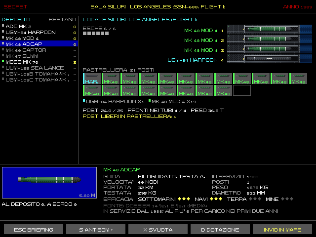
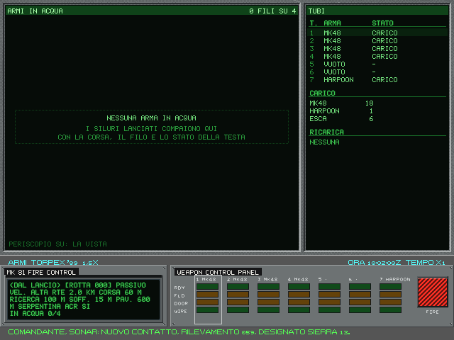
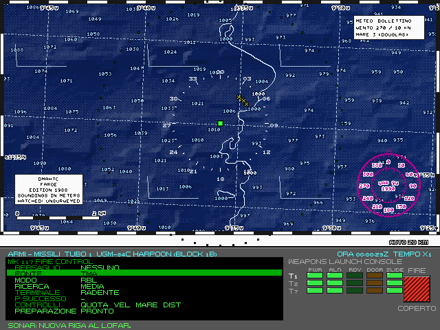

# 6. Armi

Un siluro lanciato è un rumore in più nel mare: chi lo sente sa da dove viene. Nell'Enhanced le armi hanno i loro
tempi, le loro impostazioni e i loro limiti veri. Questo capitolo segue l'arma dal deposito al bersaglio. I dati di
ogni arma (velocità, portata, quota, testata, anni di servizio) sono nelle tabelle del volume 2 e nelle schede del
Museo (F1).

## 6.1 La Sala siluri: il carico prima della missione

*La Sala siluri del 688: a sinistra il deposito, al centro il locale con i tubi, le esche e la rastrelliera, in basso
la scheda dell'arma scelta con la sagoma in scala.*

Dal briefing, F7 apre la Sala siluri (solo Enhanced). Qui si sceglie cosa imbarcare e cosa avere nei tubi alla
partenza.

- **A sinistra, il deposito**: le armi della propria marina con quante ne restano. In grigio quelle che non si possono
  prendere, col motivo nella scheda: «in servizio dal …», «ritirata nel …», «negata dalla missione», «what-if»,
  «solo IA», «nucleare».
- **Al centro, il locale**: i tubi a prua con l'arma caricata, i lanciatori delle esche, la rastrelliera a caselle. I
  posti sono condivisi: siluri, missili in capsula e mine occupano gli stessi posti, e ogni arma prende i suoi (una
  mina corta ne prende mezzo). Sotto, i totali e gli avvisi: tubi vuoti, posti liberi, esche mancanti, armi what-if.
- **In basso, la scheda**: la sagoma in scala, guida, velocità, portata, testata, anno di servizio, posti, peso,
  diametro, la fonte con la confidenza e l'**efficacia** da zero a tre stelle contro sottomarini, navi, terra e come
  mina (STIMA del gioco).

**Comandi:** frecce su e giù scelgono l'arma; destra la mette (in rastrelliera, fra le esche o nei pozzi), sinistra la
toglie; 1-6 la mettono in un tubo, la tolgono o la scambiano. X svuota tutto, D rimette la dotazione dell'originale.
Invio va in mare (con gli avvisi chiede conferma), Esc torna al briefing.

**I carichi per compito.** C, o un clic sul pulsante del carico, apre l'elenco dei carichi per compito. Per ogni voce
dice che cosa salirebbe davvero a bordo con il deposito di questa missione. Frecce e Invio, o un clic sulla riga, lo
applicano; Esc o un clic fuori chiudono senza cambiare niente. Tab e S fanno lo stesso senza aprire l'elenco: Tab passa
al carico successivo, S lo applica. Dopo si può modificare tutto a mano. Nell'elenco:

- **in giallo** il carico consigliato dalla missione. È solo un suggerimento: non si applica da solo;
- **A BORDO** segna la voce uguale al carico attuale;
- **ADATTATO** vuol dire che il deposito o l'anno non consentono quel carico per intero: sotto, «NON AL DEPOSITO» dice
  che cosa manca;
- **SCARTO 12/100** è lo scostamento dal carico standard della missione, che pesa sull'efficienza in carriera
  (capitolo F2);
- **in grigio** le voci che qui salgono uguali a una riga sopra: con questo deposito non sono una scelta in più.

Il deposito comanda: in una missione senza mine la barriera antisom e il minamento salgono come carichi di siluri. Su
86 missioni, il 688 ha da 2 a 6 scelte davvero diverse su 9 (4 nella maggior parte dei casi, 35 missioni su 59), l'Alfa
5 su 7. Il carico con cui si parte, se non si tocca niente, non cambia.

**Cosa cambia davvero.** Il peso non conta: qualche decina di tonnellate su settemila. Contano il numero di colpi per
tipo, cosa è già nei tubi al primo contatto, e i tempi della ricarica. Il debriefing giudica anche il carico: partire
per un minamento senza mine si nota.

**Il 1989.** Le armi seguono l'anno: l'ADCAP, appena entrato in servizio, si prende al massimo in sei; la MOSS sul 688
è what-if e la carica solo il modo moderno. Le missioni possono negare tipi d'arma o dichiarare un deposito proprio.

## 6.2 La stazione Armi e i tubi

*La stazione Armi del 688: a sinistra la direzione del tiro Mk 81 con le impostazioni del siluro del tubo scelto, a
destra il pannello dei tubi con le spie RDY, FLD, DOOR e WIRE. Sopra, i ripetitori: le armi in acqua, i tubi, il
carico e la ricarica.*

Ogni tubo passa per questi stati: **vuoto**, **in ricarica** dalla rastrelliera, **carico** (l'arma nel tubo, a
secco), **in armamento** (allagare, equalizzare, aprire la porta esterna: 20 secondi), **armato**.

Un clic sul tubo, o la sua cifra, fa la cosa naturale per lo stato:
- vuoto: comincia la ricarica, o la mette in coda se due sono già in corso;
- in ricarica: la annulla, e l'arma torna in rastrelliera;
- carico: lo arma;
- armato o in armamento: lo disarma, e l'arma resta nel tubo.

**La ricarica** dura 300 secondi per tubo sul 688, che carica col carrello, e 75 sull'Alfa, che ha il caricatore
automatico (STIME). Al più due insieme. Dopo un lancio parte da sola, e a ricarica finita il tubo si arma. **Fa
rumore**: un colpo ogni minuto di lavoro, che il nemico può sentire. Col **silenzio a bordo** (Ctrl+S) dura il doppio
ma non fa rumore.

**Ctrl+V** mette nel tubo scelto l'arma successiva della rastrelliera. Lo scambio costa una ricarica intera; un tubo
armato va prima disarmato.

**Armi in acqua.** Al più quattro alla volta sul 688 e sei sull'Alfa, come nell'originale: siluri ed esche.

**L (lancio)** lancia dal tubo selezionato, verso il bersaglio designato. **G** sceglie il bersaglio: il tempo si
ferma, una lettera o Tab sceglie il contatto, Invio conferma, Esc toglie il bersaglio.

## 6.3 I siluri

Nell'Enhanced il siluro ha una testa che ascolta, un filo che lo guida e una corsa limitata. I modelli sono quelli del
1989: Mk 48 e Mk 48 ADCAP americani, USET-80 e TEST-71M sovietici, il Tigerfish britannico, il Mk 46 leggero degli
aerei, il SET-65 e il 53-65K.

**Le impostazioni** del siluro nel tubo scelto si cambiano prima del lancio: Tab sceglie il campo, `[` `]` il valore.

| Campo | Valori | A che serve |
|---|---|---|
| Rotta | a passi di 10° | la rotta di corsa iniziale, se non si guida |
| Modo | passivo, attivo, misto | il misto ascolta in ricerca e passa all'attivo per l'aggancio |
| Velocità | bassa, alta | alta arriva prima, bassa va più lontano e la testa sente meglio |
| RTE | a passi di 500 m | la distanza di corsa prima che la testa si attivi |
| Quota di corsa | a passi di 15 m | la quota fino all'attivazione |
| Quota di ricerca | a passi di 15 m | la quota a cui cerca |
| Soffitto | a passi di 5 m | sopra non attacca: protegge dalle navi amiche e dalla superficie |
| Pavimento | a passi di 50 m | sotto non attacca |
| Schema | serpentina, cerchio, dritto | come cerca dopo l'attivazione |
| Anti-circolare | sì, no | si spegne se punta il lanciatore dopo l'attivazione |

**La corsa.** Il siluro corre fino all'RTE, poi cerca (in serpentina di ±30° o in cerchio). Quando la testa sente
qualcosa lo verifica per qualche secondo, poi lo insegue mirando avanti, sul punto futuro, e passa all'alta velocità.
Se perde il contatto, gira in cerchio per ritrovarlo. Finisce esploso (la spoletta di prossimità si arma dopo 500 m),
spento o a fine corsa.

**La testa.** In passivo sceglie la sorgente più forte, in attivo l'eco più forte, in un cono di ±40-50° attorno alla
prua. Uno strato fra il siluro e il bersaglio dimezza la portata. Ignora quello che sta fuori fra soffitto e
pavimento.

**Il filo** collega il siluro al battello: 30 km si svolgono dal siluro, 3 dal battello. Lungo il filo tornano i
rilevamenti della testa (la distanza solo in attivo) e l'avviso di una sorgente ferma: forse un'esca. Il filo si rompe
se il battello supera 12 nodi o vira oltre 2° al secondo per più di 5 secondi: col filo in acqua bisogna manovrare
piano.

**Guida via filo** (alla stazione Armi):

| Tasto | Comando |
|---|---|
| S | siluro filoguidato successivo |
| Z, X | rotta 10° a sinistra o a dritta |
| 8, 9 | quota 15 m più su o più giù |
| C | testa attiva |
| D | spegnimento: il siluro si ferma e affonda senza esplodere |
| Y | taglia il filo |
| Ctrl+I | DIRECT: dalla carta, il siluro verso un punto (frecce o clic, Invio) |

L'operatore può anche far rifiutare alla testa una sorgente (un'esca) o assegnargliene una.

Nel classico restano i comandi del 1989: SELEZ., DIRECT, CERCA e DETONATE. **Nell'Enhanced DETONATE non c'è**: non
esisteva sui siluri dell'epoca. Al suo posto lo spegnimento.

## 6.4 I missili

Il 688 lancia dai tubi l'Harpoon (antinave, in capsula) e il Tomahawk, antinave o d'attacco a terra; i 688 Flight II
anche dai 12 pozzi verticali. Il lancio segue le regole dell'originale: a quota periscopica, con un bersaglio
identificato per l'antinave. Il Tomahawk d'attacco a terra (TLAM-C) vuole solo la quota periscopica e va agli atti come
lancio. Il TLAM-C non usa il gestore del Tomahawk antinave: una missione che vuole contare gli attacchi a terra
dichiara il proprio gestore `armi.attacco_terra`; senza, il lancio resta solo nel registro. Nell'Enhanced il TLAM-C
ha la sua libreria di missioni e il suo ordine (più sotto).

**La 0A, «Colpisci e fuggi», nell'Enhanced.** Imbarcate nei tubi i Tomahawk antinave (TASM), non quelli d'attacco
a terra: la missione conta solo i TASM. Avete 5 minuti per lanciarli tutti e quattro, da quota periscopica; poi
conviene fuggire verso le acque di Copenaghen.

**I missili del catalogo nell'Enhanced.** Un missile del catalogo nel tubo ha la sua preparazione (accensione,
allineamento, pronto) e parte quando è pronto: piano di tiro valido e allineato (RDY) e la valvola a cassetto (slide
valve) del suo lato libera. Allora i controlli dell'originale (traccia solida, distanza minima, quota periscopica) non
valgono: il piano di tiro li sostituisce. Se non è pronto, il lancio è rifiutato con «Non ancora». Le armi fuori
dal catalogo seguono le regole dell'originale.

Nell'Enhanced il lancio si vede e si sente: la capsula che emerge, il booster, il fumo, anche per i missili della
pagina di tiro e il TLAM; i tappi della capsula e il booster fanno i loro transitori al sonar, che il nemico sente.

*La pagina di tiro col tubo 1 caricato con l'Harpoon (scena di prova PROVA_M1_ANTINAVE): sopra la carta della zona
coi contatti, sotto il Mk 117 con la fonte del bersaglio, il modo, la ricerca, la fase terminale e la preparazione, a
destra la consolle di lancio coi tubi.*

**La pagina di tiro** (F7, Enhanced). Quando il tubo scelto ha un Harpoon o un Tomahawk antinave, F7 apre da sola la
pagina di tiro; Tab torna ai siluri.
- **La carta di tiro**, in alto, mostra:
  - dove credi che sia il bersaglio, con la sua ellisse;
  - il punto dove il missile lo aspetta, la rotta, dove si accende la testa;
  - l'area dove cercherà;
  - i contatti che ci cadono dentro, con un avviso se sono neutrali o amici (gli amici solo se li hai classificati);
  - il cerchio di 3 miglia attorno al punto di lancio, dove arriveranno le navi antisom.

  I missili in volo sono una stima tratteggiata, «STIMA»: non sai dove sono davvero.
- **La consolle**, in basso a sinistra, ha una riga per parametro. Su e giù scelgono la riga, sinistra e destra il
  valore:
  - **FONTE:** da dove vengono i dati del bersaglio. Può essere la TMA (la soluzione del MATE arriva da sola ai tubi),
    il periscopio (la distanza dello stadimetro, che si corregge di 500 m alla volta), l'ESM (solo il rilevamento) o
    un rapporto radio;
  - **MODO:** RBL, se sai la distanza: il missile vola al punto previsto e cerca in una scatola; BOL, se hai solo il
    rilevamento: cerca a ventaglio dal punto d'accensione;
  - **RICERCA** (RBL): piccola, media o grande. Più grande prende un bersaglio mal stimato, ma anche le navi che non
    volevi;
  - **SRCH e DSTR** (BOL): dove la testa si accende e dove il missile si distrugge, a passi di un miglio;
  - **PREPARAZIONE:** destra avvia, sinistra spegne. I missili caricati prima della missione sono già pronti.

  La consolle calcola anche la probabilità di successo e gli avvisi: fuori portata, troppo vicino, troppo profondo o
  troppo veloce, dato vecchio, neutrali o amici nell'area. Gli avvisi su neutrali e amici non fermano il lancio: la scelta è tua.
- **Il pannello di lancio**, in basso a destra, ha le spie di ogni tubo:
  - **PWR:** il missile è acceso;
  - **ALN:** è allineato (l'Harpoon in un minuto, il Tomahawk in venti);
  - **RDY:** i dati di tiro sono validi;
  - **DOOR:** la porta è aperta;
  - **SLIDE:** la valvola del suo lato è libera. Due tubi dello stesso lato partono a 20 s l'uno dall'altro, due di
    lati opposti a 4 s.

  Maiusc+L alza il coperchio del FIRE, L lancia.
- **La carta:** I e O la ingrandiscono e la allargano, C la centra sul bersaglio.

**Il volo.** Il missile parte da dove sei davvero, ma segue i calcoli fatti sulla posizione che credi: se la tua
navigazione sbaglia di due miglia, sbaglia anche il missile. La sua testa radar non riconosce le navi: prende il primo
eco che trova nell'area, nemico o neutrale. Per questo la scatola stretta e una buona soluzione contano. Il Tomahawk
antinave ha in più un ricevitore che cerca i radar del bersaglio. Il Tomahawk d'attacco a terra ha regole sue
(sotto).

I dettagli sono nel volume 2, capitolo D3 §2.9.

**Il Tomahawk d'attacco a terra** (TLAM-C, Enhanced). Nel 1989 le missioni contro terra si pianificavano a terra:
- **la libreria di bordo:** il battello parte con un pacchetto di missioni, ognuna col suo punto di lancio, il
  bersaglio e l'ora d'arrivo;
- **l'ordine:** arriva alla radio e dice quale missione eseguire. Senza ordine i missili si preparano ma non partono;
  senza una missione scelta il lancio è rifiutato;
- **il pannello:** calcola tutto sulla posizione che **credi** di avere. Dice se la missione è VALIDA (entro 10
  miglia dal punto di lancio), da RIPIANIFICARE (fino a 40), NON VALIDA o FUORI FINESTRA, e la probabilità che il
  missile trovi la prima mappa del terreno;
- **l'esito:** dipende dalla posizione **vera**. Se la navigazione sbaglia di qualche miglio, il pannello dice VALIDA
  e il missile si perde lo stesso, perché sul mare non corregge l'errore del battello. Un punto nave prima del lancio
  costa un'esposizione e compra la probabilità vera.

**Sulla pagina di tiro** (F7, col TLAM nel tubo scelto) la riga MISSIONE sceglie la missione della libreria:
- **la scelta:** destra e sinistra girano fra le missioni; «LIBRERIA VUOTA» se la missione non ne ha;
- **la missione scelta:** il numero e l'ora sul bersaglio con la finestra («TOT 10:40Z +-10 MIN»);
- **le righe sotto:**
  - lo STATO col colore: verde VALIDA, giallo RIPIANIFICA con i minuti, rosso le altre;
  - la distanza dal punto di lancio;
  - la NAVIGAZIONE, cioè la probabilità di prendere la prima mappa;
  - l'ora di LANCIO e il tempo di volo;
  - l'ORDINE: «IN ATTESA DELL'ORDINE», «ESECUZIONE RICEVUTA», o in rosso «NON AUTENTICATO: NON ESEGUIRE»;
  - i CONTROLLI di quota e velocità.

**L'esito arriva alla radio,** come nel 1989: il battello non ha collegamento col missile. Mezz'ora dopo l'arrivo
COMSUBLANT manda il BDA, con precedenza PRIORITY: «BERSAGLIO … COLPITO» o «NESSUN EFFETTO OSSERVATO». Il debriefing
dice la verità: colpito, o perso prima del bersaglio. Le missioni possono chiedere i TLAM arrivati sul bersaglio come
obiettivo.

I dettagli sono nel volume 2, capitolo D3 §2.10.

**Anche l'IA tira** col modello del volo e col suo piano, come voi: navi, Oscar, Charlie II, e gli SSN occidentali
con l'Harpoon. Tira solo su bersagli che ha classificato, mai su chi crede neutrale; fuori portata il missile non
parte. Un sottomarino che vuole tirare sale e rallenta prima.

**Le navi si difendono.** All'arrivo un missile può ancora essere fermato, e le regole sono le stesse per i vostri e per quelli
dell'IA (volume 2, capitolo D3 §2.6):
- **La sorpresa paga, ma una volta sola.** Una nave che non sospetta nulla usa solo metà delle sue difese, in crisi tre quarti. Conta quanto
  era pronta quando avete lanciato, non l'allarme che il lancio provoca. Il primo missile la sveglia: il secondo la trova ai
  posti di combattimento, anche se il primo è stato fermato.
- **La salva paga.** Una nave segue pochi missili alla volta, da uno a quattro secondo la classe, e ciascuno la impegna per 30 s.
  Quelli in più non li ferma con i suoi missili e i suoi inganni. Quattro tubi con la slide partono in 24 s: stanno tutti dentro.
- **Il Phalanx ferma ciò che passa.** Ce l'hanno molte navi americane, da uno a quattro affusti: ai posti di combattimento una
  Kidd è colpita dal 61% degli Harpoon, senza Phalanx sarebbe il 94%. Un solo affusto contro Harpoon a 4 s ne ingaggia uno sì e
  uno no.

La probabilità sulla pagina di tiro non conta le difese delle navi.

**Limite noto:** le difese sono regole all'impatto. I missili antiaerei, i chaff e il disturbo non si vedono partire, e non ci
sono traccianti: li riassume la probabilità della classe. L'AK-630 delle navi sovietiche non è in queste regole.

## 6.5 Le esche acustiche

Un'esca imita il battello per ingannare la testa di un siluro.

- **ADC Mk 2** (688, dai due lanciatori, 6 a bordo): resta ferma alla quota del battello e fa rumore e eco per 160 s,
  come nell'originale (*in arrivo*: i dieci minuti del Mk 2 storico, che oggi usa solo l'IA). È molto credibile per una testa passiva, che la scarta solo una volta su dieci; una testa attiva la
  riconosce più spesso, perché un'esca ferma non ha effetto Doppler e ha un'eco puntiforme. I siluri che seguono la
  scia non la vedono.
- **Esche semoventi**, dal tubo come un siluro (occupano un posto in rastrelliera e un tubo; si ricaricano, si
  armano e si lanciano allo stesso modo, e contano fra le armi in acqua):
  - **MG-74** dell'Alfa: storica, due in rastrelliera nelle missioni originali;
  - **MOSS Mk 70** del 688: era dei sottomarini lanciamissili, non dei 688. Nel gioco è «what-if», solo nel modo
    moderno, e solo se la si carica in Sala siluri.

  Un'esca che si muove inganna meglio. Contro il Mk 46 di un aereo, la MOSS porta la probabilità di colpire da circa
  0,53 a 0,33.

**L'IA usa le esche**: i sottomarini nucleari sovietici lanciano la MG-74 quando hanno un siluro in coda.

## 6.6 Le mine

Le mine si caricano in Sala siluri (se la missione le prevede) e si posano dal tubo come un siluro. Non contano fra le
armi in acqua.

| Mina | Come funziona |
|---|---|
| **Mk 67 SLMM** (USA) | corre dal tubo lungo la rotta e la distanza impostate (fino a 13 km), si posa sul fondo fra 10 e 100 m, scoppia quando una nave o un sottomarino passa entro 60 m |
| **Mk 60 CAPTOR** (USA) | ormeggiata 150 m sopra il fondo, fra 200 e 900 m; un sottomarino in immersione entro 1000 m le fa liberare un siluro Mk 46. Ignora le navi |
| **PMR-1, PMR-2** (URSS) | mine-razzo ormeggiate su fondali fra 200 e 1000 m; un sottomarino sopra di loro riceve un razzo che scoppia vicino. Ignorano le navi |
| **MDT** (URSS) | mina corta da fondo, due per tubo, fino a 50 m di fondale |

Regole comuni:
- una mina **si arma 600 secondi dopo la posa**;
- fuori dalle sue profondità resta inerte;
- **non distingue amici e nemici** e agisce una volta sola.

Sulla carta le mine posate hanno il loro stato (cap. 5). Il BQS-15 trova quelle degli altri (cap. 3). Il debriefing
conta mine posate, inerti ed esplose; gli obiettivi di minamento le richiedono.
