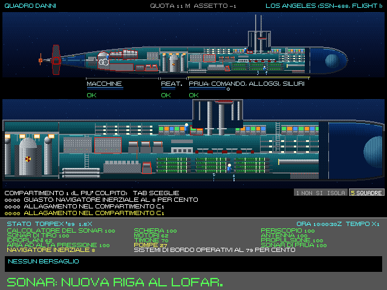
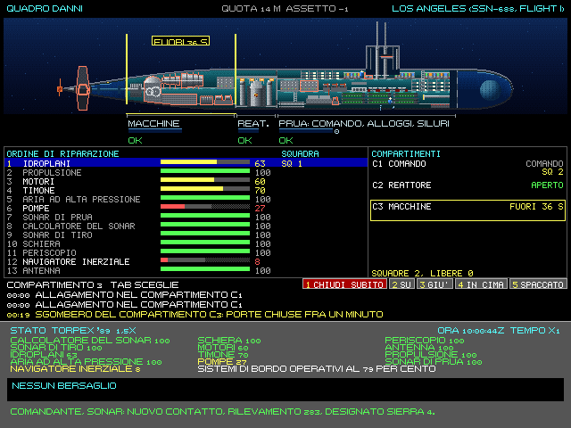
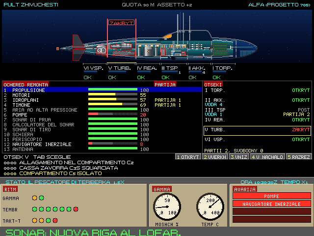

# 7. Danni e controllo danni

Nel 1989 un colpo toglieva una percentuale e spegneva un sistema. Nell'Enhanced un'esplosione vicina scuote il
battello, apre falle, rompe tubolature, accende incendi; l'acqua entra con la pressione della quota, pesa, cambia
l'assetto; l'equipaggio corre a tamponare. Questo capitolo spiega cosa succede e cosa può fare il comandante. Il
modello completo è nel volume 2 (capitoli B3 ed E2).

Nel classico restano i danni dell'originale.

## 7.1 Il modello dei danni del battello

**I compartimenti.** Lo scafo resistente è diviso da paratie stagne: sul 688 la prua (comando, alloggi, siluri), il
reattore e le macchine. Fra lo scafo resistente e quello esterno ci sono le casse. Una cassa zavorra squarciata, da
un urto o da un colpo di cannone a prua o a poppa, non tiene più l'aria. Ogni compartimento ha il suo
volume, la sua acqua, il suo fuoco, il suo fumo e il suo ossigeno.

**L'urto.** Un'esplosione subacquea colpisce col suo **fattore d'urto**, che cresce con la carica e cala con la
distanza. Le soglie, dalle fonti:

| Fattore d'urto | Effetto |
|---|---|
| 0,05-0,1 | strumenti e luci: la palette tremola, la vista sobbalza, guasti lievi e brevi |
| 0,1-0,3 | apparecchiature danneggiate, perdite da tenute e tubolature; possibile SCRAM del reattore |
| 0,3-0,6 | allagamenti da rotture localizzate |
| oltre 0,6-1 | rottura dello scafo resistente: il battello è perduto |

Più si è in profondità, più basse sono le soglie: lo scafo è già sotto sforzo.

**Le falle.** L'acqua entra con la pressione: più è profonda la falla, più forte il getto. Un foro da 5 pollici
imbarca 0,16 m³ al secondo a 20 m e 0,60 a 300 m. L'acqua si raccoglie sul fondo del compartimento, pesa e sposta
l'assetto: un compartimento di prua allagato apprua il battello.

**Le paratie** reggono fino a una certa differenza di pressione; oltre cedono, e l'acqua (o il fumo) passa al
compartimento vicino.

**I sistemi** sono tredici, ciascuno da 0 a 100%: calcolatore del sonar, sonar di tiro, timoni orizzontali («idroplani»
sullo schermo), aria ad alta pressione, antenna rimorchiata, motori, timone, pompe, periscopio, antenna, propulsione,
sonar di prua, navigatore inerziale. I giroscopi del navigatore inerziale soffrono gli urti più degli altri sistemi, e
l'acqua nel comando lo ferma: sotto metà efficienza la posizione si stima col solcometro e si allontana dal vero (cap.
5). Un sistema danneggiato funziona peggio invece di spegnersi: i motori al 75% danno tre quarti della velocità massima,
e gli ordini più bassi restano come sono; timoni orizzontali bloccati restano all'angolo che avevano; il periscopio
sotto metà efficienza non sale.

**Lo SCRAM.** Un urto forte può spegnere il reattore. Lo spengono anche un incendio forte o l'acqua nel compartimento
del reattore, e allora resta spento finché il compartimento brucia o è allagato. Dopo uno SCRAM da urto la propulsione
torna in 5-20 minuti. Nel frattempo il motore d'emergenza dà una bassa velocità con la batteria di riserva, che dura
circa due ore. Se la batteria si allaga o brucia, a reattore spento non c'è più energia: il battello si ferma e le
pompe pure.

**Gli incendi.** Un fuoco raddoppia in due minuti finché c'è ossigeno. In un compartimento chiuso lo consuma e si
spegne da solo sotto il 12%, in circa dieci minuti. Il pericolo è l'aria ad alta pressione: un fuoco forte può rompere
una tubolatura, e l'aria delle bombole lo tiene vivo e si consuma, lasciando meno aria per emergere. Il fumo riempie
il compartimento in pochi minuti, il fuoco brucia le tenute dello scafo e passa ai compartimenti vicini. Nel locale
siluri un incendio può far esplodere le testate: salta quello che c'è a bordo, quindi un locale siluri vuoto non salta,
e uno pieno è il pericolo più grande. Le batterie allagate fanno cloro. Sul Delta III l'acqua nel compartimento dei
missili a propellente liquido lo fa reagire, come sul K-219 nel 1986: un'esplosione e fumo tossico.

**Il collasso.** Sotto la quota di collaudo lo scafo soffre; alla quota di collasso cede. La quota vera di collasso
cambia da battello a battello (fra 1,1 e 1,8 volte quella di progetto, come nei collassi storici) e si abbassa con i
danni. Quando cede, i compartimenti implodono uno dopo l'altro.

**L'equipaggio.** Il fumo, il fuoco e l'acqua fanno feriti e caduti. Il debriefing e la cerimonia ne tengono conto
(cap. 10).

## 7.2 La stazione Stato e lo spaccato

*Il quadro danni del 688 dopo un'esplosione vicina: lo spaccato intero e ingrandito sul compartimento più colpito,
le squadre al lavoro, i rapporti dell'equipaggio e i sistemi con la loro efficienza.*

La stazione Stato (F3) mostra lo spaccato del battello, con il profilo vero dello scafo e dentro i ponti, le
paratie, i macchinari, le rastrelliere col carico vero. Sopra lo spaccato si vede lo stato:

- l'acqua di ogni compartimento, inclinata con l'assetto;
- le falle con il getto e le bolle;
- le fiamme e il fumo;
- i compartimenti sventrati o implosi, le paratie cedute;
- le casse con l'aria dell'esaurimento; una cassa zavorra squarciata ha lo squarcio nella lamiera, e l'aria che le si
  manda esce di lì in bolle;
- le luci d'emergenza nel reattore dopo lo SCRAM;
- i sistemi guasti, col contorno che pulsa in rosso come nel classico;
- **le squadre di controllo danni**: figurine blu sulle falle e alle riparazioni, ambra con maschera e lancia agli
  incendi, la manichetta gialla delle pompe.

Sotto: lo spaccato ingrandito di un compartimento (Tab passa al successivo, poi torna al più colpito; Maiusc+Tab va
all'indietro), la riga dei pulsanti (§7.3), i rapporti dell'equipaggio con l'ora, l'efficienza dei sistemi.

Sull'Alfa la stazione è il **PULT ZHIVUCHESTI**, il quadro della sopravvivenza: lo stesso spaccato, coi sei
compartimenti in numeri romani (I siluri, II accumulatori, III posto centrale, IV reattore, V turbine, VI ausiliari) e
le casse zavorra (TSGB).

Anche fuori dalla stazione Stato i danni si sentono: le luci tremano e la vista sobbalza con la scossa, e i rapporti
dell'equipaggio arrivano nella barra dei messaggi («Incendio nel compartimento C2», «Riparato: propulsione al 100 per
cento»).

## 7.3 Il controllo danni

L'equipaggio lavora da solo, con le priorità della dottrina:

1. dà l'allarme;
2. tampona le falle;
3. combatte gli incendi: tutte le squadre libere, divise fra i focolai. Nel fumo, con le maschere, rendono la metà;
4. ripara: propulsione, governo, sensori.

Le pompe lavorano da sole, ma rendono meno con la profondità: a 200 m non tolgono più acqua. Le squadre lavorano solo
dove si può stare: non nei compartimenti allagati, sventrati o pieni di fumo.

**Cosa può fare il comandante:**
- **salire**: le pompe rendono di più, le falle imbarcano meno, e la superficie è la via d'uscita;
- **andare veloci**: a velocità alta i timoni orizzontali tengono un battello appesantito (100 t d'acqua si reggono a
  15 nodi con 11° di prua in su); fermo, affonda;
- **emergere d'emergenza** (Ctrl+E): l'ultima carta. L'aria delle bombole svuota le casse, ma in profondità ne svuota
  poco (a 300 m un trentesimo che in superficie). In risalita l'aria si espande e la salita accelera.

**Gli ordini alle squadre.** Da sole non isolano e non cambiano l'ordine delle riparazioni: lo decidi tu, con la riga dei
pulsanti della stazione Stato.

| Pulsante | Che cosa fa |
|---|---|
| **1 ISOLA** | sul compartimento mostrato. Le squadre escono subito; sul 688 le porte si chiudono dopo un minuto |
| **1 CHIUDI SUBITO** | durante quel minuto: le porte si chiudono ora, e chi non è ancora uscito resta dentro |
| **1 RIAPRI** | a porte chiuse: le squadre possono rientrare, chi era dentro torna fuori |
| **5 SQUADRE** | apre, al posto dello spaccato ingrandito, la pagina con le riparazioni e i compartimenti; **5 SPACCATO** torna indietro |
| **2 SU, 3 GIÙ** | nella pagina: scelgono un sistema |
| **4 IN CIMA** | nella pagina: porta il sistema scelto in cima alle riparazioni. Falle e incendi restano sempre davanti ai sistemi |

*La pagina delle squadre sul 688, durante lo sgombero delle macchine: a sinistra i tredici sistemi nell'ordine di
riparazione, con l'efficienza e la squadra al lavoro; a destra i compartimenti. Il pulsante 1 ora è CHIUDI SUBITO, e sullo
spaccato la targa conta i secondi.*

Se non hai scelto un compartimento con Tab, il pulsante 1 agisce sul più colpito e da lì in poi resta su quello, anche se
un altro diventa più grave. Il posto di comando non si isola: C1 sul 688, III sull'Alfa.

**Quando isolare.** Un fuoco piccolo le squadre lo spengono in un minuto: isolandolo dura più di venti minuti, e sul 688
perdi le macchine. Un fuoco esteso le squadre non lo accorciano, ma ci restano tutte e nessuno ripara altro: lì conviene
isolare. Non è un comando di tutti i giorni: un solo siluro vicino di rado accende un fuoco esteso. Capita dopo uno scoppio
interno o con le squadre già impegnate. **Contro l'acqua isolare non serve:** le paratie sono già chiuse, e le falle
imbarcano come prima.

**Il 688 e l'Alfa.** Sul 688 le macchine hanno personale, 19 uomini: lo sgombero dura un minuto, chiudere subito lascia
dentro chi non è uscito, e con le macchine chiuse il motore scende al 15%. Sull'Alfa i compartimenti tecnici sono senza
personale: si chiudono subito, nessuno resta dentro, il motore non ne risente. I battelli dell'IA non isolano e non cambiano
le priorità.

Chi resta dentro muore se il compartimento diventa letale prima che tu riapra, e il debriefing lo conta fra i caduti. A
riaprire su un fuoco vivo l'ossigeno torna e il fumo passa ai vicini: l'incendio può ripartire. I dettagli sono nel
volume 2, capitolo B3 §2.13.

*La stessa pagina sul PULT ZHIVUCHESTI dell'Alfa, con le turbine (V) chiuse: nessuno sgombero e nessuno dentro.*

**Le scritte dell'Alfa.** Sul PULT ZHIVUCHESTI la pagina e i pulsanti sono in russo traslitterato. La scelta delle parole è
nostra, senza una fonte (**STIMA**):

| Sul 688 | Sull'Alfa |
|---|---|
| ORDINE DI RIPARAZIONE, COMPARTIMENTI | OCHERED REMONTA, OTSEKI |
| SQUADRA, SQUADRE, LIBERE | PARTIJA, PARTII, SVOBODNY |
| ISOLA, CHIUDI SUBITO, RIAPRI | GERMETIZ., ZAKRYT NEMEDLENNO, OTKRYT |
| SU, GIÙ, IN CIMA | VVERKH, VNIZ, V NACHALO |
| 5 SQUADRE, 5 SPACCATO | 5 PARTII, 5 RAZREZ |
| APERTO, CHIUSO, COMANDO (e NON SI ISOLA) | OTKRYT, ZAKRYT, POST |
| ACQUA, FUOCO, DENTRO | VODA, OGON, V OTSEKE |

## 7.4 Quando va male

I segni da guardare:
- la quota che cresce da sola: il battello è pesante. Più velocità e assetto in su, oppure si esaurisce;
- l'assetto che si inclina: l'acqua sta in un'estremità;
- l'aria ad alta pressione che cala: meno riserva per emergere;
- la quota che si avvicina a quella di collaudo.

Un battello allagato in profondità e fermo non torna su. La regola della dottrina è che la portanza dei timoni è più
rapida della zavorra: prima si accelera e si sale, poi si esaurisce.

**Sotto il ghiaccio** si emerge solo dove c'è acqua libera (una polynya) o ghiaccio sottile (il nilas); il quadro
della volta le segna. Salire sotto ghiaccio vero è un urto dal basso. Anche le chiglie del ghiaccio sono ostacoli
fissi. Quando la vela ne urta una, i danni sono quelli di una collisione: la vela, gli alberi, i periscopi e, se l'urto
è forte, lo scafo. Dopo, il battello resta 2 m sotto la chiglia e procede a un quinto della velocità finché non se ne
allontana (capitolo 9 e volume 2, E11).

## 7.5 Le navi colpite: come affondano

Le navi nemiche (e quelle amiche) hanno lo stesso tipo di fisica. Ogni nave è divisa in celle stagne lungo lo scafo e
in altezza; l'idrostatica calcola a ogni istante come galleggia, a qualunque assetto.

Un siluro sotto la chiglia, una mina, un missile, un colpo di cannone fanno cose diverse:
- **il siluro sotto la chiglia** solleva la nave con la bolla e poi la lascia cadere: la trave dello scafo può
  spezzarsi, e la nave si divide in due tronconi;
- **il siluro a contatto** apre una grande falla sul fianco: la nave imbarca e sbanda;
- **il missile** colpisce sopra il galleggiamento: incendi, spesso, col carburante che resta;
- **il colpo di cannone** passa la murata e scoppia dentro: un foro più piccolo, qualche incendio, raramente il
  deposito delle munizioni. Una nave da guerra incassa molti colpi prima di affondare.

**I depositi e il carburante.** Ogni nave porta le sue munizioni nei depositi, con la loro protezione, e il suo
carburante. Quando un deposito salta, conta quanto esplosivo c'è rispetto alla stazza:
- una nave piccola (un pattugliatore, una corvetta coi missili in coperta) salta in aria e sparisce;
- una fregata di solito si spezza;
- una portaerei spesso resta intera, con la falla e il fuoco.

Il fuoco dell'hangar e dei lanciatori in coperta scende sotto coperta. Con l'hangar in fiamme la nave perde l'elicottero: non ne fa più decollare, e quello in volo torna a bordo e non riparte.
Il greggio di una petroliera che brucia esce dalle falle e brucia sul mare attorno alla nave. Una petroliera in zavorra
non ha greggio, ma i vapori delle cisterne vuote possono esplodere e spezzarla. Sono cariche tutte le petroliere, tranne
quelle che la missione dichiara in zavorra.

I modi di affondare vengono dalla simulazione, non da un'animazione scelta: in assetto, di prua o di poppa,
capovolgendosi, spezzata in due, per l'esplosione dei depositi, o in fiamme e ancora a galla. Le petroliere bruciano a
lungo. Le navi hanno il loro controllo danni: possono salvarsi, ritirarsi, chiedere soccorso o essere abbandonate.

Al periscopio si vede tutto: la nave che sbanda e si apprua, la falla nera, la fuliggine, gli alberi che cadono, il
fumo piegato dal vento, i resti dopo l'affondamento. Il disegno viene dallo stesso modello 3D degli sprite, messo
nell'assetto calcolato: quello che si vede è quello che è successo.

**I sottomarini nemici colpiti** hanno il modello del nostro battello. Possono implodere e affondare (poi olio e
detriti in superficie), oppure tentare l'emersione d'emergenza e salire in superficie danneggiati, visibili al
periscopio.
