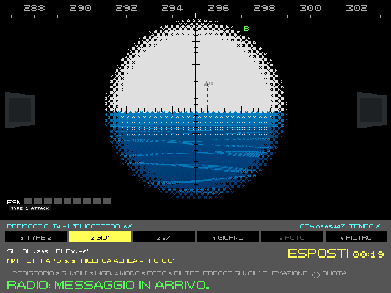

# 8. Il nemico

Il nemico dell'Enhanced non sa dove sei: ti cerca. Ascolta con l'equazione del sonar che usi anche tu, guarda col
periscopio e col radar, chiede aiuto agli aerei, spara, posa mine. Questo capitolo descrive le sue armi e le sue
abitudini. I modelli sono nel volume 2 (parte E).

## 8.1 L'IA

Le unità dell'IA seguono gli ordini della missione (gli script delle originali, le regole dell'editor), ma tutto
quello che percepiscono passa dagli stessi modelli del giocatore.

**Cosa sanno.** Un sonar nemico ti sente se l'equazione del sonar lo permette: il tuo rumore, la distanza, lo strato,
il mare. Un radar ti vede se la tua testa è fuori e la sua antenna gira dalla tua parte. Una vedetta ti vede se la
piuma è visibile. Una tua trasmissione può darti via. Un ping tuo ti rivela a chiunque ascolti. Col solo ascolto
passivo un'unità dell'IA ha il tuo rilevamento; la tua posizione la ricava col tempo, se ti tiene a lungo.

**Cosa vedono.** Le vedette e i periscopi dell'IA usano il modello della tua testa a vista, col mare e con la luce (cap.
4). Di notte riconoscono le navi dai fanali e dalla sagoma, e la Luna allunga la loro portata. Anche l'IA stima l'angolo
sulla prora come te, con più errore di notte e vicino alla prua o alla poppa, e lo manda alla sua TMA.

**Come si muovono.** Le navi e i sottomarini dell'IA conoscono il fondale: pianificano le rotte attorno alle secche,
rallentano per accostare, tengono il franco. I sottomarini usano la stessa dinamica del tuo battello. Con la
navigazione incerta (cap. 5) anche l'IA sbaglia la sua posizione e se la corregge coi suoi punti nave. Le mine che il
suo sonar ha visto le aggira, a 300 m. Sotto la banchisa un diesel cerca l'acqua libera per ricaricare (cap. 9).

**Le loro abitudini:**
- i sottomarini dell'IA alzano il periscopio ogni pochi minuti, per guardate brevi; i sovietici alzano prima
  l'avvisatore radar. Si vedono, se il tuo periscopio è su;
- i radar seguono la disciplina delle emissioni: silenzio, navigazione, ricerca, ingaggio. Passano all'ingaggio quando
  vedono qualcosa, e tornano indietro dopo venti minuti di calma (cap. 4);
- i sottomarini sovietici fanno il **Crazy Ivan**: ogni mezz'ora o due, e poco dopo un'accostata, virano di 120-180°
  per ascoltare nel cono d'ombra poppiero. Se li stai seguendo troppo da vicino, ti trovano davanti;
- le navi col sonar fuori scafo (VDS) o con la schiera filata li calano da sole, portano il pesce sotto lo strato e
  cacciano a sprint and drift;
- un sottomarino, di qualunque parte, può pedinarne un altro da vicino, dritto a poppa nel cono sordo, a qualche
  centinaio di metri. Segue quello che sente, con un ritardo: un'accostata brusca del pedinato può portare all'urto,
  come col Tautog e il K-108 nel 1970;
- un sottomarino nucleare sovietico con un siluro in coda lancia l'esca semovente MG-74;
- un Victor III che tiene un contatto lontano senza una soluzione buona per i siluri può lanciare un Vodopad, che fa
  scendere un siluro col paracadute vicino al bersaglio;
- in pace chi ti tiene ti pedina, la nave a 3,5 km e il sottomarino a 1-6 km, e la nave ogni tanto ti pinga per dirti
  che ti ha; un sottomarino dell'IA che pinghi tu da vicino si allontana (volume 4, T10);
- una nave colpita fa il suo controllo danni, si ritira, chiede soccorso o viene abbandonata (cap. 7).

**Le loro armi**, quando le regole d'ingaggio le liberano (§8.6):
- **i siluri antisom delle navi:** la Perry e la Type 22 hanno i Mk 46 dei tubi da 324 mm, fino a 7 km. Spruance, Kidd,
  Ticonderoga e Knox hanno l'ASROC col Mk 46, fino a 9 km. Le sovietiche (Krivak II, Kara, Kirov, Slava, Udaloy) hanno
  il SET-65 dai tubi da 533 mm, fino a 8 km. Un'arma alla volta: dopo un esito la nave aspetta un minuto e mezzo e
  riprende il contatto. Su un battello in superficie non tirano: la testa cerca sotto, e lì restano i cannoni (§8.3);
- **la risposta al tuo lancio:** il lancio si sente entro 20 km. Un sottomarino nemico immerso, una volta su due, ha il
  tuo rilevamento: evade, lancia le esche e, se ha le armi libere, ti tira un siluro su quel rilevamento;
- **l'elicottero imbarcato:** oltre la portata dei tubi la nave fa decollare il suo elicottero ASW, entro 60 km;
- **i missili antinave:** le navi, l'Oscar e il Charlie II, e gli SSN occidentali con gli Harpoon tirano su un
  bersaglio di superficie che hanno classificato. Mai su un neutrale né su chi credono un mercantile, e mai se
  nell'area del seeker c'è un contatto neutrale o ignoto.

**La difficoltà dei nemici** (K nella scelta della missione): facile, normale, realistico, minaccia percepita. Cambia
gli equipaggi degli aerei, la prontezza dei cannoni e quanto il nemico vede.

## 8.2 L'ASW aereo

Elicotteri e pattugliatori sono il nemico più pericoloso per un sottomarino: veloci, fuori dalla portata delle sue
armi, con sensori che non sente arrivare.

| Mezzo | Marina | Sensori | Armi |
|---|---|---|---|
| SH-60B Seahawk | USA | boe sonore, MAD | siluri Mk 46 |
| SH-3H Sea King, SH-60F | USA | sonar a immersione, boe sonore | Mk 46 |
| P-3C Orion, S-3 Viking | USA | boe sonore, MAD, radar | Mk 46 |
| Ka-25, Ka-27 | URSS | sonar a immersione o MAD, boe | siluri o bombe di profondità |
| Il-38, Tu-142, Be-12 | URSS | boe, MAD, radar | siluri, bombe |
| SH-2F Seasprite | USA | boe sonore, MAD | Mk 46 |
| Lynx HAS.3 | Regno Unito | MAD, radar (il contatto glielo dà la nave) | Sting Ray |
| Hkp 4 | Svezia | sonar a immersione | Tp 42 |

**Come cacciano.** Un aereo arriva su un'area (un datum dal SOSUS, una nave colpita, un contatto passato da una
nave), posa uno schema di boe sonore (barriera, cerchio, cuneo, trappola…), ascolta, stringe con boe attive, conferma
col MAD passandoti sopra, e attacca. Un elicottero col sonar a immersione si ferma in hover, cala il trasduttore,
ascolta, emette, risale e salta al punto successivo.

*Un Ka-27 in hover a 1,4 km, visto col Type 2 a 6 ingrandimenti: sopra il mare il disco del rotore e la cabina, sotto
il cavo del sonar a immersione che entra in acqua (scena di prova PROVA_T4_ELICOTTERO).*

**Cosa si vede e si sente dal battello:**
- al periscopio: l'elicottero in hover con l'anello di spruzzi sotto, il cavo che entra in acqua, il MAD che pende
  sotto, le boe che cadono col paracadute e la macchia di colorante, le luci di notte (spente in caccia), i
  marcatori fumogeni o luminosi;
- al sonar: i tonfi delle boe, i ping del sonar a immersione e delle boe attive, il rumore dei rotori quando passano
  proprio sopra, i siluri che entrano in acqua;
- all'ESM: i radar degli aerei;
- i messaggi dell'equipaggio: aereo in sorvolo, boa vicina, ping del sonar a immersione, marcatore avvistato.

**Il loro ping ti rivela prima di trovarti.** In acqua profonda il ping del sonar a immersione si intercetta da sette
a dieci volte più lontano di quanto la sua eco ti scopra.

**Il tempo.** Alcune boe sovietiche non servono col mare mosso: RGB-NM e NM-1 oltre mare 3, RGB-75 e RGB-25 oltre
mare 2 (le RGB-1, 2, 15 e 55A non hanno limite); il sonar a immersione non si cala oltre mare 5 né coi fulmini
vicini; il MAD perde portata col mare grosso; i siluri aviolanciati si guastano più spesso entrando in acqua mossa
(cap. 9).

**Il MAD** vede il ferro del battello entro qualche centinaio di metri, a qualunque quota e anche posato sul fondo.

**Aerei ed elicotteri non si possono abbattere:** nessuna arma, vostra o delle navi amiche, li colpisce (volume 2, E5
§7). Contro di loro conta solo non farsi trovare.

In pace e in crisi gli aerei non lanciano armi: un SUS (un segnale esplosivo) o un rapporto. Un aereo neutrale (la
parte del paese costiero, come l'Orion norvegese o l'Hkp 4 svedese nelle loro acque) caccia e osserva, ma non tira
mai.

## 8.3 L'artiglieria

Le navi coi cannoni sparano al battello, se lo vedono e se la situazione lo permette.

- **Quando:** solo in guerra, contro il battello in superficie o contro un periscopio o un albero visti entro 2-5 km
  da una nave già in allarme. In pace e in crisi solo colpi d'avvertimento, mai sul bersaglio.
- **Immerso sei al sicuro:** a 3 m sotto la superficie un proietto non arriva. A quota periscopica rischiano solo le
  teste dei periscopi, gli alberi e la cima della vela.
- **Le armi non sono uguali:** il Phalanx americano del 1989 non spara a bersagli di superficie; l'AK-630 sovietico
  sì, entro circa 2 km. L'Alfa rischia di più.
- **Cosa succede:** si vedono le vampe e le colonne d'acqua dei colpi, di notte gli illuminanti; si sentono gli
  scoppi a bordo e al sonar; l'acqua delle colonne bagna il vetro del periscopio. Un colpo sul periscopio lo acceca o
  ne incrina il vetro; le schegge rovinano la testa; i colpi sulla vela e sugli alberi li danneggiano; in superficie
  si danneggia lo scafo; un colpo a prua o a poppa, fuori dallo scafo resistente, può squarciare una cassa zavorra,
  che non tiene più l'aria e imbarca (cap. 7). Sulla carta compaiono le croci delle cadute.
- **La risposta:** immersione d'emergenza (Ctrl+D). Il cannone punisce il periscopio alzato troppo a lungo vicino a
  una scorta e il battello sorpreso in superficie: non è il modo normale di affondare un sottomarino.

**Acque territoriali.** Se la missione le dichiara, entrare in quelle di un altro paese in tempo di pace porta colpi
d'avvertimento se si è visti e, se il battello è stato localizzato, bombe d'avvertimento: due ogni due minuti, sempre
più vicine. Nel debriefing conta come violazione, e farsi scoprire dentro è un incidente diplomatico (cap. 10).

**Fra navi.** Nelle missioni che lo prevedono, in guerra, le navi si sparano fra loro. La battaglia si sente al sonar
anche a 40 km.

## 8.4 Le mine nemiche

Le missioni possono avere campi minati già posati, e i posamine dell'IA posano mine durante la partita. Le mine non
distinguono amici e nemici. Il BQS-15 del 688 le trova a prua, se è acceso (cap. 3), al prezzo di farsi sentire.

## 8.5 Le collisioni

Durante i pedinamenti della Guerra fredda i sottomarini si sono urtati spesso. Nell'Enhanced gli scafi hanno le loro
dimensioni vere, con la vela, e possono toccarsi: sottomarino contro sottomarino, nave contro sottomarino.

- **L'urto** dipende dall'energia: masse, velocità, angolo. Un urto radente graffia, uno di prua deforma e squarcia.
  Vela, timoni, eliche, antenna rimorchiata e duomo del sonar si danneggiano per primi. Una nave che passa a poppa può
  prendere la tua antenna rimorchiata.
- **Si sente:** a bordo uno schianto e lo stridio dello scafo; l'urto fra altre unità arriva dall'acqua, più debole
  quanto più è lontano; in mare il colpo si sente a chilometri. Dopo un urto tutti e due sanno dell'altro.
- **Si vede:** al periscopio la vista s'inclina col rollio dell'urto e torna dritta in una decina di secondi.
- **I quasi incidenti** (entro 200 m fra immersi, entro 500 m a quota periscopica sotto una nave) restano agli atti.
- **L'emersione sotto una nave** è il rischio più noto: vedi l'immersione d'emergenza e la quota di sicurezza (cap.
  2).

**Gli avvisi prima dell'urto:** il sonar segnala un contatto a rilevamento costante che si avvicina («Sonar: contatto
a rilevamento costante, si avvicina»), e l'equipaggio dà l'allarme collisione quando è vicinissimo. I dettagli sono nel
volume 2, capitolo E3.

**In arrivo:** le conseguenze per la carriera e l'incidente politico in pace, le reti dei pescherecci sullo scafo (per
la schiera ci sono già, cap. 3).

## 8.6 Le interazioni fra unità dell'IA

L'IA segue le stesse regole del giocatore anche fra le sue unità: un sottomarino alleato scoperto, un gruppo
antisommergibile nemico che lo caccia, un alleato che attacca per conto suo, tutto secondo la situazione (pace, crisi,
guerra), le dottrine delle due parti e l'accordo INCSEA del 1972. Il giocatore può assistervi, al periscopio e al
sonar, e la sandbox (cap. 12) le mostra da spettatore. Le navi sparano anche ai sottomarini dell'IA esposti, e l'IA
ricava la posizione dai soli rilevamenti con una sua TMA.

Alcune regole che si notano in mare:
- navi, aerei ed elicotteri non lanciano armi antisom dentro l'area d'azione di un sottomarino amico, anche la vostra
  quando la radio l'ha dichiarata, salvo un contatto classificato o la fretta subito dopo un attacco nemico;
- in pace e in crisi un aereo antisom non passa sotto i 500 piedi vicino a una nave dell'altra parte (INCSEA): si
  vede salire;
- un messaggio FLASH della missione alla vostra parte mette in allerta anche le unità amiche.
