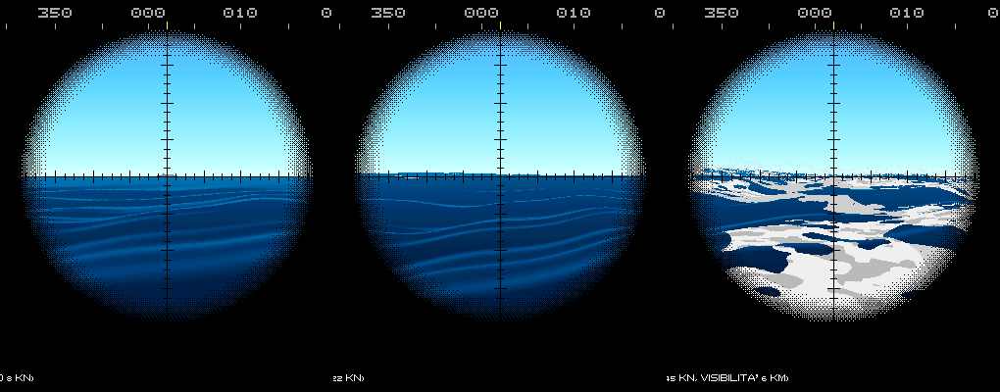
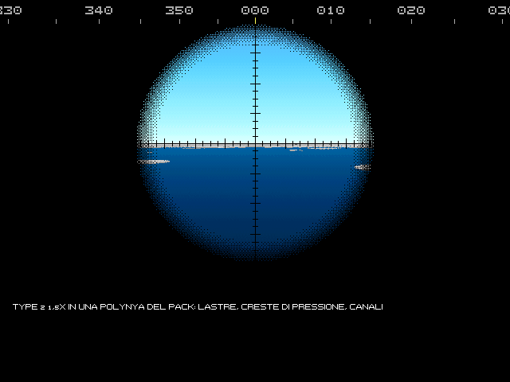

# 9. Meteo e mare

Il tempo cambia la caccia: col mare grosso tutti sentono peggio, gli elicotteri restano a bordo, il periscopio
affoga fra le onde. Nell'Enhanced il meteo è quello vero del teatro e della stagione, e cambia durante la missione.

## 9.1 Il meteo dei teatri

Nella scelta della missione, W sceglie il meteo:
- **fisso**: mare 3, sereno, come nelle prime versioni;
- **del teatro e della stagione**: il meteo realistico.

Il meteo realistico è tarato sui dati di rianalisi ERA5 di ogni teatro e mese. Un generatore ora per ora fa passare
i regimi del tempo (alte pressioni, fronti, burrasche), col vento, il mare che cresce col vento e si calma dopo, l'onda
lunga, le nubi, la pioggia e la neve, la nebbia, il ghiaccio. Gli eventi rari (i temporali, i «polar low» del nord)
arrivano nei loro mesi. Lo stesso seme dà lo stesso tempo.

Il briefing mostra il meteo previsto. Le missioni dell'editor e le rapide possono fissarlo.

## 9.2 Lo stato del mare e i suoi effetti

*Lo stesso mare al Type 2 a 1,5 ingrandimenti: a forza 2 con 0,8 m d'onda, a forza 5 con 3 m, a forza 7 con 7 m e la
visibilità a 6 km (`anteprima_periscopio mare_2`, `mare_5`, `mare_7`).*

Lo stato del mare va da 0 (calma) a 9, sulla scala Douglas, dall'altezza significativa delle onde. Il vento si misura
in Beaufort.

| Su chi | Cosa cambia |
|---|---|
| **Sonar** | il rumore del mare sale col vento; vicino alla superficie, da mare 5, sonar di scafo e boe sentono fino a 10 dB peggio, le antenne rimorchiate fino a 6. La pioggia aggiunge rumore |
| **Periscopio** | le onde coprono la finestra (a mare 3 quasi mai, a mare 6 spesso), gli spruzzi, la quota periscopica più difficile da tenere. Col mare grosso la vela può affiorare |
| **Radar ed ESM** | col mare grosso i radar vedono peggio una testa fra le onde; la pioggia disturba la banda X |
| **Vista** | nebbia, foschia, pioggia e neve riducono la visibilità per tutti, anche per le vedette nemiche |
| **ASW aereo** | alcune boe sovietiche inutili col mare mosso (RGB-NM e NM-1 oltre mare 3, RGB-75 e RGB-25 oltre mare 2), niente sonar a immersione oltre mare 5 o coi fulmini vicini, MAD peggiore, siluri aviolanciati che si guastano entrando in acqua |
| **Navi** | le navi piccole rallentano col mare di prua |
| **Radio** | i temporali portano scariche in HF |

**Quando la vela affiora.** A quota periscopica, col mare grosso, il cavo d'onda può scoprire la vela: per qualche
secondo il battello è visibile al radar come se fosse in superficie. L'equipaggio avverte.

## 9.3 Cosa si vede e si sente

- **Al periscopio:** il mare mosso con le onde vere e la schiuma delle creste; le nubi portate dal vento, le cortine di
  pioggia sotto i temporali; la foschia verso l'orizzonte; la nebbia bassa; la pioggia e la neve; i lampi, con il
  fulmine visibile vicino e il bagliore dietro le nubi lontano. Le navi rollano e beccheggiano col mare, e piantano la
  prua negli spruzzi. Gli elicotteri in hover lottano col vento.
- **Al sonar:** il fulmine che cade in mare si sente come un colpo, fino a una sessantina di chilometri: un falso
  allarme.
- **A bordo:** da mare 4 i colpi di mare sullo scafo, in superficie e a quota periscopica; il tuono, solo in
  superficie.
- **In sala radio:** il crepitio dei temporali lontani e lo schianto di quelli vicini.
- **Sulla carta:** vento e mare vicino al battello, il bollettino più lontano, le celle temporalesche quando la testa è
  fuori, il ghiaccio, i fulmini sentiti al sonar.

## 9.4 Giorno, notte e astronomia

Il sole sorge e tramonta come in quel posto e in quel giorno, con l'algoritmo astronomico: la data e l'ora della
missione decidono la luce. Dal crepuscolo nautico al giorno pieno il mare e il cielo si schiariscono e virano. Il
coperto toglie luce.

Di notte:
- a occhio si vede poco: le teste dei periscopi e le piume si notano molto meno, anche per il nemico;
- gli intensificatori, la televisione a bassa luminosità e le camere termiche ridanno una parte della vista (cap. 4);
- le navi accendono le luci; gli aerei in caccia le spengono;
- le navi usano gli illuminanti per sparare (cap. 8);
- la centrale del 688 passa alla luce rossa (cap. 2).

## 9.5 Sotto il ghiaccio

*Il Type 2 a 1,5 ingrandimenti in una polynya del pack: le lastre, le creste di pressione e i canali
(`anteprima_periscopio ghiaccio_polynya`).*

D'inverno nel Barents e nell'Okhotsk il mare può essere coperto dalla banchisa. Sotto il ghiaccio:
- **niente periscopio né alberi:** sotto la banchisa non salgono (messaggio 489). La radio arriva solo in ELF, coi
  messaggi brevi a campanello; il filo galleggiante non riceve il VLF;
- **si risale solo dove si può:** in acqua libera, cioè le polynye e i canali (messaggio 488 quando ce n'è una sopra), o
  nel nilas, il ghiaccio nuovo sottile, che il 688 sfonda. Le polynye che hai visto si spostano col pack, fino a un nodo:
  una polynya di un'ora fa non è più lì;
- **il tetto ha le chiglie:** creste che scendono in media a 4 m, raramente oltre i 10, al più 20 (50 nel pack
  pluriennale oltre gli 80° di latitudine). Il BQS-15 acceso le vede a prua e l'equipaggio avvisa: volta bassa o che
  scende (486), chiglia a prua (487), troppo veloci (484). Una chiglia che prende la vela è un urto, con i danni, e il
  battello resta sotto con poca velocità;
- **il sonar sente diverso:** il pack scricchiola, le creste fanno rumore attorno ai 100 Hz, col freddo le fessure
  attorno ai 2 kHz; le alte frequenze vanno meglio che in mare aperto. Il ping attivo prende le creste per bersagli
  fermi, e le teste dei siluri vicino alla volta si fanno ingannare;
- **il punto nave** che chiede un'antenna non si può fare: resta il batimetrico, e l'errore della posizione cresce.

La pagina del fondale (Ctrl+H) sotto il ghiaccio mostra la volta (capitolo 5). Il modello completo è nel volume 2,
capitolo E11; la tattica nel volume 4, T11.

## 9.6 Il meteo via radio

Il comando trasmette i bollettini alle 00, 06, 12 e 18 UTC, con la previsione a 12 e 24 ore. Quando la previsione vede
una burrasca entro 24 ore arriva l'avviso di burrasca, con precedenza prioritaria. Dal lato sovietico sono la
«meteosvodka» e lo «shtormovoe preduprezhdenie» del servizio idrometeorologico della flotta. Chi non ascolta la radio
li perde (cap. 4).

Le previsioni hanno gli errori di quelle del 1989: più lontano guardano, più sbagliano, e i temporali non li vedono.

Si può anche **chiedere una previsione** trasmettendo (alla Radio, tipo «previsione» col tasto 6, poi 7): arriva
al ciclo di trasmissioni successivo, ma la trasmissione si può intercettare come ogni altra (cap. 4).
