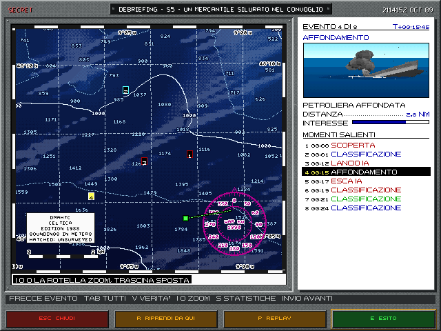
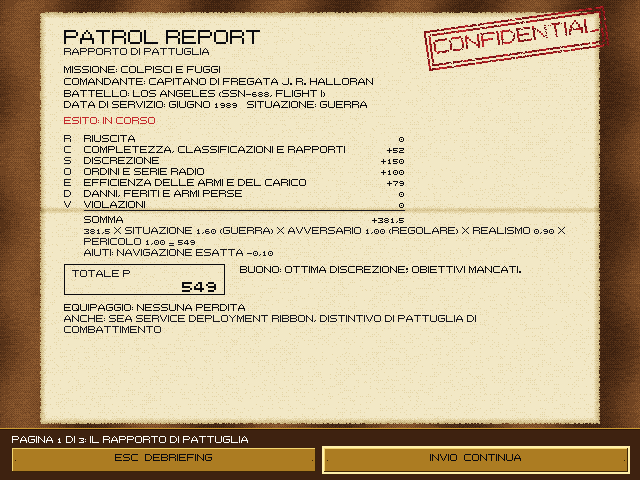
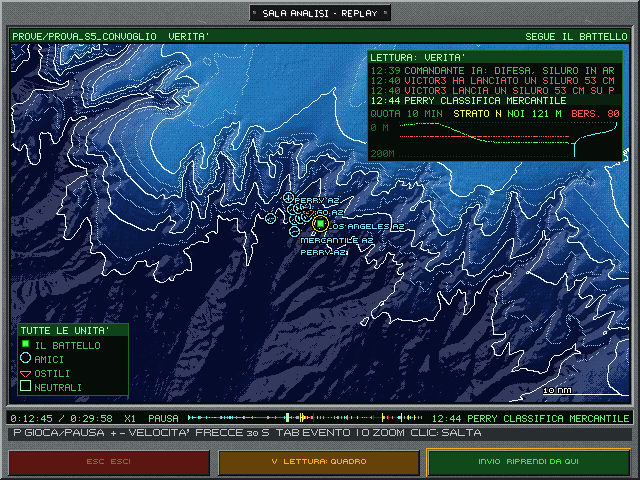
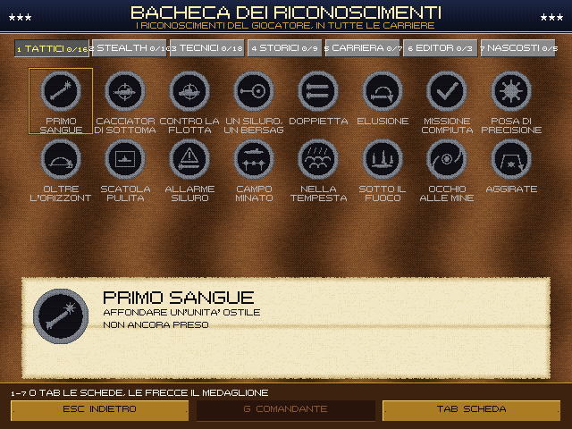
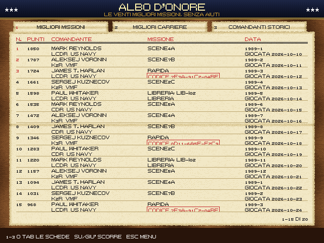
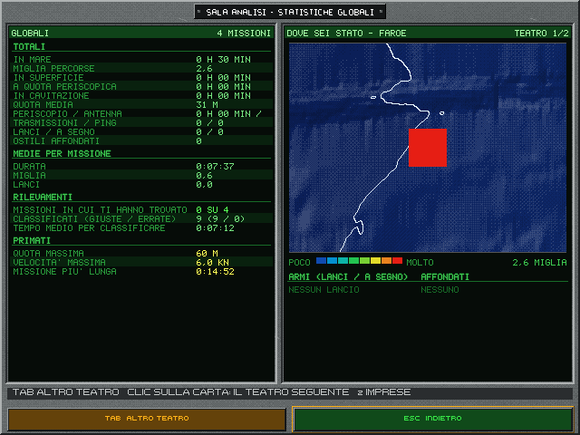

# 10. Carriera e memoria della missione

Una missione dell'Enhanced non finisce con un numero. Resta il debriefing con gli eventi, il replay da rivedere, il
rapporto di pattuglia col punteggio, le decorazioni, il fascicolo del comandante, i riconoscimenti, le statistiche.
Tutto questo vale nell'Enhanced; il classico tiene il rapporto d'esito dell'originale.

## 10.1 Comandanti, gradi e fascicolo

**L'albo dei comandanti** (C dalla scelta della missione) tiene fino a otto carriere, come cartellini sulla
scrivania: foto, nome, grado, marina, missioni, punti, decorazioni, stato. Il timbro «IN CARICA» sta sulla fototessera.
I posti ancora liberi sono tratteggiati e numerati da 2 a 8. Il cartellino «NUOVA CARRIERA» apre il modulo: nome,
marina, carriera breve o completa, indulgenza. F apre il fascicolo, B la bacheca dei riconoscimenti, O l'albo d'onore,
S le statistiche cumulate.

**Il modulo della carriera nuova** ha quattro righe: nome, marina, carriera, indulgenza. Tutte le scelte sono sempre in
vista come caselle, e la piena è quella presa: US NAVY (688) o VMF (ALFA), BREVE o COMPLETA, le tre indulgenze. Basta un
clic. Da tastiera si scrive il nome e Invio passa al campo seguente, non apre il fascicolo. Tab, Maiusc+Tab e su e giù
cambiano campo, sinistra e destra cambiano scelta. Invio sull'ultima riga, o il tasto APRI IL FASCICOLO, apre il
fascicolo; Esc annulla. Senza nome vale quello di serie della marina scelta.

La marina vale per il resto del giro: il comandante va in carica per quella marina e il menu si porta sul suo battello,
come la scheda rapida. Se in carica c'è solo un comandante della VMF, il menu parte dall'Alfa anche agli avvii successivi.

**Eliminare una carriera.** Col comandante scelto, nel piede c'è E ELIMINA. La prima pressione chiede conferma:
«ELIMINARE RAMIUS? LA CARRIERA VA PERSA PER SEMPRE», coi tasti ESC NO, LO TENGO (Invio vale no) ed E SI', ELIMINA. La
seconda E, o il clic, elimina: è definitivo. Va via il fascicolo e il posto in carica si libera; statistiche e replay
restano. Vale anche Backspace, due volte.

Il piede è di legno, coi tasti come targhette d'ottone, e risponde anche al clic. Senza un comandante scelto: ESC
MENU, O ALBO D'ONORE, S STATISTICHE, INVIO NUOVA CARRIERA. Con un comandante: ESC, F FASCICOLO, S, E ELIMINA, INVIO IN CARICA,
spento se il comandante non può andare in mare. Gli avvisi (la carica, la conferma dell'eliminazione) compaiono al
posto della riga d'aiuto.

Il comandante **in carica** di ogni marina va in mare con la prossima missione della sua parte. I caduti, i rimossi e i
congedati restano nell'albo, ma non si caricano.

**I gradi** sono quelli veri delle due marine:
- US Navy: Ensign, Lieutenant (jg), Lieutenant, Lieutenant Commander, Commander, Captain;
- VMF: Lejtenant, Starshij lejtenant, Kapitan-lejtenant, Kapitan 3-go ranga, Kapitan 2-go ranga, Kapitan 1-go ranga.

La carriera si chiude da Captain (Kapitan 1-go ranga), al comando di una squadriglia (di una brigata, per la VMF): il
grado di contrammiraglio c'è nelle tabelle, ma nessuna fase della carriera lo raggiunge.

La **carriera completa** parte dal grado più basso; la **carriera breve** parte da Commander (o Kapitan 2-go ranga), già
al comando. Le promozioni passano per le commissioni: in anticipo, in zona o in ritardo; due commissioni mancate
portano al congedo. Sul lato sovietico pesa anche la caratteristica dello zampolit, l'ufficiale politico.

**L'indulgenza:** realistica, indulgente (una seconda possibilità per carriera), arcade (nessuna rimozione dal
comando, solo meno punti).

**Il fascicolo** («Officer Service Record», «Lichnoe delo») raccoglie anagrafica, stato di servizio, note
caratteristiche con la graduatoria fra i pari grado, decorazioni con le motivazioni, commissioni e provvedimenti.

## 10.2 Il debriefing

*Il debriefing di una partita senza giocatore nella S5, il convoglio: la carta con la traccia, sul foglio il quarto evento,
l'affondamento della petroliera, con la sua minicartolina, l'elenco dei momenti salienti con l'evento corrente in negativo.*

Alla fine della missione il debriefing ripercorre gli **eventi uno alla volta**, come nei simulatori di volo di fine
anni '80:
- a sinistra la carta del teatro con la traccia del battello, che si disegna fino all'evento corrente; gli eventi già
  visti sono segnaposto numerati, quello corrente è giallo e resta sempre sopra. Le etichette che si toccherebbero
  diventano una sola: «12-18» se i numeri sono di seguito, «12+6» se no, cioè il 12 e altri 6. Avvicinandoti tornano
  separate;
- a destra, su un foglio bianco, l'evento a macchina: numero e ora, tipo, la **minicartolina** incollata, il testo,
  la distanza a puntini e l'interesse a tacche;
- sotto, l'elenco dei momenti salienti, con l'evento corrente in negativo; un clic su una riga porta a quell'evento.

**La minicartolina.** Ogni evento ha la sua figurina. La scena viene dalla fotografia di quell'istante, se c'è, come
una nave colpita, un'emersione o un missile che parte. Se no si ricostruisce da dove stavano le unità in quell'istante,
con il soggetto a galla e vicino: è una figurina, non la vista vera, e senza la fotografia non ha fumo né colonne
d'acqua. Ciò che non si vede, come un contatto sonar, un ping, la radio, i danni o una zona, ha la sua icona d'epoca,
e così il periscopio esposto troppo a lungo. Una figurina non è mai mare vuoto: ciò che non si può inquadrare, come un
contatto biologico, ha l'icona della cascata. Un siluro sedotto da un'esca mostra il battello, perché né il siluro né
l'esca si vedono.

La cartolina di un **affondamento** non è una fotografia dell'istante: al momento dell'evento la nave di solito è ancora
quasi dritta. È una scena composta col modello della sua classe, in cui si vede andare giù: di prua, di poppa o sul
fianco, sempre lo stesso modo per la stessa unità, con falle, fuliggine e rottura se la fisica le ha date; una nave
spezzata resta in due tronconi a V. Attorno fumo, chiazza di nafta, schiuma e rottami. Un battello a galla affonda di
poppa con la prua alta. Di un battello immerso e di un aereo abbattuto non si vede lo scafo: restano colonna d'acqua,
schiuma, chiazza e rottami. È una figurina: né la colonna per un battello a 200 m né il fumo vengono dalla simulazione.

**Comandi:** frecce o Invio da un evento all'altro; **Tab** tutti gli eventi o i soli salienti; **V** la verità: le
tracce vere di tutte le unità e gli eventi che a bordo non si sapevano; V di nuovo torna al quadro di bordo; **S** le
statistiche della missione. La riga d'aiuto sopra il piede li ricorda. **Sulla carta:** trascina per spostarla, rotella
per avvicinarti attorno al punto sotto il puntatore, oppure I e O. La carta torna da sola sull'evento solo quando ne
scegli uno che è fuori vista. Il piede ha quattro tasti, che
funzionano anche col clic: **Esc** chiude, **R** riprendi da qui (§10.4; spento nell'esito e nel rapporto ACINT),
**P** il replay, **E** l'esito.

**L'esito** è il rapporto di missione dattiloscritto sul foglio. Il timbro dice la categoria: verde il successo,
marrone il successo parziale o il richiamo, rosso il resto. Poi completezza, durata e meteo a puntini; gli obiettivi
con le caselle (la X se raggiunti, in rosso i falliti, in grigio i secondari); armi e bersagli, classificazioni giuste
ed errate, danno massimo, ordini violati, il messaggio del comando; in fondo il codice della partita. Invio passa al
rapporto ACINT, se il sonar ha registrato contatti, o chiude.

## 10.3 Il rapporto di pattuglia e le cerimonie

*Il rapporto di pattuglia: le sette voci del punteggio, il moltiplicatore e il giudizio.*

Dopo il debriefing viene il **rapporto di pattuglia** («Patrol report», «Donesenie o pokhode»). Il punteggio è la
somma di sette voci, per un moltiplicatore:

| Voce | Cosa misura |
|---|---|
| **R** Riuscita | gli obiettivi raggiunti |
| **C** Completezza | gli obiettivi secondari, le classificazioni, i rapporti radio |
| **S** Discrezione | quanto ci si è esposti: ping, fix di radiogoniometria, avvistamenti, ESM, transitori, boe |
| **O** Ordini | le ROE e la serie radio ricevuta; ogni infrazione toglie punti |
| **E** Efficienza | i colpi sui lanci, il carico adatto alla missione |
| **D** Danni | danni subiti, feriti, caduti, armi perse |
| **V** Violazioni | neutrali o amici colpiti, fuoco senza ordine, zone vietate, acque territoriali |

Il **moltiplicatore** è il prodotto della situazione (pace, crisi, guerra), dell'avversario, del realismo e del
pericolo corso. Il rapporto mostra la catena intera, dalla somma esatta delle voci al totale, e gli aiuti accesi col
loro peso: si vede quanto costa ogni aiuto. Il realismo parte da 1 e ogni aiuto ne toglie un po', fino a 0,5:
- la navigazione esatta;
- il GPS;
- l'ASW facile;
- la verità dei contatti (V);
- le scie di tutti;
- il sonarista esperto;
- il LOFAR colorato per rilevamento, se lo si è guardato;
- le firme acustiche senza variazioni.

Accanto al totale, un giudizio a parole con la voce più forte e la più debole.

Poi le **cerimonie**, se ci sono:
- la **decorazione personale**: il comandante in uniforme, la medaglia nell'astuccio, il nastrino che si aggiunge alla
  barretta, la motivazione su carta timbrata. Dalla Navy Achievement Medal alla Medal of Honor; dalla medaglia «Per il
  merito militare» all'Eroe dell'Unione Sovietica. La seconda decorazione uguale vuole di più. Nessuna decorazione con
  le violazioni;
- la **decorazione di reparto**, con l'equipaggio schierato davanti alla vela;
- la **promozione** e i **provvedimenti**: richiamo, inchiesta, rimozione dal comando;
- il **giornale**, per gli esiti che fanno notizia: il «Norfolk Herald» o il comunicato TASS;
- **In memoriam**, se il comandante cade: «On Eternal Patrol», o «Vechnaya pamyat'».

**Cosa conta per la carriera:** le missioni originali; le rapide che chiedono di contare, la prima volta che si gioca
quel codice; le missioni dell'editor solo nella carriera «aperta». Una missione ripetuta rende sempre meno.

## 10.4 Riprendi da qui e il replay

**Riprendi da qui** (R nel debriefing, sull'evento corrente, poi Invio): la partita ricomincia uguale (missione, seme,
opzioni, carico) e si rigioca con gli ordini dati fino a quell'istante, con una schermata d'attesa. Poi comanda di nuovo
il giocatore. La missione originale va agli atti così com'era; la ripresa non conta per la carriera.

**Il replay** (P nel debriefing) mostra la partita dall'alto, senza risimularla, nella «sala analisi»: una consolle
con la carta grande in uno schermo.

*Il replay nella lettura «verità», sul convoglio della S5: la carta grande, la legenda in basso a sinistra, la lettura in alto
a destra coi lanci in rosso chiaro, la linea del tempo sotto la carta con le tacche a colori.*

- **due letture**, con V: la **verità**, cioè tutte le unità vere con le scie, le armi in acqua col filo e gli alberi
  alzati; il **quadro del giocatore**, cioè i contatti come si sapevano, le linee della TMA e la soluzione. I simboli
  sono quelli della carta (§5.6), con la legenda in basso a sinistra («CIO' CHE SAPEVI» o «TUTTE LE UNITA'»);
- **la lettura**, in alto a destra: gli ultimi quattro eventi, in rosso chiaro quelli che sulla linea del tempo sono rossi, e
  la quota degli ultimi dieci minuti, del battello e del bersaglio, sul fondale e coi termoclini; in basso a destra la scala
  delle 10 miglia;
- **la linea del tempo**, una fascia sottile sotto la carta: ogni evento è una tacca. Il colore dice il tipo. Rosso ciò che colpisce, fa danno o è un'arma che parte:
  lanci, colpi, affondamenti, urti, incagli, artiglieria, danni, mine. Giallo il pericolo, scampato o in corso: siluri in
  acqua ed evitati, esche, passaggi ravvicinati, colonne d'acqua, emersioni, ping che ti cercano, zone proibite. Ciano le
  scoperte, le classificazioni tue, gli ingaggi e le mine trovate. Bianco inizio e fine. Grigio il resto: radio, routine
  dell'IA, misure. L'altezza dice l'interesse
  dell'evento (il dato del registro, 0-100): da 70 a tutta altezza (un affondamento, un colpo subito), da 50 più corta
  (un tuo lancio), da 30 bassa (la scoperta di una nave), sotto un punto sulla linea. Le più interessanti stanno sopra
  le altre, il cursore dell'ora sopra tutte. Nella lettura QUADRO gli eventi che non sapevi non compaiono. La ripresa è
  una riga verde. P gioca e mette in pausa, Pag Su e Pag Giù (anche `+` e `-`) la velocità da 1× a 64×, frecce
  ±30 secondi, Tab all'evento successivo, un clic per saltare;
- **la carta** segue il battello. Trascinandola la sposti, e la rotella la avvicina attorno al punto sotto il puntatore,
  come I e O; dopo averla spostata, un clic su «SEGUI IL BATTELLO» a destra della testata la
  riporta su di lui;
- **il piede**: Esc esce, V cambia lettura, Invio sceglie l'istante da cui riprendere. I tasti si possono anche
  cliccare.

Il replay dal vivo della sandbox (§12.5) tiene ancora la disposizione di prima.

I replay si salvano da soli: in carriera nella cartella del comandante, fuori carriera gli ultimi venti. Nel
fascicolo, P sulla missione scelta riapre il suo replay.

## 10.5 Riconoscimenti e albo d'onore

*La bacheca dei riconoscimenti: le schede per categoria in alto, i medaglioni (quelli presi a colori), sotto il
cartellino del medaglione scelto.*

**I riconoscimenti** (achievement) sono 68, cinque dei quali nascosti, in sette categorie: tattici, di discrezione,
tecnici, storici, di carriera, dell'editor, nascosti. I 13 del 31/10/2026 premiano:
- il lavoro sotto la banchisa: emergere in una polynya, ore sotto il ghiaccio senza urti;
- il riconoscimento notturno: le navi dai fanali, una nave a luci spente;
- il soccorso: tutti gli uomini in acqua salvati. Un solo livello, sobrio;
- il pedinamento: i minuti nei «baffles» di un sottomarino e, nascosto, le cinquecento iarde;
- le mine scoperte e aggirate;
- i sorvoli degli elicotteri e le navi con la schiera passate vicino senza farsi scoprire;
- il catalogo delle classi riconosciute e le missioni storiche della libreria. Molti hanno tre livelli: bronzo, argento, oro. Dopo l'esito, la pagina
«Nuovi riconoscimenti» mostra quelli appena presi.

**La bacheca** (B dall'albo dei comandanti) li mostra come medaglioni a rilievo, una scheda per categoria (1-7 o Tab):
il bordo del livello raggiunto, in grigio quelli da prendere, «?» i nascosti. Sotto, la condizione, la data, la missione
e l'avanzamento («12 su 20»). G alterna il comandante e i riconoscimenti globali del giocatore.

*L'albo d'onore, scheda delle migliori missioni.*

**L'albo d'onore** (O dall'albo dei comandanti) è un registro d'epoca con tre schede (1-3 o Tab; frecce per
scorrere):
- **migliori missioni**: le venti migliori, col punteggio, il comandante, la missione, le date; il codice (della
  rapida o della partita, cap. 11) in un riquadro, da ricopiare per rigiocarla;
- **migliori carriere**: le dieci migliori carriere chiuse, con la decorazione più alta e lo stato; i caduti con la
  croce o il nastro nero;
- **comandanti storici**: dieci schede di battelli e comandanti veri della Guerra fredda, con l'impresa e la fonte,
  senza punteggi.

## 10.6 Le statistiche

*Le statistiche globali nella consolle «SALA ANALISI»: a sinistra i totali, le medie e i rilevamenti; a destra la carta
dei luoghi delle missioni, teatro per teatro.*

**Della missione** (S nel debriefing), ricalcolate dalla traccia del replay:
- la quota nel tempo, con le fasce di superficie e quota periscopica;
- il livello di rumore irradiato, coi segni dei ping e delle trasmissioni;
- i tempi in superficie, a quota periscopica, oltre la cavitazione; quota e velocità medie e massime;
- le esposizioni: periscopio, antenna, antenna rimorchiata, trasmissioni, ping;
- le armi per classe e per bersaglio;
- la prima scoperta nemica: come, chi, quando, a che distanza; i contatti, le classificazioni giuste e sbagliate;
- la heatmap della posizione sulla carta del teatro;
- dal 29/10/2026, le voci delle novità:
  - **al periscopio:** identificazioni visive giuste e sbagliate, misure del telemetro con l'errore medio, osservazioni
    dell'AOB con l'errore medio;
  - **i missili:** lanciati, a segno, neutrali nella scatola;
  - **il fondo e la navigazione:** ping dell'ecoscandaglio, punti nave, errore medio e massimo della posizione stimata;
  - **l'intercettatore:** allarmi di siluro e siluri evitati dopo l'allarme;
  - **le mine:** scoperte (ormeggiate e di fondo), campi attraversati, mine aggirate;
  - **la radio:** messaggi verificati e non autentici riconosciuti;
  - **gli urti:** collisioni, quasi collisioni, colpi d'artiglieria subiti (una raffica vale uno; i totali di prima del
    05/11/2026 contano ogni proietto);
- dal 31/10/2026:
  - **il ghiaccio:** il tempo sotto la banchisa, gli urti col ghiaccio, le emersioni nella banchisa, gli avvisi delle
    chiglie;
  - **la notte:** le identificazioni coi soli fanali e con la sagoma, quelle a luci spente, il tempo con le proprie luci
    accese;
  - **il pedinamento:** il tratto più lungo in coda a un sottomarino, la distanza minima da un sottomarino straniero, le
    volte che un sottomarino ci ha classificati;
  - **l'ASW aereo:** i sorvoli degli elicotteri e degli aerei, i siluri aerei evitati;
  - **il soccorso:** gli uomini salvati.

**Cumulate** (S dall'albo dei comandanti): per il comandante o per tutte le partite, nella consolle «SALA ANALISI -
STATISTICHE GLOBALI». A sinistra totali, medie per missione, rilevamenti e primati; a destra la carta «DOVE SEI STATO»
con la heatmap per teatro e, sotto, le armi e gli affondati. Tab o un clic sulla carta cambiano teatro; anche i tasti
del piede rispondono al clic. Senza missioni i valori sono trattini spenti, e sulla carta un riquadro spiega come si
riempie.
