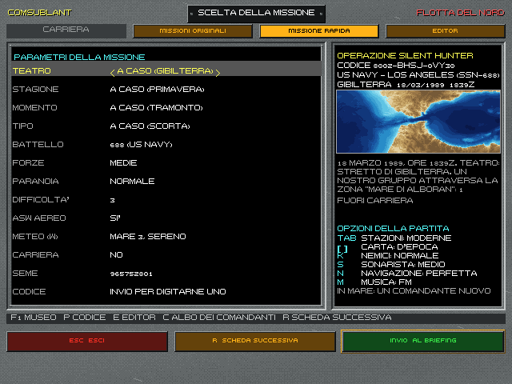
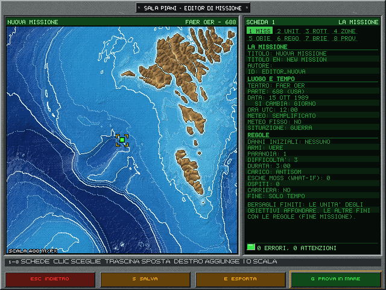

# 11. Missioni rapide, editor e libreria

Oltre alle dieci missioni originali, l'Enhanced ha tre modi di andare in mare: una missione generata in un istante, una
missione costruita con l'editor, una delle missioni pronte della libreria.

## 11.1 Le missioni rapide

*La scheda delle missioni rapide: a sinistra i parametri, a destra gli ordini generati e le opzioni della partita.*

La scheda «Missione rapida» della scelta della missione (R) genera una missione da pochi parametri. A sinistra i
parametri, a destra l'operazione generata.

**I parametri:**
- teatro, stagione, momento (alba, giorno, tramonto, notte);
- tipo di missione: pattuglia, caccia, antinave, scorta, ricognizione, minamento, inserimento;
- battello (688 o Alfa), forze in campo, «paranoia» del nemico, difficoltà;
- ASW aereo, meteo, se deve contare per la carriera;
- il seme.

Ogni campo può restare «a caso»: fra parentesi si vede cosa ha scelto il seme.

**Il codice missione.** Seme e parametri stanno in un codice di 13 caratteri, come `XXXX-XXXX-XXXXX`. Lo stesso codice
dà sempre la stessa missione, byte per byte: basta scambiarsi il codice per giocare la stessa partita. Il codice si
digita nella scheda (Invio, oppure P da qualunque scheda), o si passa da riga di comando con `--codice`.

**A destra**, l'operazione: nome, codice, parte, teatro con data e ora, anteprima del fondale, le prime quattro righe del
briefing, e se conta per la carriera. Invio la gioca, dal briefing come le originali. E la apre nell'editor per modificarla.

**Per la carriera** una rapida conta solo se lo chiede, se rispetta le soglie e se il comandante non ha già giocato quel
codice.

## 11.2 L'editor di missione

*L'editor di missione: la carta del teatro con le unità, a destra le schede della missione, sotto la riga degli errori
e delle attenzioni.*

La scheda «Editor» elenca le missioni: quelle della libreria (LIB.), quelle del giocatore e quelle importate (IMP.),
più «+ Nuova missione» e «+ Da una originale». Invio apre l'editor; G gioca subito la missione scelta; I importa un
pacchetto.

**L'editor** è una consolle, «SALA PIANI»: a sinistra la carta del teatro nella grafica della stazione Navigazione, a
destra le otto schede come linguette su due righe (1-8 o clic). I campi sono sul fosforo, l'etichetta smorzata e il
valore acceso; nella scheda Missione stanno in tre gruppi (la missione; luogo e tempo; regole). La data è una riga
sola («15 OTT 1989»): la riga sotto, «SI CAMBIA», sceglie se il clic cambia il giorno, il mese o l'anno.

| Scheda | Cosa si fa |
|---|---|
| Missione | titolo (italiano e inglese), autore, teatro, parte (688 o Alfa), situazione, data e ora, durata, difficoltà, «paranoia» del nemico, meteo (semplificato, del teatro o fisso), danni iniziali del battello |
| Unità | le unità amiche, nemiche e neutrali, con la classe e il comportamento |
| Rotte | i punti di rotta delle unità |
| Zone | le aree della missione, che le regole controllano |
| Obiettivi | cosa deve fare il giocatore, primari e secondari |
| Regole | i trigger: quando succede qualcosa, cosa fa la missione |
| Briefing | il testo degli ordini |
| Prova | la verifica e la prova in mare |

**Sulla carta:** clic sinistro sceglie, trascinare sposta un'unità o una zona, clic destro aggiunge (un'unità della
classe scelta, un punto di rotta, una zona, il centro di un obiettivo); trascinare il vuoto sposta la carta, I e O
ingrandiscono. Nelle schede ogni campo cambia col clic (sinistro avanti, destro indietro); i testi si scrivono, Invio
conferma ed Esc annulla.

**In fondo alla scheda** la verifica sempre in vista, con la spia, e sopra i primi due avvisi: un clic mostra l'unità
che non va. Il piede comune ha quattro tasti, anche col clic: **Esc** torna al menu, **S** salva, **E** esporta il
pacchetto, **G** prova in mare (la missione si gioca dal briefing, e in carriera conta come missione dell'editor). I
messaggi dell'editor compaiono al posto della riga d'aiuto.

**Da una originale** apre nell'editor una delle missioni del 1989, con unità, rotte, dotazione e briefing: la logica
degli script originali no.

## 11.3 La libreria di missioni

La libreria raccoglie missioni pronte, fatte con l'editor, da giocare o da usare come base. Ci sono due serie:

- **soggetti ispirati a fatti reali** della Guerra fredda, dal dossier sugli episodi storici (volume 3): Vestfjord, la
  nave mineraria, la quarantena, le campane d'edera, il guardiano del cavo, le petroliere, il tappo, Valona, l'operazione
  Aport, il cavo della fregata, il confine, il gruppo cacciatore, Outlaw Shark, il pedinatore in attesa, l'ancoraggio,
  la scala, sotto la prora, l'arcipelago, pietra santa, cinquecento iarde, la rotta lunga, l'acqua a due gradi, quota
  zero, l'ombra del boomer;
- **soggetti inediti**: la balena di ferro, il pescatore di Teriberka, acque basse e nervi tesi, la porta di Ercole, il
  disertore, il ponte di Ekaterina, il lupo ferito, l'ombra lunga, sotto il bastione, la corsa al relitto, il primo eco,
  la finestra di lancio, e le tre missioni di riconoscimento nello Stretto di Gibilterra: Sagome nello Stretto, Levante
  (la mattina dopo, con la nebbia) e Fanali (la notte, coi fanali di navigazione); poi le due sotto il ghiaccio, il
  bastione bianco e la soglia di Ekaterina.

Oggi sono 41, 24 storiche (da S01 a S25; la S21 non c'è) e 17 inedite (da I01 a I17), per i due battelli. Ognuna è provata: si gioca senza errori, si vince e si
perde nel modo previsto. Tre usano i missili della pagina di tiro (§6.4): il primo eco con l'Harpoon, Outlaw Shark
col TASM in esercitazione, la finestra di lancio col Tomahawk d'attacco a terra.

## 11.4 Il codice partita

Ogni partita avviata dal menu ha un **seme nuovo**: anche le missioni originali tornano come nel 1989, con varianti e
dadi diversi a ogni partita. Il seme e le scelte stanno nel **codice partita**, di 18 caratteri, come
`XXXXXX-XXXXXX-XXXXXX`:
- l'impronta del file della missione (la missione e la sua versione);
- il seme;
- le opzioni del menu: stazioni 1989 o moderne, carta, meteo, nemici, sonarista, navigazione e GPS. La musica (M,
  §1.6) non c'entra: è una scelta del menu, non della partita;
- se la partita è senza traffico civile (§3.1). I codici di prima del 28/10/2026 hanno il traffico acceso.

I codici di prima del 29/10/2026 (cominciano con 4-7) si leggono ancora, col GPS spento; quelli nuovi cominciano con
8-B.

**Dove si vede:** in fondo alla colonna di destra del briefing, nella pagina dell'esito del debriefing (E), nell'albo
d'onore, nei dati del replay.

**Come si usa:** P nella scelta della missione, in qualunque scheda, fa digitare un codice.
- Il codice di una **rapida** (13 caratteri) porta alla scheda «Missione rapida» coi suoi parametri.
- Il codice di una **partita** cerca la missione fra originali, libreria, editor e importate, e la fa partire subito con
  quel seme e quelle opzioni. Se il file della missione non c'è più o è cambiato, la scelta dice «missione del codice
  non trovata, o cambiata da allora».
- Il codice della **sandbox** (30 caratteri) riapre le regolazioni del vetrino già compilate (§12.7).
- Da riga di comando `--codice` li accetta tutti.

Il codice non distingue maiuscole e minuscole e ignora i trattini; la O vale zero, la I e la L valgono uno. Un
carattere sbagliato, o due vicini scambiati, si scoprono sempre.

Lo stesso codice, con gli stessi ordini, rifà la stessa partita, ma solo con la stessa versione del gioco: un
aggiornamento del motore può cambiare il corso degli eventi.

## 11.5 Scambiare missioni

Una missione dell'editor si esporta (E) in un **pacchetto** `.m688m`: un file unico con i dati della missione, il
briefing e le verifiche. Il pacchetto ha la versione del formato, un controllo d'integrità e l'elenco di quello che gli
serve (teatro, classi, versione del gioco), così chi lo importa sa subito se può giocarlo.

Le missioni importate girano in un ambiente **isolato**: i loro script Lua non possono toccare file, rete o sistema,
perché arrivano da altri.

## 11.6 La sandbox, il vetrino dell'IA

V nella scelta della missione, in ogni scheda, apre la **sandbox** sulla missione scelta: una partita senza giocatore,
dove anche il battello è comandato dall'IA. Regolazioni, comandante IA, vista dal vivo, statistiche tecniche e codice
sandbox sono nel capitolo 12.
