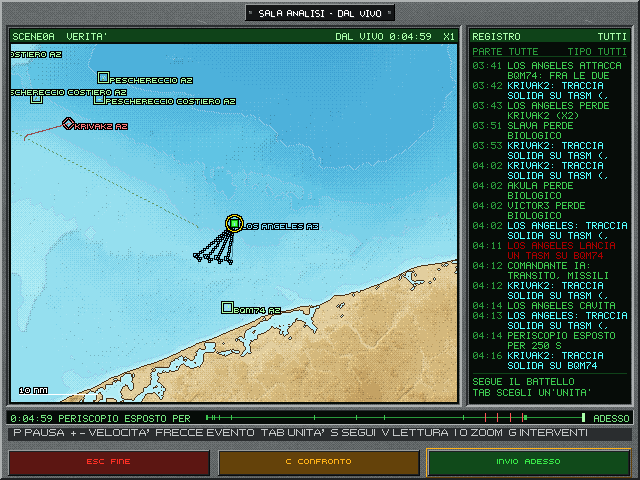
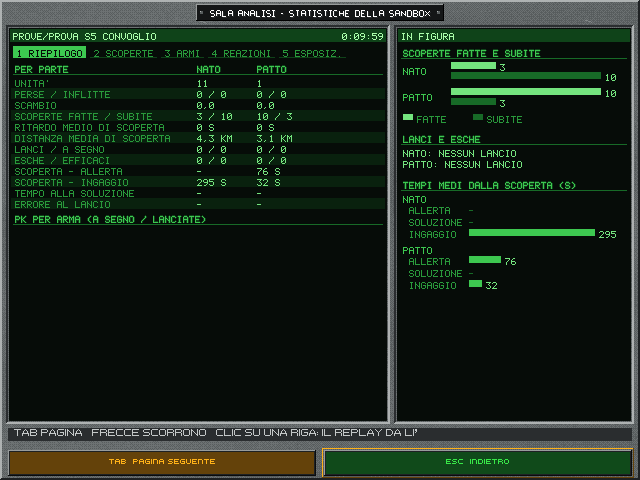
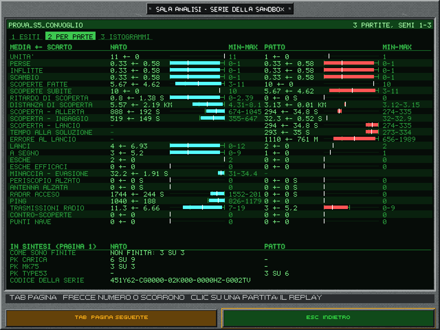
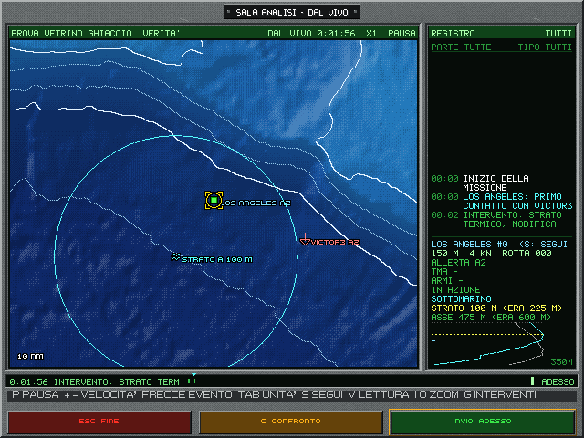

# 12. La sandbox, il vetrino dell'IA

La sandbox è una partita senza giocatore: si sceglie una missione e la si guarda svolgersi da sola, come un vetrino
al microscopio. Anche il battello lo comanda l'IA. Serve a vedere come lavorano dottrine, regole d'ingaggio, allerta,
meteo e sensori, e a misurarlo con le statistiche tecniche e col replay.

## 12.1 Le regole del vetrino

- **Solo Enhanced.** La sandbox gira sempre con le regole dell'Enhanced; il classico non cambia.
- **Nessun privilegio.** Il battello lo comanda un comandante IA con gli stessi sensori, le stesse regole e la stessa
  percezione di tutte le altre unità (§12.4). Nessuna unità vede la verità.
- **Lo spettatore vede tutto, l'IA no.** Le viste dello spettatore leggono la verità; il motore no.
- **Deterministica.** Stessa missione, stesse regolazioni e stesso seme danno la stessa partita. Il codice sandbox
  (§12.7) la fa rigiocare o la passa a un amico.
- **Fuori carriera.** Non conta per fascicolo, albo d'onore, riconoscimenti e statistiche cumulate.

## 12.2 Come si avvia

- **Dal menu:** nella scelta della missione, in qualunque scheda (originali, rapide, libreria, editor, importate), **V**
  sulla missione scelta apre le regolazioni (§12.3). Invio fa partire la partita.
- **Da un vetrino pronto:** nella scheda Editor della scelta della missione, dopo «Nuova missione» e «Da una
  originale», le righe verdi «VETRINO DELL'IA» sono le scene di prova dell'IA (§12.8). V, G, Invio o un clic aprono
  le regolazioni già compilate coi valori consigliati.
- **Da un codice:** **P** nella scelta della missione fa digitare un codice sandbox, e riapre le regolazioni già
  compilate (§12.7).
- **Da riga di comando:** `--sandbox --missione X`, anche senza finestra (`--secondi` come tetto, `--salva-traccia`
  per tenerla), con le regolazioni predefinite: la partita si ferma comunque alla loro durata, 120 minuti, o all'esito. Per regolarla si passa il suo codice: `--codice` col codice sandbox
  porta missione, seme e tutte le regolazioni, e `--seme` vince sul seme del codice (la stessa partita su un altro
  seme). Anche le missioni di prova si ritrovano dal loro codice. `--serie CARTELLA/serie.toml` riapre una serie
  (§12.8).

## 12.3 Le regolazioni

Una schermata di 29 righe in tre pannelli: in alto le tre parti in colonna, sotto la partita e, a destra, le parti
dell'IA come un quadro di levette con la spia verde. Su e Giù scelgono la riga, Sinistra e Destra cambiano il valore;
la riga scelta è in giallo, un valore cambiato rispetto alle regolazioni di base è in ciano. In basso il piede
comune: Esc indietro, S una serie di 10 semi, Invio avvia il vetrino. I tasti sono nell'appendice A.

**Per ciascuna parte** (NATO, Patto di Varsavia, neutrali), cinque righe:

| Riga | Valori | Che cosa fa |
|---|---|---|
| Situazione | della missione, pace, crisi, guerra | la situazione di partenza fra la parte e le altre |
| ROE | della missione, trattenute, libere | le regole d'ingaggio della parte, anche per i cannoni delle navi e per gli aerei antisom: con le armi trattenute non sparano, nemmeno d'avvertimento, e gli aerei cacciano senza sganciare |
| Livello dell'IA | della missione, recluta, regolare, esperto | i sonaristi, la guida a filo e il comandante IA, se il battello è della parte; vince su quello della missione |
| Allerta di partenza | della missione, A0-A3 | vale solo all'inizio: una forza ad A0 in guerra è una forza sorpresa. Poi sale e scende come sempre (cap. 8) |
| Carico | della missione, per classe e anno | il carico delle armi; per classe e anno anche il battello prende il carico standard della sua classe |

**Per tutta la partita:**

| Riga | Valori |
|---|---|
| Meteo | del teatro e della stagione, oppure fisso (mare 3, sereno) |
| Navigazione | realistica (cap. 5) o perfetta |
| Sensori e stazioni | 1989 o moderni (§1.4) |
| Seme | un numero, o nuovo a ogni partita |
| Durata massima | in minuti, a quarti d'ora; poi la partita finisce da sola |
| All'esito della missione | si ferma, o continua fino alla durata |
| Tempo compresso agli eventi | non si ferma, o torna a 1× a ogni lancio (anche dell'IA), colpo, affondamento, emersione d'emergenza e mina esplosa |
| Traffico civile | navi civili nei teatri (§3.1) o nessuno; le scene di prova non l'hanno mai |
| IA: difesa, armi, reazioni, forze, ESM, sonaristi | sì o no: si spengono le parti dell'IA, per confrontare una partita con e senza |

Gli interruttori dell'IA sono quelli della taratura (volume 2, capitolo E6 §2.18):
- **difesa:** evasione, esche, ritirata, anticollisione, tiro di risposta;
- **armi:** carico, scelta dell'arma, TMA a gambe, guida a filo;
- **reazioni:** le reazioni agli alleati attaccati, il pedinamento e l'INCSEA in pace;
- **forze:** allerta, messaggi e zone; spente le forze, si spengono anche difesa e reazioni;
- **ESM:** l'ESM delle unità dell'IA;
- **sonaristi:** i sonaristi dell'IA, che classificano e possono sbagliare.

Spegnerne uno mostra che cosa cambia senza quella parte dell'IA.

## 12.4 Il comandante IA

Il battello lo comanda un comandante IA che vede solo quello che vedrebbe il giocatore: i contatti come li mostra la
carta, la propria posizione stimata, le armi, gli obiettivi e le regole d'ingaggio ricevute. Comanda con gli stessi
ordini del giocatore: per questo replay e codice partita funzionano come sempre.

Fa il transito e la pattuglia, ascolta, fa la TMA a gambe secondo la dottrina della sua marina e, se la soluzione non
arriva, un impulso attivo. La sua esperienza è il livello scelto per la sua parte nelle regolazioni (la NATO per il
688, il Patto per l'Alfa): si fida della soluzione dopo 18 rilevamenti da recluta, 12 da regolare, 8 da esperto; con
«della missione» è regolare. Poi:
- **siluri:** attacca con la soluzione secondo le regole d'ingaggio. Guida a filo i suoi siluri: intanto resta sotto i
  12 nodi e accosta piano, perché il filo regga. Ricarica i tubi dalla rastrelliera;
- **missili:** sulle navi di cui ha la posizione, fra 15 e 100 km, da quota periscopica;
- **mine:** quando l'obiettivo è minare, va a 12 km dal campo e posa le Mk 67 a ventaglio, e finché ne ha non attacca;
- **difesa:** fugge da un siluro in arrivo cambiando quota, e lancia un'esca, anche quella semovente di traverso;
- **radio:** trasmette il rapporto di contatto al primo ostile dell'obiettivo, e ascolta il broadcast alle finestre;
- **navigazione e ritirata:** prende i punti nave con la navigazione realistica, e si ritira se è colpito o senza
  armi.

**Nelle missioni originali** il comandante segue il piano del briefing, scritto per ciascuna delle 22. Il piano dà la
condotta, le regole d'ingaggio, i punti, l'area e l'uscita. Viene solo dal briefing e dagli script, mai dalle posizioni
dei nemici, che cambiano fra le varianti. Le condotte sono:
- **caccia:** cerca e attacca nell'area del briefing, come nella TORPEX;
- **transito:** va di punto in punto e, se qualcuno lo pedina, lo semina con uno scatto lungo la rotta dall'altra
  parte dello strato, poi deriva;
- **scorta:** tiene la stazione davanti alla rotta pianificata del convoglio;
- **pedinamento:** segue il contatto designato alla distanza del briefing, con la TMA e senza impulsi;
- **evasione:** a scatti e derive, per seminare chi lo segue;
- **attacco a terra:** è la 0A. Carica da sé i quattro Tomahawk antinave (TASM) nei tubi, li lancia da quota
  periscopica col periscopio alzato entro i 5 minuti della missione, e solo dopo fugge verso Copenaghen.

Il comandante non esce mai dal rettangolo della missione, neanche quando fugge da un siluro. Il piano non fa vincere
più spesso: cambia la condotta, perché il comandante fa quello che dice il briefing. Nelle missioni senza piano e senza
un'area negli obiettivi pattuglia sul posto. Che cosa sta facendo e perché
lo dice la scheda del battello e il registro: «COMANDANTE IA: fase - motivo». Nella TORPEX, per esempio, fila
l'antenna rimorchiata, fa la TMA e lancia due volte. I dettagli sono nel volume 2, capitolo E6 §2.17.

## 12.5 La vista dal vivo

Partita la sandbox, al posto delle stazioni c'è la vista dal vivo: la carta del replay mentre la partita va avanti.
I fatti del battello sono raccontati in terza persona, col nome della classe («Spruance ha scoperto Los Angeles»).

*La vista dal vivo nella consolle «SALA ANALISI - DAL VIVO»: la carta con la verità accesa (SCENE0A, dopo cinque
minuti), a destra il registro dell'IA coi filtri, sotto la fascia del tempo e i tre pulsanti.*

Tutto sta nella consolle «SALA ANALISI - DAL VIVO».
- **A sinistra** lo schermo della carta, coi simboli della carta (§5.6). Nella testata ci sono la missione e la
  lettura; a destra l'ora della partita («DAL VIVO», o «INDIETRO» quando si guarda il passato), la compressione del
  tempo (da 1× a 256×) e la pausa.
- **A destra** lo schermo del registro dell'IA. Nella testata c'è il filtro attivo; nella prima riga la parte (clic a
  sinistra) e il tipo (clic a destra). Sotto c'è la scheda dell'unità scelta.
- **In basso** la fascia del tempo: l'istante e l'evento più vicino, la barra con le tacche (colori e altezze come nel replay, §10.4,
  qui con tutti gli eventi, anche nei quadri) e i triangoli degli interventi, con ADESSO a destra. Sotto, il piede coi tasti e i tre pulsanti FINE, CONFRONTO e
  ADESSO.

**Le letture** (V le fa girare in tondo):
- **Verità:** tutte le unità vere.
  - Ogni unità ha il simbolo della sua parte, una linea coi suoi due minuti di rotta e l'etichetta con la classe e
    l'allerta («A2»). La scia degli ultimi cinque minuti è sbiadita, verde per il battello.
  - Ci sono anche la posizione che ogni unità crede di avere, col filo verso quella vera e l'ellisse al 95%, i
    periscopi e le antenne alzati, la schiera filata, il ping, il radar e la radio.
  - Le armi in acqua sono nel colore di chi le ha lanciate, col filo verso chi le guida; le unità distrutte hanno la
    X rossa.
- **Quadro della NATO, quadro del Patto:** quello che la parte sa nell'insieme, cioè i contatti delle sue unità e i
  rapporti radio.
  - Le sue unità hanno il colore dell'amico. Ogni bersaglio ha la posizione stimata con l'ellisse, o la linea di
    rilevamento se si sa solo quella, e l'etichetta «CLASSE ETÀ SENSORE».
  - Senza la classe, il bersaglio è un ignoto. I dati più vecchi di dieci minuti sono sbiaditi.
  - **C** mette sotto, in grigio, la verità delle altre parti, per confronto.
- **Quadro dell'unità scelta** (Tab sceglie l'unità): i suoi contatti, con la posizione stimata o la linea di
  rilevamento, l'etichetta «CLASSE QUALITÀ SENSORE», e sbiaditi se non sono solidi. C'è anche la croce della sua
  soluzione TMA, tratteggiata se la soluzione non è ancora affidabile.

**Il registro** scorre a destra, il fatto più recente in basso: scoperte, classificazioni, ingaggi, lanci, colpi,
esche, evasioni, reazioni, allerta, messaggi, punti nave, le fasi del comandante, e le tracce solide e i contatti
persi. Lo stesso fatto ripetuto entro un minuto diventa una riga sola, con «(×N)».
- **I colori** sono quelli delle tacche del replay (§10.4): rosso armi, colpi e danni; giallo il pericolo, scampato o in
  corso; ciano le scoperte; bianco inizio e fine. Il resto ha il colore del testo.
- **I filtri:** un clic su «PARTE» li fa girare fra tutte le parti, NATO, Patto e neutrali; un clic su «TIPO» fra
  scoperte, armi, manovre, allerta e radio, comandante. Nel quadro di una parte il filtro segue la parte, nel quadro
  dell'unità passano solo i suoi fatti.
- **Un clic su una riga** porta la carta sul posto e sceglie l'unità; con Maiuscolo anche il tempo va lì.

**La scheda dell'unità scelta:**
- la classe e il numero;
- quota, velocità e rotta;
- l'allerta e l'errore della sua posizione stimata;
- la TMA: il bersaglio, le gambe, se ha la soluzione;
- le armi e i tubi carichi;
- lo stato (in azione, distrutta, sul fondo, incagliata), più gli alberi alzati e le emissioni;
- l'ultima reazione, o per il battello l'ultima fase del comandante.

Un clic sul titolo, o S, fa seguire l'unità.

**Guardare indietro.** Un clic sulla linea del tempo, le frecce (l'evento precedente o successivo del registro) o un
clic su una riga del registro portano la vista a un istante passato: la partita intanto continua. Invio o il pulsante
ADESSO tornano al vivo.

**La fine.** La partita finisce alla durata massima, all'esito (se si ferma lì), o con Esc. Tutti i tasti sono
nell'appendice A.

## 12.6 Il dopo

Finita la partita, il **debriefing dello spettatore**: tutti gli eventi, non solo i momenti salienti, con la verità
sulla carta e le tracce di tutte le unità. I fatti che allora nessuno sapeva hanno «(NON NOTO ALLORA)». Tab e V
tornano ai soli eventi noti e alla carta del comandante. Dal debriefing:
- **S** apre le **statistiche tecniche** (sotto);
- **P** apre il replay completo (§10.4), con le letture verità e quadro;
- Esc chiude. La traccia resta fra le ultime venti dei replay liberi.

**Le statistiche tecniche** stanno nella «sala analisi», come il replay. Hanno cinque schede (1-5, Tab o un clic
sulla linguetta; Su e Giù scorrono; un clic su una riga che ha un'ora apre il replay da lì). La prima ha due schermi:
a sinistra la tabella, a destra gli stessi numeri «in figura». Le altre quattro hanno uno schermo largo. Nel piede, Tab
passa alla pagina seguente ed Esc torna indietro.

*La prima scheda delle statistiche: il riepilogo per parte a sinistra; a destra in barre le scoperte fatte e subite,
lanci ed esche, i tempi medi dalla scoperta all'allerta, alla soluzione e all'ingaggio.*

1. **Riepilogo**, una colonna per parte:
   - unità, perse e inflitte, lo scambio delle perdite;
   - scoperte fatte e subite, il ritardo e la distanza media di scoperta;
   - lanci e colpi a segno, esche ed esche efficaci;
   - i tempi dalla scoperta all'allerta e all'ingaggio, il tempo alla soluzione, l'errore al lancio;
   - la probabilità di colpire (Pk) per arma.
2. **Scoperte:** per ogni coppia di unità di parti diverse, chi ha scoperto chi, con quale sensore, quando la scoperta
   era possibile, quando c'è stato il contatto, quando è diventato solido e classificato (in giallo se classificato
   sbagliato), a che distanza, e il ritardo fra il possibile e il contatto.
3. **Armi:** ogni arma lanciata, con lanciatore, bersaglio, ora, durata, tempo col filo ed esito (a segno, uccisione,
   sedotta da un'esca, mancata, esaurita, ancora in corsa).
4. **Reazioni e TMA:** per ogni unità i tempi dalla scoperta all'allerta, all'ingaggio, al lancio, e dalla minaccia
   all'evasione; per ogni TMA le gambe, il tempo alla soluzione, gli errori di distanza, rotta e velocità al lancio,
   la rinuncia.
5. **Esposizione:** il tempo con periscopio, antenna e schiera fuori, i secondi di radar, ping e radio, le
   contro-scoperte; l'errore medio e massimo della navigazione e i punti nave.

Le definizioni sono nel volume 2, capitolo F8 «La sandbox».

## 12.7 Il codice sandbox

Ogni partita del vetrino ha un codice di 30 caratteri, come `XXXXXX-XXXXXX-XXXXXX-XXXXXX-XXXXXX`: il codice partita
(§11.4) più tutte le regolazioni, livello, allerta e carico compresi. Si vede nel debriefing del vetrino e nei dati
del replay. P nella scelta della missione lo fa digitare (il campo tiene fino a 40 caratteri) e riapre le regolazioni
già compilate: Invio rifà la stessa partita.

## 12.8 Le serie e i vetrini pronti

**Le serie.** Una partita sola dice poco: la stessa situazione, con un altro seme, può finire in un altro modo. Nelle
regolazioni, **S** (o il bottone al centro del piede, «S SERIE DI 10 SEMI») gioca la stessa sandbox su dieci semi,
dall'1 al 10, senza finestra, fino a quattro partite alla volta. Lo schermo dice quante partite sono fatte. La serie
non si interrompe, ed è lenta: dieci partite di due ore possono chiedere diversi minuti.

Finita la serie si apre la sua schermata nella «sala analisi», con tre pagine (Tab, o un clic sulle linguette). La
NATO è in ciano, il Patto in rosso:
1. **Esiti:** come sono finite le partite, una barra per esito, con «quante SU quante».
2. **Per parte:** ogni numero delle statistiche (§12.6), NATO e Patto affiancati, sulla stessa scala. Ogni riga dice
   la media ± la deviazione e il minimo e il massimo, e ha un grafico piccolo: la linea dal minimo al massimo, la
   barra dove cade l'80% centrale delle partite (dal 10° al 90° percentile), la tacca della mediana. Se le righe non
   stanno nello schermo, le frecce le fanno scorrere. In fondo resta sempre la sintesi della pagina 1: l'esito più
   frequente, il Pk per arma di ciascuna parte e il codice della serie.
3. **Istogrammi:** Su e Giù scelgono il numero, per esempio lo scambio delle perdite o il ritardo di scoperta. Per
   ogni parte c'è un istogramma con la mediana tratteggiata e l'80% centrale segnato sotto l'asse. Sotto, una barra
   per partita in ordine di seme: un clic apre il replay di quella partita.

*La pagina 2 di una serie di tre semi: per ogni numero la media ± lo scarto, il grafico piccolo e il minimo e il
massimo, la NATO a sinistra e il Patto a destra; in fondo la sintesi della pagina 1.*

Esc o Invio tornano alle regolazioni; i due tasti del piede (Tab pagina seguente, Esc indietro) funzionano anche col
clic. Le serie restano nella cartella dei dati del gioco
(`~/.local/share/melchior688/serie/`, una cartella per missione, data e ora), con il riassunto `serie.toml`, le
tracce delle partite e un riassunto in testo; da riga di comando `--serie CARTELLA/serie.toml` le riapre.

**I vetrini pronti** sono le scene di prova dell'IA, ciascuna costruita per mostrare una cosa. Sono nella scheda
Editor, in verde; la scheda a destra dice titolo, che cosa mostra e durata, e il piede «INVIO IL VETRINO». Aprono le
regolazioni coi valori consigliati per quella scena (meteo e navigazione fissi, durata, se fermarsi all'esito o agli
eventi), che si possono cambiare prima di partire.

<!-- generato: vetrini_pronti -->
| Vetrino | Che cosa mostra | Durata |
|---|---|---|
| S1 - KPUG e SSN alleato | Un gruppo ASW sovietico trova uno Sturgeon alleato: il VDS lo sente subito, la traccia solida arriva per integrazione. | 120 min |
| S1G - KPUG e SSN alleato (guerra) | La stessa scena in guerra: le navi cacciano fino al PROBSUB, poi attaccano con le salve antisom. | 120 min |
| S2 - Una Perry pedina un Victor III | Una Perry col sonar trainato pedina un Victor III in pace; il P-3 arriva sul suo contatto. | 120 min |
| S3 - L'intruso nel bastione | Un intruso nel bastione: Il-38, gruppo ASW e un Victor III lo cercano insieme. | 120 min |
| S3A - Il bastione visto dall'Alfa | Il bastione visto dall'Alfa: il gruppo ASW trova l'intruso in pochi minuti. | 120 min |
| S4 - Due SSN amici nella stessa acqua | Due sottomarini amici in aree vicine; il Trafalgar e un Victor III si trovano e si sparano. | 120 min |
| S5 - Un mercantile silurato nel convoglio | Un Victor attacca un convoglio: una petroliera colpita, le scorte che cercano il sottomarino. | 120 min |
| S6 - L'uscita del Typhoon | Un Typhoon esce da Kola con la nave spia e i pescherecci; un SSN aspetta fuori. | 120 min |
| S7 - La crisi diventa guerra | Un gruppo portaerei e un Victor: la crisi diventa guerra, e ogni unità lo sa in tempi diversi. | 120 min |
| S8 - La parte del luogo | La parte del luogo: una Koni in crisi con gli USA e in pace con l'URSS caccia solo il 688, e a 15 minuti dichiara la guerra. | 60 min |
| M3 - Oltre l'orizzonte | Uno Slava e due Perry a 120 km, in guerra: nessuno vede l'altro. Da sola non succede nulla; è la scena dell'esperimento della spia. | 60 min |
| M1 - Antinave con scorta e un neutrale *(in ritaratura: non ancora nella libreria)* | Harpoon su uno Slava con due Krivak e un cargo neutrale dentro la scatola: il seeker prende il primo eco. | 60 min |
| M2 - TLAM: area di lancio e navigazione incerta *(in ritaratura: non ancora nella libreria)* | Una missione TLAM dalla libreria di bordo: l'area di lancio, la navigazione incerta e l'ordine dalla radio. | 240 min |
<!-- fine: vetrini_pronti -->

Non tutte le scene finiscono allo stesso modo. In S1 la traccia solida arriva di solito fra 1 e 6 minuti. In S6 l'SSN
aspetta immobile sul fango della scarpata: nelle due ore a volte trova il Typhoon, a volte no, secondo il seme.

## 12.9 Il vetrino di Dio

Nel vetrino si può anche intervenire sulla partita mentre corre, come un arbitro: aggiungere o togliere unità, dare
ordini, rompere un sistema, cambiare il tempo. Serve a vedere come l'IA reagisce a una sorpresa, e a confrontare la
stessa partita con e senza l'intervento.

**Il pannello** si apre con **G** nella vista dal vivo (I e O fanno lo zoom della carta). Si sceglie in quest'ordine:
1. la famiglia: **forze** (inserire o togliere un'unità, un ordine, il cambio di parte, la situazione, le ROE, l'allerta), **guasti**
   (macchine, un sensore, i tubi, il timone), **ambiente** (meteo, ora), **comunicazioni** (il disturbo radio, l'ordine
   falso) o **inganno** (l'incidente provocato, la false flag, la spia, il falso contatto);
2. l'intervento;
3. l'unità o la zona, con un clic sulla carta;
4. i parametri. L'ultima voce, «quando: fra», a 0 lo applica subito, altrimenti lo programma a tempo.

Backspace annulla l'ultimo intervento.

**Che cosa si vede.** Sulla linea del tempo c'è un triangolo per ogni intervento, rosso se è fallito, con la sua durata.
Sulla carta, accanto all'unità, c'è il segno della famiglia; un ordine «vai a» è tratteggiato, la zona del meteo è un
cerchio, l'unità tolta resta segnata con una croce per due minuti. Nel replay **G** salta all'intervento seguente,
Maiuscolo+G al precedente.

**Il falso contatto** è una sorgente che si muove senza scafo, con la firma della classe scelta e una fedeltà da 0 a
1. Più è bassa, più righe mancano allo spettro, e sotto 0,7 mancano le pale; un ping la svela, perché l'eco è
piccola (volume 2, C5 §2.7 e §2.11).

Nella verità il falso contatto ha la classe imitata e i colori della parte creduta, col segno dell'inganno e la
scritta FALSO. Nelle letture di chi lo sente (parte, unità, quadro del battello) c'è il segno sul contatto e la doppia
freccia dalla sorgente vera a dove la si crede. Se c'è solo il rilevamento, il segno sta sulla linea creduta alla
distanza vera, e così si vede anche l'inganno dello specchio della schiera.

**Il cambio di parte** passa una nave o un sottomarino dall'altra parte, subito e senza durata. Si sceglie la parte nuova
e chi lo sa: la parte nuova (se non si dice altro), tutti o nessuno. Lei sa chi è chi, e nella verità ha subito i colori
nuovi. Chi non lo sa continua a crederla della parte di prima: non le spara e non si guarda da lei. Se attacca si tradisce:
la vittima lo sa subito, la sua parte dopo il rapporto della formazione, e nel registro dell'IA c'è «X scopre che Y ha
cambiato parte». Il battello del comandante non si cambia.

Nella verità, sotto l'unità, la scritta CREDUTA NATO o CREDUTA PATTO dice che cosa credono gli altri. Se ormai ci crede solo
l'altra parte, lo dice: CREDUTA NATO DAL PATTO. La scritta se ne va quando lo sanno tutte e due le parti, e il registro segna
l'istante per ciascuna: «La NATO sa che Y ha cambiato parte». Nelle letture di parte e di unità Y ha i colori creduti: per chi
non lo sa è ancora dei suoi.

**Le comunicazioni e l'inganno sulla carta.**
- In alto a sinistra ci sono gli interventi che valgono per tutta una parte: il disturbo radio senza zona, l'ordine
  falso, la spia. Il disturbo con una zona ha il suo cerchio, come il meteo.
- L'incidente provocato resta lassù per due minuti. Sul punto c'è la stella dello scoppio, o il segno da dove parte il
  siluro «di nessuno». Il siluro corre nel colore della parte creduta, con la scritta SILURO DI NESSUNO.
- Finché l'ordine falso dura, sotto ogni unità che l'ha ricevuto c'è come l'ha preso: CREDE (rosso), IGNORA o
  SMASCHERA (verde), VERIFICA (giallo), NON RICEVUTO (grigio).
- Chi chiede conferma trasmette, come il sottomarino che riferisce un contatto. Se qualcuno lo localizza, per due minuti una linea gialla tratteggiata «DF» va da chi
  localizza a chi trasmette. Se lo localizza la rete strategica, che è lontana e sbaglia di decine di chilometri, non c'è
  linea: sull'unità c'è la scritta gialla DF DELLA RETE.
- Sotto l'unità che ha perso un messaggio nel disturbo c'è, per un minuto, la scritta grigia MESSAGGIO PERSO.

**Gli esperimenti.** Nelle regolazioni, Tab apre la seconda pagina: gli interventi programmati. Lì si prepara un
esperimento, che si salva in un file `.m688v` col codice sandbox. La serie A/B lo gioca a coppie, con e senza
interventi, sugli stessi semi; la schermata del confronto mostra le differenze e apre i replay affiancati di una
coppia: lì le tacche sulla linea del tempo sono gli interventi applicati di B, col colore della famiglia, e la linea
gialla è il punto dove le due partite divergono; rotella, I e O e trascinamento muovono le due carte insieme. Da riga di comando: `melchior688 --sandbox --esperimento FILE.m688v --seme N`, con `--senza-interventi` per la
partita A. Nella seconda pagina, **C** apre la lista dei file, coi tuoi esperimenti e con dieci già pronti, a 10 semi. Sette sono
sulla S5: «L'allerta anticipata», «La burrasca», «Il falso ordine di rientro», «La nave spia che vede tutto», «La scorta che non
c'è», «Lo scoppio nel transito» e «Il sonar della scorta guasto». «La spia oltre l'orizzonte» è sulla M3. «Il Victor e la spia» e «Il
Victor e la Krivak che riferisce» sono sulla M4, una scena che non sta fra quelle pronte. Che cosa danno le serie già giocate è nel
capitolo T12 §10. La spia dà il quadro ai sottomarini solo se salgono a quota d'antenna, e per un siluro quel dato non basta: nella S5
non cambia nulla, perché il Victor è sempre impegnato sul suo bersaglio e non sale mai a copiare. Nella M3 sì, perché lo Slava lancia
missili. Nella M4 nemmeno: il Victor sente già il convoglio da solo (capitolo E6 §7).

**La false flag.** Il siluro di un attaccante parte coi colori di un'altra parte, e chi è colpito incolpa
quella. Nel pannello si sceglie dalla lista delle unità chi attacca, poi il bersaglio. Nella verità il siluro ha la scritta
FALSE FLAG: CREDUTA NATO e la doppia freccia da chi l'ha lanciato davvero. Dal colpo in poi, se la colpa cade sulla parte
sbagliata, la scritta CREDUTA NATO sta sotto chi ha lanciato.

**L'ambiente sulla carta.** Strato, deriva del ghiaccio e polynya hanno il segno della famiglia AMBIENTE. Con una zona c'è il
cerchio e, sul centro, la scritta: STRATO A 120 M, STRATO X2, STRATO TOLTO, CANALE A 600 M, POLYNYA SI APRE, POLYNYA SI CHIUDE.
Senza zona la scritta sta in alto a sinistra, come GHIACCIO VERSO 090 A 0,5 KN, con la freccia della rotta. Durante la
transizione si aggiunge IN CORSO.

La polynya si vede anche mentre cambia. Quella che si apre è un disco di puntini, l'acqua libera, col bordo che cresce dal centro
fino al cerchio. Quella che si chiude è il tratteggio obliquo del ghiaccio su tutta la zona: rado finché è nilas, fitto a ghiaccio
fatto. Allo scadere dell'intervento il ghiaccio torna com'era nella stessa transizione, con la scritta POLYNYA SI RICHIUDE o
POLYNYA SI RIAPRE. Il comandante, sulla sua carta, non la vede: ha le carte del clima e la volta che misura col sondatore.

**Il pack.** Nei teatri col ghiaccio, nel mese della partita, la carta dello spettatore ha il tratteggio del pack dove la copertura
supera la metà, col suo bordo, e mai sulla terra. Il bordo si muove quando la deriva cambia, e la polynya è un buco nel tratteggio.
Si vede anche nel replay salvato del vetrino. Nelle partite col comandante il replay resta senza. Una polynya aperta dove non c'è
pack non disegna acqua: restano il cerchio e la scritta. Se sta a cavallo del bordo, i puntini stanno solo dalla parte del pack.

**Il profilo del suono.** Dal vivo, con un'unità scelta (Tab), sotto la scheda ci sono due righe, STRATO e ASSE, con la quota nel
punto dell'unità; se un intervento le ha cambiate, fra parentesi com'era: STRATO 100 M (ERA 225 M). STRATO NESSUNO vuol dire che
non c'è uno strato da passare: tolto dall'intervento, o nelle acque polari, dove la velocità del suono sale dalla superficie.
Sotto, il grafico della velocità del suono con la profondità: la curva ciano è quella di adesso, quella grigia quella del mese, se
è cambiata; lo strato è a tratti in giallo, la tacca a sinistra è la quota dell'unità. In fondo al grafico la profondità che
mostra. Nel replay salvato del vetrino lo stesso grafico sta accanto alle quote del battello, sulla loro stessa scala, con la riga
dello strato sopra. Nelle partite col comandante non c'è.

