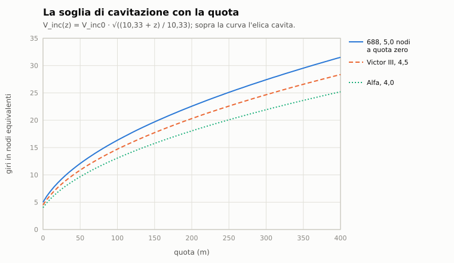

# B1. Dinamica del sottomarino

*Autore: kit, per il runtime. Revisione del 27/10/2026. Stato: rivisto (runtime, 27/10/2026), curatore: kit.*

## 1. A che serve

Decide come si muove il battello quando il comandante dà un ordine. Nell'Enhanced il timone è un angolo di barra, il
telegrafo chiede giri all'elica e la quota si cambia inclinando lo scafo. Il battello risponde con la sua massa: ci
mette quasi due minuti a passare da fermo a 20 nodi, accosta su un cerchio di qualche lunghezza, rallenta in
accostata. I timoni orizzontali governano solo se c'è abbrivio: da fermo il battello non tiene la quota, e se ha
acqua a bordo affonda. La velocità dice anche quando l'elica comincia a cavitare, cioè a farsi sentire da lontano:
più in basso si va, più giri si possono dare in silenzio. Lo stesso modello muove i sottomarini dell'IA.

## 2. Il modello

Il codice è in `nucleo/dinamica_sottomarino.hpp` e `nucleo/src/dinamica_sottomarino.cpp` (`DinamicaSottomarino`,
`ComandiSottomarino`, `parametri_sottomarino`). Nella missione lo collegano `Missione::dinamica_sottomarini` e
`Missione::muovi_con_dinamica` (`missioni/src/missione.cpp`); gli ordini del giocatore li traduce
`StazioniMissione::consegna_dinamica` (`missioni/src/stazioni_missione.cpp`).

Il modello ha tre gradi di libertà. Li integra `Missione::navigazione` al passo della missione: il passo fisso del
motore (1/30 s, capitolo A1), spezzato in sottopassi di al più 1/9 s (`PASSO_S`) quando il motore avanza di più.
- l'avanzo lungo l'asse;
- l'imbardata, cioè la rotazione attorno alla verticale;
- il beccheggio, con la quota che ne segue.

Non c'è rollio né deriva laterale. Dentro il modello le velocità sono in m/s e gli angoli in gradi. La rotta è in gradi
bussola, positiva a dritta. La quota è in metri, positiva verso il basso. L'assetto è positivo con la prua in su.

### 2.1 I parametri di una classe

`parametri_sottomarino(classe)` mette insieme tre fonti:
- lunghezza, larghezza e velocità massima da `data/motore/classi.toml`;
- il dislocamento in immersione dallo scafo del kit (`data/motore/scafi/<classe>.toml`, sezione `[sottomarino]`);
- potenza all'asse, diametro tattico e soglia di cavitazione da una tabella nel codice (`TABELLA`).

| Classe | Δ in immersione (t) | Vmax (kn) | Potenza (shp) | Diametro tattico (L) | Cavitazione a quota 0 (kn) |
|---|---|---|---|---|---|
| Los Angeles | 6927 | 32 | 30.000 | 5,0 | 5,0 |
| Sturgeon | 4714 | 26 | 15.000 | 5,0 | 4,5 |
| Trafalgar | 5250 | 32 | non pubblicata | 5,0 | 5,5 |
| Alfa | 3180 | 41 | 40.000 | 3,0 | 4,0 |
| Victor III | 7250 | 30 | 31.000 | 5,0 | 4,5 |
| Akula | 12770 | 33 | 43.000 | 5,0 | 5,5 |
| Oscar | 19400 | 32 | 98.000 | 6,0 | 4,0 |
| Charlie II | 5300 | 24 | 15.000 | 5,0 | 3,5 |
| Typhoon | 48000 | 27 | 100.000 | 6,0 | 4,0 |
| Kilo | 3075 | 17 | 5.500 | 4,5 | 3,5 |
| Foxtrot | 2515 | 16 | 5.400 | 5,0 | 3,0 |

*Fonte: potenza, diametro tattico e cavitazione da `nucleo/src/dinamica_sottomarino.cpp`, `TABELLA`; dislocamento
dagli scafi del kit e velocità massima da `classi.toml`, che hanno la precedenza sulla tabella. La tabella del codice
dà valori diversi solo dove i dati li sostituiscono: Trafalgar 5300 t, Charlie II 5500 t, Typhoon 26 nodi, Kilo 20,
Foxtrot 15.*

- **Potenza mancante** (Trafalgar e le classi fuori tabella): la potenza del 688 scalata col coefficiente
  dell'Ammiragliato, cioè col dislocamento alla 2/3 e la velocità al cubo. Per il Trafalgar vengono circa 18.600 kW.
- **Classe fuori tabella**: dislocamento e velocità del 688, diametro tattico 5 lunghezze, cavitazione a 4,5 nodi.
- **Distanza fra centro di carena e baricentro** (`bg_m`): 0,5 m per tutte le classi.
- **Area in pianta** per il moto verticale: 0,8 L B, con L e B dalla classe.

Le soglie di cavitazione sono le stesse delle firme acustiche (`data/motore/acustica.toml`, `v_cavitazione_kn`,
capitolo C4), così il rumore e l'avviso dicono la stessa cosa.

### 2.2 Avanzo: spinta e resistenza

```
T = c Vmax² n|n|            (in marcia indietro × 0,7)
D = c u|u| (1 + 1,5 (β/35)²)
du/dt = (T − D) / m
c = 0,7 P / Vmax³           m = 1,1 Δ
```

- `n`: i giri, come frazione dei giri massimi, da −0,5 (indietro tutta) a 1.
- `u`: la velocità sull'acqua (m/s). `Vmax`: la velocità massima della classe (m/s).
- `β`: l'angolo di barra (gradi). Con la barra tutta la resistenza cresce di una volta e mezza.
- `P`: la potenza all'asse (W). Il 70% diventa spinta utile (`RENDIMENTO`).
- `Δ`: il dislocamento in immersione (kg). Il 10% in più è la massa d'acqua trascinata (`MASSA_AGGIUNTA`).

A giri costanti e timone al centro la velocità di regime è `n Vmax`: il telegrafo ordina una velocità e la turbina
ci porta. I giri però non cambiano di colpo: inseguono l'ordine di 0,05 al secondo (`RATEO_GIRI`), quindi da stop a
tutta forza servono 20 s.

I danni toccano i giri. `LimitiBattello::velocita` è la frazione della velocità massima che motori e propulsione
consentono, la minore fra le due efficienze; dopo uno SCRAM vale al più 0,15 (capitolo B3). Nel codice l'ordine dei
giri si ferma a questa frazione, non si scala: con i motori al 60%, un ordine di metà dei giri dà la sua velocità
di regime, e un ordine di tutti i giri si ferma al 60%. Lo stesso limite vale in marcia indietro. Per il giocatore
l'ordine oltre il limite è già rifiutato (§2.7).

**Esempio** (calcolo con le formule del codice). Sul 688 `c` vale circa 3.510 N s²/m² e `m` circa 7.620 t. Da fermo,
con i giri al massimo, il battello arriva a 20 nodi in circa 110 s. La costante di tempo `m / (c Vmax)` è di circa
130 s. L'Alfa, più leggera e più potente, ci arriva in circa 53 s.

### 2.3 Imbardata: il modello di Nomoto

Il timone è un modello di Nomoto del primo ordine: il rateo di virata insegue un valore di regime con un ritardo.

```
r_regime = (u / R) (β / 35)           R = D_t L / 2
τ = 1,5 L / max(|u|, 0,5)
dr/dt = (r_regime − r) / τ
```

- `r`: il rateo di virata (gradi/s, positivo a dritta).
- `R`: il raggio di virata con la barra tutta. `D_t` è il diametro tattico in lunghezze (tabella §2.1), `L` la
  lunghezza.
- `τ`: la costante di tempo. Il battello impiega una volta e mezza la propria lunghezza a «prendere» la virata.

La barra stessa si muove a 5 gradi al secondo (`RATEO_BARRA`), fino a 35 (`BARRA_MAX`).

Con «accostare per» (`ComandiSottomarino::rotta`) il timoniere sceglie la barra da solo:

```
β = clamp(errore di rotta − 8 r, ± barra_max)
```

Lo smorzamento `8 r` toglie barra mentre la prua si avvicina alla rotta ordinata, così non la oltrepassa. La barra
massima è 15° per difetto; il timoniere dell'IA ne usa 20.

**Conseguenze:**
- il raggio di virata a barra tutta non dipende dalla velocità: sul 688 il cerchio è di circa 550 m (5 lunghezze),
  sull'Alfa di circa 245 m (3 lunghezze);
- con la barra tutta la resistenza sale di 2,5 volte, quindi la velocità di regime scende a `n Vmax / √2,5`, cioè a
  circa il 63%. Un 688 a 20 nodi accosta a circa 12,6 nodi. Con i 15° di «accostare per» la resistenza sale solo del
  28% e lo stesso 688 accosta a circa 17,7 nodi;
- con la barra tutta un'Alfa a 30 nodi inverte la rotta in circa 40 s, un 688 a 15 nodi in poco meno di 3 minuti
  (calcolo).

### 2.4 Beccheggio, quota e autorità dei timoni orizzontali

L'assetto `θ` insegue un angolo voluto. Il comando è:
- **con la quota ordinata**: mezzo grado di assetto per metro di scarto, prua in su se il battello è troppo in basso,
  entro l'angolo massimo (15° per difetto, 30° nelle emergenze, mai oltre 30°);
- **con l'angolo ordinato** (ordine `angolo_immersione`, positivo con la prua in giù): l'angolo stesso, con la quota
  che cambia finché dura.

L'assetto insegue l'angolo voluto con una costante di tempo di 4 s, entro un rateo massimo (sotto). L'angolo voluto,
compreso il disturbo dei danni, non va oltre ±60°.

L'**autorità dei timoni orizzontali** cresce con la velocità:

```
a = min(1, |u| / 8 m/s)
```

Con `a` nullo (battello fermo, o timoni orizzontali in avaria) il comando non vale: l'assetto segue solo i momenti
del battello danneggiato. Il rateo massimo con cui l'assetto si muove è `0,2 + 3 a` gradi al secondo: 0,2 è il
moto idrostatico lento di un battello fermo.

Il **momento d'assetto** dell'acqua imbarcata, dell'aria nelle casse e delle armi lanciate (`ForzeIdrostatiche`,
capitoli B2 e B3) sposta l'assetto quanto i timoni non compensano:

```
M_r = Δ g BG                                   momento di raddrizzamento
M_comp = a² M_r sin 15°                        quello che i timoni compensano
θ_disturbo = asin((|M| − M_comp) / M_r)        con il segno di M, se |M| > M_comp
```

I timoni compensano un momento che a piena autorità (8 m/s, circa 15,5 nodi) vale quanto 15° di inclinazione, e
che scala col quadrato della velocità. Sul 688 `M_r` vale circa 34 MN m, e a piena autorità i timoni ne reggono circa
8,8 MN m.

La **quota** segue l'assetto:

```
dz/dt = −u sin θ + w_peso
w_peso = sign(F) √(|F| / (½ ρ C_d A))          ρ = 1025 kg/m³, C_d = 1, A = 0,8 L B
```

- `F`: il peso netto del battello danneggiato (N), positivo se pesante. Zero a battello intatto.
- `w_peso`: la velocità di regime di un corpo che cade di piatto contro la resistenza della sua pianta. È
  `rateo_verticale_regime` di `nucleo/battello.hpp`, senza la portanza dei piani: qui la portanza è già l'assetto,
  che il timoniere alza quando il battello è pesante. Contarla anche nella formula la darebbe due volte.
- In superficie il battello galleggia: la quota non va sotto zero.

**Esempi** (calcolo con le formule del codice, sul 688):
- a 15 nodi, da 50 a 150 m con l'angolo di 15°: il battello scende a circa 2 m/s e ci mette poco più di un minuto;
- con 100 t d'acqua a bordo, da fermo, il battello affonda a circa 1,5 m/s: in un minuto è quasi 90 m più in basso;
- con le stesse 100 t a 15 nodi il timoniere alza la prua di circa 11° e il battello si assesta circa 22 m sotto la
  quota ordinata. Ci arriva in meno di un minuto e lì resta: il comando dell'assetto è proporzionale allo scarto di
  quota, e per tenere su il peso serve uno scarto fisso.

### 2.5 Cavitazione con la quota

```
V_inc(z) = V_inc0 √((10,33 + z) / 10,33)
cavita  ⇔  |n| Vmax > V_inc(z)
```

- `V_inc0`: la soglia a quota zero (tabella §2.1).
- `z`: la quota (m). 10,33 m d'acqua fanno un'atmosfera (`ATM_ACQUA`).
- La soglia si confronta con i giri in nodi equivalenti, non con la velocità: l'elica cavita appena i giri salgono,
  prima che il battello acceleri.

| Quota | 0 m | 18 m | 50 m | 100 m | 150 m | 300 m |
|---|---|---|---|---|---|---|
| 688 (5,0 kn a quota zero) | 5,0 kn | 8,3 kn | 12,1 kn | 16,3 kn | 19,7 kn | 27,4 kn |
| Alfa (4,0 kn a quota zero) | 4,0 kn | 6,6 kn | 9,7 kn | 13,1 kn | 15,8 kn | 21,9 kn |

*Calcolo dalla formula, coi valori di `TABELLA`.*



Quando il battello cavita, l'acustica lo sa dalla dinamica (`Missione::sorgente_acustica`): la firma prende il rumore
di cavitazione (capitolo C4) e i sonar nemici ne ricavano l'indizio per la classificazione (capitolo C5).

### 2.6 Il battello appesantito

La dinamica non calcola l'acqua: la riceve. A ogni passo `DanniSottomarini::avanza`
(`missioni/src/danni_sottomarini.cpp`) mette nell'ordine del motore dell'unità (`OrdineMotore`):
- il peso netto e il momento d'assetto (`BattelloDanni::forze`: acqua nei compartimenti, aria nelle casse, casse
  d'assetto, armi lanciate e compressione dello scafo dell'Alfa);
- i limiti: velocità consentita, timone e timoni orizzontali.

Timone e timoni orizzontali governano finché la loro efficienza è almeno 0,3 (`BattelloDanni::limiti`). Sotto, la
barra resta dov'era e i timoni orizzontali non portano: `a` vale zero. Il battello allora sale o scende secondo il
suo peso, e l'assetto segue i momenti.

Il caso estremo è il battello pesante e fermo. Senza abbrivio i timoni non lo reggono e la quota la decide solo
`w_peso`. È la dottrina che il dossier 02 §9.2 riassume: con un allagamento si dà tutta forza e si alza la prua,
perché la portanza dei timoni arriva prima della zavorra.

### 2.7 Nella missione

- **Chi la usa**: `Missione::dinamica_sottomarini` la accende con la regola di simulazione (`DanniMissione`), per ogni
  classe che ha uno scafo con la sezione `[sottomarino]`. Le unità in affondamento seguono il moto dell'affondamento.
- **Stato imposto da fuori**: il fondale, uno script o il motore possono spostare quota, rotta e velocità
  dell'unità; la dinamica riparte da lì (`imposta_quota`, `imposta_rotta`, `imposta_velocita`).
- **Il giocatore**: `StazioniMissione` tiene l'ultimo stato completo dei comandi e lo rimanda alla dinamica a ogni
  ordine. Il primo ordine parte da come è il battello (barra, giri e quota di quel momento), così non cambia il resto.
  Prima della consegna `rifiuto_per_guasto` scarta gli ordini che i danni non consentono: barra e accostata col
  timone in avaria, quota e angolo coi timoni orizzontali in avaria, giri oltre la frazione `LimitiBattello::velocita`.
- **L'IA e il pilota automatico**: senza comandi propri, l'unità segue il timoniere. Prende i giri dalla velocità
  ordinata, la quota ordinata, e accosta per la rotta con al più 20° di barra. Una virata degli script data come
  rateo diventa barra in proporzione: 3,6 °/s, il rateo massimo del classico, vale la barra tutta. Col pilota
  automatico inserito anche il giocatore torna al timoniere (capitolo B2 §2.11), e allora i giri vengono dalla velocità
  ordinata. Gli ordini di giri del giocatore la aggiornano: velocità ordinata = giri × velocità massima della classe
  (`StazioniMissione::consegna_dinamica`). La vedono il timoniere, il pannello e il controllo della schiera.
- **Il posto di comando** (`PostoEnhanced`, `nucleo/comando.hpp`): gli stessi tasti del classico danno barra a scatti
  di 5°, nove campane del telegrafo e la quota ordinata a passi di 15 m con 15° al più. Avanti 1/3, 2/3, standard e
  tutta valgono 5, 10, 15 e 20 nodi; la massima è la velocità massima della classe. Indietro 1/3, 2/3 e tutta
  valgono −1/6, −1/3 e −1/2 dei giri.

## 3. Fonti e confidenza

| Parametro | Fonte | Confidenza |
|---|---|---|
| Dislocamenti, velocità massime, potenze | dossier 01 §2 e §8.1 | alta per il 688, media per i sovietici |
| Potenza del Trafalgar e delle classi senza dato | coefficiente dell'Ammiragliato dal 688 | **STIMA** |
| Diametro tattico 4-6 lunghezze | dossier 01 §2.1, «non pubblicato» | **STIMA**, bassa |
| Alfa: 3 lunghezze | dossier 01 §2.4, «inversione di rotta in decine di secondi» | **STIMA** |
| Rendimento 0,7, massa aggiunta 10% | scelta di modello | **STIMA** |
| Resistenza in accostata (+150% a barra tutta) | tarata su «un terzo di velocità in meno» | **STIMA** |
| Turbina: 0,05 dei giri al secondo | scelta di modello | **STIMA** |
| Barra a 5 °/s | scelta di modello | **STIMA** |
| dz/dt ≈ v sin θ, assetto 15-20°, emergenza 30° | dossier 01 §2.1 | media per la forma |
| Autorità dei timoni orizzontali (8 m/s, 15° di momento) | scelta di modello | **STIMA** |
| BG = 0,5 m per tutte le classi | scelta di modello | **STIMA** |
| Cavitazione `V_inc(z)` | dossier 02 §2.3 [Ross76] | alta per la formula |
| Soglie di cavitazione per classe | dossier 02 §2.3 | bassa |
| Moto verticale col peso netto | `docs/10` §10.3, decisione 2 | media per la forma |

Le STIME del timone e del motore servono a ritrovare i pochi dati qualitativi che le fonti danno: un diametro
tattico di 4-6 lunghezze, un'Alfa che inverte la rotta in decine di secondi, una velocità che in accostata cala di un
terzo. Nessun valore di manovrabilità del 688 è pubblicato.

## 4. Classico ed Enhanced

Nel classico la dinamica non esiste. Le unità si muovono col moto dell'originale
(`docs/originale/sensori_e_navigazione.md` §5-§7, `docs/originale/prestazioni.md`):
- il timone è un rateo di virata in 9 scatti, da −3,6 a +3,6 °/s, senza raggio né perdita di velocità;
- la velocità cambia a un'accelerazione costante del modello: 0,257 kn/s per il 688;
- la quota cambia a un rateo costante del modello: 18 ft/s per il 688, 22,5 ft/s per l'Alfa; l'emersione d'emergenza
  lo moltiplica per quattro;
- il moto sulla carta è 3,46 volte quello vero (il «fattore 3,46», capitolo A2);
- non c'è cavitazione, né assetto, né timoni orizzontali che perdono autorità.

Le stranezze dell'originale restano: l'accostata degli script va sempre a sinistra (`accosta_a`) e oltre 3° di
errore di rotta la velocità scende a un quarto di avanti tutta (messaggio 47).

Nell'Enhanced, con la regola di simulazione, tutti i sottomarini con lo scafo del kit si muovono con questa
dinamica, il giocatore e l'IA. Il rilievo delle 110 partite del classico resta identico (`docs/11` §10).

## 5. Come si vede in gioco

- **Manovra (F4)** (volume 1, §2.4): campane, barra in gradi, giri, assetto, quota in metri, la soglia di cavitazione
  e la scritta «CAVITA!» quando la si supera.
  - **Il tamburo della quota** nell'Enhanced segna la chiglia vera (`Missione::chiglia_vera`). Sotto la quota
    periscopica della classe (688: 18,3 m) è la quota del motore. Fra la superficie e la quota periscopica della
    missione (6,096 m) si interpola dal pescaggio alla quota periscopica della classe. Così a 6,096 m segna 60 piedi,
    e a 5,5 m (Ctrl+P) circa 57.
  - **Sullo schermo** la quota scende senza scalini da 60 m alla quota periscopica della missione
    (`quota_a_schermo`, `app/interfaccia.cpp`): prima restava ferma a 18 m per 12 m di risalita. Le collisioni tengono
    `chiglia_vera`.
  - **La spia PERI** (solo 688): verde fra 1 m e 6,6 m sulla scala della missione, la stessa soglia del rifiuto del
    periscopio.
  - **Sotto i 3 nodi** Ctrl+P dà il messaggio 469 («Timoniere: sotto i 3 nodi i piani non portano su, serve velocità»).
    Il periscopio o l'antenna fuori quota danno il 500 («... Ctrl+P e almeno 3 nodi»); nel classico resta il 212.
  - **La spia ARRAY** (688 con la schiera): spenta se la schiera è a posto o dentro, ambra se tocca il fondo o è
    danneggiata, rossa se è persa (capitolo C6 §2.9).
  - Il classico e l'Alfa non cambiano (`DatiGoverno::quota_periscopica` e `schiera` a −1 in `grafica/sale`).
- **Tasti** (volume 1, §2.9 e appendice A): tastierino 4 e 6 la barra, 5 al centro; `+` e `-` il telegrafo; tastierino
  8 e 2 la quota di 15 m in 15 m, 0 per tenerla; Ctrl+P quota periscopica (5,5 m sul quadro, la chiglia a circa
  17 m), Ctrl+1 150 piedi (45,7 m); `.` il pilota automatico, che un ordine di barra disinserisce.
- **Messaggi**: 313 «stiamo cavitando», all'inizio della cavitazione; 214 il timone non risponde e 215 i timoni
  orizzontali non rispondono, quando un ordine trova il governo in avaria; un ordine di giri oltre quello che i
  motori danneggiati reggono è rifiutato col messaggio 64, «Velocità massima non disponibile».
- **Acustica**: chi cavita si sente di più e si riconosce (capitoli C4 e C5), il giocatore come i nemici.
- **Pannello dell'Alfa**: il pulto Boksit (capitolo B2 e volume 1, §2.6).

## 6. Taratura e prove

I casi su cui il modello è tarato sono qualitativi (§3). Le prove automatiche lo tengono fermo:
- `test/prove_dinamica_sottomarino.cpp` (`dinamica:`):
  - «parametri dalle classi e dal dossier»;
  - «velocita' di regime n Vmax e accelerazione dalla spinta»: 32 nodi a regime, 20 nodi fra 60 e 240 s da fermo;
  - «diametro tattico 4-6 lunghezze a 15-20 nodi, l'Alfa stringe di piu'»: l'Alfa sotto il 75% del 688, inversione
    a 30 nodi sotto i 90 s;
  - «in accostata con la barra tutta la velocita' cala di circa un terzo»: fra il 55 e il 75%;
  - ««accostare per» con la barra massima e senza oltrepassare la rotta»;
  - «la quota ordinata con l'assetto entro l'angolo massimo, dz/dt ~ v sin theta», con il battello fermo che non
    cambia quota;
  - «peso netto e momento del battello danneggiato contro la velocita'», con i timoni orizzontali in avaria;
  - «cavitazione V_inc(z) = V_inc0 sqrt((10,33 + z)/10,33)», coi fattori della tabella del dossier 02;
  - «i giri di 1/3, 2/3 e massimi danno le velocita' delle campane; i danni le tagliano, non le scalano»: 5 e 10 nodi
    e la massima per 688, Victor III e Kilo entro il 2%; coi motori al 50%, 1/3 resta 5 nodi e la massima si ferma a 16;
  - «dinamica nella missione: solo con la regola di simulazione; timoniere dell'IA e comandi del giocatore»;
  - «dinamica nella missione: i giri danno la velocita' ordinata; Ctrl+E come primo ordine sale a 30 gradi».
- `test/prove_enhanced_giocatore.cpp` (`enhanced:`): «posto di comando con barra in gradi, campane e quote», «gli
  ordini arrivano alla dinamica del giocatore, nel classico no».
- `test/prove_comandi.cpp` (`comandi:`): il moto del classico coi gestori della missione, e il pilota automatico che
  il timone disinserisce.

## 7. Limiti noti e in arrivo

- Tre gradi di libertà: niente rollio, niente deriva in accostata, niente perdita di quota in virata.
- Il raggio di virata non dipende dalla velocità né dalla quota. Non ci sono timoni di prora distinti da quelli della
  vela, né l'effetto della superficie sui timoni orizzontali vicino a quota periscopica.
- La massa aggiunta è una sola, per l'avanzo; l'imbardata ha solo la costante di tempo.
- La turbina non ha un tempo di risposta per classe: tutte salgono di giri allo stesso ritmo, anche l'Alfa col suo
  reattore a metallo liquido.
- La pianta per il moto verticale è `0,8 L B`, mentre il modello del battello danneggiato usa quella vera dello
  scafo del kit (`BattelloDanni::area_pianta_m2`): i due ratei di un battello pesante differiscono di poco.
- La quota che la dinamica riceve è quella dell'unità, che il motore delle collisioni intende come quota della
  chiglia (`Missione::chiglia_vera`); la cavitazione la usa come quota dell'asse. La differenza è mezzo diametro.
- Le correnti non spostano il battello.
- La marcia indietro rende il 70% della spinta, ma non cambia il governo: il timone funziona come in marcia avanti.
- La curva fra giri e velocità di regime è la stessa retta `n Vmax` per tutte le classi: non c'è una tabella dei giri
  per classe.

## 8. Riferimenti

- Codice: `nucleo/dinamica_sottomarino.hpp`, `nucleo/src/dinamica_sottomarino.cpp`, `nucleo/battello.hpp`
  (`ForzeIdrostatiche`, `LimitiBattello`, `rateo_verticale_regime`), `nucleo/comando.hpp` (`PostoEnhanced`),
  `missioni/src/missione.cpp` (`dinamica_sottomarini`, `muovi_con_dinamica`, `avvisi_sonar`),
  `missioni/src/stazioni_missione.cpp` (`consegna_dinamica`, `rifiuto_per_guasto`),
  `missioni/src/danni_sottomarini.cpp` (forze e limiti nell'ordine del motore).
- Dati: `data/motore/classi.toml`, `data/motore/scafi/<classe>.toml` (`[sottomarino]`), `data/motore/acustica.toml`
  (`v_cavitazione_kn`), `data/motore/tasti_predefiniti.toml`.
- Ricerca: dossier 01 §2 e §8.1; dossier 02 §2.3 e §9.2.
- Progetto: `docs/11_comandi_e_stazioni.md` §3.1 e §10; `docs/10_danni_affondamento_esplosioni.md` §10.3;
  `docs/originale/sensori_e_navigazione.md` §5-§7; `docs/originale/prestazioni.md`.
- Volume 1: `1_uso/02_battello_e_stazioni.md` §2.4-§2.5. Volume 2: capitoli A1, A2, B2, B3, C4, C5.
