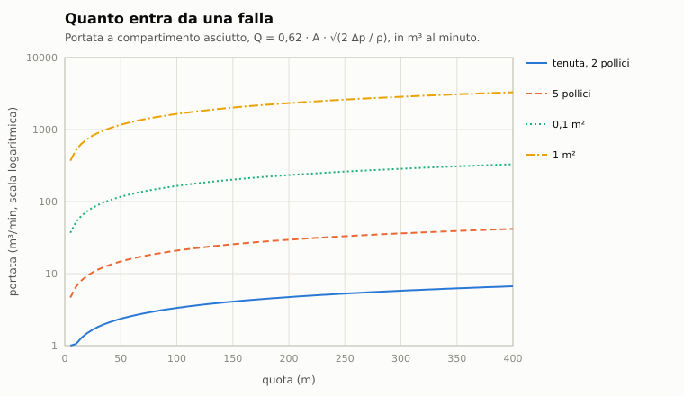

# B3. Danni del battello

*Autore: kit. Revisione del 28/10/2026. Stato: rivisto (curatore: kit).*

## 1. A che serve

Decide cosa succede a un sottomarino colpito, o urtato, o in fiamme: quanta acqua entra e dove, se il battello si
appesantisce o si apprua, quali sistemi smettono di funzionare e per quanto, quando lo scafo cede. Vale per il
battello del giocatore e per i sottomarini dell'IA, con lo stesso modello. Il modulo non muove il battello: calcola il
peso netto e il momento d'assetto, che la dinamica (capitolo B1) trasforma in moto.

## 2. Il modello

Il codice è in `nucleo/battello.hpp` e `nucleo/src/battello.cpp` (`BattelloDanni`), con l'adattatore per le missioni
in `missioni/src/danni_sottomarini.cpp` (`DanniSottomarini`). Il passo interno è di 0,1 s.

### 2.1 Lo scafo: compartimenti e casse

Lo scafo viene da `data/motore/scafi/<classe>.toml`, generato da `tools/navi/compartimenti.py` dal modello 3D:
stazioni ogni 1-2 m con la sezione esterna, il raggio e la quota dello scafo resistente, e le celle.

- **Compartimenti**: le celle dentro lo scafo resistente. Il volume è l'area della sezione resistente fra i limiti
  laterali della cella, integrata lungo x, per la permeabilità (la frazione che l'acqua può riempire).
- **Casse zavorra**: le celle d'uso «zavorra», fra lo scafo esterno e quello resistente o alle estremità. Il loro
  volume è la sezione esterna meno quella resistente, per la permeabilità.
- **Paratie**: una fra ogni coppia di compartimenti contigui dello stesso scafo, con resistenza
  `p_paratia = 0,3 · ρ g h_collaudo`.
- **Riferimento**: il baricentro dei volumi dei compartimenti, `x_rif`, per i momenti.

<!-- generato: compartimenti_battelli -->
| Battello | Compartimento | Uso | Da x a x (m) | Permeabilità |
|---|---|---|---|---|
| Alfa (Progetto 705) | C1 | deposito (siluri) | 31,7 … 21,7 | 0,60 |
| Alfa (Progetto 705) | C2 | batterie | 21,7 … 11,7 | 0,60 |
| Alfa (Progetto 705) | C3 | locali | 11,7 … 0,7 | 0,85 |
| Alfa (Progetto 705) | C4 | reattore | 0,7 … -9,3 | 0,50 |
| Alfa (Progetto 705) | C5 | macchine | -9,3 … -21,3 | 0,85 |
| Alfa (Progetto 705) | C6 | macchine | -21,3 … -31,3 | 0,85 |
| Alfa (Progetto 705) | (casse zavorra) | zavorra | 14 celle, alle estremità o fra i due scafi | 0,98 |
| Los Angeles (SSN-688, Flight I) | C1 | deposito (siluri) | 41,1 … -2,9 | 0,60 |
| Los Angeles (SSN-688, Flight I) | C2 | reattore | -2,9 … -12,8 | 0,50 |
| Los Angeles (SSN-688, Flight I) | C3 | macchine | -12,8 … -39,9 | 0,85 |
| Los Angeles (SSN-688, Flight I) | (casse zavorra) | zavorra | 2 celle, alle estremità o fra i due scafi | 0,98 |
<!-- fine: compartimenti_battelli -->

### 2.2 Le forze

```
P = ρ g (V_assetto + Σ acqua_i) + P_var(h) − ρ g Σ aria_cassa_j
M = M_var − ρ g Σ acqua_i (x_i − x_rif) + ρ g Σ aria_cassa_j (x_j − x_rif)
aria_cassa_j = min(V_j, N_j · p_atm / p(h))
```

- `P`: peso netto (N), positivo se il battello è pesante e scende; `M`: momento d'assetto, positivo con la prua in
  su;
- `ρ = 1025 kg/m³`, `g = 9,81 m/s²`, `p(h) = p_atm + ρ g h`;
- `acqua_i`: m³ d'acqua nel compartimento i, al baricentro `x_i`;
- `N_j`: aria nella cassa j in m³ normali (a 1 bar); occupa il volume `N_j · p_atm / p` (legge di Boyle);
- `V_assetto`: le casse d'assetto (al centro, nessun momento). Si scende al più a −15 m³, la riserva delle casse di
  compensazione (`RISERVA_ASSETTO_M3`); il Tan dell'Alfa le tiene fra ±15 m³. Per posarsi sul fondo la missione
  imbarca 2 t (capitolo B2);
- `P_var(h) = g (m_var + c · 1000 · (h − h_neutra) / 100)`: il peso delle armi lanciate e delle mine posate (`m_var`,
  negativo) e la compressione dello scafo con la quota (`c` tonnellate per 100 m). Vale solo per l'Alfa del giocatore:
  un'arma 1900 kg, un'esca 300, una mina 1000, all'estremità prodiera; `c` = 0,5 t ogni 100 m sotto la quota di
  partenza (tutto **STIMA**, `missioni/src/danni_sottomarini.cpp`). Per gli altri battelli è zero.

Il battello intatto è neutro per costruzione.

**Nella missione** peso e momento passano alla dinamica dell'Enhanced (capitolo B1), insieme ai governi in avaria.

**Senza la dinamica** (adattatore cinematico, il ripiego) il peso diventa un rateo verticale di regime. Vale quando il
peso netto supera 5·10⁴ N (circa 5 t): da lì la quota la decide la fisica e non più la barra degli script.

```
w = sign(F) · sqrt(|F| / (½ ρ C_d A_pianta)),   F = P ∓ L,   L = ½ ρ V² · 0,03 · A_pianta · 0,8
```

con `C_d = 1` (cilindro di traverso) e la portanza dei timoni orizzontali `L` nel verso della quota ordinata
(entro 1 m dalla quota ordinata, o coi timoni orizzontali guasti, la portanza si oppone al peso). In superficie il
battello non sale oltre lo zero.

### 2.3 Le falle e l'allagamento

```
Q = C_d · A · sqrt(2 |Δp| / ρ),   Δp = p_mare(h) − p_aria,i,   p_aria,i = p_atm · V_i / (V_i − acqua_i)
```

- `C_d = 0,62` (spigolo vivo), `A` area della falla (m²);
- l'aria del compartimento, a 1 bar, si comprime mentre l'acqua entra: l'allagamento si ferma quando `p_aria` arriva
  a `p_mare`, cioè alla frazione `1 − p_atm / p_mare` del volume. A 100 m è il 91%, in superficie zero;
- in risalita l'aria si espande e spinge fuori una parte dell'acqua.



Esempio: un foro da 5" (0,0127 m²) imbarca 0,16 m³/s a 20 m e 0,60 m³/s a 300 m, come nella tabella del dossier 02
§9.1.

**Paratie.** Cedono quando la differenza fra le pressioni dell'aria dei due compartimenti supera `p_paratia`. Poi
l'acqua passa con lo stesso Q da 1 m² di varco, finché i due compartimenti si pareggiano.

### 2.4 L'urto di un'esplosione

```
HSF = sqrt(W [lb]) / R [ft]
KSF = HSF · (1 + sin θ) / 2
k   = KSF / max(0,25, 1 − 0,5 · h / h_collaudo)
```

- `W`: carica in TNT equivalente; `R`: distanza dallo scafo; `θ`: angolo fra la direzione dello scoppio e il piano
  orizzontale (90°: sotto la chiglia);
- la divisione per il fattore di quota abbassa le soglie in profondità (lo scafo è già carico).

Effetti, per fasce del dossier 02 §9.4:

| Condizione | Effetto |
|---|---|
| `k ≥ 0,05` | scossa (palette che tremola, vista che sobbalza). Ogni sistema si guasta con probabilità `p = (k − 0,05) / 0,8`, perdendo `U(0,2; 1) · min(1, k/0,4)` di efficienza. Il navigatore inerziale è più delicato: `p = (k − 0,03) / 0,32`, certo da 0,35, e perde `U(0,3; 1) · min(1, k/0,3)` (col suo generatore casuale) |
| `k ≥ 0,1` | SCRAM del reattore con probabilità `min(0,8; (k − 0,1)/0,3 · 0,8)`, per 300-1200 s; una falla (due da 0,2) da 1-2" nel compartimento colpito e, la seconda, in uno vicino; incendio con probabilità `min(0,6; (k − 0,1)/0,5)` |
| `k ≥ 0,3` | falle da 2-5" × min(2, k/0,3); casse entro 15 m squarciate con probabilità `(k − 0,3)/0,3`; danno allo scafo resistente `+0,5 (k − 0,3)` |
| `k ≥ 0,6` | rottura dello scafo resistente con probabilità `(k − 0,6)/0,4`: falla da 0,3-1 m² |

Un danno grave (perdita oltre 0,7) lascia il sistema riparabile solo fino a `max(0,5; 1,3 − perdita)`.

Il compartimento colpito è quello più vicino al punto `x` dello scoppio. L'incendio acceso dall'urto parte piccolo
(intensità 0,05).

**Come arrivano i colpi** (`DanniSottomarini::colpisci`). Con la geometria vera (siluri dell'Enhanced, bombe, mine)
lo scoppio si porta nel riferimento della vittima e la distanza si misura da un cilindro lungo quanto lo scafo e largo
quanto il battello, non dal centro (almeno 0,5 m); l'angolo è `asin(|dz| / distanza radiale)`. Senza, la geometria si
stima per arma, in un punto a caso entro il 30% della lunghezza dei compartimenti dal loro centro:

| Arma | TNT equivalente | Distanza e angolo |
|---|---|---|
| Mk 48 | 544 kg | 3-8 m sotto la chiglia (influenza) |
| Mk 46 | 108 kg | 0,5 m, di fianco (contatto) |
| AT-1 | 105 kg (STIMA) | 0,5 m, di fianco |
| Sting Ray | 45 kg in carica cava (STIMA) | 0,5 m, di fianco, senza l'intercapedine; in più il getto: una falla di 0,05 m² e un incendio a 0,3 nel compartimento |
| gli altri siluri (i sovietici da 533 mm) | 300 kg | 1 m, di fianco |
| carica di profondità, razzo | 135 kg | 5-25 m, angolo fra 17° e 90° |
| missile | 220 kg | 2 m, di fianco, solo sul battello entro 5 m di quota |
| mina a influenza senza geometria | 300 kg, o la sua carica | 5-15 m sotto la chiglia |
| mina (Enhanced) | la sua carica | la sua geometria |

Sui battelli a doppio scafo l'**intercapedine** (0,4-1,2 m, tabella del §2.12) si aggiunge alla distanza: protegge lo
scafo resistente.

**I contenitori dei missili fra i due scafi** (i 24 P-700 dell'Oscar II, gli 8 P-120 del Charlie II) stanno fuori
dallo scafo resistente, a tratti di 5 m con la loro parte dell'esplosivo (`esplosivo_kg` di `missili.toml` per il
numero). Con un urto oltre 0,3, i tratti entro 5 m dallo scoppio saltano per simpatia con probabilità
`min(0,5; (k − 0,3)/0,7)` (STIMA). Il loro scoppio, a 1 m più l'intercapedine, è un altro urto, che può far saltare i
tratti accanto. In superficie i contenitori sono zone come i lanciatori in coperta delle navi (capitolo E2). Quando il battello emerso passa alla
fisica delle navi porta con sé, oltre all'acqua e alle falle, il fuoco di ogni compartimento e il carico vivo dei
depositi; gli effetti (fiamme, fumo, nafta) lo seguono come una nave.

**Il carico dei depositi** viene dallo scafo (`carica_kg`, `propellente_kg`, `protezione` delle celle, dati di
`tools/navi/danni_critici.py`): per esempio il 688 Flight I ha 15 Mk 48, 4 Harpoon e 6 Tomahawk, 5980 kg
d'esplosivo. La missione lo sostituisce col carico vivo (`BattelloDanni::carico_deposito`: le armi ancora a bordo);
il propellente scala nella stessa proporzione. I silos dei missili balistici hanno il propellente: solido (Trident
dell'Ohio, protezione 0,8) o liquido (R-29R del Delta III, §2.7). Le testate nucleari non esplodono.

**Gli altri danni** che arrivano al battello:
- **collisioni** (capitolo E3): `urto_meccanico` dà la scossa, i guasti della parte colpita, la falla nello scafo
  resistente al punto (divisa fra due compartimenti se lo squarcio è lungo), le casse vicine squarciate e
  l'ammaccatura;
- **artiglieria** (capitolo E4): le teste dei periscopi, gli alberi, i timoni della falsatorre (688 e Sturgeon) e
  piccole falle nello scafo; un 16" nello scafo apre 0,5 m² e il battello non si immerge più. Un colpo nello scafo
  fuori dai compartimenti (a prua o a poppa dello scafo resistente) squarcia la cassa zavorra più vicina da quella
  parte con probabilità 1 dal 16", 0,7 dai 100-130 mm, 0,4 dai 57-76 mm, 0,15 dai 30 mm (per la frazione del colpo:
  diretto 1, schegge meno). La cassa non tiene più l'aria (§2.5) e, in superficie, apre una falla di 0,5 m² sul fondo
  della sua cella (evento `cassa_squarciata`, conto `casse_squarciate` in `DanniArtiglieriaBattello`). I colpi diretti
  consumano anche l'integrità dell'originale (capitolo E4 §2.10);
- **la canna del periscopio** col vetro rotto, se resta alzata, imbarca acqua nel compartimento della centrale
  (`imbarca`, senza falla);
- **i guasti chiesti dalla missione**, per esempio il periscopio piegato dalla velocità (capitolo C9) o il fondo
  (capitolo B2 §7: rocce sul timone o sulla cupola del sonar al 30%, prese a mare sulla propulsione al 50%);
- **i danni iniziali** della missione (`danni_iniziali`): un urto, sistemi già ridotti, acqua, falle e incendi nei
  compartimenti indicati.

### 2.5 L'aria e l'esaurimento

- Le bombole hanno 2,5 volte il volume delle casse, in m³ normali.
- L'esaurimento manda l'aria alle casse integre in proporzione all'acqua che hanno, a una portata che le svuota tutte
  in 30 s in superficie. In profondità la stessa massa d'aria svuota `p_atm / p` del volume: a 300 m un trentesimo.
- L'aria in eccesso esce dagli ombrinali; una cassa squarciata non tiene l'aria. Con una cassa squarciata il battello
  dell'IA sceglie di restare a galla invece di immergersi (capitolo E6).
- **Sfoghi** (Alfa, VENTIL): l'aria esce, una cassa piena in 15 s (STIMA).
- **Casse d'assetto**: dalle valvole 0,05 m³/s; si scaricano con le pompe.

### 2.6 Il collasso

La quota di collasso vera è `h_collasso_prevista × U(1,1; 1,8)`, dal seme (media 1,45: la regola di Rule, dossier 07
§8.2), abbassata dai danni allo scafo resistente:

```
h_collasso = h_collasso_prevista · U(1,1; 1,8) · (1 − 0,5 · danno_scafo)
```

`danno_scafo` (0-1) cresce con gli urti oltre 0,3 (`+0,5 (k − 0,3)`), con le esplosioni interne (`+W / 2000`) e con le
ammaccature delle collisioni (capitolo E3); la rottura dello scafo resistente lo porta a 1.

Oltre quella quota il battello è perso: i compartimenti ancora asciutti implodono uno alla volta, a 1-30 s di
distanza, con l'energia `E = (p_mare − p_aria) · V_aria` (in TNT: `E / 4,184·10⁶ kg`), che serve ai suoni e agli
effetti.

### 2.7 Gli incendi

Per compartimento: fuoco `F` (0-1), fumo, ossigeno (frazione), combustibile (secondi di fuoco pieno: macchine 3600,
batterie 2400, locali 1800, deposito 1500, reattore 1200).

```
dF/dt = (ln 2 / 120) · F · (1 − F) · o2,   o2 = clamp((O₂ − 0,12) / 0,06, 0, 1)
dO₂/dt = − 0,15 · F / V
dfumo/dt = F · (1000 / V) / 180
```

- senza ossigeno o combustibile il fuoco cala di 0,01/s e sotto 0,005 è spento; con oltre metà del compartimento
  allagato si spegne;
- con `F > 0,7` una tubolatura dell'aria ad alta pressione si rompe con una probabilità di `1/1200` al secondo: l'aria
  delle bombole (5 Nm³/s) tiene l'ossigeno al 21% e aggiunge combustibile, finché le bombole si vuotano;
- con `F > 0,8`: una tenuta dello scafo brucia ogni 900 s (falla da 0,002 m²), i vicini prendono fuoco con
  probabilità `1/900` al secondo;
- i sistemi del compartimento perdono `F/600` di efficienza al secondo;
- con `F > 0,5`: nel deposito salta il suo carico con probabilità `0,006 · F · (1 − protezione)` al minuto. Il carico
  vale l'esplosivo delle armi a bordo più 0,3 kg per kg di propellente solido, al più 30 t; un deposito vuoto non
  salta. Nelle batterie l'idrogeno (30 kg) salta con probabilità `1/1800` al secondo;
- i **silos a propellente liquido** (gli R-29R del Delta III): con acqua oltre il 2% del compartimento, o con `F > 0,5`,
  il propellente reagisce una volta con probabilità `1/600` al secondo, come sul K-219 nel 1986. È un'esplosione
  interna di 100 kg (STIMA: il portello del silo che salta, non una detonazione) e il fumo tossico dell'acido nitrico,
  che resta come il cloro;
- le batterie allagate oltre il 5% fanno cloro: il fumo cresce di `1/300` al secondo e non si dirada finché restano
  allagate;
- a fuoco spento il fumo si dirada con costante 600 s e l'ossigeno torna con costante 1800 s; il fumo passa le paratie
  cedute (i due compartimenti si pareggiano con costante 60 s).

### 2.8 Le esplosioni interne

```
p = 0,4 · E / V_aria
```

sull'aria dei compartimenti raggiunti: una paratia cede se `p > 0,45 · p_paratia`, e il volume raggiunto si allarga a
cascata. I compartimenti raggiunti si riempiono di fumo e prendono fuoco; quello dello scoppio è sventrato
(equipaggio perduto). I sistemi perdono 0,9 nel compartimento dello scoppio e 0,5 negli altri raggiunti. Oltre 50 kg lo
scafo resistente si squarcia con una falla di diametro `W^(1/3)` m, e il danno allo scafo cresce di `W / 2000`.

### 2.9 Il controllo danni

Le squadre sono `squadre × V_abitabile / V_totale`, arrotondate (`squadre` della classe, almeno 1). Abitabile: non
imploso, non sventrato, allagato meno di metà, fumo sotto 0,95. Il lavoro, in quest'ordine:

1. **tamponare** le falle fino a 0,003 m² (circa 2,4"): `dA/dt = −5·10⁻⁵ · q / (1 + h/100)` m²/s, una squadra per falla;
2. **spegnere**: tutte le squadre libere, divise fra i focolai, `dF/dt = −6·10⁻⁴ · k · q · (1 − 0,5 fumo) · (1 − 0,7 F)`;
3. **pompare** (le pompe sono macchine, non tolgono squadre): 0,03 m³/s × efficienza delle pompe ×
   `max(0, 1 − h/200)`, solo nei compartimenti senza falle aperte;
4. **riparare** i sistemi nell'ordine delle priorità, `q / 900` di efficienza al secondo per squadra, solo se il
   compartimento del sistema è abitabile. Ordine: propulsione, motori, timoni orizzontali, timone, aria, pompe, sonar di
   prua, calcolatore del sonar, sonar di tiro, antenna rimorchiata, periscopio, navigatore inerziale, antenna. Il
   navigatore inerziale non si ripara finché il compartimento comando ha acqua oltre il 20% del volume; con quell'acqua
   si ferma.

`q` è la qualità del controllo danni della classe (`qualita_controllo_danni` in `scafi/<classe>.toml`: 1 per i
battelli occidentali, 0,8 per i sovietici). Dopo lo SCRAM il reattore torna critico da solo alla fine del suo tempo.

**Il reattore e l'energia** (sui nucleari):
- lo SCRAM viene anche dal compartimento del reattore che brucia oltre 0,5 o ha acqua oltre il 10%; il reattore resta
  fermo finché dura la causa e riparte 5 minuti dopo (STIMA);
- durante lo SCRAM la batteria di riserva regge il motore d'emergenza e le pompe per 2 ore (STIMA);
- la batteria è persa se il suo compartimento ha acqua oltre il 5%, brucia oltre 0,7, è sventrato o imploso;
- reattore fermo e batteria scarica: niente energia, il battello si ferma e le pompe pure (`LimitiBattello::energia`).

Le priorità delle riparazioni le cambia il giocatore (`TipoOrdine::priorita_sistema`, `BattelloDanni::priorita`): il
sistema scelto va in cima, gli altri scalano. Tamponatura e spegnimento restano davanti, perché vengono prima nel lavoro.
Isolare un compartimento toglie le squadre di lì: §2.13.

### 2.10 I limiti per i comandi

| Limite | Regola |
|---|---|
| velocità massima | `min(motori, propulsione)` per la massima (avanti tutta × 280/256); con lo SCRAM al più il 15%, e così con le macchine chiuse (§2.13); senza energia zero |
| timone, timoni orizzontali | funzionano con l'efficienza ≥ 0,3 |
| periscopio, antenna | salgono con l'efficienza ≥ 0,5 |
| antenna rimorchiata | funziona sopra zero |
| sonar | calcolatore del sonar e sonar di prua ≥ 0,3 |
| navigatore inerziale | funziona con l'efficienza ≥ 0,5; sotto, la navigazione passa alla stima col solcometro (capitolo C12) |

I sistemi sono tredici. Sono assegnati ai compartimenti: sonar a prua; periscopio, antenna, timoni e navigatore
inerziale (DMINS o WSN-3 sul 688, Sož sull'Alfa) in centrale; propulsione nel
reattore; motori, aria e pompe nelle macchine; antenna rimorchiata a poppa. La centrale è il primo compartimento
«locali» nella metà prodiera; sul 688, che non l'ha separata, è il compartimento di prua.

### 2.11 Gli esiti nella missione

`DanniSottomarini::avanza` decide che cosa diventa un sottomarino danneggiato, dell'IA o del giocatore:

- **perso** (l'unità è distrutta e restano i segni in superficie) in quattro casi:
  - il collasso dello scafo resistente;
  - tutti i compartimenti allagati (aria sotto il 10% del volume) o implosi;
  - posato sul fondo e pesante per 10 minuti con l'aria delle bombole finita;
  - affondato in superficie, dopo essere emerso danneggiato. Vale anche per il giocatore e per il comandante IA: la
    missione finisce. Il relitto a galla di `Missione::visita` è solo dell'originale, senza la fisica (dal 04/11/2026);
- **emerso danneggiato**: in superficie con acqua, fuoco, fumo oltre 0,3 o un compartimento sventrato. Passa alla
  fisica delle navi (`DanniNave`, capitolo E2) con la sua acqua, le casse e le falle. Può sbandare, appruarsi,
  capovolgersi e affondare; non si immerge più. Quello dell'IA va al più a 3 nodi;
- **fuori combattimento** (solo l'IA): l'integrità dell'originale è finita e il battello è menomato, cioè emerso
  danneggiato, con la velocità massima sotto il 30% (§2.10) o con acqua oltre il 10% del volume. Gli script non lo
  bersagliano più;
- **fuori combattimento dal cannone** (per tutti, anche il giocatore e il comandante IA; dal 04/11/2026, **STIMA**): il
  colpo diretto di artiglieria che porta a zero l'integrità manda il battello fuori combattimento, anche senza che sia
  menomato. Il danno non passa dall'acqua a bordo: nelle misure il giocatore fermo in superficie arriva alla fine senza
  acqua. Consumi e soglia sono nel capitolo E4 §2.10. I colpi sotto i 57 mm non consumano e non
  finiscono nessuno.

**L'IA** esaurisce le casse da sola:
- dopo il primo allagamento, se è sopra i 150 m, con una probabilità fra il 30 e il 70% (dossier 07 §8.4);
- dopo 5 minuti di incendio oltre 0,6 o di fumo oltre 0,8, a qualunque quota;
- quando è posata sul fondo e pesante.

Un battello dell'IA che arriva in superficie dopo un esaurimento, salendo a più di 1 m/s, fa l'**emersione violenta**:
la prua esce dall'acqua con un angolo di 10-35° e per il 12-40% della lunghezza, poi ricade (`EmersioneViolenta`).

**I segni in superficie** (dossier 07 §8.3), dove il battello si perde:
- rottura oltre 300 m: nafta per 6 ore e pochi rottami per un'ora, che arrivano dopo 10-60 minuti;
- più in alto o sul fondo: subito aria per 5 minuti, nafta e rottami abbondanti;
- il gasolio dei diesel fa una chiazza più grande e più lunga (× 1,5).

### 2.12 I dati delle classi

<!-- generato: scafi_sottomarini -->
| Classe | Scafo | Dislocamento in emersione / immersione (t) | Collaudo / collasso previsto (m) | Riserva di spinta | Intercapedine (m) | Squadre | Compartimenti |
|---|---|---|---|---|---|---|---|
| Akula I (Progetto 971) | doppio | 8140 / 12770 | 600 / 900 | 0,57 | 1,11 | 3 | 8 |
| Alfa (Progetto 705) | doppio | 2300 / 3180 | 400 / 600 | 0,38 | 1,00 | 2 | 6 |
| Charlie II (Progetto 670M) | doppio | 4300 / 5300 | 300 / 450 | 0,23 | 0,42 | 3 | 8 |
| Delta III (Progetto 667BDR) | doppio | 10600 / 13700 | 320 / 480 | 0,29 | 0,88 | 4 | 7 |
| Foxtrot (Progetto 641) | doppio | 1983 / 2515 | 280 / 420 | 0,27 | 1,04 | 2 | 7 |
| Kilo (Progetto 877) | doppio | 2325 / 3075 | 300 / 450 | 0,32 | 1,21 | 2 | 6 |
| Los Angeles (SSN-688, Flight I) | singolo | 6082 / 6927 | 290 / 435 | 0,14 | 0,00 | 3 | 3 |
| Nacken (A14) | singolo | 1015 / 1085 | 300 / 450 | 0,07 | 0,00 | 1 | 4 |
| Ohio (SSBN-726) | singolo | 16764 / 18750 | 250 / 375 | 0,12 | 0,00 | 4 | 5 |
| Oscar II (Progetto 949A) | doppio | 14700 / 19400 | 600 / 900 | 0,32 | 0,65 | 4 | 10 |
| Sierra I (Progetto 945) | doppio | 5940 / 8300 | 450 / 550 | 0,40 | 1,30 | 3 | 6 |
| Sturgeon (SSN-637) | singolo | 3698 / 4714 | 400 / 600 | 0,28 | 0,00 | 3 | 3 |
| Trafalgar (Royal Navy) | singolo | 4700 / 5250 | 300 / 500 | 0,12 | 0,00 | 3 | 3 |
| Type 206 (U 13-30) | singolo | 450 / 498 | 200 / 300 | 0,11 | 0,00 | 1 | 4 |
| Typhoon (Progetto 941) | doppio | 23200 / 48000 | 400 / 600 | 1,07 | 1,00 | 4 | 15 |
| Victor I (Progetto 671) | doppio | 3500 / 4700 | 400 / 600 | 0,34 | 0,97 | 3 | 6 |
| Victor III (Progetto 671RTM) | doppio | 4950 / 7250 | 600 / 900 | 0,47 | 0,82 | 3 | 7 |
<!-- fine: scafi_sottomarini -->

### 2.13 L'isolamento di un compartimento

Un ordine del giocatore (`TipoOrdine::isola_compartimento`), solo nell'Enhanced. Nel modello le paratie sono già chiuse:
**isolare non ferma l'acqua** e non cambia l'ossigeno che il fuoco consuma.

| Con il compartimento chiuso | |
|---|---|
| Squadre | non entrano: niente tamponatura, spegnimento o riparazione. Il compartimento conta come non abitabile (688 C3: da 3 a 2 squadre, §2.9) |
| Fuoco | consuma l'ossigeno come prima (§2.7) e si spegne sotto il 12% |
| Contagio ai vicini | un quarto (**STIMA**), anche verso un compartimento isolato |
| Tubolatura dell'aria ad alta pressione | non si rompe più; se è già rotta continua ad alimentare il fuoco |
| Fumo e ossigeno | non tornano finché si riapre |
| Pompe | continuano |
| Tenute bruciate | le falle restano aperte finché si riapre |

**La chiusura.** Le squadre escono al primo comando (`BattelloDanni::isola`). Sul 688 le porte si chiudono dopo 60 s
(**STIMA**), in qualunque compartimento; un secondo comando durante il conto le chiude subito (`chiudi_subito`). Gli uomini
escono a ritmo costante: chi resta dentro è `⌈uomini × conto residuo / 60⌉`. Sull'Alfa (`senza_personale`, dossier 19
§3.1-3.2) i compartimenti tecnici si chiudono subito e senza nessuno dentro.

**Lo fa solo il giocatore:** l'IA non isola (§7).

**Il posto di comando non si isola** (`compartimento_di(Sistema::inerziale)`: C1 del 688, III dell'Alfa): l'ordine è
rifiutato col messaggio 418. Nemmeno un compartimento imploso o sventrato si isola.

**Il motore.** Sul 688 con le macchine chiuse la velocità scende al più al 15%, come con lo SCRAM; durante il conto non
ancora. Sull'Alfa la manovra è nel posto centrale, e non cambia niente.

**Chi resta dentro** (**STIMA**: 19 uomini nelle macchine del 688, nessuno nel reattore) muore quando il compartimento
diventa letale: fumo pieno, ossigeno sotto il 12%, acqua oltre metà, o il compartimento perduto. Riaprendo prima torna fuori
(K-219, 1986). Sono i soli caduti che il modello conosce, e contano nell'esito (`EsitoDettagliato::morti`): l'equipaggio
uomo per uomo non è modellato.

**Riaprire** (`riapri`) a fuoco vivo: l'ossigeno risale al 16% (**STIMA**) e il fumo si mescola coi vicini, quindi
l'incendio può ripartire.

**Le misure** (100 m, 5 m/s, 40 semi, ordine al secondo 0; `tools/re/prove/isola/`). Le prime cinque righe sono le macchine
del 688:

| Caso | Senza isolare | Isolato |
|---|---|---|
| Fuoco 0,8: spento in | 1656 s | 931 s |
| Fuoco 0,8: timone dal 20% al 30% in | 1746 s | 89 s |
| Fuoco 0,8: tubolatura rotta | 28 semi su 40 | 4 su 40 |
| Fuoco 0,8: aria persa | 1782 Nm³ | 255 Nm³ |
| Fuoco 0,1: spento in | 66 s | 1295 s |
| Alfa C5, fuoco 0,8: spento in | 482 s | 271 s |

Un fuoco piccolo le squadre lo vincono, e isolarlo è un errore; uno esteso brucia allo stesso modo con o senza di loro
(1656 s contro 1618 s), ma le tiene tutte lì. I motori del 688 non si salvano in nessuno dei due casi: a fuoco spento
sono a zero. L'acqua non cambia: con una falla da 0,02 m² in C3, dopo 10 minuti, 327,06 m³ isolato o no. Un Mk 46 di traverso
a 7, 15 e 30 m non tiene mai un fuoco oltre 0,5 per 120 s (0 colpi su 576, otto classi): l'isolamento serve dopo uno
scoppio interno, o con le squadre già impegnate.

## 3. Fonti e confidenza

| Parametro | Fonte | Confidenza |
|---|---|---|
| Fattore d'urto e fasce degli effetti | dossier 02 §9.4 | media |
| Portata delle falle, Cd 0,62 | dossier 02 §9.1 | alta (idraulica) |
| Fattore della quota di collasso 1,1-1,8 | dossier 07 §8.2, regola di Rule (Thresher × 1,24, K-8 × 1,62) | media |
| Teste in TNT equivalente (Mk 48 544, Mk 46 108) | dossier 07 §1.5 | media |
| AT-1 105 kg | 70 kg di miscela alluminizzata × 1,5 | **STIMA** |
| Paratie a 0,3 della pressione di collaudo, varco 1 m² | tarate sul Kursk | **STIMA** |
| Aria = 2,5 volte le casse, esaurimento in 30 s | tarate su San Francisco e Thresher | **STIMA** |
| Squadre, tamponatura, pompe, riparazioni, SCRAM 5-20 min | dossier 02 §9.2 per l'ordine; i ritmi | **STIMA** |
| Incendi: crescita, ossigeno, fumo, tubolatura, testate | dossier 07 §8, docs/10 §10.13 | **STIMA** |
| Sovrappressione delle esplosioni interne 0,45 | tarata sul Kursk | **STIMA** |
| Compartimenti, volumi, intercapedini | modelli 3D del kit, dossier 01 | media |
| Emersione d'emergenza dell'IA al 30-70% sopra i 150 m | dossier 07 §8.4 (un solo caso vicino, il San Francisco) | bassa |
| Fuori combattimento dal cannone, senza passare dall'acqua | scelta di gioco (capitolo E4 §2.10) | **STIMA** |
| Peso delle armi e compressione dello scafo dell'Alfa | dossier 19 | **STIMA** |
| Segni in superficie | dossier 07 §8.3 | media |
| Dottrina: isolare, chiudere le valvole, pompe; ordine delle riparazioni | dossier 02 §9.2 | media |
| Compartimenti chiusi con uomini dentro, un portello aperto che ne salva, le pompe che tengono la quota | K-219, 1986 | media |
| Morti attribuiti ai compartimenti chiusi; il fuoco passa dal condizionamento | K-8, 1970 | media-bassa |
| Isolamento fallito, fuoco alimentato dall'aria | Komsomolets, 1989 (fonte indiretta) | media |
| Alfa con i compartimenti tecnici senza personale, manovra nel posto centrale | dossier 19 §3.1-3.2 | media |
| Procedura americana su chi resta dentro | non trovata | — |
| Sgombero 60 s, contagio a un quarto, 19 uomini, ossigeno al 16%, chiusura del ramo dell'aria | scelte nostre | **STIMA** |

## 4. Classico ed Enhanced

Solo Enhanced: `DanniSottomarini` nasce solo con la regola di simulazione (`app/partita.cpp`). Nel classico i
sottomarini hanno i danni dell'originale: un'integrità e i sei sistemi rotti o funzionanti
(`docs/originale/sensori_e_navigazione.md` §9.4), gestiti dagli script. Dei tredici sistemi, sei vengono dall'originale
(calcolatore del sonar, antenna rimorchiata, periscopio, sonar di tiro, motori, antenna); gli altri sette sono
dell'Enhanced.

## 5. Come si vede in gioco

- **Stazione Stato** (volume 1, cap. 7): lo spaccato con l'acqua, le falle, il fuoco, il fumo, le squadre, i sistemi.
  «Sistemi di bordo operativi» è la media dell'efficienza dei tredici sistemi (`app/interfaccia.cpp`). La pagina SQUADRE
  (`grafica/pagina_squadre`) sta al posto del dettaglio; sullo spaccato il compartimento chiuso ha le paratie colorate, la
  targa e il conto alla rovescia.
- **Messaggi dell'equipaggio**, solo per il battello del giocatore:
  - 270 allagamento, 271 avarie ai sistemi, 272 SCRAM, 273 reattore di nuovo critico, 274 riparazione completata;
  - 275 falla tamponata, 276 paratia ceduta, 277 esaurimento, 278 aria delle bombole esaurita, 279 rottura dello scafo
    resistente, 282 posati sul fondo e pesanti;
  - 284 incendio, 285 esplosione a bordo, 286 incendio spento, 287 cloro, 288 aria nell'incendio;
  - 415 sgombero, 416 isolato, 417 riaperto, 418 rifiuto del posto di comando, 419 uomini perduti.
- **Messaggi del sonar** sugli altri sottomarini entro 20 miglia: 280 rumori di rottura (paratia ceduta o collasso),
  281 implosioni, 283 emersione d'emergenza, 289 esplosione a bordo.
- **Scossa**: la palette tremola e la vista sobbalza col fattore d'urto, per 1,5 s dopo l'urto.
- **Al periscopio**: l'emersione violenta dei battelli dell'IA, il battello emerso danneggiato disegnato nel suo
  assetto, i segni in superficie.
- **Dinamica**: il peso e il momento passano alla dinamica (B1); un battello con 100 t d'acqua tiene la quota a 15
  nodi con circa 11° di prua in su, fermo affonda a 1,5 m/s.

## 6. Taratura e prove

| Caso | Esito del modello |
|---|---|
| **Thresher** (1963): foro da 5" in sala macchine a 300 m, propulsione persa | perso in 10 semi su 10; con un foro da 2" si salva |
| **San Francisco** (2005): casse di prua squarciate a 160 m | emerge con l'esaurimento |
| **Kursk** (2000): esplosione nel compartimento 1, poi le testate, fondo a 108 m | 2 t sfondano fino al quinto compartimento; il reattore e la poppa restano asciutti; nessun collasso |
| **Komsomolets** (1989): incendio nel settimo a 380 m, tubolatura dell'aria rotta (prova su un Akula) | emerge in circa 9 minuti, l'incendio si spegne quando l'aria finisce. L'affondamento dopo 5 ore non si riproduce |
| **Bonefish** (1988): incendio delle batterie | l'incendio si spegne in circa 5 minuti, il fumo costringe a emergere in circa 6 |
| Cariche della seconda guerra mondiale, 130 kg | a 6 m scafo rotto in circa metà dei casi, a 4 m sempre, a 12 m solo falle |
| Letalità: Mk 46 a contatto | Victor III e Alfa persi in 1,5-3 minuti a 50 m, sotto il minuto e mezzo in profondità |

I casi storici sono nelle prove; la letalità è misurata con lo strumento `strumenti/letalita.cpp` (12 semi, 4 ore,
`docs/10` §10.17) e non ha una prova automatica.

Prove:
- `test/prove_battello.cpp`: «battello: sottomarino danneggiato in immersione», «battello: urto, guasti dei sistemi e
  riparazioni», «battello: casi storici», «battello: squadre di controllo danni al lavoro», «battello: acqua imbarcata
  senza falla (la canna del periscopio col vetro rotto, G3)», «battello: il navigatore inerziale, urti e acqua nel
  comando», «battello: isolare un compartimento e le priorità delle squadre»;
- `test/prove_danni_sottomarini.cpp`: «sottomarini: isolare un compartimento, l'ordine del giocatore», «danni dei sottomarini nelle missioni (regola di simulazione)», «sottomarini
  colpiti: esiti e segni in superficie», «sottomarini colpiti: emersione con la fisica delle navi e geometria dello
  scoppio», «sottomarini: incendi a bordo, casi storici», «sottomarini colpiti: emersione violenta dopo l'esaurimento
  delle casse», «artiglieria sul battello (G3)…», le due prove delle casse dell'Alfa e «sottomarini: i danni iniziali
  del giocatore dalla missione (scheda I07)»;
- `test/prove_pagina_squadre.cpp`: il disegno della pagina e dei pulsanti, e dal vero, sul 688 e sull'Alfa, dal clic
  all'ordine consegnato.

## 7. Limiti noti e in arrivo

- Il ghiaccio nelle valvole dell'aria (Thresher) non c'è.
- Il Komsomolets non affonda dopo cinque ore: le tenute bruciate aprono falle troppo piccole.
- Il 688 ha tre soli compartimenti: prua (comando, alloggi, siluri), reattore e macchine. Il comando e gli alloggi non
  sono separati.
- **L'IA non isola e non cambia le priorità:** tiene l'ordine di partenza della dottrina. È un limite scritto alla simmetria,
  per scelta dell'utente (06/11/2026). Si vedrebbe poco: su 576 colpi vicini di Mk 46 (a 7, 15 e 30 m, otto classi) un
  incendio abbastanza esteso da farla isolare, oltre 0,5 per 120 s fuori dal comando, non si è mai presentato. Artiglieria,
  collisioni, scoppi interni e colpi ripetuti non sono misurati.
- **Los Angeles, Sturgeon, Trafalgar, Ohio e Oscar non hanno un compartimento batterie:** niente cloro, niente idrogeno, e la
  batteria di riserva non si perde per i danni (si scarica solo col tempo, durante lo SCRAM, §2.9). Anche questo è una scelta
  dell'utente (06/11/2026): su 360 colpi vicini a queste cinque classi, 30 m³ d'acqua nel locale del comando si sono visti
  47 volte, sempre su battelli poi perduti. Artiglieria, collisioni e colpi ripetuti non sono misurati.
- Non si può pressurizzare un compartimento con l'aria per frenare l'acqua, e non c'è l'estintore volumetrico (LOKh)
  dell'Alfa.
- L'equipaggio non è modellato uomo per uomo: gli altri danni non fanno caduti. Le squadre non lasciano da sole un incendio
  senza speranza.
- Nell'adattatore cinematico la portanza dei timoni orizzontali guasti si oppone ancora al peso (§2.2).
- Il battello emerso danneggiato non si immerge più, anche se le falle sono tamponate.

## 8. Riferimenti

- Codice: `nucleo/battello.hpp`, `nucleo/src/battello.cpp`, `missioni/danni_sottomarini.hpp`,
  `missioni/src/danni_sottomarini.cpp` (`colpisci`, `avanza`, `in_superficie`, `lascia_segni`),
  `grafica/spaccato.hpp`, `grafica/pagina_squadre.hpp`, `app/interfaccia.cpp` (scossa, sistemi operativi, pulsanti di F3),
  `strumenti/letalita.cpp`.
- Dati: `data/motore/scafi/<classe>.toml` (da `tools/navi/compartimenti.py`), `data/motore/testi/messaggi_bordo.tsv`.
- Progetto: `docs/10_danni_affondamento_esplosioni.md` §10 (in particolare §10.11-10.14, §10.17 e §10.19).
- Ricerca: dossier 02 §9, dossier 07 §1.5, §8 e §9.4, dossier 19 (l'Alfa).
- Volume 1: cap. 7. Volume 2: capitoli B1, B2, C9, C12, E2, E3, E4.
