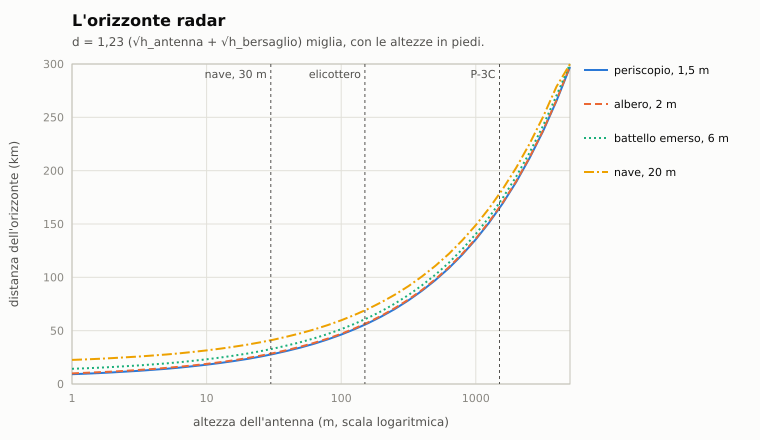

# C10. Radar ed ESM

*Autore: kit, per il runtime. Revisione del 27/10/2026. Stato: rivisto (runtime, 27/10/2026), curatore: kit.*

## 1. A che serve

Decide chi vede chi sopra l'acqua. Un radar acceso cerca le teste dei periscopi, gli alberi e i battelli emersi; a
ogni giro d'antenna ha una probabilità di vederli, che crolla con la distanza e col mare. L'**ESM** del battello (il
ricevitore d'allarme radar sull'albero) sente gli stessi radar molto più lontano, perché il loro segnale fa una sola
strada e non andata e ritorno. Dice da dove viene il radar, che radar è, se si avvicina e se è già abbastanza vicino da
vederci. I radar dell'IA non sono sempre accesi: ogni unità segue una disciplina delle emissioni (**EMCON**) che sale
con l'allarme. Il modello decide quanto si può restare a quota periscopica, quando conviene abbassare tutto e scendere,
e quanto costa accendere il proprio radar.

## 2. Il modello

Il codice è in `nucleo/elettronica.hpp` e `nucleo/src/elettronica.cpp`, un modulo puro che non conosce la missione.
I dati sono in `data/motore/emettitori.toml`, generato da `tools/pipeline/emettitori.py`. Nella missione lo collegano
`Missione::elettronica_enhanced` e `Missione::passo_elettronica` (`missioni/src/missione.cpp`), chiamato a ogni passo.
Tutto vale solo nell'Enhanced con la regola di simulazione (`DanniMissione::avanza`, `missioni/src/danni_missione.cpp`).
Se il file degli emettitori manca, resta la regola dell'originale (sezione 4).

### 2.1 Gli emettitori

Ogni radar (`Radar`) ha:
- il **ruolo**: navigazione, superficie, ricerca aerea, antisommergibile d'aereo, tiro, testa di missile;
- la **banda** NATO e la frequenza in GHz;
- il **periodo** di scansione in secondi, cioè quanto dura un giro d'antenna;
- l'**altezza** dell'antenna sul mare; 0 vuol dire la quota della piattaforma (aerei e missili);
- la **R50** contro un periscopio a mare 2 e a mare 4 e contro uno snorkel a mare 2: la distanza a cui un giro vede la
  testa con probabilità 0,5;
- la portata **contro una nave** (0: fino all'orizzonte);
- il **fattore ESM**: la portata d'intercettazione è l'orizzonte radar per questo fattore;
- tre segni per l'ESM: **puntato** (tiro e teste: illumina solo il bersaglio), **firma unica** (si riconosce senza
  ambiguità), **agilità di frequenza** (il Korshun salta di frequenza da un impulso all'altro);
- il **gruppo d'ambiguità**: i radar che l'operatore può confondere fra loro.

La tabella riassume il file dei dati; le distanze sono in km, «orizz.» vuol dire fino all'orizzonte.

| Radar | Ruolo | Banda, GHz | Periodo (s) | Altezza (m) | R50 periscopio mare 2 / mare 4, snorkel | Contro nave | Fattore ESM | Segni |
|---|---|---|---|---|---|---|---|---|
| AN/APS-115 (P-3C) | ASW aereo | I, 9 | 6 | quota | 11,1 / 3,7, 27,8 | 185,2 | 1,1 | — |
| AN/APS-124 (SH-60B) | ASW aereo | I, 9 | 0,75 | quota | 9,3 / 3,7, 22,2 | 111,1 | 1,1 | firma unica |
| Seaspray Mk 1 (Lynx HAS.3) | ASW aereo | I, 9 | 1 | quota | 7,4 / 2,8, 18,5 | 92,6 | 1,1 | firma unica |
| Wet Eye (Il-38) | ASW aereo | I, 9 | 6 | quota | 7,4 / 2,8, 22,2 | 148,2 | 1,1 | — |
| Korshun (Tu-142) | ASW aereo | I, 9 | 6 | quota | 9,3 / 3,7, 25,9 | 185,2 | 1,1 | agilità di frequenza |
| Initsiativa-2K (Ka-25) | ASW aereo | I, 9 | 4 | quota | 7,4 / 2,8, 18,5 | 111,1 | 1,1 | — |
| Initsiativa-2KM (Ka-27) | ASW aereo | I, 9 | 4 | quota | 7,4 / 2,8, 18,5 | 111,1 | 1,1 | — |
| Initsiativa-2B (Be-12) | ASW aereo | I, 9 | 4 | quota | 6,5 / 2,2, 16,7 | 92,6 | 1,1 | — |
| AN/APS-116 (S-3A) | ASW aereo | I, 9 | 0,2 | quota | 14,8 / 5,6, 33,3 | 277,8 | 1,1 | firma unica |
| AN/APS-137 (S-3B) | ASW aereo | I, 9 | 0,2 | quota | 18,5 / 7,4, 37,0 | 277,8 | 1,1 | firma unica |
| AN/SPS-55 | superficie | I, 9 | 3,75 | 30 | 9,3 / 3,7, 18,5 | orizz. | 1,2 | — |
| AN/SPS-10/67 | superficie | G, 5 | 4 | 42 | 7,4 / 2,8, 16,7 | orizz. | 1,2 | firma unica |
| Mk 92 CAS (Perry) | tiro | I, 9 | 1 | 20 | 7,4 / 2,8, 16,7 | 46,3 | 1,2 | firma unica |
| AN/SPQ-9 | tiro | I, 9 | 1 | 22 | 7,4 / 2,8, 16,7 | 37,0 | 1,2 | firma unica |
| AN/SPS-49 | ricerca aerea | C, 0,75 | 5 | 38 | 1,9 / 0, 7,4 | orizz. | 1,3 | firma unica |
| AN/SPS-48 | ricerca aerea | E, 2,5 | 6 | 42 | 2,8 / 0,9, 9,3 | orizz. | 1,3 | — |
| AN/SPS-40 | ricerca aerea | B, 0,375 | 6 | 30 | 0 / 0, 3,7 | orizz. | 1,3 | firma unica |
| Top Sail / Top Pair / Top Steer | ricerca aerea | C, 0,75 | 8 | 38 | 1,9 / 0, 7,4 | orizz. | 1,3 | firma unica |
| Head Net-C / Strut Curve | ricerca aerea | E, 2,5 | 6 | 24 | 2,8 / 0,9, 9,3 | orizz. | 1,3 | — |
| AN/SPY-1A (Ticonderoga) | ricerca aerea | E, 2,5 | 1 | 17 | 3,7 / 0,9, 11,1 | orizz. | 1,3 | firma unica |
| Type 967/968 (Type 22) | ricerca aerea | D, 1,5 | 2 | 32 | 2,8 / 0,9, 9,3 | orizz. | 1,3 | firma unica |
| Top Plate (Udaloy) | ricerca aerea | D, 1,5 | 5 | 31 | 1,9 / 0, 7,4 | orizz. | 1,3 | firma unica |
| Type 1006 (Type 22) | navigazione | I, 9 | 2,5 | 26 | 7,4 / 2,8, 16,7 | orizz. | 1,2 | — |
| Don-2 / Don Kay / Palm Frond | navigazione | I, 9 | 3 | 24 | 7,4 / 2,8, 16,7 | orizz. | 1,2 | — |
| Peel Pair / Plank Shave | superficie | I, 9 | 3 | 12 | 7,4 / 2,8, 16,7 | orizz. | 1,2 | — |
| navigazione civile (X + S) | navigazione | I, 9 | 2,5 | 24 | 3,7 / 0,9, 11,1 | orizz. | 1,2 | — |
| radar di tiro (generico) | tiro | J, 15 | 1 | 19 | 0 / 0, 0 | 55,6 | 1,0 | puntato |
| AN/BPS-15 (688) | navigazione | I, 9 | 3 | 8 | 0 / 0, 0 | 20,4 | 1,2 | — |
| Snoop Tray / Snoop Pair | navigazione | I, 9 | 3 | 8 | 0 / 0, 0 | 20,4 | 1,2 | — |
| Calypso II (Type 206A) | navigazione | I, 9 | 3 | 7 | 0 / 0, 0 | 18,5 | 1,2 | — |
| AN/DSQ-28 (Harpoon, TASM) | testa di missile | J, 15 | 0,5 | 10 | 0 / 0, 0 | 27,8 | 1,0 | puntato, firma unica |
| testa del Granit | testa di missile | J, 15 | 0,5 | 10 | 0 / 0, 0 | 27,8 | 1,0 | puntato, firma unica |

Fonte: `data/motore/emettitori.toml` `[radar.*]`. La tabella è scritta a mano: va sostituita da una tabella generata
quando il curatore aggiungerà il modulo dell'area.

**Le altezze delle antenne** vengono dai modelli del kit (dal 31/10/2026). `tools/pipeline/emettitori.py` misura su
ogni modello la cima della parte che porta il radar (`PARTI_ANTENNA`: l'SPS-49 sulla sua antenna o sul pennone alto,
il radar civile sul radar, sull'albero radar o sulla plancia…) e la scrive in `[antenne.<classe>]` con la parte e la
quota. L'altezza del radar è la mediana delle sue navi, al metro: il Type 967/968 delle Type 22 a 32 m, il Sea Giraffe
della Stockholm a 19, il DRBV 22 della Oslo a 16, il Top Plate dell'Udaloy a 31. Per il radar combinato Top Sail / Top Pair /
Top Steer conta la più alta delle sue antenne (lo Slava ha il Top Steer a 38,1 m): la mediana fa 38 m. Il motore usa l'altezza per
classe di `[antenne]` (`CatalogoElettronico::altezza_antenna`, in `Missione::altezza_radar`): conta per i radar comuni
a molte navi, come il radar civile, che va dai 6,9 m del peschereccio costiero ai 43,7 della portacontainer, o lo
Strut Curve e l'Head Net, dai 15,9 della Grisha ai 28,3 dell'Udaloy. L'altezza del radar (la mediana) resta per le
classi senza antenna misurata. Sottomarini, aerei e teste dei missili restano come sono. La prova è «emettitori: le antenne radar tornano coi modelli del kit»
(`test/prove_lamiera.cpp`).

Le suite per classe sono in `[suite]`:
- Perry: SPS-55, Mk 92 CAS, SPS-49, tiro. Kidd: SPS-55, SPQ-9, SPS-48, tiro. Spruance: SPS-55, SPQ-9, SPS-40, tiro;
- Iowa: SPS-10/67, SPS-49, tiro. Nimitz: SPS-10/67, SPS-49, SPS-48. Sacramento: SPS-10/67, SPS-40;
- Kara: navigazione sovietica, Top Sail, Head Net-C, tiro. Kirov e Slava: navigazione, Top Sail, tiro. Krivak II e
  Koni: navigazione, Head Net-C, tiro. Nanuchka: Peel Pair, tiro;
- mercantili, navi da carico e petroliere: il radar di navigazione civile;
- aerei ed elicotteri: un radar ciascuno, come nella tabella;
- le classi nuove dei lotti 1 e 2 (30/10/2026; dotazioni da Wikipedia EN, Navsource e Seaforces, portate STIMA come
  i radar dello stesso ruolo):
  - Knox: SPS-10/67, SPS-40, tiro (l'SPG-53 del cannone);
  - Ticonderoga: SPS-55, SPQ-9, SPS-49, SPY-1A, tiro;
  - Type 22, Batch 1 e Batch 2: Type 1006, Type 967/968, tiro;
  - Udaloy: navigazione sovietica, Head Net-C / Strut Curve (lo Strut Pair), Top Plate, tiro;
  - Grisha III: navigazione, Head Net-C / Strut Curve, tiro;
- sottomarini: BPS-15 per Los Angeles, Sturgeon, Trafalgar e Ohio; Snoop per tutti i sovietici (anche Delta III,
  Sierra e Victor I); il Calypso II per il Type 206A;
- missili: DSQ-28 per Harpoon e Tomahawk, la testa del Granit per il P-700.

### 2.2 I ricevitori ESM

`RicevitoreEsm`, in `[esm.*]`:

| Ricevitore | Copertura (GHz) | Intercetto per passaggio: E-J / B-D | Errore di rilevamento I-J / E-H / B-D | Antenna |
|---|---|---|---|---|
| AN/WLR-8(V)2 | 0,05-20 | 0,95 / 0,8 | 5° / 8° / 12° | 1,5 m |
| Bukhta | 2-18 | 0,7 / 0,7 | 7,5° / 12° / 18° | 1,5 m |
| DR-2000U (Type 206A) | 2-18 | 0,8 / 0,6 | 6° / 10° / 15° | 1,5 m |

Fonte: `data/motore/emettitori.toml` `[esm.wlr8]`, `[esm.bukhta]`, `[esm.dr2000]`. Il WLR-8 va su Los Angeles,
Sturgeon, Trafalgar e Ohio, il Bukhta su tutti i sottomarini sovietici, il DR-2000U (col SARIE, prestazioni STIMA) sul
Type 206A (`[esm_di]`). Il Bukhta non copre sotto i 2 GHz: non sente l'SPS-49, il Top
Sail e l'SPS-40.

### 2.3 Orizzonte radar

```
d_orizzonte = 1,23 (√h_r + √h_t)  miglia, con le altezze in piedi
```

- `h_r`: altezza dell'antenna radar; `h_t`: altezza del bersaglio (o dell'antenna ESM).
- `orizzonte_radar_m`; altezze esposte in `altezza_esposta_m`: periscopio 1,5 m, albero 2 m, snorkel 1,5 m, battello
  emerso 6 m.
- Gli aerei senza un controllore dell'ASW volano a 300 m, gli elicotteri a 150 m (`QUOTA_AEREO_M`,
  `QUOTA_ELICOTTERO_M` in `missioni/src/missione_asw.cpp`); con il controllore vale la quota vera.



### 2.4 Il radar contro la testa: un giro alla volta

Per ogni giro d'antenna:

```
p_giro = min(0,95,  F_op · F_vel / (1 + (R / R50)^4))      solo se R ≤ d_orizzonte
```

- `R`: distanza fra il radar e la testa.
- `R50`: dalla tabella, corretta per l'esposizione, il mare e la pioggia (sotto).
- `F_op`, l'operatore (`Missione::radar_contro`): 0,3 non allertato; 0,7 se ha un contatto sul bersaglio o l'EMCON è
  in ingaggio; 0,9 se il contatto ha già la posizione. I mercantili restano sempre a 0,3.
- `F_vel`, il pennacchio: 1 fino a 5 nodi (9,3 km/h), 1,5 fino a 8 nodi, 2 oltre.

Nel passo `dt` della missione la probabilità è `1 − (1 − p_giro)^(dt / periodo)`, così la probabilità cumulata
sull'esposizione è `1 − Π(1 − p_giro)` sui giri. Un radar a 0,2 s (APS-116, APS-137) fa cinque giri al secondo:
pochi secondi di testa fuori bastano.

**R50 col mare** (`r50_m`):
- mare 0: 1,3 volte quella di mare 2; mare 1: 1,15 volte;
- fra mare 2 e mare 4: interpolata fra i due valori della tabella;
- da mare 5 in su: zero per il periscopio e l'albero;
- lo snorkel segue una retta sola: 1 a mare 2, 0,3 da mare 5 in su. Sotto mare 2 la retta sale: 1,23 a mare 1 e 1,47
  a mare 0;
- il battello emerso non sente il mare.

**R50 per l'esposizione:**
- periscopio: quella della tabella (riferimento: 0,5 m² di sezione);
- albero (antenna e periscopio insieme, circa 1 m²): per `2^(1/4)` = 1,19;
- battello emerso: 0,6 della portata contro nave; se il radar non ne ha una, la R50 è infinita e conta solo
  l'orizzonte;
- la testa di un sottomarino dell'IA conta come periscopio della tabella, senza la sua sezione vera;
- con i periscopi dell'Enhanced la testa vera del giocatore (`TestaEsposta`, dal capitolo C9): la R50 del periscopio
  scala con la radice quarta della sezione efficace, `(σ / 0,5)^(1/4)`; l'orizzonte usa l'altezza vera della testa; il
  pennacchio pesa per la **piuma** della testa, `F_vel = 1 + (F_vel − 1) · piuma`.

**Pioggia** (`fattore_pioggia`, con l'intensità nel punto del bersaglio, capitolo E7):
- attenuazione andata e ritorno, `2 · a · R` dB, con `a = 0,0101 · P^1,276` dB/km da 6 GHz in su, `0,002 · P` fra 4 e
  6 GHz, niente sotto i 4 GHz (`P` in mm/h);
- la R50 si moltiplica per `10^(−perdita/40)` (la portata va con la radice quarta);
- contro una testa c'è anche l'eco della pioggia: un altro fattore `1 / (1 + P/20)` (STIMA).

Il documento di progetto (dossier 11 §6.4) dice «pioggia forte: R50 × 0,7 in banda I/J»; il codice usa
l'attenuazione per frequenza e l'eco della pioggia. Esempio: a 10 mm/h, banda I, 10 km, la R50 di una testa scende a
circa 0,54 della R50 a secco.

**Quando il radar vede** (`radar_contro`): il contatto ha qualità almeno 800, la **posizione** e la quota (il radar dà
distanza e rilevamento). L'EMCON di chi vede riceve «albero visto», l'IA alza l'allerta («albero», capitolo E6) e
sceglie il bersaglio. Vale per tutti i radar accesi contro tutti i sottomarini delle altre parti: il giocatore e
l'IA. Le parti sono tre (NATO, Patto, neutrali; `flag & 0x18`): ogni radar vede anche i neutrali, e i radar dei
neutrali vedono tutti gli altri, in modo simmetrico.

### 2.5 Il radar contro le navi

`Missione::radar_contro_nave`, per i radar accesi contro le navi in superficie:
- l'altezza della nave è `0,15 ×` la lunghezza, fra 6 e 35 m (`NAVE_SOVRASTRUTTURE`, `NAVE_ALTA_MIN_M`,
  `NAVE_ALTA_MAX_M`: STIMA);
- la portata è l'orizzonte fra antenna e sovrastrutture, al più la portata contro nave del radar;
- `p_giro` vale 0,9 fino a quattro quinti della portata, poi scende a zero in linea retta (`NAVE_P_GIRO`: STIMA);
- il contatto ha qualità almeno 800 e la posizione;
- il radar del giocatore vede tutte le navi; quelli dell'IA le navi delle altre parti, neutrali compresi (le tre
  parti di `flag & 0x18`, come in §2.4).

### 2.6 EMCON dell'IA

`Emcon`, una per ogni unità la cui classe ha radar. Cinque stati, ognuno con i radar che accende (`Emcon::emette`):

| Stato | Radar accesi |
|---|---|
| silenzio | nessuno |
| navigazione | navigazione e superficie |
| ricerca | navigazione, superficie e ricerca aerea |
| intermittente | tutti tranne tiro e teste, acceso e spento a caso (aerei) |
| ingaggio | tutti, tiro compreso |

**Stato di partenza** (`emcon_di_partenza`):
- aerei ed elicotteri: intermittente;
- mercantili (e AGI): navigazione;
- navi americane: navigazione; navi sovietiche: ricerca;
- sottomarini e armi: silenzio.

**Eventi** (`Emcon::evento`). Lo stato sale e non scende per un evento:
- «scoperti» porta in ricerca;
- «minaccia aerea», «albero visto», «lancio di missili» portano in ingaggio;
- «contatto sonar» non cambia lo stato;
- gli aerei non cambiano stato: con «albero visto» passano a radar **continuo**, gli altri eventi rinnovano solo
  l'ora dell'allarme;
- i sottomarini restano in silenzio, salvo il lancio di missili. Allora vanno in ingaggio e accendono il loro radar
  di navigazione (BPS-15 o Snoop) fino al ritorno.

Nella missione arrivano quattro eventi:
- «albero visto», quando un radar o una vedetta vede la testa o l'albero (`radar_contro`, `missione_periscopi.cpp`);
- «scoperti», da una radiogoniometria sulla trasmissione del giocatore (capitolo C11) e quando l'allerta della forza
  arriva al livello `emcon_combattimento` = 3 (`data/motore/interazioni.toml`, `missioni/src/missione_forze.cpp`);
- «minaccia aerea», a ogni passo, per una nave che ha un contatto di qualità almeno 800 su un aereo ostile
  (`passo_elettronica`);
- «lancio di missili», all'unità che lancia col comando MISSILE dello script (`registra_lancio_missile`).

**Ritorno:** dopo 20 minuti senza allarmi (`ALLARME_S` = 1200 s) l'unità torna allo stato di partenza e l'aereo
lascia il radar continuo.

**Cicli degli aerei** (`[intermittente]`, secondi, estratti a caso con distribuzione uniforme; si parte spenti):

| Aereo | Acceso | Spento |
|---|---|---|
| P-3C | 6-18 | 120-480 |
| Il-38, Tu-142, Be-12 | 120-300 | 120-300 |
| SH-60B | 30-60 | 180-300 |
| S-3A, S-3B | 1-3 | 180-600 |
| Ka-25, Ka-27 | sempre | — |

### 2.7 L'ESM del battello

`EsmBattello::avanza`, a ogni passo, per ogni radar acceso:

1. **Antenna fuori.** Serve l'antenna ESM fuori dall'acqua e la quota non oltre 18 m (`QUOTA_ALBERO_M`). Per il
   giocatore con i periscopi dell'Enhanced: l'antenna alzata, o la testa di un periscopio che ha l'ESM (il Type 18;
   capitolo C9). Senza il modulo dei periscopi: periscopio o antenna.
2. **Banda.** La frequenza del radar dentro la copertura del ricevitore.
3. **Portata.** `fattore_esm · d_orizzonte(h_radar, 1,5 m)`.
4. **Un passaggio del fascio**, con probabilità `min(1, dt / periodo) · P_int`. `P_int` è quella del ricevitore;
   sotto i 2 GHz vale quella delle bande basse.
5. **Fuori dal fascio.** Un radar puntato su un altro bersaglio si sente solo dai lobi laterali: portata divisa per 3,
   probabilità per 0,3 (STIMA).

A ogni passaggio:
- **rilevamento**: il vero più un errore gaussiano con σ della banda (I-J da 8 GHz, E-H da 2 GHz, B-D sotto). La media
  è circolare su tutti i passaggi; il suo errore è `σ / √n`, non meno di 2°;
- **distanza stimata**: `log₁₀ R_stim = log₁₀ R + 0,15 · N(0, 1)`, cioè circa ±40% a una σ. Il primo passaggio
  la fissa, poi una media mobile (0,7 il vecchio, 0,3 il nuovo);
- **ampiezza** da 1 a 5: `5 − ⌊5 R / portata⌋`, fra 1 e 5. Vale 5 nel quinto più vicino della portata;
- **tendenza**: il livello a sola andata, `−20 log R`, confrontato con quello di almeno un minuto prima (al più due).
  Oltre +3 dB al minuto: in avvicinamento; sotto −3: in allontanamento; altrimenti stabile;
- **identità**:
  - al primo passaggio solo «radar in banda X»;
  - dal secondo, la classe generica: «radar di superficie in banda I»;
  - al terzo l'operatore decide, una volta sola: riconosce il radar con probabilità 0,9 se ha firma unica, 0,6 se la
    firma è condivisa, 0,3 con l'agilità di frequenza;
  - se lo riconosce, con probabilità 0,1 dice il nome di un altro radar dello stesso gruppo d'ambiguità.

**Rischio di contro-scoperta:**

```
ρ = R_stim / R50(radar, esposizione, mare)
```

| Condizione | Rischio |
|---|---|
| radar puntato su di noi | SCOPERTO |
| ρ ≤ 1 | CONTRO-SCOPERTA PROBABILE |
| 1 < ρ ≤ 2 | ATTENZIONE |
| ρ > 2, o R50 nulla | SICURO |

L'esposizione è quella a categorie: emerso (o vela affiorata col mare grosso), albero con l'antenna su, altrimenti
periscopio. Il rischio usa la distanza stimata, non quella vera, e non tiene conto della pioggia.

**Perdita.** Un emettitore senza passaggi per un minuto, o per tre periodi se più lunghi (`PERDITA_S`), è perso.

**Eventi** (`EventoEsm`): nuovo emettitore; radar d'aereo antisommergibile; rischio alto (ogni volta che il rischio
sale a probabile o scoperto da un livello più basso); illuminati da un radar puntato (una volta per emettitore);
emettitore perso.

**Contatti.** Ogni intercettazione dà al giocatore un contatto col sensore «esm», qualità almeno 200 e il **solo
rilevamento**. Non sovrascrive un contatto che ha già la posizione da un altro sensore.

**Il livello dell'originale.** La barra ESM resta: con l'elettronica dell'Enhanced vale `17 ×` l'ampiezza più alta fra
le intercettazioni, da 0 a 85 (`livello_originale`).

### 2.8 L'ESM dell'IA

Ogni unità dell'IA la cui classe ha un ricevitore in `[esm_di]` ha il suo `EsmBattello`. Sono solo i sottomarini, ed
è voluto: navi e aerei non hanno l'ESM. Hanno l'antenna fuori se emersi, con l'antenna alzata (`flag54 & 4`) o con la
testa di una guardata (capitolo C9), e alla quota del battello fino a 18 m. Il periscopio alzato dallo script, da
solo, non porta l'ESM fuori. Sentono tutte le emissioni, anche il
radar del giocatore. I contatti hanno il solo rilevamento e sono solo sugli emettitori ostili. Gli avvisi restano per
l'equipaggio del giocatore. L'ESM dell'IA si può spegnere per i confronti (`usa_esm_ia`).

### 2.9 Il radar del giocatore

`TipoOrdine::radar` e `Missione::radar_giocatore_acceso`:
- è il radar della classe: BPS-15 sul 688, Snoop sull'Alfa;
- emette solo col battello emerso (quota sotto 0,5 m) o con l'antenna alzata a quota periscopica (fino a 6,6 m,
  `QUOTA_PERISCOPICA_M` + 0,5);
- scendendo si spegne da solo (messaggio 459);
- il punto nave col radar della costa lo accende per la durata del fix, poi lo rimette com'era (capitolo C12);
- non ha EMCON: decide il giocatore. Contro i sottomarini usa `F_op` dai suoi contatti, come l'IA.

Che cosa vede, dai dati: le navi entro 20,4 km (11 miglia) e i sottomarini emersi entro 0,6 × 20,4 = 12,2 km come R50.
Le sue R50 contro periscopio, albero e snorkel sono zero: **non vede le teste**. Vale lo stesso per lo Snoop dei
sottomarini sovietici dell'IA. È voluto: il volume 1 (§4.6), che dice che vede anche gli alberi e i periscopi
alzati, si corregge.

Che cosa costa: è un'emissione come le altre. L'ESM di un sottomarino nemico con l'antenna fuori lo sente fino a
`1,2 · d_orizzonte(8 m, 1,5 m)` ≈ 20 km. Il volume 1 (§4.6) dice che lo intercettano le navi e gli aerei nemici;
ma navi e aerei non hanno un ricevitore ESM (`[esm_di]`), quindi lo sentono solo i sottomarini. Anche qui il volume 1
si corregge.

### 2.10 Due esempi

**Un P-3C contro un periscopio** (dossier 11 §6.4, ripreso dalle prove). APS-115 a 1000 piedi (305 m), mare 2,
operatore allertato (0,7), battello a 5 nodi, distanza 5 miglia (9,3 km):
- R50 = 6 miglia: `p_giro = 0,7 / (1 + (5/6)^4) = 0,47`;
- 8 s di testa fuori, uno o due giri: probabilità fra 0,47 e 0,72; 60 s, dieci giri: 0,998, ma solo col radar continuo, che
  arriva dopo un albero visto;
- l'operatore non allertato (0,3) fa 0,20 per giro: in 8 s fra 0,20 e 0,36;
- l'ESM del 688 lo sente fino a `1,1 · 1,23 · (√1000 + √4,9)` = 45,8 miglia (84,8 km). L'altezza è la quota vera dell'aereo: il
  P-3C cerca a 457 m (55,4 miglia, 103 km). Ma il P-3C in ricerca è acceso 6-18 s ogni 2-8 minuti: 1-3 giri da 6 s.

**Una Krivak II contro l'albero di un 688** (prova «elettronica nella missione»). Krivak sovietica in ricerca: radar di
navigazione (25 m) e Head Net-C (28 m) accesi, il tiro spento. 688 a quota periscopica con l'antenna su, 3 nodi,
mare 2:

| Distanza | ESM: navigazione / Head Net | Radar di navigazione contro l'albero | Rischio mostrato |
|---|---|---|---|
| 30 km | sente / sente (30,8 / 34,9 km) | oltre l'orizzonte (26,5 km): 0 | sicuro |
| 15 km | sente / sente | `p_giro` 0,03 | attenzione (ρ ≈ 1,7) |
| 4 km | sente / sente | `p_giro` 0,29 ogni 3 s: in un minuto quasi certo | probabile (ρ ≈ 0,45) |

Calcoli con R50 dell'albero = 7,4 km × 1,19 = 8,8 km e `F_op` = 0,3. Il rischio va con la distanza stimata, quindi può
oscillare. Quando la Krivak vede l'albero passa all'ingaggio, accende il tiro e alza `F_op`.

## 3. Fonti e confidenza

| Parametro | Fonte | Confidenza |
|---|---|---|
| Bande, ruoli e suite per classe | dossier 11 §1 | media; bassa per le bande sovietiche |
| Periodi e altezze dei radar | dossier 11 §6.1 | **STIMA** salvo l'APS-116/137 (dossier 11 §5.1 [APL97], 300 giri/min) |
| R50 contro periscopio, albero, snorkel | dossier 11 §5.2, §6.1 | **STIMA**: la sezione dei veri alberi è riservata; scelte perché un aereo veda un periscopio a 4-8 miglia con mare 2 |
| Radar ASW dell'Enhanced (S-3, Tu-142M, Be-12, Ka-27) | dossier 17 §8.2, §10.1 | **STIMA** |
| Orizzonte radar `1,23 (√h_r + √h_t)` | dossier 11 §0.2, dossier 02 §7.7 | alta |
| Legge `1 / (1 + (R/R50)^4)` e cumulata sui giri | dossier 11 §5.3, §6.4 | media (forma), **STIMA** i valori |
| `F_op` 0,3 / 0,7 / 0,9; `F_vel` 1 / 1,5 / 2 | dossier 11 §6.4 | **STIMA**; 0,3 per le navi non allertate approvato nella taratura P5 |
| Mare: zero da mare 5, snorkel 0,3 | dossier 11 §6.1, dossier 21 §6.1 | media |
| Pioggia | dossier 21 §6.2 (ITU per l'attenuazione) | alta l'attenuazione; **STIMA** l'eco della pioggia |
| Radar contro nave: altezza 0,15 L, 0,9 per giro | scelta di gioco | **STIMA** |
| Fattore ESM sull'orizzonte 1,0-1,3 | dossier 11 §4.3 | **STIMA**: diffrazione e condotti |
| WLR-8: copertura 0,05-20 GHz | dossier 11 §4.1 [FASWLR8] | alta |
| WLR-8: intercetto 0,95, errori 5°/8°/12° | dossier 11 §4.1, §6.3 | **STIMA**: le prestazioni non sono pubblicate |
| Bukhta: 2-18 GHz, 0,7, errori × 1,5 | dossier 11 §4.2 | **STIMA**, fonti deboli |
| Identificazione 0,9 / 0,6, errore 0,1, terzo passaggio | dossier 11 §6.3 | **STIMA** |
| Agilità di frequenza 0,3 | dossier 17 | **STIMA** |
| Distanza stimata ±40%, tendenza 3 dB/min | dossier 11 §4.4, §6.3 | **STIMA** (prassi plausibile) |
| Soglie di rischio ρ = 1 e 2 | dossier 11 §6.3 | **STIMA** |
| Stati EMCON e partenze | dossier 11 §3, §6.2 | media (dottrina), **STIMA** le transizioni |
| Cicli degli aerei | dossier 11 §6.2 | **STIMA**: nessuna fonte aperta con numeri |
| Ritorno dopo 20 minuti | dossier 11 §6.2 | **STIMA** |

## 4. Classico ed Enhanced

Nel classico non ci sono emettitori né EMCON (`docs/originale/sensori_e_navigazione.md` §3.2,
`docs/originale/numeri_eseguibile.md` §3.5):
- una nave o un aereo «vede» il periscopio alzato del giocatore entro 900 quarti d'unità per asse (4,5 miglia), con
  l'antenna entro 1350 (6,75 miglia), sempre, senza probabilità;
- non dà la scoperta: dà un bonus alla qualità della traccia, un quarto del livello, e un contatto con segnale 550
  quando l'ascolto passivo fallisce;
- il livello è `85 − (|dx| + |dy|) / 32` in quarti d'unità, da 85 vicinissimo a circa 1 al limite;
- la barra ESM del periscopio mostra quel livello: 9 riquadri sul 688, 10 sull'Alfa. Vale l'ultima intercettazione,
  senza decadimento; torna a 0 con periscopio e antenna giù e ogni volta che un'unità esce dalla simulazione;
- quindi l'ESM dell'originale non misura i radar nemici: è la spia «ti stanno vedendo».

Nell'Enhanced con la regola di simulazione:
- la regola dell'originale lascia il posto ai radar accesi con la probabilità per giro (sezione 2.4);
- la barra ESM resta, col livello dell'emettitore più vicino (sezione 2.7);
- se mancano i dati degli emettitori, l'intercettazione dell'originale entra nell'acustica come +5 dB (capitolo C1);
- il radar del giocatore, l'ESM dell'IA e la radiogoniometria esistono solo qui.

## 5. Come si vede in gioco

- **Volume 1, §4.5 (L'ESM) e §4.6 (Il radar del battello).** Antenna su e giù col tasto N; radar con Ctrl+R.
- **Pannello radio/ESM** (stazione Radio, F2): con l'antenna o il periscopio su, la panoramica per banda (da B a J) e
  le intercettazioni, una riga ciascuna: rilevamento, banda, identità, ampiezza. La spia **THREAT** (UGROZA sull'Alfa)
  si accende con un rischio probabile o scoperto. Col radar acceso la prima riga è «PROPRIO RADAR ACCESO»
  (`engine/app/interfaccia.cpp`, `engine/grafica/src/sale.cpp`).
- **Sopra le altre stazioni** (non sulla carta, la radio, i danni e il sonar), con l'antenna o il periscopio su: la
  barra ESM dell'originale e fino a cinque intercettazioni con rilevamento, banda, identità, ampiezza (A1-A5), tendenza
  (AVV., ALL.) e rischio. Verde se sicuro, giallo con attenzione, rosso con rischio alto.
- **Messaggi:**
  - 334 nuovo emettitore radar; 335 radar di un aereo antisommergibile; 336 rischio di scoperta alto;
  - 337 illuminati da un radar di tiro; 338 emettitore perso;
  - 458 radar acceso, ci possono intercettare; 459 radar spento, l'albero è sott'acqua.
- **Contatti:** «esm» col solo rilevamento; «radar» con la posizione.
- **Registro e debriefing** (capitolo F1): i messaggi 336 e 337 diventano l'evento `esm_rischio_alto`, con interesse 45,
  55 se l'emettitore è un aereo antisommergibile.
- **Dall'altra parte:** l'albero visto al radar alza l'allerta dell'unità (capitolo E6) e porta la sua EMCON in
  ingaggio. Le navi accendono il tiro, gli aerei tengono il radar acceso.

## 6. Taratura e prove

- **Esempio del dossier 11 §6.4**, il P-3C a 5 miglia: `p_giro` = 0,47, ritrovato dalla prova.
- **Taratura P5** dei periscopi (`docs/14_periscopi.md`, 25/10/2026), con la Krivak II:
  - a mare 2 il radar vede la testa con una R50 di circa 10 km su 10 s d'esposizione, in linea con le 4-5 miglia;
  - a mare 5 il radar non vede; resta la vista;
  - approvato `F_op` 0,3 per le navi non allertate.
- **Strumento:** `engine/strumenti/taratura.cpp` misura la scoperta del periscopio (radar e vista) per distanza, mare,
  ora e velocità, e la probabilità per giro dell'APS-115 per teatro e mese. `TARATURA_SENZA_ESM_IA` spegne l'ESM
  dell'IA per i confronti della fase 2 (`docs/18_interazioni_ia.md`).

Prove in `test/prove_elettronica.cpp`:
- «elettronica: catalogo, suite delle classi e ricevitori ESM»;
- «elettronica: orizzonte radar e probabilita' per giro contro il periscopio (esempio del dossier §6.4)»;
- «elettronica: EMCON dell'IA, allarmi e ritorno; aerei intermittenti»;
- «elettronica: l'ESM del 688 sente il P-3C ben prima di esserne visto, identifica e stima il rischio»;
- «elettronica: oltre l'orizzonte niente intercetto; il radar di tiro puntato su di noi e' SCOPERTO»;
- «elettronica nella missione: a 30 km l'ESM sente la Krivak, che non vede l'albero; a 4 km il radar lo vede».

Altre prove:
- `test/prove_percezione_ia.cpp`: «il radar di una nave vede l'antenna di un sottomarino dell'IA»; «l'ESM di un
  sottomarino dell'IA intercetta il radar di una nave»; «il radar del giocatore acceso si fa intercettare, e
  sott'acqua si spegne»; «i radar vedono le navi in superficie, quello del giocatore e quelli dell'IA»;
- `test/prove_periscopi.cpp`: «periscopi: sezione radar della testa per l'elettronica»;
- `test/prove_asw_aereo.cpp`: «asw aereo: dati, classi ed emettitori coerenti»;
- `test/prove_missioni.cpp`: «livello ESM (DS:476C): ultima intercettazione sul giocatore, a 0 coi sensori giu' e
  quando un'unita' esce» (il classico).

## 7. Limiti noti e in arrivo

- **Eventi EMCON.** «Contatto sonar» non cambia lo stato e la missione non lo manda. Del dossier 11 §6.2 mancano: il radar d'aereo acceso per quota (sotto i 1000 piedi in attacco: oggi lo tiene acceso il
  bersaglio visto, E5), lo stato minimo con nebbia o vicino alla costa,
  le navi americane che partono in silenzio sotto minaccia.
- **Le teste dei missili non emettono.** DSQ-28 e Granit sono nel catalogo, ma le armi partono in silenzio e
  l'intermittenza esclude le teste: con le regole di oggi non si accendono mai. Nessun'altra parte del codice le accende.
- **Radar d'aereo a lampi.** L'emettitore si perde dopo un minuto senza passaggi. Un P-3C acceso 6-18 s ogni 2-8
  minuti dà uno o tre passaggi per lampo: l'identificazione al terzo passaggio riesce di rado, e ogni lampo riparte da
  un emettitore nuovo.
- **Niente falsi periscopi.** I picchi del mare che l'operatore scambia per un periscopio (dossier 11 §6.4) non ci
  sono.
- **Il rischio è approssimato.** Usa l'esposizione a categorie, non la sezione vera della testa, e ignora la pioggia;
  il radar che vede davvero usa la testa vera e la pioggia.
- **Radar per periscopi col mare grosso.** `r50_m` ha un ramo per i radar che a mare 4 tengono almeno 0,55 della R50
  di mare 2 (l'APS-116/137 secondo il commento del codice), che restano utili fino a mare 7. Nei dati il rapporto
  è al più 0,4 per tutti: il ramo non scatta e da mare 5 nessun radar vede una testa.
- **Il documento dice altro** (dossier 11 §6.3): l'APS-137 dà SCOPERTO a prescindere dalla distanza; nel codice
  SCOPERTO viene solo da un radar puntato su di noi.
- **Solo i sottomarini hanno l'ESM**, per scelta. Navi e aerei non intercettano il radar del giocatore; la
  radiogoniometria delle trasmissioni radio usa invece una regola a parte, con le navi e gli aerei nemici entro 50 km
  (capitolo C11).
- **Radar sempre uguali.** Niente potenza ridotta né settori ristretti: un radar è acceso o spento.
- **In arrivo:** nessun lavoro deciso per questo modulo nella roadmap (`docs/00_ROADMAP.md`, punto 23) né in
  `docs/18_interazioni_ia.md`.

## 8. Riferimenti

- Codice: `nucleo/elettronica.hpp`, `nucleo/src/elettronica.cpp` (`carica_elettronica`, `orizzonte_radar_m`,
  `altezza_esposta_m`, `r50_m`, `probabilita_giro`, `fattore_pioggia`, `emcon_di_partenza`, `Emcon`, `EsmBattello`);
  `missioni/src/missione.cpp` (`elettronica_enhanced`, `passo_elettronica`, `radar_contro`, `radar_contro_nave`,
  `radar_giocatore_acceso`, `altezza_radar`, `TipoOrdine::radar`); `missioni/src/missione_periscopi.cpp`
  (`testa_giocatore`, `esm_in_testa`); `missioni/src/missione_forze.cpp` (EMCON di combattimento);
  `missioni/src/registro_missione.cpp` (`esm_rischio_alto`); `app/interfaccia.cpp`, `grafica/src/sale.cpp` (pannelli).
- Dati: `data/motore/emettitori.toml` (`[radar.*]`, `[esm.*]`, `[suite]`, `[esm_di]`, `[intermittente]`), da
  `tools/pipeline/emettitori.py`; `data/motore/interazioni.toml` (`emcon_combattimento`);
  `data/motore/tasti_predefiniti.toml` (`radar_giocatore`, `antenna`); messaggi in
  `data/motore/testi/messaggi_bordo.tsv` (334-338, 458, 459).
- Ricerca: dossier 11 (§0.2, §1-6); dossier 02 §7.7; dossier 17 §8.2 e §10.1; dossier 21 §6.1 e §6.2.
- Progetto: `docs/00_ROADMAP.md` punto 23; `docs/14_periscopi.md` (P1, P5); `docs/18_interazioni_ia.md` (fase 2).
- Originale: `docs/originale/sensori_e_navigazione.md` §3.2; `docs/originale/numeri_eseguibile.md` §3.5.
- Volume 1: `1_uso/04_periscopi_esm_radio.md` §4.5 e §4.6. Capitoli vicini: C1, C9, C11, C12, E5, E6, E7.
