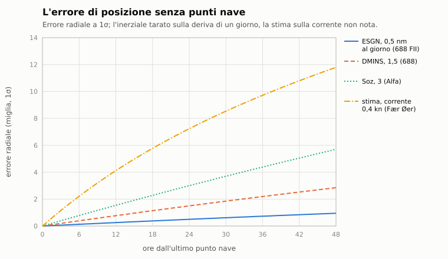

# C12. Navigazione

*Autori: kit (carta e fondale); il modulo della posizione incerta è del disassemblatore; gli strumenti della carta e
la TMA (capitolo C13) li rivede la principale. Revisione del 29/10/2026 (il GPS 1990+, la qualità del fix, il
batimetrico sulla carta, l'inerziale dell'IA). Stato: rivisto (curatore: kit).*

## 1. A che serve

Dice dove sono il fondo, la costa e il battello: il fondale vero che il battello tocca, le carte d'epoca con cui
naviga e che non coincidono col fondale vero, la posizione che il battello crede di avere. Nel 1989 un sottomarino non
sapeva mai esattamente dove si trovava, e le sue carte avevano buchi ed errori: questo capitolo spiega come il gioco
lo rende. Con la navigazione realistica il battello sa dov'è solo per stima. L'errore cresce col tempo, e i punti nave
(il satellite, l'Omega, le stelle, la costa, il fondale) lo riportano indietro a un prezzo: salire, alzare un albero,
rallentare, emettere. L'IA naviga con le stesse regole. Il quadro del fondale (§2.11) mette sulla carta quello che
l'ecoscandaglio e il BQS-15 hanno misurato: dove la carta sbaglia, lo si scopre solo misurando, e ogni ping si sente.

## 2. Il modello

### 2.1 Il fondale vero

- **Fonte**: EMODnet per i sei teatri europei, ETOPO 2022 per le Curili; heightmap a 16 bit a celle di 200 m, in una
  proiezione azimutale equidistante col centro nel teatro (`data/motore/teatri/<teatro>.fdl`, blocco `GEO1` col
  centro).
- **Lettura**: interpolazione bilineare fra i centri delle celle; fuori dalla griglia non c'è fondo.
- **Coordinate**: `Fondale::geografiche` e `proiettata` passano dal piano a latitudine e longitudine WGS84 col
  problema diretto e inverso di Vincenty dal centro: nella proiezione azimutale equidistante sull'ellissoide distanza
  e azimut dal centro sono quelli del piano. Scarto da pyproj sotto 1 cm a 230 km.

### 2.2 Il fondo e gli incagli

Uguale per tutte le unità (navi e sottomarini; aerei esclusi). La quota è quella della chiglia; in superficie conta il
pescaggio.

- **Incaglio**: un passo che porterebbe la chiglia in un fondo più alto (e più alto di quello in cui si trova) non
  avviene: l'unità si ferma. Da una secca si esce sempre verso acqua più profonda; l'incaglio finisce a 50 m dal punto.
- **Sul fondo**: la chiglia si appoggia (`sul_fondo`).
- **Danni**, al primo contatto: `integrità × (v / 20 m/s)²`, con la velocità vera o il rateo di discesa. Sotto 1 m/s
  nessun danno; 30 nodi contro la costa tolgono il 59%, una discesa a 5,5 m/s l'8%. L'originale toglieva sempre 40
  punti.
- **Giocatore**: messaggio 30 («Abbiamo toccato il fondo, danni allo scafo!»), oppure 9 («Abbiamo urtato il fondo,
  {COMANDANTE}!») con l'esito 1 della missione, il battello perduto, come l'originale (`Missione::urta_fondo`).
- **Armi**: sott'acqua non scendono sotto il fondo; sulla costa il siluro è perso.

### 2.3 Il pilota dell'IA

Nell'originale le navi ignoravano il fondale e passavano sopra la terra. Il pilota del remake:

- **rotte**: verso una meta, se la via diretta incontra acqua bassa, una rotta A* sulle celle collegate, tagliata a
  vista. Acqua minima: pescaggio + 0,5 m; fra la minima e la comoda (pescaggio + 3 m per le navi, + 10 m per i
  sottomarini) il costo è quadruplo. Una meta in un'acqua non collegata (un fiordo chiuso da una soglia bassa) porta
  al punto raggiungibile più vicino;
- **aggiramento a vista** delle secche senza meta, con scarti di 15°;
- **velocità di manovra**: 5 nodi mentre aggira una secca o accosta di oltre 45°;
- **franco**: i sottomarini tengono la chiglia 25 piedi (7,6 m) sopra il fondo, qui e lungo la prua;
- **freno d'emergenza**: macchine ferme se entro una volta e mezza lo spazio di frenata (più 200 m) la chiglia
  toccherebbe;
- **collocazione**: le unità che partono, o che gli script creano, in acqua meno che comoda o in una pozza chiusa (sotto
  20 km²) vanno nell'acqua comoda più vicina.

Verifica (`strumenti/verifica_fondale.cpp`): 22 scene × 5 semi × 60 minuti, con e senza fondale: nessun urto
dell'IA, nessuna unità sulla terra. Gli esiti possono differire: le rotte diverse attorno alle secche cambiano gli
scontri, e lo strumento lo segnala senza contarlo come errore.

### 2.4 Le carte d'epoca

Ogni parte naviga sulla sua carta (`data/motore/teatri/<teatro>_carta_<nato|urss>.fdl`, da
`tools/pipeline/carta_epoca.py` con i parametri di `carte_epoca.yaml`, tutti **STIMA**). È il fondale vero degradato
come lo conoscevano i rilievi dell'epoca, con la stessa griglia. La generazione è deterministica, col seme dal teatro e
dalla parte:

1. **campagne di rilievo** in blocchi di Voronoi di 20-50 miglia: anno, ente, orientazione delle linee, spostamento e
   scarto della velocità del suono usata. Secondo la copertura alcune restano non rilevate; la fascia costiera
   avversaria (22 km) non si rileva mai;
2. **linee di scandaglio** con la spaziatura del teatro (fitta sulle soglie, rada nei bacini), campionate con un
   ecoscandaglio a cono, più sondaggi sparsi nelle zone non rilevate;
3. **ricostruzione** a triangoli dalle posizioni sbagliate, con la costa vera a quota zero;
4. **generalizzazione** con un passa-basso che conserva i bassi fondali;
5. profondità in metri interi, terra a passi di 10 m;
6. **annotazioni** per i rilievi veri spariti dalla carta: ED (esistenza dubbia), PA (posizione approssimata),
   «profondità minore riportata», «acqua scolorita».

Una cella è «non rilevata» se è più lontana di 1,5 volte la spaziatura da ogni linea. Il risultato, sul mare del
teatro:

| Teatro | NATO: non rilevato / errore medio / annotazioni | URSS: non rilevato / errore medio / annotazioni |
|---|---|---|
| Baltico | 20% / 1,1 m / 0 | 0% / 1,1 m / 1 |
| Barents | 29% / 7,4 m / 15 | 0% / 4,2 m / 22 |
| Celtica | 0% / 77 m / 43 | 9% / 83 m / 25 |
| Fær Øer | 3% / 16 m / 43 | 13% / 16 m / 45 |
| Gibilterra | 0% / 16 m / 32 | 11% / 18 m / 52 |
| Kunashir | 30% / 67 m / 58 | 0% / 43 m / 60 |
| Otranto | 17% / 21 m / 53 | 16% / 25 m / 41 |

Nei teatri profondi (Mar Celtico, Curili) l'errore medio viene soprattutto dalla velocità del suono sbagliata sui
fondi oltre i 2000 m. **Simulazione, pilota dell'IA e incagli usano solo il fondale vero**: la carta serve solo a chi
guarda.

### 2.5 La carta disegnata

`grafica/carta_vga` (capitolo E9 per la grafica): il fondale al pixel con la retinatura di Bayer fra le fasce di
profondità, il rilievo ombreggiato da nord-ovest su fondali e terra, la costa liscia con la fascia di risacca, le isole
piccole sempre visibili, le isobate principali coi numeri (incisi sulla carta NATO, a stampino su quella sovietica), le
zone non rilevate tratteggiate, il contorno di sicurezza, gli scandagli solo dove la carta d'epoca «sa». La mobilia:
cornice coi minuti (il passo cresce con la scala: 1, 2, 5, 10, 15, 30, 60 primi), rosa con la declinazione magnetica
del 1990 (STIMA dal modello IGRF/WMM per il centro del teatro), scala in miglia, cartiglio DMAHTC o GUNiO MO SSSR con
l'edizione; fuori dalla cornice il margine bianco del foglio. La cache si trasla finché la vista si sposta meno di 48
pixel. Il contorno di sicurezza segue la quota con un limite: mentre il battello cambia quota può restare indietro di
10 m al massimo, e un secondo di missione dopo che la quota si è fermata è esatto. A gioco in pausa resta com'è fino alla
ripresa; nel debriefing è sempre esatto.

Per la leggibilità, il tratteggio delle zone non rilevate è ogni 12 px, tre fasce più chiaro dell'acqua sotto, così non si confonde
con le isobate. Gli scandagli evitano i numeri delle isobate e le note d'epoca (ED, PA), che hanno l'alone. Sulla carta VGA la rosa
attorno al battello è ciano, con le cifre con l'alone, per distinguerla dagli scandagli; si muove col battello, quindi può ancora
passarci sopra.

**I toponimi** (`disegna_toponimi`; dati in `data/motore/teatri/<teatro>.toponimi.toml`, da
`tools/pipeline/toponimi.py`): mari, golfi, stretti, banchi, isole, capi, città e basi, da 7 nomi (Mar Celtico) a 42
(Otranto) per teatro.
- **Fonti**: Natural Earth 1:10m (aree marine, regioni fisiche, località; pubblico dominio), più le aggiunte a mano di
  `tools/pipeline/toponimi_aggiunte.yaml`: le basi d'epoca (Severomorsk, Gadžievo, Zapadnaja Lica, Rota, Taranto,
  Tivat…), le isole minori, gli stretti e i banchi dei dossier 03 §A1-A7. Nessun nome posteriore al 1989.
- **Il punto** di un'area marina è il punto d'acqua più lontano dalla riva dentro l'area, sul fondale vero; la
  pipeline controlla che i nomi d'acqua cadano in mare e gli altri a terra.
- **A scala**: ogni nome ha un rango (1 i mari, 3-4 isole maggiori, stretti e basi, 5-7 capi, banchi e città minori).
  Oltre 400 m per pixel si scrive fino al rango 4, poi un rango in più a ogni ingrandimento di due volte, tutti sotto
  25 m per pixel.
- **Senza sovrapporsi**: in ordine di rango, un nome che toccherebbe un altro nome, la rosa, la scala o il cartiglio
  non si scrive; città e basi provano a destra, a sinistra, sopra e sotto il loro segno (un punto la città, un quadrato
  vuoto la base).
- **Lo stile**: le acque in blu, inclinate come il corsivo delle carte nautiche, i mari maggiori in maiuscolo spaziato;
  la terra in nero diritta; l'alone bianco. Il font delle isobate ha solo maiuscole: le lettere che non ha perdono
  l'accento (Møn diventa MON).
- Il livello `toponimi` della carta, acceso di norma, permette di spegnerli.

### 2.6 La posizione incerta

Il modulo è `nucleo/navigazione.hpp` (`nucleo/src/navigazione.cpp`; dati in `data/motore/navigazione.toml` da
`tools/pipeline/navigazione.py`, dossier 06 §2, §6 e §7.3). È uguale per il giocatore e per l'IA, puro e
deterministico dal seme. La missione lo aggancia in `missioni/src/missione_navigazione.cpp`.

**Come si accende.**
- L'opzione **navigazione realistica**: N nella scelta della missione, `--navigazione perfetta|realistica` da riga di
  comando, la riga «NAVIGAZIONE» delle regolazioni della sandbox (capitolo F8). È un bit nel codice partita
  (capitolo A1 §2.7). Spenta di norma: senza, la posizione è esatta.
- L'opzione **GPS «1990+»**, scelta dell'utente: N gira fra tre posizioni, NAVIGAZIONE PERFETTA, REALISTICA e
  REALISTICA, GPS 1990+; da riga di comando `--gps` insieme a `--navigazione realistica`. Mette il GPS fra i punti nave
  (`Missione::usa_gps`) e ha il suo bit nel codice partita. Senza la navigazione realistica non conta.
- Vale solo con la regola di simulazione (l'Enhanced): `Missione::usa_navigazione`, prima del primo passo.
- Con l'opzione accesa, la missione può dare la chiave `navigazione = { sigma_iniziale_nm, inerziale_guasto, gps }`:
  quanto è buona la posizione di partenza (0,1 miglia per asse se manca), l'inerziale guasto dall'inizio, il GPS
  (§2.7). Oggi la usa la scena di prova `PROVA_M2_TLAM` (1,5 miglia).

**Il navigatore** (`NavigazioneStimata`):
- un filtro di Kalman a quattro stati: errore di posizione ed errore di velocità per asse (x verso est, y verso nord).
  L'errore di velocità è un processo di Gauss-Markov, con la correlazione del sistema (`correlazione_h`: 72 ore
  con l'inerziale, 12 ore a stima);
- l'errore vero si simula con lo stesso modello, dal seme. Il filtro non lo conosce: lo vede solo dai punti nave. La
  posizione stimata è la vera più l'errore;
- con l'inerziale, l'intensità dell'errore di velocità è tale che dopo un giorno l'errore radiale a 1σ sia la deriva
  del sistema (la tabella sotto). A stima, la velocità radiale rms dell'errore è la corrente non nota del teatro
  (§2.8);
- sopra la deriva c'è l'oscillazione di Schuler: 84,4 minuti, 0,15 miglia, in una direzione a caso. Il filtro non la
  segue, ma l'ellisse ne tiene conto;
- oltre 80° di latitudine la deriva e l'oscillazione raddoppiano (`latitudine_polare`, `fattore_polare`), solo con
  l'inerziale;
- con l'inerziale guasto si passa alla stima: l'errore di velocità riparte con l'incertezza del nuovo modo e la deriva
  stimata si azzera. Se l'inerziale torna, si torna all'inerziale.

Il sistema della classe (`CatalogoNavigazione::sistema_di`): prima il nome intero, poi togliendo i suffissi
(`los_angeles_flight3` → `los_angeles`), altrimenti il predefinito, la stima con solcometro e girobussola.

<!-- generato: sistemi_navigazione -->
| Classe | Sistema | Deriva (nm al giorno, 1σ) | Fonte | Confidenza |
|---|---|---|---|---|
| Los Angeles (SSN-688, Flight I) | AN/WSN-1 DMINS | 1,50 | 06 §2.1: STIMA DI GIOCO (deriva non pubblicata) | bassa |
| Los Angeles (Flight II) | AN/WSN-3 ESGN | 0,50 | 06 §2.1: giroscopio elettrostatico dei 688 con Tomahawk, STIMA | bassa |
| Los Angeles (688I) | AN/WSN-3 ESGN | 0,50 | 06 §2.1: giroscopio elettrostatico dei 688 con Tomahawk, STIMA | bassa |
| Sturgeon (SSN-637) | AN/WSN-1 DMINS | 1,50 | 06 §2.1: STIMA DI GIOCO (deriva non pubblicata) | bassa |
| Trafalgar (Royal Navy) | SINS Mk 2 | 1,00 | 06 §2.1 [RNSINS]: classe 1 nm/giorno | media |
| Victor III (Progetto 671RTM) | Medvedica | 1,75 | 06 §6: STIMA 1,5-2 nm/giorno | bassa |
| Akula I (Progetto 971) | Medvedica | 1,75 | 06 §6: STIMA 1,5-2 nm/giorno | bassa |
| Oscar II (Progetto 949A) | Medvedica | 1,75 | 06 §6: STIMA 1,5-2 nm/giorno | bassa |
| Typhoon (Progetto 941) | Medvedica | 1,75 | 06 §6: STIMA 1,5-2 nm/giorno | bassa |
| Alfa (Progetto 705) | Soz | 3,00 | 06 §6: STIMA 3 nm/giorno (Alfa) | bassa |
| Charlie II (Progetto 670M) | Sigma | 3,00 | 06 §6: STIMA 3 nm/giorno (Victor I/II, Charlie) | bassa |
| Kilo (Progetto 877) | Solcometro e girobussola | la corrente non nota | 06 §2.1: la stima accumula la corrente non nota | media |
| Foxtrot (Progetto 641) | Solcometro e girobussola | la corrente non nota | 06 §2.1: la stima accumula la corrente non nota | media |
<!-- fine: sistemi_navigazione -->



### 2.7 I punti nave

`valuta_punto_nave(definizione, condizioni)` dice se un punto nave si può fare. Se no, dà la prima condizione che
manca (`MotivoPuntoNave`), in quest'ordine: marina, anno, opzione, copertura, quota, velocità, albero, filo, cielo,
notte, costa. Se sì, dà la precisione, la durata dell'esposizione, se emette e se vuole l'albero fuori. La marina
`nato` vale per tutte le occidentali, `vmf` per la sovietica.

La precisione a 1σ per asse:

```
σ = σ_min + q · (σ_max − σ_min) + k · σ_v
```

- `σ_min`, `σ_max`: la forchetta della tabella (miglia);
- `q`: la qualità del fix, da 0 (il migliore) a 1 (il peggiore). Nella partita la peggiorano il mare e la velocità:
  `q = 0,2 + 0,08 · mare + 0,01 · nodi`, fra 0 e 1 (**STIMA**). A mare 3 e 5 nodi vale 0,49; a mare 6 e 15 nodi 0,83;
- `k`: le miglia in più per nodo d'incertezza della velocità propria (`per_kn`, 0,2 per Transit e Parus);
- `σ_v`: l'incertezza della velocità propria che il filtro dichiara (`sigma_velocita_kn`).

Un esempio: un Transit con 0,5 nodi d'incertezza della velocità vale 0,075 + 0,2 × 0,5 = 0,175 miglia.

<!-- generato: punti_nave -->
| Punto nave | Precisione (nm, 1σ) | Durata (s) | Condizioni | Marina, dal | Confidenza |
|---|---|---|---|---|---|
| Transit (NAVSAT) | 0,05-0,10 + 0,20 per nodo d'incertezza | 120 | entro 18 m; sotto 8 kn; albero fuori | nato, 1964 | alta |
| GPS | 0,01 | 60 | entro 18 m; albero fuori; opzione «gps» | nato, 1990 | alta |
| Loran-C | 0,10-0,25 | 180 | entro 18 m; albero fuori; teatri: Fær Øer e varco GIUK, Canale d'Otranto, Curili e Mare di Okhotsk, Mare di Barents, Mar Baltico, Mar Celtico | nato, 1958 | media |
| Cajka | 0,10-0,30 | 180 | entro 18 m; albero fuori; teatri: Mare di Barents, Mar Baltico, Curili e Mare di Okhotsk | vmf, 1970 | bassa |
| Omega | 2,00-4,00 | 300 | entro 60 m; filo galleggiante | nato, 1971 | alta |
| RSDN-20 «Alfa» | 1,35-3,80 | 300 | entro 60 m; filo galleggiante | vmf, 1970 | media |
| Parus (Ciklon-B) | 0,05-0,15 + 0,20 per nodo d'incertezza | 120 | entro 18 m; sotto 8 kn; albero fuori | vmf, 1974 | bassa |
| Astronomico al periscopio | 1,00-3,00 | 450 | entro 18 m; albero fuori; cielo sereno; notte o crepuscolo | tutte, sempre | media |
| Radar sulla costa | 0,05-0,20 | 60 | entro 18 m; albero fuori; emette; carta; entro 37 km dalla costa | tutte, sempre | media |
| Visivo su punti cospicui | 0,05-0,10 | 60 | entro 18 m; albero fuori; carta; entro 20 km dalla costa | tutte, sempre | media |
| Rilevamenti di fari | 0,10-0,30 | 120 | entro 18 m; albero fuori; notte o crepuscolo; carta | tutte, sempre | bassa |
| Batimetrico (contorni) | 0,25 della spaziatura delle isobate | 900 | emette; carta | tutte, sempre | alta |
<!-- fine: punti_nave -->

Particolarità:
- **Transit e Parus**: il tempo si divide in finestre lunghe 100, 60 e 40 minuti il Transit (110, 70 e 45 il Parus) a
  40°, 60° e 70° di latitudine, interpolate fra questi valori. In ogni finestra passa un satellite in un istante a caso,
  e un quarto dei passaggi non serve (`scartati` = 0,25). Il primo passaggio utile lo dà `prossimo_passaggio_s`,
  deterministico dal seme;
- **Omega**: il ricevitore conta le corsie (8 miglia) dalla stima. Se la stima è fuori di più di mezza corsia, il fix
  cade nella corsia sbagliata e il filtro ci crede;
- **batimetrico**: nel modulo la precisione è un quarto della spaziatura delle isobate (mai sotto 0,05 miglia), tre
  volte peggio lungo l'isobata (l'ellisse si allunga), più l'errore della carta d'epoca, che il filtro non sa: la stima
  va dove dice la carta. Nella partita la missione legge la carta della propria parte nel punto dove il battello
  crede di essere (`condizioni_punto_nave`):
  - la pendenza su ±1 km dà la spaziatura delle isobate: un'isobata ogni 20 m in piattaforma (sotto i 200 m), ogni
    100 m oltre (**STIMA**), al più 20 miglia sul fondo piatto;
  - la direzione debole è lungo l'isobata, perpendicolare alla pendenza;
  - con la carta d'epoca l'errore è lo spostamento della campagna di rilievo di quel punto, 1 miglio dove la carta
    non è rilevata (**STIMA**). Lo portano anche i fix sulla carta, radar e visivo;
- **GPS**: con l'opzione «1990+» della partita o con la chiave di missione `navigazione.gps`. Con l'una o l'altra
  l'anno conta almeno come il 1990, e nel menu dei punti nave il GPS segue le sue condizioni (per esempio «SERVE
  L'ANTENNA SU»); senza, resta grigio con «SOLO CON L'OPZIONE 1990+»;
- **radar e visivo**: la costa entro 37 km (20 miglia) il radar, entro 20 km il visivo. La missione misura la
  distanza dal primo punto di terra del fondale vero, lungo 16 direzioni a passi di 2 km, fino a 60 km;
- **due fix distanziati** stimano anche la deriva: la correzione aggiorna anche l'errore di velocità stimato, che il
  navigatore poi sottrae.

### 2.8 La corrente, l'ellisse e i numeri

**La corrente non nota.** Senza inerziale, o con l'inerziale guasto, la stima accumula la corrente che il navigatore
non conosce: da 0,2 nodi nel Baltico a 1 nodo a Gibilterra, più forte negli stretti.

<!-- generato: teatri_navigazione -->
| Teatro | Latitudine | Corrente non nota (kn) |
|---|---|---|
| Fær Øer e varco GIUK | 62,0° N | 0,4 |
| Mare di Barents | 72,0° N | 0,4 |
| Curili e Mare di Okhotsk | 44,5° N | 0,8 |
| Mar Celtico | 50,0° N | 0,4 |
| Canale d'Otranto | 40,5° N | 0,3 |
| Mar Baltico | 56,0° N | 0,2 |
| Stretto di Gibilterra | 36,0° N | 1,0 |
<!-- fine: teatri_navigazione -->

**L'ellisse** (`NavigazioneStimata::ellisse`) viene dalla covarianza di posizione del filtro, più la varianza
dell'oscillazione di Schuler (A²/2 sulla sua direzione) quando si naviga a inerziale. Sulla carta è la regione del
95%: i semiassi a 1σ moltiplicati per 2,4477 (`ELLISSE_95`, il chi quadro a due gradi di libertà). La **sigma
dichiarata** (`sigma_m`) è l'errore radiale atteso: la radice della somma dei quadrati dei due semiassi a 1σ.
`Missione::ellisse_navigazione` la dà per il solo giocatore; `Missione::sigma_navigazione_m` anche per le unità
dell'IA col navigatore (capitolo E6 §2.14).

**Che cosa dà, in numeri** (dalle prove `navigazione:`, rieseguite il 28/10/2026; errori rms su molti semi, fra
parentesi la sigma dichiarata):

| Caso | Risultato |
|---|---|
| un giorno senza fix, DMINS alle Fær Øer | 1,47 nm di errore vero (1,50) |
| un giorno senza fix, WSN-3 alle Fær Øer | 0,50 nm (0,51) |
| un giorno senza fix, Soz dell'Alfa nel Barents | 2,93 nm (3,00) |
| 6 ore a stima a Kunashir / nel Baltico | 4,45 nm (4,43) / 1,11 nm |
| subito dopo un fix Transit | 0,11 nm rms |
| due Parus a 12 ore di distanza | incertezza della velocità da 0,13 a 0,045 nodi |
| batimetrico su una carta che sbaglia di 1 miglio | errore 1,01 nm, dichiarato 0,30 |
| Omega dopo 3 ore a stima nel Baltico | corsia sbagliata nello 0% dei casi |
| Omega dopo 18 ore a stima a Gibilterra | corsia sbagliata nell'88% dei casi |

### 2.9 Nella partita

`Missione::passo_navigazione`, a ogni passo:
- il navigatore del giocatore avanza alla latitudine del battello. L'inerziale vale finché c'è il sistema
  `inerziale` dei danni (`LimitiBattello::inerziale`: efficienza ≥ 0,5; si ferma anche con l'acqua oltre il 20% del
  locale comando; capitolo B3) e la chiave della missione non lo dà guasto. Giù, si naviga a stima col messaggio 474,
  solo per le classi che hanno un inerziale; il messaggio torna se l'inerziale riparte e poi cade di nuovo;
- il punto nave in corso va avanti (sotto).

**L'ordine `punto_nave`** (il testo è l'id del punto; `Missione::avvia_punto_nave`):
1. la valutazione sulle condizioni vere (`condizioni_punto_nave`): quota, velocità, albero fuori (col modello dei
   periscopi la testa del periscopio o l'antenna; senza, i bit dell'albero), filo galleggiante filato (capitolo C11),
   cielo sereno (nubi fino a 3 ottavi, capitolo E7), notte o crepuscolo (la luce del sole sotto 0,2, capitolo E8),
   distanza dalla costa;
2. se non si può, il messaggio 472. Un satellite però si può ordinare anche senza albero, troppo profondi o troppo
   veloci: conta l'istante del passaggio. Se il passaggio è lontano, il messaggio 471;
3. durante l'esposizione (per un satellite dal passaggio) le condizioni devono reggere. Se ne manca una, il messaggio
   473 e il punto nave è perso;
4. alla fine la correzione del filtro e il messaggio 470.

Le emissioni: il radar sulla costa accende il radar del battello per l'esposizione, se la classe ne ha uno, e lo
rispegne se era spento (capitolo C10). Il batimetrico è un evento acustico lungo quanto l'esposizione (15 minuti), che
l'IA può sentire. Ogni tentativo, riuscito o no, va nella lista `Missione::punti_nave`: tipo, esito, motivo,
spostamento della stima, sigma prima e dopo.

| Messaggio | Testo |
|---|---|
| 470 | Navigatore: punto nave fatto, la stima è corretta, {COMANDANTE}. |
| 471 | Navigatore: in attesa del passaggio del satellite. |
| 472 | Navigatore: punto nave impossibile adesso. |
| 473 | Navigatore: punto nave interrotto. |
| 474 | Navigatore: inerziale fuori servizio, si naviga a stima. |

**Chi usa la stima.** `Missione::posizione_stimata` dà la stima del giocatore e dei sottomarini dell'IA col
navigatore; delle altre unità la vera.
- La carta della stazione Navigazione (§5).
- Il pilota automatico: va verso il punto di rotta dove il giocatore crede che sia, quindi la meta vera è spostata
  dell'errore (`Missione::prossimo_punto`).
- I missili: la posizione di lancio dei TLAM e la loro validità (capitolo D3).
- Il comandante IA del battello del giocatore nella sandbox (capitolo F8): naviga sulla stima; con la sigma
  dichiarata oltre 1 miglio sale a quota periscopica a 4 nodi, alza l'antenna, ordina il punto nave più preciso fra
  quelli che non emettono, e poi torna alla quota di crociera.
- La traccia del replay: per ogni unità la posizione stimata, e per il giocatore l'ellisse.

### 2.10 L'IA con la navigazione stimata

`Missione::passo_navigazione_ia`, solo con l'opzione accesa (simmetria dell'IA, `docs/18`):
- ogni sottomarino dell'IA ha il navigatore della sua classe, col suo seme e la stessa sigma iniziale del giocatore.
  Navi e aerei no: la loro posizione è esatta;
- il navigatore avanza ogni 10 s. L'inerziale dell'IA si guasta coi danni, con la stessa regola del giocatore
  (`DanniSottomarini`, `Missione::inerziale_ia`): da lì il sottomarino naviga a stima;
- esposto (periscopio o antenna fuori, o a non più di 18 m), il sottomarino prende il punto nave più preciso fra quelli
  possibili per la sua marina, il teatro e l'anno. Solo quelli che non emettono e non usano la carta: niente radar,
  visivo né batimetrico. Un satellite solo se passa in quei 10 s. Il fix è subito, senza esposizione; solo se è più
  preciso della stima attuale, e al più uno ogni 30 minuti;
- l'errore entra nei rapporti di contatto che il sottomarino riferisce alla sua parte (capitolo E6): la posizione
  riferita e l'origine si spostano della sua stima;
- entra nelle zone del suo script (`in_rettangolo`, `in_cerchio`, `x_maggiore`; `Missione::posizione_per_script`) e
  nelle mete di `vai_a` (`Missione::meta_per_navigazione`): il battello va dove crede che sia il punto, e arriva
  spostato del suo errore.

Restano vere, perché una missione originale non diventi impossibile:
- zone e mete dentro i **gestori d'esito**: le funzioni dello script che danno un esito (messaggi 100-999, 25 e 29) e
  quelle che le chiamano (`leggi_gestori_esito`);
- la meta di un `vai_a` il cui arrivo dà un esito, e le mete che inseguono un'unità;
- tutto, se lo script non si lascia leggere.

### 2.11 Il quadro del fondale

Solo nell'Enhanced, per il battello del giocatore (serve l'acustica). Il battello sa del fondo quello che dice la sua
carta e quello che ha misurato, niente di più: le viste e gli avvisi non leggono mai il fondale vero. I moduli sono del
disassemblatore (`nucleo/ecoscandaglio`, `nucleo/ritorni_fondo`, `nucleo/quadro_fondale`), il collegamento è
`missioni/src/missione_fondale.cpp`, le viste sono `app/vista_fondale`. Quasi tutti i valori sono **STIMA DI GIOCO**:
le caratteristiche dell'ecoscandaglio dei 688 non sono pubbliche.

**L'ecoscandaglio** (`[ecoscandagli.fathometer]` di `data/motore/acustica.toml`, per analogia con l'AN/UQN-4 di
superficie):
- un ping a 12 kHz verso il basso, in un cono di 30°. L'eco arriva dal punto del fondo più vicino nel cono, e lo
  strumento lo legge come verticale: i fianchi dei rilievi si arrotondano, i picchi stretti si vedono prima di esserci
  sopra o più bassi del vero;
- l'errore è la scala della velocità del suono, fissa per l'apparato (σ 1%, estratta una volta per battello), più un
  rumore dello 0,2% della distanza per ping;
- i falsi fondi: il 2% dei ping, un eco 5-50 m sotto la chiglia (bolle, pesci, uno strato di salinità). Di giorno
  (6-18 ora locale), se lo strato diffondente profondo (300-500 m dalla superficie) sta fra il battello e il fondo, il
  falso fondo è lui. Sopra i 20 nodi la scia porta i falsi echi al 10% dei ping, sempre a 5-50 m. L'operatore non li
  riconosce;
- due potenze: **piena**, fino a 6000 m sotto la chiglia, 210 dB, si sente a 15-20 km; **bassa**, fino a 2000 m,
  190 dB, 5-8 km. Senza eco entro la portata il ping dice «nessun eco»;
- ogni ping è un impulso per i ricevitori d'intercettazione (capitolo C7 §2.10; l'emissione `fathometer`, 10 ms): chi
  sta di lato sente il lobo laterale, a −20 dB;
- il programma: a comando (un ping) o periodico ogni 1, 2, 5, 10, 15 o 30 minuti (`ProgrammaEcoscandaglio`).

**Il BQS-15 sul fondo** (`[bqs15_fondo.*]`): la stessa spazzata che cerca le mine (capitolo C7), vista dal lato del
terreno. Con il BQS-15 acceso, ogni spazzata dà anche i ritorni del fondo e delle pareti:
- il canale di prua: ±60° in azimut, da −30° a +45° in elevazione, un raggio ogni 7,5°. Su ogni raggio l'eco è il
  punto del terreno più vicino nel ventaglio;
- la portata dipende da che cosa si illumina: una parete, o un rilievo che sale verso il battello con pendenza oltre
  0,3, si vede a 3,2 km; il fondo radente a 1,5 km. Il rumore proprio la riduce del 30% a 15 nodi e del 60% oltre i 20;
- un raggio senza eco dice «niente fino a X», e libera le celle con meno fiducia;
- l'errore è di 1° e 5 m. Un eco più alto della chiglia meno 30 m è un **ostacolo**;
- i sovietici usano lo stesso modello con le portate ridotte: MG-70 (Victor III, Akula) al 70%, MG-24 (Alfa) al 60%.

**Il quadro** (`QuadroFondale`) fonde carta e misure sulla griglia della carta (200 m):
- per ogni cella la carta dà la profondità e quanto fidarsene: il 2% della profondità dove c'è il rilievo, più il
  rilievo che cade fra due linee (0,15 × pendenza × spaziatura); il 25% nelle zone non rilevate (§2.4);
- le misure si fondono sopra con un filtro di Kalman scalare. Un sondaggio misura il centro dell'impronta; nel resto
  dell'impronta vale solo «il fondo è almeno qui» (il vincolo di minimo). Lungo la rotta si forma un nastro di celle
  note;
- una misura invecchia: la sua σ cresce di 20 m per ora, perché la posizione del battello si perde, e la cella torna
  piano verso la carta;
- il mosaico scorre: ogni misura è archiviata con la posizione stimata del momento (§2.6). A un punto nave la
  correzione si distribuisce in modo lineare sulle misure prese dall'ultimo punto nave, e le celle si rifanno (una
  SLAM semplificata);
- con la navigazione perfetta il quadro sta sul fondale vero, e la carta è esatta.

**Gli avvisi dell'equipaggio** nascono solo dalle misure, ogni 2 s; ognuno si dice una volta quando diventa vero, e di
nuovo dopo che è tornato falso:

| Messaggio | Quando |
|---|---|
| 480 «Ecoscandaglio: meno di cento metri sotto la chiglia.» | l'ultimo sondaggio dà meno di 100 m |
| 481 «… meno di trenta metri sotto la chiglia, comandante!» | meno di 30 m |
| 482 «Ecoscandaglio: il fondo sale.» | due sondaggi recenti mostrano il fondo che sale |
| 483 «BQS-15: ostacolo a prua!» | un ostacolo del BQS-15 entro il tempo di reazione (180 s) alla velocità attuale |
| 484 «BQS-15: troppo veloci per quello che vediamo davanti, comandante.» | la velocità supera quella sicura: la portata vista dal BQS-15 percorsa in 180 s |
| 485 «Ecoscandaglio: nessun eco dal fondo.» | il ping non trova il fondo; una volta per tratto |

Il quadro si salva e si ricarica con la partita. Nel classico non c'è.

### 2.12 La volta del ghiaccio nella pagina e sulla carta

Sotto il ghiaccio il battello misura anche la volta sopra di sé (`QuadroVolta` in `nucleo/volta_ghiaccio`, del
disassemblatore):
- il sondatore verso l'alto: un cono di 12°, una misura ogni 2 s nella missione; il ghiaccio liscio sotto 1 m a volte
  sembra acqua libera;
- il BQS-15 sulle chiglie a prua, fino a circa 2,5 km;
- un quadro a celle di 200 m: per cella il pescaggio più profondo misurato e quante volte la cella è sembrata libera;
  le polynye candidate sono le celle viste libere, con la loro età (il pack deriva).

Le viste sono in `app/vista_fondale` (`disegna_pagina_volta`, `disegna_volta_carta`), nello stile dei ripetitori.
Disegnano solo le misure, mai il ghiaccio vero. La scelta dell'utente del 29/10/2026: il ghiaccio nei tre schermi
della pagina, in due fasce.

**La pagina del fondale sotto il ghiaccio** (Ctrl+H; prende il posto dei tre schermi del fondo quando il quadro della
volta ha delle misure):
- **la volta a prua**, in pianta, da 1 km a poppa a 2,6 km a prua:
  - il settore del BQS-15 (±45°, anelli a 1 e 2 km, la portata a 2,5 km);
  - le celle misurate, più piene più spesse;
  - i ritorni delle chiglie degli ultimi 5 minuti come tacche, col pescaggio dai 15 m in su (un numero per zona);
  - in rosso le chiglie che arrivano alla cima della vela meno 10 m;
  - le polynye candidate dell'ultima ora in un riquadro ciano, con l'età e le misure libere su quelle fatte (le tre
    più recenti hanno l'etichetta);
  - in alto gli avvisi del quadro (volta bassa, volta in discesa, chiglia a prua, velocità sicura);
- **la carta termica** degli ultimi 30 minuti (la storia del sondatore):
  - sopra il ghiaccio, con le tacche blu dell'acqua libera;
  - sotto il fondo del BQN-17;
  - in verde la quota della chiglia;
- **la sezione di prua**, da 2 km a poppa a 8 km a prua, lungo la rotta:
  - a poppa il pescaggio misurato dal sondatore, pieno;
  - a prua le chiglie del BQS-15, a tacche, rosse se arrivano alla vela meno il margine;
  - a puntini dove non si sa;
  - la linea gialla della vela meno 10 m, la quota e il battello con la vela;
  - il fondo come nella sezione di oggi.

**Le due fasce:**
- la fascia del ghiaccio, ingrandita, va dalla superficie al ghiaccio più profondo o alla linea della vela meno il
  margine, più 5 m, almeno 20 m, a passi di 5;
- sotto, dalla fine della fascia al fondo, la scala a multipli di 50 m;
- una riga a puntini separa le due fasce.

**Sulla carta** la volta è sempre visibile, sotto la banchisa, perché è un'informazione di sicurezza (scelta della
principale del 29/10/2026). Si vedono:
- le celle misurate: bianco sottile (sotto 3,5 m), grigio spesso (sotto 9 m), nero le chiglie, ciano l'acqua libera;
- le chiglie sotto la vela con la croce rossa e il pescaggio, una per cresta;
- le polynye candidate dell'ultima ora col cerchio ciano e l'età;
- la legenda come il bollettino del meteo.

**I falsi echi delle chiglie.** Sotto la banchisa ogni ping attivo del giocatore torna anche dalle chiglie del pack
(`Missione::echi_chiglie_ping` in `missioni/src/missione_ghiaccio.cpp`, del runtime):
- le chiglie che superano il pescaggio minimo, nel settore del sonar fuori dal cono d'ombra, entro la portata;
- ognuna è un bersaglio fermo e muto con la forza di bersaglio della chiglia, valutato con l'equazione del sonar;
- restano quelle con eccesso positivo, una per cella (la più forte), con un grado di errore sul rilevamento e l'1%
  sulla distanza;
- la lista (`echi_falsi_attivo()`) si rifà a ogni ping.

Le viste li mostrano per 10 s dal ping (`SonarEnhanced::echi_falsi`, `disegna_echi_carta` in `app/vista_fondale`):
- sulla carta, nel punto del rilevamento e della distanza misurati: un quadretto nero col centro giallo per i primi
  5 s, poi un puntino nero, misurato dalla posizione di adesso del battello;
- sul BTR, una tacca in cima alla colonna del rilevamento; sull'Enisej dell'Alfa, un punto sul bordo.

Sono echi veri del ghiaccio: il sonar non li distingue da un bersaglio fermo. Per riconoscerli servono la volta della
pagina (sopra) e la carta, dove cadono sulle chiglie misurate.

## 3. Fonti e confidenza

| Parametro | Fonte | Confidenza |
|---|---|---|
| Fondale | EMODnet, ETOPO 2022 | alta |
| Georeferenziazione | Vincenty, verificata con pyproj | alta |
| Danni d'incaglio | stima di gioco | **STIMA** |
| Carte d'epoca: campagne, spaziature, errori | dossier 06 §5, `carte_epoca.yaml` | **STIMA** |
| Declinazione magnetica 1990 | IGRF/WMM al centro del teatro | **STIMA** (da verificare col WMM 1990) |
| Derive degli inerziali | dossier 06 §2.1 e §6 | bassa, quasi tutte STIMA |
| Oscillazione di Schuler (84,4 min, 0,15 nm), raddoppio oltre 80° | dossier 06 §2.1 e §7.3 | bassa, **STIMA** di gioco |
| Correlazione dell'errore di velocità (72 h a inerziale, 12 h a stima) | `navigazione.toml` | **STIMA** di gioco |
| Punti nave | dossier 06 §2.2-2.6, §6 e §7.3 | vedi tabella |
| Passaggi dei satelliti (40-110 min, un quarto inutili) | dossier 06 §2.2 e §6 | **STIMA** (le attese del Transit e tutto il Parus) |
| Corrente non nota per teatro, 0,2-1 nodi | dossier 06 §7.3 | **STIMA** |
| Qualità del fix dal mare e dalla velocità (0,2 + 0,08 · mare + 0,01 · nodi) | scelta di gioco | **STIMA** |
| Isobate ogni 20 m in piattaforma e 100 m oltre; 1 miglio d'errore dove la carta non è rilevata | scelte di gioco | **STIMA** |
| IA: un fix ogni 30 min, soglia del comandante IA a 1 nm | scelte di gioco (codice) | — |
| Ecoscandaglio: cono 30°, 12 kHz, portate 6000/2000 m, scala 1%, falsi fondi 2% | dossier 06 §1.2 e §7.1, AN/UQN-4 per analogia; Bowditch §2608 per il cono | **STIMA** di gioco |
| BQS-15 sul fondo: portate 3,2/1,5 km, errore 1° e 5 m, MG-70 e MG-24 ridotti | dossier 06 §1.1 (f 25 kHz, SL 205 dB) e §7.1 | **STIMA** |
| Quadro: σ della carta 2%/25%, invecchiamento 20 m/h, soglie degli avvisi 100/30 m, reazione 180 s | `docs/24` §2.3, `docs/08` §7 | **STIMA** di gioco |

## 4. Classico ed Enhanced

Il **fondale** e gli incagli valgono in tutti e due, con lo stesso danno proporzionale all'urto (non i 40 punti fissi
dell'originale) e i messaggi 30 e 9 dell'originale (`app/partita.cpp` dà il fondale a ogni partita). La **carta
d'epoca** e la carta VGA sono dell'Enhanced; nel classico la carta è quella del 1989. La **posizione incerta** è solo
dell'Enhanced, con l'opzione della navigazione realistica: nel classico, e nell'Enhanced senza l'opzione, il battello
sa sempre dov'è, e così l'IA.

## 5. Come si vede in gioco

Volume 1, capitolo 5: la carta, gli stili, la carta d'epoca o il fondale vero (`[` `]` nella scelta della missione), le
zone non rilevate, gli incagli; §5.2 per la navigazione realistica, l'ellisse e i punti nave.

Con la navigazione realistica, sulla carta della stazione Navigazione (F6; `app/carta.cpp`):
- la carta sta dove il giocatore crede di essere. Battello, contatti, scie, linee di rilevamento, cadute e mine viste
  si spostano dell'errore; fondale, punti di rotta, zone, intelligence e segni del lucido restano fermi;
- attorno al battello l'ellisse al 95%, tratteggiata, nel verde del battello;
- nell'intestazione «POSIZIONE +-x NM», col semiasse maggiore al 95%, e il punto nave in corso: «TRANSIT FRA 34 MIN»
  in attesa del satellite, poi i secondi d'esposizione rimasti;
- la croce del cursore misura rilevamento e distanza dalla posizione stimata; l'evento del lucido (E) e il pennino del
  plottatore Sož dell'Alfa stanno sulla posizione stimata.

**Il menu dei punti nave** (Ctrl+O, `punto_nave` in `tasti_predefiniti.toml`;
`InterfacciaMissione::disegna_menu_punto_nave`):
- si apre solo alla carta; da un'altra stazione l'equipaggio risponde col messaggio 262 («Prima aggiorno
  l'immagine.»). Senza la navigazione realistica il tasto non fa niente;
- mostra i punti nave della propria marina, al più nove, con la precisione («+-0.18 NM»), la durata e «EMETTE»;
- in bianco quelli possibili, in giallo quelli che emettono, in grigio quelli impossibili col motivo: «NON ANCORA IN
  SERVIZIO», «SOLO CON L'OPZIONE 1990+», «FUORI COPERTURA», «TROPPO PROFONDI», «TROPPO VELOCI», «SERVE L'ANTENNA SU»,
  «SERVE IL FILO», «CIELO COPERTO», «SERVE IL CREPUSCOLO O LA NOTTE», «COSTA TROPPO LONTANA»;
- la cifra ordina il punto nave e chiude il menu; su un punto impossibile il menu resta aperto. Esc chiude.

**Dopo la partita.** Il debriefing mostra la posizione vera. Il replay, nella lettura «verità», mostra la posizione che
il giocatore credeva di avere, con un filo verso la vera e l'ellisse al 95% (capitolo F5). Le statistiche della
sandbox riportano per unità l'errore medio e massimo della stima e i punti nave fatti e mancati (capitolo F8).

**Il quadro del fondale** (Ctrl+H, `quadro_fondale`; `InterfacciaMissione::disegna_pagina_fondale`): una pagina
della Navigazione, da ogni stazione; Ctrl+H o Esc la chiudono. Tutto dalla posizione stimata e dalla chiglia vera:
- in alto a sinistra la prospettiva dei soli ritorni per 8 km, erede del display dell'originale: la griglia fusa
  davanti al battello, piena dove è misurata e a tratti «da carta», coi ritorni del BQS-15 degli ultimi 5 minuti;
- in alto a destra la striscia del BQN-17: la profondità sotto la chiglia degli ultimi 30 minuti, come su una carta
  termica, coi falsi fondi come li vede l'operatore, il programma, la potenza e l'ultima lettura;
- in basso la sezione di prua per 10 km: la carta a tratti, la stima misurata con la fascia d'incertezza, i ritorni,
  la quota della chiglia in verde e il margine di 30 m in giallo a tratti;
- i tasti: 1 un ping; 2 il periodo successivo (a comando, 1, 2, 5, 10, 15, 30 minuti, di nuovo a comando); 3 la
  potenza piena o bassa; 4 le misure sulla carta;
- la riga del pannello: «ECOSCANDAGLIO», il periodo, la potenza, l'ultima lettura sotto la chiglia o «NESSUN ECO»,
  «MISURE SULLA CARTA SI/NO».

**Le misure sulla carta** (4; `disegna_misure_carta`, sopra la carta della Navigazione anche a pagina chiusa):
- le celle misurate prendono il colore della profondità misurata nella rampa delle isobate, sfumate verso la carta
  secondo la confidenza: dove la misura concorda con la carta non si vede niente, dove la carta sbaglia sì;
- l'acqua non misurata è puntinata a matita («da carta»), un segno diverso dal tratteggio delle zone non rilevate
  della carta d'epoca;
- il nastro dei sondaggi in magenta, gli ostacoli come croci rosse.

## 6. Taratura e prove

- `test/prove_nucleo.cpp`: «fondale: georeferenziazione azimutale equidistante sull'ellissoide WGS84» (contro pyproj);
  «fondali esportati dei teatri»; «carte d'epoca dei teatri: stessa griglia, maschera del rilievo e qualita' per
  parte»; «carte d'epoca: un rilievo stretto fra le linee sparisce, i campi letti dal file».
- `test/prove_carta_vga.cpp`: il disegno della carta, la cache, la mobilia, «carta VGA: scandagli in acqua, sulla
  carta d'epoca solo nelle zone rilevate», «carta VGA: toponimi dei teatri, a scala, senza sovrapposizioni ne' fuori
  dall'area».
- `test/prove_navigazione.cpp` (`navigazione:`), il modulo: il catalogo e i sistemi per classe; le condizioni dei punti
  nave; i passaggi dei satelliti; la deriva per sistema dopo un giorno; a inerziale guasto la corrente del teatro; un
  punto nave riporta la stima e l'ellisse a posto (il filtro è coerente: l'errore vero sta nella sigma dichiarata);
  due punti nave stimano anche la deriva; il batimetrico allunga l'ellisse e la carta degradata inganna; l'Omega
  sbaglia corsia se la stima è troppo lontana; deterministica dal seme, e il cambio di modo. I numeri sono in §2.8.
- `test/prove_navigazione_missione.cpp` (`navigazione:`), la missione: «spenta di norma, la posizione propria e'
  esatta»; «a inerziale guasto la stima deriva; il GPS la riporta a posto»; «senza l'opzione il GPS nel 1989 non c'e',
  e un punto nave impossibile ha il suo motivo»; «l'inerziale fuori servizio nei danni fa navigare a stima, col
  messaggio 474»; «anche i sottomarini dell'IA sanno dove sono solo per stima, ed esposti la correggono» (un Victor:
  477 m d'errore dopo 12 ore sotto, 310 m dopo 3 ore in superficie); «i gestori d'esito delle originali»; «il
  sottomarino dell'IA arriva spostato del suo errore, gli obiettivi restano veri».
- `strumenti/verifica_fondale.cpp` (`verifica_fondale [secondi] [semi]`, di norma 3600 s e 5 semi): le 110 partite
  senza urti dell'IA.
- Il quadro del fondale: `prove_ecoscandaglio.cpp` («sul fondo piatto misura entro l'1%, la sigma lo dice», «un
  pinnacolo nell'impronta si vede prima di esserci sopra, arrotondato», «i falsi fondi, il 2% e di piu' sulla scia; lo
  strato diffondente di giorno», le portate delle due potenze e l'impulso, il programma, i dati),
  `prove_ritorni_fondo.cpp` («una parete a 2,1 km si vede a 10 kn e non a 25», il fondo radente, l'ostacolo e la
  velocità sicura), `prove_quadro_fondale.cpp` (il nastro lungo la rotta, il punto nave che fa scorrere il mosaico,
  «gli avvisi solo dalle misure; lo scenario del San Francisco», il salvataggio), `prove_fondale_missione.cpp` («il
  ping a comando misura il fondo, va nel quadro e il Victor lo intercetta», «gli avvisi vengono dalle misure, non dal
  fondo vero», «nel classico non c'e' l'ecoscandaglio»), `prove_vista_fondale.cpp`.

## 7. Limiti noti e in arrivo

- Il tipo di fondo c'è per teatro e per fascia di profondità (piattaforma, scarpata, profondo: `ClimaTeatro::fondo`,
  **STIMA**), e lo usano l'acustica (capitolo C2) e i rischi del posarsi. **In arrivo**: il tipo di fondo dai raster
  geologici, punto per punto.
- I nomi sono in italiano su tutte e due le carte; quella sovietica non ha ancora i nomi traslitterati del russo.
- La declinazione magnetica è una per teatro, non varia nel teatro.
- La qualità di un fix sente il mare e la velocità, non la distanza della stazione né l'altezza delle stelle.
- L'opzione GPS «1990+» vale per il giocatore: il navigatore dell'IA ha il GPS solo con la chiave di missione
  `navigazione.gps`.
- Il navigatore dell'IA prende il fix senza esposizione e solo fra i punti nave che non emettono. Le navi e gli aerei
  dell'IA sanno sempre dove sono. Nel replay si vede solo l'ellisse del giocatore.
- L'oscillazione di Schuler ha una direzione fissa per battello, scelta dal seme.
- Il quadro del fondale è solo del giocatore: il pilota dell'IA e il comandante dell'IA leggono la profondità dal
  fondale vero (§2.3), e i sottomarini dell'IA non usano l'ecoscandaglio. Il sondatore verso l'alto e la volta del
  ghiaccio ci sono (§2.12, e il capitolo E11 per il campo del ghiaccio vero); sotto la volta l'IA scende sotto le chiglie
  misurate a prua. Sotto la banchisa non si fa il punto nave che chiede un'antenna (radio, satellite, Loran); restano
  quelli che non ne chiedono, come il confronto col fondo (`batimetrico`).

## 8. Riferimenti

- Codice: `nucleo/fondale.hpp`, `nucleo/rotte.hpp`, `grafica/carta_vga.hpp`, `app/carta.cpp`,
  `missioni/src/missione.cpp` (pilota, incagli, `prossimo_punto`, `posizione_per_script` nelle funzioni degli script),
  `strumenti/verifica_fondale.cpp`.
- Quadro del fondale: `nucleo/ecoscandaglio.hpp`, `nucleo/ritorni_fondo.hpp`, `nucleo/quadro_fondale.hpp` (e i
  `.cpp`), `missioni/src/missione_fondale.cpp`, `app/vista_fondale.{hpp,cpp}`, `app/interfaccia.cpp`
  (`disegna_pagina_fondale`); i dati in `data/motore/acustica.toml` (`tools/pipeline/acustica.py`); `docs/24` §2-4,
  `docs/08` §3-4 e §7, dossier `docs/ricerca/06` §1.1-1.2 e §7.1-7.2.
- Posizione incerta: `nucleo/navigazione.hpp` e `nucleo/src/navigazione.cpp` (`CatalogoNavigazione`,
  `valuta_punto_nave`, `prossimo_passaggio_s`, `NavigazioneStimata`); `missioni/src/missione_navigazione.cpp`
  (`navigazione_enhanced`, `passo_navigazione`, `passo_navigazione_ia`, `avvia_punto_nave`, `condizioni_punto_nave`,
  `leggi_gestori_esito`, `meta_per_navigazione`); `missioni/src/missione_forze.cpp` (i rapporti di contatto);
  `missioni/src/comandante_ia.cpp`; `missioni/src/danni_sottomarini.cpp` (`inerziale_giocatore`,
  `inerziale_ia`); `app/interfaccia.cpp` (il menu dei punti nave), `app/replay.cpp`, `app/main.cpp` (`--navigazione`,
  `--gps`), `app/scelta_missione.cpp` (N).
- Dati: `data/motore/teatri/` (anche `<teatro>.toponimi.toml`), `data/motore/navigazione.toml`,
  `data/motore/testi/messaggi_bordo.tsv` (470-474), `data/motore/tasti_predefiniti.toml`; generatori
  `tools/pipeline/carta_epoca.py`, `navigazione.py`, `toponimi.py` (con `toponimi_aggiunte.yaml` e i dati grezzi di
  Natural Earth in `tools/toponimi/grezzi`).
- Progetto: `docs/08_fondali_e_navigazione.md` (§6 per la navigazione), `engine/README.md` («Navigazione e posizione
  propria incerta»), `docs/18_interazioni_ia.md` (la simmetria dell'IA).
- Ricerca: dossier 06 (fondali e navigazione), dossier 03 (teatri).
- Volume 1: `1_uso/05_carta_e_tma.md` §5.2. Volume 2: capitoli B3, C2, C10, C11, C13, D3, E6, E7, E8, F5, F8.
