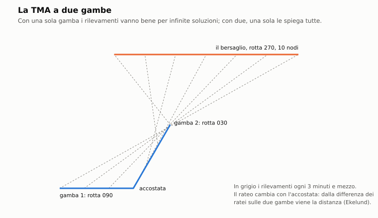
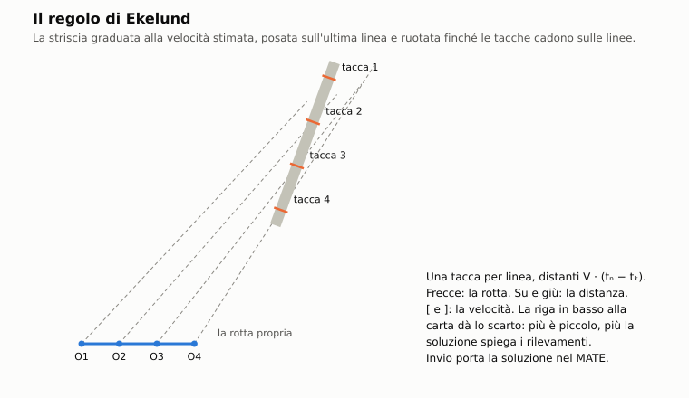

# C13. TMA

*Autore: principale. Revisione del 28/10/2026 (proposta dal CPA, TMA dell'IA). Stato: rivisto (curatore: kit).*

## 1. A che serve

Col sonar passivo si sente il contatto, ma si misura solo il suo rilevamento. La distanza, la rotta e la velocità vanno
ricavate dalla serie dei rilevamenti: è l'analisi del moto del bersaglio (TMA, *target motion analysis*). Nel gioco
la fa il comandante, a mano, con gli strumenti d'epoca: il MATE alla carta, le linee di rilevamento, il pannello
tempo-rilevamento e il regolo di Ekelund. Non c'è un risolutore che dà la soluzione al giocatore. La lezione è quella
vera: su una gamba sola la distanza non si vede, serve una manovra. L'IA ha una sua TMA che risolve da sola, con la
stessa matematica e la stessa regola (§2.9).

## 2. Il modello

### 2.1 I rilevamenti del giocatore

`missioni/src/stazioni_missione.cpp`, `StazioniMissione::dopo_passo`. Con la regola di simulazione:

- **Cadenza**: un rilevamento ogni 5 s di missione, sul **bersaglio designato** (G), finché c'è il contatto.
- **Misura**: il rilevamento del contatto, con l'errore del sensore (capitolo C1), solo se il contatto è visibile in
  quell'istante (non lampeggia). Senza il modello acustico: il rilevamento vero più uno scarto gaussiano di 0,5° di
  deviazione (somma di 12 uniformi).
- **Posizione propria**: quella del battello quando il rilevamento è preso. Oggi è la posizione vera.
- **Memoria**: al più 720 rilevamenti (un'ora a uno ogni 5 s); oltre, si toglie il più vecchio.
- **Cambio di bersaglio**: la serie si azzera e ricomincia.

L'errore del rilevamento, dal modello acustico (`nucleo/src/acustica.cpp`, `errore_rilevamento_deg`):

```
σ = max(0,2°, θ₃dB / sqrt(d · 10^(SE/10)))        SE limitato in basso a −10 dB
```

- `θ₃dB`: larghezza del fascio del sensore alla frequenza della banda e al rilevamento relativo;
- `d`: indice di rivelazione del sensore; `SE`: eccesso di segnale (capitolo C1);
- i sensori con un errore misurato (DIFAR, RGB-2) usano il loro.

### 2.2 Il modello del bersaglio

`nucleo/tma.hpp`, `Tma`. Il bersaglio va in **moto rettilineo uniforme**. La soluzione è riferita all'ultimo
rilevamento: il bersaglio sta su quella linea, a una distanza `R`, con rotta `C` e velocità `V`.

```
P(t) = Oₙ + R · u(Bₙ) + V · (t − tₙ) · u(C)          u(θ) = (sin θ, cos θ)
eₖ   = norm₁₈₀( rilevamento(Oₖ, P(tₖ)) − Bₖ )
scarto = sqrt( Σ eₖ² / N )
```

- `Oₖ`, `Bₖ`, `tₖ`: posizione propria, rilevamento misurato e istante del rilevamento k; `n` l'ultimo;
- `eₖ`: scarto fra il rilevamento previsto e quello misurato, in gradi fra −180 e +180;
- `scarto`: la media quadratica, in gradi.

La soluzione giusta dà scarti piccoli, del solo errore dei rilevamenti, e senza tendenza.

### 2.3 Lo strumento MATE

*Manual Adaptive Target Estimator*: il giocatore propone `R`, `C`, `V` e guarda gli scarti (`app/interfaccia.cpp`).

| Comando | Effetto | Limiti |
|---|---|---|
| T (stazione Navigazione, F6) | apre e chiude il MATE | — |
| frecce sinistra e destra | rotta, 30° al secondo | 0-360° |
| su e giù | distanza, ×(1 ± 0,5) al secondo | 200 m - 150 km |
| Maiusc + su e giù | velocità, 4 nodi al secondo (nodi di gioco) | 0-45 nodi |

All'apertura la proposta è 9 260 m (5 nm), rotta 000°, 5 nodi di gioco.

**Che cosa mostra:**
- **sulla carta**: le linee di rilevamento (una ogni tre, lunghe 1,3 volte la distanza proposta), le posizioni della
  soluzione agli stessi istanti (punti gialli), una croce sulla posizione di adesso;
- **la striscia degli scarti**, in basso: un punto per rilevamento, ±5° a tutta altezza, verde sotto 1°, giallo oltre;
- **il pannello**, in una riga: distanza (NM), rotta, velocità (nodi), scarto medio (gradi), rateo di rilevamento
  degli ultimi 2 minuti (°/min, §2.6) e numero dei rilevamenti;
- **il confronto col CPA misurato** dal verniero del sonar (capitolo C5): il CPA che la soluzione prevede contro quello
  della curva Doppler di una riga, con «COERENTE» se tempo, distanza e velocità relativa stanno entro due sigma della
  misura (`nucleo/src/misure_sonar.cpp`, `confronta_cpa`). Il confronto vale per la soluzione che si sta regolando;
- **la proposta dal CPA** (blocco 3 del sonar, L): quando il verniero è agganciato a una riga del bersaglio e il CPA è
  osservato, sopra la striscia degli scarti compare «INVIO: PROPOSTA DAL CPA x KM ±σ ROTTA ±σ NODI ±σ». **Invio**
  carica quella soluzione nel MATE, che poi si regola come ogni altra.

**La proposta dal CPA** (`soluzione_da_cpa`, del disassemblatore). Al CPA il rilevamento è perpendicolare al moto
relativo. Quindi:
- **il rilevamento al CPA** e il suo rateo vengono da una retta ai minimi quadrati sui rilevamenti entro 2 minuti dal
  CPA (almeno 3);
- **il bersaglio al CPA** sta su quel rilevamento, alla distanza del CPA misurata dal verniero;
- **la sua velocità** è quella del battello più la velocità relativa del verniero, perpendicolare al rilevamento, nel
  verso del rateo;
- **il moto del battello** è quello medio fra il primo e l'ultimo rilevamento;
- **la soluzione** si porta all'ultimo rilevamento, come quelle del MATE.

Le sigma vengono dalla misura:
- in velocità quella della velocità relativa;
- in distanza quella del CPA, composta con quella della velocità per il tempo trascorso dal CPA;
- in rotta la sigma della velocità sulla velocità del bersaglio.

Non c'è proposta se la misura non è valida, se il CPA non è osservato o cade fuori dai rilevamenti, o con meno di 3
rilevamenti. Vale se il bersaglio non ha manovrato: una sua accostata dopo il CPA sposta la soluzione, e lo scarto lo
mostra.

**La stima al MATE** (`app/stima_mate.hpp`, dal 03/11/2026). Un obiettivo `rotta_stimata` con `da_tma` conta le rotte stimate
dal giocatore col MATE (la LIB-S20). Col MATE aperto, ogni 30 s, la rotta proposta diventa una stima se i rilevamenti del
contatto hanno una soluzione con la distanza osservabile (`risolvi_tma`, con σ 1,5°) e quella del MATE li spiega
altrettanto bene: scarto al più 1° peggiore (**STIMA**). L'obiettivo la confronta con la rotta vera, entro il suo `errore`,
e conta le stime buone ad almeno 300 s l'una dall'altra. Su due gambe di 300-600 s, a 2-4 km, con accostate di 90°, la
soluzione diventa osservabile dopo 600-900 s (misura di trailer-1, senza partita). Il comandante IA della sandbox non
registra stime.

### 2.4 L'osservabilità



Con una sola gamba (rotta e velocità proprie costanti) la distanza non si vede. Se si scalano dello stesso fattore la
distanza e la velocità relativa del bersaglio, i rilevamenti restano identici:

```
P'(t) − O(t) = k · (P(t) − O(t))     per ogni t        →   stessi rilevamenti, scarto nullo
```

Una manovra propria (cambio di rotta o di velocità) rompe la famiglia: solo la soluzione vera resta a scarto nullo. È
la prova «tma: su una gamba sola la distanza non si vede (inosservabile)».

### 2.5 Le linee di rilevamento sulla carta

Carta dell'Enhanced (`app/interfaccia.cpp`, `dopo_passo`; `nucleo/strumenti_carta.hpp`, `LucidoCarta`). Il plotter
segna sul lucido una linea dalla posizione del battello all'istante della misura.

- **5** cicla: linee spente, solo il bersaglio, anche i tracker del sonar.
- **Cadenza**: una linea ogni 30 s nel modo moderno, ogni 2 minuti nel modo 1989 (il plotter d'epoca).
- **Fonte**: la lettera del contatto bersaglio (o «B»); `S1`, `S2`... per i tracker; più le linee dell'ASW aereo
  (tonfi, SUS, sonar a immersione, fumogeni, radar d'aereo all'ESM).
- **Memoria**: le ultime 12 linee per fonte.
- **Etichetta**: la fonte e l'ora UTC a quattro cifre.

### 2.6 Il pannello tempo-rilevamento e il rateo

**9** apre il pannello a destra della carta: gli ultimi 20 minuti, un punto per linea, una retta per fonte e il rateo.

```
rateo = (N Σ tᵢ bᵢ − Σ tᵢ Σ bᵢ) / (N Σ tᵢ² − (Σ tᵢ)²)        [°/min]
```

- `tᵢ` in minuti; `bᵢ` i rilevamenti «srotolati» attorno al primo, così il passaggio per il nord non fa salti;
- positivo in senso orario. Servono almeno due punti.

Il MATE usa la stessa formula sui rilevamenti degli ultimi 120 s (`Tma::rateo`).

### 2.7 Il regolo di Ekelund

**Q** alla carta (`nucleo/src/strumenti_carta.cpp`, `regolo_ekelund`; dossier 12 §5.2 punto 9). È il MATE in forma
geografica: una striscia graduata alla velocità stimata, posata sull'ultima linea e ruotata finché le tacche cadono
sulle linee precedenti.

```
P₀ = Oₙ + R · u(Bₙ)
Pₖ = P₀ − V · (tₙ − tₖ) · u(C)                 una tacca per linea
scarto = sqrt( Σ norm₁₈₀(rilevamento(Oₖ, Pₖ) − Bₖ)² / N )
```

| Comando | Effetto | Limiti |
|---|---|---|
| Q | apre il regolo sulle linee del bersaglio (se ne ha almeno due), o della fonte dell'ultima linea | servono due linee |
| frecce sinistra e destra | rotta, 15° al secondo (60° con Maiusc) | — |
| su e giù | distanza, ×(1 ± 0,3) al secondo (± 1,0 con Maiusc) | 200 m - 100 km |
| `[` `]` | velocità, a passi di 0,5 nodi | 0-45 nodi |
| Invio | porta distanza, rotta e velocità nel MATE | — |

All'apertura la rotta è l'ultimo rilevamento più 90°. La riga in basso alla carta dà la fonte, la rotta, la velocità
(nodi), la distanza (NM) e lo scarto; con meno di due linee dice che ne servono almeno due.



### 2.8 La regola del 1934 e la distanza di Ekelund

Le due formule classiche sono nel nucleo (`Tma::rateo_1934`, `Tma::distanza_ekelund`, `Tma::attraverso`):

```
Ḃ = V⊥ / R                       [rad/s]       →   Ḃ [°/min] = 1934 · V⊥ [kn] / R [yd]
R = (OSA₂ − OSA₁) / (Ḃ₁ − Ḃ₂)                   (Ḃ in rad/s, OSA in m/s)
OSA = vₓ cos B − v_y sin B
```

- `V⊥`: velocità relativa attraverso la linea di vista;
- `OSA₁`, `OSA₂`: componente della velocità propria attraverso la linea di vista sulle due gambe; `Ḃ₁`, `Ḃ₂`: i ratei
  di rilevamento sulle due gambe; la distanza vale se positiva e se i ratei sono diversi.

Esempi:
- un nodo attraverso la linea di vista a 1000 iarde (914,4 m) dà 1,934°/min (da qui il nome della regola);
- a 5 nm, 10 nodi attraverso la linea di vista danno 1,91°/min;
- il battello a 5 m/s fa due gambe di 5 minuti (000°, poi 090°); il bersaglio, a 9 km per 045°, va per 270° a 4 m/s.
  Coi ratei di due minuti attorno alla virata la distanza di Ekelund sta entro il 10% della vera (prova «tma: rateo
  di rilevamento, regola del 1934 e distanza di Ekelund»). Ekelund ignora l'accelerazione del rilevamento: le gambe
  vanno prese corte attorno alla manovra.

### 2.9 La TMA dell'IA

Per la simmetria (l'IA vede e fa quello che fa il giocatore, `docs/18_interazioni_ia.md`, fase 2), dal passivo l'IA
ha solo il rilevamento, e la posizione la ricava con la sua TMA (`nucleo/tma_ia.hpp`, `risolvi_tma`). Stessa classe
`Tma`, stesso modello del bersaglio (§2.2).

**Quando** (`missioni/src/missione.cpp`, `Missione::ascolta_con_acustica`):
- un'unità dell'IA ascolta un'unità ostile con un sensore acustico, con la traccia solida (qualità ≥ 800);
- un rilevamento ogni 20 s di missione, con l'errore del sensore; una soluzione ogni 60 s;
- la posizione del contatto si aggiorna solo se la distanza è **osservabile**. La quota: 0 per una nave già
  classificata, altrimenti la propria.

**Come risolve:**

| Passo | Valore |
|---|---|
| dati minimi | 6 rilevamenti in almeno 120 s |
| errore dei rilevamenti | quello del sensore, almeno 0,3° |
| griglia delle distanze | 28 passi logaritmici da 300 m a 60 km |
| a distanza fissa | rotte ogni 15° (24) per 9 velocità da 0 a 13 m/s (0-25 nodi); poi Levenberg-Marquardt (al più 30 iterazioni) sulla velocità in componenti e sull'errore dell'ultimo rilevamento, con la velocità al più 35 nodi |
| raffinamento della distanza | sezione aurea fra i vicini della griglia, fino a 5 m (al più 30 passi) |
| distanze compatibili | `N · (s² − s_min²) / σ² ≤ 1`: N rilevamenti, s lo scarto medio a quella distanza, σ il maggiore fra l'errore del sensore, lo scarto minimo e 0,1° |
| osservabile | distanza compatibile massima / minima ≤ 1,6, massima sotto 59,4 km, nessun secondo minimo lontano, minimo non sul bordo della griglia |
| incertezza | lungo la linea: metà dell'intervallo compatibile; attraverso: `R · σ` |

Senza una manovra propria il profilo dello scarto resta piatto su un largo intervallo di distanze e la posizione non
si dà. Con la manovra converge in 10-30 minuti, secondo la geometria.

**Una gamba sola non dà mai la distanza** (blocco 3 del sonar, 28/10/2026, disassemblatore). Prima il raffinamento per
coordinate si fermava nelle valli curve del profilo. Su una gamba sola il profilo vero è piatto, e un dente del profilo
sembrava un minimo stretto: a volte l'IA aveva una distanza «osservabile», stretta e sbagliata. Un esempio: un Victor a
2 km stimato a 3,9 km. Inoltre la traccia era appesa all'ultimo rilevamento misurato, col suo errore. Ora i due
problemi sono corretti:
- **il raffinamento** è Levenberg-Marquardt;
- **le distanze compatibili** usano il chi quadro di tutti i rilevamenti;
- **il secondo minimo e il bordo:** un secondo minimo lontano rende la distanza ambigua, e un minimo sul bordo della
  griglia non è una soluzione.

Con due gambe la stima è onesta, dentro le sue sigma: l'IA lancia più tardi, ma meglio.

## 3. Fonti e confidenza

| Parametro | Fonte | Confidenza |
|---|---|---|
| Inosservabilità su una gamba | dossier 02 §5.1 [NA81] | alta |
| Regola del 1934 | dossier 02 §5.1 (derivazione: 1 kn = 33,756 yd/min; × 57,296 = 1934) | alta |
| Distanza di Ekelund | dossier 02 §5.1 [TMA-wiki], [NHHC-Ekelund] | alta |
| MATE come strumento d'interfaccia | dossier 02 §5.1 | media |
| Errore del rilevamento `θ₃dB / sqrt(SNR)`, minimo 0,2° | dossier 02 §5.1 | media la forma, bassa i numeri |
| Un rilevamento ogni 5 s | scelta di gioco | **STIMA** |
| Linee ogni 30 s (moderno) e 2 minuti (1989) | dossier 12 §5.2 punto 2 | **STIMA** |
| Regolo di Ekelund sul plot geografico, pannello tempo-rilevamento | dossier 12 §5.2 punti 9 e 10 | media |
| TMA dell'IA: 20 s e 60 s, soglia 0,25 σ, rapporto 1,6 | scelta di gioco | **STIMA** |

## 4. Classico ed Enhanced

- **Classico**: nessuna TMA. La posizione di un contatto viene dalla traccia solida, come nell'originale. Le stazioni
  non raccolgono rilevamenti (`app/partita.cpp`, `raccogli_tma` solo con la regola di simulazione): il MATE si apre ma
  resta vuoto. Il rilevamento della carta è quello vero.
- **Enhanced**: tutto il capitolo. Rilevamento misurato, con l'errore del sensore e l'immagine speculare dell'antenna
  rimorchiata finché la virata non la risolve (capitolo C6).
- **Modo 1989 dell'Enhanced**: linee ogni 2 minuti, letture della carta arrotondate (0,1 nm da vicino, 0,5 nm da
  lontano, 1°); niente allarmi.

## 5. Come si vede in gioco

- **Stazione Navigazione** (F6): T il MATE, Q il regolo di Ekelund, 5 le linee, 9 il tempo-rilevamento, 8 il CPA sul
  bersaglio. Volume 1, §5.3 e §5.4.
- **Sonar**: il bersaglio si designa con G; il verniero misura il CPA dalla curva Doppler (volume 1, cap. 3).
- **Debriefing e replay**: il «quadro del giocatore» mostra la soluzione del MATE accanto alla verità (capitolo F5;
  volume 1, §10.4).
- **Senza finestra**: `--mate` apre la carta col MATE.

## 6. Taratura e prove

`test/prove_tma.cpp`:
- «tma: la soluzione vera ha scarti nulli, una sbagliata no» (due gambe: la distanza al 70% dà oltre 0,5°);
- «tma: su una gamba sola la distanza non si vede (inosservabile)»;
- «tma: rateo di rilevamento, regola del 1934 e distanza di Ekelund» (entro il 10%);
- «tma dell'IA: con due gambe e rilevamenti rumorosi trova il bersaglio; su una gamba sola no» (errore di 1°:
  distanza entro il 20%, scarto sotto 2°; una gamba: non osservabile; meno di 6 rilevamenti o di 120 s: niente).

`test/prove_strumenti_carta.cpp`:
- «carta: regolo di Ekelund, nullo sulla soluzione vera e grande fuori»;
- «carta: retta del tempo-rilevamento e rateo ai minimi quadrati, anche attraverso il nord»;
- «carta: il lucido tiene le ultime linee per fonte, gli eventi numerati e i datum».

`test/prove_misure_sonar.cpp`:
- «misure sonar: il CPA misurato controlla una soluzione della TMA»;
- «misure sonar: la soluzione dal CPA per il MATE (blocco 3 del sonar)».

Effetto in partita (`docs/18_interazioni_ia.md`, 26/10/2026): senza le manovre di TMA dell'IA (fase 4) l'IA ricava
di rado la posizione dal passivo e tiene quelle dell'eco e del radar.

## 7. Limiti noti e in arrivo

- **Velocità del MATE nelle missioni originali** (corretta il 26/10/2026). Le posizioni sono metri veri, ma le unità
  corrono k volte più del vero (capitolo A2, k da 2,02 a 4,29). Il MATE ora legge e regola la velocità in nodi di gioco
  col moto della missione, come il regolo di Ekelund: 4 nodi al secondo con Maiusc e le frecce, da 0 a 45 nodi. Prima
  il pannello divideva per il nodo vero (a TORPEX un bersaglio a 10 nodi si leggeva a circa 21,8) e il tetto era di
  25 m/s.
- **La regola del 1934 e la distanza di Ekelund** sono nel nucleo e nelle prove, ma nessuno strumento le mostra. Il
  regolo di Ekelund della carta è la striscia geometrica (§2.7), non il calcolo dai ratei.
- **Posizione propria vera**: gli errori della TMA vengono solo dai rilevamenti. **In arrivo** la posizione incerta
  (capitolo C12).
- **Linee e MATE non prendono gli stessi rilevamenti**: il MATE solo quelli del contatto visibile; le linee della carta
  anche quando il contatto lampeggia.
- **Una sola serie**: cambiando bersaglio la serie del MATE si azzera; tornando al primo, la storia è persa.
- **L'immagine speculare** dell'antenna rimorchiata non entra nella TMA.
- **TMA dell'IA**: la griglia delle velocità arriva a 13 m/s; il raffinamento può salire oltre, ma parte da lì. Nelle
  originali, con k, molti bersagli vanno più veloci. **In arrivo** (fase 4 delle interazioni fra IA) le manovre di TMA
  dell'IA, senza le quali la distanza resta spesso inosservabile.

## 8. Riferimenti

- Codice: `nucleo/tma.hpp` e `nucleo/src/tma.cpp`; `nucleo/tma_ia.hpp` e `nucleo/src/tma_ia.cpp`;
  `nucleo/strumenti_carta.hpp` e `nucleo/src/strumenti_carta.cpp` (`regolo_ekelund`, `retta_rilevamento`,
  `LucidoCarta`); `nucleo/src/misure_sonar.cpp` (`confronta_cpa`); `nucleo/src/acustica.cpp`
  (`errore_rilevamento_deg`); `missioni/src/stazioni_missione.cpp` (rilevamenti del giocatore);
  `missioni/src/missione.cpp` (`ascolta_con_acustica`, TMA dell'IA); `app/interfaccia.cpp` (MATE, linee, Ekelund);
  `app/carta.cpp` (`disegna_ekelund`, `disegna_tempo_rilevamento`); `app/scena_prova.cpp` (pannello Navigazione).
- Ricerca: dossier 02 §5.1 (`docs/ricerca/02_acustica_oceanografia_dottrina.md`); dossier 12 §2.4 e §5.2
  (`docs/ricerca/12_strumenti_plotting_e_carta.md`).
- Progetto: `docs/11_comandi_e_stazioni.md` §3.4 e fase C6c; `docs/18_interazioni_ia.md` fase 2.
- Capitoli: C1 (errore del rilevamento), C5 (verniero e CPA), C6 (antenna rimorchiata), C12 (carta e strumenti), A2
  (moto classico).
