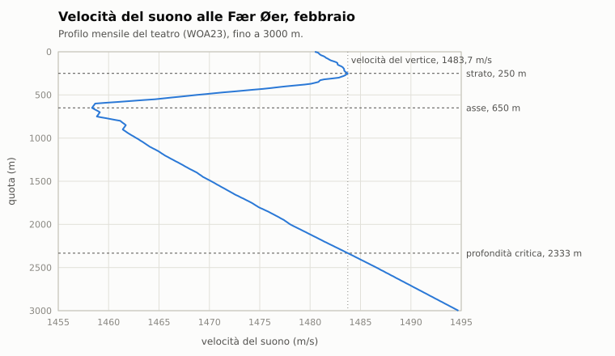
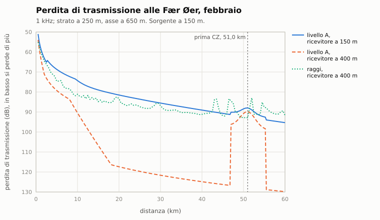
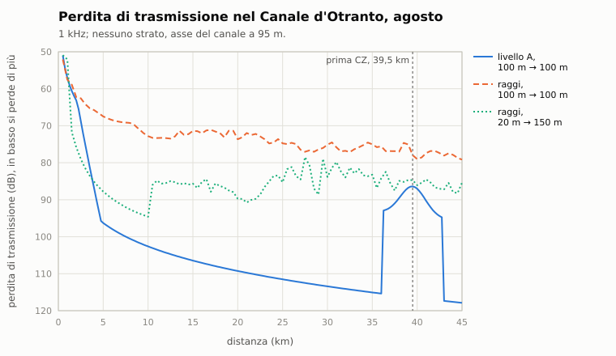

# C2. Propagazione

*Autore: disassemblatore. Revisione del 03/11/2026 (lo strato che cambia). Stato: rivisto (curatore: kit).*

## 1. A che serve

Decide quanto suono si perde per strada fra chi fa rumore e chi ascolta: la **perdita di trasmissione** (TL)
dell'equazione del sonar (capitolo C1). Non dipende solo dalla distanza. Il mare ha strati: la velocità del suono
cambia con la temperatura e la pressione, e i raggi si piegano. Sopra lo **strato** (il layer) il suono resta
intrappolato e va lontano; sotto lo strato chi sta sopra non si sente bene; oltre una certa distanza c'è una **zona
d'ombra**; più lontano, in acqua profonda, il suono torna su nelle **zone di convergenza**. Per il comandante vuol
dire: scegliere la quota rispetto allo strato è come scegliere dove nascondersi.

## 2. Il modello

Il codice è in `nucleo/acustica.hpp` e `nucleo/src/acustica.cpp`. Ci sono due livelli:
- **livello A**, analitico: `perdita_trasmissione(f, r, zs, zr, ambiente)`, una formula per ogni percorso del suono;
- **livello B**, i raggi: `calcola_campo(zs, ambiente)` traccia i raggi nel profilo e dà un campo di perdite
  (`CampoPerdita::tl(f, r, zr)`).

Nella missione vale il livello B dove c'è il campo; prima del primo campo di una sorgente e fuori dalla griglia vale
il livello A (paragrafo 2.6).

### 2.1 Il profilo della velocità del suono

Ogni teatro ha 12 profili mensili, in `data/motore/teatri/<teatro>.suono.toml`, generati da `tools/pipeline/suono.py`:
- la mediana del teatro per mese dal World Ocean Atlas 2023 (WOA23, 0,25°, decadi 1955-2022), fino a 1500 m, con la
  velocità del suono TEOS-10;
- sotto, la mediana della stagione WOA fino a 5500 m, raccordata;
- oltre i dati, il solo gradiente di pressione: +0,0163 m/s per metro.

Fra i livelli la velocità si interpola in linea retta. Dal profilo `ProfiloSuono::analizza()` ricava:
- **strato** (`sld_m`): la quota del massimo della velocità nei primi 400 m. Zero se la velocità cala già dalla
  superficie;
- il gradiente sopra lo strato (positivo: c'è il condotto) e nei 100 m sotto (negativo: il termoclino);
- **asse** del canale sonoro: la quota del minimo della velocità;
- **profondità critica**: sotto l'asse, dove la velocità torna al valore del vertice (il massimo sopra l'asse);
- **prima zona di convergenza**: la distanza orizzontale del raggio che parte orizzontale dal vertice e ci torna,

  ```
  x_CZ = 2 ∫ c / sqrt(c_v² − c²) dz       dal vertice alla profondità critica, a passi di 1 m
  ```

  solo se fra il vertice e la profondità critica ci sono almeno 800 m. Sotto, il profilo è un semicanale (le alte
  latitudini) e non fa zone di convergenza.



Le missioni del 1989 non hanno una data. Il mese predefinito è una scelta di gioco: l'inverno nei mari del nord,
agosto nel Mediterraneo e a Gibilterra (`mese_predefinito`).

Una missione con la data (editor, missioni rapide, libreria, scene di prova) prende il mese della data, come il meteo: una
scena di settembre nel Barents ha l'acqua di settembre (`Missione::mese_acustica`). Vale anche da riga di comando e da codice
(`app/data_missione.hpp`), e `--data` e `--ora` prevalgono. Le prove possono imporre un mese con `imposta_mese`.

<!-- generato: profili_suono -->
| Teatro | Mese | c in superficie (m/s) | Strato (m) | Asse (m) | Prima CZ (km) | Traffico |
|---|---|---|---|---|---|---|
| Mar Baltico | feb (predefinito) | 1426,4 | 80 | superficie | nessuna | 0,8 |
| Mar Baltico | mag | 1450,3 | nessuno | 50 | nessuna | 0,8 |
| Mar Baltico | ago | 1481,9 | nessuno | 50 | nessuna | 0,8 |
| Mar Baltico | nov | 1452,2 | 65 | 95 | nessuna | 0,8 |
| Mare di Barents | feb | 1459,6 | 375 | superficie | nessuna | 0,3 |
| Mare di Barents | mag | 1461,6 | 350 | 175 | nessuna | 0,3 |
| Mare di Barents | ago | 1484,8 | nessuno | 175 | nessuna | 0,3 |
| Mare di Barents | nov | 1469,0 | 375 | 175 | nessuna | 0,3 |
| Mar Celtico | feb (predefinito) | 1494,8 | ≥ 400 | 1500 | 45,9 | 0,7 |
| Mar Celtico | mag | 1498,8 | ≥ 400 | 1650 | 55,9 | 0,7 |
| Mar Celtico | ago | 1514,2 | nessuno | 1550 | 66,1 | 0,7 |
| Mar Celtico | nov | 1503,1 | 50 | 1650 | 59,4 | 0,7 |
| Fær Øer e varco GIUK | feb (predefinito) | 1479,4 | 225 | 600 | 54,9 | 0,4 |
| Fær Øer e varco GIUK | mag | 1482,2 | 150 | 700 | 51,8 | 0,4 |
| Fær Øer e varco GIUK | ago | 1492,9 | nessuno | 600 | 54,1 | 0,4 |
| Fær Øer e varco GIUK | nov | 1484,5 | 150 | 700 | 59,2 | 0,4 |
| Stretto di Gibilterra | feb | 1509,1 | 125 | 475 | nessuna | 1,0 |
| Stretto di Gibilterra | mag | 1515,7 | nessuno | 425 | 23,8 | 1,0 |
| Stretto di Gibilterra | ago (predefinito) | 1530,0 | nessuno | 450 | 36,9 | 1,0 |
| Stretto di Gibilterra | nov | 1519,0 | nessuno | 450 | 31,4 | 1,0 |
| Curili e Mare di Okhotsk | feb (predefinito) | 1444,9 | ≥ 400 | 15 | nessuna | 0,4 |
| Curili e Mare di Okhotsk | mag | 1458,9 | ≥ 400 | 150 | nessuna | 0,4 |
| Curili e Mare di Okhotsk | ago | 1499,7 | nessuno | 225 | 46,7 | 0,4 |
| Curili e Mare di Okhotsk | nov | 1480,9 | 15 | 225 | 34,7 | 0,4 |
| Canale d'Otranto | feb | 1505,2 | ≥ 400 | superficie | nessuna | 0,8 |
| Canale d'Otranto | mag | 1519,1 | nessuno | 75 | 34,7 | 0,8 |
| Canale d'Otranto | ago (predefinito) | 1539,6 | nessuno | 75 | 41,4 | 0,8 |
| Canale d'Otranto | nov | 1518,1 | 15 | 100 | nessuna | 0,8 |
<!-- fine: profili_suono -->

### 2.2 Livello A: i percorsi

Ogni percorso dà una perdita; le perdite si sommano in potenza (somma incoerente) e il percorso migliore dà il nome
(`Perdita::percorso`). Le quote si limitano fra 0,5 m e il fondale.

**Diretto**

```
TL = 20 log R + α R + ΔLloyd + Δstrato + Δombra
```

- `R`: distanza obliqua (m); `α`: assorbimento (dB/m) alla frequenza, con la temperatura e la salinità in superficie,
  alla quota media, col pH del teatro (formula di Ainslie e McColm).
- `ΔLloyd`: lo specchio della superficie. Vicino alla superficie l'onda riflessa cancella quella diretta:
  `x = k zs zr / R`; sotto π/4 la perdita è `−10 log(2 − 2 C cos 2x)`, oltre è incoerente (+3 dB di guadagno).
  `C = exp(−2 (k σ sin θ)²)` è la coerenza di Eckart: con il mare mosso lo specchio si rompe; σ è un quarto
  dell'altezza d'onda.
- `Δstrato`: chi attraversa lo strato (una quota sopra, l'altra sotto) perde da 5 a 20 dB:
  `5 + 100 · |gradiente sotto|`, fra 5 e 20 dB. Sotto la frequenza di taglio del condotto la perdita scala con
  `f / f_taglio` (al più un quarto). Entra in pieno dopo 2 km.
- `Δombra`: oltre la portata del raggio limite (il raggio che sfiora lo strato), +20 dB per ogni volta la portata,
  al più 25 dB.

**Condotto superficiale**: sorgente e ricevitore entrambi nello strato, con gradiente positivo, e frequenza sopra il
taglio.

```
f_taglio = c / λ_max,   λ_max = 8,5·10⁻³ H^1,5   (piedi)
TL = 10 log r₀ + 10 log R + (α + perdita_per_salto / salto) R
salto = sqrt(8 R_c H),   r₀ = salto / 6,   R_c = c / gradiente
perdita_per_salto = (0,5 + 0,6 · mare) · (1 + 2 (f_taglio / f)²)
```

Oltre `r₀` la divergenza è cilindrica (10 log R invece di 20): è per questo che nello strato si sente lontano. Il
mare mosso fa perdere energia a ogni rimbalzo.

**Zone di convergenza**: solo se il fondale supera la profondità critica di almeno 200 m. Per le prime tre zone:

```
guadagno_n = (8 − 4 (n − 1)) · exp(−((r − n x_CZ) / (0,05 n x_CZ))²)
TL = 20 log R + α R − guadagno_n
```

La prima zona dà 8 dB sulla sferica, le successive 4 dB in meno ciascuna; sono larghe il 5% della distanza.

**Rimbalzo sul fondo**: i raggi che arrivano sul fondo con più di 10° si riflettono, con la perdita del tipo di fondo:

```
sopra = base · max(0,5, 1 + 0,25 log(f / 1000)) · (1 + max(0, θ − 20°) / 40)
base: roccia 3 dB, sabbia 5, fango 11
sotto l'angolo critico θc (sabbia 30°, roccia 60°): minimo + (sopra − minimo) · (θ / θc)²
minimo fino a 250 Hz: sabbia 0,5 dB, roccia 0,3
minimo a 1 kHz: sabbia 1,8 dB, roccia 1,0 (in logaritmo fra 250 Hz e 1 kHz, oltre come «sopra»)
```

Nella sabbia e nella roccia il suono è più veloce che nell'acqua. Sotto l'angolo critico (Rayleigh: θc = arccos c1/c2) la riflessione è
quasi totale. In basso resta solo la perdita nel sedimento; da 1 kHz in su contano anche rugosità e strati, e la
perdita sale a 1,5-2 dB (Urick, curve APL-UW). Il fango ha una velocità simile a quella dell'acqua: niente angolo
critico, la formula di sopra a ogni angolo.

**Acqua bassa** (fondale sotto 200 m): al posto degli altri percorsi vale Marsh e Schulkin, a tre tratti (sferica,
intermedia, cilindrica) col parametro di salto `H = sqrt((strato + fondale) / 3)` in kyd e l'attenuazione per salto
`a_T` secondo il fondo (roccia 1, sabbia 2, fango 4) più 0,3 per stato del mare.

### 2.3 Livello B: i raggi

`calcola_campo(zs, ambiente)` (`ParametriRaggi`):
- 101 raggi fra −30° e +30°, con passo d'arco di 100 m (Runge-Kutta del secondo ordine), fino a 300 km nella missione
  (`raggi_` in `missioni/missione.hpp`); il valore predefinito del nucleo (`ParametriRaggi::r_max_m`) resta 100 km, e con
  quello lavorano gli esempi del §2.5;
- in acqua bassa (fondale sotto 500 m) 301 raggi fra −30° e +30°, uno ogni 0,2°. Lontano arrivano i raggi quasi
  orizzontali, e col ventaglio rado non ce n'era nessuno fra 0° e ±0,6°. Vicino alla sorgente servono anche i
  cammini ripidi: con un ventaglio di ±15° una boa a 18 m e un sottomarino a 300 m, a 400 m l'uno dall'altra, perdevano
  il diretto;
- griglia a passi di 500 m in distanza e 10 m in quota, fino al fondo o a 1000 m;
- in superficie la riflessione ha la coerenza di Eckart; sul fondo la perdita del tipo di fondo. Ogni raggio porta
  due potenze, con le perdite al contorno a 1 kHz e a 250 Hz, e il campo ha le griglie per tutte e due: `tl` usa
  quella a 250 Hz per le bande sotto i 500 Hz;
- l'intensità viene da fasci gaussiani larghi quanto il tubo fra due raggi vicini, più le immagini al contorno. Un
  raggio senza vicini ha un fascio largo al più quanto il fondale, o due volte lo strato se è nel condotto; un fascio
  più largo della colonna d'acqua la riempie tutta;
- **il condotto sotto il taglio**:
  - un raggio che non è mai sceso sotto lo strato è un raggio del condotto, se lo strato è più sottile di 0,8 volte il
    fondale;
  - il campo tiene anche la griglia senza quei raggi, e `tl` la usa sotto la frequenza di taglio dello strato (Urick);
  - un condotto di 10 m ha il taglio sopra 1 kHz, e a 150 Hz non porta niente;
- dove non arriva nessun raggio la perdita è al più la sferica più 25 dB;
- `CampoPerdita::tl(f, r, zr)` aggiunge l'assorbimento alla frequenza.

I raggi trovano quello che le formule perdono: il canale sotto il termoclino del Mediterraneo d'estate (asse a 95 m)
e l'ombra vera vicino alla superficie. Spostano anche la zona di convergenza con le quote. Alle Fær Øer in febbraio
la formula la mette a 51 km per tutti; con i raggi il picco cade fra 46 e 52 km per sorgente e ricevitore fra 50 e
400 m, e a 38,5 km se stanno entrambi a 400 m, sotto lo strato.

**Acqua bassa d'estate** (correzione del 27/10/2026).
- **Lo scenario.** Barents a settembre: 10 m rimescolati sopra un termoclino forte, fondale di 131 m, sabbia. Ogni
  raggio che parte dalla superficie tocca il fondo con almeno 8,6° e lo ritocca ogni 1,5 km circa.
- **L'errore di prima.** Il raggio orizzontale restava nel condotto di 10 m senza perdite, e il suo fascio, isolato e
  largo chilometri, portava energia fino al fondo. A 150 Hz e 90 m la perdita era 92 dB a 61 km e 97 a 30 km: il
  Typhoon in superficie si sentiva con la TB-16 a 61 km, con 16 dB d'eccesso.
- **Adesso:**
  - 73 dB a 10 km, 90 a 30 km, 103 a 61 km, entro 1-6 dB dal calcolo con 1601 raggi;
  - il Typhoon resta al limite della scoperta, da −1 a +3 dB d'eccesso;
  - i pescherecci al lavoro a 11-30 km restano a +20-45 dB.
- **D'inverno** (profilo quasi isotermo, raggi verso l'alto) la sabbia sotto l'angolo critico rende le portate più
  lunghe di 3-8 dB a 30-80 km.

### 2.4 Effetto pomeriggio

Con il sole e il vento debole, nei primi metri si forma un microtermoclino che piega i raggi verso il basso:
- `intensita_pomeriggio(ora, vento, nubi)`: sale dalle 10 alle 14, piena fino alle 18, a zero alle 22. Nulla con il
  vento da 11 nodi in su o con le nubi oltre il 50%;
- `applica_pomeriggio(profilo, intensità)` mette nei primi 10 m un salto di 1,5 °C (intensità 1);
- nel livello A il microstrato toglie fino a 9 dB (2 dB per m/s di salto, al più 10) al diretto e al condotto, per chi
  sta entro 5 volte il suo spessore.

### 2.5 Esempi

Perdite a 1 kHz dal motore (`tools/manuale/esempi_acustica.cpp`); fra parentesi il percorso.

Fær Øer, febbraio (strato 250 m, asse 650 m, prima CZ a 51 km):

| Distanza | Livello A, 150 m → 150 m | Livello A, 150 m → 400 m | Raggi, 150 m → 400 m |
|---|---|---|---|
| 1 km | 57,1 (diretto) | 61,3 (diretto) | 59,1 |
| 5 km | 68,7 (diretto) | 79,3 (diretto) | 74,6 |
| 10 km | 74,3 (condotto) | 90,4 (diretto) | 81,1 |
| 20 km | 81,5 (condotto) | 117,4 (ombra) | 83,3 |
| 30 km | 85,5 (condotto) | 121,6 (ombra) | 86,8 |
| 50 km | 88,5 (CZ) | 90,8 (CZ) | 92,8 |



- Nello strato il condotto tiene la perdita bassa.
- Sotto lo strato il livello A vede l'ombra dopo 15 km; i raggi trovano più energia, perché qualche raggio passa.
- A 50 km la prima zona di convergenza riporta il suono a tutte le quote.

Otranto, agosto (nessuno strato: la velocità cala dalla superficie; asse a 95 m; CZ a 39,5 km):

| Distanza | Livello A, 100 → 100 m | Raggi, 100 → 100 m | Raggi, 20 → 150 m |
|---|---|---|---|
| 1 km | 57,1 | 57,5 | 52,1 |
| 5 km | 96,3 | 67,5 | 87,8 |
| 10 km | 102,6 | 72,8 | 94,6 |
| 20 km | 109,3 | 73,7 | 89,7 |



Qui il livello A vede solo l'ombra; i raggi vedono il canale a 95 m, dove due battelli si sentono a decine di km.

Assorbimento (4 °C, 35 psu, pH 8): 0,001 dB/km a 100 Hz, 0,064 a 1 kHz, 0,23 a 3,5 kHz, 1,17 a 10 kHz, 5,8 a 25 kHz.
Per questo le basse frequenze vanno lontano e i sonar delle teste dei siluri no.

### 2.6 Nella missione

- `Missione::ambiente_acustico(a, b)`: il profilo del mese della missione (`mese_acustica`), il traffico e il pH; il
  fondale è il minore fra i due punti (`Fondale` del teatro), e dà il tipo di fondo (`ClimaTeatro::fondo`); il meteo
  è quello del punto di chi ascolta (capitolo E7).
- L'effetto pomeriggio: un profilo per ogni quarto d'intensità (0, ¼, ½, ¾, 1), fatto una volta per mese con
  `applica_pomeriggio`. Il quarto si ricontrolla ogni 10 minuti di gioco, dall'ora solare
  (`ora UTC + longitudine / 15`), dal vento e dalle nubi del giocatore. Il profilo cambia solo col quarto, e con lui
  i campi dei raggi.
- Lo strato che cambia (§2.8): `Missione::profilo_in(a, b)` è il profilo di questo percorso. Sopra quello del mese e
  del pomeriggio applica le `ZonaStrato` (tutto il teatro o un cerchio) che contengono il **punto medio** fra i due: la
  scelta è simmetrica, e il modello resta indipendente dalla distanza. La transizione è a 4 passi; ogni passo è un profilo
  nuovo, tenuto in una mappa con il puntatore stabile. Il puntatore è nella chiave dei campi dei raggi, quindi si
  ricalcolano a istanti fissi e la partita resta deterministica. A fine durata la transizione torna indietro. Senza
  zone è il profilo di sempre, bit per bit. `sld_in(p)` dà la SLD a chi sceglie una quota.
- La perdita dei sensori viene dai campi dei raggi delle sorgenti (`CacheCampiAsincrona`):
  - un campo per sorgente, rifatto oltre 3 nm di spostamento, 30 m di quota o con un cambio d'ambiente (profilo,
    fondale del 10%, fondo, stato del mare);
  - il calcolo parte in un thread ed entra in vigore 10 s di gioco dopo la richiesta: il campo in uso dipende solo dal
    tempo di gioco, quindi le partite si ripetono identiche;
  - prima del primo campo vale il livello A, e così oltre la fine della griglia, a 300 km nella missione: lì la perdita
    fa un gradino, che ferma soltanto i bersagli più rumorosi (§7).
- Costo: 54-64 ms per campo in acqua profonda e 87-92 ms in acqua bassa, memoria 150 e 75 kB (Xeon E5-2696 v2 a 2,5 GHz).

### 2.7 Le frange d'interferenza (solo LOFAR e cuffia)

Fra il diretto e i cammini riflessi c'è una differenza di percorso, e alle frequenze dove le onde arrivano in fase il
segnale sale, dove arrivano in controfase scende. Sulla cascata del LOFAR sono frange che si piegano quando la
distanza cambia, a «vasca da bagno» attorno al CPA. Il sonarista vero ci legge la distanza.

`nucleo/interferenza.hpp` le calcola col metodo delle immagini, in una guida d'onda isoveloce col fondale del punto
(Jensen et al., §2.4.2):
- i cammini sono il diretto, la superficie e le famiglie col fondo, fino a 16 immagini (4 famiglie);
- ogni immagine porta `1/L` e il segno meno a ogni riflessione in superficie; a ogni rimbalzo porta la perdita sul
  fondo del livello A (§2.2), per angolo e frequenza;
- la parte coerente di ogni cammino cala:
  - con la coerenza di Eckart della superficie (l'Hs);
  - con la rugosità del fondo (STIMA: roccia 1 m, sabbia 0,3, fango 0,2);
  - per i cammini col fondo, con `exp(−r / 30 km)` (STIMA);
- il resto dell'energia arriva in potenza.

Il risultato è il rapporto in dB fra il campo coerente e lo stesso campo in potenza. Per la coppia diretto e
superficie vale il dipolo del livello A, col suo minimo. I termini incrociati in media sulle frequenze valgono zero,
quindi il rapporto, sommato alla perdita del livello A, aggiunge le frange senza cambiare il livello medio. Lontano,
sotto π/4, il dipolo è già nel livello A e il rapporto vale 1.

Le frange fitte si spianano col moto: il rapporto è la media di tre istanti, a `r ± dr/2`, con `dr` la velocità
radiale per il tempo d'integrazione `1/bin`. Le navi sono a quota zero nella missione, ma per le frange la sorgente è
l'elica, a 5 m (STIMA, 0,6-0,7 del pescaggio).

In acqua bassa il ritardo fra le immagini va come `1/r`, quindi una frangia sta a `f ∝ r`: è l'invariante di guida
`β ≈ 1`. Le frange salgono di frequenza quando il contatto si allontana e scendono quando si avvicina.

Dove entrano: `spettro_fascio`, `spettro_verniero`, `spettro_continuo` e `righe_ricevute` (capitolo C5) con
l'argomento `coerente`, sul continuo bin per bin e sulle righe. Le righe svaniscono e tornano con la distanza. Il peso
è 1 dove il livello A ha come percorso migliore il diretto, il fondo o l'acqua bassa, e 0 nel condotto e nelle zone di
convergenza. La scoperta (`valuta`), il BTR e il DEMON restano incoerenti: le frange cambiano quello che si vede e si
sente, non quando un contatto si scopre. Costo: circa 2,6 ms per sorgente su uno spettro di 4000 bin.

### 2.8 Lo strato che cambia (vetrino di Dio, D4)

Solo nel vetrino (docs/28 §3.3; capitolo F8). `modifica_profilo` (`nucleo/modifica_profilo.hpp`) fa un profilo nuovo da
quello del teatro, come l'effetto pomeriggio:

| Modifica | Che cosa fa al profilo |
|---|---|
| `sposta` | lo strato rimescolato alla quota data (al più 390 m e nei dati), con la sola pressione sopra (0,016 s⁻¹); il termoclino traslato sotto, finché raggiunge l'acqua di sempre |
| `togli` | niente condotto: il gradiente negativo dalla superficie, quello del termoclino, almeno −0,05 s⁻¹ |
| `rinforza` | il termoclino tot volte più ripido (sotto 1, più dolce) |
| `canale` | l'asse del canale sonoro alla quota data, stirando la colonna fra lo strato e il fondo dei dati |

**Le acque polari** non hanno un termoclino sotto la SLD: c sale dalla superficie. Sono 24 profili su 84 dei teatri
(7 teatri, 12 mesi). Lì `sposta` e `rinforza` non fanno niente, e `canale` nemmeno se l'asse non sta sotto lo strato.
`modifica_applicabile` lo dice prima, così l'intervento si rifiuta. Sugli altri profili lo strato finisce entro 5 m dalla
quota chiesta, dove quella quota esiste nei dati.

**Che cosa cambia** (febbraio alle Fær Øer, 1 kHz, misurato coi raggi):

| Percorso | Prima | Dopo |
|---|---|---|
| da 50 a 300 m, 8 km | 82 dB, strato a 225 m | 72 dB, strato a 390 m: tutti e due nel condotto |
| da 50 a 200 m, 8 km | 72 dB, strato a 225 m | 86 dB, strato a 100 m: il termoclino fra i due |
| da 50 a 50 m, 20 km | 80 dB, col condotto | 98 dB, senza |

STIMA di gioco: nessun dato dice come si sposta uno strato vero in pochi minuti. Conta che la geometria acustica sia
quella di uno strato a quella quota.

**Chi lo vede.** Tutti i percorsi passano da `profilo_in`, e chi sceglie una quota (ASW, VDS) da `sld_in`. Il ripetitore di
manovra del battello prende la SLD dal profilo della sua scena, quindi mostra lo strato cambiato. Lo spettatore ha sulla carta
il cerchio e la scritta, e il profilo nella scheda dell'unità (capitolo 12, F8), senza l'effetto pomeriggio.

## 3. Fonti e confidenza

| Parametro | Fonte | Confidenza |
|---|---|---|
| Profili WOA23 per teatro e mese | NOAA World Ocean Atlas 2023 (dossier 02 §3.1, `fetch_woa.py`) | alta |
| Velocità del suono TEOS-10; Mackenzie per le prove | dossier 02 §3.1 | alta |
| Assorbimento Ainslie-McColm | dossier 02 §3.2 | alta |
| Strato nei primi 400 m, taglio del condotto (Urick) | dossier 02 §3.3, §3.4 b | alta (forma) |
| Penalità dello strato 5-20 dB | dossier 02 §3.4 c | media |
| Perdita per salto del condotto | dossier 02 §3.4 b | **STIMA** |
| Zone di convergenza: 8 dB, −4 dB per zona, 5% di larghezza | dossier 02 §3.4 d (5-10 dB, 3-5 dB, 3-5 nm) | media |
| Ombra al più 25 dB | dossier 02 §3.4 (10-30 dB) | media |
| Perdite sul fondo per tipo | dossier 02 §3.4 e (2-6 dB sabbia e roccia, 8-15 fango) | **STIMA** la dipendenza da f e angolo |
| Angolo critico 30° sabbia e 60° roccia, 0,5 e 0,2 dB sotto | Rayleigh con c2/c1 1,15 e 2 | **STIMA** |
| Taglio del condotto nei raggi, ventaglio dell'acqua bassa | convergenza contro 1601 raggi (prova) | media |
| Marsh-Schulkin in acqua bassa | dossier 02 §3.4 i | alta (forma) |
| Effetto pomeriggio | dossier 02 §3.5 | media |
| Mese predefinito per teatro | scelta di gioco (`tools/pipeline/suono.py`) | — |
| Frange: metodo delle immagini in guida isoveloce | Jensen et al., Computational Ocean Acoustics §2.4.2; dossier 02 §3.4 h | alta (forma) |
| Frange: rugosità del fondo, coerenza a 30 km, elica a 5 m | — | **STIMA** |

Confronti col dossier: Fær Øer d'inverno CZ a 51 km (il dossier stima 59); Mediterraneo d'estate CZ a 39,5 km con
l'asse a 95 m (il dossier stima 41); Mediterraneo d'inverno, Barents, Baltico e Curili d'inverno senza CZ.

## 4. Classico ed Enhanced

Nel classico non c'è propagazione: la portata è una formula di distanza per asse, e ogni termoclino fra le due quote
dimezza il guadagno del settore e divide per 4 il rumore (`docs/originale/sensori_e_navigazione.md` §3.3). La
quota del termoclino è un dato della missione. Tutto questo capitolo è solo dell'Enhanced.

## 5. Come si vede in gioco

Il volume 1 spiega strato, canale superficiale, ombra, zone di convergenza ed effetto pomeriggio dal lato del
comandante (§3.1, «Il suono in mare»). In partita il modello si vede così:
- **contatti in CZ**: un contatto compare a 40-55 km, sparisce avvicinandosi e torna più vicino;
- **lo strato**: sotto lo strato chi è sopra fatica a sentirti, e tu lui. La quota propria rispetto allo strato
  decide più della velocità;
- **acqua bassa** (Barents, Baltico): il fondo e la superficie mangiano il suono e le portate si accorciano;
- **Mediterraneo d'estate**: niente strato, ma il canale a un centinaio di metri. Due battelli a quella quota si
  sentono lontano, chi sta vicino alla superficie no.

## 6. Taratura e prove

Prove in `test/prove_acustica.cpp`:
- «profili dei teatri, layer, asse e zone di convergenza»;
- «perdita di trasmissione per percorsi (sferica, condotto, layer, acqua bassa, CZ, fondo)»;
- «effetto pomeriggio (intensita', microstrato, portate verso la superficie)»;
- «tracciamento dei raggi (sferica vicino, condotto, ombra, CZ, acqua bassa)»;
- «memoria dei campi e valuta con i raggi»;
- «memoria dei raggi asincrona (istante fisso, ripetibile, senza attese alla richiesta)», provata anche con
  ThreadSanitizer;
- «il campo di raggi in acqua bassa d'estate converge, e le acque profonde non cambiano»: Barents a settembre contro
  1601 raggi, e due casi profondi (Gibilterra ad agosto, Fær Øer a febbraio) uguali entro 0,1 dB a prima della
  correzione.

Prova in `test/prove_acustica_missione.cpp`: «S6, Barents a settembre». Dal 28/10 il Los Angeles aspetta sul fango
della scarpata (oltre 200 m di fondale) e il Typhoon a più di 80 km resta sotto la soglia, fra −35 e −10 dB.

Prove in `test/prove_modifica_profilo.cpp`: la geometria dei quattro tipi, tutti i teatri e i mesi, i raggi prima e dopo,
la zona e la transizione nella missione, il ritorno a fine durata, due partite identiche.

Prove in `test/prove_interferenza.cpp`:
- «le immagini della guida d'onda»;
- «lo specchio di Lloyd, zeri e massimi dove dice la formula»;
- «il livello medio non cambia e lontano (il dipolo del livello A) il rapporto vale 1»;
- «la griglia e il calcolo puntuale coincidono»;
- «in acqua bassa le frange scalano con la distanza»: correlazione 0,998 con la frequenza scalata di r2/r1;
- «il mare mosso, il fango, la distanza e il moto spengono le frange»;
- «le frange sullo spettro del fascio, con il livello medio del livello A»: da −7,6 a +3,5 dB, segnale medio −0,2 dB.

Le righe di prova per la grafica (un 688 con la TB-16 e un mercantile al CPA, senza e con le frange) si rifanno con
`tools/re/cascate_esempio.cpp`, in `tools/re/prove/cascate_esempio`.

## 7. Limiti noti e in arrivo

- **Sotto la banchisa** la superficie è la volta: la sua rugosità (1 m nel primo anno, 2,5 m nel pluriennale) al posto
  delle onde, e 0,5 dB per rimbalzo nel ghiaccio (capitolo E11 §2.3). Il condotto superficiale tipico dell'Artico non
  c'è: il profilo resta quello del clima del teatro.
- Il modello è a distanza e quota: il profilo e il fondale sono gli stessi lungo tutto il percorso (il fondale è il
  minore dei due estremi). Un fronte fra due masse d'acqua (Islanda-Fær Øer) non c'è.
- I raggi sono incoerenti: niente specchio di Lloyd. Le frange del §2.7 vengono da una guida isoveloce, senza la
  rifrazione del profilo: nel condotto e nelle zone di convergenza non ci sono. La fase della riflessione sul fondo è
  zero (STIMA), sotto e sopra l'angolo critico.
- Il taglio del condotto nei raggi è tutto o niente: sotto il taglio i raggi del condotto non contano, sopra contano
  per intero. Nel livello A la perdita scala gradualmente.
- Le perdite al contorno dei raggi sono a due frequenze, 250 Hz e 1 kHz: le bande intermedie prendono la più vicina.
- In acqua bassa d'estate il campo oscilla ancora di qualche dB con la distanza, dove i raggi del fondo si
  concentrano: 3-6 dB dal calcolo con 1601 raggi.
- Il tipo di fondo è una STIMA per teatro e fascia di profondità (`ClimaTeatro::fondo`: piattaforma sotto 200 m,
  scarpata fino a 2000 m, piana oltre; `FONDI` in `tools/pipeline/suono.py`), non un raster dei sedimenti. Le
  piattaforme delle Fær Øer, di Gibilterra e delle Curili sono roccia, il Baltico è fango.
- L'effetto pomeriggio è uno per la scena, col meteo e l'ora solare del giocatore, e l'intensità va a quarti: un
  battello lontano col sole diverso ha lo stesso microstrato.
- Dove la velocità del suono cala già dalla superficie (Otranto d'estate) il pomeriggio non fa microstrato: non c'è
  un condotto da spezzare, i raggi piegano già verso il basso.
- Il livello A, sotto lo strato e senza strato, è pessimista: vede l'ombra dove i raggi trovano energia. Fra i sensori
  passivi conta nei primi 10 s di una sorgente nuova, per il traffico civile oltre 30 km (capitolo E10) e oltre il bordo qui sotto.
- **Il bordo dei raggi è a 300 km e ferma solo i bersagli più rumorosi.** Nella missione la griglia finisce lì: oltre,
  `CampoPerdita::tl` non dà nulla e vale sempre il livello A, con lo specchio di Lloyd e l'ombra che i raggi non hanno. Sotto
  i 100 km la griglia più lunga dà la stessa perdita di prima (0,00 dB su 191.040 punti).
  - **Portate statiche sul mercantile a 6 nodi** (giugno e ottobre, 805 m di fondale, ricevitore a 80 m): Skat con SE ≥ 0 a
    117 e 133 km, con SE ≥ +10 a 60 e 45 km; TB-16 con SE ≥ 0 a 192 e 202 km, con SE ≥ +10 a 103 e 111 km. Con la Skat, SE ≥ 0: cargo a 129 e 149 km, petroliera a
    163 e 179 km.
  - **In corsa, Victor sul mercantile** (giugno, 3 semi, 3000 s): a 40 km contatto solido in 110-135 s; a 99 km in 840-1650 s,
    con perdite di contatto; a 130 km solo in 1 seme su 3.
  - **Oltre i 100 km si sentono anche i sottomarini veloci.** Portate statiche del Victor a 15 nodi e 150 m: con la SQR-19 130-150 km
    su 805 m, fino al bordo su 3000 m; con la TB-16 80-110 km su 805 m, 110-150 km su 3000 m.
  - **Il bersaglio silenzioso si perde molto prima:** la Perry a 6 nodi, per la Skat, a 52-62 km.

  Misure: `tools/re/prove/portata_sonar/proposta_punto1.md`, `punto1/`.
- **La Perry è generosa sul Victor a 60 km.** Una Perry a 12-15 nodi, alle Fær Øer con 1817 m di fondale, ha il contatto solido su un
  Victor a 3 nodi e 300 m in 4 semi su 5 (3600 s). Il calcolo statico si ferma a 40 km (SQR-19, Perry a 6 nodi, 805 m), con
  SE circa −2 a 60 km: il resto lo fa la fluttuazione di 4 dB (`SIGMA_DB`). A 100 km, con 664 m di fondale, 0 semi su 5. C'era già
  con la griglia a 100 km; gli altri teatri non sono misurati.
- **Il traffico civile oltre i 30 km resta al livello A**, senza il campo di raggi (`TRAFFICO_CAMPO_M`, capitolo E10): una nave
  della scena e una del traffico non si sentono allo stesso modo. Sul mercantile a 6 nodi, a 40 km, in giugno, la Skat ha SE
  +11,5 coi raggi e −52 col livello A.

## 8. Riferimenti

- Codice: `nucleo/acustica.hpp`, `nucleo/src/acustica.cpp` (`ProfiloSuono::analizza`, `perdita_trasmissione`,
  `specchio_lloyd`, `assorbimento_db_km`, `calcola_campo`, `CacheCampi`, `CacheCampiAsincrona`);
  `nucleo/interferenza.hpp`, `nucleo/src/interferenza.cpp`; `missioni/src/missione.cpp` (`ambiente_acustico`).
- Dati: `data/motore/teatri/<teatro>.suono.toml` (da `tools/pipeline/suono.py` e `fetch_woa.py`).
- Esempi: `tools/manuale/esempi_acustica.cpp`.
- Ricerca: dossier 02 §3 e §10.2; il piano `docs/20_sonar_blocco1.md` §4.
