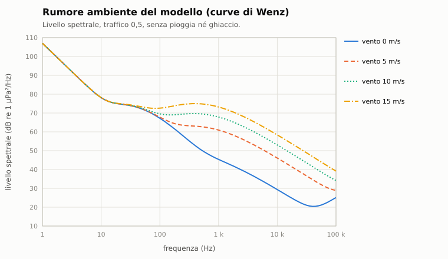

# C3. Rumore ambiente

*Autore: disassemblatore. Revisione del 27/10/2026. Stato: rivisto (curatore: kit).*

## 1. A che serve

Il mare non è mai silenzioso. Il vento sulle onde, le navi lontane, la pioggia, i gamberi, il ghiaccio, le balene
fanno un fondo contro cui ogni segnale deve emergere: il termine `NL` dell'equazione del sonar (capitolo C1). Con il
mare calmo e lontano dalle rotte si sente lontano; con il vento forte, sotto un acquazzone o in uno stretto pieno di
mercantili le portate si accorciano. In più ci sono il rumore del battello che ascolta, che cresce con la velocità, e
le sorgenti naturali e civili del **paesaggio sonoro**: non coprono solo il bersaglio, ma creano falsi contatti da
riconoscere.

## 2. Il modello

Il codice è in `nucleo/acustica.hpp` e `nucleo/src/acustica.cpp` (`rumore_ambiente`, `componenti_rumore_ambiente`,
`rumore_proprio`, `rumore_mare_proprio_db`) e in `nucleo/src/paesaggio_sonoro.cpp`. Tutti i livelli sono spettrali,
in dB re 1 µPa²/Hz.

### 2.1 Le curve di Wenz

Il fondo è la somma in potenza di quattro parti (forme di Coates, secondo Stojanovic), con `f` in kHz:

```
turbolenza = 17 − 30 log f
traffico   = 40 + 20 (s − 0,5) + 26 log f − 60 log(f + 0,03)
vento      = 50 + 7,5 sqrt(w) + 20 log f − 40 log(f + 0,4)
termico    = −15 + 20 log f
```

- `s`: il traffico del teatro, fra 0 e 1 (`traffico` in `teatri/<teatro>.suono.toml`): 0,3 nel Barents, 0,4 alle
  Fær Øer e alle Curili, 0,7 nel Mar Celtico, 0,8 nel Baltico e a Otranto, 1 a Gibilterra.
- `w`: il vento in m/s, limitato a 15 m/s (oltre, il rumore satura), e ridotto dalla copertura di ghiaccio:
  `w · (1 − ghiaccio)`.
- Il traffico domina sotto i 200 Hz, il vento fra 500 Hz e 20 kHz, il termico sopra i 100 kHz.



### 2.2 Pioggia, gamberi, ghiaccio

Si sommano alle curve:
- **pioggia** (`pioggia_mm_h`): `50 + 10 log(mm/h)` fra 5 e 25 kHz, −10 dB per decade sotto 5 kHz e sopra 25 kHz;
  con la pioggerella (sotto 2 mm/h) un picco di +5 dB a 15 kHz (le goccioline che risuonano);
- **gamberi schioccatori** (`gamberi`, acque basse e calde): 68 dB fra 2 e 20 kHz, −20 dB per decade fuori;
- **ghiaccio** (`ghiaccio`, la copertura fra 0 e 1): `vento(0) − 5 + 60 g (1 − g)`. Il pack compatto è quieto (5 dB
  sotto il mare calmo); il margine, a metà copertura, fa fino a 15 dB in più.

Esempi dal motore, a 100 Hz / 1 kHz / 10 kHz (`tools/manuale/esempi_acustica.cpp`):

| Condizione | 100 Hz | 1 kHz | 10 kHz |
|---|---|---|---|
| calma, traffico 0,5 | 67,2 | 45,4 | 29,4 |
| vento 5 m/s | 67,8 | 61,0 | 46,1 |
| vento 10 m/s | 69,6 | 67,9 | 53,0 |
| vento 15 m/s | 72,6 | 73,2 | 58,4 |
| traffico 1 (Gibilterra), vento 5 | 77,2 | 61,2 | 46,1 |
| pioggia 10 mm/h, vento 5 | 67,8 | 61,6 | 60,2 |
| gamberi, vento 5 | 67,8 | 64,5 | 68,0 |
| margine del ghiaccio (50%), vento 5 | 67,5 | 58,2 | 43,4 |
| pack (100%), vento 5 | 67,2 | 46,3 | 30,5 |

Col ghiaccio il vento non muove più l'acqua: il margine è rumoroso rispetto al pack, ma meno del mare aperto con lo
stesso vento.


**Sotto la banchisa** al rumore del ghiaccio si aggiungono le creste che si spingono (un livello suo attorno ai
100 Hz) e le fessure termiche col freddo dell'aria (fino a 18 dB attorno ai 2 kHz), dal campo del ghiaccio vero: capitolo
E11 §2.3.
### 2.3 Il rumore del battello che ascolta

Il rumore proprio (formula nel capitolo C1, 2.1) è il più grande dei due:
- **macchina**: costante, del sensore (`nl_macchina_db`: TB-16 35 dB, lontana dallo scafo; sfera BQQ-5 45 dB);
- **flusso**: `NL_flusso + 60 log(V / V₀)`, che cresce in fretta con la velocità.

A 300 Hz:

| Velocità | TB-16 | sfera BQQ-5 |
|---|---|---|
| 3-5 kn | 45,5 | 55,5 |
| 8 kn | 45,5 | 60,5 |
| 12 kn | 55,5 | 71,0 |
| 16 kn | 63,0 | 78,5 |

Oltre la velocità massima del sensore si aggiungono 30 dB: il sensore è sordo. Posato sul fondo il battello non ha
flusso.

**Il mare sui sensori** (`rumore_mare_proprio_db`): dal mare 5 il beccheggio, le bolle sul duomo e la schiera che si
muove con l'onda alzano il rumore proprio vicino alla superficie:
- sonar di scafo: fino a +10 dB a quota zero, niente oltre i 100 m;
- schiere trainate: fino a +6 dB, niente oltre i 150 m;
- con il mare 5 vale il 60%, dal mare 6 tutto.
Vale per tutti allo stesso modo: la differenza la fanno i mezzi. Le boe e i sonar a immersione non hanno uno scafo che
si muove con l'onda: il loro sensore ha `mare_proprio_db = 0` in `acustica.toml`, e il mare li tocca solo con il
rumore ambiente (§2.1).

### 2.4 Il paesaggio sonoro

Le sorgenti della libreria (`[sorgenti.*]` di `acustica.toml`, 32 voci) non sono un fondo: sono contatti veri, con
posizione, rilevamento e firma. Ogni voce dice:
- dove e quando c'è: i teatri, i mesi, le ore (giorno, crepuscolo, notte), la densità in istanze per 1000 nm²;
- quota e velocità, e l'estensione (un coro o un branco occupa un settore largo);
- il livello (rms, a 1 m) e le **componenti**: toni, famiglie di armoniche, bande, sweep (i richiami discendenti),
  impulsi;
- il **ritmo**: continuo, periodico, Poisson, a treni (serie di minuti e pause, doppiette e terzine);
- gli indizi per riconoscerla e con che cosa si confonde.

`popola_sorgenti(catalogo, teatro, mese, ora, centro, raggio, seme)` fa le istanze: per ogni voce un numero di Poisson
dalla densità e dall'area, e per ognuna posizione nel disco, quota, rotta e velocità dal seme. Le istanze si muovono
lungo la rotta, che cambia ogni 10 minuti (`muovi_sorgente`).

Nella missione (`missione.cpp`, costanti `RAGGIO_PAESAGGIO_M`, `SPOSTAMENTO_PAESAGGIO_M`, `ASCOLTO_PAESAGGIO_S`):
- il disco è di 100 km attorno al giocatore, col mese della missione (quello della data, o il predefinito del teatro);
- si ripopola quando il giocatore si sposta di più di 50 km, tenendo le istanze ancora dentro;
- le istanze si ascoltano ogni 2 s col livello A della propagazione e danno contatti con id da 100000, senza
  posizione, che arrivano al più a «classificato» (avviso 346 per i biologici).

<!-- generato: sorgenti_ambiente -->
| Sorgente | Categoria | Livello (dB, rms) | Teatri | Mesi | Densità (per 1000 nm²) | Fonte | Confidenza |
|---|---|---|---|---|---|---|---|
| Aringa (Clupea harengus): banco | biologico, pesce | 140 | Fær Øer e varco GIUK, Mare di Barents | tutto l’anno | 0,50 | 09 §5.3: Wilson 2004; livello STIMA | media |
| Balenottera azzurra (Balaenoptera musculus) | biologico, misticeto | 189 | Fær Øer e varco GIUK | 9, 10, 11, 12, 1, 2 | 0,05 | 09 §5.3: DOSITS | alta |
| Balenottera comune (Balaenoptera physalus) | biologico, misticeto | 185 | Fær Øer e varco GIUK, Mar Celtico, Stretto di Gibilterra, Canale d'Otranto | 10, 11, 12, 1, 2, 3 | 0,50 | 09 §5.3: DOSITS, Watkins 1987, Miksis-Olds 2019 | alta |
| Balenottera minore (Balaenoptera acutorostrata) | biologico, misticeto | 165 | Fær Øer e varco GIUK, Mar Celtico, Stretto di Gibilterra, Mare di Barents | 9, 10, 11, 12, 1, 2, 3, 4, 5 | 0,30 | 09 §5.3: Minke 2014; livello STIMA | bassa |
| Balenottera minore del Pacifico settentrionale (Balaenoptera acutorostrata) | biologico, misticeto | 150 | Curili e Mare di Okhotsk | 10, 11, 12, 1, 2, 3 | 0,20 | M, 29_note: banda e durata misurate sulla registrazione SWFSC (Rankin e Barlow 2005); cadenza e livello STIMA | bassa |
| Branco di delfini (delfino comune, globicefali) | biologico, odontoceto | 160 | Mar Celtico, Stretto di Gibilterra, Fær Øer e varco GIUK, Canale d'Otranto | tutto l’anno | 1,00 | 09 §5.3: ADA037620; livello dei fischi STIMA | media |
| Capodoglio (Physeter macrocephalus) | biologico, odontoceto | 230 | Fær Øer e varco GIUK, Stretto di Gibilterra, Canale d'Otranto, Curili e Mare di Okhotsk | tutto l’anno | 0,10 | 09 §5.3: DOSITS; 02 §4.5 | alta |
| Coro di pesci (sciaenidi) | biologico, pesce | 110 | Canale d'Otranto, Stretto di Gibilterra | 5, 6, 7, 8, 9 | 1,00 | 09 §5.3: Hild09, Chorus | alta |
| Eglefino (Melanogrammus aeglefinus): coro | biologico, pesce | 115 | Mare di Barents, Fær Øer e varco GIUK, Mar Celtico | 2, 3, 4, 5 | 0,50 | 09 §5.3: Haddock; livello STIMA | media |
| Foca barbata (Erignathus barbatus) | biologico, pinnipede | 170 | Mare di Barents, Curili e Mare di Okhotsk | 3, 4, 5, 6 | 0,30 | 09 §5.3: Frouin 2016; livello STIMA | media |
| Gamberi schioccatori (Alpheidae): colonia | biologico, crostaceo | 160 | Canale d'Otranto, Stretto di Gibilterra | tutto l’anno | 0,50 | 09 §5.3: Hild09 (183-189 dB pp per schiocco); colonia STIMA | media |
| Megattera (Megaptera novaeangliae) | biologico, misticeto | 137 | Fær Øer e varco GIUK, Mare di Barents | 5, 6, 7, 8, 9 | 0,30 | 09 §5.3: DOSITS, Fournet 2018 | media |
| Merluzzo (Gadus morhua) in riproduzione | biologico, pesce | 123 | Mare di Barents, Fær Øer e varco GIUK | 2, 3, 4 | 1,00 | 09 §5.3: Cod 2011 | alta |
| Orca (Orcinus orca) | biologico, odontoceto | 155 | Fær Øer e varco GIUK, Curili e Mare di Okhotsk, Mare di Barents | tutto l’anno | 0,10 | 09 §5.3: Holt 2011 (135-176 dB) | media |
| Tricheco (Odobenus rosmarus) | biologico, pinnipede | 170 | Mare di Barents | 1, 2, 3, 4 | 0,10 | M, 29_note: banda e cadenza misurate sulla registrazione AFSC; livello e stagione STIMA | bassa |
| Ecoscandaglio multifascio di una nave oceanografica | civile, ecoscandaglio | 230 | tutti | tutto l’anno | 0,05 | 09 §5.2: Hild09 (245 dB, fascio verso il fondo) | alta |
| Imbarcazione con fuoribordo | civile, diporto | 165 | Canale d'Otranto, Stretto di Gibilterra, Mar Baltico | 5, 6, 7, 8, 9 | 0,50 | 09 §5.2: Hild09 | alta |
| Peschereccio a strascico al lavoro | civile, pesca | 160 | Mar Celtico, Canale d'Otranto, Curili e Mare di Okhotsk, Fær Øer e varco GIUK, Mare di Barents | tutto l’anno | 1,00 | 09 §5.2: Hild09, RN-aural; livelli STIMA | bassa |
| Peschereccio piccolo in moto | civile, pesca | 150 | tutti | tutto l’anno | 1,50 | 09 §5.2: Hild09, Suisan95 | media |
| Profilatore del sottofondo | civile, ecoscandaglio | 220 | tutti | tutto l’anno | 0,05 | 09 §5.2: Hild09 (230 dB) | alta |
| Rete a strascico sul fondo | civile, pesca | 152 | tutti | tutto l’anno | 0,00 | 09 §5.2: Hild09, RN-aural (attrezzi da fondo); livelli e ritmo STIMA | bassa |
| Distacco di un iceberg | geofisico, ghiaccio | 220 | Mare di Barents | 5, 6, 7, 8, 9 | 0,20 | 09 §5.4: PMEL-ice, Podolskiy22 | alta |
| Fessurazione del ghiaccio | geofisico, ghiaccio | 150 | Mare di Barents, Curili e Mare di Okhotsk, Mar Baltico | 12, 1, 2, 3, 4 | 1,00 | 09 §5.4; 02 §4.6 | media |
| Ghiaccio glaciale che fonde | geofisico, ghiaccio | 140 | Mare di Barents | 5, 6, 7, 8, 9 | 0,30 | 09 §5.4: IGF; livello STIMA | media |
| Iceberg che s'incaglia | geofisico, ghiaccio | 175 | Mare di Barents | 5, 6, 7, 8, 9 | 0,10 | 09 §5.4: PMEL-ice; livello STIMA | alta |
| T-phase di un terremoto | geofisico, sismica | 185 | Fær Øer e varco GIUK, Curili e Mare di Okhotsk, Canale d'Otranto, Stretto di Gibilterra | tutto l’anno | 0,20 | 09 §5.4: Fox, Volc99; livello alla distanza di gioco STIMA | bassa |
| T-phase vulcanico | geofisico, vulcano | 180 | Curili e Mare di Okhotsk, Canale d'Otranto | tutto l’anno | 0,10 | 09 §5.4: Volc99, Monowai16 | bassa |
| Tremore armonico d'iceberg | geofisico, ghiaccio | 180 | Mare di Barents | 4, 5, 6, 7, 8, 9, 10 | 0,20 | 09 §5.4: PMEL-ice; livello STIMA | alta |
| Vulcano sottomarino attivo | geofisico, vulcano | 170 | Curili e Mare di Okhotsk | tutto l’anno | 0,05 | 09 §5.4: Barcena | media |
| Battitura di pali (cantiere portuale o piattaforma) | industriale, cantiere | 220 | Mar Baltico, Mar Celtico, Canale d'Otranto | tutto l’anno | 0,05 | 09 §5.6: Hild09 (205,9 + 10,2 log kJ) | alta |
| Esplosione d'esercitazione | industriale, esplosivo | 280 | tutti | tutto l’anno | 0,02 | 09 §5.1: SL = 269 + 7,53 log lb (Hild09) | alta |
| Nave sismica con cannoni ad aria | industriale, sismica | 250 | Fær Øer e varco GIUK, Mar Celtico | 4, 5, 6, 7, 8, 9, 10 | 0,05 | 09 §5.6: Hild09 (260 dB equivalente; STIMA 250 rms) | alta |
| Piattaforma di perforazione fissa | industriale, petrolio | 184 | Fær Øer e varco GIUK, Mar Celtico | tutto l’anno | 0,02 | 09 §5.2: Hild09 | alta |
| Risacca e frangenti su costa e bassifondi | meteo, costa | 165 | tutti | tutto l’anno | 0,20 | 09 §5.5; livello STIMA | bassa |
<!-- fine: sorgenti_ambiente -->

### 2.5 Fulmini

Un lampo che tocca il mare dà da 1 a qualche colpo (`transitori_lampo` in `nucleo/audio_meteo.hpp`): transitori
`fulmine_mare` da 195 dB, impulsi fra 40 Hz e 5 kHz. Il primo colpo arriva all'istante del lampo; i successivi a
intervalli lognormali di mediana 57 ms (20-180 ms al 90%), 6 ± 3 dB sotto il primo. Durano troppo poco per una
traccia, ma la cuffia li suona e il sonar li vede come transitori (capitolo C4).

## 3. Fonti e confidenza

| Parametro | Fonte | Confidenza |
|---|---|---|
| Curve di Wenz nelle forme di Coates | dossier 02 §4.1 [Wenz 1962] [Coates] [Stojanovic] | alta |
| Traffico per teatro | dossier 02 §4.3 | **STIMA** (rotte 0,8-1, oceano aperto 0,3-0,5) |
| Vento saturato a 15 m/s | dossier 02 §4.2 | media |
| Pioggia | dossier 02 §4.4 | **STIMA** sulla forma |
| Gamberi schioccatori, +20-30 dB in 2-20 kHz | dossier 02 §4.5 | media |
| Ghiaccio: pack −5 dB, margine +10-20 dB | dossier 02 §4.6 | **STIMA** |
| Rumore proprio di macchina e flusso | dossier 02 §2.5 | **STIMA** |
| Il mare sui sensori | dossier 24 §7.4, 21 §6.1, 02 §8 | **STIMA** |
| Libreria delle sorgenti | dossier 09 §5 e §6.2 (fonte per voce: DOSITS, Watkins, Miksis-Olds…) | per voce, nella tabella |
| Fulmini | dossier 21, nota «e_audio_meteo» §5.1 | **STIMA** su dispersione e ampiezza |

## 4. Classico ed Enhanced

Nel classico non c'è rumore ambiente: la portata dipende dal rumore del bersaglio e dalla velocità dell'osservatore
(il termine `40 − velocità propria` della formula, `docs/originale/sensori_e_navigazione.md` §3.3). Il meteo, il
traffico e i biologici non contano. Tutto questo capitolo è solo dell'Enhanced.

## 5. Come si vede in gioco

- **Cascate e LOFAR** (volume 1, §3.3 e §3.4): il fondo è il colore di base delle cascate; con il vento sale.
- **Cuffia** (volume 1, §3.7): vento e pioggia si sentono con le loro tessiture registrate; i biologici con i
  campioni (capitolo C8).
- **Contatti biologici**: compaiono come contatti senza posizione, avviso 346 quando il sonarista li riconosce.
  Il sonarista recluta può chiamare «possibile sottomarino» un biologico (capitolo C5).
- **Meteo** (capitolo E7): il vento e la pioggia del punto di chi ascolta.

## 6. Taratura e prove

- Coates con traffico 0,5: 61 dB a 1 kHz con 5 m/s di vento, 67 dB a 100 Hz in calma (dossier 02 §4.1).
- Prove in `test/prove_acustica.cpp`:
  - «formule di base (velocita' del suono, assorbimento, rumore ambiente, stato del mare)»: Coates, pioggia, gamberi,
    margine del ghiaccio;
  - «il mare grosso sui sensori vicino alla superficie, uguale per tutti (24 §7.4)».
- `test/prove_paesaggio_sonoro.cpp`: la popolazione per teatro, mese e ora, il moto, i ritmi e i livelli delle voci.
- `test/prove_audio_meteo.cpp`: i colpi dei fulmini.

## 7. Limiti noti e in arrivo

- Il rumore ambiente è lo stesso in tutte le direzioni: il rumore del traffico non viene dalle rotte, né il rumore del
  margine del ghiaccio dal margine.
- Il traffico è un numero per teatro, non cambia con l'ora né con la guerra.
- I gamberi si accendono con `gamberi_attivi(fondale, temperatura)`: fondale sotto 60 m e acqua in superficie da 18 °C
  in su (STIMA), nel punto di chi ascolta. Nei teatri del gioco vuol dire le coste di Otranto da maggio a ottobre e di
  Gibilterra da giugno a novembre.
- Il paesaggio sonoro c'è solo nel disco attorno al giocatore. Gli ascoltatori dell'IA dentro il disco (navi e
  sottomarini) sentono le istanze entro 30 km ogni 10 s, solo per il loro sonarista: così anche l'IA ha i suoi falsi
  contatti, ma lontano dal giocatore no.

## 8. Riferimenti

- Codice: `nucleo/acustica.hpp`, `nucleo/src/acustica.cpp`, `nucleo/src/paesaggio_sonoro.cpp`,
  `nucleo/audio_meteo.hpp`; `missioni/src/missione.cpp` (paesaggio).
- Dati: `data/motore/acustica.toml` `[sorgenti.*]` (da `tools/pipeline/sorgenti_libreria.py`),
  `data/motore/teatri/<teatro>.suono.toml` (`traffico`).
- Esempi: `tools/manuale/esempi_acustica.cpp`.
- Ricerca: dossier 02 §2.5 e §4; dossier 09 §5 e §6.2; dossier 21; dossier 24 §7.4.
