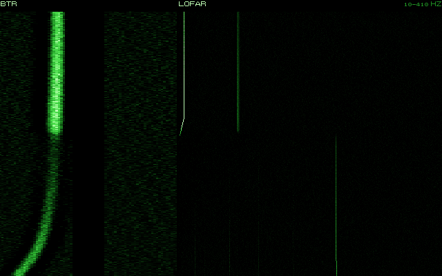

# C4. Firme acustiche

*Autore: disassemblatore. Revisione del 28/10/2026 (navi civili, righe legate all'asse). Stato: rivisto (curatore: kit).*

## 1. A che serve

Ogni battello e ogni nave fanno un rumore loro: la **firma**. Il livello dice da quanto lontano si sentono (il termine
`SL` dell'equazione del sonar, capitolo C1); la forma dice chi sono. Il rumore a banda larga cresce con la velocità e
salta quando l'elica cavita. Sopra il continuo ci sono le **righe**: la rete elettrica di bordo, le pompe, le turbine,
i riduttori, la pala dell'elica. Il LOFAR le vede e il sonarista le confronta con la libreria; il DEMON legge i giri e
il numero di pale. Poi ci sono i **transitori**: un portello, un siluro lanciato, un'esplosione, uno scafo che
implode. Con le variazioni accese, due battelli della stessa classe non sono mai identici.

## 2. Il modello

Le firme sono in `data/motore/acustica.toml` `[firme.<classe>]` (da `tools/pipeline/acustica.py`), i transitori in
`[transitori.*]`. Il codice è in `nucleo/src/acustica.cpp` (`livello_banda_larga`, `livello_sorgente`,
`frequenza_pala_hz`, `livello_pala_db`, `aspetto_db`, `sorgente_acustica`) e in `nucleo/src/analisi_acustica.cpp`
(`righe_emesse`, `demon`).

### 2.1 La banda larga

Il livello a banda larga 5-200 Hz, in dB re 1 µPa a 1 m, viene da una tabella per velocità (`punti`, coppie
nodi-dB), interpolata in log della velocità; sotto il primo punto resta costante.

```
SL_bl(v) = interpolazione in log v dei punti
         + 40 log(max(v, v_cav) / v_cav)      se cavita (non le navi)
         + snorkel_db                         a snorkel (Foxtrot e Kilo: +22,5)
         − 10                                 posato sul fondo
         + variazioni (2.6) + transitorio
```

Lo **spettro** per Hz:

```
SL(f) = SL_bl − 20 − 20 log(max(f, 200) / 1000)   [+ 10 sopra 100 Hz se cavita]
```

cioè 20 dB sotto la banda larga a 1 kHz, piatto sotto i 200 Hz, −20 dB per decade sopra. Con la cavitazione lo
spettro sopra i 100 Hz sale di 10 dB: a gradino se la cavitazione viene dalla dinamica (capitolo B1), in 2 nodi se
viene dalla firma.

Le navi civili (`nazionalita = "civile"`: le quattro firme e il traffico generato) hanno lo spettro 17 dB più basso
(`SPETTRO_CIVILI_SOTTO_DB`). I loro `punti` sono la banda misurata (McKenna 2012, Veirs 2016), e integrando lo spettro su
5-200 Hz si otterrebbero 17 dB in più. Le navi da guerra e i sottomarini no: le loro portate sono tarate su questo spettro.

### 2.2 La cavitazione



*La firma di un Victor III che passa al traverso della sfera del BQQ-5, come nel Museo (`grafica/cascata_firma`). A
sinistra il BTR, il rilevamento nel tempo; a destra il LOFAR, da 10 a 410 Hz. In basso, la metà più vecchia, il
battello va piano: si vedono le righe delle macchine. Poi accelera fino a 18 nodi: il continuo della cavitazione copre
le righe e accende la traccia.*

L'elica cavita oltre una velocità che cresce con la profondità:

```
v_cav(z) = v_cav,0 · sqrt((10,33 + z) / 10,33)
```

`v_cav,0` è l'insorgenza in superficie della firma (`v_cavitazione_kn`, la stessa tabella della dinamica). Un 688
che cavita a 5 nodi in superficie, a 150 m cavita solo sopra i 20 nodi circa. Un'elica danneggiata cavita prima, fino al 40% di
velocità in meno, e più forte (+8-15 dB all'insorgenza). Le navi non hanno il termine di cavitazione: il loro rumore
è già nei punti della tabella.

### 2.3 Le righe

Ogni firma ha la **tonale** (di norma la riga più forte, `tonale_hz`, `tonale_db`; nelle navi civili a diesel lento lo
sono le righe del diesel, +12, +10, +8 sulla tonale) e un elenco di **righe** relative a quella:
`[Hz, dB relativi, tipo, da nodi, a nodi]`.
- **rete**: le armoniche della rete di bordo, 60 Hz occidentale (120, 180, 300) e 50 Hz sovietica (250). La quinta
  armonica è la tonale: 300 Hz per gli occidentali, 250 per i sovietici (scelta di gioco);
- **pompa**: le pompe del primario, lente fino a una velocità e veloci sopra (il 688 a 42,3 Hz fino a 15 nodi, 84,6
  sopra);
- **turbina**, **riduttore**, **ausiliario**, **diesel** (solo a snorkel), e per le sorgenti della libreria
  **biologico**, **geofisico**, **industriale**.

**Le tonali delle navi civili** seguono lo spettro: mercantile 138 dB, cargo 140, petroliera 143, peschereccio 135, e nel
traffico generato la tonale è 35 dB sotto la banda (era 18). Con la riga a 250-300 Hz più alta, il LOFAR avrebbe tenuto il
contatto a 100 km anche con lo spettro abbassato. Le righe del diesel, a 7-28 Hz, servono all'analizzatore a distinguere le classi, e
stanno nel rumore del mare: non allungano la portata.

**Le righe legate all'asse** (blocco 2 del sonar, deciso dall'utente il 28/10/2026; `docs/22` §3, dossier 28): i
sottomarini nucleari hanno anche tre righe deboli di turbina e riduttore, da −12 a −21 dB sulla tonale, che sono
multipli della frequenza d'asse (`RigaFirma::multiplo_asse`, il sesto campo della riga). Salgono e scendono coi giri:
nella tabella la frequenza è quella a 10 nodi. Sul LOFAR si vedono muoversi insieme alla riga d'asse, sul proprio
battello e sugli altri (capitolo C5 §2.9).

Le righe di **pala** vengono dai giri:

```
f_asse = giri_per_nodo · v / 60        f_pala = pale · f_asse
L_pala = SL(100 Hz) a 10 kn + 15 + 60 log(v / 10)   [+10 se cavita] [−10 posato]
```

Si emettono l'asse (−6 dB), la pala e la doppia pala (−6 dB). Sotto 0,5 nodi non ci sono.

<!-- generato: righe_firme -->
| Firma | Righe: Hz (dB sulla tonale, origine, velocità) |
|---|---|
| Los Angeles (SSN-688, Flight I) | 60,0 (-6, rete); 120,0 (-9, rete); 180,0 (-12, rete); 300,0 (0, rete); 42,3 (-3, pompa, fino a 15 kn); 84,6 (-2, pompa, da 15 kn); 97,5 (-4, turbina); 168,0 (-8, riduttore); 23,0 a 10 kn (-18, turbina, 23 volte l'asse); 78,0 a 10 kn (-15, riduttore, 78 volte l'asse); 375,0 a 10 kn (-20, riduttore, 375 volte l'asse) |
| Sturgeon (SSN-637) | 60,0 (-6, rete); 120,0 (-9, rete); 180,0 (-12, rete); 300,0 (0, rete); 38,1 (-3, pompa, fino a 12 kn); 76,2 (-2, pompa, da 12 kn); 112,0 (-4, turbina); 150,0 (-7, riduttore); 24,5 a 10 kn (-17, turbina, 21 volte l'asse); 84,0 a 10 kn (-14, riduttore, 72 volte l'asse); 385,0 a 10 kn (-20, riduttore, 330 volte l'asse) |
| Trafalgar (Royal Navy) | 60,0 (-6, rete); 120,0 (-9, rete); 180,0 (-12, rete); 300,0 (0, rete); 47,0 (-3, pompa, fino a 14 kn); 94,0 (-2, pompa, da 14 kn); 104,0 (-4, turbina); 140,0 (-8, riduttore); 27,1 a 10 kn (-19, turbina, 25 volte l'asse); 87,8 a 10 kn (-16, riduttore, 81 volte l'asse); 433,3 a 10 kn (-21, riduttore, 400 volte l'asse) |
| Victor III (Progetto 671RTM) | 50,0 (-6, rete); 100,0 (-9, rete); 150,0 (-12, rete); 250,0 (0, rete); 36,0 (-2, pompa); 88,0 (-4, turbina); 132,0 (-6, riduttore); 185,0 (-9, ausiliario); 25,3 a 10 kn (-15, turbina, 19 volte l'asse); 88,0 a 10 kn (-13, riduttore, 66 volte l'asse); 386,7 a 10 kn (-19, riduttore, 290 volte l'asse) |
| Alfa (Progetto 705) | 50,0 (-6, rete); 100,0 (-9, rete); 150,0 (-12, rete); 250,0 (0, rete); 400,0 (-3, ausiliario); 29,0 (0, pompa); 120,0 (-4, turbina); 210,0 (-7, riduttore); 20,2 a 10 kn (-14, turbina, 27 volte l'asse); 66,0 a 10 kn (-12, riduttore, 88 volte l'asse); 315,0 a 10 kn (-18, riduttore, 420 volte l'asse) |
| Akula I (Progetto 971) | 50,0 (-6, rete); 100,0 (-9, rete); 150,0 (-12, rete); 250,0 (0, rete); 44,0 (-3, pompa, fino a 12 kn); 88,5 (-2, pompa, da 12 kn); 93,0 (-4, turbina); 155,0 (-8, riduttore); 22,0 a 10 kn (-17, turbina, 22 volte l'asse); 74,0 a 10 kn (-15, riduttore, 74 volte l'asse); 350,0 a 10 kn (-20, riduttore, 350 volte l'asse) |
| Oscar II (Progetto 949A) | 50,0 (-6, rete); 100,0 (-9, rete); 150,0 (-12, rete); 250,0 (0, rete); 33,0 (-3, pompa, fino a 14 kn); 66,0 (-2, pompa, da 14 kn); 79,0 (-4, turbina); 142,0 (-8, riduttore); 16,7 a 10 kn (-16, turbina, 20 volte l'asse); 58,3 a 10 kn (-14, riduttore, 70 volte l'asse); 258,3 a 10 kn (-19, riduttore, 310 volte l'asse) |
| Charlie II (Progetto 670M) | 50,0 (-6, rete); 100,0 (-9, rete); 150,0 (-12, rete); 250,0 (0, rete); 31,0 (-1, pompa); 72,0 (-3, turbina); 118,0 (-6, riduttore); 196,0 (-9, ausiliario); 24,0 a 10 kn (-14, turbina, 18 volte l'asse); 85,3 a 10 kn (-12, riduttore, 64 volte l'asse); 373,3 a 10 kn (-18, riduttore, 280 volte l'asse) |
| Typhoon (Progetto 941) | 50,0 (-6, rete); 100,0 (-9, rete); 150,0 (-12, rete); 250,0 (0, rete); 27,0 (-3, pompa, fino a 12 kn); 54,0 (-2, pompa, da 12 kn); 69,0 (-4, turbina); 126,0 (-7, riduttore); 11,3 a 10 kn (-17, turbina, 17 volte l'asse); 40,0 a 10 kn (-15, riduttore, 60 volte l'asse); 180,0 a 10 kn (-20, riduttore, 270 volte l'asse) |
| Foxtrot (Progetto 641) | 50,0 (-6, rete); 100,0 (-9, rete); 150,0 (-12, rete); 250,0 (0, rete); 68,0 (-4, ausiliario); 11,0 (0, diesel); 22,0 (-3, diesel); 33,0 (-6, diesel) |
| Kilo (Progetto 877) | 50,0 (-6, rete); 100,0 (-9, rete); 150,0 (-12, rete); 250,0 (0, rete); 75,0 (-4, ausiliario); 12,5 (0, diesel); 25,0 (-3, diesel); 37,5 (-6, diesel) |
| Victor I (Progetto 671) | 50,0 (-6, rete); 100,0 (-9, rete); 150,0 (-12, rete); 250,0 (0, rete); 34,0 (0, pompa); 68,0 (-2, pompa); 83,0 (-3, turbina); 124,0 (-5, riduttore); 176,0 (-8, ausiliario); 25,5 a 10 kn (-13, turbina, 18 volte l'asse); 87,8 a 10 kn (-11, riduttore, 62 volte l'asse); 382,5 a 10 kn (-17, riduttore, 270 volte l'asse) |
| Delta III (Progetto 667BDR) | 50,0 (-6, rete); 100,0 (-9, rete); 150,0 (-12, rete); 250,0 (0, rete); 29,0 (-2, pompa, fino a 12 kn); 58,0 (-1, pompa, da 12 kn); 74,0 (-3, turbina); 137,0 (-6, riduttore); 205,0 (-9, ausiliario); 18,4 a 10 kn (-15, turbina, 17 volte l'asse); 65,0 a 10 kn (-13, riduttore, 60 volte l'asse); 287,1 a 10 kn (-19, riduttore, 265 volte l'asse) |
| Sierra I (Progetto 945) | 50,0 (-6, rete); 100,0 (-9, rete); 150,0 (-12, rete); 250,0 (0, rete); 41,0 (-3, pompa, fino a 12 kn); 82,0 (-2, pompa, da 12 kn); 97,0 (-4, turbina); 161,0 (-8, riduttore); 21,0 a 10 kn (-17, turbina, 21 volte l'asse); 72,0 a 10 kn (-15, riduttore, 72 volte l'asse); 340,0 a 10 kn (-20, riduttore, 340 volte l'asse) |
| Ohio (SSBN-726) | 60,0 (-6, rete); 120,0 (-9, rete); 180,0 (-12, rete); 300,0 (0, rete); 31,0 (-6, pompa, da 10 kn); 62,0 (-5, pompa, da 18 kn); 88,0 (-6, turbina); 132,0 (-10, riduttore); 18,0 a 10 kn (-20, turbina, 24 volte l'asse); 60,0 a 10 kn (-17, riduttore, 80 volte l'asse); 285,0 a 10 kn (-22, riduttore, 380 volte l'asse) |
| Type 206 (U 13-30) | 60,0 (-6, rete); 120,0 (-9, rete); 180,0 (-12, rete); 300,0 (0, rete); 70,0 (-4, ausiliario); 16,5 (0, diesel); 33,0 (-3, diesel); 49,5 (-6, diesel) |
| Nacken (A14) | 60,0 (-6, rete); 120,0 (-9, rete); 180,0 (-12, rete); 300,0 (0, rete); 65,0 (-4, ausiliario); 25,0 (0, diesel); 12,5 (-3, diesel); 75,0 (-6, diesel) |
| Oliver Hazard Perry (FFG-7) | 60,0 (-6, rete); 120,0 (-9, rete); 180,0 (-12, rete); 300,0 (0, rete); 115,0 (-2, turbina); 230,0 (-6, riduttore) |
| Kidd (DDG-993) | 60,0 (-6, rete); 120,0 (-9, rete); 180,0 (-12, rete); 300,0 (0, rete); 118,0 (-2, turbina); 236,0 (-6, riduttore) |
| Spruance (DD-963) | 60,0 (-6, rete); 120,0 (-9, rete); 180,0 (-12, rete); 300,0 (0, rete); 118,0 (-2, turbina); 177,0 (-6, riduttore) |
| Krivak II (Progetto 1135M) | 50,0 (-6, rete); 100,0 (-9, rete); 150,0 (-12, rete); 250,0 (0, rete); 105,0 (-2, turbina); 210,0 (-6, riduttore) |
| Kara (Progetto 1134B) | 50,0 (-6, rete); 100,0 (-9, rete); 150,0 (-12, rete); 250,0 (0, rete); 110,0 (-2, turbina); 165,0 (-6, riduttore) |
| Slava (Progetto 1164) | 50,0 (-6, rete); 100,0 (-9, rete); 150,0 (-12, rete); 250,0 (0, rete); 98,0 (-2, turbina); 196,0 (-6, riduttore) |
| Koni (Progetto 1159) | 50,0 (-6, rete); 100,0 (-9, rete); 150,0 (-12, rete); 250,0 (0, rete); 14,0 (-2, diesel); 28,0 (-5, diesel); 125,0 (-4, turbina) |
| Nanuchka I (Progetto 1234) | 50,0 (-6, rete); 100,0 (-9, rete); 150,0 (-12, rete); 250,0 (0, rete); 17,0 (-2, diesel); 34,0 (-5, diesel) |
| Oslo (F300) | 60,0 (-6, rete); 120,0 (-9, rete); 180,0 (-12, rete); 300,0 (0, rete); 98,0 (-2, turbina); 196,0 (-6, riduttore); 29,0 (-4, pompa) |
| Stockholm (K11) | 60,0 (-6, rete); 120,0 (-9, rete); 180,0 (-12, rete); 300,0 (0, rete); 31,7 (-2, diesel); 63,3 (-5, diesel); 140,0 (-4, turbina) |
| Kitty Hawk (CV-63) | 60,0 (-6, rete); 120,0 (-9, rete); 180,0 (-12, rete); 300,0 (0, rete); 80,0 (-2, turbina); 160,0 (-6, riduttore); 32,0 (-3, pompa); 48,0 (-5, ausiliario) |
| Hauk (motocannoniera norvegese) | 60,0 (-6, rete); 120,0 (-9, rete); 180,0 (-12, rete); 300,0 (0, rete); 30,0 (-2, diesel); 150,0 (-4, diesel) |
| Kirov (Progetto 1144) | 50,0 (-6, rete); 100,0 (-9, rete); 150,0 (-12, rete); 250,0 (0, rete); 92,0 (-2, turbina); 46,0 (-4, pompa); 138,0 (-6, riduttore) |
| Iowa (BB-61) | 60,0 (-6, rete); 120,0 (-9, rete); 180,0 (-12, rete); 300,0 (0, rete); 85,0 (-2, turbina); 160,0 (-6, riduttore) |
| Nimitz (CVN-68) | 60,0 (-6, rete); 120,0 (-9, rete); 180,0 (-12, rete); 300,0 (0, rete); 82,0 (-2, turbina); 41,0 (-4, pompa); 164,0 (-6, riduttore) |
| Sacramento (AOE-1) | 60,0 (-6, rete); 120,0 (-9, rete); 180,0 (-12, rete); 300,0 (0, rete); 78,0 (-2, turbina); 156,0 (-6, riduttore) |
| Mercantile (Ravenstvo, tipo Leninskiy Komsomol) | 50,0 (-6, rete); 100,0 (-9, rete); 150,0 (-12, rete); 250,0 (0, rete); 8,3 (12, diesel); 16,7 (10, diesel); 25,0 (8, diesel) |
| Portacontainer (Cpl. Louis J. Hauge Jr., ex Estelle Maersk) | 60,0 (-6, rete); 120,0 (-9, rete); 180,0 (-12, rete); 300,0 (0, rete); 9,5 (12, diesel); 19,0 (10, diesel); 28,5 (8, diesel) |
| Ugra (Progetto 1886) | 50,0 (-6, rete); 100,0 (-9, rete); 150,0 (-12, rete); 250,0 (0, rete); 12,5 (-1, diesel); 25,0 (-3, diesel); 37,5 (-5, diesel); 60,0 (-6, ausiliario) |
| Petroliera (Sea Isle City, 1981) | 60,0 (-6, rete); 120,0 (-9, rete); 180,0 (-12, rete); 300,0 (0, rete); 7,2 (12, diesel); 14,4 (10, diesel); 21,6 (8, diesel) |
| Ticonderoga (CG-47) | 60,0 (-6, rete); 120,0 (-9, rete); 180,0 (-12, rete); 300,0 (0, rete); 121,0 (-2, turbina); 181,5 (-6, riduttore) |
| Knox (FF-1052) | 60,0 (-6, rete); 120,0 (-9, rete); 180,0 (-12, rete); 300,0 (0, rete); 93,0 (-2, turbina); 186,0 (-6, riduttore); 28,0 (-4, pompa) |
| Type 22 Broadsword (Batch 1) | 60,0 (-6, rete); 120,0 (-9, rete); 180,0 (-12, rete); 300,0 (0, rete); 108,0 (-2, turbina); 22,5 (-1, diesel); 45,0 (-4, diesel) |
| Type 22 Boxer (Batch 2) | 60,0 (-6, rete); 120,0 (-9, rete); 180,0 (-12, rete); 300,0 (0, rete); 108,0 (-2, turbina); 22,5 (-1, diesel); 45,0 (-4, diesel) |
| Udaloy (Progetto 1155) | 50,0 (-6, rete); 100,0 (-9, rete); 150,0 (-12, rete); 250,0 (0, rete); 102,0 (-2, turbina); 204,0 (-6, riduttore) |
| Grisha III (Progetto 1124M) | 50,0 (-6, rete); 100,0 (-9, rete); 150,0 (-12, rete); 250,0 (0, rete); 21,0 (-2, diesel); 42,0 (-5, diesel); 130,0 (-4, turbina) |
| AGI classe Okean (LINZA) | 50,0 (-6, rete); 100,0 (-9, rete); 150,0 (-12, rete); 250,0 (0, rete); 25,0 (-2, diesel); 8,3 (-6, diesel); 15,3 (0, diesel, da 1 kn); 30,6 (-3, diesel, da 1 kn); 3,8 (-8, diesel, da 1 kn) |
| Peschereccio d'altura (Atlantic Peace, 1987) | 50,0 (-6, rete); 100,0 (-9, rete); 150,0 (-12, rete); 250,0 (0, rete); 75,0 (0, diesel); 112,5 (-5, diesel); 37,5 (-6, diesel); 12,5 (-5, diesel); 10,7 (-2, elica); 21,3 (-6, elica); 32,0 (-9, elica); 14,0 (-6, ausiliario, 2-6 kn); 28,0 (-10, ausiliario, 2-6 kn); 42,0 (-14, ausiliario, 2-6 kn); 225,0 (-8, ausiliario, 2-6 kn) |
| biologico | 20,0 (0, biologico); 40,0 (-8, biologico) |
| siluro Mk 48 | 660,0 (2, elica, fino a 47 kn); 1320,0 (-4, elica, fino a 47 kn); 132,0 (-4, riduttore, fino a 47 kn); 1188,0 (-4, riduttore, fino a 47 kn); 264,0 (-4, turbina, fino a 47 kn); 907,5 (12, elica, da 47 kn); 1815,0 (6, elica, da 47 kn); 181,5 (6, riduttore, da 47 kn); 1633,5 (6, riduttore, da 47 kn); 363,0 (6, turbina, da 47 kn) |
| siluro Mk 48 ADCAP | 660,0 (-1, elica, fino a 47 kn); 1320,0 (-7, elica, fino a 47 kn); 264,0 (-10, turbina, fino a 47 kn); 907,5 (9, elica, da 47 kn); 1815,0 (3, elica, da 47 kn); 363,0 (0, turbina, da 47 kn) |
| siluro USET-80 | 154,0 (-12, elica, fino a 40 kn); 308,0 (-16, elica, fino a 40 kn); 385,0 (-14, turbina, fino a 40 kn); 198,0 (-2, elica, da 40 kn); 396,0 (-6, elica, da 40 kn); 495,0 (-4, turbina, da 40 kn) |
| siluro TEST-71M | 105,6 (-12, elica, fino a 32 kn); 211,0 (-16, elica, fino a 32 kn); 264,0 (-14, turbina, fino a 32 kn); 176,0 (0, elica, da 32 kn); 352,0 (-4, elica, da 32 kn); 440,0 (-2, turbina, da 32 kn) |
| siluro 53-65K | 180,0 (-2, elica); 360,0 (-6, elica); 5000,0 (0, turbina) |
| siluro Mk 46 | 157,0 (-10, elica, fino a 36 kn); 235,0 (-10, elica, fino a 36 kn); 392,0 (-16, elica, fino a 36 kn); 252,0 (2, elica, da 36 kn); 378,0 (2, elica, da 36 kn); 630,0 (-4, elica, da 36 kn) |
| siluro AT-1 | 140,0 (-10, elica); 280,0 (-14, elica); 350,0 (-12, turbina) |
<!-- fine: righe_firme -->

### 2.4 Il DEMON

Il DEMON (`demon` in `analisi_acustica.cpp`) ascolta l'inviluppo del rumore di cavitazione fra 2 e 8 kHz. Se la
sorgente cavita e si sente in alta frequenza, dà le righe:
- l'asse (−6 dB) e il suo doppio (−10 dB);
- la pala e due armoniche (0, −4, −8 dB);
forti quanto il S/N a 3,5 kHz più 10 dB, fra 0 e 40 dB. `leggi_demon` ne ricava i giri e il numero di pale (soglia
6 dB). Una sorgente che non cavita dà un DEMON piatto.

### 2.5 La forza di bersaglio

Per l'attivo (capitolo C1): `ts_prua_db` e `ts_traverso_db` della firma. I battelli con il rivestimento anecoico
(Victor III, Alfa, Akula) hanno 10 dB in meno.

### 2.6 Le variazioni (dossier 18)

Con le variazioni accese (`UnitaAcustica::variazioni`, di serie nell'Enhanced; si spengono con l'opzione di realismo)
navi e sottomarini veri hanno, dal seme dell'unità:
- **l'individuo**:
  - banda larga ± σ 2,4 dB (al più ±5);
  - righe dei giri (turbine, riduttori, asse, pala) spostate dell'1,5% σ (al più 3%), pompe, ausiliari e diesel dello
    0,25% (al più 0,5%), la rete identica in tutta la classe;
  - un ritratto di ±2,5 dB per riga;
  - un'elica «cantante» su venti: una riga fra 100 e 1000 Hz in una finestra di velocità;
- **il regime delle pompe**: automatico (per velocità), spente, lente o veloci. La veloce sta `40 log(f_veloce /
  f_lenta)` sopra la lenta (legge di Ross). Gli ausiliari sono accesi il 70% del tempo, a turni di 20 minuti;
- **il momento**:
  - l'aspetto, secondo Trevorrow:
    `10 log((|cos(θ − 97°)|^1,95 + 0,08) / 1,08) + 3 max(0, −cos θ)`, con θ dalla prua, mai sopra zero. Sulle navi
    la prua è −10 dB e la poppa −7; sui sottomarini il 30% di questo. Sotto 100 Hz vale il 30%, e sale al 100% a
    300 Hz;
  - la virata: +1,65 dB per grado al secondo, fino a 12 dB sui sottomarini e 18 sulle navi;
  - l'usura: fino a +5 dB;
- **i danni**: all'elica, cavitazione anticipata e bande laterali a ±1 volta i giri; alle macchine, +6-20 dB sulle
  loro righe.

Spente le variazioni, la sorgente è bit per bit quella della classe.

### 2.7 Da unità a sorgente

`sorgente_acustica(catalogo, unità)` sceglie la firma:
1. un'esca lanciata (arma con il flag 80h): `adc_mk2`; un falso bersaglio non arma: `biologico`;
2. la classe; il `type53` usa `uset80`;
3. altrimenti la firma generica della categoria: `nave_generica`, `siluro_generico`, `biologico`,
   `sottomarino_generico`;
4. gli aerei restano senza firma (li sente l'ASW aereo, capitolo E5).

Le teste dei siluri usano la stessa sorgente sulla loro scala: `sorgente_per_siluri` dà la banda larga più 18 dB (un
688 silenzioso a 130 dB, come nel modello delle teste, capitolo D1).

### 2.8 I transitori

I transitori sono sorgenti brevi della libreria `[transitori.*]` (62 voci), con le stesse componenti del paesaggio
sonoro (capitolo C3). Li producono gli eventi:
- **lancio** (`transitori_lancio`): allagamento del tubo 35 s prima, equalizzazione 10 s prima, porta 5 s prima, lo
  sparo del pistone ad acqua col ritorno 3-8 s dopo, l'avvio del siluro 0,5-2 s dopo; per l'Harpoon i tappi della
  capsula 20-60 s dopo, per il Tomahawk il booster;
- **esplosione** (`transitori_esplosione`): l'urto, poi le pulsazioni della bolla. Il periodo è
  `T₁ = 2,11 W^⅓ / (d + 10,1)^⅚` (W in kg di TNT, d in m), T₂ = 0,74 T₁ e T₃ = 0,63 T₁, a 14, 20 e 26 dB sotto
  l'urto. Vicino alla superficie la bolla sfiata e non pulsa;
- **implosione** (`transitori_implosione`) di uno scafo alla quota di collasso: TNT equivalente `(2-3) p V / 4,184
  MJ`, con il volume asciutto `0,29 L B²` (fra 300 e 15 000 m³). Lo Scorpion (76,7 × 9,6 m) dà circa 2050 m³ e 6 t a
  470 m; un 688 circa 3200 m³. Poi 10-20 cedimenti minori in 200 s;
- **affondamento** di una nave (`transitori_affondamento`): allagamento, aria, 5-10 minuti di rotture, l'urto sul
  fondo;
- **ping delle teste attive**: un ping ogni `1,2 · 2R / c` con R la distanza dal bersaglio, cioè 5,8 s a 3,6 km e
  0,16 s a 100 m.

<!-- generato: transitori_acustici -->
| Transitorio | Categoria | Livello (dB) | Durata (s) | Indizi | Fonte | Confidenza |
|---|---|---|---|---|---|---|
| Allagamento del tubo lanciasiluri | arma, lancio | 128 | 25,0 | gorgoglio di 20-30 s: un tubo si prepara | r7 §1.2 e §6.2; livello STIMA | STIMA |
| Avvio del motore del siluro | arma, lancio | 155 | 2,0 | scoppio breve e acuto, poi il fischio che sale: siluro in acqua | r7 §2.5 e §6.2; STIMA | STIMA |
| Booster del Tomahawk acceso in acqua | arma, lancio | 200 | 2,5 | ruggito a larga banda di 2 s: missile da sottomarino | r7 §1.3: 195-210 dB molto incerti (STIMA) | STIMA |
| Capsula dell'Harpoon: apertura dei tappi | arma, lancio | 178 | 1,0 | schiocco pirotecnico in superficie, 20-60 s dopo il lancio | r7 §1.3; STIMA | STIMA |
| Colpo di partenza di un cannone navale | arma, artiglieria | 180 | 1,0 | tonfo sordo e ritmico alla cadenza del pezzo: la nave sta sparando; arriva prima del proietto | 22 §7.3: 165-180 dB a 1 m equivalente, picco a ~70 Hz [NOSC732]; si tiene il massimo perché con la perdita del modello (sorgente a 3 m) si senta entro 5-10 km come nelle fonti della US Navy | STIMA |
| Equalizzazione del tubo | arma, lancio | 125 | 10,0 | sibilo, poi un colpo secco | r7 §6.2; STIMA | STIMA |
| Esplosione subacquea: onda d'urto (1 kg di TNT) | arma, esplosione | 256 | 3,0 | colpo violento, poi le pulsazioni della bolla | r7 §3.1 (Cole, Willis, dossier 07 §1); taratura STIMA | STIMA |
| Esplosione subacquea: pulsazione della bolla | arma, esplosione | 242 | 1,0 |  | r7 §3.2: la prima bolla ~14 dB sotto l'urto | STIMA |
| Lancio: colpo del pistone ad acqua | arma, lancio | 172 | 1,5 | colpo forte e grave con la risonanza del tubo (~55 Hz): lancio | r7 §1.2 e §6.2 (risonanza c/4L con L ~7 m); STIMA, udibile a 10-40 km | STIMA |
| Lancio: ritorno del pistone | arma, lancio | 155 | 1,0 |  | r7 §6.2; STIMA | STIMA |
| Ping della testa attiva del AT-1 | arma, ping | 200 | 0,5 | ping acuto che accelera man mano che il siluro si avvicina | r7 §2.4 e §6.3; STIMA | STIMA |
| Ping della testa attiva del Mk 46 | arma, ping | 205 | 0,5 | ping acuto che accelera man mano che il siluro si avvicina | r7 §2.4 e §6.3; STIMA | STIMA |
| Ping della testa attiva del Mk 48 | arma, ping | 210 | 0,5 | ping acuto che accelera man mano che il siluro si avvicina | r7 §2.4 e §6.3; STIMA | STIMA |
| Ping della testa attiva del Mk 48 ADCAP (FM) | arma, ping | 210 | 0,5 | ping a larga banda FM | r7 §6.3; STIMA | STIMA |
| Ping della testa attiva del SET-65 / TEST-71 | arma, ping | 205 | 0,5 | ping acuto che accelera man mano che il siluro si avvicina | r7 §2.4 e §6.3; STIMA | STIMA |
| Ping della testa attiva del Sting Ray | arma, ping | 205 | 0,5 | ping acuto che accelera man mano che il siluro si avvicina | r7 §2.4 e §6.3; STIMA | STIMA |
| Ping della testa attiva del Tp 42 | arma, ping | 200 | 0,5 | ping acuto che accelera man mano che il siluro si avvicina | r7 §2.4 e §6.3; STIMA | STIMA |
| Ping della testa attiva del USET-80 | arma, ping | 210 | 0,5 | ping acuto che accelera man mano che il siluro si avvicina | r7 §2.4 e §6.3; STIMA | STIMA |
| Porta esterna del tubo | arma, lancio | 145 | 5,0 | colpo metallico e ronzio idraulico: la porta si apre o si chiude | r7 §6.2; STIMA | STIMA |
| Portello di un pozzo VLS | arma, lancio | 145 | 3,0 |  | r7 §6.2; STIMA | STIMA |
| Proietto che scoppia sull'acqua (5", 3,5 kg) | arma, artiglieria | 244 | 1,0 | crack corto e secco, senza bolla: esplosione in superficie; a cadenza regolare: tiro d'artiglieria (0,75 s Mk 75, 3 s Mk 45, doppiette AK-130 e AK-726) | 22 §7.1 e §10 (Cole, specchio di Lloyd); taratura sul modello [CALC] | media-bassa |
| Proietto con spoletta di prossimità che scoppia in aria | arma, artiglieria | 224 | 1,0 | come la cannonata, più debole: il suono entra in acqua solo sotto lo scoppio (finestra di Snell) | 22 §3.5 e §7.1; 20 dB sotto lo scoppio sull'acqua (STIMA) | STIMA |
| Proietto inerte o rimbalzato che entra in acqua | arma, artiglieria | 204 | 1,0 | tonfo breve senza esplosione: colpo d'esercitazione o rimbalzo | 22 §7.2: 30-50 dB sotto lo scoppio dello stesso calibro (STIMA; EIS non scaricabili) | STIMA |
| Raffica di un cannone a canne rotanti (AK-630): mezzo secondo | arma, artiglieria | 240 | 0,5 | ronzio di micro-scoppi per 1-3 s: AK-630 | 22 §7.1 (30 mm, 48,5 g: 5 dB sotto il 5"); 75 colpi al secondo (4500/min); STIMA | STIMA |
| Be-12 in sorvolo | asw, aereo | 155 | — | ~70 Hz e armoniche | 17 §8.3 [CALC]; livello STIMA | media |
| Elicottero in hover: rotore e spruzzi | asw, elicottero | 136 | — | rumore di superficie localizzato entro 0,5-1 nm | 17 §8.3 (regola d'ascolto [GIOCO]); livello STIMA: la sfera del 688 lo sente entro ~1 nm | STIMA |
| Esplosiva MGAB | asw, esplosiva | 215 | 3,0 | colpo singolo a 25, 150 o 400 m; 2-3 nello stesso punto a 3-4 min | 17 §4.2 [ART-Tu142]; livello STIMA (100-800 g) | media |
| Hkp 4 (Vertol 107) in volo | asw, elicottero | 150 | — | ~13 Hz, i due rotori in tandem a 3 pale | 35: Vertol 107, 264 giri (STIMA); livello come il Sea King | STIMA |
| Il-38 in sorvolo | asw, aereo | 158 | — | ~70 Hz e armoniche | 17 §8.3 [CALC]; livello STIMA | media |
| Ka-25 in volo | asw, elicottero | 150 | — | 11,9 Hz, rotori coassiali | 17 §8.3; livello STIMA | STIMA |
| Ka-27 in volo | asw, elicottero | 152 | — | ~13-14 Hz con i battimenti dei rotori coassiali | 17 §8.3; giri e livello STIMA | STIMA |
| Lynx HAS.3 in volo | asw, elicottero | 145 | — | ~21 Hz del rotore principale a 4 pale; circa 100 Hz del rotore di coda | 38: rotore a 4 pale; giri e livello STIMA, un po' sotto l'SH-2F più grande | STIMA |
| P-3C Orion in sorvolo | asw, aereo | 158 | — | 68 Hz (4 pale x 17 Hz) e armoniche fino a ~1 kHz; pochi secondi, Doppler +-5 Hz | 17 §8.3 [AT-FERG19] [FMARS22]; livello STIMA | alta per i toni |
| Ping del sonar a immersione AQS-13B | asw, ping | 211 | 2,0 | ~10 kHz, ogni 6-10 s, 3-6 ping poi silenzio | 17 §6.4 e §8.3 [MILAQS13B] | alta |
| Ping del sonar a immersione AQS-13F | asw, ping | 215 | 2,0 | ~10 kHz, ogni 6-10 s | 17 §8.3 (215 dB nella tabella dell'asimmetria) | media |
| Ping del sonar a immersione HS-73 | asw, ping | 205 | 2,0 | ~10 kHz, ogni 6-10 s: l'Hkp 4 svedese | 35; frequenza e livello STIMA | STIMA |
| Ping del sonar a immersione VGS-2 | asw, ping | 200 | 2,0 | Ka-25: raro | 17 §8.3; frequenza e livello STIMA | STIMA |
| Ping del sonar a immersione VGS-3 | asw, ping | 205 | 2,0 | raro: un contatto o un sospetto | 17 §6.5 e §8.3; frequenza e livello STIMA | STIMA |
| Ping di una boa DICASS (SSQ-62B) | asw, ping | 200 | 2,0 | 6,5-9,5 kHz, CW o FM, a comando | 17 §4.1 e §8.3 [FASSSQ62]; durata STIMA | alta |
| Ping di una boa RGB-55A | asw, ping | 200 | 2,0 | 4 frequenze, a comando | 17 §4.2 [ART-Tu142]; frequenza e livello STIMA | STIMA |
| Ping di una boa SSQ-47B | asw, ping | 195 | 1800,0 | 13-19 kHz ogni 10 s: inconfondibile | 17 §4.1 e §8.3 [HOLLER]; livello e durata STIMA | alta per la cadenza |
| S-3 Viking in sorvolo | asw, aereo | 145 | — | turbofan: nessun tonale d'elica, soffio largo | 17 §8.3 [CALC]; livello STIMA | media |
| SH-2F Seasprite in volo | asw, elicottero | 148 | — | ~20 Hz del rotore principale a 4 pale; circa 95 Hz del rotore di coda | 17 §8.3 come l'SH-60; giri e livello STIMA (la Knox, 30/10/2026) | STIMA |
| SH-3 Sea King in volo | asw, elicottero | 150 | — | ~17 Hz del rotore principale | 17 §8.3; giri e livello STIMA | STIMA |
| SH-60 in volo | asw, elicottero | 150 | — | ~17 Hz del rotore principale; 80 Hz del rotore di coda | 17 §8.3; giri e livello STIMA | STIMA |
| SUS Mk 84 | asw, segnale | 170 | 80,0 | toni a ~3 kHz per 45-120 s: attacco simulato o codice d'ordine | 17 §4.3 [PRC68SUS]; livello STIMA | media |
| Spirale MGAB SZ: treno di colpi | asw, esplosiva | 210 | 8,0 | treno di colpi a 4 Hz | 17 §4.2 [ART-Tu142]; livello e durata STIMA | media |
| Tonfo del trasduttore del sonar a immersione | asw, tonfo | 150 | 5,0 | tonfo, poi 1-3 min di silenzio e i ping | 17 §8.3; livello STIMA | STIMA |
| Tonfo di un siluro aviolanciato | asw, tonfo | 175 | 5,0 | tonfo forte, dopo 5-10 s il motore e la testa: siluro in acqua | 17 §8.3 [GIOCO] | media |
| Tonfo di una boa sonora | asw, tonfo | 160 | 5,0 | colpo secco in superficie; a intervalli regolari: una barriera di boe | 17 §8.3 [ART-Be12] (2,8 km ai sonar sovietici) e [GIOCO] | media |
| Tu-142 in sorvolo | asw, aereo | 162 | — | ~49 e 98 Hz (eliche controrotanti) | 17 §8.3 [CALC]; livello STIMA | media |
| Fulmine che colpisce il mare | meteo, fulmine | 195 | 3,0 | colpo secco e grave da un rilevamento qualsiasi, spesso 3-5 colpi in mezzo secondo; nessuna traccia: dura troppo poco; con un temporale vicino, altri colpi da direzioni diverse | 21e §1 e §5.2: [ABA84] (udibili a 30-40 km), [INPEX09] (+15 dB a 5-10 km), [HIL85] via [DOL09]; livello e forma STIMA tarate sul modello | media per l'esistenza, STIMA per i livelli |
| Allagamento di uno scafo | scafo, affondamento | 150 | 1800,0 | fruscio con molte righe strette: risonanze dello scafo che si riempie | r7 §4.3 ([Bry18]: oltre 100 righe nel LOFAR); frequenze e livelli STIMA | STIMA |
| Aria che sfugge dallo scafo | scafo, affondamento | 140 | 60,0 |  | r7 §6.2 (bolle di Minnaert); STIMA | STIMA |
| Attrezzo che cade | scafo, scafo | 138 | 0,5 |  | r7 §6.2; STIMA | STIMA |
| Avvio di una pompa d'assetto o d'esaurimento | scafo, scafo | 135 | 3,0 |  | r7 §6.2; STIMA | STIMA |
| Cedimento di un compartimento in discesa | scafo, affondamento | 185 | 1,0 | schianti cupi uno dopo l'altro, sempre più profondi | r7 §4.1-4.2 (Scorpion: 17 eventi in 200 s); STIMA | STIMA |
| Collisione: le pale di un'elica che colpiscono | scafo, collisione | 150 | 3,0 | colpi rapidi che rallentano: un'elica ha colpito qualcosa | 16 §2.3 e §2.6; 20 dB sotto il colpo (STIMA) | STIMA |
| Collisione: scafo contro scafo | scafo, collisione | 170 | 2,0 | colpo metallico forte e cupo, poi lo scafo che risuona: due scafi si sono toccati; dopo l'urto entrambi sanno, chiunque fosse il più silenzioso | 16 §2.6 (180-190 dB per un urto forte); STIMA | STIMA |
| Collisione: strisciamento di uno scafo sull'altro | scafo, collisione | 160 | 1,0 | stridio metallico continuo dopo il colpo (K-407 e Grayling, 1993) | 16 §2.6 [WP-Kola93]; livello e spettro STIMA | STIMA |
| Collisione: vela, timoni o appendici | scafo, collisione | 170 | 2,0 | schianto squillante di lamiera: una vela, un timone o un albero colpiti | 16 §2.6 e §2.3 (parti a lama); spettro STIMA | STIMA |
| Colpo dei piani di profondità | scafo, scafo | 128 | 1,5 |  | r7 §6.2; STIMA | STIMA |
| Espulsione dei rifiuti (TDU) | scafo, scafo | 148 | 1,5 | colpo d'acqua e bolle, spesso al cambio di guardia | r7 §6.2; STIMA | STIMA |
| Nave che si spezza e affonda | scafo, affondamento | 160 | 450,0 | strappi, colpi e lamiere per 5-10 minuti | r7 §4.3 (MOL Comfort, CTBTO); livelli STIMA | STIMA |
| Portello che sbatte | scafo, scafo | 142 | 0,5 | colpo metallico isolato: indisciplina a bordo | r7 §5 e §6.2; STIMA | STIMA |
| Scafo che scricchiola al cambio di quota | scafo, scafo | 128 | 15,0 |  | r7 §6.2; STIMA | STIMA |
| Scafo che urta il fondo | scafo, affondamento | 190 | 20,0 |  | r7 §6.2; STIMA | STIMA |
| Soffiata d'emergenza delle casse | scafo, scafo | 175 | 30,0 | ruggito di 30 s con bolle grosse: risalita d'emergenza | r7 §4.1 (Thresher a ~30 nmi) e §6.2; STIMA | STIMA |
<!-- fine: transitori_acustici -->

### 2.9 Le firme delle classi

<!-- generato: firme_acustiche -->
| Firma | Banda larga a 5 / 10 / 20 / 30 kn (dB) | Cavitazione in superficie (kn) | Tonale (Hz, dB) | Elica: pale, assi, giri per nodo | TS prua / traverso (dB) | Fonte |
|---|---|---|---|---|---|---|
| Los Angeles (SSN-688, Flight I) | 113 / 120 / 134 / 142 | 5,0 | 300,0, 110 | 7, 1, 6,0 | 12 / 25 | 01 §3.2: 688 Flight I, 60 Hz |
| Sturgeon (SSN-637) | 118 / 127 / 140 / — | 4,5 | 300,0, 114 | 5, 1, 7,0 | 12 / 25 | 01 §3.2 |
| Trafalgar (Royal Navy) | 111 / 118 / 131 / 139 | 5,5 | 300,0, 107 | — | 12 / 25 | 01 §3.2: pump-jet |
| Victor III (Progetto 671RTM) | 123 / 132 / 144 / 150 | 4,5 | 250,0, 118 | 4, 1, 8,0 | 2 / 15 | 01 §3.2; anecoico (02 §1.4) |
| Alfa (Progetto 705) | 129 / 139 / 149 / 156 | 4,0 | 250,0, 125 | 7, 1, 4,5 | 2 / 15 | 01 §3.2: pompe Pb-Bi; anecoico |
| Akula I (Progetto 971) | 113 / 122 / 135 / 143 | 5,5 | 250,0, 108 | 7, 1, 6,0 | 2 / 15 | 01 §3.2 (Miasnikov 110); anecoico |
| Oscar II (Progetto 949A) | 121 / 130 / 143 / 149 | 4,0 | 250,0, 112 | 7, 2, 5,0 | 15 / 30 | 01 §3.2: scafo grande, 2 assi |
| Charlie II (Progetto 670M) | 134 / 142 / 152 / — | 3,5 | 250,0, 135 | 5, 1, 8,0 | 12 / 25 | 01 §3.2: 2a generazione, 50 Hz |
| Typhoon (Progetto 941) | 125 / 131 / 145 / — | 4,0 | 250,0, 114 | 7, 2, 4,0 | 15 / 30 | 01 §3.2 (Miasnikov 125) |
| Foxtrot (Progetto 641) | 124 / 132 / — / — | 3,0 | 250,0, 110 | 6, 3, 14,0 | 12 / 25 | 01 §3.2: a batteria; snorkel +20-25 |
| Kilo (Progetto 877) | 116 / 124 / 138 / — | 3,5 | 250,0, 100 | 6, 1, 12,0 | 12 / 25 | 01 §3.2 (Miasnikov); snorkel +20-25 |
| Victor I (Progetto 671) | 136 / 145 / 154 / 159 | 3,0 | 250,0, 138 | 5, 1, 8,5 | 10 / 22 | 31 §1: 1a generazione, «il più rumoroso» (Conway), sopra il Charlie II; senza rafting |
| Delta III (Progetto 667BDR) | 128 / 136 / 149 / — | 3,5 | 250,0, 120 | 5, 2, 6,5 | 15 / 30 | 31 §2: Miasnikov 125-130 dB a 4 kn; 2 assi, eliche a 5 pale |
| Sierra I (Progetto 945) | 118 / 126 / 139 / 145 | 5,0 | 250,0, 112 | 7, 1, 6,0 | 2 / 15 | 31 §3: fra Delta III e Akula; rafting e anecoico; «come i primi Los Angeles» |
| Ohio (SSBN-726) | 106 / 111 / 123 / — | 6,0 | 300,0, 100 | 7, 1, 4,5 | 15 / 32 | 32 §1: il più silenzioso degli USA, circolazione naturale del S8G, 7 pale |
| Type 206 (U 13-30) | 111 / 120 / — / — | 3,5 | 300,0, 98 | 5, 1, 12,0 | 8 / 18 | 32 §5: SSK di 48 m, amagnetico; snorkel +20-25 come Kilo e Foxtrot |
| Nacken (A14) | 109 / 118 / 132 / — | 3,5 | 300,0, 96 | 5, 1, 11,0 | 9 / 20 | 35: SSK svedese come il 206 ma più grande (STIMA); snorkel +22,5 come gli altri diesel |
| sottomarino generico | 121 / 130 / 143 / 150 | 4,5 | 300,0, 112 | — | 12 / 25 | classe senza firma: SSN medio |
| Oliver Hazard Perry (FFG-7) | 135 / 144 / 157 / — | — | 300,0, 130 | 5, 1, 6,0 | 20 / 32 | 01 §3.2 fregate 150-170, Prairie-Masker -10 |
| Kidd (DDG-993) | 138 / 147 / 158 / 166 | — | 300,0, 132 | 5, 2, 5,5 | 20 / 34 | 01 §3.2, turbine a gas, Prairie-Masker |
| Spruance (DD-963) | 138 / 147 / 158 / 166 | — | 300,0, 132 | 5, 2, 5,5 | 20 / 34 | 01 §3.2, turbine a gas, Prairie-Masker |
| Krivak II (Progetto 1135M) | 145 / 154 / 165 / 171 | — | 250,0, 140 | 5, 2, 6,0 | 20 / 32 | 01 §3.2 fregate senza Masker |
| Kara (Progetto 1134B) | 145 / 154 / 165 / 171 | — | 250,0, 140 | 5, 2, 5,5 | 22 / 35 | 01 §3.2 |
| Slava (Progetto 1164) | 145 / 154 / 165 / 171 | — | 250,0, 140 | 5, 2, 5,5 | 22 / 35 | 01 §3.2 |
| Koni (Progetto 1159) | 145 / 154 / 165 / — | — | 250,0, 140 | 4, 3, 7,0 | 18 / 30 | 01 §3.2 |
| Nanuchka I (Progetto 1234) | 145 / 154 / 164 / 171 | — | 250,0, 140 | 4, 3, 9,0 | 15 / 28 | 01 §3.2 (piccola) |
| Oslo (F300) | 140 / 149 / 161 / — | — | 300,0, 134 | 5, 1, 7,0 | 18 / 30 | 35: fregata norvegese (Dealey modificata), 1.760 t, turbina a vapore su 1 asse, 20.000 shp, 25 nodi |
| Stockholm (K11) | 135 / 144 / 155 / 162 | — | 300,0, 130 | 4, 3, 12,0 | 10 / 20 | 35: corvetta svedese, 372 t, CODAG su 3 assi (2 MTU 16V396 e una Allison 570), 32 nodi |
| Kitty Hawk (CV-63) | 158 / 167 / 177 / 182 | — | 300,0, 153 | 5, 4, 6,0 | 25 / 40 | 35: portaerei a vapore, 8 caldaie e 4 assi, 280.000 shp, 32 nodi; sopra la Nimitz (caldaie, ventilatori, pompe) |
| Hauk (motocannoniera norvegese) | 130 / 140 / 150 / 160 | — | 300,0, 125 | 3, 2, 30,0 | 8 / 16 | STIMA: motocannoniera norvegese Hauk, 36,5 m e 148 t, due diesel veloci su 2 assi, 34 nodi (kit, extracted/navi/hauk) |
| Kirov (Progetto 1144) | 150 / 159 / 170 / 176 | — | 250,0, 145 | 5, 2, 5,0 | 25 / 40 | 01 §3.2 portaerei/BB 170-180 (incrociatore nucleare) |
| Iowa (BB-61) | 155 / 164 / 174 / 179 | — | 300,0, 150 | 4, 4, 6,0 | 25 / 40 | 01 §3.2 portaerei/BB 170-180 |
| Nimitz (CVN-68) | 155 / 164 / 174 / 180 | — | 300,0, 150 | 5, 4, 6,0 | 25 / 40 | 01 §3.2 portaerei/BB 170-180 |
| Sacramento (AOE-1) | 150 / 161 / 173 / — | — | 300,0, 145 | 5, 2, 6,0 | 25 / 38 | 01 §3.2 |
| Mercantile (Ravenstvo, tipo Leninskiy Komsomol) | 160 / 172 / — / — | — | 250,0, 138 | 4, 1, 6,0 | 25 / 38 | 01 §3.2 mercantili 175-185 |
| Portacontainer (Cpl. Louis J. Hauge Jr., ex Estelle Maersk) | 162 / 174 / — / — | — | 300,0, 140 | 6, 1, 5,5 | 25 / 40 | 01 §3.2 mercantili 175-185 |
| Ugra (Progetto 1886) | 148 / 158 / — / — | — | 250,0, 143 | 4, 2, 8,0 | 24 / 38 | STIMA: base galleggiante Progetto 1886, 141 m e 9.650 t, due diesel su 2 assi, 17 nodi (kit, extracted/navi/ugra); fra le combattenti diesel e i mercantili |
| Petroliera (Sea Isle City, 1981) | 165 / 177 / — / — | — | 250,0, 143 | 5, 1, 6,0 | 25 / 40 | 01 §3.2 petroliere 180-190 |
| Ticonderoga (CG-47) | 138 / 147 / 158 / 167 | — | 300,0, 132 | 5, 2, 5,5 | 22 / 36 | 32 §2: scafo e macchine della Spruance, Prairie-Masker |
| Knox (FF-1052) | 142 / 151 / 162 / — | — | 300,0, 136 | 5, 1, 6,5 | 20 / 33 | 32 §3: vapore su un asse, Prairie-Masker non confermato |
| Type 22 Broadsword (Batch 1) | 140 / 149 / 161 / 169 | — | 300,0, 135 | 5, 2, 6,0 | 20 / 33 | 32 §4: COGOG, Agouti; diesel dei generatori senza raft |
| Type 22 Boxer (Batch 2) | 140 / 149 / 161 / 169 | — | 300,0, 135 | 5, 2, 6,0 | 20 / 34 | 32 §4: il Batch 2, scafo allungato di 15 m per la 2031Z; le stesse macchine e i diesel senza raft (STIMA) |
| Udaloy (Progetto 1155) | 145 / 154 / 165 / 172 | — | 250,0, 140 | 5, 2, 5,5 | 22 / 36 | 31 §4: COGAG su 2 assi, nessuna cortina d'aria nota (come Kara) |
| Grisha III (Progetto 1124M) | 143 / 152 / 163 / 170 | — | 250,0, 138 | 4, 3, 7,5 | 15 / 27 | 31 §5: CODAG su 3 assi, piccola (come Koni) |
| nave generica | 145 / 154 / 165 / 172 | — | 300,0, 140 | — | 20 / 32 | classe senza firma: fregata senza Masker |
| AGI classe Okean (LINZA) | 150 / 160 / — / — | — | 250,0, 132 | 4, 1, 26,0 | 15 / 28 | STIMA: AGI Okean, diesel da 540 CV; in deriva il solo generatore (kit, extracted/navi/agi) |
| Peschereccio d'altura (Atlantic Peace, 1987) | 167 / 167 / — / — | — | 250,0, 135 | — | 18 / 32 | STIMA: peschereccio a rampa poppiera, diesel da 4000 CV, passo variabile; al lavoro a 2-5,5 kn (kit, extracted/navi/peschereccio) |
| biologico | 140 / 140 / — / — | — | 300,0, 150 | — | 0 / 10 | 02 §4.5: balenottere 180-190 dB a 10-40 Hz (impulsi); STIMA in banda |
| esca ADC Mk 2 | 150 / 150 / — / — | — | 300,0, 140 | — | 10 / 10 | 05 §5.1: esca ADC Mk 2, 150 dB, eco puntuale (C6b) |
| siluro Mk 48 | 140 / 140 / 140 / 142 | — | 300,0, 140 | — | -25 / -20 | STIMA: siluro pesante, 150-160 dB a 45 kn |
| siluro Mk 48 ADCAP | 138 / 138 / 138 / 140 | — | 300,0, 138 | — | -25 / -20 | STIMA: ADCAP più silenzioso |
| siluro Tigerfish | 138 / 138 / 138 / 144 | — | 300,0, 138 | — | -25 / -20 | STIMA |
| siluro Spearfish | 140 / 140 / 140 / 140 | — | 300,0, 140 | — | -25 / -20 | STIMA |
| siluro USET-80 | 145 / 145 / 145 / 145 | — | 300,0, 145 | — | -25 / -20 | STIMA; anche il type53 delle missioni |
| siluro TEST-71M | 140 / 140 / 140 / 145 | — | 300,0, 140 | — | -25 / -20 | STIMA |
| siluro 53-65K | 158 / 158 / 158 / 158 | — | 300,0, 150 | — | -25 / -20 | STIMA: segui-scia a vapore-gas, rumoroso |
| siluro Mk 46 | 140 / 140 / 140 / 140 | — | 300,0, 140 | — | -28 / -23 | STIMA: leggero |
| siluro AT-1 | 145 / 145 / 145 / — | — | 300,0, 140 | — | -28 / -23 | STIMA |
| siluro generico | 140 / 140 / 140 / 142 | — | 300,0, 140 | — | -25 / -20 | arma senza firma |
<!-- fine: firme_acustiche -->

### 2.10 Le navi civili generate (blocco 1 del sonar)

Il traffico (capitolo E10) non usa firme di classe. Ogni nave è un individuo generato dal suo seme
(`nucleo/navi_civili.hpp`, `genera_nave_civile`), dai 13 tipi di `[civili.*]` in `acustica.toml`:
- **merci:** mercantile da carico generale, portacontainer, portarinfuse;
- **cisterne:** petroliera a turbina, petroliera costiera;
- **traghetti e servizi:** traghetto, rimorchiatore, rompighiaccio diesel-elettrico, nave oceanografica;
- **pesca:** peschereccio a rampa, BMRT sovietico, peschereccio costiero, cianciolo.

Un tipo dà gli intervalli dell'individuo: lunghezza, pescaggio, velocità di servizio, innesco della cavitazione,
assi, pale, giri, motori, cilindri, generatori, rete a 50 o 60 Hz.

<!-- generato: tipi_civili -->
| Tipo | Lunghezza (m) | Servizio (kn) | Cavitazione (kn) | Propulsione | Assi, pale | Giri dell'asse | Individui con la rete a 60 Hz | Fonte | Confidenza |
|---|---|---|---|---|---|---|---|---|---|
| Mercantile da carico generale | 90-180 | 13-17 | 8-11 | diesel lento, presa diretta | 1, 4 | 110-160 | 50% | 26 §3 cargo generale; ECHO Bulker (V_C 13,9 kn) | media |
| Portacontainer | 150-290 | 18-23 | 9-12 | diesel lento, presa diretta | 1, 5-6 | 80-110 | 60% | 26 §3 portacontainer (Econship 7RLB90 a 98 giri); ECHO Containership | media |
| Portarinfuse | 150-300 | 13-15 | 7-10 | diesel lento, presa diretta | 1, 4-5 | 80-140 | 60% | 26 §2.1 Overseas Harriette, §3 portarinfuse; ECHO Bulker | media |
| Petroliera grande (VLCC a turbina) | 230-370 | 14-16 | 7-10 | turbina | 1, 5-6 | 75-90 | 60% | 26 §3 VLCC (Mobil Hawk, turbina GE, elica a 90 giri); ECHO Tanker | media |
| Petroliera costiera e chimichiera | 60-180 | 12-15 | 8-11 | diesel medio, riduttore | 1, 4 | 150-250 | 40% | 26 §3 petroliera prodotti e chimica; McKenna 2012 chimichiere; ECHO Tanker | bassa |
| Traghetto ro-ro e passeggeri | 100-200 | 17-23 | 8-12 | diesel medio, riduttore, passo variabile | 2, 4 | 130-250 | 30% | 26 §3 traghetti (Herald of Free Enterprise, Silja Serenade); ECHO Passenger | bassa |
| Rimorchiatore d'altura | 30-70 | 11-15 | 4-7 | diesel medio, riduttore | 2, 4 | 150-300 | 50% | 26 §3 rimorchiatori (EMD 645, riduttore Falk); ECHO Tug; Veirs 2016 170 ± 5 dB | bassa |
| Rompighiaccio diesel-elettrico | 120-140 | 14-19 | 8-11 | diesel-elettrico | 3, 4 | 120-180 | 0% | 26 §3 rompighiaccio (Krasin, Kapitan Khlebnikov); ECHO Government; DOSITS +10 dB nel ghiaccio | bassa |
| Nave oceanografica | 50-100 | 10-14 | 8-11 | diesel medio, riduttore, passo variabile | 1-2, 4-5 | 150-250 | 50% | 26 §3 navi oceanografiche (Johan Hjort, Revelle); ECHO Government/Research | bassa |
| Peschereccio a rampa | 40-70 | 11-14 | 3-5 | diesel medio, riduttore, passo variabile | 1, 4 | 150-250 | 40% | 26 §3 peschereccio a rampa occidentale; ECHO Fishing; Veirs 2016 164 ± 9 dB | bassa |
| Grande peschereccio sovietico (BMRT) | 84-105 | 12-16 | 3-5 | diesel medio, riduttore, passo variabile | 1, 4 | 140-200 | 0% | 26 §3 BMRT Pulkovskiy Meridian (2 x 520 giri, CPP a 146 giri); ECHO Fishing | media |
| Peschereccio costiero (palangaro, reti da posta) | 15-45 | 9-12 | 4-7 | diesel veloce | 1, 3-4 | 300-600 | 50% | 26 §3 palangari e reti da posta; ECHO Fishing | bassa |
| Cianciolo | 30-70 | 12-15 | 4-6 | diesel medio, riduttore, passo variabile | 1, 4 | 200-350 | 50% | 26 §3 ciancioli; ECHO Fishing | bassa |
<!-- fine: tipi_civili -->

**Livello.** Il modello JOMOPANS-ECHO (MacGillivray e de Jong 2021) della classe ECHO del tipo:

```
L(f) = K − 20 log f1 − 10 log((1 − f/f1)² + D²) + 20 log(l / 91,44 m)      K = 191, D = 3, f1 = 480 / V_C
```

- Le classi da carico hanno in più il picco sotto 100 Hz.
- Il livello è integrato su 5-200 Hz come la banda larga del §2.1, e alla velocità V_C della classe è il livello di
  servizio della nave.
- Attorno al servizio sale e scende con `40 log V` (STIMA: ECHO e RANDI danno 60 log V sulla flotta, Veirs 2016 circa
  1 dB/kn per nave).
- Sotto l'innesco della cavitazione è 6 dB più basso, mai oltre 30 dB sotto il servizio.
- Ogni individuo ha uno scarto di σ 4 dB, e ogni tipo una correzione d'epoca da −3 a +13 dB che porta la media sulle
  misure (il rimorchiatore +13: ECHO lo misura a 3,7 kn in porto).

**Righe:**
- l'elica: asse e pala, come le altre firme;
- il **diesel lento** a 2 tempi in presa diretta: le accensioni a `cilindri × asse` (`RigaFirma::multiplo_asse`),
  che seguono i giri. Il rapporto con la pala, `cilindri / pale`, è fisso a ogni velocità;
- i **diesel medi** a 4 tempi col riduttore: accensioni a `cilindri × giri / 120` e la rotazione del motore. Più
  motori sullo stesso riduttore battono. Con l'**elica a passo variabile** (`FirmaRumore::giri_costanti`: traghetti,
  pescherecci, navi oceanografiche) l'asse gira costante e asse, pala e motori non dicono la velocità;
- il **diesel-elettrico**: i diesel-generatori a giri fissi;
- la **turbina**: il rotore e la ruota del riduttore legati all'asse, il turbogeneratore fisso;
- i **generatori** di servizio: a giri sincroni (`120 f / poli`), con la loro rete a 50 o 60 Hz, le armoniche e le
  pompe. La riga più forte, la tonale, sono le accensioni del primo generatore.

**DEMON.** Le navi civili generate ce l'hanno sopra l'innesco della cavitazione. Le altre navi no: per loro la
cavitazione è nella tabella (`v_cavitazione_kn = 0`), come prima.

**Nel catalogo** c'è la firma tipica di ogni tipo civile fra le firme, dal seme dell'id: serve per la libreria e per
le missioni che mettono una nave di quel tipo. Mercantile, cargo, petroliera e peschereccio restano le firme fatte a
mano di sempre. Nella libreria i tipi civili hanno il nome, la sottocategoria «civile» e gli indizi:
- «ogni nave è diversa»;
- le righe del diesel legate all'asse;
- il passo variabile.

## 3. Fonti e confidenza

| Parametro | Fonte | Confidenza |
|---|---|---|
| Banda larga per velocità, per classe | dossier 01 §3.2 | media (ricostruzioni aperte); **STIMA** per le classi senza dati |
| Forma dello spettro, −20 dB a 1 kHz e −20 dB/decade | dossier 01 §3.1 | media |
| Insorgenza della cavitazione con la profondità | dossier 02 §2.3 | alta (forma) |
| Gradino e pendenza della cavitazione (10 dB, 40 dB/decade) | dossier 02 §2.3 | **STIMA** |
| Righe dei macchinari, livelli assoluti | dossier 02 §2.6, §2.7; dossier 01 §3.2 | media sulle frequenze, **STIMA** sui livelli |
| Righe di pala alla Ross, +15 dB a 10 kn | dossier 02 §2.2 [Ross] | **STIMA** |
| DEMON, 2-8 kHz, +10 dB | dossier 02 §2.7; dossier 09 | **STIMA** |
| Forza di bersaglio, −10 dB anecoico | dossier 02 §1.4 | media |
| Snorkel +22,5 dB | dossier 01 §3.3 | media |
| Variazioni: Sponagle (2,4 dB), Trevorrow (aspetto, virata), Ross (pompe), Shin (danni) | dossier 18 §3 | media; **STIMA** il 30% sui sottomarini |
| Transitori delle armi e degli scafi | dossier 18 §8, nota «transitori_armi_r7»; dossier 07 §1 [Cole] [Willis] | media; **STIMA** il volume d'implosione tarato sullo Scorpion |

Il dossier 02 §2.6 dà livelli a banda larga più alti, ma in un'altra banda (100 Hz-10 kHz): si è seguito il dossier
01, che ha i punti per velocità.

## 4. Classico ed Enhanced

Nel classico ogni unità ha un solo numero di rumore (`+3A`) che si moltiplica per la velocità
(`docs/originale/sensori_e_navigazione.md` §3.3), e gli eventi acustici (§4: lancio, ping, esplosione…) si sommano
alla portata. Le firme, le righe, il DEMON, la cavitazione con la quota e le variazioni sono solo dell'Enhanced. I
transitori dell'Enhanced sostituiscono, per la regola di simulazione, gli eventi acustici del classico.

## 5. Come si vede in gioco

- **LOFAR e cascate** (volume 1, §3.4): le righe, che si spostano con la velocità per le pompe e l'elica; la rete di
  bordo che dice la nazionalità.
- **DEMON** (volume 1, §3.4): giri e pale di un bersaglio che cavita.
- **Messaggi**: 313 stiamo cavitando, 344 il contatto cavita, 345 transitorio, 347 nuova riga al LOFAR.
- **Cuffia** (capitolo C8): la firma si sente, con i transitori.
- **Silenzio**: andare piano e profondi evita la cavitazione; le pompe lente abbassano le righe.

## 6. Taratura e prove

- Portate al traverso alle Fær Øer d'inverno, TB-16 a 5 nodi (capitolo C1): 688 a 5 nodi 6,1 km, Victor III 13,6 km,
  Alfa a 20 nodi 175 km.
- Implosione dello Scorpion: circa 6 t di TNT equivalente a 470 m, come Rule.

Prove:
- `test/prove_acustica.cpp`: «rumore irradiato con velocita', cavitazione e snorkel; rumore proprio e direttivita'»,
  «catalogo di firme e sensori coerente con le classi», «sorgenti dalle unita'», «cavitazione dalla firma o dalla
  dinamica, posato sul fondo»;
- `test/prove_variazioni_acustiche.cpp` (`variazioni:`);
- `test/prove_analisi_acustica.cpp` (LOFAR, DEMON, analizzatore di firma);
- `test/prove_transitori_armi.cpp` (lanci, esplosioni, implosioni, affondamenti, ping delle teste);
- `test/prove_navi_civili.cpp` (`navi civili:`): i tipi nel catalogo e le classi; lo stesso seme dà la stessa nave
  dentro gli intervalli; i livelli di servizio dentro le misure (media su 200 navi: portacontainer 188 dB,
  portarinfuse 187, petroliera 182, mercantile 179, traghetto 174, rimorchiatore 169, nave oceanografica 166,
  peschereccio 162; McKenna 2012 e Veirs 2016); le righe del diesel lento seguono i giri e quelle col passo variabile
  no; individui dello stesso tipo si distinguono.

## 7. Limiti noti e in arrivo

- Le firme sono ricostruzioni da fonti aperte: le firme vere sono classificate.
- La tonale della rete è una scelta di gioco (la quinta armonica) per dare a ogni classe una riga forte.
- L'aspetto non c'è senza variazioni, e per armi, esche e sorgenti della libreria.
- I transitori non hanno il ritardo di propagazione: arrivano all'istante dell'evento.
- Navi civili: i livelli delle righe sono STIMA, perché le fonti aperte ne danno solo per una nave (Overseas
  Harriette). La forma dello spettro è quella comune del §2.1, non quella della classe ECHO. Gli ecoscandagli delle navi
  oceanografiche e dei pescherecci non ci sono ancora.

## 8. Riferimenti

- Codice: `nucleo/acustica.hpp`, `nucleo/src/acustica.cpp`, `nucleo/analisi_acustica.hpp`,
  `nucleo/src/analisi_acustica.cpp`, `nucleo/transitori_armi.hpp`.
- Dati: `data/motore/acustica.toml` `[firme.*]` e `[transitori.*]` (da `tools/pipeline/acustica.py` e
  `tools/pipeline/sorgenti_libreria.py`).
- Ricerca: dossier 01 §3; dossier 02 §1.4, §2; dossier 07 §1; dossier 09; dossier 18 §3 e §8; dossier 26 (navi
  civili: `tools/pipeline/civili.py`, `nucleo/navi_civili.hpp`).
