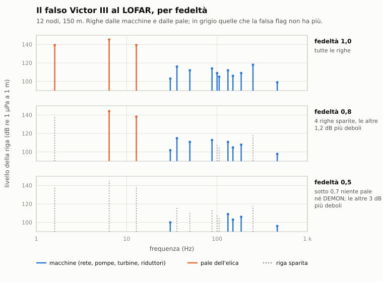

# C5. Elaborazione e presentazione

*Autore: disassemblatore. Revisione del 03/11/2026. Stato: rivisto (curatore: kit).*

## 1. A che serve

L'equazione del sonar (capitolo C1) dice se un suono si sente. Questo capitolo dice che cosa ne vede l'operatore e
che cosa ne capisce: la **cascata** per rilevamento, lo spettro **LOFAR** di un fascio, il **DEMON** dell'elica, i
**tracker**, la **classificazione** con la sua confidenza, l'**errore del rilevamento**. E dice come lavora il
**sonarista** dell'equipaggio, che rileva, traccia e classifica con gli errori della sua esperienza: lo stesso
sonarista che hanno le unità dell'IA. La stazione non cambia la simulazione: lo stesso replay dà le stesse righe.

## 2. Il modello

Il codice è in `nucleo/analisi_acustica.hpp` (spettri, cascata, DEMON, confronto con la libreria),
`nucleo/acint.hpp` (classificazione e ACINT), `nucleo/sonarista.hpp` (il sonarista) e `app/sonar_enhanced.hpp` (la
stazione, che tiene le storie e le disegna).

### 2.1 L'errore del rilevamento

```
σ_ril = max(0,2°, θ₃dB / sqrt(SNR))        SNR = d · 10^(max(SE, −10) / 10)
```

- `θ₃dB`: la larghezza del fascio a −3 dB alla frequenza della scoperta (`larghezza_fascio_deg`):
  - sfera e scafo: `58,4° · λ / D`;
  - schiera: `50,8° · λ / L` al traverso, che si allarga verso l'endfire (le due direzioni lungo l'asse della schiera) come `1 / sin(angolo dall'asse)`, al più
    `2 sqrt(λ / L)` radianti;
- `d`: l'indice di rivelazione del sensore; `SE`: l'eccesso di segnale della scoperta;
- i sensori con un errore misurato (le boe sonore DIFAR, la RGB-2 sovietica) usano il loro `sigma_rilevamento_deg`.

La missione dà al contatto il rilevamento vero più `σ_ril` per una gaussiana. La schiera ha l'**ambiguità conica**: un
rilevamento e il suo specchio rispetto all'asse del battello, `2 · rotta − rilevamento`. Si risolve accostando. Per l'IA
vale lo stesso (fase 2 delle interazioni fra IA), e la sua TMA (`risolvi_tma`, capitolo C13) usa quella σ.

Esempio: la TB-16 (73 m) a 50 Hz ha un fascio di 20,9° al traverso; la sfera BQQ-5 (4,6 m) a 150 Hz di 127°, e a 1
kHz di 19°. Con SE +10 dB e d = 14 la TB-16 a 50 Hz sbaglia di circa 1,8°.

### 2.2 La cascata per rilevamento (BTR)

`cascata(sorgenti, ricevitore, ambiente, fasci, banda, caso, campi)`: l'energia nella banda (un'ottava; predefinita la più alta
del sensore, col fascio più stretto) su 72 fasci uguali, in dB di (segnale + rumore) / rumore. Ogni sorgente entra con
la risposta del fascio; i fasci nel cono d'ombra poppiero (baffles) o nell'endfire sono segnati ciechi. Con la grana del rumore (1,5 dB) la
cascata sembra vera.

Nella missione la perdita è quella che il sensore sta usando per quella sorgente: il campo dei raggi in vigore e, dove il
sensore usa il livello A, il livello A (prima del primo campo, fuori dalla griglia, il traffico civile oltre 30 km, le
sorgenti del paesaggio). La cascata legge il campo senza chiederlo (`CacheCampiAsincrona::in_vigore`), quindi non sposta il
momento delle richieste e la partita non cambia. Il Museo, che non ha una missione, usa il livello A.

**Il difetto corretto il 07/11/2026.** Fino a quella data la cascata usava sempre il livello A. A 9 km in 53 m d'acqua erano
93-94 dB contro i 66 del sensore: 27-28 dB, almeno dal 28/10, coperti dai 17 dB in più delle firme civili. Tolti quelli, il
battello teneva i mercantili con +27 dB di eccesso e sullo schermo non c'era niente. Nelle stesse scene, col traffico acceso e
col seme 1, le unità solide disegnate sono passate da 0 a 5 su 7 (SCENE2B), 6 su 7 (SCENE2A), 5 su 5 (SCENE1A).

**Limiti.**
- Non tutto ciò che il sensore tiene ha una striscia. Il sensore integra e sceglie la banda migliore, e ha circa 14 dB di
  margine sullo schermo: un contatto solido può stare appena sopra il fondo della cascata (un peschereccio a 19 km nella
  SCENE2A, traccia 1500, +0,9 dB).
- Il LOFAR e il DEMON restano al livello A: sono altri spettri, e il DEMON entra nelle partite. Una striscia sulla cascata
  può quindi comparire senza righe al LOFAR sullo stesso fascio.

La stazione ne tiene la storia:
- una riga ogni 2 s, la più recente in alto, con il **normalizzatore a finestra divisa** sui fasci (toglie il fondo
  che cambia lentamente lungo i rilevamenti);
- **integrazione**: ogni riga mostrata è la media delle ultime N misurate (1, 2, 4, 8): la grana scende di √N;
- **scala dei tempi** ×1, ×4, ×16: una riga per 1, 4 o 16, decimate col massimo, così i transitori brevi restano;
- pavimento e tetto della scala dei colori regolabili, AUTO nel modo moderno.

**I falsi echi delle chiglie** (sotto la banchisa, dopo un ping attivo; C12 §2.12): per 10 s una tacca in cima alla
colonna del loro rilevamento; sull'Enisej dell'Alfa un punto sul bordo.

### 2.3 Lo spettro LOFAR

`spettro_fascio(sorgenti, ricevitore, ambiente, rilevamento, f_min, f_max, bin)`: lo spettro del fascio puntato, bin
per bin, contro il rumore nel bin:

```
continuo:  SL(f) − TL + 10 log b
righe:     L − TL, alla frequenza ricevuta (Doppler)
rumore:    NL + 10 log b − DI
```

pesati con la risposta del fascio (per la schiera, anche lo specchio). `f_min` e `f_max` fanno da filtri. Le righe
che si leggono sono quelle sopra +3 dB (`righe_osservate`, con il fondo locale come mediana attorno al picco: un
continuo forte non è una riga).

Con l'argomento finale `coerente` lo spettro ha le **frange d'interferenza** dei cammini (capitolo C2, 2.7):
continuo e righe salgono e scendono con la frequenza e con la distanza, a «vasca da bagno» al CPA, e il livello medio
resta quello di prima. Senza l'argomento, `false`, lo spettro è quello di sempre, bit per bit. La stazione
dell'Enhanced lo passa in tutti e due i modi, perché è fisica e non un aiuto. Lo stesso argomento c'è su
`spettro_verniero`, `spettro_continuo` e `righe_ricevute`, quindi anche la cuffia sente le righe che svaniscono.

Il **verniero** (`spettro_verniero`) è lo zoom: 4 Hz attorno a una riga con bin di 0,01-0,02 Hz (50-100 s
d'integrazione) e la risposta di Hann, così il picco si stima fra due bin (`misura_riga`).

### 2.4 Il DEMON

Le righe dell'inviluppo della cavitazione fra 2 e 8 kHz (capitolo C4, 2.4): asse, doppio dell'asse, pala e due
armoniche. `leggi_demon` ne ricava la frequenza d'asse (la più bassa delle due righe forti), la frequenza di pala e
il numero di pale, con soglia 6 dB. Pale e giri, con `giri_per_nodo` della classe, danno la velocità del bersaglio.

### 2.5 La classificazione

**Il confronto per rapporti** (`confronta_rapporti`): per ogni voce della libreria (firme delle classi e sorgenti
della libreria) cerca il fattore `k = 1 + v/c` che allinea più righe osservate alle righe fisse della voce (gli sweep
no), entro un Doppler di ±1,2%. Poi conta le concordanze entro lo 0,3% relativo:
- il punteggio somma le righe concordi pesate per il livello, meno le osservate che la voce non spiega, più le pale
  del DEMON;
- la confidenza è una softmax sulle voci (somma 1): con poche righe le ipotesi restano vicine e l'errore è possibile;
- dal fattore k viene la velocità radiale.

Con le variazioni (capitolo C4, 2.6) le righe dei giri si accettano entro il 3,5% (pesate 0,7), quelle sulla rete
entro lo 0,6%; rete ed elica tengono preciso il fattore Doppler.

**La scala NATO** (`classifica_righe`), sulla migliore ipotesi con almeno due righe concordi:

| Passo | Condizione |
|---|---|
| CERTSUB | sottomarino con confidenza ≥ 0,8 e almeno 5 righe |
| PROBSUB | sottomarino con confidenza ≥ 0,55 e almeno 3 righe |
| POSSUB | un sottomarino meno sicuro, o senza classe |
| NONSUB | la migliore ipotesi non è un sottomarino |

È la scala del sonarista (§2.7) e di ACINT. La stazione ha regole sue (§2.6).

**Le famiglie armoniche** (`famiglie_armoniche`): fondamentale ai minimi quadrati, multipli presenti, copertura, e un
indizio: rete 50, 60 o 400 Hz, una famiglia della libreria, «elica (pala)» sotto i 30 Hz.

**ACINT** (`acint.hpp`): per ogni contatto le righe stabili (presenti in almeno il 30% dei campioni), le pale del
DEMON più frequenti, le tre ipotesi migliori e le righe che la classe migliore non spiega: le novità da riferire.

### 2.6 I tracker

Nella stazione (`app/sonar_enhanced`): i tracker S1, S2… seguono il picco del contatto sulla cascata, con
rilevamento e rateo in gradi al minuto. Si mettono a mano sul fascio puntato; nel modo moderno si agganciano da soli
ai contatti forti. Senza segnale per 30 s si perdono. ANALIZZA sul fascio di un tracker dà il passo e il rapporto al
comando. Legge il confronto per rapporti (§2.5), con regole sue:
- **il nome** (`voci_rette`): una voce è retta con almeno 3 righe spiegate, almeno 2 righe diverse della voce e almeno il 60%
  delle righe lette. La scritta (`lettura_analisi`) è «PESCHERECCIO 5/5 RIGHE O ROMPIGHIACCI 4/5»: le prime due voci, con
  quante righe ciascuna spiega su quante lette. Altrimenti è «NESSUN NOME: 2 RIGHE NON BASTANO». Niente percentuale,
  niente fattore K;
- **il passo** (`passo_da_voci`): PROBSUB se le due voci mostrate sono sottomarini (ssn, ssgn, ssbn, ssk), o se ce n'è una
  sola ed è un sottomarino; POSSUB se lo è una delle due; altrimenti nessun passo e nessun rapporto. Sotto le soglie il
  tracker resta com'era. La stazione non arriva a CERTSUB e non dice mai NONSUB: le righe di una nave nel fascio non
  escludono un battello. Il sonarista ha la sua scala, che resta a parte e può ancora dire NONSUB (§2.7);
- **la classe** (`classifica_dai_tracker`): a PROBSUB il contatto più vicino a quel rilevamento, entro 5°, è classificato
  con la prima voce.

Con la cascata piena (§2.2) i tracker automatici restano su picchi veri: su 12 corse, 1252 letture dei tracker agganciati (una
ogni 20 s), nessuna su un'unità inesistente. Il prezzo è il ricambio: nel traffico fitto nascono più tracker, 23 invece di 14 in
50 minuti nella SCENE5A e 13 invece di 8 in un'ora nella S5.

### 2.7 Il sonarista

`Sonarista` (`nucleo/sonarista.hpp`) riceve a ogni secondo che cosa sentono i sensori del battello (per sorgente:
rilevamento vero, SE, errore del sensore, righe, pale, se è un biologico) e tiene le tracce «Sierra»:
1. un segnale sopra la soglia per il **ritardo** diventa una traccia nuova e un rapporto («nuovo contatto Sierra 1,
   rilevamento 045»);
2. dopo il **tempo d'analisi** la traccia si classifica con le righe che l'operatore vede (quelle sopra la sua soglia
   delle righe): la classe della libreria, o la seconda ipotesi con la probabilità d'errore. Con una riga sola non c'è
   classe, e la natura (NONSUB o POSSUB) la votano le tre ipotesi migliori, pesate con la loro confidenza:
   - votano solo i battelli, navi e sottomarini; un siluro, un'esca, un pesce, il ghiaccio o un vulcano no;
   - il voto vale solo se i battelli pesano almeno 0,3 (`VOTO_MINIMO`, STIMA): NONSUB se i sottomarini pesano meno
     della metà;
   - sotto, decide il DEMON a orecchio (passo B), e senza DEMON resta POSSUB.

   Il perché: le armoniche di rete (50 e 60 Hz e multipli) stanno su una ventina di navi e una decina di sottomarini,
   ognuno con pochi centesimi di confidenza. Prima del 03/11/2026 la sola riga a 250 Hz votava «nave» (mk46 0,08, agi
   0,04, akula 0,04), e un Victor III vero a 3,7 km diventava NONSUB. Una riga a 60 Hz (le navi pesano 0,92) o a 100 Hz
   (la nave da ricerca 0,86) resta invece NONSUB;
3. un biologico può diventare POSSUB;
4. il rilevamento riferito ha un errore in più, `σ_extra`;
5. senza segnale per la **tenuta** la traccia si perde («perso Sierra 1»); quando torna, «riacquisito»;
6. due tracce che si incrociano (sotto 2°, finché non si separano oltre 5°) si scambiano con la probabilità di
   scambio: la traccia segue l'altra sorgente e il sonarista non lo sa;
7. un **transitorio dello scafo** della sorgente (un portello che sbatte, un attrezzo che cade, una pompa: i sette di
   `missione_scafo`) dice «sottomarino» subito: una traccia che c'è, sotto PROBSUB, diventa PROBSUB («transitorio
   metallico su Sierra 3»); un contatto nuovo che nasce entro 60 s dal transitorio nasce POSSUB;
8. un **falso contatto** del vetrino di Dio (F8; docs/28 §3.5) ha la firma di una classe, rovinata dalla sua fedeltà
   (§2.11). Preso per vero, la classificazione è sbagliata. Il sonarista lo smaschera:
   - alla classificazione e a ogni rivalutazione (300 s), con probabilità (1 − fedeltà) × la sua capacità di
     smascherare i falsi. Il contatto diventa NONSUB «falso contatto», col rapporto «firma incoerente, probabile
     falso contatto»;
   - anche se non si classifica. Sotto fedeltà 0,7 il falso non ha pale né abbastanza righe e resterebbe in analisi;
     la stessa prova si fa dopo il tempo del passo B (1,5 volte l'analisi) e poi ogni 300 s. Prima del 03/11/2026 un
     falso scadente non si smascherava mai, ed era più sicuro di uno buono;
   - subito, se un ping trova un'eco d'esca: troppo piccola per la classe. Vale per ogni contatto, anche per uno
     creduto NONSUB senza classe, perché l'eco puntiforme è troppo piccola anche per una nave.

Una traccia si tiene fino a 3 dB sotto la soglia di scoperta (isteresi).

**La TMA non smaschera un falso contatto.** Una sorgente che va a rotta e velocità costanti dà rilevamenti coerenti
quanto quelli di un battello vero. La soluzione converge e la TMA dell'IA la dichiara osservabile, se chi ascolta
accosta. A smascherarla sono la firma (le righe che mancano, le pale assenti) e l'eco attiva. Un falso contatto che
cambia rotta a scatti, invece, non lascia convergere la soluzione: la TMA resta non osservabile, come con un battello
che zigzaga.

| Profilo | Recluta | Medio | Esperto |
|---|---|---|---|
| soglia di scoperta (dB di SE) | 3 | 1 | 0 |
| ritardo del rapporto (s) | 60 | 30 | 15 |
| tempo d'analisi (s) | 90 | 45 | 30 |
| errore di classe | 0,30 | 0,15 | 0,05 |
| biologico preso per sottomarino | 0,25 | 0,10 | 0,03 |
| errore in più sul rilevamento (°) | 2 | 1 | 0,5 |
| tenuta senza segnale (s) | 60 | 120 | 180 |
| scambio agli incroci | 0,40 | 0,20 | 0,05 |
| soglia delle righe (dB nel bin) | 6 | 3 | 1,5 |
| righe proprie mascherate (§2.9) | 0,6 | 1 | 1 |
| falsi contatti smascherati, per (1 − fedeltà) | 0,3 | 0,6 | 0,9 |

**Il sonarista dell'IA** (fase 2 delle interazioni fra IA): ogni unità dell'IA ha lo stesso sonarista, con un seme
suo (`seme_sonarista_ia`). Il livello viene dall'avversario della missione (impreparato → recluta, regolare → medio,
veterano ed élite → esperto) e la chiave d'unità `sonarista` lo sovrascrive (`esperienza_ia`). Così anche l'IA può
prendere un peschereccio per un sottomarino.

### 2.8 Modo 1989 e modo moderno

Si sceglie per partita. Cambia la presentazione e gli aiuti, non la fisica:

| | 1989 | Moderno |
|---|---|---|
| Aspetto | fosforo verde o grigio, come un BQQ-5 | viridis, turbo, caldo, come un A-RCI |
| Disposizione | la consolle BQQ-5: due CRT incassati, i tasti a luce | il quadro SDR |
| Band plan sotto l'A-scan | tacche fisse di 50, 60 e 400 Hz | le righe della voce sovrapposta, per tipo |
| Colore per rilevamento (RIL) | no | sì, acceso di norma; conta nel realismo |
| Scala dei colori | a mano | anche AUTO |
| Tracker | solo a mano | anche automatici |
| Righe automatiche (§2.10) | no | sì |
| DEMON a cascata (§2.10) | cursori a mano | anche l'aggancio alla serie |
| Slot dello spettro | il 688 sì, l'Alfa no | tutti |

**La disposizione** (scelta dell'utente del 29/10/2026; `docs/ricerca/30_sonar_grafica_sdr.md`, bozze in
`docs/ricerca/25_bozze/sonar_sdr/`):
- **moderno, il quadro SDR** (`SonarEnhanced::disposizione`): sopra il BTR i tracker come segnalibri (due file se si
  toccano, il colore del passo, la cornice sul seguito) e la scala a tacche ogni 5°, lunghe ogni 10, col numero ogni
  30; il fascio puntato come barra rossa con i bordi a puntini fino in fondo; i fasci ciechi a tratteggio invece del
  blocco blu. Fra l'A-scan e il LOFAR la striscia del band plan; sull'A-scan i cerchietti delle righe confermate (Mark
  Peaks di SDR#); sotto la scala delle frequenze la barra dello zoom (GQRX);
- **1989, la consolle BQQ-5** (`SonarEnhanced::disegna_consolle`): la lamiera, due CRT incassati (il BTR; il LOFAR
  sopra il DEMON), otto tasti quadrati a luce che dicono lo stato (BTR, LOF, DEM, INT, CURS, TRK, ANAL, MASC; non si
  cliccano), il vetro dei contatti e dello stato. Nei CRT stretti il titolo del LOFAR si accorcia, e la riga di stato
  perde il nome del modo se non ci sta;
- **la riga del cursore**, nei due modi: il testo che non ci sta va a capo all'ultima virgola che ci sta. Succede nei
  modi STORIA e, nella sala sonar, RIGHE. Col capo le righe sotto si stringono, da 12 a 10 pixel, per restare sul vetro
  della consolle, e la riga delle FAMIGLIE non si scrive (la prima famiglia resta nella pagina dell'analizzatore). «F
  VERNIERO» o «F SGANCIA» si scrive a destra solo nei modi lettura, differenza e armonica, se la riga gli lascia il
  posto;
- **la pagina dell'analizzatore** (`SonarEnhanced::disegna_analisi`, nei due modi; il tasto 4 la apre e la chiude,
  `pagina_analisi()`): il LOFAR a tutta larghezza (A-scan alto 50), il DEMON sotto a sinistra, a destra l'esito
  dell'analisi e gli otto slot in miniatura (`pixel_lofar` dello spettro salvato). Con la libreria aperta vale la
  libreria; l'Okean dell'Alfa non ha la pagina.

**L'Okean dell'Alfa** (la bozza D, scelta dell'utente del 29/10/2026; `SonarEnhanced::disegna_enisej`):
- **Enisej** è una cascata polare. L'angolo è il rilevamento relativo (la prua in alto), il raggio il tempo: l'ultima
  riga sul bordo, una riga per pixel alla scala dei tempi scelta;
- le righe si girano con la prua di adesso (STIMA: le righe non tengono la prua del loro momento);
- il pavimento, i colori e il dithering sono quelli della cascata;
- il cieco oltre ±120° e i fasci ciechi sono a tratteggio, i minuti a cerchi di puntini;
- la scala L/P è sul bordo; il fascio ha le parentesi; i tracker sono segnalibri, su due raggi se si toccano;
- nel 1989 la scala lunga prende la tinta `fosforo_alfa` (verde giallino, `grafica/scala_cascata`) e il testo il
  fosforo del tema; nel moderno i colori del 688;
- le scritte sono SPEKTR, IST. e GC (scelta della principale). Il titolo del DEMON resta quello della sua vista.

**Il colore per rilevamento** (RIL, solo moderno; `SonarEnhanced::colore_rilevamento`): a ogni riga, oltre allo
spettro del fascio puntato, `spettro_fascio` calcola quelli dei fasci a ±10° e ±20° (non coerenti). Un bin prende il
lato del vicino più forte, se lo supera di 3 dB e sta sopra i 3 dB: −2, −1, +1, +2 (−20°, −10°, +10°, +20°). Sulla cascata del LOFAR, a
scala ×1, i bin col lato si tingono di blu (a sinistra) o di viola (a destra), chiari sopra metà scala; la legenda
«RIL: SN BLU DR VIOLA» sta in fondo alla cascata. I lati si tengono in parallelo alla storia ×1 (`lati_`) e si
azzerano col cambio di sensore. È un aiuto: `colore_rilevamento_usato()` dice se è stato acceso almeno una volta nella
partita, per il realismo. Costa quattro spettri in più per riga, solo quando è acceso. Gli spettri di una riga si calcolano
su più fili (`app/spettri_fasci.hpp`): al massimo 5, mai oltre i core del processore né oltre i fasci della riga. I valori sono
gli stessi, bit per bit, con un filo o con più (`test/prove_sonar_enhanced.cpp`).

**I colori delle cascate** (rifinitura estetica, capitolo E9 §2.9; `grafica/scala_cascata`, cablati dalla principale
il 28/10/2026):
- **scala lunga:** sul 688, a stazione piena e nella sala sonar, la scala prende 128 indici (96-223) invece dei 32
  di prima (200-231), con il dithering ordinato Bayer 4×4 fra due gradini. La mappa dB → colore resta lineare fra il
  pavimento e il tetto della stazione, e l'indice 0 è nero sotto il pavimento. Le frange d'interferenza (C2 §2.7), di
  3-10 dB, a 32 livelli facevano curve di livello;
- **fosforo del 1989:** col modo 1989 e la palette fosforo, cascata, LOFAR e A-scan passano da un
  `cascate::Fosforo`: bagliore dai vicini più accesi, grana ferma, una riga su due all'85%, un velo di grana al 7%
  sotto il pavimento (`Effetti::fondo`, `SonarEnhanced::effetti_fosforo`: lo schermo resta acceso anche senza
  segnale, come un BQQ-5), e per l'A-scan la persistenza. Il piede della rampa P1 e il tetto di base del 1989 si
  decidono dopo la prova in finestra con l'utente;
- **PERS:** il campo della persistenza nel giro di Tab, solo nel modo 1989. Breve, normale o lunga (0,80, 0,90, 0,95 a
  fotogramma; normale di norma). Resta fra le partite in `~/.config/melchior688/preferenze.toml`, `[sonar]
  persistenza = 0|1|2` (0 breve, 1 normale, 2 lunga): si legge all'avvio della partita e si scrive quando cambia;
  senza il file vale 1 (`main.cpp`, `leggi_persistenza_sonar`).

### 2.9 Le righe del proprio battello (blocco 2 del sonar, F)

`Ricevitore::proprio` è la sorgente del battello che ascolta, con firma, velocità e variazioni (regime delle pompe,
giri, snorkel). Il runtime la riempie una volta per passo per ogni unità che ascolta (`ricevitore_acustico`), quindi
anche per l'IA. Con `nullptr` gli spettri sono quelli di prima, bit per bit.

**Le righe.** Sono le `righe_emesse` della propria sorgente, quindi cambiano da sole:
- le pompe del primario lente o veloci secondo la velocità (il 688 passa a 15 nodi) o il regime forzato;
- i diesel degli SSK solo a snorkel;
- le righe di turbina e riduttore legate all'asse (`RigaFirma::multiplo_asse`), che salgono coi giri.

**Le righe legate all'asse** (deciso dall'utente il 28/10/2026): ogni sottomarino nucleare ne ha tre, deboli, come
multipli della frequenza d'asse: una di turbina e due di riduttore, da −12 a −21 dB sulla tonale (capitolo C4 §2.3, i
valori «a 10 kn»). Si vedono salire coi giri sul proprio LOFAR e su quello degli altri. Le voci della libreria
tengono solo le righe fisse (`voce_da_firma`), e anche `confronta_firma` le salta: la classificazione resta sulle
righe fisse. Nella libreria c'è un indizio per classe, per esempio sul 688 «righe deboli che salgono coi giri, in
volte la frequenza d'asse: turbina 23, riduttore 78, riduttore 375».

**Le vie verso i sensori** (`righe_del_proprio`, STIMA del dossier 28 §5):

| Sensore | Via | Attenuazione |
|---|---|---|
| sfera e sensori di scafo | strutturale, in tutti i fasci | l'isolamento del sensore (`isolamento_proprio_db`): BQQ-5 30 dB, MGK-400/503 28, MG-200 24; 6 dB in meno nei baffles |
| schiera trainata | per l'acqua, solo nei fasci entro ±30° dal fuoco anteriore | `20 log d` sulla distanza (il cavo filato, almeno 100 m, più mezza schiera) e 10 dB di direttività |

La schiera danneggiata perde anche le righe proprie sopra 300 Hz. Le righe proprie entrano in `spettro_fascio`, nel
verniero, in `righe_ricevute` (sorgente −3) e nella cuffia; `valuta` no, perché la scoperta resta col rumore proprio a
banda larga.

**Il catalogo e la maschera.** `righe_proprie(ricevitore, ambiente, fascio, bin)` dà le righe del momento nel fascio,
con frequenza, S/N nel bin e macchina (rete, pompa, turbina, riduttore, elica). `togli_righe` toglie dalle righe
osservate quelle entro 0,2 Hz dalle proprie, prima di `confronta_firma` e `confronta_rapporti`. Senza maschera il
confronto prende le righe proprie per righe del contatto: un 688 con la maschera spenta si classifica come un 688
(dossier 09 §3.9).

**Il sonarista maschera secondo l'esperienza.** Anche il sonarista dell'equipaggio e quello dell'IA ricevono le righe
proprie fra le righe del fascio: `righe_ricevute` le marca con la sorgente −3, la missione le mette in
`AscoltoSonar::proprie` (`missione_sonarista`). Fra le proprie c'è anche la vibrazione del cavo della schiera filata
(sorgente −2, capitolo C6 §2.9), che è anche nel catalogo `righe_proprie`, con la macchina «cavo». L'operatore toglie la
frazione `maschera_proprie` del suo profilo:
- recluta 0,6, medio ed esperto 1 (STIMA);
- la scelta è fissa per ogni riga, perché viene dalla sua frequenza: una riga che la recluta non maschera resta non
  mascherata a ogni passo;
- le righe che restano entrano nella classificazione come righe del contatto. Così una recluta può classificare male
  un contatto vicino alle frequenze del proprio battello, e l'IA sovietica con un sonarista mediocre maschera peggio
  (`docs/22` §3).

**Nella stazione** (`app/sonar_enhanced`, principale):
- **MASCH SI/NO:** l'ultimo campo del giro di Tab, in tutti e due i modi; acceso di base. Nella riga di stato c'è
  quando è acceso o scelto. Acceso, ANALIZZA lavora sulle righe senza le proprie (`righe_per_analisi`);
- **il catalogo:** con MASCH scelto, il pannello di testo mostra al posto di DEMON e analizzatore le righe proprie nel
  fascio, al più quattro, con frequenza e macchina, e «(MASCHERATE)» se la maschera è accesa;
- **la riga nuova:** quando nel fascio entra una riga propria che prima non c'era (oltre 0,5 Hz da tutte), il pannello
  dice per 30 s «RIGA PROPRIA NUOVA A x HZ» al posto del DEMON;
- **le tacche:** sul LOFAR, fra l'A-scan e la cascata, una tacca per riga propria nel campo di frequenze: ciano,
  blu se mascherata.

### 2.10 DEMON a cascata, righe automatiche e storia lunga (blocco 3 del sonar)

Il progetto è `docs/23_sonar_blocco3.md`. Le viste sono di trailer-1 (`app/cascata_demon`, `app/righe_automatiche`,
`app/vista_storia`); i moduli puri sono `nucleo/rilevatore_righe` e `nucleo/storia_cascata`. L'aggancio è della
principale (`app/sonar_enhanced`, `app/interfaccia`). Il tasto 9 gira su sette modi del cursore (`SonarEnhanced::Cursore`):
spento, lettura, delta, armonico, DEMON, RIGHE (solo moderno), STORIA.

**G. Il DEMON a cascata** (`CascataDemon`). Mostra l'inviluppo della cavitazione del fascio puntato, una riga per passo
della stazione, nel terzo basso della colonna del LOFAR (dossier 09 §4.3). L'inviluppo (`demon_fascio`) è quello di
tutte le sorgenti che cavitano nel fascio, pesate con la sua risposta: anche le navi civili e il proprio battello.
`leggi_demon_fascio` ne ricava fino a 4 serie (asse, pala, pale), togliendone una alla volta.
- **disposizione:** l'A-scan in alto, la cascata sotto, la lettura in fondo («ASSE 2,40 HZ 144 GIRI PALE 7 PALA
  16,8 HZ», giri al minuto);
- **scale dei tempi:** le stesse della stazione; le righe lente sono il massimo di 4 o 16 righe, come il LOFAR;
- **cursori:** l'asse e le sue armoniche fino alla pala in giallo, la pala e le sue in ciano. Nel modo DEMON sinistra e
  destra spostano l'asse a passo fine (Maiusc a passo grosso), su e giù le pale;
- **aggancio:** nel moderno F porta i cursori sulla serie trovata (`leggi_demon_fascio`), e ripremuto sulla successiva
  se nel fascio ce n'è più d'una. Nel 1989 i cursori si mettono a mano;
- **analisi:** le pale vanno all'analizzatore della firma (ANALIZZA).

**H. Le righe automatiche** (`RilevatoreRighe`, solo moderno; dossier 09 §3.9). Come l'ALI/ALT dell'A-RCI, sono un
aiuto, non la verità:
- **l'integratore (ALI):** cerca i picchi sulla media delle ultime 4 righe, sopra 3 dB dal fondo locale. Un picco è
  confermato quando torna in 3 delle ultime 5 medie;
- **l'inseguitore (ALT):** segue la riga nel tempo con la sua deriva (Doppler o giri), entro 2 bin oltre la deriva
  prevista. Senza il picco per 60 s la riga è persa;
- **gli errori** (STIMA): la grana fa circa 4 righe false all'ora su 200 Hz, una riga che svanisce (frange, segnale che
  cala) torna con un altro id, due righe più vicine di due bin diventano una, una riga propria non mascherata si marca come le altre;
- **sulla stazione:** marche verdi sul bordo alto della cascata, sempre. Nel modo RIGHE c'è la lista in alto a sinistra
  sul LOFAR: su e giù scelgono, F aggancia il verniero alla riga scelta. Il rilevatore si azzera quando il fascio salta.

**I. La storia lunga** (`StoriaCascata`, `VistaStoria`, in entrambi i modi). Ogni cascata ha più risoluzioni, ognuna un
anello:

| Risoluzione | Durata |
|---|---|
| 1 riga al secondo | 10 minuti |
| 1 riga ogni 10 s | 2 ore |
| 1 riga ogni 60 s | 12 ore |

- **decimazione:** ogni livello prende il massimo delle righe del suo passo, quindi una riga breve non sparisce scendendo
  di risoluzione;
- **memoria:** i valori sono quantizzati in 8 bit a 0,25 dB. Con 4000 bin le tre risoluzioni stanno in circa 8 MB;
- **i comandi**, nel modo STORIA: il LOFAR e il BTR mostrano la storia nei loro riquadri e scorrono insieme. Su e giù
  spostano il cursore del tempo (Maiusc dieci righe), `[` e `]` la risoluzione (1, 10, 60 s a riga). F cerca «quando è
  comparsa» la riga del cursore o la riga automatica scelta. Uscendo dal modo si torna in diretta;
- **i fasci:** la storia del LOFAR ricomincia quando il fascio salta. Quella del BTR è su 72 fasci veri fissi, di 5°
  dal nord, così l'accostata del battello non la rompe.

Il registratore della stazione (S5d) resta per l'ascolto.

### 2.11 La firma del falso contatto (vetrino di Dio, D3)

Il falso contatto è una sorgente semovente senza scafo, con la firma della classe scelta (F8). La sua **fedeltà**
(`UnitaAcustica::fedelta`, da 0 a 1; i battelli veri hanno 1) dice quanto bene imita:
- **le righe:** ne manca una parte; quali, lo decide un'impronta della sorgente e della frequenza, quindi sono sempre le
  stesse. Le altre sono più deboli di (1 − fedeltà) × 6 dB;
- **le pale:** sotto 0,7 non ci sono, né nello spettro né nel DEMON, perché la sorgente non ha un'elica vera;
- **la banda larga** resta quella della classe: il falso contatto si scopre come uno vero, e la portata è la stessa;
- **l'eco** è quella di un'esca, piccola e puntiforme. Un ping la svela.

| Fedeltà | Righe che restano (circa) | Più deboli di | Pale e DEMON |
|---|---|---|---|
| 1 | tutte | 0 dB | sì |
| 0,8 | 4 su 5 | 1,2 dB | sì |
| 0,5 | metà | 3 dB | no |
| 0,3 | 3 su 10 | 4,2 dB | no |



STIMA di gioco: nessuna fonte aperta descrive le esche acustiche semoventi del 1989 a questo dettaglio.

## 3. Fonti e confidenza

| Parametro | Fonte | Confidenza |
|---|---|---|
| Errore del rilevamento θ₃dB/√SNR, almeno 0,2° | dossier 02 §10.5 | alta (forma) |
| Larghezze dei fasci di sfera e schiera | dossier 02 §1.2 | alta |
| Cascata, normalizzatore, integrazione, scale dei tempi | dossier 09 §2-§4 | media |
| Verniero, 0,01-0,02 Hz | dossier 09 §2.2 | media |
| Scala NATO NONSUB-CERTSUB | dossier 09 §2.9 | alta (i nomi); **STIMA** le soglie (0,8 e 5 righe, 0,55 e 3) |
| Soglie del nome di ANALIZZA (3 righe, 2 della voce, 60%) e passo dalle due voci | misure del 07/11/2026 (§7) | **STIMA DI GIOCO** |
| Confronto per rapporti, tolleranze | dossier 09 §3.4-3.5 | **STIMA** |
| Profili del sonarista | dossier 09 §3.9 (passo 2 di 30-45 s, §2.9) | **STIMA DI GIOCO** |
| Livello del sonarista dell'IA dall'avversario | scelta di gioco (nota condivisa della fase 2) | — |
| Righe proprie: rete, pompe a due velocità, riduttore coi giri | dossier 28 §4 | media (la forma); **STIMA** il catalogo del 688 |
| Isolamento delle righe proprie (24-30 dB), 6 dB nei baffles, cono di ±30° della schiera, direttività 10 dB | dossier 28 §5 (numeri navali di 25-35 dB, nessuno del 688) | **STIMA** |
| Righe di turbina e riduttore legate all'asse, da −12 a −21 dB | `docs/22` §3, dossier 28 | **STIMA DI GIOCO** |

## 4. Classico ed Enhanced

Nel classico non c'è elaborazione: la stazione sonar mostra i contatti con la barra della qualità, e la
classificazione arriva con la durata della traccia (`docs/originale/sensori_e_navigazione.md` §3.4 e §10.5). Il
rilevamento è esatto. Cascate, LOFAR, DEMON, analisi, errore del rilevamento, ambiguità della schiera e sonarista sono
solo dell'Enhanced.

## 5. Come si vede in gioco

- **Stazione sonar** (volume 1, §3.3-3.5): cascata, A-scan, LOFAR, DEMON, tracker, ANALIZZA e la sua pagina,
  libreria, slot; le righe proprie con le tacche sul LOFAR, MASCH e «RIGA PROPRIA NUOVA»; il quadro SDR nel moderno,
  la consolle BQQ-5 nel 1989.
- **Messaggi**: 342 analisi pronta, 343 analisi incerta; 370 tracker nuovo, 371 tracker perso, 372 POSSUB,
  373 PROBSUB, 374 CERTSUB e 375 NONSUB (restano, ma la stazione non li manda più), 376 tracker pieni; 410 il sonarista riferisce un nuovo contatto.
- **Carta**: dal passivo il contatto è una X sul rilevamento, con lo specchio per la schiera; la posizione viene dalla
  TMA (capitolo C13).
- **Debriefing**: le classificazioni giuste e sbagliate, gli scambi di traccia del sonarista (capitolo F1).

## 6. Taratura e prove

Prove:
- `test/prove_analisi_acustica.cpp`: righe emesse, LOFAR, cascata, DEMON, analizzatore di firma, confronto per
  rapporti;
- `test/prove_acint.cpp`: righe stabili, classificazione, ACINT;
- `test/prove_misure_sonar.cpp`: misure sul verniero;
- `test/prove_sonarista.cpp`: ritardo, Sierra, classificazione, tracce perse e ritrovate, l'esperienza, biologici e
  incroci, il livello e il seme dell'IA;
- `test/prove_sonarista_missione.cpp`: il sonarista nella missione;
- `test/prove_sonar_enhanced.cpp`: la stazione (modi, tracker, slot dell'Alfa, MASCH nel giro in tutti e due i modi);
- blocco 3 (§2.10):
  - `test/prove_cascata_demon.cpp` (`cascata demon:`): la storia per scala dei tempi; i cursori a mano, l'aggancio alle
    due serie e la lettura; il disegno;
  - `test/prove_rilevatore_righe.cpp` (`righe automatiche:`): una riga vera confermata presto, con l'id stabile e la
    deriva; poche righe false dalla grana; una riga che svanisce e torna, due vicine che si fondono; ripetibile; una
    riga debole trovata dall'integratore e una che corre al CPA seguita;
  - `test/prove_righe_automatiche.cpp`: la lista, la scelta che segue la riga, la riga persa, le marche;
  - `test/prove_storia_cascata.cpp` (`storia delle cascate:`): la decimazione col massimo; quando è comparsa una riga;
    la memoria, il salvataggio e la ricarica;
  - `test/prove_vista_storia.cpp` (`vista storia:`): la diretta, la risoluzione, il cursore che trascina la finestra;
    quando è comparsa, sul LOFAR e sul BTR a cavallo di 0°;
- `test/prove_sonarista.cpp`: «sonarista: le righe del proprio battello, tolte dall'esperto, lasciate in parte dalla
  recluta»;
- `test/prove_righe_proprie.cpp` (`righe proprie:`): la sfera in tutti i fasci e più forte nei baffles, niente senza
  `proprio`; i giri e il regime delle pompe; la schiera solo verso il fuoco anteriore; senza maschera il 688 si
  scambia per un 688, con la maschera no; la schiera danneggiata;
- `test/prove_acustica.cpp`: «schiera trainata cieca in virata e nell'endfire, errore del rilevamento».

## 7. Limiti noti e in arrivo

- La cascata e il LOFAR sono calcolati: nessun segnale vero passa da una FFT. La grana del rumore è un rumore
  aggiunto con il suo seme.
- Il sonarista non usa la cascata della stazione: lavora sugli stessi dati della simulazione, con i suoi errori.
- Il sonarista dell'IA è nella missione (`missioni/src/missione_sonarista.cpp`). Per le unità ostili al giocatore
  l'avversario viene dal blocco carriera; le amiche e le neutrali hanno un sonarista medio.
  - Le righe si calcolano ogni 5 s, solo per le coppie ostili con la traccia solida, per il costo.
  - Le sue tracce decidono la durata dei contatti acustici dell'IA: sotto 800 finché non ha riferito, sotto 1400
    finché non ha classificato.
  - Ogni classificazione è un evento `classificazione_ia` nel registro (classe creduta, giusta o no, confidenza).
- MASCH vale solo per ANALIZZA della stazione: il sonarista ha la sua maschera, quella dell'esperienza, e MASCH non la
  cambia.
- **ANALIZZA tace spesso, e un nome non è una certezza.** Misura del 07/11/2026 col binario: 145 corse, 2.731 letture con
  righe. Allarme vuol dire POSSUB o PROBSUB.

  | Colonna | Allarme: sottomarini | Allarme: guerra | Allarme: civili | Nomi, veri | Col bersaglio fra i nomi |
  |---|---:|---:|---:|---:|---:|
  | Scene | 6 su 72, 8,3% | 0 su 35 | 21 su 413, 5,1% | 69, 93% | 4 |
  | Sfera in moto | 0 su 119 | 0 su 108 | 12 su 835, 1,4% | 62, 74% | 1 |
  | TB-16 filata | 11 su 146, 7,5% | 0 su 116 | 7 su 887, 0,8% | 75, 80% | 17 |

  - **Il nome.** Il fascio è largo e le righe possono essere di un'altra sorgente vicina: il nome è spesso vero, ma il
    bersaglio del fascio è fra i nomi molto più di rado.
  - **Il silenzio.** La stazione tace spesso, anche quando un sottomarino c'è. Con la sfera in moto nessun allarme sui
    sottomarini (prima di guardare le sole due voci mostrate 3 su 119, meno del 6% dei civili).
  - **Chi dà l'allarme.** Sui sottomarini Alfa, Victor III e Akula nelle scene, il solo Alfa con la TB-16. Sulle navi, gli
    allarmi con righe di un sottomarino vero fra le sorgenti sono 20 su 21 nelle scene (19 nella SCENE5A, l'Alfa vicinissimo),
    0 su 12 con la sfera in moto, 3 su 7 con la TB-16.
  - **I limiti della misura.** Letture a missione ferma, col fascio sul rilevamento vero (il caso migliore), scene scelte
    a mano, senza un giocatore che manovra.
- **In arrivo** (fase 4 delle interazioni fra IA): la classe creduta nel contatto. Finché non c'è, un falso POSSUB
  non diventa un bersaglio.

## 8. Riferimenti

- Codice: `nucleo/analisi_acustica.hpp`, `nucleo/src/analisi_acustica.cpp`, `nucleo/acint.hpp`,
  `nucleo/misure_sonar.hpp`, `nucleo/sonarista.hpp`, `nucleo/src/sonarista.cpp`, `app/sonar_enhanced.hpp`;
  `missioni/src/missione_sonarista.cpp`; blocco 3: `nucleo/rilevatore_righe.hpp`, `nucleo/storia_cascata.hpp`,
  `app/cascata_demon`, `app/righe_automatiche`, `app/vista_storia`.
- Ricerca: dossier 02 §1.2, §10.5; dossier 09 §2-§4, §3.9 e §6.1; dossier 28 §4-§5 (righe proprie).
- Progetto: `docs/11_comandi_e_stazioni.md` §11; `docs/18_interazioni_ia.md`; `docs/22_sonar_blocco2.md` §3;
  `docs/23_sonar_blocco3.md`.
