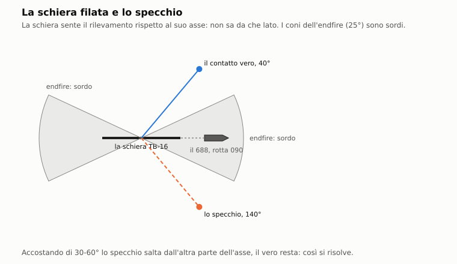

# C6. Antenna rimorchiata

*Autore: kit, per il runtime. Revisione del 30/10/2026 (il VDS e le schiere delle navi, §2.10; il cavo vero nelle
collisioni). Stato: rivisto (runtime,
27/10/2026), curatore: kit.*

## 1. A che serve

L'antenna rimorchiata (la «schiera») è una fila di idrofoni trainata lontano dalla poppa. Lontana dalle macchine e
lunga 73 m, sente le basse frequenze meglio della sfera di prua e copre il cono d'ombra poppiero. Ha però i suoi
difetti, e il modello li fa pesare. Non distingue la dritta dalla sinistra: ogni contatto ha un gemello speculare. In
virata è cieca, e dopo la virata ci mette un paio di minuti a tornare dritta. Verso il battello non sente. Oltre una
certa velocità il rumore dell'acqua che scorre la assorda. Per filarla bisogna andare piano, e con la schiera fuori il
battello non può posarsi sul fondo. È lo strumento della caccia lenta e lunga, quella del 688 contro un sottomarino
sovietico silenzioso.

## 2. Il modello

La schiera ha tre parti nel codice:
- **lo stato** (dentro, in filatura, filata, in recupero, persa): `StazioneSonar` in `nucleo/sonar_giocatore.hpp` e
  `nucleo/src/sonar_giocatore.cpp`, con i tempi negli script dei gestori delle missioni;
- **l'ascolto**: il sensore `tb16` (o `skat`) di `data/motore/acustica.toml`, valutato da `nucleo/src/acustica.cpp`
  come ogni altro sensore (capitolo C1), con le regole proprie delle antenne lineari;
- **la geometria e i danni** (solo Enhanced): il cavo che si srotola, la quota della schiera, il fondo, i danni.
  Il modulo puro è `nucleo/schiera.hpp`, coi dati in `[schiere.*]` di `acustica.toml`. Il runtime l'ha agganciato
  alla missione il 28/10/2026 (`missioni/src/missione_schiera.cpp`, §2.9).

Nella missione il collegamento è il bit 0 di `flag54` dell'unità, che vuol dire «schiera filata»
(`docs/originale/sensori_e_navigazione.md` §2). Solo con quel bit `Missione::sensori_acustici` mette la schiera fra i
sensori dell'unità. Per il giocatore serve anche la schiera integra: con l'efficienza del sistema «schiera» a zero
(capitolo B3) la schiera filata non ascolta. Lo stato arriva a ogni passo da `DanniSottomarini`
(`Missione::schiera_giocatore`).

### 2.1 Chi ce l'ha

| Classe | Schiera | Fonte |
|---|---|---|
| Los Angeles, Sturgeon, Trafalgar | `tb16` | `data/motore/acustica.toml [suite]` |
| Victor III, Akula, Oscar, Typhoon | `skat`: Skat-KS del Victor III, Pelamida dell'Akula (tutto **STIMA**, capitolo C1 §2.8) | idem, `[schiere.skat]` |
| Alfa, Charlie II, Kilo, Foxtrot | nessuna nell'acustica | idem |
| Perry, Spruance, Ticonderoga | la SQR-19 TACTAS (Enhanced, §2.10) | `[suite]`, `[schiere.sqr19]` |
| Knox | il VDS SQS-35 e la SQR-18A trainata dal pesce (Enhanced, §2.10) | `[schiere.sqs35_vds]`, `[schiere.sqr18a]` |
| Type 22 Batch 2 | la Type 2031Z (Enhanced, §2.10); la Batch 1 non ha schiera | `[schiere.type2031z]` |
| Udaloy, Kara, Krivak II, Grisha III | un VDS: Polinom «Horse Tail», Vega, Shelon calabile (Enhanced, §2.10) | `[schiere.*_vds]` |

Il Progetto 705 non aveva una schiera rimorchiata (dossier 04 §6.4): nell'Enhanced il pulsante dell'Alfa non fa nulla
e il riquadro dice «SENZA SCHIERA» (`InterfacciaMissione::ha_schiera`, che guarda se la suite ha un passivo lineare).

### 2.2 Filare, recuperare, tagliare

```
dentro → in filatura (60 s) → filata → in recupero (40 s) → dentro
qualunque stato fuori bordo → persa (taglio o guasto)
```

- **Filare** (ordine `schiera_cala`): l'equipaggio rifiuta col messaggio 244 se la posizione di velocità è oltre 2,
  cioè con la velocità ordinata da 3/4 di avanti tutta in su:

  ```
  posizione = floor(4 · velocità ordinata / avanti tutta)
  ```

  Altrimenti la manovra parte. Il gestore dello script fila la schiera in 60 s, poi mette il bit e manda il messaggio
  17. La velocità ordinata è quella del battello (`StazioniMissione::situazione_sonar`): nell'Enhanced la aggiornano
  anche gli ordini di giri (giri × velocità massima della classe).
- **Recuperare** (ordine `schiera_recupera`): 40 s. Il bit si toglie alla fine, con il messaggio 18: durante il
  recupero la schiera ascolta ancora, durante la filatura non ancora.
- **Durante una manovra** un secondo ordine dà solo il messaggio 241 o 242.
- **Tagliare** (ordine `schiera_taglia`): la schiera è persa per tutta la missione (messaggio 249). Un ordine
  successivo dà il messaggio 243. L'ordine vale nel classico e nell'Enhanced; nell'Enhanced oggi non ha un tasto.
- **Guasto** (classico): il guasto «towed array» porta la schiera a persa.
- **Guasto** (Enhanced): con l'efficienza della schiera a zero l'equipaggio rifiuta di filare e di recuperare col
  messaggio 61, e la schiera già filata smette di ascoltare. Resta fuori bordo: non è persa, e il battello non si
  può posare.

I tempi sono quelli dell'originale, perché vengono dagli script dei gestori. La stazione Sonar dell'Enhanced usa gli
stessi ordini.

**Il cavo nell'Enhanced** (§2.9). Quando lo script mette il bit, il verricello srotola il cavo:
- TB-16: 790 m a 0,9 m/s, circa un quarto d'ora;
- Skat: 800 m a 0,8 m/s.

Mentre il cavo esce la schiera ascolta già, più vicina al battello. Quando lo script toglie il bit, la schiera è dentro
subito. Una schiera **persa** nel modello resta persa per la missione: l'ordine di filare non parte più.

### 2.3 Il guadagno d'antenna e il fascio

Per un'antenna lineare (`Antenna::lineare`):

```
DI = 10 log(2 L / λ)                  λ = 1500 / f
θ_3dB = 50,8° λ / L / sin α           al più 2 √(λ / L) radianti
```

- `L`: la lunghezza della schiera, 73 m per la TB-16.
- `α`: l'angolo del contatto dall'asse della schiera. Al traverso il fascio è il più stretto; verso le due estremità
  (l'**endfire**) si allarga.
- L'errore del rilevamento è il fascio diviso per la radice del rapporto segnale/rumore, mai sotto 0,2°
  (`errore_rilevamento_deg`, `ERRORE_MIN_DEG`).

| Frequenza | 50 Hz | 150 Hz | 300 Hz | 1000 Hz |
|---|---|---|---|---|
| DI della TB-16 | 6,9 dB | 11,6 dB | 14,7 dB | 19,9 dB |
| DI della sfera del BQQ-5 (4,6 m) | 0 dB | 3,2 dB | 9,2 dB | 19,7 dB |
| Fascio della TB-16 al traverso | 20,9° | 7,0° | 3,5° | 1,0° |

*Calcolo dalle formule, con i dati di `acustica.toml`. Le bande della TB-16 sono 50, 150, 300 e 1000 Hz.*

Sotto i 300 Hz la schiera ha 5-12 dB di guadagno più della sfera: è la ragione per cui esiste. A 1 kHz le due si
equivalgono. Il LOFAR della TB-16 è il più fine del battello: bin di 0,05 Hz integrato per 120 s (capitolo C1 §2.2).

### 2.4 Rumore di flusso e sordità

Il rumore proprio della schiera ha la forma di quello di ogni sensore (capitolo C1 §2.1):

```
NL_proprio = max(NL_macchina, NL_flusso + 60 log(V / V₀)) − 20 log(max(f, 100) / 1000)   [+ 30 dB oltre Vmax]
```

| Parametro (`acustica.toml [sensori.tb16]`) | TB-16 | Sfera del BQQ-5 |
|---|---|---|
| `nl_macchina_db`: macchinario, a 1 kHz | 35 dB | 45 dB |
| `nl_flusso_db` alla velocità `v0_flusso_kn` | 45 dB a 12 kn | 50 dB a 8 kn |
| `velocita_max_kn`: oltre è sorda (+30 dB) | 17 kn | 25 kn |
| `baffles_gradi` | 0 | 35° |

Il macchinario conta poco, perché la schiera è lontana dal battello. Il flusso prende il sopravvento verso gli 8
nodi, e da lì il rumore sale di 60 dB per decade:

| Velocità | 5 kn | 10 kn | 15 kn | 17 kn | 18 kn |
|---|---|---|---|---|---|
| TB-16 | 35 dB | 40,2 dB | 50,8 dB | 54,1 dB | 85,6 dB (sorda) |
| Sfera del BQQ-5, fuori dai baffles | 45 dB | 55,8 dB | 66,4 dB | 69,6 dB | 71,1 dB |

*Calcolo dalla formula a 1 kHz, senza il mare. Sopra i 17 nodi la TB-16 prende i 30 dB di `SORDO_DB`.*

Da posato il sensore non ha rumore di flusso. Col mare 5 e oltre si aggiunge il mare sui sensori vicino alla superficie:
per la schiera al più 6 dB col mare 6 e oltre, 3,6 dB col mare 5, che calano in proporzione e spariscono a 150 m di
quota (`rumore_mare_proprio_db`, capitolo C3).

### 2.5 Cieca in virata, l'endfire e il raddrizzamento

`valuta` (`nucleo/src/acustica.cpp`) penalizza l'eccesso di segnale della schiera in tre casi:

```
cieca:           rateo di virata > 0,3 °/s        oppure   |rilevamento relativo| < 25°      → −30 dB
raddrizzamento:  t dalla fine della virata < 120 s                                         → −10 (1 − t / 120) dB
```

- `virata_max_deg_s` = 0,3; `endfire_gradi` = 25; `raddrizzamento_s` = 120. Le penalità sono `CIECO_DB` e
  `RADDRIZZAMENTO_DB`.
- Il **rateo di virata** è quello vero dell'unità; con la dinamica dell'Enhanced viene dal timone (capitolo B1).
- La **fine della virata** la segna `Missione::avvisi_sonar`: a ogni passo con un rateo oltre 0,3 °/s il tempo si
  azzera.
- L'**endfire anteriore** è il settore di 25° per parte attorno alla prua: la schiera guarda verso il battello, che
  copre tutto col suo rumore. L'endfire posteriore sente, ma col fascio largo (§2.3).

**Esempio** (calcolo con la dinamica del 688, capitolo B1). Con la barra tutta il rateo di virata arriva a circa
0,42 °/s a 5 nodi e 0,84 °/s a 10 nodi; a regime, col battello che rallenta in accostata, scende a 0,35 e 0,68 °/s.
Per accecare la schiera servono circa 23° di barra a 5 nodi e circa 11° a 10 nodi. A 5 nodi l'«accostare per», con
15° di barra al più, non la acceca; a 10 nodi sì. Una correzione di rotta di pochi gradi, con poca barra, la lascia
sentire.

### 2.6 L'ambiguità dritta-sinistra

La schiera misura l'angolo del contatto dal suo asse, non da che parte stia: il rilevamento è conico (`conico = true`).
A ogni scoperta fatta con la schiera, `Missione` dà al contatto anche il rilevamento speculare rispetto all'asse:

```
specchio = 2 · rotta del battello − rilevamento misurato
```

- Lo specchio si ricalcola a ogni scoperta. Se la scoperta viene da un sensore senza ambiguità, come la sfera, lo
  specchio sparisce.


- Sulla carta e sulle stazioni il contatto ha due X, finché la traccia non è solida (`traccia()`).
- Nella cascata del sonar la schiera mostra la traccia doppia, perché la risposta del fascio è la stessa per il
  rilevamento vero e per lo specchio (`nucleo/src/analisi_acustica.cpp`, capitolo C5).
- Per risolverla si accosta: il rilevamento vero si sposta in modo coerente con la manovra, lo specchio no (dossier 02
  §5.2). Il gioco non la risolve da solo: lo fa il comandante, con la TMA (capitolo C13).

### 2.7 Rischi

- **Una nave che passa a poppa.** In una collisione, se la parte urtata del battello è la poppa, l'elica o i timoni e
  la schiera è filata, il sistema «schiera» perde tutta l'efficienza (`nucleo/src/collisioni.cpp`, capitolo E3).
- **Il cavo di una nave** (scheda S10). Una nave che fila la sua schiera (§2.10) traina un cavo che il motore segue
  sulla scia (`Missione::passo_cavi`). Il cavo è una collana di punti a 5 m l'uno dall'altro lungo la traccia passata
  della poppa. Dal 30/10/2026, con l'acustica, la quota lungo il cavo è la forma vera del modello della schiera
  (`Missione::profilo_cavo`): il cavo del pesce del VDS dalla poppa, poi la schiera, che sulla Knox pende dal pesce. Senza
  il modello (nel classico) resta il ripiego dei numeri fissi della SQR-19, all'angolo critico:

  ```
  sin φ = min(1, v0 / v)                  v0 = 2,2 kn
  quota = min(360 m, 1700 m · sin φ)      lunghezza in pianta = 1700 m · cos φ + 242 m
  ```

  Dove il fondo è più alto, il cavo vi resta un metro sopra. Un sottomarino che passa:
  - con l'elica entro mezzo diametro più 1 m dal cavo, se lo avvolge: la propulsione perde l'85%, la velocità resta a 2
    nodi, la nave perde la schiera e sente il battello come in un urto (caso del K-324, 1983);
  - con lo scafo entro 0,5 m, lo tocca soltanto.

  Il giocatore riceve il messaggio 435 quando il cavo è entro 300 m, 436 se l'elica è impigliata e 437 se l'ha
  toccato.

### 2.8 L'IA con la schiera

Per le unità dell'IA il bit della schiera lo mettono gli script. Il cavo lo fila il modello (§2.9): l'IA, come il
comandante IA che guida il giocatore nella sandbox, fila solo quello che non tocca il fondo. Danni e messaggi seguono
le stesse regole del giocatore, ma solo il giocatore riceve i messaggi. Con la schiera filata:
- i sottomarini che pedinano in pace stanno a 6 km invece che a 1,2 (`missioni/src/missione_reazioni.cpp`);
- la TMA dell'IA, dopo ogni virata, aspetta 120 s di raddrizzamento prima di contare la gamba
  (`nucleo/manovre_tma.hpp`), e sa quando un rilevamento ha ancora lo specchio da risolvere.

### 2.9 La quota, il fondo e i danni (Enhanced)

Solo nell'Enhanced con l'acustica, per il giocatore e per l'IA con la stessa regola. Il modello è del disassemblatore
(`nucleo/schiera`), l'aggancio del runtime (`Missione::passo_schiere`).

**La forma.** Il cavo lungo e sottile sta all'**angolo critico**, dove il peso eguaglia la resistenza normale (la legge
del seno quadrato di Pode, dossier 04 §1.5):

```
w cos φ = R sin² φ            R = ½ ρ C_n d v²
flessione della schiera = L · min(1, v_D / v)
```

- `w`: il peso del cavo in acqua; `d`: il diametro; `C_n` = 1,2; `v_D` = 1,2 kn.
- La TB-16 (cavo da 9,4 mm, 2 N/m) sta circa 165 m sotto il battello a 5 nodi e 85 m a 10.
- Rallentando la schiera affonda: a bassa velocità può stare sotto lo strato termico mentre la sfera è sopra.
- **Quota massima:** 700 m per la TB-16, 600 per la Skat. La schiera non va oltre; ci resta e rischia (sotto).

**Il ritardo.** La quota non cambia di colpo: va verso quella d'equilibrio col tempo del cavo, (cavo + schiera) / v, da 60
a 600 s. Rallentando la schiera affonda in qualche minuto; accelerando risale piano. Il battello che cambia quota se la
porta dietro.

**Dove ascolta.** Il `Ricevitore` della schiera (`Missione::ricevitore_acustico`) sta al centro della schiera, alla sua
quota, dietro la poppa sulla rotta attuale. Ha con sé il cavo filato e lo sfregamento sul fondo.

**Il fondo.** Il profilo ha 16 punti, 10 sul cavo e 6 sulla schiera, ognuno col fondale sotto di sé lungo la scia. Un
punto tocca se sta entro 5 m dal fondale.
- **Sfregamento:** la frazione della schiera che tocca aggiunge rumore proprio (STIMA, dossier 04 §2.1 senza numeri):

  ```
  NL_sfregamento = 95 + 30 log(v / 5) + 10 log(frazione) + fondo − 20 log(max(f, 300) / 300)
  ```

  Il termine `fondo` vale 0 sulla sabbia, +6 sulla roccia, −8 sul fango.
- **Messaggio:** il 396 quando la schiera tocca; torna solo dopo che si è staccata.

**La vibrazione del cavo** (strum). I vortici di Kármán danno due righe proprie sul LOFAR col cavo filato:
- la frequenza è `f = 0,2 v / d`, circa 55 Hz per la TB-16 a 5 nodi, più la seconda armonica;
- sono righe proprie deboli (sorgente −2 in `righe_ricevute`), l'armonica 6 dB sotto la fondamentale (STIMA);
- sono nel catalogo delle righe proprie (`righe_proprie`, macchina «cavo»), in tutti i fasci. La maschera della stazione
  e quella del sonarista, del giocatore e dell'IA, le tolgono come le altre proprie (capitolo C5 §2.9). Prima del
  03/11/2026 restavano fra le righe del contatto e, con un contatto silenzioso, votavano «nave»;
- sotto i 2 nodi non ci sono.

**I danni** (dossier 04 §6.3, tutte **STIMA DI GIOCO**). Si tirano ogni minuto, col seme della partita:

| Causa | Probabilità al minuto | Esito |
|---|---|---|
| schiera sul fondo | 0,15 + 0,02 v (v in nodi), il doppio sulla roccia | 30% persa, 70% danneggiata |
| velocità oltre il massimo (20 nodi la TB-16, 18 la Skat) | 0,02 per nodo oltre, il triplo oltre i 6 nodi in più | danneggiata; oltre i 6 nodi in più, metà delle volte persa |
| oltre la quota massima | 0,2 | danneggiata |
| una rete a strascico al lavoro entro 150 m, con la coda della schiera non più di 30 m sopra la rete | 0,5 | 60% persa, 40% danneggiata; messaggio 399 |
| un'esplosione entro 500 m dal centro della schiera | 0,5, subito | persa |

- **Danneggiata:** ascolta 6 dB peggio e perde la banda sopra i 300 Hz, anche delle righe proprie. Messaggio 397.
- **Seconda volta:** un nuovo danno sulla schiera già danneggiata la perde.
- **Persa:** il cavo va a zero e il bit si toglie, come in un recupero (il sonar dell'unità perde 2). Messaggio 398. Non
  si fila più per tutta la missione.

**Le reti** (`Missione::passo_reti`). Un peschereccio a strascico trascina la rete solo fra 2 e 5,5 nodi: sono i
pescherecci e i BMRT, anche quelli del traffico civile (capitolo E10). La rete gli sta dietro a 3 volte il fondale,
fra 300 e 1500 m, e 2 m sopra il fondo. La rete è anche una sorgente della libreria («Rete a strascico sul fondo»):
fruscio largo con colpi fitti.

**Il cavo dell'IA** (`cavo_sicuro_m`). L'IA guarda il fondale dei prossimi 800 m di scia e fila al più il cavo la cui
coda resta 20 m sopra il più basso. Accorcia o allunga il cavo alle velocità del verricello: TB-16 0,9 m/s in uscita
e 0,75 in rientro, Skat 0,8 e 0,7. Il giocatore fila sempre tutto il cavo: in acqua bassa decide lui.

Il guasto del sistema «schiera» del capitolo B3 (efficienza a zero) è un'altra cosa e resta come in §2.2.

### 2.10 Il VDS e le schiere delle navi (Enhanced)

Dal 30/10/2026 le navi dell'IA hanno il loro sonar fuori scafo (dossier 33, del disassemblatore). Ce ne sono due tipi:
- **il VDS** (sonar a profondità variabile): un «pesce» calato a poppa con un cavo corto e pesante;
- **la schiera rimorchiata**, come quella dei sottomarini.

Tutti e due servono a portare l'orecchio dove lo scafo non arriva: lontano dalle macchine e, soprattutto, sotto lo
strato. Un Victor III che si nasconde sotto lo strato la cupola di prua non lo sente; il pesce calato 30 m sotto sì.

**Un solo modello.** Il pesce del VDS è una «schiera corta» al cavo, con la stessa legge del cavo delle schiere
(§2.9) e il peso del pesce spalmato sul cavo (STIMA). Ne seguono:
- la quota sale con la velocità: a 5 nodi il pesce pende, a 15 risale;
- la quota ordinata si raggiunge filando il cavo (`cavo_per_quota_m`), ma mai oltre l'equilibrio col cavo intero né
  oltre la quota massima del sistema;
- il ritardo della quota è quello delle schiere;
- le velocità per filare e recuperare e la velocità di traino, oltre la quale c'è il danno, valgono come per i
  sottomarini.

L'acustica sente il sensore alla quota e alla posizione del pesce (`ricevitore_acustico`): la propagazione fa da sola
il resto, strato compreso. Il pesce sta lontano dalle macchine: niente via strutturale e macchinario 10 dB sotto il
sonar di prua (STIMA), e il rumore di flusso è quello del pesce.

| Sistema | Navi | Cavo | Quota massima | Filare / traino max | A 10 nodi |
|---|---|---|---|---|---|
| SQS-35 | Knox | 250 m | 180 m (alta) | 12 / 20 kn | circa 160 m (180 fino a 8 kn) |
| Vega | Kara, Krivak II | 150 m | 100 m (media) | 12 / 18 kn | circa 75 m |
| Polinom «Horse Tail» | Udaloy | 300 m | 200 m | 12 / 20 kn | circa 180 m |
| Shelon | Grisha III | 200 m | 150 m | 0,5 / 3 kn: calabile solo da ferma | — |
| SQR-18A | Knox, trainata dal pesce | 1500 m | 360 m | 12 / 20 kn | — |
| SQR-19 TACTAS | Spruance, Perry, Ticonderoga | 1700 m, schiera 242 m | 360 m | 15 / 25 kn | al più 340 m (l'IA, sotto) |
| Type 2031Z | Type 22 Batch 2 | 1500 m, schiera 500 m (VLF) | 300 m | 12 / 20 kn | — |

Le quote «a 10 nodi» sono col cavo intero: il pesce risale con la velocità (l'SQS-35 è a 113 m a 15 nodi). Le quote
massime di SQS-35 e Vega vengono dalle fonti; il resto è STIMA (dossier 33 §2). Il Bronza del Krivak III è nei
dati come VDS, ma il Krivak III non è nel gioco. Le navi sovietiche non hanno schiere lunghe: nel 1989 non se ne è
trovata nessuna, e la Zvezda della Neustrashimy arriva dopo.

**Come lo usa l'IA della nave** (`missioni/src/missione_vds.cpp`), con le stesse regole del giocatore (simmetria):
- **filare:** la nave fila schiera e VDS da sola, sotto la velocità per filare e con almeno 60 m d'acqua (STIMA). Il
  cavo della schiera è quello che non tocca il fondo (`cavo_sicuro_m`, §2.9). Sulla Knox la SQR-18A pende dal pesce,
  quindi prima cala il pesce. Comincia solo quando la velocità voluta regge il traino da un minuto: l'accostata del
  classico la fa saltare ogni pochi secondi, e senza questa attesa il pesce andava su e giù;
- **la quota massima della schiera:** l'IA accorcia il cavo perché il centro della schiera resti 20 m sopra la quota
  massima, alla velocità più bassa del suo ciclo (in deriva a 6 nodi la SQR-19 col cavo intero scenderebbe a 600 m).
  Nella S10 della libreria la Perry tiene così la schiera fra 180 e 280 m, e il cavo attraversa in diagonale le quote
  sopra;
- **la quota del pesce:** con lo strato, 30 m sotto, perché la nave ha il batitermografo; senza strato, due terzi della
  massima. Mai entro 30 m dal fondo e mai sopra i 20 m. Si rivede ogni mezzo minuto;
- **recuperare prima di accelerare:** col cavo fuori la nave non supera la velocità di traino. Se lo script vuole di
  più, rallenta a quella per filare, recupera e accelera col cavo dentro. Con un siluro contro di lei entro 15 km
  accelera subito, e il traino veloce porta il rischio di danno;
- **sprint and drift:** 5 minuti in deriva a 6 nodi (10 minuti da ferma per i sonar calabili come lo Shelon), poi 10
  minuti di scatto alla velocità che tiene la media voluta dallo script. Così la nave arriva dove deve quando deve.
  Se lo scatto supererebbe la velocità di traino o l'avanti tutta, niente ciclo;
- **il registro:** un evento per manovra, «filato» quando il pesce arriva in quota (con la quota) e «recuperato»
  quando è dentro, per il debriefing e il replay.

Il sonarista dell'IA classifica sul LOFAR più fine fra i sensori in ascolto, quindi sulla schiera filata e non sul
sonar di prua: questo sente di più a banda larga, ma non vede le righe basse.

Il giocatore non vede né il pesce né la schiera nemica. Nel classico non c'è niente di tutto questo, perché serve
l'acustica, e il rilievo resta 0/110.

## 3. Fonti e confidenza

| Parametro | Fonte | Confidenza |
|---|---|---|
| TB-16: 73 m di schiera | dossier 01 §2.1, dossier 04 §1 | media |
| DI e fascio di un'antenna lineare | dossier 02 §1.2 [U83] | alta per le formule |
| Rumore di flusso: V₀ = 12 kn, 60 log V | dossier 02 §2.5 | bassa |
| Sorda oltre 17 kn | dossier 02 §2.5 («15-18 kn»), dossier 04 §1.4 | **STIMA** |
| Cieca oltre 0,3 °/s di virata | `docs/07` §3.4, dossier 04 §6.2 | **STIMA** |
| Raddrizzamento in 120 s | dossier 02 §5.2 («2-5 minuti») | **STIMA** |
| Endfire anteriore cieco per 25° | dossier 02 §5.2 («±20-30°»), dossier 04 §1.7 | **STIMA** |
| Ambiguità conica | dossier 02 §5.2 | alta per il concetto |
| Filata in 60 s, recupero in 40 s, limite di 3/4 | eseguibile dell'originale | alta (per il classico) |
| L'Alfa senza schiera | dossier 04 §6.4 | alta |
| Cavo della SQR-19: 1.700 m, 242 m, 360 m, v0 2,2 kn | dossier 04 §4 e §6.2 | media |
| Cavo nell'elica: −85%, 2 nodi | caso K-324, dossier 04 §2.2 | **STIMA** |
| Angolo critico, quota della TB-16 (165 m a 5 kn, 85 a 10, ±30%) | dossier 04 §1.5 [FAS-TB16] | media |
| Flessione, quota massima, velocità massime, verricello | dossier 04 §6.2 | **STIMA** |
| Ritardo della quota (cavo + schiera) / v | dossier 04 §1.5 (il tempo di raddrizzamento) | **STIMA** |
| Contatto entro 5 m, danni al minuto, reti, esplosioni | dossier 04 §6.3 | **STIMA DI GIOCO** |
| Sfregamento 95 dB a 5 kn | dossier 04 §2.1 (senza numeri) | **STIMA** |
| Vibrazione del cavo: Strouhal 0,2 | dossier 04 §1.5 | alta (la legge), **STIMA** i livelli |
| Skat: 200 m, cavo di 800 m | dossier 04 §3 e §6.2 | **STIMA** |

## 4. Classico ed Enhanced

Nel classico la schiera è quella dell'originale (`docs/originale/sensori_e_navigazione.md` §2 e §10.4):
- filata, allarga il settore d'ascolto di prua da ±30° a ±90° e alza di 2 il sonar dell'unità;
- non c'è ambiguità, né virata, né rumore di flusso;
- con la schiera fuori o in manovra, gli ordini di telegrafo da 3/4 in su e l'arresto rapido chiedono conferma: Invio
  la taglia e dà l'ordine, Esc lo annulla. La velocità massima con la schiera è quindi metà di avanti tutta, per il 688
  e per l'Alfa;
- l'Alfa ha la schiera, come nel 1989;
- un difetto è riprodotto: recuperare toglie sempre 2 al sonar, anche se la schiera era già dentro.

Il manuale del 1989 parla di 2/3 della velocità sul 688 e di metà sull'Alfa; l'eseguibile non distingue le classi.

Nell'Enhanced, con l'acustica:
- la schiera è il sensore `tb16` (`skat` per i sovietici di terza generazione), con le regole di §2.3-2.6, e ha
  quota, fondo e danni (§2.9);
- la domanda del taglio non c'è più, perché gli ordini di telegrafo vanno alla dinamica (capitolo B1): la schiera si
  può trainare a ogni velocità e oltre i 17 nodi è sorda;
- l'ordine di taglio resta, ma manca il tasto (§7);
- con la schiera guasta (efficienza zero) la schiera filata non ascolta (§2.2);
- l'Alfa non ce l'ha;
- con la schiera fuori il battello non si posa sul fondo (capitolo B2 §2.9).

## 5. Come si vede in gioco

- **Sonar (F8)** (volume 1, §3.3 e §3.6): il pulsante 3 fila o recupera; il riquadro dice l'azione possibile (FILA o
  RECUPERA). Nell'Enhanced il pulsante 5 sceglie il sensore, e la cascata della schiera mostra la traccia doppia e
  i settori ciechi. Col modello della schiera (§2.9) il riquadro dice fra parentesi la quota del centro («RECUPERA
  (230 M)»), oppure «SUL FONDO» o «DANNEGGIATA», e «PERSA» quando il modello la perde (`app/interfaccia.cpp`).
- **Manovra (F4)**, solo sul 688 dell'Enhanced: la spia ARRAY accanto al tamburo della quota, spenta con la schiera a
  posto o dentro, ambra sul fondo o danneggiata, rossa persa (capitolo B1 §5).
- **Carta (F6)** e plottaggio: la seconda X dello specchio sul rilevamento, finché la traccia non è solida; nel
  replay lo specchio è una linea tratteggiata.
- **Barra del bersaglio**: il sensore dell'ultima scoperta, che può essere la schiera, e l'eccesso di segnale.
- **Messaggi**:
  - 17 antenna rimorchiata filata, 18 recuperata;
  - 241 ancora in filatura, 242 ancora in recupero, 243 l'abbiamo tagliata, 244 impossibile filarla, 249 tagliata;
  - 61 l'antenna rimorchiata è persa: nell'Enhanced, il rifiuto con la schiera guasta;
  - 314 schiera cieca in virata;
  - 217 non possiamo posarci con l'antenna filata;
  - 435 il cavo di una nave è vicino, 436 siamo impigliati, 437 abbiamo toccato il cavo;
  - Enhanced (§2.9): 396 schiera a contatto col fondo, 397 schiera danneggiata, 398 schiera persa, 399 una rete da
    pesca l'ha agganciata.

## 6. Taratura e prove

- `test/prove_sonar_giocatore.cpp` (`sonar:`): «schiera filata solo sotto i 3/4, manovre e taglio»; «la schiera
  nella missione, filata in 60 s e recuperata in 40 s dagli script».
- `test/prove_acustica.cpp` (`acustica:`): «schiera trainata cieca in virata e nell'endfire, errore del rilevamento»
  (−30 dB in virata, −5 dB a metà del raddrizzamento, fascio più stretto della sfera); «LOFAR sulle tonali (schiera
  trainata contro battelli silenziosi)».
- `test/prove_analisi_acustica.cpp`: «analisi: cascata per rilevamento (traccia, specchio della schiera, settori
  ciechi)».
- `test/prove_sonar_enhanced.cpp`: «sonar enhanced: il sensore cambia e la storia riparte; la schiera non filata non
  da' righe».
- `test/prove_schiera.cpp` (`schiera:`): la quota della TB-16 come la tabella del dossier 04 §1.5; la quota che ci
  mette minuti, rallentando e accelerando; il fondo in acqua bassa a bassa velocità, mai in acqua profonda, e lo
  sfregamento; la vibrazione del cavo sul LOFAR, solo col cavo filato; a bassa velocità la schiera sotto lo strato
  sente quello che la sfera non sente; il cavo sicuro in acqua bassa.
- `test/prove_schiera_missione.cpp` (`schiera nella missione:`): in acqua profonda a 3 nodi la schiera scende sotto il
  battello e non tocca; in 200 m d'acqua tocca il fondo, si danneggia o si perde, e la persa non si fila più; senza
  l'acustica (il classico) niente schiera del modello; lo stesso seme dà la stessa storia.
- `test/prove_collisioni_missione.cpp`: «S10: il cavo della schiera della Perry si impiglia nell'elica del 688 fermo
  sulla sua scia».
- `test/prove_libreria_missioni.cpp`: «libreria S10 «Il cavo della fregata»: mezz'ora nel cono sordo; sulla scia, il
  cavo chiude male (Enhanced)».
- `test/prove_vds.cpp` (`vds:`, `vds nella missione:`):
  - la quota del pesce dell'SQS-35 con la velocità;
  - le suite delle navi;
  - sotto lo strato il Horse Tail sente il Victor III che la cupola di prua non sente;
  - l'Udaloy cala il pesce sotto lo strato, e il registro lo dice;
  - la Spruance recupera la SQR-19 prima di accelerare;
  - sulla Knox la SQR-18A scende dietro il pesce;
  - il Grisha ferma cala lo Shelon e lo tira su prima di partire;
  - la Perry fa sprint and drift con la media dello script;
  - con la velocità voluta che salta, la Kara non va su e giù (un evento per manovra);
  - la Perry che tiene l'Alfa mezz'ora lo classifica almeno POSSUB;
  - nel classico niente pesce e niente schiera del modello;
  - in acqua bassa la nave non cala niente.

## 7. Limiti noti e in arrivo

- La schiera sta dietro la poppa sulla rotta attuale: non segue la scia e non resta curva dopo una virata. Il fondo
  si legge lungo la stessa retta. Il raddrizzamento dell'ascolto resta un tempo fisso (120 s la TB-16, 150 la Skat),
  non `k (cavo + schiera) / v` come chiede `docs/07` §3.4; la quota invece ha già quel ritardo.
- `docs/07` §3.4 mette il ginocchio del rumore di flusso della TB-16 a 8 nodi; i dati hanno `v0_flusso_kn` = 12, con
  un rumore di flusso che supera il macchinario attorno agli 8 nodi.
- Filatura e recupero durano 60 e 40 s, quelli dell'originale. `docs/07` §3.1 propone 14-17 minuti al verricello,
  con un transitorio all'inizio e alla fine: non c'è.
- L'endfire anteriore è fisso a 25°; il dossier 04 §1.7 lo fa crescere con la velocità.
- La TB-23 ha i dati della forma (`[schiere.tb23]`) ma nessuna classe la porta.
- Le schiere e i VDS delle navi (§2.10) sono solo dell'IA e il giocatore non li vede: né la quota del pesce né la
  schiera nemica compaiono sulla carta o nell'analizzatore. Le velocità di traino, i cavi e i pesi sono quasi tutti
  STIMA (dossier 33 §4); la SQR-19 la porta tutta la classe Perry, Spruance e Ticonderoga, e il VDS tutta la classe
  Knox, anche le unità che nel 1989 non l'avevano.
- La Skat è tutta una STIMA, compresa la sua quota massima di 600 m.
- Nell'Enhanced l'ordine `schiera_taglia` c'è e funziona, ma l'interfaccia non ha un tasto per darlo. **In arrivo**
  dall'app.
- Un guasto della schiera nell'Enhanced (efficienza zero, per esempio dopo un urto a poppa) fa rifiutare filare e
  recuperare, e la schiera filata smette di ascoltare. Il guasto è tutto o niente: un'efficienza ridotta ma non nulla
  non cambia l'ascolto. Nessuna prova automatica tiene ancora fermo questo comportamento.
- Il giocatore fila sempre tutto il cavo: non può sceglierne la lunghezza. Il cavo sicuro c'è solo per l'IA.
- **In arrivo** (roadmap punto 20, `docs/07` §3): la schiera che segue la scia e resta curva dopo le virate, il
  verricello rumoroso, la fatica del cavo, il cavo nell'elica del proprio battello, il taglio d'emergenza col suo tasto.

## 8. Riferimenti

- Codice: `nucleo/sonar_giocatore.hpp` e `nucleo/src/sonar_giocatore.cpp` (`StazioneSonar`), `nucleo/acustica.hpp` e
  `nucleo/src/acustica.cpp` (`Sensore`, `rumore_proprio`, `indice_direttivita`, `larghezza_fascio_deg`, `valuta`),
  `nucleo/src/analisi_acustica.cpp` (la risposta del fascio con lo specchio), `missioni/src/missione.cpp`
  (`sensori_acustici`, `ricevitore_acustico`, `avvisi_sonar`, il rilevamento speculare),
  `missioni/src/missione_collisioni.cpp` (`cavo_di`, `punti_cavo`, `passo_cavi`), `nucleo/src/collisioni.cpp`,
  `app/interfaccia.cpp` (pulsante 3, conferma del taglio), `app/partita.cpp` (messaggi 435-437).
- Il VDS e le schiere delle navi: `missioni/src/missione_vds.cpp`, il dossier `docs/ricerca/33_vds_schiere_navi.md`.
- Quota, fondo e danni: `nucleo/schiera.hpp`, `nucleo/src/schiera.cpp`, `missioni/src/missione_schiera.cpp`
  (`passo_schiere`, `danneggia_schiera`), `Missione::passo_reti` e `Missione::ricevitore_acustico` in
  `missioni/src/missione.cpp`; lo sfregamento in `nucleo/src/acustica.cpp` (`rumore_sfregamento_db`), la vibrazione in
  `nucleo/src/analisi_acustica.cpp`.
- Dati: `data/motore/acustica.toml` (`[sensori.tb16]`, `[sensori.skat]`, `[schiere.*]`, `[suite]`,
  `[sorgenti.rete_strascico]`), `data/motore/testi/messaggi_bordo.tsv`.
- Ricerca: dossier 04 (tutto, in particolare §1.4-1.7, §2 e §6); dossier 02 §1.2, §2.5 e §5.2; dossier 01 §2.1.
- Progetto: `docs/07_towed_array.md`; `docs/originale/sensori_e_navigazione.md` §2 e §10.4; `docs/00_ROADMAP.md`
  punto 20; `docs/11_comandi_e_stazioni.md` §10.
- Volume 1: `1_uso/03_sonar.md` §3.6. Volume 2: capitoli C1, C3, C5, C13, E3, B2.
