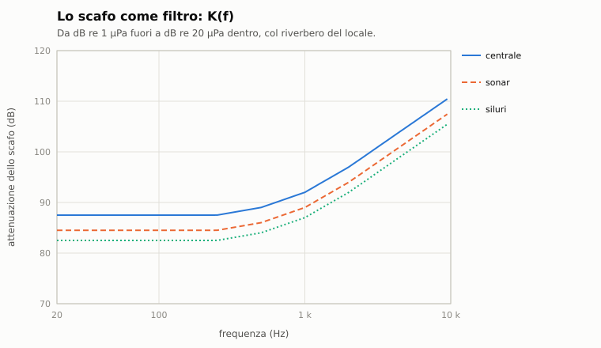
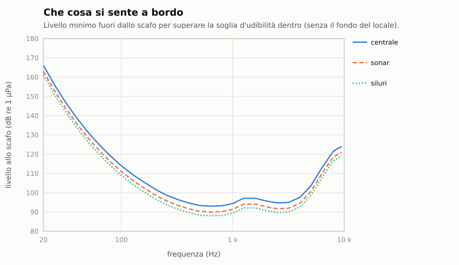

# C8. Audio

*Autore: disassemblatore. Revisione del 28/10/2026 (registrazioni del blocco 3). Stato: rivisto (curatore: kit).*

## 1. A che serve

Fa sentire il mare come lo sente il battello. In **cuffia**, alla stazione sonar, si ascolta il fascio puntato: le
eliche che battono, le righe delle macchine, una balena, la pioggia in superficie. **A bordo**, senza cuffia, si sente
quello che passa attraverso lo scafo: il ping di chi ci cerca come ghiaia sullo scafo, uno scoppio vicino, le proprie
macchine, i colpi di mare a quota periscopica. Il suono non è un effetto a parte: viene dallo stesso modello acustico
della scoperta (capitoli C1-C4), quindi quello che si sente è quello che c'è. E si può ascoltare come nel 1989, con la
resa dei campioni a 4 bit o della Sound Blaster.

## 2. Il modello

Tutto il calcolo è in `nucleo`, puro e deterministico; il dispositivo è a parte (`piattaforma/audio.hpp`). Senza
dispositivo il gioco tace e il resto non cambia.

### 2.1 L'uscita

`UscitaAudio` (`piattaforma/audio.hpp`): un flusso mono in virgola mobile SDL3 sul dispositivo predefinito, col driver
scelto all'avvio (pipewire, pulseaudio, alsa, sndio). L'opzione `--audio` sceglie la resa: `piena`, `sound_blaster`,
`originale`, oppure `spento`.

**Il suono ha un filo suo.** I campioni li chiede il dispositivo (`UscitaAudio::tira`, `RegiaAudio::produci_dal_filo`), non
il ciclo dei fotogrammi: un fotogramma lungo non interrompe musica, effetti e suoni del classico. Escono circa 80 ms prima di
quanto facessero (**STIMA**: dipende dal dispositivo). Le partite non cambiano. Il disco resta sul thread dei fotogrammi
(`aggiorna_brano`).

### 2.2 Il mixer

`Mixer` (`nucleo/mixer_audio.hpp`) ha tre canali: **cuffia**, **bordo**, **interfaccia**. Ognuno riceve blocchi alla sua
frequenza, ricampionati in modo continuo (interpolazione lineare con la fase che resta fra un blocco e l'altro) alla
frequenza d'uscita, 48 kHz. Poi i volumi e la **resa**:
- **piena**: nessuna alterazione;
- **originale**: come i campioni dell'eseguibile del 1989, PCM a 4 bit (16 livelli) tenuto a 5,5 kHz senza filtro
  anti-aliasing, com'era sull'altoparlante, sul Tandy o sul Covox;
- **Sound Blaster**: 8 bit (256 livelli) tenuti a 22 050 o 11 025 Hz senza anti-aliasing, come la SB 1.0, più un
  passa basso leggero.

Con un numero pari di livelli nessun gradino cade sullo zero: il silenzio finirebbe sul livello di riposo, +1/15 con
16 livelli. Le schede d'epoca avevano l'uscita accoppiata in alternata, che toglieva quella continua. Qui le due rese
d'epoca passano da un passa alto a un polo a 10 Hz (STIMA), partito dal livello di riposo
(`ParametriMixer::accoppiamento_alternata`). Il silenzio esce a zero esatto dal primo campione e un seno ha media
nulla. Spostare i gradini toglieva la continua del silenzio ma la metteva in ogni segnale.

### 2.3 La cuffia

`CuffiaSonar` (`nucleo/ascolto.hpp`) suona il fascio puntato in tempo reale, sul `GeneratoreSpettrale`:
- **rumore colorato**: lo spettro del fascio senza le righe (`spettro_continuo`, capitolo C5) dà il colore. Si sintetizza
  a fotogrammi sovrapposti per metà sotto la radice della finestra di Hann, con potenza costante e passaggi morbidi;
- **righe**: sinusoidi a fase continua, con la frequenza ricevuta (il Doppler) e l'ampiezza del loro S/N nel bin,
  che passano da un valore all'altro a rampa;
- **battito d'elica**: una modulazione d'ampiezza del rumore alla frequenza del DEMON (capitolo C4);
- **filtri e aiuti** (`ParametriAscolto`): passa banda 20 Hz-5 kHz (o un passa alto), le righe sotto 50 Hz portate su
  di ottave, l'ascolto accelerato ×4 o ×16 (il tratto suona più acuto);
- un fondo di −24 dBFS senza sorgenti e un limitatore per campione.

La scena (sorgenti, ricevitore, ambiente) si rilegge ogni 0,25 s di tempo reale. L'uscita non dipende da come si
spezzano i passi. Costo: 0,25 ms in media e 3 ms al massimo per passo con 8 sorgenti.

**Le registrazioni** (`nucleo/campioni.hpp`): una sorgente che ha un campione suona con la sua tessitura registrata
invece del rumore colorato:
- la tessitura è sbiancata (senza righe, solo nella banda valida) e si legge alla posizione del tempo di gioco, con
  l'interpolazione cubica: la stessa partita suona uguale;
- si ricampiona col Doppler (le navi anche al battito d'elica del modello, al più ×1,3);
- si ricolora a fotogrammi con lo spettro che il modello dà a quella sorgente nel fascio;
- fuori dalla banda valida resta il rumore del modello, e le righe sono sempre quelle del modello;
- i livelli per banda tornano entro 2 dB con quelli del modello.

Anche il **vento** e la **pioggia** del rumore ambiente (capitolo C3) suonano con le loro tessiture: la loro parte nel
fascio (`componenti_rumore_ambiente`) la porta la tessitura ricolorata. Gli **aerei** e gli elicotteri si sentono in
cuffia, con la tessitura, solo dentro la finestra di Snell (capitolo E5).

`collega_campioni(catalogo, libreria)` lega nel tempo le sorgenti della libreria ai loro campioni: l'attività segue
l'inviluppo del tratto che la cuffia legge, con la stessa media di lungo periodo. Così cascata, LOFAR, scoperta e cuffia
vedono la stessa balena cantare nello stesso momento.

**Le registrazioni del blocco 3 del sonar** (28/10/2026, disassemblatore): sette nuove.
- **I click del capodoglio** (NOAA, pubblico dominio).
- **Dall'Alfred Wegener Institute** (progetto Polar Sounds, CC BY 4.0): i trilli della foca barbata, la pressione del
  ghiaccio e il suo «canto».
- **I colpi del tricheco** (NOAA AFSC, pubblico dominio presunto).
- **Il «boing» della balenottera minore del Pacifico** (NOAA).
- **Le orche di Monterey** (SanctSound).

Due sorgenti della libreria sono nuove: il tricheco (Barents, d'inverno) e la balenottera minore del Pacifico
(Kunashir, d'inverno), capitolo C3. La coda del capodoglio e le campane del tricheco restano al modello. Le registrazioni
CC BY 4.0 dicono nella tabella che sono modificate (sbiancate e ricolorate dal motore); i crediti completi sono in
`docs/CREDITI.md`.

<!-- generato: campioni_audio -->
| Voce | Registrato al posto della voce | Durata vera (s) | Banda valida (Hz) | Licenza | Attribuzione |
|---|---|---|---|---|---|
| Be-12 in sorvolo | An-24, bimotore AI-24 | 10,0 | 5-1709 | pubblico dominio (rilasciato dall'autore) | Grachev (pubblico dominio), via Wikimedia Commons, https://commons.wikimedia.org/wiki/File:Sound_of_AN-24_airplane.ogg |
| Il-38 in sorvolo | An-12 con gli AI-20M dell'Il-38 | 10,0 | 5-4638 | CC BY 3.0 | "Antonov An-12 taking off from Malta International Airport" di Joluqa (YouTube blzV1AvMPoY), CC BY 3.0 (https://creativecommons.org/licenses/by/3.0/), via Wikimedia Commons, https://commons.wikimedia.org/wiki/File:Antonov_An-12_taking_off_from_Malta_International_Airport.ogv. Modificato. |
| P-3C Orion in sorvolo | C-130T con i T56 del P-3; passaggio basso | 10,0 | 5-6355 | pubblico dominio (17 U.S.C. §105) | U.S. Marine Corps video by SSgt Oscar L. Olive IV, via DVIDS / Wikimedia Commons, https://commons.wikimedia.org/wiki/File:Fat_Albert_low_pass.ogv |
| P-3C Orion in sorvolo | WP-3D Orion, 8 s | 8,3 | 5-9922 | CC0 | John Veit (CC0), via Wikimedia Commons, https://commons.wikimedia.org/wiki/File:US_Navy_Lockheed_WP-3D_Orion_recon_aircraft.ogv |
| Tu-142 in sorvolo | Tu-95MS a Engels (NK-12, eliche controrotanti) | 10,0 | 5-9922 | CC BY 4.0 | Ministry of Defence of the Russian Federation (mil.ru), CC BY 4.0 (https://creativecommons.org/licenses/by/4.0/), via Wikimedia Commons, https://commons.wikimedia.org/wiki/File:Полеты_Ту-95МС_в_условиях_низких_температур.webm. Modificato: estratto audio, sbiancato e ricolorato. |
| Nave sismica con cannoni ad aria | — | 517,7 | 5-152 | pubblico dominio (17 U.S.C. §105) | NOAA PMEL Acoustics Program, https://www.pmel.noaa.gov/acoustics/sounds_enviro.html |
| Balenottera comune (Balaenoptera physalus) | — | 60,0 | 5-9922 | pubblico dominio (17 U.S.C. §105) | NOAA Office of National Marine Sanctuaries and U.S. Navy. 2021. SanctSound Raw Passive Acoustic Data. NOAA National Centers for Environmental Information. https://doi.org/10.25921/saca-sp25 |
| Balenottera minore del Pacifico settentrionale (Balaenoptera acutorostrata) | — | 34,5 | 25-9922 | pubblico dominio (17 U.S.C. §105) | NOAA Fisheries, Southwest Fisheries Science Center, Marine Mammal and Turtle Division, copia della Wayback Machine del 16/10/2011 (https://web.archive.org/web/20111016181104id_/http://swfsc.noaa.gov/uploadedFiles/Divisions/PRD/Sounds/MinkWhaBoin.wav) |
| Capodoglio (Physeter macrocephalus) | — | 60,0 | 5-9922 | pubblico dominio (17 U.S.C. §105) | NOAA Fisheries, Southwest Fisheries Science Center, Marine Mammal and Turtle Division, via Wikimedia Commons, https://commons.wikimedia.org/wiki/File:Sperm_Whale_Normal_Clicks.ogg |
| Coro di pesci (sciaenidi) | — | 5,0 | 5-9922 | pubblico dominio (17 U.S.C. §105) | NOAA Office of National Marine Sanctuaries and U.S. Navy. 2021. SanctSound Raw Passive Acoustic Data. NOAA National Centers for Environmental Information. https://doi.org/10.25921/saca-sp25 |
| Branco di delfini (delfino comune, globicefali) | — | 60,0 | 5-9922 | pubblico dominio (17 U.S.C. §105) | NOAA Office of National Marine Sanctuaries and U.S. Navy. 2021. SanctSound Raw Passive Acoustic Data. NOAA National Centers for Environmental Information. https://doi.org/10.25921/saca-sp25 |
| Distacco di un iceberg | — | 180,0 | 5-1200 | pubblico dominio (17 U.S.C. §105) | NOAA PMEL Acoustics Program, https://www.pmel.noaa.gov/acoustics/sounds_cryogenic.html |
| Ecoscandaglio multifascio di una nave oceanografica | — | 10,0 | 5-9922 | pubblico dominio (17 U.S.C. §105) | NOAA Office of National Marine Sanctuaries and U.S. Navy. 2021. SanctSound Raw Passive Acoustic Data. NOAA National Centers for Environmental Information. https://doi.org/10.25921/saca-sp25 |
| Eglefino (Melanogrammus aeglefinus): coro | — | 17,0 | 5-631 | pubblico dominio (17 U.S.C. §105) | NOAA Fisheries, Northeast Fisheries Science Center, Passive Acoustics Group, https://www.fisheries.noaa.gov/new-england-mid-atlantic/science-data/fish-and-invertebrate-acoustics |
| SH-3 Sea King in volo | Marine One 1998, probabile VH-3D; voci e folla | 10,0 | 5-6952 | pubblico dominio (17 U.S.C. §105) | White House Television video by Courtesy; William J. Clinton Presidential Library, via DVIDS / Wikimedia Commons, https://commons.wikimedia.org/wiki/File:President_Clinton_Departing_the_White_House_via_Marine_One_(1998).webm |
| SH-3 Sea King in volo | UH-3H in appontaggio, filmato di un incidente: si usa solo l'avvicinamento | 10,0 | 5-9922 | pubblico dominio (17 U.S.C. §105) | U.S. Navy video by U.S. Navy, via DVIDS / Wikimedia Commons, https://commons.wikimedia.org/wiki/File:Desert_Duck_744_Accident.webm |
| SH-60 in volo | SH-60J in arrivo | 10,0 | 5-9475 | CC BY 3.0 | "JMSDF SH-60J Sapporo Airshow Okadama Airport" di RUNWAY FUN Aviation & Military & plus (YouTube zCGzVZeXj6s), CC BY 3.0 (https://creativecommons.org/licenses/by/3.0/), via Wikimedia Commons, https://commons.wikimedia.org/wiki/File:JMSDF_SH-60J_Sapporo_Airshow_Okadama_Airport.ogv. Modificato. |
| SH-60 in volo | quattro UH-60 in passaggio | 10,0 | 5-4594 | CC BY 4.0 | "BlackhawksLilburnGeorgia" di BeeboMan, CC BY 4.0, via Wikimedia Commons, https://commons.wikimedia.org/wiki/File:BlackhawksLilburnGeorgia.webm. Modificato. |
| Esplosione d'esercitazione | — | 5,0 | 5-8624 | pubblico dominio (17 U.S.C. §105) | NOAA Office of National Marine Sanctuaries and U.S. Navy. 2021. SanctSound Raw Passive Acoustic Data. NOAA National Centers for Environmental Information. https://doi.org/10.25921/saca-sp25 |
| Fessurazione del ghiaccio | — | 60,0 | 5-1806 | CC BY 4.0 | Registrazione: Alfred Wegener Institute, Helmholtz Centre for Polar and Marine Research (AWI), 2022, CC BY 4.0 (https://creativecommons.org/licenses/by/4.0/), dal progetto Polar Sounds (AWI, HIFMB, Cities and Memory), https://audioboom.com/posts/8230903-rubbing-sea-ice-recording-2. Modificato: sbiancato e ricolorato dal motore del gioco. |
| Fessurazione del ghiaccio | — | 60,0 | 5-164 | CC BY 4.0 | Registrazione: Alfred Wegener Institute, Helmholtz Centre for Polar and Marine Research (AWI), 2022, CC BY 4.0 (https://creativecommons.org/licenses/by/4.0/), dal progetto Polar Sounds (AWI, HIFMB, Cities and Memory), https://audioboom.com/posts/8231522-singing-sea-ice-recording-1. Modificato: sbiancato e ricolorato dal motore del gioco. |
| Foca barbata (Erignathus barbatus) | — | 60,0 | 5-228 | CC BY 4.0 | Registrazione: Alfred Wegener Institute, Helmholtz Centre for Polar and Marine Research (AWI), 2022, CC BY 4.0 (https://creativecommons.org/licenses/by/4.0/), dal progetto Polar Sounds (AWI, HIFMB, Cities and Memory), https://audioboom.com/posts/8232592-bearded-seal-erignathus-barbatus. Modificato: sbiancato e ricolorato dal motore del gioco. |
| Imbarcazione con fuoribordo | — | 9,7 | 5-9922 | pubblico dominio (17 U.S.C. §105) | National Park Service, Glacier Bay National Park & Preserve (C. Gabriele / NPS), https://www.nps.gov/glba/learn/nature/soundclips.htm |
| Ghiaccio glaciale che fonde | — | 15,8 | 5-9922 | pubblico dominio (17 U.S.C. §105) | National Park Service, Glacier Bay National Park & Preserve (H. Lentfer / NPS), https://www.nps.gov/glba/learn/nature/soundclips.htm |
| Gamberi schioccatori (Alpheidae): colonia | — | 60,0 | 5-9922 | pubblico dominio (17 U.S.C. §105) | NOAA Office of National Marine Sanctuaries and U.S. Navy. 2021. SanctSound Raw Passive Acoustic Data. NOAA National Centers for Environmental Information. https://doi.org/10.25921/saca-sp25 |
| Iceberg che s'incaglia | — | 289,6 | 5-39 | pubblico dominio (17 U.S.C. §105) | NOAA PMEL Acoustics Program, https://www.pmel.noaa.gov/acoustics/sounds_cryogenic.html |
| Megattera (Megaptera novaeangliae) | — | 60,0 | 5-7958 | pubblico dominio (17 U.S.C. §105) | National Park Service, Glacier Bay National Park & Preserve (NPS), https://www.nps.gov/glba/learn/nature/soundclips.htm |
| Mercantile | — | 10,0 | 5-8635 | pubblico dominio (17 U.S.C. §105) | NOAA Office of National Marine Sanctuaries and U.S. Navy. 2021. SanctSound Raw Passive Acoustic Data. NOAA National Centers for Environmental Information. https://doi.org/10.25921/saca-sp25 |
| Mercantile | — | 60,0 | 5-9922 | pubblico dominio (17 U.S.C. §105) | NOAA Office of National Marine Sanctuaries and U.S. Navy. 2021. SanctSound Raw Passive Acoustic Data. NOAA National Centers for Environmental Information. https://doi.org/10.25921/saca-sp25 |
| Mercantile | — | 37,2 | 5-9922 | pubblico dominio (17 U.S.C. §105) | National Park Service, Glacier Bay National Park & Preserve (C. Gabriele / NPS), https://www.nps.gov/glba/learn/nature/soundclips.htm |
| Merluzzo (Gadus morhua) in riproduzione | — | 5,0 | 5-9922 | pubblico dominio (17 U.S.C. §105) | NOAA Office of National Marine Sanctuaries and U.S. Navy. 2021. SanctSound Raw Passive Acoustic Data. NOAA National Centers for Environmental Information. https://doi.org/10.25921/saca-sp25 |
| Orca (Orcinus orca) | — | 60,0 | 5-9922 | pubblico dominio (17 U.S.C. §105) | National Park Service, Glacier Bay National Park & Preserve (C. Gabriele / NPS), https://www.nps.gov/glba/learn/nature/soundclips.htm |
| Orca (Orcinus orca) | — | 7,5 | 5-9922 | pubblico dominio (17 U.S.C. §105) | NOAA Office of National Marine Sanctuaries and U.S. Navy. 2021. SanctSound Raw Passive Acoustic Data. NOAA National Centers for Environmental Information. https://doi.org/10.25921/saca-sp25 |
| Peschereccio piccolo in moto | — | 31,2 | 5-9922 | pubblico dominio (17 U.S.C. §105) | National Park Service, Glacier Bay National Park & Preserve (C. Gabriele / NPS), https://www.nps.gov/glba/learn/nature/soundclips.htm |
| Pioggia sul mare | — | 60,0 | 5-9922 | pubblico dominio (17 U.S.C. §105) | NOAA Office of National Marine Sanctuaries and U.S. Navy. 2021. SanctSound Raw Passive Acoustic Data. NOAA National Centers for Environmental Information. https://doi.org/10.25921/saca-sp25 |
| T-phase di un terremoto | — | 182,0 | 5-360 | pubblico dominio (17 U.S.C. §105) | NOAA PMEL Acoustics Program, https://www.pmel.noaa.gov/acoustics/sounds_seismic.html |
| T-phase vulcanico | — | 827,4 | 6-23 | pubblico dominio (17 U.S.C. §105) | NOAA PMEL Acoustics Program, https://www.pmel.noaa.gov/acoustics/sounds_seismic.html |
| Tremore armonico d'iceberg | — | 180,0 | 5-150 | pubblico dominio (17 U.S.C. §105) | NOAA PMEL Acoustics Program, https://www.pmel.noaa.gov/acoustics/sounds_cryogenic.html |
| Tricheco (Odobenus rosmarus) | — | 44,6 | 5-4538 | pubblico dominio presunto (sito federale NOAA senza credito per il clip, 17 U.S.C. §105) | NOAA Fisheries, Alaska Fisheries Science Center, Marine Mammal Laboratory, https://apps-afsc.fisheries.noaa.gov/Audio/Alaska-Marine-Mammal-Acoustic-Studies/index.html |
| Vento sul mare | — | 30,0 | 5-70 | pubblico dominio (17 U.S.C. §105) | NOAA Office of National Marine Sanctuaries and U.S. Navy. 2021. SanctSound Raw Passive Acoustic Data. NOAA National Centers for Environmental Information. https://doi.org/10.25921/saca-sp25 |
<!-- fine: campioni_audio -->

### 2.4 A bordo

`AmbienteBordo` (`nucleo/bordo_audio.hpp`) fa il suono di una stazione senza cuffia:
1. le sorgenti della scena arrivano allo scafo con la loro perdita di trasmissione e il Doppler;
2. attraversano lo scafo con il trasferimento `K(f)`, da dB re 1 µPa fuori a dB re 20 µPa dentro: un passa basso
   (91,5 dB sotto 250 Hz, 96 a 1 kHz, 107 a 4 kHz, 113 a 8 kHz), meno 4 dB di riverbero del locale. Il locale siluri
   sta contro lo scafo (−5 dB), la sala sonar accanto al trasduttore (−3), gli alloggi sono ovattati (+2);
3. si sommano al **fondo della stazione** per regime;
4. si tiene solo quello che supera la soglia d'udibilità (ISO 226, approssimata).

Il suono più debole che si sente dentro, senza il fondo del locale, sta fra 600 Hz e 3 kHz: circa 88-95 dB re 1 µPa
allo scafo. A 20 Hz ne servono oltre 160.

| Stazione (dBA) | Silenzioso | Normale | Avanti tutta |
|---|---|---|---|
| centrale | 40 | 62 | 66 |
| sonar | 38 | 58 | 62 |
| siluri | 40 | 60 | 64 |
| macchine | 78 | 87 | 92 |
| alloggi | 38 | 60 | 63 |
| plancia (all'aperto) | 60 | 62 | 65 |

0 dBFS rms valgono 100 dB SPL: la sala macchine a 87 dBA sta a −13 dBFS, la centrale silenziosa a circa −50. La
saturazione è morbida. Gli aerei non si sentono a bordo.

**Eventi a campione esatto:**
- il ping degli altri come ticchettio o ghiaia sullo scafo: il transitorio d'inizio e la risposta dello scafo a 1-4
  kHz, non il tono;
- i tonfi (boe, siluri, trasduttori) quando passano la soglia, cioè vicinissimi;
- il ping proprio, forte nei locali prodieri (93-108 dB misurati sulla Tigrone);
- gli scoppi di cariche, testate e mine: l'onda d'urto (Cole), le pulsazioni della bolla (Rayleigh-Willis) e il
  rombo, con lo `scossone()` per la vista;
- l'artiglieria che cade vicino.

**Il battello stesso**, con la sua sorgente acustica:
- le macchine: le righe della firma come le emette ora (pompe lente, veloci o spente, ausiliari, l'individuo, i danni),
  la più forte a 84 dB in sala macchine e 20-40 dB sotto nelle altre stazioni, e il fischio della turbina che sale coi
  giri;
- i colpi del battello (le voci «scafo» dei transitori entro 50 m), forti dentro;
- la ventilazione in centrale e negli alloggi, le ventole in sala sonar.

**Il maltempo** (capitolo E7):
- i colpi di mare sullo scafo al periodo d'onda, dal mare 4, che calano con la quota come il moto orbitale
  `exp(−2π z / λ)`: in superficie tonfo e campana dello scafo, a quota periscopica tonfi e scricchiolii, in profondità
  niente;
- l'acqua sul ponte in superficie: 50 dBA a mare 3 e +4 per classe, passa basso a 150 Hz;
- il tuono, solo in superficie, dopo distanza / c: 45 dB sotto quello in aria, passa basso a 200 Hz, rimbombi e
  schianto sotto 3 km, niente oltre 20 km;
- i fulmini caduti vicino come tonfi, netti entro circa 100 m;
- la pioggia e il vento dentro lo scafo non si sentono (45 dB d'isolamento a 100 Hz, 65 a 1 kHz).

### 2.5 Nell'app

`InterfacciaMissione::audio(dt_reale, compressione)` gira a ogni fotogramma, col tempo reale:
- la cuffia suona solo alla stazione sonar (`SonarEnhanced::ascolta`); altrove tace;
- il bordo prende la stazione dove si sta (plancia in superficie, sonar, siluri, centrale) e il regime (silenzioso
  col silenzio a bordo, avanti tutta oltre l'80% della velocità massima, altrimenti normale);
- la scena di bordo si rilegge ogni 0,25 s; gli scoppi e l'artiglieria arrivano come eventi della missione;
- con la compressione del tempo oltre ×8 l'audio non suona;
- cuffia e bordo si generano a ogni fotogramma con un anticipo fisso sul filo dell'audio (`imposta_anticipo`): 0,1 s in
  partita. A ogni fotogramma la loro coda torna all'anticipo; prima restavano sempre più indietro, oltre 10 s in pochi
  minuti. Nel video d'apertura il suono si prepara insieme alle immagini (capitolo A1). Senza dispositivo (`--audio-wav`)
  l'anticipo non c'è.

## 3. Fonti e confidenza

| Parametro | Fonte | Confidenza |
|---|---|---|
| Rese d'epoca: 4 bit a 5,5 kHz, SB 1.0 senza anti-aliasing | `docs/01_analisi_tecnica_originale.md` §2.6; dossier 18 §5 | alta (4 bit, 5,5 kHz); **STIMA** il filtro della SB |
| Sintesi a fotogrammi, righe a fase continua | dossier 18 §5 | — (tecnica) |
| Trasferimento dello scafo K(f) | dossier 18 §6.2 (lastra d'acciaio di 4 cm a sola massa) | **STIMA** |
| Fondi delle stazioni | dossier 18 §6.3 [Cla92] [Har71]: barca silenziosa 35-45 dBA, macchine 87 misurati | **STIMA** sugli altri |
| Ping proprio 93-108 dB | dossier 18 §6.1 (Tigrone) | media |
| Soglia d'udibilità | ISO 226:2003, approssimata | media (da verificare) |
| Anticipo di cuffia e bordo, 0,1 s | scelta di progetto, provvisoria: si conferma con un ascolto | **STIMA** |
| Registrazioni | NOAA SanctSound, PMEL, NOAA Fisheries, NPS (pubblico dominio); Wikimedia Commons (pubblico dominio, CC0, CC BY); AWI Polar Sounds (CC BY 4.0) | per voce, nella tabella |
| Maltempo a bordo | dossier 21, nota «e_audio_meteo» §3 e §5 | **STIMA** |

Elenco e licenze dei campioni: `docs/ricerca/18_note/campioni_r4.md` (fauna, vento, pioggia, navi) e
`campioni_r8.md` (aerei ed elicotteri). Il capodoglio, la foca barbata e il ghiaccio, prima esclusi per la licenza,
hanno ora registrazioni libere (§2.3); i crediti di tutte sono in `docs/CREDITI.md`.

## 4. Classico ed Enhanced

Il gioco del 1989 ha i suoni dell'originale (`docs/01_analisi_tecnica_originale.md` §2.6 e §2.7): campioni PCM a
4 bit dei file `.T` suonati agli eventi, all'altoparlante, al Tandy o al Covox, a frequenze di 4000-6500 Hz (il sonar
a 5500-6200), più la musica dei titoli.

Nel rifacimento il classico suona come nel 1989 (`nucleo/suoni_classici`; le regole, ricavate dall'eseguibile, in
`docs/originale/suoni.md`). I sei campioni dei file `.T` sono copiati senza modifiche dal disco 2
(`data/motore/suoni_classici.toml`, da `tools/pipeline/suoni_classici.py`) e suonano agli stessi eventi:
- EXP1 a 5000 Hz ai colpi a segno (messaggi 7 e 50) e, al periscopio, al quarto fotogramma dell'animazione del colpo;
  a 4000 Hz ai danni e alle esplosioni subacquee (messaggi 19, 20, 26, 30);
- SONAR1 a 5500 Hz al ping proprio, a 6200 Hz a quelli altrui (messaggio 8; ripetuto, solo un bip grave);
- TORPRAMP a 6500 Hz al lancio da un tubo, una volta sola;
- PROP2, PROPV2 e WHALE2 per ANALIZZA, a una frequenza che dipende dal tipo del contatto;
- un bip dell'altoparlante a ogni testo nella barra dei messaggi, e ai tasti Ctrl+N e Ctrl+Q.

L'originale fermava il gioco a ogni suono, quindi due suoni uscivano uno dopo l'altro. Qui il gioco non si ferma e la
stessa sequenza la dà una coda sola, sul canale dell'interfaccia del mixer (`InterfacciaMissione::audio_classico`).
Ctrl+N toglie i campioni e lascia i bip, Ctrl+Q spegne tutto (`ModoSuoniClassici`, come `DS:03E2` nel 1989). Senza
finestra, `--audio-wav FILE` registra l'audio della partita in un WAV, per le prove. Il filo del §2.1 vale anche qui, per
scelta dell'utente: i suoni escono un po' prima, le partite restano uguali.

La musica dei titoli suona già nel menu, per i due modi (`app/musica_titoli`, vol. 1 §1.6). Le tre versioni,
AdLib, Tandy e Covox, vengono da `CALLS.EXE` (`extracted/musica`). `tools/pipeline/musica.py` le porta a PCM a 16 bit
mono in `data/motore/musica/titolo_<versione>.wav`. M nella scelta della missione cambia versione e la ricorda
in `musica.txt` accanto ai fascicoli (`leggi_preferenza_musica`, `salva_preferenza_musica`); `--audio spento` la tace.

La cuffia, l'ambiente di bordo e le registrazioni sono solo dell'Enhanced. Le rese «originale» e «Sound Blaster» si
possono usare anche nell'Enhanced, per sentirlo come allora.

## 5. Come si vede in gioco

- **Cuffia** (volume 1, §3.7): il fascio puntato. Q cambia il modo: normale, ottava, ×4, ×16. Il filtro della
  stazione vale anche per la cuffia.
- **A bordo**: il suono cambia con la stazione e col silenzio a bordo; la vista sobbalza con lo scossone degli
  scoppi.
- **Registrazioni dell'ascolto**: alla stazione sonar E salva in WAV 8 s del fascio puntato, nella cartella
  `ascolti` accanto ai fascicoli. Non sono gli ultimi 8 s ascoltati: `registra_ascolto` sintetizza 8 s della scena di
  quel momento, col modello e senza le registrazioni.

## 6. Taratura e prove

- Le tessiture registrate tornano entro 2 dB per banda col livello del modello.
- Il fulmine in acqua: +15 dB sul fondo a 10 km, circa +23 a 1 km, niente oltre 60 km (dossier 21).

Prove:
- `test/prove_mixer_audio.cpp`: canali, volumi e silenzio; ricampionamento continuo; le rese d'epoca, col silenzio a
  zero e il seno senza continua;
- `test/prove_suoni_classici.cpp`: i sei `.T` con la provenienza, i messaggi nell'ordine dell'originale, ping, lancio,
  ANALIZZA e i bip, Ctrl+N e Ctrl+Q, lo scoppio al quarto ridisegno del periscopio;
- `test/prove_ascolto.cpp`: rumore e righe ripetibili, ottava e accelerazione, WAV, la cuffia continua comunque si
  spezzino i passi, Doppler e fascio;
- `test/prove_campioni.cpp`: la libreria, la tessitura col livello del modello, vento e pioggia, cascata e scoperta
  sul tratto della cuffia, il P-3 in verticale;
- `test/prove_bordo_audio.cpp`: lo scafo passa basso, le eliche vicine sì e gli aerei mai, ping, tonfi e scoppi, le
  macchine proprie;
- `test/prove_audio_meteo.cpp`: fulmini, schiocco in cuffia, tuono e colpi di mare a bordo.

## 7. Limiti noti e in arrivo

- La cuffia è mono: niente stereo per il rilevamento.
- Le righe sono sempre sintetiche: le tessiture registrate non portano le loro righe.
- Senza registrazione (la coda del capodoglio, le campane del tricheco, S-3, Ka-27, Ka-25) resta il rumore del
  modello.
- Il trasferimento dello scafo è uguale per tutte le classi.
- Un fotogramma più lungo dell'anticipo (§2.5) può lasciare un breve buco in cuffia e bordo, non in musica ed effetti.
  Il valore dell'anticipo è provvisorio: si conferma con un ascolto.
- Nel classico la durata dei bip dell'altoparlante è quella di un XT a 4,77 MHz (STIMA). Nel 1989 dipendeva dalla
  velocità della CPU: è un ciclo d'attesa, non un tempo.
- La cadenza dei ridisegni del periscopio, da cui dipende lo scoppio al quarto fotogramma, è un passo della missione
  (STIMA): nell'originale era quella del ciclo della stazione.

## 8. Riferimenti

- Codice: `piattaforma/audio.hpp`; `app/regia_audio.hpp`; `nucleo/mixer_audio.hpp`, `nucleo/ascolto.hpp`, `nucleo/campioni.hpp`,
  `nucleo/bordo_audio.hpp`, `nucleo/audio_meteo.hpp`, `nucleo/suoni_classici.hpp`; `app/interfaccia.cpp` (`audio`,
  `audio_classico`), `app/sonar_enhanced.cpp` (`ascolta`).
- Dati: `data/motore/campioni.toml`, `data/suoni/campioni/*.wav` (da `tools/pipeline/campioni.py` e
  `campioni_analisi.py`); `data/motore/suoni_classici.toml` e `suoni_classici/*.t` (da
  `tools/pipeline/suoni_classici.py`).
- Originale: `docs/originale/suoni.md`, quando suona ogni campione e ogni bip, con gli indirizzi.
- Ricerca: dossier 18 §5, §6 e §8; dossier 21.
