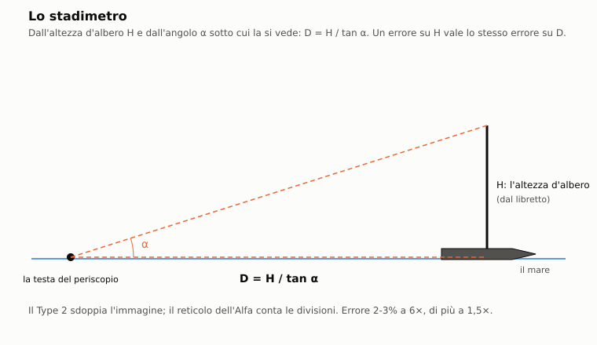
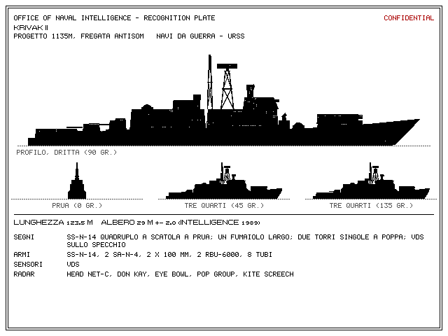
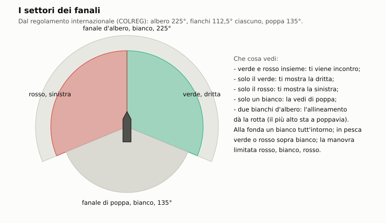

# C9. Periscopi

*Autore: kit, per il runtime. Revisione del 29/10/2026 (il libretto di riconoscimento, il quadrante, l'AOB). Stato: rivisto (runtime, 27/10/2026), curatore: kit.*

## 1. A che serve

Il periscopio è l'unico modo di vedere fuori, e il modo più facile di farsi vedere. Nell'Enhanced il 688 ha due
periscopi diversi: il Type 2 d'attacco, sottile, e il Type 18 di ricerca, che vede di più, di notte, fotografa e
ascolta i radar, ma ha la testa grossa. Il modello decide quanto ci vuole ad alzarlo, quanto resta fuori la testa,
quando un'onda copre la finestra, quanto trema l'immagine con la velocità, quanto lontano la testa e la sua scia si
vedono a occhio e al radar, e quanto è precisa la distanza con lo stadimetro. Le stesse regole valgono per i
sottomarini dell'IA, che fanno le loro guardate: col periscopio alzato si vedono le loro teste, e loro vedono la
nostra.

## 2. Il modello

Il codice è in `nucleo/periscopi.hpp` e `nucleo/src/periscopi.cpp` (il posto del giocatore, `PostoPeriscopi`; la
visibilità della testa; i periscopi dell'IA, `PeriscopioIa`). Il modulo è puro e deterministico: ogni estrazione usa
il generatore passato dalla missione. Nella missione lo collega `missioni/src/missione_periscopi.cpp`
(`Missione::periscopi_enhanced`, `passo_periscopi`, `ordine_periscopio`). La stazione è in `app/interfaccia.cpp`
(`cifra_periscopi`, `periscopi_vista`, `misura_stadimetro`), la vista in `grafica/oculare.hpp` e
`grafica/src/periscopio.cpp`. I dati sono in `data/motore/periscopi.toml`, generato da `tools/pipeline/periscopi.py`
(pezzo P0 di `docs/14_periscopi.md`).

Tutto vale solo con la regola di simulazione. Se il file dei dati manca, resta il periscopio dell'originale.

### 2.1 I periscopi per classe

Per classe (`[classi.*]`): l'elenco dei periscopi (il primo è quello d'attacco o l'unico), la quota periscopica
alla chiglia, quanto esce la testa a quella quota col periscopio tutto su, e la dottrina delle guardate dell'IA.

| Classe | Periscopi | Quota periscopica (m) | Testa fuori (m) | Avvisatore prima | TV |
|---|---|---|---|---|---|
| Los Angeles, Sturgeon | Type 2, Type 18 | 18,3 | 1,5 | no | — |
| Trafalgar | CH84, CK34 | 18,0 | 1,5 | no | — |
| Alfa | «Сигнал» | 13,0 | 1,2 | sì | — (telecamera verticale) |
| Victor III | ПЗНГ-10М, МТ-70 | 13,0 | 1,2 | sì | МТ-70 fino a 50 m |
| Charlie II | ПЗНС-10, МТ-70 | 13,0 | 1,2 | sì | МТ-70 fino a 50 m |
| Akula, Typhoon | «Лебедь», «Сигнал-3» | 13,0 | 1,2 | sì | — |
| Oscar | ПЗНС-10, «Сигнал-3» | 13,0 | 1,2 | sì | — |
| Kilo, Foxtrot | ПК-8,5, ПЗНГ-8М (Kilo) o ПЗНГ-8 (Foxtrot) | 13,0 | 1,2 | sì | — |

Fonte: `data/motore/periscopi.toml [classi.*]`.

La quota della missione si traduce nella quota della classe (`quota_classe` in `missione_periscopi.cpp`): la quota
periscopica dell'originale, 20 ft (6,096 m, `QUOTA_PERISCOPICA_MISSIONE_M`), corrisponde alla quota periscopica della
classe. Un battello a 20 ft ha quindi la chiglia a 18,3 m se è un 688 e a 13 m se è un'Alfa.

### 2.2 I modelli

Ogni periscopio (`DatiPeriscopio`, `[periscopi.*]`) ha il ruolo (attacco, ricerca, universale, TV), gli
ingrandimenti con il campo vero, i limiti dell'elevazione, il telemetro, i modi di visione, la testa, la sezione
radar, la piuma, i tempi d'alzata e discesa, quattro soglie di velocità, il reticolo, i fermi dell'elevazione e i
filtri.

Ottica e modi:

| Periscopio | Ruolo | Ingrandimenti (campo) | Elevazione | Telemetro | Modi di visione |
|---|---|---|---|---|---|
| Type 2 | attacco | 1,5× (32°), 6× (8°) | −10° / +74,5° | sdoppiato | giorno |
| Type 18 | ricerca | 1,5× (32°), 6× (8°), 12× (4°) | −10° / +60° | sdoppiato | giorno, bassa luminosità, TV |
| CH84 | attacco | 1,5× (32°), 6× (8°) | −10° / +60° | sdoppiato | giorno, intensificatore, TV, termico |
| CK34 | ricerca | 1,5× (32°), 6× (8°) | −10° / +60° | sdoppiato | giorno, bassa luminosità, TV |
| «Сигнал», «Сигнал-3» | universale | 1,5× (40°), 6× (10°) | −15° / +60° | reticolo | giorno, intensificatore, TV |
| «Лебедь-11/21» | attacco | 1,5× (40°), 6× (10°) | −10° / +45° | reticolo | giorno, intensificatore |
| ПЗНС-10, ПЗНГ-10М, ПЗНГ-8М | universale | 1,5× (40°), 6× (10°) | −15° / +90° | reticolo | giorno, intensificatore |
| ПЗНГ-8 | universale | 1,5× (40°), 6× (10°) | −15° / +90° | reticolo | giorno |
| ПК-8,5 | attacco | 1,5× (40°), 6× (10°) | −10° / +45° | reticolo | giorno |
| МТ-70 | TV | 1× (30°) | −10° / +30° | reticolo | TV |

Testa e corsa:

| Periscopio | TV, foto, ESM, stabilizzato | Testa (m) | Sezione (m²) | Piuma | Alzata / discesa (s) |
|---|---|---|---|---|---|
| Type 2 | no, no, no, no | 0,061 | 0,2 | 0,5 | 6 / 5 |
| Type 18 | sì, sì, sì, sì | 0,191 | 1,5 | 1,0 | 8 / 6 |
| CH84 | sì, sì, no, sì | 0,08 | 0,3 | 0,6 | 6 / 5 |
| CK34 | sì, sì, sì, sì | 0,19 | 1,5 | 1,0 | 8 / 6 |
| «Сигнал», «Сигнал-3» | sì, sì, no, no | 0,18 | 1,0 | 1,0 | 8 / 6 |
| «Лебедь-11/21» | no, no, no, no | 0,07 | 0,3 | 0,6 | 6 / 5 |
| ПЗНС-10, ПЗНГ-10М | no, sì, no, no | 0,15 | 1,0 | 1,0 | 8 / 6 |
| ПЗНГ-8, ПЗНГ-8М | no, no, no, no | 0,15 | 1,0 | 1,0 | 8 / 6 |
| ПК-8,5 | no, no, no, no | 0,06 | 0,2 | 0,5 | 6 / 5 |
| МТ-70 | sì, no, no, no | 0,12 | 0,5 | 0,8 | 8 / 6 |

Fonte: `data/motore/periscopi.toml [periscopi.*]`. Per tutti i modelli le soglie di velocità sono le stesse: libera
6 nodi (3,1 m/s), tremolio 8, inservibile 10, danno 15 (7,7 m/s). Il telemetro sdoppiato ha quadranti da 4,57 a
39,62 m d'altezza, distanze da 201 a 10 058 m e sdoppiamento massimo di 2°. Il Type 2 ha i fermi a molla a 14° e 44°,
gli altri nessuno. Filtri: polaroid, rosso, verde e giallo sugli americani e britannici; affumicato e rosso sui
sovietici.

Senza dati per la classe il posto usa un Type 2 di riserva (`type2_di_riserva`). Ha l'ottica, l'elevazione e i passi
del reticolo del Type 2; testa, sezione, piuma, tempi e soglie sono i valori di base (0,06 m, 0,2 m², 0,5, 6 / 5 s).
Non ha fermi, filtri né quadranti del telemetro.

### 2.3 Alzata, discesa e altezza della testa

Il posto (`PostoPeriscopi::avanza`) tiene la frazione d'alzata da 0 (giù) a 1 (su). A ogni passo:

```
alzata += dt / alzata_s        (comandato su, intatto, nessun cambio in corso)
alzata −= dt / discesa_s       (altrimenti)
```

La testa sta sull'acqua calma a

```
h = max(0, min(esposto + Q − q, esposto + Q) − (1 − alzata) · CORSA)
```

- `esposto`: la testa fuori a quota periscopica (`esposto_m`, 1,5 m sul 688);
- `Q`: la quota periscopica della classe; `q`: la quota della chiglia;
- `CORSA`: la corsa dell'albero, 6 m (`CORSA_PERISCOPIO_M`, STIMA).

Esempio sul 688 a quota periscopica. La testa esce quando l'alzata supera 1 − 1,5/6 = 0,75: dopo 4,5 s col Type 2 e
dopo 6 s col Type 18. In discesa torna sotto dopo 1,25 s col Type 2 e 1,5 s col Type 18.

- Il periscopio è «su» (il flag dell'originale, `flag54 & 2`) solo a fine corsa. La missione alza il flag con il
  comando dell'originale quando l'alzata arriva a 1 (messaggio 401), e lo abbassa quando la testa torna sotto.
- Una testa bloccata dall'artiglieria non sale e non scende più: resta dov'era, e ogni comando dà il messaggio 404
  (capitolo E4).
- Si alza un periscopio per volta. Scegliere l'altro con quello su lo fa scendere; il nuovo sale quando il primo è
  tutto giù (`scegli`, `prossimo_`). Al cambio ingrandimento, modo ed elevazione si adattano ai limiti del nuovo.
- Un ordine «su» o «scegli» arrivato al secondo 0, prima che il posto esista, aspetta il posto e si esegue nell'ordine
  (`ordini_peri_in_attesa_`). Un periscopio già alzato dallo script parte su.
- Sotto i 20 ft il flag si abbassa da solo, come nell'originale (`Missione::controlli_giocatore`, messaggio 3): anche
  l'ordine del posto torna giù.

### 2.4 Il mare sulla testa

Col mare la testa sale e scende. L'errore di quota è un processo AR(1) con tempo di correlazione di 20 s:

```
e ← f · e + √(1 − f²) · σ · g        f = exp(−dt / 20),  g gaussiana
h_vera = max(0, h − e)
```

`σ` è `sigma_quota_m`: la tabella del dossier 21 §7.3 per lo stato del mare (0,3, 0,4, 0,5, 0,6, 1,5, 2,5, 4,0,
6,0 m da mare 0 a 7) per 0,4. Il fattore 0,4 rappresenta il comandante che tiene la quota (taratura M6). Lo stato del
mare viene dall'altezza significativa vera del meteo (classe di Douglas).

Sopra la testa passa l'onda di `nucleo/onde.hpp`: cinque componenti attorno al periodo di picco di Pierson-Moskowitz
(`Tp = 5 √Hs`), con varianza (Hs/4)². La **finestra è coperta** quando

```
η(Hs, t) > h_vera − 0,12
```

- `η`: l'elevazione dell'onda nel punto della testa (`elevazione_onda_m`);
- 0,12 m: la mezza finestra della testa (`FINESTRA_M`, STIMA).

Con la finestra coperta il giocatore non vede, e in quell'istante né i radar né le vedette vedono la testa
(`Missione::testa_giocatore`). L'onda non spezza la guardata: l'esposizione continua.

### 2.5 Velocità: tremolio, piuma e danno

**Tremolio** dell'immagine, da 0 a 1 (`tremolio`):

```
x = 0                       sotto v_libera
x = 0 → 0,5                 fra v_libera e v_tremolio (lineare)
x = 0,5 → 1                 fra v_tremolio e v_inservibile
x += 0,08 · max(0, mare − 2)                    il mare scuote la testa (STIMA)
x ← x / 2                   se il periscopio è stabilizzato
tremolio = min(1, x + 0,05 · σ_quota)           il moto della quota
```

| Velocità (kn) | Type 2, mare 2 | Type 2, mare 4 | Type 18, mare 2 | Type 18, mare 4 |
|---|---|---|---|---|
| 5 | 0,01 | 0,19 | 0,01 | 0,11 |
| 7 | 0,26 | 0,44 | 0,14 | 0,24 |
| 9 | 0,76 | 0,94 | 0,39 | 0,49 |
| 10 | 1 | 1 | 0,51 | 0,61 |

Calcolo dalle formule del codice. Con il tremolio a 1 l'immagine è inservibile (messaggio 402).

**Piuma**, la scia bianca della testa (`piuma`):

```
piuma = fattore · clamp((v − 2) / 8, 0, 1,5)
```

Il fattore è 1 per le teste di ricerca e universali, 0,8 per l'МТ-70, 0,6 per il CH84 e il «Лебедь», 0,5 per il
Type 2 e il ПК-8,5. A 10 nodi la testa di ricerca fa
la piuma 1, la «piuma enorme» del dossier 20 §5; oltre cresce fino a 1,5.

**Danno** con l'albero alzato oltre la velocità di danno (`probabilita_danno_s`):

```
p al secondo = min(0,5, 0,004 · (v − v_danno))
```

A 20 nodi è il 2% al secondo (STIMA). Il danno toglie 0,6 d'efficienza al sistema «periscopio» dei danni del
battello (`PERDITA_VELOCITA`, messaggio 403). Sotto 0,5 d'efficienza il periscopio non sale più (messaggio 404).

Resta anche la regola dell'originale (`Missione::controlli_giocatore`): sopra i 100 ft, col flag del periscopio
alzato, la velocità ordinata è al più un quarto di avanti tutta (messaggio 45).

### 2.6 Esposizione

- `esposto_s` conta i secondi della guardata in corso, da quando la testa esce a quando torna sotto.
- Ogni guardata finisce nella storia (`EsposizionePeriscopio`: periscopio, inizio, fine).
- Oltre 30 s (`ESPOSIZIONE_LUNGA_S`, la regola delle esposizioni brevi del dossier 20 §7) l'equipaggio avverte
  (messaggio 405) e, alla fine, la guardata va nel registro come `esposizione_lunga` (capitolo F1).

### 2.7 La testa al radar

La testa alzata dà a `nucleo/elettronica` la sua sagoma (`sagoma_testa`, struttura `TestaEsposta`):

```
σ = sezione_m2 · h²
```

`sezione_m2` è la sezione in banda X con 1 m esposto; il doppio dell'altezza vale quattro volte. Con 1,5 m fuori il
Type 2 fa 0,45 m², il Type 18 3,4 m². L'elettronica scala la R50 del radar contro il periscopio con (σ / 0,5)^¼ (0,97
per il Type 2, 1,61 per il Type 18), usa l'altezza della testa per l'orizzonte radar e la piuma per il fattore di
velocità: `f_vel = 1 + (f − 1) · piuma`, con `f` = 1, 1,5 o 2 sotto 5, fino a 8 e oltre 8 nodi. Il resto del
modello, i giri e l'EMCON, è nel capitolo C10.

### 2.8 La testa a vista

Ogni secondo di missione le navi, gli aerei e i periscopi dell'IA dell'altra parte possono vedere la testa
(`probabilita_vista`). Prima si calcola la **portata di riferimento** (`portata_visiva_m`):

```
D = √(testa · h) · f_t   ⊕   1 m · piuma · f_p                     (somma in quadratura)
R = 7000 · D · F_mare · F_notte · (1 + 0,5 · riflesso) · (1 se allertato, 0,7 se no)
R ≤ orizzonte = 3843 · (√h_occhio + √max(h, 0,5 se c'è piuma)),     R ≤ visibilità
```

- `testa`: il diametro della testa; `h`: l'altezza vera fuori dall'acqua.
- `f_t`, `f_p`: 1 e 1 per la nave; 0,6 e 1,6 per l'aereo, che dall'alto vede meglio la scia; 0,8 e 0,8 per il
  periscopio, che guarda radente.
- `F_mare`: 1,3 a mare 0-1, 1,0 a 2, 0,8 a 3, 0,5 a 4, 0,3 a 5, 0,2 a 6, 0,1 a 7 (dossier 21 §6.1, STIMA su IAMSAR).
- `F_notte`: con luce sopra 0,7 vale 1; sotto 0,1 vale il residuo del sensore notturno migliore dell'osservatore; in
  mezzo è lineare. Residui (dossier 21 §6.2): occhio 0,05 con le stelle e 0,02 col coperto; intensificatore 0,3 e 0,1;
  bassa luminosità e TV 0,25 e 0,08; termico 0,6 senza effetto delle nubi.
- `riflesso`: il sole basso sulla lente verso l'osservatore, da 0 a 1.
- `h_occhio`: vedette a 20 m (`OCCHIO_NAVE_M`, STIMA), la quota dell'aereo, la testa del periscopio nemico.
- Visibilità: quella del meteo nel punto. Nella nebbia di radiazione il termico vede quattro volte la visibilità, se
  questa supera 300 m (`portata_meteo`; dossier 21 §6.2).

Poi la probabilità nei `dt` secondi:

```
tasso = tasso_max / (1 + (r / R)⁴)          P = 1 − exp(−tasso · dt)
```

con `tasso_max` 0,1 al secondo per la nave, 0,08 per l'aereo, 0,15 per il periscopio (STIMA). A `r = R` il tasso è
la metà: una nave vede la testa in 10 s con probabilità 0,39. Oltre l'orizzonte o la visibilità, zero.

Portate di riferimento con la testa a 1,5 m, vedette allertate, di giorno, a mare 2 (fra parentesi non allertate):

| Velocità | Type 2 | Type 18 | Type 2, mare 5 | Type 18, notte, occhio | Type 18, notte, intensificatore |
|---|---|---|---|---|---|
| 3 kn | 2160 m (1510) | 3850 m (2690) | 650 m | 135 m | 770 m |
| 6 kn | 2750 m (1920) | 5130 m (3590) | 820 m | 180 m | 1030 m |
| 10 kn | 4090 m (2860) | 7940 m (5560) | 1230 m | 280 m | 1590 m |

Calcolo dalle formule del codice, notte con 4 ottavi di nubi.

Chi vede la testa (`passo_periscopi`):
- ha il contatto col giocatore con qualità almeno 800, la posizione e il sensore «vista»;
- registra l'evento `albero_visto` nel suo EMCON (capitolo C10) e l'allerta «albero» (capitolo E6);
- sceglie il bersaglio.

Osservano le navi, gli aerei e i periscopi dell'IA in guardata o in TV; l'avvisatore da solo non guarda. La TV МТ-70
vede come a una distanza divisa per 0,3 (`fattore_tv`).

Le stesse regole valgono per le teste dell'IA viste dalle navi e dai periscopi dell'altra parte (fase 2 delle
interazioni, `docs/18_interazioni_ia.md`). Visibilità, nubi, nebbia e stato del mare sono quelli del punto della
testa (`meteo_ascolto`).

### 2.9 Che cosa vede il periscopio del giocatore

Con la testa fuori e la finestra libera, il periscopio del giocatore vede le teste dell'IA esposte
(`Missione::teste_ia`): quelle delle guardate e quelle alzate dagli script entro 20 ft più 1,5 m. Il giocatore è un
osservatore «periscopio», allertato, con l'occhio all'altezza della sua testa (almeno 0,5 m) e il primo modo notturno
del periscopio in uso. La testa vista dà un contatto con qualità almeno 300 e il solo rilevamento, e il messaggio 406
una volta per guardata.

### 2.10 I periscopi dell'IA

`PeriscopioIa` pianifica le guardate di ogni sottomarino dell'IA che ha i dati della classe:

1. per guardare usa il periscopio di ricerca o universale, altrimenti il primo che non sia la sola TV; di notte usa
   il miglior sensore notturno fra i periscopi della classe (la Trafalgar il termico del CH84);
2. la prossima guardata cade fra `intervallo_s`: 180-720 s per americani e britannici, 180-600 s per i sovietici;
3. a quell'ora, se c'è un'arma in acqua contro di lui, rimanda all'intervallo successivo;
4. con la TV МТ-70, entro 50 m di quota, con luce oltre 0,5 e non a quota periscopica, guarda con la TV senza esporsi:
   10 s con la portata ridotta a 0,3 (`fattore_tv`, STIMA);
5. a quota periscopica (entro 1 m) e a non più di 6 nodi si espone: i sovietici alzano prima l'avvisatore radar per 5 s
   (`AVVISATORE_S`); se in quei 5 s sentono un radar nemico acceso entro 40 km, o arriva un allarme, o lasciano la
   quota, rinunciano;
6. la testa resta fuori 10 s (`esposizione_s`) alla piena altezza della classe;
7. altrimenti riprova dopo 30 s (`RIPROVA_S`).

Il periscopio dell'IA fuori vede le navi dell'altra parte entro la visibilità e al più 15 km di giorno, 3 km con la
luce sotto 0,2 (`NAVE_VISTA_GIORNO_M`, `NAVE_VISTA_NOTTE_M`, STIMA).

### 2.11 Elevazione e fermi

L'elevazione è la linea di mira sopra l'orizzontale, entro i limiti del modello. Alla stazione Periscopio le frecce
su e giù la muovono di 20° al secondo (`periscopi_vista`). I fermi a molla del Type 2, a 14° e 44°, fermano la
linea di mira; una nuova pressione la fa ripartire. La stazione manda l'ordine `elevazione_periscopio` quando la
differenza supera 0,5°, al più ogni 0,2 s: l'elevazione è nel replay. La ricerca aerea della lista NWP conta come
fatta quando la linea di mira arriva al primo fermo (14°; meno mezzo grado).

### 2.12 Stadimetria



**Telemetro sdoppiato** (Type 2, Type 18, CH84, CK34; `misura_stadimetro`):

1. con il periscopio su (a fine corsa), H apre l'immagine fantasma col messaggio 395. Lo sdoppiamento iniziale è
   quello di un albero a 3000 m: `α₀ = atan(H / 3000)`. Col periscopio non su, messaggio 268;
2. `H` è l'altezza sul quadrante (`InterfacciaMissione::quadrante`, docs/25 §3.3):
   - quella della tavola del libretto, dopo IDENTIFICA (§2.16). Se `albero_m` supera `telemetro_altezza_max_m` del
     periscopio e la tavola ha il secondo riferimento, il riferimento (`InterfacciaMissione::quadrante_tavola`): si
     mira a quel punto e non all'albero;
   - quella messa a mano, a stadimetro chiuso col libretto aperto: `[` `]` di 1 m, Maiuscolo 5 m;
   - solo con la difficoltà ASW «facile», «il timoniere legge la tavola»: l'altezza del libretto della classe vera se
     il contatto è noto da 1400;
   - altrimenti 30 m.

   Sempre entro i limiti del quadrante del periscopio (4,57-39,62 m sul Type 2 e sul Type 18);
3. l'immagine fantasma è la stessa scena spostata in alto di α. Si allinea il galleggiamento della copia alla
   testa d'albero vera: allora α è l'angolo sotteso dall'albero;
4. `[` e `]` cambiano α del 2% (con Maiuscolo del 10%), fra 0,005° e lo sdoppiamento massimo del modello (2°);
5. H di nuovo legge la distanza, chiude l'immagine fantasma e dà il messaggio 267:

   ```
   R = H / tan α
   ```

La precisione è quella dell'allineamento del giocatore, senza estrazioni a caso. Il codice non guarda dov'è il
bersaglio: legge l'angolo impostato. Il passo del 2% dà un errore di lettura fino all'1% circa; nella vista lo
sdoppiamento è arrotondato al pixel (a 6× un pixel vale circa 0,03°). L'errore dell'altezza è sistematico: la
distanza letta è quella vera per H / H vera. Senza identificazione H vale 30 m; con una classe sbagliata, o con
l'incertezza della tavola, H è sbagliata della stessa proporzione. La misura compare nella barra del bersaglio
(«STADIMETRO 3,4 NM (ALBERO PRESUNTO 30 M)»).

Il testo del messaggio 395 dice oggi l'inverso («allineare la testa d'albero fantasma al galleggiamento»): vale la
vista descritta qui, e il testo si corregge (principale).

**Telemetro a reticolo** (i periscopi sovietici, l'Alfa; kit, 31/10/2026): lo stesso giro, sulla scala verticale del
reticolo.

1. Con il periscopio su, H mette il cursore (una barra a sinistra della scala) all'angolo di un albero a 3000 m,
   arrotondato al decimo di divisione, col messaggio 492. L'altezza è quella del quadrante, come sopra; per i
   sovietici il quadrante va da 3 a 80 m (STIMA: niente limiti meccanici, solo quelli di una nave vera).
2. Si porta il galleggiamento del bersaglio sulla linea di mezzo (con l'elevazione) e il cursore sulla testa
   d'albero: `[` `]` lo spostano di un decimo di divisione piccola, con Maiuscolo di una divisione. La divisione
   piccola è di 1° a 1,5× e di 0,2° a 6×; il cursore arriva a 5°.
3. Le divisioni fra la linea di mezzo e il cursore le conta il giocatore sulla scala, come sui periscopi veri.
4. H legge `R = H / tan α`, con α l'angolo del cursore, e dà il messaggio 267; la lettura va al motore come quella
   dello stadimetro.

Il passo di un decimo di divisione a 6× (0,02°) dà un errore di lettura dell'ordine del 2-3% a 3000 m, un po' più
grosso del 2% del Type 2: è la grana del reticolo.

**Stadimetro a errore** (il periscopio del classico, e i periscopi senza telemetro):

```
R = r_vera · H_usata / H_vera · (1 + ε)        ε gaussiana, σ = 3% a 6× e 8% a 1,5×
```

- `r_vera`: la distanza vera; `H_vera`: l'albero della classe (30 m se il modello manca); `H_usata`: H_vera se il
  contatto è identificato, 30 m se no.

Serve il bersaglio di superficie (quota fino a 1 m) nel campo e il flag del periscopio alzato; altrimenti messaggio
268. È il pezzo S2 di `docs/11_comandi_e_stazioni.md`.

### 2.13 Luce e notte

- La luce ambiente del periscopio si ricalcola ogni 60 s di missione dall'altezza del sole nel punto e nell'ora della
  missione (`luce_ambiente`, `elevazione_sole`; capitolo E8). Serve agli osservatori (§2.8) e alla TV dell'IA.
- La vista usa la luce sotto le nubi e gli illuminanti (`app/main.cpp`).
- **La luna** (Enhanced, 30/10/2026): la vista riceve il cielo con cui l'IA vede le sagome di notte
  (`VistaPeriscopio::cielo`, da `Missione::cielo_notte_in`, runtime). È l'illuminamento sul mare, con la luna e la sua
  fase, l'altezza, l'estinzione e le nubi, il sole del crepuscolo e la posizione della luna (`nucleo/sagoma_notte`,
  disassemblatore). Da lì:
  - **la luce della vista** (`cielo::luce_della_notte`) è la maggiore fra quella del crepuscolo con lo stesso
    illuminamento e quella dell'occhio adattato al buio: in scala logaritmica dei lux, da 0 con le sole stelle
    (0,003 lux) a 0,22 con la luna piena alta (0,25 lux) (STIMA). La luna piena dà quindi una notte leggibile, più
    scura del crepuscolo col sole a −4° (0,3); il cielo coperto toglie la luna, e la notte resta buia. Si applica anche
    al crepuscolo profondo, col sole fra −9° e −12°;
  - **il disco della luna** (`cielo::luna`), di 0,52°, bianco, giallo sotto i 4° d'altezza, con la sua fase: la falce
    o la gobba dalla frazione illuminata e dall'angolo del lembo di `CieloNotte` (disassemblatore). Il terminatore è
    un'ellisse; la parte buia resta cielo. Sta sotto le nubi, che lo coprono; di notte ha un alone rado, più debole con
    la falce;
  - **la scia sul mare** (`cielo::scia_lunare`): scintille rade sotto la luna, dove le faccette d'onda la rimandano
    all'occhio. È larga con la pendenza delle onde (STIMA, alla Cox e Munk: 0,06 + 0,05 per metro d'onda) e più
    stretta di lato che in profondità; sopra il mare, il ghiaccio e la costa, sotto le navi. I colori sono quelli EGA
    dei fanali, che la palette della notte non scurisce.
  Il giocatore vede quindi la notte che vede l'IA. Il classico non ha il cielo lunare.
- I modi di visione non cambiano la simulazione: sono della vista (§2.15). Contano invece, per la vista degli altri,
  i sensori notturni che gli osservatori hanno.

### 2.14 Foto

Il tasto 5 scatta (`foto_periscopio`) solo col periscopio che ha la fotocamera, tutto su. La foto tiene il
rilevamento, l'ingrandimento, il campo e le unità in vista: quelle in superficie o entro 20 ft più 1,5 m, e gli
aerei, entro 25 km (`PORTATA_FOTO_M`) e dentro il campo, dalla più vicina. Va nel registro (`foto_periscopio`,
messaggio 407) e diventa una minicartolina del debriefing. Gli obiettivi di missione di tipo «foto» la usano, con una
distanza massima.

### 2.15 La vista (kit)

Con i periscopi veri la vista è l'oculare (`parametri_oculare`, da `DatiPeriscopio` e `StatoPeriscopio`).

- **Campo tondo** di 300 pixel di diametro (`oculare::RAGGIO` 150) che copre il campo vero; fuori nero, e una
  vignettatura retinata dall'80% del raggio verso il bordo. Niente numeri dentro il cerchio: rilevamento, stato e
  secondi stanno nella cornice.
- **Reticoli** per scuola, coi passi di `reticolo_gradi` e `reticolo_fine_gradi` per ingrandimento:
  - americano: croce sottile a tutto campo, tacche lunghe ogni 4° e corte ogni 1° a 1,5×, ogni 1° e 15′ a 6× (e
    0,5° e 7,5′ a 12×);
  - britannico: la stessa croce con tre pali spessi dal bordo verso il centro;
  - sovietico: due scale con le tacche da un solo lato, il centro vuoto e un vertice a punta (passi 5° e 1°, 1° e
    0,2°).
- **Elevazione**: la linea di mira sale e mostra il cielo, con gli aerei visti all'angolo giusto.
- **Tremolio**: la linea di mira oscilla al più di 0,5° (`TREMOLIO_GRADI`, STIMA) per il tremolio del modello.
- **Stadimetro**: l'immagine fantasma è la stessa scena spostata in alto dello sdoppiamento, a scacchiera (metà dei
  pixel ciascuna). Si porta il galleggiamento della copia sulla testa d'albero vera. La lente ruotata di 90°
  (`sdoppiamento_orizzontale`) sposterebbe la copia di lato, per l'angolo sulla prua.
- **Modi monocromi** sulla rampa di 15 colori: bassa luminosità verde (guadagno 8), intensificatore sovietico verde
  giallino (14), TV in bianco e nero con le righe del tubo (1,5), termico con mare e cielo freddi e scafi caldi. La
  grana cresce col buio. In TV l'immagine è uno schermo 4:3 di 400×300 pixel con gli angoli tondi.
- **Filtri**: polaroid (tutto un po' più scuro, senza riflessi), rosso, verde, giallo, affumicato.
- **Testa sott'acqua** (alzata in corso, onda): acqua torbida, più chiara verso la superficie, con le bolle.
- **Mare sul vetro** (`acqua_sulla_finestra`, con l'onda di `nucleo/onde.hpp`): l'acqua sale dal basso col profilo
  mosso e la schiuma; quando scende resta un velo che scola e gocce che scivolano e asciugano entro 8 s. Da Hs 1,25 m
  la cresta vicina sotto la finestra fa gli spruzzi. La pioggia mette le sue gocce; le colonne dei proietti vicini
  bagnano la finestra (capitolo E4).
- **Mare mosso** (`oculare::mare`): onde lunghe attorno al picco e onde corte del vento, viste dall'occhio che sale e
  scende con l'onda. Le creste vicine coprono l'orizzonte e le navi. Schiuma delle creste con la frazione di Monahan
  da forza 3, strisce da forza 7, spruzzaglia da forza 8 (capitolo E7).
- **Testa colpita** dall'artiglieria: l'immagine che si spegne nel rumore o il vetro incrinato con l'acqua che sale
  (capitolo E4).
- **TV in centrale**: fuori dalla stazione Periscopio, con un periscopio con la TV alzato, la vista in alto è il
  monitor TV, monocromo con la grana.
- **Telecamera verticale** dell'Alfa: guarda in su, verso la superficie con le caustiche o il pack con le lastre e i
  canali; più scura con la quota. Si accende col 7 alla stazione Periscopio (`dati_telecamera` le dà quota e copertura): è solo
  la vista, e non espone niente.
- **La banchisa** (`oculare::banchisa`, kit, 30/10/2026): sotto la banchisa e al suo margine il ghiaccio attorno
  alla testa. La stazione riempie `VistaPeriscopio::ghiaccio` dal campo del ghiaccio della missione
  (`CampoGhiaccio::in`, del disassemblatore) in `InterfacciaMissione::prepara_vista`; vuoto, la vista resta quella
  di sempre. Come il mare vicino, è un campo d'altezze percorso colonna per colonna dal vicino al lontano, fino
  all'orizzonte delle creste di 3 m (al più tre volte la visibilità):
  - **le lastre**: il bordo libero è un decimo dello spessore (5-40 cm); la neve è a gobbe ombreggiate dal sole basso
    (da sud-sudovest, STIMA); ogni lastra ha il suo tono. Le gobbe si spengono quando sono più piccole di due pixel;
  - **il nilas**, il ghiaccio nuovo delle polynye richiuse: grigio scuro e liscio;
  - **le fratture** fra le lastre: canali stretti (~8 m) a tratti, solo grafici;
  - **le creste di pressione**: una linea per cella del campo, lunga fino a 1,2 celle: passa nelle celle vicine e
    cala in punta, senza finire di colpo al confine. È a blocchi, alta quanto la vela del campo nel suo centro (il
    pescaggio della chiglia diviso 4,5, STIMA), con le falde a ~27°, una al sole e una in ombra. Coprono quello che
    c'è dietro, anche le navi (`oculare::quota_cresta` dà la quota per le prove);
  - **l'acqua** dei canali e delle polynye: dentro il pack (copertura del meteo da 0,3) è calma e scura, con rari
    pezzi di lastra alla deriva; le onde scendono a 0,3 × (1 − copertura) + 0,05 m al più;
  - **il margine visto dal mare aperto**: l'acqua resta il mare mosso e le creste d'onda vicine coprono il ghiaccio
    lontano;
  - **il cielo**: la base delle nubi riflette la superficie che le sta sotto, anche oltre l'orizzonte. Sopra il
    ghiaccio è chiara (iceblink, il riflesso del ghiaccio: fino a cinque passi di grigio), sopra l'acqua un poco più
    scura (il «cielo d'acqua» sopra i canali, le polynye e il mare aperto oltre il margine). La superficie si legge
    su una griglia di un chilometro, interpolata; la forza va con la copertura delle nubi del meteo (STIMA). Col
    cielo sereno, dal mare aperto, resta solo una fascia chiara bassa e debole (un grado e mezzo) sopra la banchisa
    lontana. Col cielo coperto la foschia (`cielo::foschia`) sta sotto il plafond, quindi la base delle nubi si vede;
  - la foschia schiarisce il ghiaccio lontano; la notte, la nebbia, la neve che cade e i modi dell'oculare li fanno la
    palette, il meteo e la conversione, come per il mare. I grigi sono quelli degli sprite (148-158), presi dalla
    luce.
  Dall'occhio a 1,5 m il ghiaccio oltre 100 m sta in pochi pixel sotto l'orizzonte (a 1,5×, oltre 350 m in due o
  tre): è giusto. A 6× e dal battello emerso (occhio a 10-12 m) la banchisa si legge.
- **La costa** (`oculare::costa`, kit, 30/10/2026; solo Enhanced): la terraferma del fondale della missione, coi
  fiordi, le isole e le montagne dei teatri costieri. La stazione riempie `VistaPeriscopio::costa`
  in `InterfacciaMissione::prepara_vista` con la quota del `Fondale` (`Fondale::quota`, positiva sulla terra,
  interpolata fra i nodi della griglia di 200 m, da EMODnet ed ETOPO, capitolo C12) e il passo della sua cella; senza fondale, o nel
  classico, resta vuota e la vista non cambia. Come il mare e la banchisa, ogni colonna del campo si percorre dal
  vicino al lontano, da 20 m a tre volte la visibilità (al più 80 km), col passo che cresce con la distanza (un
  quarto di cella, almeno lo 0,6% della distanza):
  - **la geometria**: ogni punto di terra sta all'elevazione della sua quota sopra l'occhio, con la curvatura della
    Terra e la rifrazione dell'orizzonte del mare; la terra più vicina copre quella dietro, e le montagne lontane
    salgono sopra le isole basse. Dall'occhio a 1,5 m le pareti di un fiordo largo 800 m salgono di parecchi gradi ai
    due lati; un'isola di 40 m a 2 km è una striscia sopra l'orizzonte;
  - **la linea di costa**: dove la colonna entra nella terra, la terra parte dal livello del mare; entro 8 km una
    riga chiara di risacca, retinata, che sparisce nella foschia;
  - **il colore**: il pendio è ombreggiato dal sole (fisso a sud-sudovest, STIMA, come le falde delle creste del
    ghiaccio) col retino fra il tono chiaro e lo scuro. Il materiale va con la quota e con un rumore a macchie di
    qualche chilometro: il bosco sui bruni (196-198) in basso, la roccia sui grigi degli sprite (149-154) a chiazze e
    sopra i 360 m, la neve (156-158) sopra i 450 m (STIMA per i teatri del nord). La foschia porta la terra lontana al
    grigio della foschia del meteo (157), con la visibilità e un poco con la sola distanza: la terra oltre la
    visibilità ci sparisce (a una distanza pari alla visibilità il contrasto è del 2%). La costa si disegna dopo la
    foschia del cielo, che altrimenti la coprirebbe come cielo lontano;
  - **la notte**, la nebbia e i modi dell'oculare li fanno la palette e la conversione, come per il mare: i bruni e i
    grigi sono negli indici della vista, quindi la terra di notte è una sagoma scura contro il cielo;
  - **le navi dietro la terra**: la costa scrive nel profilo del mare (`ProfiloMare`) la riga più alta coperta per
    ogni distanza; una nave dietro un'isola o dietro la punta di un fiordo non si vede, una davanti sì;
  - **i fari** (dal 31/10/2026). I fari veri dei teatri vengono da Wikidata (CC0):
    - `tools/pipeline/fari_wikidata.py` interroga una volta per teatro e scrive extracted/fari_wikidata;
    - `tools/pipeline/fari.py` scrive `data/motore/fari.toml`: 484 fari, di cui Baltico 403, Gibilterra 38, Otranto
      19, Barents 12, Faroe 7, Kunashir 5, Celtica nessuno;
    - si tengono solo quelli accesi nel 1989: accesi entro il 1989, o con l'anno ignoto (STIMA), e non spenti prima
      del 1990.

    Per ogni faro: posizione, altezza focale, portata nominale (la maggiore fra i colori), colore e caratteristica.
    Dove Wikidata non le ha sono STIMA: l'altezza è la torre più 10 m, o 20 m; la portata 15 miglia; la
    caratteristica «Fl W 10s». La caratteristica («LFl(2) WRG 20s») diventa la sequenza dei lampi nel periodo:
    - lampo 0,5 s, lampo lungo 2 s, pausa 1,5 s (STIMA, l'elenco dà solo il periodo);
    - eclissi di 1 s per le Oc, metà periodo per le Iso, 60 e 120 lampi al minuto per Q e VQ.

    Il modulo `nucleo/fari` (`carica_fari`, `faro_acceso`) sfasa i fari fra loro con l'id. La stazione li porta nel
    piano della missione col fondale georeferenziato (`Fondale::proiettata`), e la vista li disegna dopo la costa,
    come i fanali (`luce_fanale`, `punto_fanale`, il riflesso sul mare): portata e foschia come la vedetta, oltre
    l'orizzonte finché la luce sta sopra il calo della curvatura. Non ci sono i settori colorati: conta il primo colore
    della caratteristica, bianco se c'è. Wikidata dice i colori ma non gli angoli; i settori sono nella NGA List of
    Lights, il cui portale rispondeva 503 sia il 03/11/2026 sia il 06/11/2026: restano un limite (§7). La terra fra l'occhio e la lanterna copre la luce (`faro_coperto`): il fondale si campiona lungo la
    congiungente, cella per cella, saltando gli ultimi 300 m (il capo su cui sta il faro). La luce è coperta dove la
    terra sale sopra la retta fra l'occhio e la lanterna, con la curvatura della Terra (raggio efficace 4/3). Il
    calcolo si fa solo per i fari entro 1,3 volte la portata. Il punto nave dal rilevamento di un faro è del runtime.

L'ordine di disegno (`Periscopio::disegna`): tremolio, fondo, luna, nubi, mare, banchisa, foschia, costa, fari, scia della luna, fulmini, navi ed effetti dietro le creste,
fumo di mare, immagine fantasma, precipitazione, acqua sulla finestra, modo monocromo, guasto, reticolo, maschera,
scala dei rilevamenti.

### 2.16 Il libretto di riconoscimento e l'AOB



*La tavola grande della Krivak II in stile ONI (`strumenti/libretto_tavole`): il profilo, le viste a 0°, 45° e 135°, le
misure con l'errore dell'intelligence del 1989, i segni, le armi, i sensori e i radar. Le sagome vengono dal modello
3D; nel gioco la pagina è ridotta nel terzo destro della vista.*

Il piano è `docs/25_libretto_riconoscimento.md` (scelte dell'utente del 29/10/2026). Solo nell'Enhanced.

**I dati** (`data/motore/libretto.toml`, da `tools/pipeline/libretto.py`; `grafica/libretto.hpp`, `libretto::carica`):
68 tavole, nell'ordine `ordine`: 54 navi e sottomarini e, dal 31/10/2026, 14 aerei ed elicotteri. Per ogni classe:
- nome, sottotitolo, sezione, parte e tipo;
- dislocamento e lunghezza (dalle classi);
- `albero_m` e `albero_sigma_m`, l'altezza della testa d'albero come la sapeva l'intelligence nel 1989 e la sua
  incertezza (**STIMA**). Oggi è l'altezza del modello del kit arrotondata al metro; l'incertezza vale 1 m per le navi
  della NATO, 2 m per quelle sovietiche, 1,5 m per i sottomarini sovietici, 0,5 m per quelli della NATO, 1-3 m per le
  civili;
- i segni distintivi, le armi e i sensori visibili, i radar (nomi NATO brevi, e gli id di `emettitori.toml` per l'ESM);
- `vede`, le etichette del filtro «cosa vedo», dal vocabolario `VEDO`: ponte di volo, hangar, lanciatori, torri, uno,
  più o nessun fumaiolo, radomi, gru e bighi, container, la plancia a prua, al centro o a poppa, i portali, la vela.
  I sottomarini hanno anche dove sta la vela (a prua, al centro, arretrata: una sola, la pipeline lo controlla), se è
  alta, bassa o raccordata allo scafo, i timoni sulla vela, il bulbo sul timone. Vengono dai segni della tavola e
  dalla posizione della vela sui modelli del kit. Dal 31/10/2026 anche la forma della vela di fianco, misurata sui
  modelli: **corta o lunga** (lunghezza alla base sull'altezza: sotto 2,2 o da 2,3; Trafalgar 1,7, Foxtrot 1,9, Kilo
  2,5, Charlie II 4,2) e **squadrata o spiovente a poppa** (quanto arretra il bordo d'uscita per metro di quota: fino a
  0,3 o da 1,2; Sierra 0,24, Victor III 1,32). Ogni sottomarino ne ha una per coppia, e la pipeline si ferma se due
  sottomarini hanno le stesse etichette: Charlie II, Kilo e Trafalgar, Victor III e Sierra, Foxtrot e Type 206,
  Oscar e Victor I, che prima erano uguali, ora si separano;
- il rimando alla voce del museo; `fonte`, `conf`, `stime`;
- `riferimento_nome`, `riferimento_m`, `riferimento_sigma_m`: per le otto navi con l'albero oltre il quadrante del Type
  2 e del Type 18 (39,62 m), un secondo punto noto entro il quadrante, misurato sulle parti del modello del kit, con la
  stessa incertezza dell'albero. Kirov tetto della plancia 25 m, Slava fumaioli 19, Nimitz tetto dell'isola 37, Iowa
  primo fumaiolo 31, Sacramento tetto della plancia 30, Kidd fumaiolo prodiero 20, Spruance fumaiolo prodiero 21,
  portacontainer fumaiolo 38. La pipeline si ferma se un albero oltre il quadrante non ha riferimento, o se il
  riferimento non ci sta. Sulla pagina sta in un riquadro a filo, sotto «OLTRE IL QUADRANTE, AL TELEMETRO».

Le civili generiche (portarinfuse, traghetto, rompighiaccio, rimorchiatore) hanno la sagoma e l'albero del modello di
base, come nel gioco. La nave oceanografica, il BMRT, il peschereccio costiero, il cianciolo e la petroliera costiera
hanno dal 31/10/2026 il modello proprio del kit: sagome, albero (38, 29, 11, 18 e 31 m) e segni vengono da quello.

**Gli aerei e gli elicotteri** (dal 31/10/2026). Hanno 14 tavole in due sezioni, «AEREI ED ELICOTTERI - NATO» e
«- URSS»:
- P-3C, S-3A e S-3B, SH-60B e SH-60F, SH-3H, SH-2F, Lynx e Hkp 4;
- Il-38, Tu-142M, Be-12, Ka-25 e Ka-27.

Le sagome vengono dai loro modelli del kit, ora esportati anche per il motore, in volo. La pagina non ha né il
riquadro dell'albero né la riga del telemetro: l'«albero» della tavola è l'altezza dell'aereo, e non serve. Restano i
segni, le armi, i sensori e il radar da sentire all'ESM. Le etichette del filtro per loro sono turboeliche, reattori,
quattro o due motori, ali a freccia, anfibio, coda del MAD, rotore singolo, rotori coassiali e rotori in tandem.
Nell'album sovietico le sezioni sono «SAMOLETY I VERTOLETY NATO» e «SSSR».

**Il libretto dell'Alfa** (`libretto::in_stile_sovietico`, chiamato da `imposta_libretto` quando il battello è
l'Alfa). Le stesse tavole, ma come un album di sagome sovietico:
- l'ordine diventa navi degli USA e della NATO, sottomarini della NATO, navi sovietiche, sottomarini sovietici,
  civili, e `ordine` si rinumera;
- le sezioni sono KORABLI VMS SSHA I NATO, PODVODNYE LODKI NATO, KORABLI VMF SSSR, PODVODNYE LODKI SSSR,
  GRAZHDANSKIE SUDA, in caratteri latini come le altre scritte dell'Alfa;
- la classifica è «SOV. SEKRETNO» e il piede della pagina «ALBOM SILUETOV»;
- l'Alfa ha il telemetro a reticolo (§2.12), non lo stadimetro a sdoppiamento: la riga sotto l'albero dice «CON
  IDENTIFICA VA AL TELEMETRO: CONTA LE DIVISIONI DEL RETICOLO» e non c'è il riquadro del quadrante.

**La pagina** (`libretto::pagina`, documento della variante B, capitolo E9 §2.9.6): 210×340 pixel in `{422, 8}`, nel
terzo destro della vista. Le sagome vengono dai modelli 3D a 0°, 45°, 90° e 135° (`libretto::sagoma`), in inchiostro
su carta; dei sottomarini solo vela e alberi. Si fanno una volta per classe, alla prima apertura.

**Il filtro** (docs/25 §3.1; `libretto::Filtro`, `filtra`, `scegli`, `scheda_filtro`, `striscia`). Una tavola passa
se ha la parte e il tipo scelti (vuoti: tutte) e tutte le etichette `vede` segnate. Gli elenchi vengono dai dati
(`parti`, `tipi` della parte scelta, `etichette` nell'ordine del vocabolario `VEDO` di `libretto.py`). La scheda ha
`righe_filtro` righe: 0 la parte, 1 il tipo, poi un'etichetta per riga. `scegli(voci, filtro, riga, passo)`:
- sulla parte e sul tipo, `passo` ±1 scorre l'elenco in tondo passando da TUTTE, 0 torna a TUTTE;
- cambiata la parte, un tipo che non c'è più torna a TUTTI;
- su un'etichetta qualunque passo la mette o la toglie.

La scheda (210×340, nello stesso rettangolo della pagina) mostra quante tavole passano, rosso se nessuna, e per ogni
etichetta quante ne resterebbero mettendola (grigio se zero); la riga del cursore è in negativo. Le 37 etichette non
entrano tutte: l'elenco scorre col cursore («ALTRE n SOPRA», «ALTRE n SOTTO»); le righe di `scegli` non cambiano. Con il filtro attivo
la testata della pagina diventa la striscia: fascia nera, «PATTO / FREGATA / LANCIATORI» e il numero fra le tavole che
passano. «FILTRO:» davanti solo se ci sta tutto; il resto si tronca coi puntini.

**I comandi** (`InterfacciaMissione::comandi_libretto`): Ctrl+Z apre o chiude il libretto, da ogni stazione porta al
Periscopio; Esc lo chiude. Tab e Maiuscolo+Tab sfogliano, solo fra le tavole che passano il filtro
(`tavole_filtrate`). Senza bersaglio designato si sfoglia soltanto.
- **F:** apre o chiude la scheda del filtro. Con la scheda aperta (`frecce_al_libretto`):
  - su e giù muovono la riga, una volta per pressione;
  - sinistra e destra danno `scegli(…, ±1)`; Invio o Spazio `scegli(…, +1)`; Backspace `scegli(…, 0)`;
  - Esc chiude la scheda, il secondo Esc il libretto;
  - i tasti del bersaglio qui sotto non valgono, e le frecce non ruotano il periscopio.

  Se il filtro non lascia tavole, al posto della pagina resta la scheda con «NESSUNA TAVOLA: F RIAPRE IL FILTRO».

Col bersaglio:
- **Invio, IDENTIFICA:** l'ordine `identifica_visiva` col contatto e la classe della tavola (il runtime: la classe
  dichiarata va al contatto, al registro e alle ROE), e l'altezza della tavola al quadrante: l'albero, o il secondo
  riferimento quando l'albero supera il massimo del periscopio;
- **`[` `]`**, a stadimetro chiuso: l'altezza a mano di 1 m (5 col Maiuscolo), entro i limiti del quadrante. Da lì
  non è più quella della tavola;
- **Z, X:** l'AOB a passi di 10°, a sinistra e a dritta; 180 è la poppa;
- **Spazio:** l'ordine `osserva_aob` alla TMA, solo a periscopio alzato, con l'incertezza ±10° a 6× e ±15° a 1,5×.
  La rotta osservata è il rilevamento più 180° meno l'AOB. Nel MATE la riga «PERISCOPIO» con l'ora, l'AOB, la rotta,
  la soluzione e lo scarto, verde se lo scarto sta nell'incertezza.

Sotto la pagina la riga «AOB 30 DR  ALBERO 29 M  IDENT.». Col secondo riferimento il punto in breve al posto di
ALBERO: PLANCIA, ISOLA, FUMAIOLO. Il «?» dopo i metri vuol dire altezza presunta o a mano,
«IDENT.» che la tavola aperta è la classe dichiarata per il bersaglio. La barra del bersaglio dice «A VISTA» e il nome
della tavola.

**L'AOB dell'IA** (`nucleo/aob_ia`, per la simmetria; tutte STIME di gioco). La vedetta dell'IA stima l'AOB come il
giocatore: l'AOB vero più un errore gaussiano, arrotondato ai 10°. La sigma:
- parte da quella del giocatore, 10° ad alto ingrandimento e 15° a basso;
- cresce con la distanza, fino al doppio alla portata della vista (che ha già dentro la foschia);
- di notte vale 1,5 volte coi fanali, che danno l'aspetto dai colori e dall'allineamento, e 2 volte sulla sola sagoma;
- sulla sola vela di un sottomarino in superficie vale 1,5 volte;
- non supera i 60°.

Entro 20° dalla prua o dalla poppa la sagoma non dice da che lato si guarda. Con una probabilità che cresce verso
l'asse e con la distanza, l'AOB si specchia (dritta per sinistra), e la sigma non lo sa. La rotta che ne viene va
nella TMA dell'IA come un'osservazione di rotta, col peso di quella del giocatore.

### 2.17 Le luci di navigazione (dati e libretto)



Il piano è `docs/27_luci_navigazione.md`, approvato dall'utente il 29/10/2026. Solo nell'Enhanced: il classico resta
senza luci, come nel 1989.

**I dati** (`data/motore/luci.toml`, da `tools/pipeline/luci.py`, in `esporta_motore`; `nucleo/luci_navigazione.hpp`,
`luci::carica`). Sono 47 classi: le navi da guerra, le civili e i sottomarini del libretto.
- **Per classe:**
  - il tipo: mercantile, peschereccio, militare o sottomarino;
  - per i pescherecci la pesca: strascico (verde su bianco) o altre (rosso su bianco, il cianciolo);
  - la lunghezza.
- **Per fanale:** il ruolo, il colore (`luci::Colore`: bianco, rosso, verde, giallo, ambra, luci di coperta), la
  posizione sul modello 3D, il settore, la portata e gli stati in cui si accende.
- **Le regole** sono quelle del COLREG 1972:
  - **il fanale d'albero** sui 225° di prora; dai 50 m in su un secondo più alto di almeno 4,5 m e a poppavia;
  - **i laterali** rosso a sinistra e verde a dritta, 112,5° ciascuno, sulla plancia;
  - **il coronamento** sui 135° di poppa;
  - **alla fonda** un bianco tutt'intorno a prua, e dai 50 m uno più basso a poppa. Le navi da 100 m accendono anche
    le luci di coperta (regola 30);
  - **in pesca** verde o rosso sopra bianco. Dai 50 m il fanale d'albero sta a poppavia e più in alto; i pescherecci
    hanno anche le luci da lavoro;
  - **la manovra limitata:** rosso, bianco e rosso, coi fanali di moto;
  - **senza governo:** due rossi, senza fanali d'albero, coi laterali e il coronamento se ha abbrivio (regola 27);
  - **le portate** (regola 22): da 50 m in su 6 miglia l'albero e 3 gli altri; fra 12 e 50 m 5 (3 sotto i 20 m) e 2.
    Le luci da lavoro 4 miglia e il faro ambra 3, **STIMA**.
- **Le posizioni** vengono dalle parti del modello che il gioco disegna:
  - gli alberi, ordinati da prua a poppa;
  - la plancia (`timoneria`, `ponte_comando`…) per i laterali;
  - la poppa dello scafo per il coronamento;
  - la vela dei sottomarini, che ha il fanale d'albero, i laterali e il faro ambra.

  Le classi civili generiche hanno il modello di base, come nel gioco; la lunghezza della classe decide la portata e il
  secondo fanale d'albero. Le militari con un albero solo hanno un fanale d'albero solo, come consente la regola 1(c).
- **Il faro ambra** (32 CFR 707.7, dal 1983) ce l'hanno solo Los Angeles e Sturgeon. Fa un lampo al secondo per tre
  secondi, poi tre secondi di buio; il lampo dura mezzo secondo (**STIMA**). Il Trafalgar e i sovietici non ce
  l'hanno (docs/27 §6).

**Il codice** (`nucleo/luci_navigazione`):
- `Stato`, cioè le chiavi dello scenario: spente, moto, fonda, pesca, manovra_limitata, non_governa;
- `nel_settore(fanale, rilevamento_relativo)`, coi bordi compresi; il coronamento passa per la poppa;
- `lampo_acceso(tempo)`;
- `accesi(configurazione, stato, tempo)`: i fanali di quello stato, coi lampi.

- `stato_predefinito(tipo, velocità, guerra, la missione le vuole spente)`:
  - spente se la missione lo dice, o per le militari e i sottomarini in guerra;
  - pesca per i pescherecci sotto i 5 nodi;
  - fonda sotto mezzo nodo;
  - moto altrimenti.

  Il runtime lo sovrascrive con la chiave `luci` dello scenario e coi danni (non_governa).

**La vista** (`grafica/periscopio`, `VistaPeriscopio::luci`): le configurazioni e lo stato per id di nave. Il campo è
facoltativo: senza, o con lo stato «spente», la vista resta quella di prima, e il classico non lo riempie. Per ogni
nave disegnata (in superficie), dopo lo scafo e le onde:
- **i fanali accesi** nel suo stato, solo quelli nel cui settore cade il rilevamento della nave verso il periscopio;
- **dove:** la posizione vera della luce, dalla rotta e dalla posizione sul modello, con la quota sul mare e la
  curvatura. Oltre l'orizzonte di chi guarda, il fanale è nascosto solo se sta sotto l'orizzonte geometrico, cioè se
  è più basso del calo della curvatura dopo quell'orizzonte; se si vede, resta almeno sulla riga dell'orizzonte. Prima
  la riga dell'orizzonte tagliava tutto, e i fanali bassi lontani (pescherecci, il cargo in avaria della I15), a meno
  di un pixel sopra quella riga, sparivano verso 4-5 km invece che alla loro portata;
- **quanto:** la legge di Allard (`luce_fanale`). L'intensità si ricava dalla portata del regolamento, che vale con 10
  miglia di visibilità; poi la luce cala col quadrato della distanza e con la foschia di Koschmieder. La soglia è
  quella della notte fino a luce 0,1 e sale fino a 3000 volte a pieno giorno (**STIMA**), così di giorno i fanali
  spariscono;
- **l'ottica:** nell'oculare dell'Enhanced la luce si moltiplica per il guadagno dell'ottica (`luci::guadagno_ottico`
  di `nucleo/portata_luci`, la stessa legge della vedetta dell'IA col binocolo): trasmissione × (apertura utile /
  pupilla)², con l'apertura utile che è il minore fra l'obiettivo e l'ingrandimento per la pupilla di notte (7 mm).
  L'obiettivo di 30 mm e la trasmissione di 0,3 sono in `periscopi.toml` (**STIMA**, per tutti i periscopi). A 6x il
  guadagno è circa 5,5, a 1,5x circa 0,68: nella foschia a 15 km un fanale da 3 miglia si vede a 4,4 km a occhio nudo
  e a circa 7 km a 6x (la I15);
- **come:**
  - appena sopra la soglia un pixel d'alone; da 2 volte il nucleo; da 15 la croce d'alone; da 150 il nucleo a croce;
  - nella foschia (visibilità sotto i 4 km) l'alone si allarga di un pixel;
  - i colori negli EGA, che la notte non scurisce: bianco 15 con l'alone 7, rosso 12 e 4, verde 10 e 2, ambra e
    giallo 14 e 6, luci di coperta 7 e 8;
- **le onde:** una cresta a 40 m, alta fino all'altezza delle onde e col periodo del mare, copre a intermittenza le
  luci basse (**STIMA**). Col periscopio a 1,5 m e mare 5 o più, i laterali lontani ammiccano;
- **il riflesso sul mare** (`riflesso_fanale`, la scia luccicante). Fra il periscopio e la luce, una riga di mare
  vista con la depressione a riflette il fanale solo se una faccetta d'onda è inclinata di b = (a − a_luce)/2 verso
  chi guarda:
  - **le pendenze** sono gaussiane, con la varianza totale di Cox e Munk (1954): 0,003 + 0,00512 U. U è il vento in
    m/s: quello del meteo, o in mancanza quello del mare formato (Hs = 0,0246 U², **STIMA**);
  - **la luce si conserva riga per riga:** la frazione che una riga rimanda è la densità della pendenza per il suo
    intervallo di pendenze, per la riflettanza di Fresnel alla radente (Schlick, R0 0,02). Moltiplicata per la luce
    del fanale (in soglie), è la probabilità che la riga scintilli in quel decimo di secondo;
  - **come si disegna:** da 3 soglie col colore del nucleo, sotto col colore dell'alone. Le pendenze laterali
    spostano la scintilla di 2 c sen(a medio): la scia si allarga verso chi guarda;
  - **cosa si vede:** col mare calmo, sotto le luci vicine (1-3 km) una colonna di scintille fitta vicino allo
    specchio, a circa (z + h)/r sotto la linea d'acqua. Col mare mosso la scia si allunga e si dirada; le luci
    lontane quasi non si riflettono. Di giorno niente, come i fanali;
  - **STIMA:** mancano l'ombra delle creste sulle faccette alla radente e la schiuma.

**La tavola «luci» del libretto** (`libretto::pagina_luci`, capitolo E9 §2.9.6). Otto riquadri di notte disegnati dai
dati veri:
- il mercantile da prora, da dritta e da poppa;
- alla fonda;
- il peschereccio in pesca;
- la manovra limitata;
- senza governo;
- il sottomarino americano col faro ambra.

In ogni riquadro ci sono lo scafo e gli alberi in grigio e i fanali accesi nel loro settore. I fanali uno sopra
l'altro sono distanziati di 4 pixel perché si leggano.

**La seconda tavola, l'AOB dalle luci** (`libretto::pagina_luci_aob`).
- **I laterali:** solo verde, l'AOB è a dritta; solo rosso, a sinistra; tutti e due, di prora; un bianco solo, di
  poppa.
- **I due bianchi d'albero del mercantile,** visti a 0, 20, 45 e 90 gradi a dritta, alla stessa scala: lo scarto
  cresce con l'angolo. Lo schema di scorcio proietta i fanali sull'asse di chi guarda (u = x sen AOB + y cos AOB).
- **La regola:** AOB = arcsen(D / L), con D lo scarto fra i due bianchi e L la distanza fra gli alberi (103 m sul
  mercantile). Il bianco basso è a prua: da quella parte va la nave.

## 3. Fonti e confidenza

| Parametro | Fonte | Confidenza |
|---|---|---|
| Type 2: ottica, elevazione, fermi, stadimetro, reticolo, filtri | dossier 20 §2.1 [PSM] | alta |
| Libretto: altezze d'albero (dal modello del kit) e incertezze dell'intelligence | scelta di gioco, docs/25 | **STIMA** |
| Libretto: radar di tiro e dei missili delle navi | tavole del kit | **STIMA**, da verificare |
| Type 18: ottica, stabilizzazione, notte, TV, foto, ESM | dossier 20 §2.1 [PAT] [K18] [NSL2] | media |
| Quota periscopica del 688, testa a 1,4-2 m | dossier 20 §2.1 [NTSB] [GRIF] | alta |
| Trafalgar: CH84 e CK34 | dossier 20 §3 [RNS] | media e bassa; molti campi **STIMA** |
| Periscopi sovietici per classe | dossier 20 §4.1 [APA] | media; ottiche, notte ed elevazione **STIMA** |
| «Сигнал» e TV-1 dell'Alfa, telecamera verticale | dossier 20 §4.4 [SOB] [KOL705] | media-alta; ottica **STIMA** |
| Avvisatore radar prima del periscopio, quota 12-14 m | dossier 20 §7 [SPR74] | alta |
| Sezione della testa (0,2 e 1,5 m² a 1 m) | dossier 20 §5 e §8.1 | **STIMA**: calcolo sul cilindro |
| Piuma (fattori, legge con la velocità) | dossier 20 §5 [SD] | **STIMA**: la piuma «da miglia» a 10 nodi |
| Soglie di velocità 6, 8, 10, 15 nodi | dossier 20 §8.1 | **STIMA**: nessun numero pubblicato [NSL1] |
| Danno 0,004 al secondo per nodo | scelta di gioco | **STIMA** |
| Tempi d'alzata e discesa | dossier 20 §8.1 | **STIMA** |
| Corsa dell'albero 6 m, mezza finestra 0,12 m | scelta di gioco | **STIMA** |
| Errore di quota (tabella per mare, × 0,4) | dossier 21 §7.3 e §8 punto 8 | media; il fattore 0,4 è taratura |
| Onda sulla finestra (Pierson-Moskowitz) | dossier 21 | alta (forma) |
| Portata visiva: 7000 m per metro equivalente, tassi, f_t e f_p | dossier 20 §5 e §8.3 | **STIMA** (taratura P5) |
| Fattori del mare e della notte | dossier 21 §6.1 e §6.2 | media; **STIMA** su IAMSAR |
| Esposizioni brevi sotto i 30 s, guardate di circa 10 s | dossier 20 §7 [USF25] [NWI] | alta |
| Lista NWP: tre giri, ricerca aerea | dossier 20 §7 (NWP 3-13.10 dal rapporto NTSB) | alta |
| Intervalli delle guardate dell'IA 3-12 minuti | dossier 20 §7 [USF25] [SD] | media; **STIMA** per classe |
| TV МТ-70 fino a 50 m | dossier 20 §4.2 e §8.3 [PAV] | media; portata 0,3 **STIMA** |
| Vista delle navi dal periscopio dell'IA (15 km, 3 km) | scelta di gioco | **STIMA** |

## 4. Classico ed Enhanced

Nel classico c'è un periscopio solo, con due ingrandimenti (1,5× e 6×, campi di 32° e 8°) e una vista rettangolare.
Si alza e si abbassa subito, solo a 20 ft (`TipoOrdine::periscopio`, flag `+54` 02h;
`docs/originale/sensori_e_navigazione.md` §2). Sotto i 20 ft si abbassa da solo (messaggio 3). Sopra i 100 ft, col
periscopio su, la velocità è al più un quarto di avanti tutta (§9.6). Il periscopio alzato conta così (§3.2):
- un sottomarino col periscopio su vede a vista navi e aerei entro 9 nm per asse;
- navi e aerei «sentono» il periscopio del giocatore entro 4,5 nm per asse con radar ed ESM: non è una scoperta
  automatica ma un bonus alla qualità della traccia;
- col periscopio dell'osservatore su la durata di un contatto vale almeno 800.

Lo stadimetro non c'era nell'originale, dove H accende e spegne il HUD. Il motore lo aggiunge (§2.12, a errore).

Solo nell'Enhanced: i periscopi per classe, i tempi d'alzata, l'altezza della testa, il mare sulla finestra, il
tremolio, la piuma, il danno con la velocità, la sezione radar della testa, la vista degli osservatori, le guardate
dell'IA, l'elevazione, i modi di visione, i filtri, la foto, lo stadimetro sdoppiato e l'oculare, col ghiaccio e la
costa.

## 5. Come si vede in gioco

- **Stazione Periscopio** (F5; volume 1, cap. 4, §4.1-4.4): pulsanti 1 periscopio successivo, 2 su o giù (anche U da
  ogni stazione), 3 ingrandimento (anche I), 4 modo di visione, 5 foto, 6 filtro; frecce sinistra e destra ruotano,
  su e giù muovono l'elevazione; H stadimetro, `[` `]` lo sdoppiamento; F1 la scheda del periscopio
  nell'enciclopedia. Ctrl+Z il libretto di riconoscimento (§2.16).
- **Cornice**: la corsa (GIÙ, IN SALITA, SU, IN DISCESA, AVARIA), il rilevamento, l'elevazione, gli avvisi
  «ONDA SULLA FINESTRA», «TREMA» e «TREMA: TROPPO VELOCI» (tremolio oltre 0,05 e oltre 0,5).
- **Contatore ESPOSTI**: verde, giallo oltre 8 s (un giro d'orizzonte), rosso da 30 s.
- **Lista NWP** (modo moderno): «GIRI RAPIDI n/3», «RICERCA AEREA», «POI GIÙ». I giri si contano dalla rotazione
  accumulata mentre la testa è fuori.
- **Monitor TV** in centrale, col periscopio con la TV alzato (volume 1, §4.1).
- **Messaggi**: 400 periscopio scelto, 401 su, 402 immagine che trema, 403 danneggiato dalla velocità, 404 in avaria,
  non sale, 405 esposti da trenta secondi, 406 periscopio nemico in vista, 407 foto scattata, 408 la vela affiora (col
  mare grosso, capitolo E7); 395, 267 e 268 dello stadimetro; 3 periscopio abbassato, 45 regolo la velocità.
- **Debriefing**: le foto come minicartoline, le esposizioni lunghe nel registro (capitolo F1).
- **Rischio**: le vedette e gli aerei che ci vedono hanno la nostra posizione; il radar che vede la testa dà
  l'allarme (volume 1, §4.2 e §4.5; capitolo C10).

## 6. Taratura e prove

Taratura P5 (runtime, 25/10/2026, `docs/14_periscopi.md`), con una Krivak II:
- a mare 2 il radar vede la testa con R50 di circa 10 km in 10 s d'esposizione, in linea coi 4-5 nm del dossier 20
  §5;
- a mare 5 il radar non vede; resta la vista, e il Type 18 a 10 nodi si nota per la piuma;
- in agguato l'IA guarda ogni 7 minuti circa;
- approvato `f_op` 0,3 per le navi non allertate.

Taratura M6 (meteo): `σ` della quota per 0,4, perché la finestra coperta torni all'1-3% a mare 4 e al 7-15% a
mare 5 (dossier 21 §8 punto 8; con la tabella intera era il 14% e il 19%).

Prova della banchisa in `test/prove_vista_periscopio.cpp` («banchisa: spenta niente; nel pack lastre e acqua calma,
le creste coprono; fuori dal pack il riflesso»):
- spenta, la tela non cambia;
- emersi nella polynya, lastre grigie sotto l'orizzonte e acqua calma vicino;
- la cresta copre le navi dietro;
- con l'occhio a 1,5 m le creste di 4 m salgono sopra l'orizzonte;
- è deterministica;
- fuori dal pack l'acqua vicina non si tocca e il cielo basso si schiarisce;
- sotto le nubi (plafond 300 m) la base è chiara sopra il pack oltre un margine a 4 km e più scura sopra il mare;
  dalla polynya, un canale a 3-4,5 km fa la sua fascia di cielo d'acqua; senza nubi il cielo non cambia.

La seconda prova, «banchisa: le creste passano da una cella all'altra e calano in punta», mette la chiglia in una cella
sola: la cresta esce nelle vicine (fino a 2 m di quota fuori), non salta più di mezzo metro per metro e lontano non c'è.

Anteprime in `strumenti/anteprima_periscopio`: `ghiaccio_polynya`, `ghiaccio_6x`, `ghiaccio_emerso`,
`ghiaccio_notte`, `ghiaccio_nebbia`, `ghiaccio_margine`, `ghiaccio_nubi_margine` (cielo coperto, il pack a 4 km) e
`ghiaccio_nubi_canale` (cielo coperto, un canale a 1,5-2,5 km). Col costo del disegno (`ANTEPRIMA_TEMPI=1`), nella build di
debug la banchisa aggiunge 25-70 ms alla vista.

Prova della costa in `test/prove_vista_periscopio.cpp` («costa: spenta niente; le pareti del fiordo sopra
l'orizzonte, il mare davanti intatto, l'isola copre»):
- spenta, la tela non cambia;
- in un fiordo verso nord (pareti di 400 m a 400 m dall'asse) le colonne ai lati del campo a 1,5× hanno la terra
  sopra l'orizzonte;
- al centro, dove il fiordo è aperto per chilometri, il cielo alto e il mare vicino non si toccano;
- è deterministica;
- un'isola alta 40 m a 2 km copre nel profilo una nave a 3 km e non una a 1 km.

La seconda, «costa: con la foschia del meteo le pareti del fiordo restano, non diventano cielo grigio», disegna la vista
intera col meteo acceso e 15 km di visibilità. In partita la costa non si vedeva: la foschia veniva dopo e la copriva
(trailer-1, 30/10/2026).

Prova della luna in `test/prove_meteo_grafica.cpp` («luna: la luce della notte dai lux dell'IA, il disco nel cielo e la
scia sul mare sotto la luna»):
- la luna piena alta dà 0,22, fra il crepuscolo equivalente e quello col sole a −4°; le stelle sole niente; la luce
  cresce coi lux;
- il disco cade all'altezza della luna; la mezza luna col lembo a destra è accesa a destra e buia a sinistra, la
  luna nuova non ha disco;
- la scia sta sotto la luna, più di cinque volte più fitta che 16° di lato;
- di giorno non c'è scia, e con la luna sotto l'orizzonte non c'è niente.

Anteprime in `strumenti/anteprima_periscopio`: `costa_fiordo` (dentro un fiordo, un cargo a 2,4 km),
`costa_fiordo_6x`, `costa_notte`, `costa_arcipelago` (isole basse e una Koni dietro un'isola) e `costa_lontana` (le
montagne oltre l'orizzonte del mare). La quota è sintetica, la stessa forma dei fondali veri.

Prove in `test/prove_periscopi.cpp`:
- «periscopi: il telemetro a reticolo dell'Alfa legge un angolo positivo fino a 5 gradi»;
- «periscopi: dati del 688 e delle classi»;
- «periscopi: alzata e discesa coi tempi, flag a fine corsa, esposizione»;
- «periscopi: l'onda e l'errore di quota coprono la finestra col mare grosso, di rado col mare calmo»;
- «periscopi: scelta del Type 18 con l'altro alzato, ingrandimenti, modi, elevazione»;
- «periscopi: tremolio, piuma e danno con la velocita' e il mare»;
- «periscopi: portate visive per testa, piuma, mare, notte e osservatore»;
- «periscopi: sezione radar della testa per l'elettronica»;
- «periscopi: guardate dell'IA, avvisatore dei sovietici, TV МТ-70»;
- «periscopi missione: il classico alza subito, senza posto»;
- «periscopi missione: alzata coi secondi, flag a fine corsa, esposizione lunga, foto del Type 18»;
- «periscopi missione: l'Alfa fa le sue guardate, il giocatore vede la testa e l'Alfa vede la nostra»;
- «periscopi missione: la notte e la luce dal sole della missione»;
- «periscopi missione: oltre la velocita' di danno il sistema «periscopio» si rompe e non sale piu'»;
- «periscopi missione: gli ordini al secondo 0 (replay) aspettano il posto»;
- «periscopi: la testa colpita dall'artiglieria, bloccata (non scende) o cieca con la canna che si allaga»;
- «periscopi missione: obiettivo «foto» di un'unita' o di una classe, con la distanza massima».

Prove della vista in `test/prove_vista_periscopio.cpp`: «oculare spento: la geometria della vista e' quella del
classico»; «oculare: il campo copre il diametro, l'elevazione sposta la linea di mira»; «reticolo americano: tacche
lunghe ogni grado e corte ogni quarto a 6x, niente fuori dal cerchio»; «reticolo sovietico: scale con un solo lato di
tacche e vuoto al centro»; «maschera: nero fuori dal cerchio, centro intatto, bordo vignettato»; «stadimetro:
l'immagine fantasma sale dello sdoppiamento, a scacchiera»; «telemetro a reticolo (sovietici): il cursore sulla scala
verticale, niente immagine fantasma»; «modi monocromi: rampa, intensificatore che vede di notte,
TV che di notte vede poco»; «palette: fosfori per modo e filtri solo sugli indici della vista»; «tremolio: fermo a
zero, limitato dall'ampiezza»; «telecamera verticale: piu' scura in profondita', il ghiaccio fa lastre scure e canali
chiari»; «dal modello e dallo stato del posto (nucleo/periscopi.hpp) ai parametri dell'oculare»; «testa sott'acqua:
solo acqua nel cerchio, piu' chiara verso la superficie»; «onde: varianza (Hs/4)^2 e periodo di picco di
Pierson-Moskowitz»; «acqua sulla finestra: sommersa, l'acqua che sale dal basso, gocce che asciugano, niente senza
onde»; i due «mare mosso: …»; «filtro, stadimetro e telecamera verticale dallo stato del posto».

Altre prove: `test/prove_elettronica.cpp` «elettronica: orizzonte radar e probabilita' per giro contro il periscopio
(esempio del dossier §6.4)»; `test/prove_percezione_ia.cpp` «percezione dell'IA: le vedette di una nave vedono il
periscopio di un sottomarino dell'IA»; `test/prove_grafica.cpp` «geometria del periscopio»;
`test/prove_comando.cpp` «posto di comando: barra di immersione, automatismi, periscopio solo a quota periscopica»;
`test/prove_artiglieria_grafica.cpp` «oculare: la testa colpita (spenta, incrinata) e niente se intatta».

Le luci: `test/prove_luci_navigazione.cpp`, otto casi:
- «i settori del COLREG, compreso il bordo e il coronamento che passa per la poppa»;
- «il faro ambra fa tre lampi e tre secondi di buio, in un ciclo di 6 s»;
- «i fanali delle classi rispettano il COLREG e si accendono per stato»;
- «la legge di Allard, la foschia e il giorno»;
- «nella vista i fanali del mercantile, coi settori; di giorno, spente o senza dati niente»: da prora il rosso e il
  verde, da poppa nessuno dei due. Spente, o senza dati, la vista è identica pixel per pixel;
- «di notte il fanale resta almeno un pixel fino alla sua portata, anche oltre l'orizzonte, a 1,5x e a 6x»: il
  mercantile e il peschereccio che vengono verso di noi, da 1 km fino alla portata dell'albero (la luce sopra la
  soglia e sopra l'orizzonte geometrico). A 1,5x il laterale del peschereccio lontano cade nel pixel dell'albero, e
  basta che la luce ci sia;
- «l'ottica del periscopio a 6x porta i fanali più lontano nella foschia; a 1,5x quasi niente»: il cargo senza
  governo a 6 km con la foschia a 15 km, invisibile a occhio nudo e a 1,5x, visibile a 6x;
- «di notte i fanali vicini si riflettono sul mare sotto la loro linea d'acqua; di giorno no»: il mercantile a 1 km
  col mare calmo lascia pixel rossi o verdi sotto la riga 186; senza dati e di giorno nessuno.

Le anteprime notturne sono `anteprima_periscopio <dati> luci_notte | luci_foschia | luci_6x | luci_calma |
luci_mosso` (le ultime due: il riflesso col mare calmo e mosso), in
`docs/ricerca/25_bozze/luci/`.

In `prove_lamiera.cpp` «la tavola delle luci sta nella pagina coi soli EGA e mostra i colori dei fanali». La
pipeline si ferma se una classe di superficie non ha l'albero, i laterali, il coronamento o il fanale di fonda, se il
secondo fanale d'albero non è più alto e a poppavia, se in pesca il fanale d'albero non sta sopra il verde, o se un
fanale esce dal modello.

Il libretto: `test/prove_lamiera.cpp`, «libretto: la sagoma e' d'inchiostro e la pagina sta nel suo rettangolo coi
soli EGA», «libretto: le tavole si caricano nell'ordine del libretto, con l'albero e il filtro», «libretto: il filtro tiene le
tavole con la parte, il tipo e tutto quello che si vede», «libretto: la striscia e la scheda del filtro stanno nel
loro rettangolo coi soli EGA» (anche: la riga del cursore resta nella scheda che scorre, e ogni sottomarino ha una
sola posizione della vela). Le tavole di tutte
le classi le fa `strumenti/libretto_tavole` (con `tools/estetica/libretto_campione.py`), che stampa l'altezza del
modello accanto a quella del libretto e avverte se il testo di una tavola non entra nella pagina.

## 7. Limiti noti e in arrivo

- **Le luci di navigazione** (§2.17): i dati, il codice puro, la vista (riempita dalla missione con
  `Missione::stato_luci`) e il riflesso sul mare ci sono, e la vedetta dell'IA legge i fanali con la loro portata
  (dal 29/10; la Luna dal 30/10). **In arrivo:**
  - le due tavole delle luci nel libretto del gioco: oggi le disegna solo `strumenti/libretto_tavole` (principale);
  - l'ordine per spegnere il faro ambra del 688 (runtime);

- **Il quadrante e le navi alte:** il quadrante del Type 2 e del Type 18 arriva a 39,62 m (130 piedi). Otto tavole
  hanno l'albero più alto: Kirov 51, Nimitz 63, Sacramento 70, Iowa 55, il portacontainer 46, Spruance 43, Kidd 41 e
  Slava 40 m. Come sui periscopi veri, che miravano allora a un punto più basso e noto, le loro tavole hanno il
  secondo riferimento (§2.16), e IDENTIFICA mette quello sul quadrante. Il limite resta per chi mette l'altezza a
  mano: sopra 39,62 m non si va, e mirando all'albero di queste navi la distanza letta è corta in proporzione (Kirov:
  il 78% di quella vera).
- **Il filtro:** l'elenco delle etichette è sempre intero, anche quelle che con la parte o il tipo scelti non
  lasciano niente (in grigio): con TIPO SOTTOMARINO le etichette delle navi stanno lì a zero. Si potrebbe mostrare solo
  quelle delle tavole della parte e del tipo scelti, ma le righe cambierebbero col filtro.
- Il testo del messaggio 395 descrive l'allineamento al contrario della vista; si corregge (principale).
- I limiti dei quadranti del telemetro sdoppiato (altezze 4,57-39,62 m, distanze 201-10 058 m) sono nei dati ma il
  codice non li applica: limita solo lo sdoppiamento a 2°.
- Il Type 2 di riserva ha lo sdoppiamento massimo a 0: H apre lo stadimetro (messaggio 395) ma l'immagine fantasma
  non si sposta e la distanza non si legge. Vale solo per una classe del giocatore senza dati.
- L'angolo sulla prua con la lente ruotata esiste nella vista (`sdoppiamento_orizzontale`) ma nessun comando lo usa.
- L'avvisatore dei sovietici è una fase di 5 s a quota periscopica: la quota dell'avvisatore dei dati
  (`avvisatore_quota_m`, 17 m) non è usata.
- La vista disegna l'acqua sulla finestra con l'altezza della testa senza l'errore di quota; il modello, che decide
  chi vede, la usa. Per qualche istante la finestra può sembrare libera mentre il modello la dà coperta, o il
  contrario. Senza meteo la vista usa il mare 3 (`STATO_MARE_PERISCOPI`).
- L'ESM nella testa del Type 18 ascolta anche quando l'onda copre la finestra.
- Il modo di visione scelto non cambia la simulazione: per vedere le teste nemiche il giocatore usa sempre il primo
  modo notturno del suo periscopio.
- La foto prende le unità nel campo senza guardare la luce, la visibilità o le creste.
- **La banchisa** (§2.15): una cresta per cella, dritta; il sole delle falde è fisso a sud-sudovest; il riflesso
  sulle nubi legge il ghiaccio su un chilometro e non guarda l'ora né il sole; il ghiaccio non fa lo scafo emerso del
  battello incastrato. Il meteo dà la copertura dell'occhio una volta per vista.
- **La costa** (§2.15): la terra ha la risoluzione del fondale, celle di 200 m: gli scogli e le isole più piccole
  mancano o sono gobbe, i fiordi più stretti di 400 m sono chiusi. Niente case né moli costruiti, né le luci dei
  porti (i fari ci sono, senza settori colorati: una luce «WRG» si vede bianca da ogni direzione); niente risacca che si muove, né la neve che cambia con la stagione; il sole delle falde è fisso. La terra non
  si riflette nell'acqua calma dei fiordi. Le navi vicine alla riva sono coperte per colonna con la riga della terra
  davanti: se la terra è appena più bassa del loro scafo, ne spunta la parte alta.

## 8. Riferimenti

- Codice: `nucleo/periscopi.hpp`, `nucleo/src/periscopi.cpp` (`PostoPeriscopi`, `tremolio`, `piuma`,
  `probabilita_danno_s`, `sagoma_testa`, `portata_visiva_m`, `probabilita_vista`, `PeriscopioIa`); `nucleo/onde.hpp`
  (`elevazione_onda_m`); `nucleo/src/elettronica.cpp` (`probabilita_giro` con `TestaEsposta`);
  `missioni/src/missione_periscopi.cpp`, `missioni/periscopi_missione.hpp` (messaggi 400-409,
  `QUOTA_PERISCOPICA_MISSIONE_M`); `app/interfaccia.cpp` (`cifra_periscopi`, `periscopi_vista`, `prepara_vista`,
  `misura_stadimetro`); `app/scena_prova.cpp` (`disegna_periscopi`); `grafica/oculare.hpp`, `grafica/src/oculare.cpp`,
  `grafica/src/periscopio.cpp`; `strumenti/anteprima_periscopio.cpp`.
- Dati: `data/motore/periscopi.toml` (da `tools/pipeline/periscopi.py`); `data/motore/testi/messaggi_bordo.tsv`.
- Ricerca: dossier 20 (periscopi), §2, §3, §4, §5, §7, §8; dossier 21 §6 e §7.3 (mare e notte); dossier 11 §5 e §6
  (radar contro l'albero).
- Progetto: `docs/14_periscopi.md`; `docs/11_comandi_e_stazioni.md` (S2, stadimetro); `docs/18_interazioni_ia.md`
  (fase 2); `docs/00_ROADMAP.md` requisito 8.
- Originale: `docs/originale/sensori_e_navigazione.md` §2, §3.2 e §9.6.
- Volume 1: cap. 4, §4.1-4.4.
