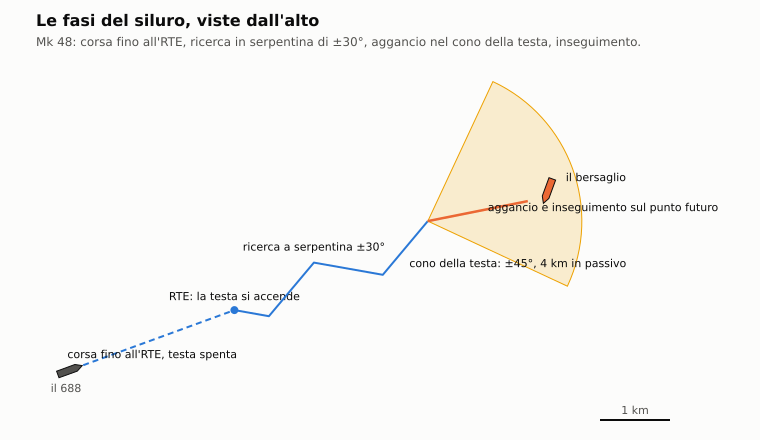
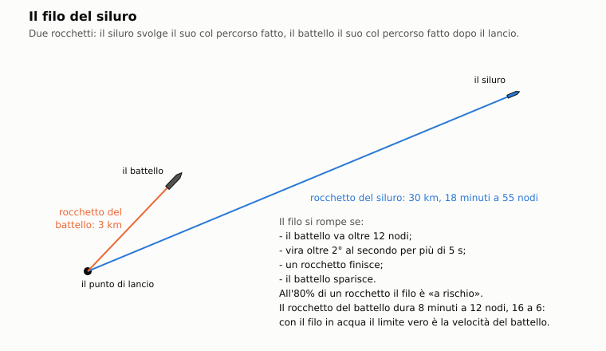

# D1. Siluri

*Autore: kit, per il runtime. Revisione del 27/10/2026. Stato: rivisto (runtime, 27/10/2026), curatore: kit.*

## 1. A che serve

Decide se un siluro arriva sul bersaglio. Nell'Enhanced il siluro non va più dritto verso il contatto: corre sulla
rotta impostata, a una distanza stabilita accende la **testa**, cerca, verifica quello che sente, lo insegue e
scoppia vicino allo scafo. Lungo il **filo di guida** il battello lo corregge finché il filo regge. Ogni scelta
prima del lancio conta: alta velocità arriva prima ma la testa passiva sente meno; una testa attiva si fa sentire;
un soffitto troppo basso fa attaccare la propria nave di scorta. E un'esca può portarlo via (capitolo D2). Il modello
è lo stesso per il giocatore e per l'IA.

## 2. Il modello

Il codice è in `nucleo/siluro.hpp` e `nucleo/src/siluro.cpp` (classe `Siluro`); i dati in `data/motore/siluri.toml`,
generato da `tools/pipeline/siluri.py`. Nella missione lo collegano `missioni/src/missione.cpp`
(`Missione::nuovo_siluro`, `Missione::passo_siluri`) e `missioni/src/stazioni_missione.cpp` (ordini e messaggi). Il
modulo è puro: a ogni passo riceve le sorgenti attorno e restituisce lo stato e gli eventi.

Unità: metri, secondi, m/s; rotte in gradi bussola; quote positive verso il basso.

### 2.1 Quando vale

- `Missione::siluri_enhanced` legge `siluri.toml` e accende il modello. Lo chiama `DanniMissione::avanza` con la
  regola di simulazione, cioè nell'Enhanced. Senza il file i siluri restano quelli dell'originale.
- Passano al modello le armi create dagli script (flag 20h) che non sono missili (i due bit bassi del flag a 3) né esche
  (flag 80h), se la classe è nella tabella. `type53` diventa l'USET-80 (`dati_siluro_missione`); le altre classi hanno
  lo stesso nome. Col carico della sala siluri decide invece la variante uscita dal tubo (`Missione::variante_tubo`):
  per l'Alfa il predefinito della famiglia `type53` è il SET-65 (`carico.toml [predefinite.urss]`).
- Una volta nel modello, gli script dell'arma non girano più: niente fine corsa a tempo, niente taglio del filo a
  tempo, niente colpo per vicinanza dell'originale (`Missione::impatti` salta i siluri del modello).
- Il passo del modello è `dt × m_s_per_nodo / NODO`: nelle missioni sulla scala del 1989 il siluro corre con il moto
  accelerato del mondo, così le distanze tornano (capitolo A2).

### 2.2 I modelli per tipo

Ogni classe (`DatiSiluro`) ha: le due velocità e le autonomie, la quota massima, il rateo di virata, la testata, il
raggio della spoletta, il filo, i modi della testa, le portate d'acquisizione, il cono, l'affidabilità, il fondale minimo
dei siluri leggeri e l'anno d'entrata in servizio. Tutte le classi, da `data/motore/siluri.toml` (la variante nel tubo
la decide la sala siluri, capitolo D5):

<!-- generato: siluri_tabella -->
| Classe | Alta / bassa (kn) | Autonomia alta / bassa (km) | Quota max (m) | Testa | Acquisizione attiva / passiva (m) | Filo (km, siluro / battello) | Testata (kg) | Fondale minimo (m) | In servizio |
|---|---|---|---|---|---|---|---|---|---|
| `mk48` Mk 48 Mod 4 | 55 / 40 | 38 / 50 | 760 | attiva, passiva | 1500 / 4000 | 30 / 3 | 293 | — | 1980 |
| `mk48_adcap` Mk 48 ADCAP | 60 / 40 | 32 / 50 | 800 | attiva, passiva | 2000 / 5000 | 30 / 3 | 295 | — | 1988 |
| `tigerfish` Tigerfish Mk 24 Mod 1 | 35 / 24 | 17 / 33 | 442 | attiva, passiva | 1000 / 2500 | 25 / 3 | 134 | — | 1987 |
| `spearfish` Spearfish | 60 / 30 | 21 / 56 | 600 | attiva, passiva | 2000 / 5000 | 30 / 3 | 300 | — | 1994 |
| `uset80` USET-80 | 45 / 35 | 18 / 24 | 1000 | attiva, passiva | 1200 / 2500 | — | 250 | — | 1980 |
| `test71m` TEST-71M | 40 / 24 | 15 / 20 | 400 | attiva, passiva | 800 / 1500 | 20 / 2 | 205 | — | 1977 |
| `set65` SET-65 | 40 | 16 | 400 | attiva, passiva | 800 / 1500 | — | 205 | — | 1965 |
| `saet60m` SAET-60M | 40 | 15 | 200 | solo passiva | — / 1500 | — | 300 | — | 1969 |
| `type53_65k` 53-65K | 45 | 19 | 100 | segui-scia | — | — | 300 | — | 1969 |
| `mk46` Mk 46 Mod 5 | 45 | 11 | 450 | attiva, passiva | 900 / 1500 | — | 44 | 40 | 1979 |
| `stingray` Sting Ray Mod 0 | 45 | 11 | 800 | attiva, passiva | 1000 / 1500 | — | 45 | 30 | 1983 |
| `at1` AT-1M | 27 | 5 | 200 | attiva | 300 / — | — | 70 | 60 | 1965 |
| `tp42` Tp 42 (Tp 422) | 30 / 20 | 10 / 20 | 200 | attiva, passiva | 500 / 800 | — | 45 | 15 | 1975 |
| `at2` AT-2M | 40 | 10 | 600 | attiva, passiva | 800 / 800 | — | 100 | — | 1973 |
| `umgt1` UMGT-1 Orlan | 41 | 8 | 550 | attiva, passiva | 600 / 600 | — | 60 | — | 1981 |
| `apr2` APR-2 Yastreb-M | 60 / 43 | 3 | 600 | attiva, passiva | 1000 / 1500 | — | 100 | 80 | 1976 |
<!-- fine: siluri_tabella -->

I siluri dei tubi del giocatore sono il Mk 48 e l'ADCAP (688), l'USET-80, il TEST-71M, il SET-65, il SAET-60M e il
53-65K (Alfa). Il Tigerfish e lo Spearfish sono britannici (lo Spearfish, del 1994, solo what-if). Il Mk 46, lo Sting
Ray e il Tp 42 sono i siluri leggeri degli aerei, degli elicotteri e delle navi della NATO e della Svezia; l'AT-1M,
l'AT-2M, l'UMGT-1 e l'APR-2 quelli sovietici (capitolo E5).

### 2.3 Le impostazioni prima del lancio

`ImpostazioniSiluro`, una per tubo nella stazione Armi (`StazioneArmi::impostazioni`), con i valori predefiniti del
codice:

| Campo | Predefinito | Che cosa fa |
|---|---|---|
| `rotta` | 0° | rotta di corsa fino all'attivazione |
| `modo` | passivo | passivo, attivo o **misto** (passivo in ricerca, attivo in verifica e inseguimento) |
| `velocita` | alta | alta o bassa: velocità, autonomia e rumore proprio della testa |
| `rte_m` | 2000 m | *run to enable*: il percorso prima che la testa si accenda |
| `quota_corsa_m` | 60 m | quota fino all'attivazione |
| `quota_ricerca_m` | 100 m | quota della ricerca, sopra o sotto lo strato |
| `soffitto_m` | 15 m | la testa ignora ciò che sta più in alto |
| `pavimento_m` | 600 m | la testa ignora ciò che sta più in basso; il siluro non scende oltre |
| `schema` | serpentina | serpentina, cerchio o dritto |
| `anti_circolare` | sì | si spegne se, dopo l'attivazione, punta il lanciatore |

Regole (`applica`, `Siluro::Siluro`):
- il soffitto non può superare il pavimento, e viceversa; RTE e quote non possono essere negative;
- al lancio il pavimento scende alla quota massima della classe, e le quote di corsa e di ricerca stanno fra 0 e il
  pavimento;
- un modo che la testa non ha viene corretto: il SAET-60M corre in passivo anche se lo si imposta attivo.

**Chi le decide.** Al lancio contano solo i campi del tubo che il giocatore ha toccato. La stazione li segna uno per
uno (`StazioneArmi::campi_impostati`, un bit per campo) e li passa alla missione
(`Missione::imposta_siluro_giocatore`). Gli altri campi li ricava il motore, come per l'IA. Chi imposta solo
l'RTE, per esempio, lancia sulla rotta del contatto e non a 0°. I campi toccati restano al tubo anche per i lanci
successivi.

Il motore ricava i campi come faceva l'istruzione LAUNCH dell'originale, ma con quello che il lanciatore sa del
bersaglio (`Missione::nuovo_siluro`):
- rotta verso la posizione stimata del contatto, o lungo il rilevamento se la posizione non è nota; la posizione vera
  solo se il lanciatore non ha nessun contatto (lo script ha lanciato alla cieca); senza bersaglio, la rotta dell'arma;
- testa mista, alta velocità;
- RTE al 60% della distanza stimata, non meno di 500 m; col solo rilevamento 2000 m (`RTE_SOLO_RILEVAMENTO_M`, STIMA);
- quota di ricerca alla quota stimata del bersaglio; col solo rilevamento alla quota del lanciatore;
- quota di corsa a quella del lanciatore;
- entrambe le quote fra soffitto e pavimento (o la quota massima della classe, se è minore);
- aviolanciato: RTE 0, ricerca a cerchio, testa attiva. La quota di ricerca è la quota vera del bersaglio più un
  errore gaussiano di 60 m (`QUOTA_STIMATA_SIGMA_M`, STIMA), non sopra 15 m: la stima dell'equipaggio. Il siluro ci
  scende subito, perché anche la quota di corsa è quella.

Se il giocatore ha toccato il soffitto o il pavimento, le quote ricavate dal motore (quelle che non ha toccato) si
rimettono fra il soffitto e il pavimento toccati. Il pavimento non va oltre la quota massima della classe. Chi alza il
pavimento a 30 m, per esempio, e lascia la quota di corsa al motore, lancia un siluro che corre a 30 m al più.

### 2.4 Le fasi



```
corsa → ricerca → verifica → inseguimento ⇄ riacquisizione
                                  ↓
                     esploso · spento · esaurito
```

- **Corsa.** Rotta e quota di corsa. La testa è spenta. Finisce quando il percorso supera l'RTE, o prima con il
  comando via filo «abilita». Evento `attivazione`.
- **Ricerca.** Quota di ricerca. Con la serpentina la rotta è `asse + 30° · sin(2π t / 60 s)`
  (`SERPENTINA_GRADI`, `SERPENTINA_PERIODO_S`); col cerchio vira al suo rateo massimo; col dritto tiene l'asse. L'asse
  è la rotta all'attivazione.
- **Verifica** (`VERIFICA_S` = 4 s). La testa ha scelto un candidato: il siluro punta su di lui e ne prende la quota,
  fra soffitto e pavimento. Se lo perde torna in ricerca. Dopo 4 s decide fra aggancio e rifiuto (§2.6).
- **Inseguimento.** Il siluro passa all'alta velocità e mira al punto futuro del bersaglio:

  ```
  t_arrivo = min(30 s, d / v_siluro)
  P_mira = P_bersaglio + V_bersaglio · t_arrivo
  ```

  `d` è la distanza, `V_bersaglio` la velocità vettoriale vera del bersaglio. La quota segue quella del bersaglio, fra
  soffitto e pavimento (per il segui-scia da 0).
- **Riacquisizione.** Dopo 6 s senza contatto (`PERDITA_S`) il siluro perde il bersaglio (evento `perdita`) e gira in
  cerchio al rateo massimo, alla quota di ricerca, finché la testa trova qualcosa.

**Manovra.** A ogni passo la rotta cambia al più di `virata_gradi_s × dt` (8°/s per il Mk 48) e la quota di 4 m/s
(`RATEO_QUOTA_M_S`). La velocità è quella del passo scelto.

**Autonomia.** È una frazione di energia che cala di `passo / portata` alla velocità del momento: metà corsa in alta
e metà in bassa consumano mezza autonomia ciascuna. Finita l'energia il siluro è `esaurito`. Il Mk 48 in alta corre
38 km in 22 minuti; in bassa 50 km in 40 minuti.

### 2.5 La testa

**Che cosa vede** (`Siluro::vede`). Una sorgente è vista se:
- non è fra quelle rifiutate;
- non è il lanciatore, con l'anti-circolare inserito;
- sta fra soffitto e pavimento (non per il segui-scia);
- sta nel cono di ±`semiapertura_gradi` attorno alla prua (45° il Mk 48, 50° l'ADCAP), salvo entro 50 m;
- è entro la portata della testa su di lei.

**La portata** (`Siluro::portata_su`):

```
passiva:  r = r_passiva · 10^((L − 130) / 20)   × 0,6 in alta velocità
attiva:   r = r_attiva  · 10^((TS − 15) / 40)   × 0,33 su un'eco quasi ferma a meno di 10 m dal fondo
tutte e due:                                     × 0,5 se uno strato sta fra la quota del siluro e quella della sorgente
```

- `r_passiva`, `r_attiva`: le portate d'acquisizione della classe (`acquisizione_passiva_m`, `acquisizione_attiva_m`),
  che valgono su una sorgente di 130 dB (`LIVELLO_RIFERIMENTO_DB`) e su un'eco di 15 dB (`TS_RIFERIMENTO_DB`);
- `L`: livello della sorgente sulla scala della testa. Con l'acustica dell'Enhanced è il livello a banda larga della
  sorgente più 18 dB (`sorgente_per_siluri`, `SCALA_TESTA_DB`). Senza, una STIMA dal rumore dell'originale:
  `105 + 2,5 · rumore + 0,5 dB per nodo oltre 5`;
- `TS`: forza di bersaglio. La missione la fissa per categoria, con o senza l'acustica (`Missione::passo_siluri`):
  15 dB per un sottomarino, 25 dB per una nave; le esche nel capitolo D2. La forza di bersaglio delle firme
  (capitolo C4) la testa non la usa;
- 0,6 è il rumore proprio in alta velocità (`RUMORE_PROPRIO_ALTA`, STIMA); 0,5 è lo strato (`STRATO_FATTORE`); gli
  strati sono le quote dei termoclini della missione;
- 0,33 e i 10 m sono `FONDO_FATTORE` e `VICINO_FONDO_M`; «quasi ferma» vuol dire sotto 2 m/s (`DOPPLER_ESCA_M_S`).

L'eco è a 40 log r (andata e ritorno), il rumore a 20 log r: per questo un'eco 10 dB più forte allunga la portata
attiva di 1,8 volte e un rumore 10 dB più forte allunga la passiva di 3,2 volte.

**Esempio.** Un Mk 48 cerca in passivo un sottomarino di 120 dB (senza l'acustica: un 688 a 5 nodi, rumore 6). In
bassa velocità lo sente a 4000 · 10^(−10/20) = 1265 m; in alta a circa 760 m; se il bersaglio è dall'altra parte
dello strato, a circa 380 m. In attivo vede un sottomarino a 1500 m e una nave a 1500 · 10^(10/40), circa
2670 m.

**Il segui-scia** (53-65K) vede solo le navi in moto a 2 m/s o più, entro 1500 m (`SCIA_PORTATA_M`, STIMA), e mai
le esche.

**Chi sceglie.** Fra le sorgenti viste, la più forte alla testa: in passivo `L − 20 log d`, in attivo
`TS − 40 log d`. In ricerca e in riacquisizione diventa il candidato della verifica.

**Il ping.** In attivo (e nel misto, in verifica e inseguimento) la testa emette (`Siluro::ping_in_corso`). La
missione ne fa un transitorio della scena acustica (`missione_transitori.cpp`), con la voce della classe: tanto più
fitto quanto più il siluro è vicino al bersaglio, da 2,4 s alla portata d'acquisizione del Mk 48 a 0,16 s
(`intervallo_ping_testa_s`). Le classi senza una voce (Tigerfish, Spearfish, i leggeri sovietici salvo l'AT-1M) non
hanno il transitorio.

**Guasti.** Una classe con `affidabilita` sotto 1 estrae al lancio se testa e spoletta funzionano. Un siluro guasto
corre ma non vede niente. Hanno un'affidabilità solo il Mk 46 (0,8) e l'AT-1M (0,3).

### 2.6 Aggancio o rifiuto

Alla fine della verifica (`Siluro::ascolta`):
- **fondo**: in attivo, se il candidato è un'eco quasi ferma vicino al fondo, la testa lo scarta come fondo con
  probabilità 0,7 (`FONDO_RIFIUTO`);
- **esca**: la testa la rifiuta con probabilità `p`:
  - in passivo `p` = 0,1;
  - in attivo `p` = 0,5 se l'eco è quasi ferma (niente Doppler), più 0,2 se è corta (meno di 20 m);
- un bersaglio vero non si rifiuta mai.

Il rifiuto mette la sorgente fra le rifiutate per sempre e riporta il siluro in ricerca (evento `esca_rifiutata`).
Altrimenti il siluro aggancia (evento `aggancio`, o `esca_sedotta` se il candidato è un'esca) e passa
all'inseguimento. I numeri delle esche e del disturbo sono nel capitolo D2.

### 2.7 La spoletta

- Si arma dopo un percorso di `min(RTE, 500 m)` (`ARMAMENTO_M`, STIMA).
- Scatta sulla prima unità vera (non un'esca, non il lanciatore con l'anti-circolare) entro il suo raggio.
- Se la classe del bersaglio ha le dimensioni (`classi.toml`), la distanza si misura dallo scafo
  (`distanza_dallo_scafo`): un cilindro lungo quanto il battello e largo quanto lui sull'asse della rotta; per una nave
  la carena dalla superficie al pescaggio. Il raggio è `spoletta_scafo_m`: 5 m per i Mk 48, 1 m per i siluri a
  contatto, 3 m per il segui-scia (STIME).
- Senza dimensioni vale `spoletta_m` dal centro, meno 5 m per un sottomarino e 10 m per una nave.
- Lo scoppio passa alla regola dei colpi del motore (`Missione::colpisci`) con la geometria vera: distanza dal centro e
  differenza di quota. Da lì decidono la fisica delle esplosioni e dei danni (capitoli E1, E2, B3).

**La carica cava dello Sting Ray** (`missioni/src/danni_sottomarini.cpp`, STIMA). I 45 kg di Torpex dello Sting Ray
sono in carica cava, fatta per gli scafi doppi sovietici. Lo scoppio conta come 45 kg di TNT a contatto; in più il
getto fora lo scafo resistente anche oltre l'intercapedine: una falla di circa 25 cm (0,05 m²) e un incendio nel
compartimento dove entra. Il Mk 46, con la sua testa da 108 kg di TNT equivalente, scoppia più forte ma non fora oltre
il doppio scafo.

### 2.8 L'anti-circolare

Dopo l'attivazione, se il siluro punta il lanciatore entro ±45° e a meno di 3000 m (`ACR_SEMIAPERTURA_GRADI`,
`ACR_DISTANZA_M`), si spegne (evento `spento`). La posizione del lanciatore è quella vera finché è fra le sorgenti
(`Missione::passo_siluri` lo segna come lanciatore). Se non c'è più, vale l'ultima nota dal filo. Gli aerei non sono
fra le sorgenti e i loro siluri non hanno filo: per un aviolanciato l'anti-circolare non scatta.

### 2.9 Il filo

Le classi filoguidate (Mk 48, ADCAP, Tigerfish, Spearfish, TEST-71M) partono collegate. A ogni passo
(`Siluro::controlla_filo`):
- il siluro svolge il suo rocchetto: il filo svolto è il percorso fatto;
- il battello svolge il suo: il percorso fatto dal lanciatore dopo il lancio;
- il filo si rompe se il lanciatore va oltre 12 nodi o vira oltre 2°/s per più di 5 s (`FILO_VELOCITA_MAX_KN`,
  `FILO_VIRATA_MAX_GRADI_S`, `FILO_TOLLERANZA_S`), se un rocchetto finisce o se il lanciatore sparisce;
- con un rocchetto all'80% (`FILO_QUASI`) o col battello fuori dai limiti il filo è «a rischio».

**Esempio.** Un Mk 48 in alta velocità finisce i 30 km del suo rocchetto in 18 minuti. Il battello che lo guida a
12 nodi finisce i suoi 3 km in 8 minuti; a 6 nodi in 16. Con il filo in acqua il limite vero è quasi sempre la
velocità del battello.



**I comandi via filo** (`ComandoFilo`), ignorati col filo rotto o tagliato:

| Comando | Effetto |
|---|---|
| `rotta` | nuova rotta, che diventa anche l'asse della ricerca |
| `quota` | nuova quota di corsa e di ricerca, fino al pavimento |
| `velocita` | alta o bassa |
| `modo` | passivo, attivo o misto, se la testa lo consente |
| `abilita` | accende subito la testa (solo in corsa) |
| `rifiuta` | la testa ignora una sorgente; se era il bersaglio, torna in ricerca |
| `assegna` | aggancia una sorgente, anche rifiutata prima, e la insegue in alta velocità |
| `spegni` | il siluro si ferma e affonda senza esplodere |
| `taglia` | il filo si stacca; il siluro continua con la sua testa |

Lungo il filo tornano i dati della testa (`Siluro::testa`): per ogni sorgente vista il rilevamento, la distanza solo
in attivo, e l'avviso «quasi ferma» (sotto 2 m/s), cioè una possibile esca.

### 2.10 Le armi e il filo dell'IA

Nell'Enhanced i sottomarini dell'IA hanno un carico vero, come il giocatore (`nucleo/armi_ia.hpp`,
`missioni/src/missione_armi_ia.cpp`; docs/18, fase 4 B). Le armi dell'IA si accendono con le forze
(`Missione::forze_enhanced` chiama `armi_ia_enhanced`); senza `carico.toml` o `interazioni.toml` restano quelle degli
script.

**Il carico** (`carico_ia`). Ogni sottomarino dell'IA riceve, la prima volta che il passo lo vede, il carico della
sua classe nell'anno della missione:
- le classi con un locale in `carico.toml` (688 e Alfa) usano il carico standard predefinito;
- le altre il carico di `interazioni.toml [armi_ia.<classe>]` (Sturgeon, Trafalgar, Victor III, Akula, Oscar, Typhoon,
  Charlie II, Kilo, Foxtrot); i tubi da 650 mm restano vuoti;
- una variante non in servizio nell'anno diventa la predefinita della famiglia, poi la più recente in servizio della
  stessa famiglia (`variante_dell_anno`); le what-if e le nucleari non si caricano;
- il tetto dei primi due anni di servizio vale anche qui (`massimo_primo_anno`: l'ADCAP nel 1989 al più 6); oltre il
  tetto, la predefinita della famiglia.

**La scelta dell'arma** (`scegli_arma_ia`, `Missione::arma_ia_al_lancio`). Quando lo script lancia un siluro, l'arma
viene dai tubi. Fra i siluri nei tubi vince, in quest'ordine:
- quello che arriva: distanza sotto il 90% della portata (`PORTATA_UTILE`); la distanza è quella stimata del contatto,
  8000 m col solo rilevamento (`DISTANZA_IGNOTA_M`, STIMA);
- quello con più stelle contro il bersaglio (sottomarino o superficie, `SchedaArma::stelle`);
- il filoguidato;
- il più lungo.

Se nessuno ha stelle contro il bersaglio, parte il primo siluro in tubo. Se i tubi non hanno siluri, il lancio dello
script non avviene: l'arma creata si perde. I missili e le mine nei tubi non partono da qui.

**I tubi.** Il tubo usato si vuota e torna carico dopo 300 s (`RICARICA_S`, STIMA), con la stessa variante se ce n'è
ancora in riserva, se no con il siluro più numeroso. Una classe senza dati lancia come prima, senza contare le armi.

**Il tiro di risposta** (`Missione::tiro_di_risposta`, da `passo_difesa`). Un sottomarino dell'IA che sente il
transitorio di un lancio ostile entro 20 km (`TRANSITORIO_LANCIO_M`), una volta su due (`P_OCCHIATA`), lancia lungo il
rilevamento, se ha le armi libere su chi ha lanciato. L'arma viene dai tubi con la stessa scelta. Vale anche nelle
missioni originali: è una difesa (capitolo E6).

**La guida a filo** (`GuidaFiloIa`). I sottomarini dell'IA guidano i loro filoguidati. La dottrina dipende
dall'esperienza del sonarista (`data/motore/interazioni.toml [filo_ia.*]`, tutte STIMA, confidenza bassa):

| Esperienza | Corregge ogni | Oltre | Taglio dopo l'aggancio | Rifiuta le esche |
|---|---|---|---|---|
| recluta | 60 s | 15° | 10 s | no |
| medio | 20 s | 8° | 30 s | sì, oltre 15° dalla stima |
| esperto | 10 s | 5° | 60 s, o entro 1000 m | sì, oltre 10° dalla stima |

- La recluta e il medio tagliano anche entro 1500 m dalla stima, dopo l'aggancio.
- La rotta va verso la posizione stimata del contatto del lanciatore. Col solo rilevamento va su un punto della
  linea del rilevamento, alla distanza dal lanciatore a cui sarà il siluro alla correzione dopo: il siluro stringe
  sulla linea senza tornare indietro.
- La rotta si corregge solo allo scadere del tempo e solo se lo scarto supera la soglia.
- Un'eco «quasi ferma» lontana dalla stima si rifiuta (`rifiuta`), una volta per sorgente.
- Alla perdita del contatto il medio e l'esperto passano la testa in attivo, l'alta velocità e la rotta sulla stima.
- Dopo l'aggancio la rotta non si corregge più. Il filo si taglia passato il tempo della tabella, o prima se il
  siluro è vicino alla stima.
- Il filo si taglia subito se il lanciatore deve evadere (`guida_evasione`) o se il filo è a rischio.
- Mentre guida, il lanciatore rispetta i due limiti del filo: non va oltre 12 nodi e non vira oltre 2°/s
  (`GuidaFiloIa::vincoli`, raccolti in `StatoArmiIa::vincoli`). I vincoli si rifanno a ogni passo e li applica il moto
  (`Missione::navigazione`): la prua ordinata sta al più 10° avanti alla prua (`ANTICIPO_FILO_DEG`), così anche la
  dinamica accosta piano, e il rateo di virata si ferma a 2°/s. Finita la guida, i limiti cadono: non restano
  nell'ordine del battello.
- Le gambe di TMA che il sottomarino fa prima del lancio, col solo rilevamento, sono nel capitolo E6.

**Quando l'IA lancia, e dove mira** (`Missione::arma_ia_al_lancio`, `missioni/src/missione.cpp`, STIMA):
- **la portata:** il siluro resta in tubo se la corsa fino al punto d'incontro, o senza soluzione fino alla posizione
  stimata, supera il 90% della sua portata in alta velocità (`PORTATA_UTILE`);
- **la posizione vecchia:** niente salva se il bersaglio può essersi spostato oltre l'acquisizione di una testa, 2 km
  (`SPOSTAMENTO_MAX_M`). L'età è quella dell'ultima soluzione osservabile della TMA, o dell'ultima scoperta per l'eco, la
  vista e il radar; la velocità è quella della soluzione, o 15 nodi se non c'è (mai meno di 3);
- **l'anticipo:** con una soluzione osservabile della sua TMA, l'IA mira al punto d'incontro, come il giocatore col
  MATE: la rotta del siluro va dove il bersaglio sarà, non dove è. Senza, mira alla posizione stimata; col solo
  rilevamento, lungo il rilevamento. La testa parte in misto e in alta velocità, con l'RTE al 60% della distanza (almeno
  500 m) e la ricerca alla quota stimata del bersaglio.

### 2.11 Le armi antisom delle navi

Le navi dell'IA hanno i loro siluri antisom (`missioni/src/missione_antisom_navi.cpp`, del runtime; STIMA dalle
dotazioni del 1989):
- **la Perry e la Type 22** (Batch 1 e 2): due Mk 32 o STWS Mk 2 tripli da 324 mm col Mk 46 (lo Sting Ray dalle navi
  britanniche venne dopo), fino a 7 km;
- **la Spruance, la Kidd, la Ticonderoga e la Knox:** l'ASROC col Mk 46, fino a 9 km;
- **le sovietiche** (Krivak II, Kara, Kirov, Slava, Udaloy): i tubi da 533 mm col SET-65, fino a 8 km, senza ricariche
  in mare.

Oltre la portata dei tubi la nave fa decollare il suo elicottero ASW, entro 60 km (capitolo E5 §2.11). Il siluro della
nave entra in acqua a 15 m e corre col modello di questo capitolo; dopo un esito la nave aspetta 90 s, e riprende il
contatto prima del colpo seguente.

### 2.12 Sotto il ghiaccio: i falsi echi delle chiglie

Sotto la banchisa una testa attiva vicino alla volta vede le chiglie come bersagli fermi, come le esche: dentro ±20°
d'elevazione e la sua acquisizione, con la forza di bersaglio che cresce col pescaggio (capitolo E11 §2.4). Una
chiglia sotto il soffitto della testa (15 m di serie) la inganna a volte; sopra il soffitto no. I segui-scia non le
vedono. Sotto il pack conviene una quota di ricerca più bassa, lontana dalla volta.

### 2.13 Fine del siluro

- **Esploso**: la spoletta è scattata su un'unità (§2.7).
- **Spento**: via filo o dall'anti-circolare. Il modello lo fa affondare a 1 m/s; la missione lo toglie dal gioco.
- **Esaurito**: finita l'autonomia; tolto dal gioco.
- **Perso**: entrato dove il fondale è a zero, cioè sulla costa (come nell'originale). Col filo il giocatore riceve
  il messaggio 38.
- **Perso all'ingresso**: un aviolanciato in acqua più bassa del suo minimo urta il fondo nel tuffo
  (`fondale_minimo_m`: Tp 42 15 m, Sting Ray 30 m, Mk 46 40 m, AT-1M 60 m, APR-2 80 m; la tabella di §2.2).

### 2.14 La probabilità di colpire

Non c'è una tabella di probabilità. L'esito viene dalla geometria, dalla testa, dalle esche, dal filo e dalla
manovra del bersaglio. Le sole probabilità esplicite sono il rifiuto in verifica (§2.6), il disturbo delle esche
(capitolo D2) e l'affidabilità. Si sono tarate sui casi storici (§6).

## 3. Fonti e confidenza

| Parametro | Fonte | Confidenza |
|---|---|---|
| Velocità, autonomie, quote, testate dei siluri | dossier 01 §6.1-6.2, dossier 14 §2.9; la nota di ogni classe in `siluri.toml` | media; per classe |
| Impostazioni prima del lancio, fasi, schemi di ricerca | dossier 02 §6.2 | media |
| Serpentina ±30° in 60 s | dossier 02 §6.2 (20-45°) | **STIMA** |
| Portate della testa, cono, verifica di 4 s, perdita dopo 6 s | nessuna fonte aperta | **STIMA DI GIOCO** |
| Rifiuto delle esche (Doppler, estensione) | dossier 05 §5.3 e §5.6 [TWZ] [PAT5235924] | **STIMA** sui valori |
| Filo: 30 + 3 km, 12 kn, 2°/s, 5 s | dossier 02 §6.2; dossier 05 §5.6 | **STIMA DI GIOCO** |
| Anti-circolare: 3 km, ±45° | nessuna fonte aperta | **STIMA DI GIOCO** |
| Spoletta: armamento a 500 m, raggi dallo scafo | modello dei danni (dossier 07) | **STIMA** |
| Fondo: portata a un terzo, rifiuto 0,7 | dossier 17 §6.7 (Pk ≤ 0,1 su un battello posato) | **STIMA**, taratura A6.1 |
| Affidabilità del Mk 46 e dell'AT-1M | dossier 17 §6.7 e §9 | **STIMA**, taratura A6 |
| Dottrine del filo dell'IA | dossier 02 §6.2 e §6.4 | **STIMA**, bassa |
| Carichi dell'IA per classe | dossier 01 §2, dossier 14 §1.4 (`[armi_ia.*]`, la fonte di ogni classe) | media; composizioni in parte **STIMA** |
| Ricarica dei tubi dell'IA in 300 s, distanza di scelta di 8000 m | nessuna fonte (4-6 minuti a mano o col sistema idraulico) | **STIMA** |

Le STIME della testa sono scelte per avere portate dell'ordine di quelle citate per le teste dell'epoca (1-2 km in
attivo, qualche km in passivo) e per far valere le regole qualitative del dossier 05 §5.3: il passivo si fa sedurre,
l'attivo smaschera l'esca ferma.

## 4. Classico ed Enhanced

Nel classico il siluro è un'unità degli script (`docs/originale/sensori_e_navigazione.md` §10.3 e §9.8,
`docs/originale/prestazioni.md`):
- insegue il contatto copiato dal lanciatore, a traccia solida, e ne prende la quota;
- colpisce **qualsiasi** unità entro 100 piedi di quota e 5 unità di gioco per asse (185 m), anche amici e neutrali;
- la corsa e il filo sono timer dello script:

| Arma | Velocità | Corsa | Filo tagliato a | Danno |
|---|---|---|---|---|
| Mk 48 | 50,3 kn | 280 s | 190 s | 75 |
| Type 53 (533 mm) | 45,7 kn | 240 s | 170 s | 100 |

- il danno si dimezza in 7 passi su 18; dopo il taglio del filo il siluro può colpire il proprio lanciatore (difetto
  dell'originale);
- la guida a filo ha tre comandi: **DIRECT** (`guida_e2`, l'arma va al punto scelto sulla carta), **CERCA**
  (`guida_e1`, messaggio 41, torna al comportamento di ricerca) e **DETONATE** (`guida_e0`, messaggio 19, l'arma
  sparisce senza danni);
- non ci sono impostazioni, testa, strati, verifica né anti-circolare.

Nell'Enhanced vale tutto il §2. DETONATE non c'è: nessun siluro dell'epoca poteva farsi esplodere via filo
(decisione del 24/10/2026, `nucleo/siluro.hpp`); al suo posto lo spegnimento. Il rilievo delle 110 partite del classico
resta identico.

## 5. Come si vede in gioco

Volume 1, capitolo 6: §6.2 (tubi e lancio) e §6.3 (siluri, impostazioni, filo).

- **Stazione Armi** (F7): le impostazioni del tubo scelto, col campo scelto fra parentesi; «(DAL LANCIO)» se non le
  si è toccate. Toccato un campo, la scritta sparisce, ma i campi non toccati li ricava ancora il motore al lancio
  (§2.3): il pannello ne mostra il valore predefinito, non quello che userà. Tab sceglie il campo, `[` e `]` cambiano il valore (rotta a passi di 10°, RTE di 500 m, quote di
  15 m, soffitto di 5 m, pavimento di 50 m). Sotto, la fase del siluro scelto e la percentuale del filo, con
  «A RISCHIO».
- **Tasti della guida**: S siluro filoguidato successivo; Z e X rotta di 10° a sinistra o a dritta (alla stazione
  Sonar con l'acustica muovono invece il fascio); 8 e 9 quota di 15 m più su o più giù (solo alla stazione Armi); C
  abilita la testa (`ComandoFiloTipo::abilita`); D spegne il siluro; Y taglia il filo; Ctrl+I DIRECT dalla carta (il
  siluro prende la rotta verso il punto). Velocità, modo, rifiuto e assegnazione non hanno un tasto: l'ordine
  `comando_filo` li porta già al siluro (`StazioniMissione`), ma l'interfaccia non li manda.
- **Messaggi**: 2 siluro lanciato; 263 testa attiva; 264 aggancio; 265 contatto perso; 266 spento via filo; 39 filo
  a rischio (una volta per siluro); 23 filo tranciato; 24 fine corsa; 19 esplosione subacquea; 38 siluro perso sulla
  costa; 438 e 439 la scelta del punto di DIRECT; 233 e 234 nessuna arma o arma non filoguidata. Per un siluro nemico
  il sonar dà il 311 «siluro in acqua».
- **Cuffia e sonar**: il lancio dal tubo e le teste attive sono transitori della scena acustica (capitolo C8).
- **Debriefing**: lanci, colpi ed esche sedotte nel registro (capitolo F1).

## 6. Taratura e prove

Taratura:
- **Mk 46 contro un SSN non allertato**: Pk 0,5-0,7 nelle fonti; affidabilità 0,8 (taratura A6.1 del 25/10/2026).
- **AT-1M contro un Foxtrot**: Pk 0,15-0,18 delle prove sovietiche; prima della taratura colpiva il 96% dei lanci.
  Acquisizione portata a 300 m e affidabilità a 0,3 (taratura A6, `docs/13_asw_aereo.md`).
- **Battello fermo sul fondo in acque basse**: Pk ≤ 0,1 (Falkland, dossier 17 §6.7), da cui le costanti del fondo.

Prove (`test/prove_siluro.cpp`, `siluro:` e `siluro nella missione:`):
- «tabella delle classi con fonti e prestazioni d'epoca»; «anno di servizio, impostazioni da ordine e avviso del
  filo»;
- «corsa dritta fino all'RTE, poi la testa si attiva»; «serpentina di +-30 gradi attorno all'asse di ricerca»;
- «aggancio passivo, inseguimento con anticipo e spoletta di prossimita'»; «la distanza dallo scafo misura dal
  cilindro dello scafo, non dal centro»;
- «soffitto e strato; il segui-scia vede solo le navi in moto»; «anti-circolare, si spegne se torna verso il
  lanciatore»;
- «filo, comandi, vincoli del lanciatore e taglio»; «spegnimento via filo, si ferma e affonda senza esplodere»;
- «perdita del contatto e riacquisizione a cerchio; esaurimento a fine autonomia»;
- «battello fermo sul fondo in acque basse, la testa attiva lo vede poco e lo scarta come fondo»;
- «classico invariato, modello con esplosione sul bersaglio»; «senza siluri.toml i siluri restano classici»;
  «impostazioni del giocatore, filo e spegnimento»;
- «siluro dell'IA: si lancia sul contatto del lanciatore, non sulla posizione vera (docs/18 fase 1)».

Altre prove:
- `test/prove_enhanced_giocatore.cpp`: «enhanced: lancio con le impostazioni del tubo, rotta via filo e
  spegnimento»;
- `test/prove_armi_giocatore.cpp`: «armi: impostazioni dei siluri per tubo (Enhanced)»; per il classico «armi: guida
  a filo solo per i propri siluri collegati» e «armi: filo tagliato a 190 s e fine corsa a 280 s, come negli
  script»;
- `test/prove_armi_ia.cpp`: «armi dell'IA: il catalogo e le dottrine del filo», «armi dell'IA: carico per classe e
  anno, con le varianti dell'anno», «armi dell'IA: la scelta dell'arma per bersaglio, portata e filo», «armi
  dell'IA: la guida a filo porta il siluro sul bersaglio e poi taglia», «armi dell'IA: esche rifiutate
  dall'esperto, taglio per evadere, vincoli del lanciatore»;
- `test/prove_comandi.cpp`: «comandi: lancio dal tubo 1, selezione del siluro e DETONATE dell'originale»;
- `test/prove_danni_missione.cpp`: «impatto: il siluro colpisce entro 5 unita' per asse e 100 piedi, poi
  sparisce».

## 7. Limiti noti e in arrivo

- La testa non usa l'equazione del sonar: scala una portata di riferimento col livello o con l'eco. Non conta il
  rumore ambiente, la frequenza né la propagazione, salvo il fattore fisso dello strato.
- Le probabilità di rifiuto sono fisse e non dipendono dalla classe del siluro: un ADCAP si fa ingannare come un
  SET-65. Il dossier 05 §7.3 propone un fattore per generazione che il codice non usa.
- Il pannello della stazione Armi non distingue i campi toccati da quelli che ricaverà il motore.
- Nessuna prova automatica tiene fermo il lancio con una parte sola dei campi toccati.
- Il giocatore non ha tasti per velocità, modo, rifiuto e assegnazione via filo; li usa solo l'IA. **In arrivo**
  nell'interfaccia.
- Il 53-65K vede la nave in moto come una sorgente puntiforme: la scia non ha forma né durata.
- Le armi non interagiscono fra loro: un siluro non scoppia su un altro siluro.
- **In arrivo** (roadmap, punto 25): le esche rimorchiate delle navi contro i siluri del giocatore (capitolo D2).

## 8. Riferimenti

- Codice: `nucleo/siluro.hpp`, `nucleo/src/siluro.cpp`, `nucleo/armi_giocatore.hpp`, `nucleo/src/armi_giocatore.cpp`,
  `nucleo/armi_ia.hpp`, `nucleo/src/armi_ia.cpp`, `missioni/src/missione.cpp` (`nuovo_siluro`, `passo_siluri`),
  `missioni/src/missione_armi_ia.cpp` (carico, scelta, tubi, filo e tiro di risposta dell'IA),
  `missioni/src/missione_difesa.cpp` (`passo_difesa`), `missioni/src/missione_transitori.cpp` (ping della testa),
  `missioni/src/stazioni_missione.cpp`, `app/interfaccia.cpp`.
- Dati: `data/motore/siluri.toml` (da `tools/pipeline/siluri.py`), `data/motore/interazioni.toml [armi_ia.*]` e
  `[filo_ia.*]`, `data/motore/carico.toml` (carichi standard, varianti e stelle), `data/motore/classi.toml`
  (dimensioni per la spoletta).
- Ricerca: dossier 01 §6.1-6.2; dossier 02 §6.2-6.4; dossier 05 §5.3 e §5.6; dossier 14 §2.1 e §2.9;
  dossier 17 §6.7.
- Progetto: `docs/11_comandi_e_stazioni.md` §3.3 e §10; `docs/18_interazioni_ia.md`; `engine/README.md` («Siluri
  dell'Enhanced»); per il classico `docs/originale/sensori_e_navigazione.md` §9.8 e §10.3, `docs/04_vm_missioni.md`.
- Capitoli: D2 esche, D5 carico e ricarica, E6 l'IA, C2 propagazione, C4 firme, E1 ed E2 esplosioni e danni, B3 danni del
  battello, A2 moto classico, appendice G3.
