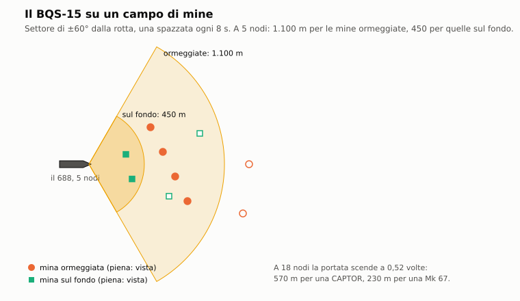

# D4. Mine

*Autore: kit, per il runtime. Revisione del 30/10/2026 (l'IA vede e aggira le mine). Stato: rivisto (runtime, 27/10/2026), curatore: kit.*

## 1. A che serve

Decide dove si posa una mina, quando diventa pericolosa e chi la fa scoppiare. Il battello posa le mine dai tubi,
come un siluro. La Mk 67 corre da sola per chilometri prima di fermarsi sul fondo, così il battello resta lontano
dall'imboccatura che vuole chiudere. La CAPTOR aspetta un sottomarino e gli lancia contro un Mk 46. Le mine-razzo
sovietiche colpiscono il sottomarino che passa sopra di loro. Ogni mina vuole il suo fondale: fuori resta inerte. E
nessuna distingue amici e nemici. Il BQS-15 del 688 le trova a prua, al prezzo di farsi sentire.

## 2. Il modello

Il codice è in `nucleo/mine.hpp` e `nucleo/src/mine.cpp` (`CampoMinato`); i dati in `data/motore/carico.toml
[mine.*]`, da `tools/pipeline/carico.py`. Nella missione lo collega `missioni/src/missione.cpp` (`posa_mina`,
`posa_mina_ia`, `passo_mine`, `innesco_mina`); il sonar per le mine è in `missioni/src/missione_bqs15.cpp`. Il modulo
è puro: a ogni passo riceve i bersagli e il fondale e restituisce le mine posate, armate e innescate; la missione
applica gli scoppi e i siluri.

### 2.1 Quando vale

Le mine ci sono solo nell'Enhanced. `Missione::siluri_enhanced` legge `[mine.*]` di `carico.toml` insieme ai siluri e
posa il campo iniziale della missione. Senza i dati il campo minato non sa posare nulla: la posa dal tubo fallisce
col messaggio 364.

### 2.2 I quattro comportamenti

`TipoMina`:
- **influenza** (Mk 67, MDT): sul fondo; scoppia quando una nave o un sottomarino passa entro il raggio;
- **captor** (Mk 60): ormeggiata sopra il fondo; rileva un sottomarino in immersione e libera un siluro leggero;
- **mina_razzo** (PMR-1, PMR-2): ormeggiata a quota fissa sopra fondali profondi; rileva un sottomarino in
  immersione sopra di lei e gli lancia un razzo che scoppia vicino;
- **mina_siluro**: sul fondo, lancia un siluro contro navi e sottomarini. Nessuna mina del catalogo la usa.

### 2.3 Le mine del catalogo

Da `data/motore/carico.toml [mine.*]` (posti e anni di servizio nel capitolo D5):

| Mina | Tipo | Carica | Raggio | Fondale | Quota della mina | Bersagli |
|---|---|---|---|---|---|---|
| Mk 67 SLMM | influenza, mobile | 150 kg | 60 m | 10-100 m | sul fondo | navi e sottomarini |
| Mk 60 CAPTOR | captor (Mk 46) | 44 kg | 1000 m | 200-900 m | 150 m sopra il fondo | sottomarini sotto 30 m |
| PMR-1 Kal'mar | mina_razzo | 200 kg | 100 m | 200-1000 m | al più 300 m | sottomarini sotto 30 m, sopra la mina |
| PMR-2 | mina_razzo | 175 kg | 200 m | 200-1000 m | al più 300 m | sottomarini sotto 30 m, sopra la mina |
| MDT | influenza | 600 kg | 50 m | 8-50 m | sul fondo | navi e sottomarini |

Tutte si armano 600 s dopo la posa (`armamento_s`). La Mk 67 corre fino a 13 km a 20 nodi (`corsa_max_m`,
`velocita_corsa_kn`). Il PMR ha anche l'errore del razzo: lo scoppio a 10 m dal bersaglio (`errore_razzo_m`).

### 2.4 La posa dal tubo

Una mina si carica, si arma e si lancia come le altre armi (capitolo D5): il tubo armato dà il messaggio 366 «Mina
armata». Al lancio la missione non chiama un gestore dello script ma il campo minato (`Missione::posa_mina`):
- la mina è la variante uscita dal tubo; se manca, o mancano i dati, messaggio 364 e niente posa;
- la Mk 67 corre lungo la **rotta** e per la **distanza** del tubo: la rotta e l'RTE della stazione Armi (capitolo
  D1 §2.3). Vale la regola dei soli campi toccati, come per i siluri: la rotta del tubo se il giocatore l'ha toccata,
  se no la rotta del battello; l'RTE del tubo se l'ha toccato, se no tutta la corsa, 13 km. Chi tocca solo la rotta
  posa la mina in fondo alla corsa, a 13 km. La distanza si ferma alla corsa massima;
- le altre si posano dove sono state lanciate, sotto il battello;
- le mine non contano fra le armi in acqua.

**La corsa.** La Mk 67 avanza alla sua velocità, con il passo del mondo come i siluri (`dt × m_s_per_nodo / NODO`).
A 20 nodi i 13 km le servono 21 minuti. Se incontra terra durante la corsa si ferma lì, inerte.

**Esempio.** Un 688 a 12 km dall'imboccatura di un fiordo lancia una Mk 67 con la rotta del canale e l'RTE a 12 km.
La mina arriva dopo 19 minuti e si posa sul fondo: se il fondo sta fra 10 e 100 m è posata (messaggio 367) e si arma
dopo altri 10 minuti; se è più profondo resta inerte (messaggio 368).

### 2.5 Sul fondo

Alla fine della corsa (al primo passo per le mine che non corrono) la mina guarda il fondale sotto di sé
(`CampoMinato::posa_sul_fondo`):
- **fuori dalle sue profondità**, o a terra: resta **inerte**, per sempre;
- altrimenti si posa. La quota è `fondale − ormeggio`; per le mine-razzo non più di `quota_mina_m`:

  ```
  Mk 67, MDT:  quota = fondale
  CAPTOR:      quota = fondale − 150 m
  PMR:         quota = min(fondale, 300 m)
  ```

  Una CAPTOR su 600 m di fondale sta a 450 m; un PMR su 800 m sta a 300 m, su 250 m sta sul fondo;
- si arma dopo `armamento_s`, contati dalla posa sul fondo, non dal lancio.

### 2.6 L'innesco

A ogni passo una mina armata cerca il bersaglio adatto più vicino entro il raggio (`CampoMinato::avanza`):

```
r = √(d_orizzontale² + (quota_mina − quota_bersaglio)²)    innesco se r ≤ raggio
```

- i bersagli sono tutte le navi e i sottomarini della missione, di qualunque parte, anche chi l'ha posata; non le
  armi né gli aerei;
- `navi` e `sottomarini` dicono quali categorie la mina sente;
- un sottomarino più in alto di `quota_min_bersaglio_m` (30 m) non conta, per le CAPTOR e i PMR: devono essere in
  immersione;
- per i PMR il bersaglio deve stare sopra la mina (`solo_sopra`): così si rende il settore di 160° verso l'alto del
  PMR-2;
- a parità di distanza vince l'unità con l'id più basso;
- la mina agisce una volta sola.

Che cosa succede (`Missione::innesco_mina`):
- **influenza**: lo scoppio sul posto. La missione crea un'arma della parte del posatore, con lui come lanciatore,
  e applica il colpo con la regola dei colpi del motore. Il danno classico è quello del Mk 48 in proporzione alla
  carica (`75 × carica / 293`); per la fisica valgono la carica vera, la distanza e la differenza di quota, con
  l'indicazione «a influenza» (capitoli E1, E2, B3);
- **captor**: un Mk 46 (`[siluri.mk46]`) parte dalla mina verso il bersaglio, all'alta velocità, col modello
  dell'Enhanced (capitolo D1). Il bersaglio l'ha scoperto la mina da sé, entro il suo raggio: il siluro non usa il
  contatto del posatore (`Missione::nuovo_siluro`, le armi nate da una mina). Le impostazioni sono quelle ricavate dal
  motore (D1 §2.3) sulla posizione e sulla quota vere del bersaglio: rotta dalla mina verso di lui, testa mista, RTE
  al 60% della distanza (non meno di 500 m), ricerca alla sua quota. Se colpisce, lo scoppio ha la carica della mina,
  44 kg;
- **mina_razzo**: il razzo arriva subito. Lo scoppio è nella posizione del bersaglio, a 10 m da lui e alla sua quota,
  con la carica della mina.

**Esempio.** Una Mk 67 su 50 m di fondale. Una nave in superficie la fa scoppiare se le passa entro
√(60² − 50²) ≈ 33 m in orizzontale. Su 70 m di fondale la nave, alla quota 0, è sempre a più di 60 m: solo un
sottomarino in immersione la fa scoppiare.

### 2.7 I campi dell'IA e delle missioni

- **Il campo già posato.** Una missione può dichiarare le sue mine nella tabella `mine`: tipo, posizione (x, y), parte
  (`lato`: urss, usa o neutrale; predefinita «urss») e `armata` (predefinita sì). `siluri_enhanced` le posa all'avvio;
  quelle armate lo sono subito. Il posatore è nessuno (-1): non sono eventi del registro e non danno messaggi di posa.
  Le usano, per esempio, le schede S06 e I04 della libreria (`docs/17_libreria_missioni.md`).
- **La posa dell'IA.** Lo script chiama `m688.posa_mina(unità, tipo, quante, ogni_s)` (`f_posa_mina`; predefiniti 1
  mina e 60 s). L'unità, una nave o un sottomarino dell'IA, posa una mina sotto di sé ogni `ogni_s` secondi, finché ne
  ha (`Missione::posa_mina_ia`). La Mk 67 posata così non corre. Le mine posate entrano nel registro come
  `mina_posata` del posatore, non note al giocatore.
- **L'IA non evita le mine**, né le proprie né le altrui.

### 2.8 Il BQS-15



Il sonar attivo ad alta frequenza della vela del 688 (`missioni/src/missione_bqs15.cpp`). Qui solo per le mine.
Tutte le cifre sono STIME DI GIOCO del dossier 06: quelle vere sono classificate.

- **Chi lo ha.** Le classi del 688 (`ha_bqs15`: «los_angeles» e varianti), e solo nell'Enhanced.
- **La spazzata.** Ogni 8 s (`SPAZZATA_S`), la prima appena acceso. Il settore è di ±60° dalla rotta
  (`SETTORE_DEG`) e da −30° a +45° in elevazione (`ELEVAZIONE_MIN`, `ELEVAZIONE_MAX`; positiva verso l'alto).
- **La portata**:

  ```
  portata = P₀ × f(v)
  P₀ = 1100 m per una mina ormeggiata (più di 2 m sopra il fondo), 450 m per una mina sul fondo
  f(v) = 1 fino a 5 kn;  1 − 0,03 (v − 5) fino a 15 kn;  0,7 − 0,06 (v − 15) fino a 20 kn;  0,4 oltre
  ```

  `PORTATA_ORMEGGIATA_M`, `PORTATA_FONDO_M`; la distanza è quella in tre dimensioni. Sul fondo la mina si confonde con
  la riverberazione. A 18 nodi `f` vale 0,52: 570 m per una CAPTOR, 230 m per una Mk 67.
- **Che cosa trova.** Ogni mina nel settore e in portata, già posata o ancora da armare, anche inerte; non quelle in
  corsa né quelle scoppiate. Anche le proprie.
- **L'IA** (dal 30/10/2026, per simmetria). Un sottomarino dell'IA col BQS-15 acceso tiene le sue mine scoperte come
  il giocatore (`Missione::mine_scoperte_ia`). Lo stesso vale per i sonar da mine sovietici, l'MG-70 e l'MG-24, a ogni
  spazzata del sonar del fondo (`missione_fondale_ia.cpp`). Il sonar si accende da solo:
  - nei campi minati noti, cioè le mine della sua parte o quelle già viste, entro la distanza del campo;
  - sotto la banchisa;
  - vicino al fondo in navigazione sopra i 3 nodi;
  - mai quando l'unità è in silenzio (`nucleo/src/sondaggio_ia.cpp`).
- **Le mine aggirate** (`Missione::evita_mine`). Il pilota dell'IA guarda le mine viste nell'ultima ora entro 2 km
  davanti. Se la rotta passerebbe a meno di 300 m dalla più vicina, accosta quanto basta dal lato opposto. Se è già
  dentro i 300 m, si allontana. Margine e memoria sono **STIMA**. Le mine scoppiate non contano più.
- **La stima.** Distanza con 5 m d'errore, azimut ed elevazione con 1° (`ERRORE_DISTANZA_M`, `ERRORE_ANGOLO_DEG`,
  gaussiani). La posizione stimata si aggiorna a ogni spazzata finché la mina resta nel settore. Ogni mina trovata va
  in `Missione::mine_scoperte()` e nel registro come `mina_scoperta`. Gli script la leggono con
  `m688.mine_scoperte()` e accendono il sonar con `m688.bqs15(unità, acceso)` (`docs/09_schema_missioni.md` §5.1c).
- **La contro-scoperta.** Ogni spazzata è un impulso di 205 dB a 25 kHz, lungo 10 ms. Arriva ai sensori passivi
  degli altri che sentono quella banda: nel fascio a pieno livello, fuori con i lobi laterali, 25 dB sotto
  (`LOBI_DB`). Il calcolo è quello dei ping (capitoli C1 e C7).

## 3. Fonti e confidenza

| Parametro | Fonte | Confidenza |
|---|---|---|
| Mk 67: Mk 37 modificato, corsa 13 km, 150 kg | dossier 14 §2.6 [WPSLMM] [FASMk67] | alta per le dimensioni |
| Mk 67: raggio, fondali, velocità di corsa | nessuna fonte | **STIMA** |
| Mk 60 CAPTOR: Mk 46 in un contenitore ancorato | dossier 14 §2.7 [WPCaptor] | alta |
| CAPTOR: raggio, fondali, ormeggio | nessuna fonte | **STIMA** |
| PMR-1: 200 kg, bersagli a 30-400 m | dossier 14 §2.12 [RuPMR1] [AMPMR2] | media |
| PMR-2: 175 kg, raggio 200 m, settore di 160° verso l'alto, fondali 200-1000 m, mina a 200-400 m | dossier 14 §2.12 [AMPMR2] [WFPMR2] | media |
| PMR: raggio del PMR-1 metà di quello del PMR-2 | dossier 14 §2.12 | media |
| PMR: quota di 300 m, errore del razzo di 10 m | nessuna fonte | **STIMA** |
| MDT: 600 kg, raggio 50 m, fondali fino a 50 m | dossier 14 §2.12 [WPMDT] [AMMDT] | media; il minimo di 8 m **STIMA** |
| Armamento dopo 600 s | nessuna fonte | **STIMA** |
| BQS-15: spazzata di 8-10 s, settore, portata su TS −15 dB, 205 dB a 25 kHz, lobi a −20/−25 dB | dossier 06 §1.1, §2 e §7 | **STIMA DI GIOCO** del dossier |

Il dossier 14 §2.12 segnala una contraddizione: una fonte vuole che il PMR-1 lanci un siluro da 400 mm. La correzione
del 25/10/2026 lo tiene mina-razzo solo antisom, come il PMR-2.

## 4. Classico ed Enhanced

Il classico non ha mine né BQS-15. Nelle missioni della libreria che le usano, giocate nel classico, le mine non ci
sono (`docs/17_libreria_missioni.md`).

## 5. Come si vede in gioco

Volume 1: §6.6 (le mine), §3.8 (il BQS-15), §5.1 (le mine sulla carta), §8.4 (le mine nemiche).

- **Stazione Armi** (F7): il tubo con la mina si arma (366) e si lancia con L. La rotta e l'RTE del tubo sono la
  rotta e la distanza della Mk 67.
- **Messaggi**: 364 posa non possibile; 367 mina posata; 368 mina posata su un fondale inadatto, inerte (questi due
  solo per le mine del giocatore); 369 esplosione di una mina (per ogni mina che si innesca, anche altrui, e anche
  quando una CAPTOR libera il suo Mk 46); 450 BQS-15 in trasmissione; 451 mina a prua; 452
  BQS-15 spento.
- **Tasti**: Ctrl+M accende e spegne il BQS-15.
- **Carta**: le mine posate dal battello col loro stato (in corsa, in armamento con l'ora, armata); quelle trovate dal
  BQS-15 nella posizione stimata.
- **Registro e debriefing**: mine posate, inerti, scoperte ed esplose, con chi le ha posate e chi le ha fatte
  scoppiare (`mina_posata`, `mina_scoperta`, `mina_esplosa`); gli obiettivi di minamento (capitolo F1).

## 6. Taratura e prove

Nessuna taratura numerica: i valori sono quelli del catalogo.

Prove:
- `test/prove_mine.cpp`: «mine: dati»; «mine: Mk 67, corsa, posa, armamento e scoppio sotto una nave»; «mine:
  fondali inadatti e terra»; «mine: CAPTOR e PMR-2 contro i sottomarini»; «mine: una Mk 67 posata dal tubo scoppia
  sotto una nave (Enhanced)»; «mine: la CAPTOR libera un Mk 46 contro un sottomarino nemico (Enhanced)»;
- `test/prove_bqs15.cpp`: «BQS-15: le mine nel settore di prua, l'evento del registro e chi sente gli impulsi (S06)»;
  «BQS-15: la portata cala con la velocita' e con il fondo; niente senza l'Enhanced»; «BQS-15: fuori dal fascio di
  prua l'impulso arriva coi lobi laterali, 25 dB sotto»;
- `test/prove_carico.cpp`: «carico: mine nei tubi, tubi vuoti alla partenza»;
- `test/prove_libreria_missioni.cpp`: «libreria S07 «Tappo»: sei Mk 67 nel campo e via (Enhanced); senza mine la
  ritirata non basta»; «libreria S06 «Petroliere»: la mina colpisce la prima, arriva l'ordine, il posamine riparte e
  posa; fermato, finisce bene»; «libreria I04 «La porta di Ercole»: a Cadice e' fatta; oltre 20 nodi il P-3C; nel
  canale le CAPTOR (Enhanced)»;
- `test/prove_effetti.cpp`: «fenomeni: bombe di profondita', razzi e mine».

## 7. Limiti noti e in arrivo

- L'influenza è solo una distanza: niente firma magnetica, di pressione o acustica del bersaglio, niente contanavi.
- Il raggio si misura dalla quota dell'unità, non dalla chiglia: su un fondale più profondo del raggio una mina a
  influenza non sente le navi in superficie (§2.6).
- Il Mk 46 della CAPTOR ha come lanciatore chi l'ha posata: la testa e la spoletta del modello ignorano il
  lanciatore (capitolo D1 §2.7-2.8), quindi il siluro di una CAPTOR non colpisce il suo posatore. La mina in sé invece
  si innesca anche su di lui. E l'anti-circolare spegne il Mk 46 se punta il posatore entro 3000 m.
- Il Mk 46 della CAPTOR parte sulla posizione vera del bersaglio: la scoperta della mina non ha errore.
- Il razzo dei PMR arriva nello stesso passo: niente tempo di volo, niente mancato oltre l'errore fisso di 10 m.
- Le mine non si dragano, non si spostano e non si consumano col tempo.
- L'IA vede solo le mine del suo sonar, e le aggira solo in pianta: non cambia quota per passare sopra una mina sul
  fondo. Le navi di superficie dell'IA non hanno sonar da mine.
- Nessuna mina del catalogo usa il comportamento `mina_siluro`.
- Nessuna funzione nuova delle mine è decisa nella roadmap.

## 8. Riferimenti

- Codice: `nucleo/mine.hpp`, `nucleo/src/mine.cpp`, `missioni/src/missione.cpp` (`siluri_enhanced`, `posa_mina`,
  `posa_mina_ia`, `f_posa_mina`, `passo_mine`, `innesco_mina`, la tabella `mine` delle missioni),
  `missioni/src/missione_bqs15.cpp`, `nucleo/armi_giocatore.hpp` (messaggi 364-369), `app/interfaccia.cpp`.
- Dati: `data/motore/carico.toml [mine.*]` (da `tools/pipeline/carico.py`), `[siluri.mk46]` di `siluri.toml`.
- Ricerca: dossier 14 §2.6, §2.7 e §2.12; dossier 06 §1.1, §2 e §7.
- Progetto: `docs/17_libreria_missioni.md` (S06, S07, I04); `docs/09_schema_missioni.md` (la tabella `mine`);
  `docs/00_ROADMAP.md` (sagome delle armi e delle mine).
- Capitoli: D5 carico e ricarica, D1 siluri, C7 sonar attivo e BQS-15, E1 esplosioni, E2 e B3 danni, F1 registro.
