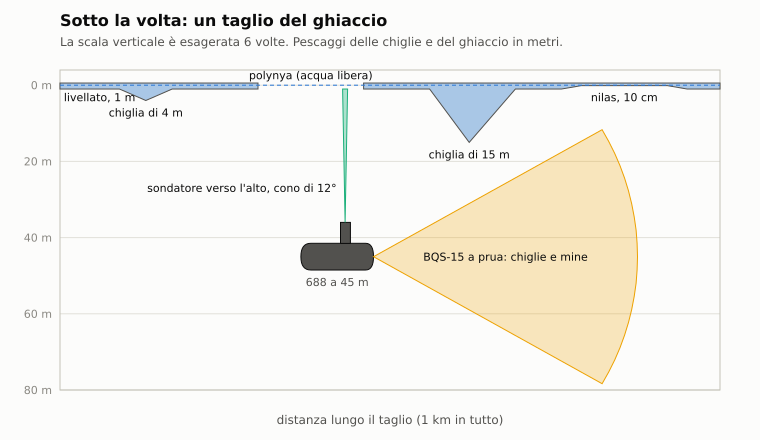
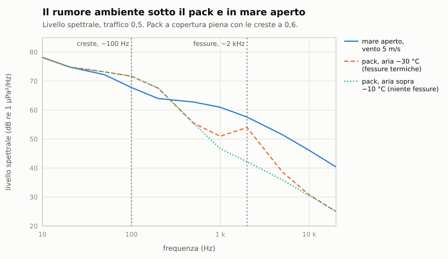

# E11. Sotto il ghiaccio

*Autore: disassemblatore (il campo, la volta, l'acustica del pack, i falsi echi); il runtime per le regole di bordo,
l'urto, l'IA e le missioni. Revisione del 03/11/2026. Stato: rivisto dagli autori (curatore: kit).*

## 1. A che serve

Sotto la banchisa il sottomarino è più nascosto e più cieco:
- **sopra** ha un tetto: niente periscopio né antenne, la radio arriva solo in ELF, e risale solo dove il ghiaccio è
  aperto o sottile;
- **il tetto ha le chiglie**, creste di ghiaccio che scendono fino a 20 m (50 nel pack pluriennale) e che la vela può
  urtare;
- **il sonar** sente un mare diverso, col ghiaccio che scricchiola e le creste che si spingono, e il sonar attivo prende
  le chiglie per bersagli.

Questo capitolo dice come il gioco costruisce il ghiaccio, come il battello lo misura e come lo sente. Le missioni I16
«Il bastione bianco» e I17 «La soglia di Ekaterina», nell'Okhotsk a marzo, sono quelle che lo usano di più.

## 2. Il modello

### 2.1 Il campo del ghiaccio

`nucleo/campo_ghiaccio` (`CampoGhiaccio`) è procedurale e deterministico dal seme della missione, sulla copertura che
il meteo dà per punto (`StatoMeteo::ghiaccio`, da 0 a 1; capitolo E7). Il mare è diviso in celle da 200 m:

- **lo spessore livellato:** 1 m nel ghiaccio di primo anno, 3 m nel pack pluriennale oltre gli 80° di latitudine
  (Sharpe 1988), con ±30% fra le celle (STIMA);
- **le chiglie:** con probabilità dalle creste per km di rotta (4 per km, STIMA) una cella ha una chiglia. Il pescaggio
  è lognormale, con la media e il 99° percentile di Ervik 2023 per il primo anno nel Barents sudoccidentale: media
  3,8 m, 99° percentile 9,4 m, massimo 20 m. Nel pack pluriennale le creste arrivano a 50 m;
- **l'acqua libera:** polynye e canali a blocchi di 1,5 km. A copertura piena sono il 10% del mare (CNR08); metà di
  quei blocchi è richiusa da ghiaccio nuovo sottile, il nilas, fra 5 e 15 cm. Il nilas è quello che un 688 può sfondare
  risalendo;
- **la deriva:** il pack si muove rigido, sotto un nodo (0,1 e 0,05 m/s, STIMA). `in(p, t)` guarda il punto p meno la
  deriva per il tempo: una polynya di un'ora fa non è più dov'era.

Per ogni punto il campo dice se c'è ghiaccio, se è acqua libera o nilas, lo spessore e il **pescaggio**: la chiglia, se
c'è, altrimenti 0,9 dello spessore. `pescaggio_max(a, b, t)` dà il più profondo lungo un tratto, per l'urto della vela
e per gli avvisi.

La forma fine di una cresta, lunga e stretta, è una semplificazione: qui una chiglia è il pescaggio massimo della sua
cella.

**Il ghiaccio che si muove** (vetrino di Dio, D4; docs/28 §3.3; solo nel vetrino, capitolo F8):
- **la deriva a tratti:** `cambia_deriva(t, v)` cambia la velocità del pack da quell'istante. Il campo non salta:
  `spostamento(t)` è la somma dei tratti. Il bordo del pack va dietro alla deriva cambiata, non a quella normale;
- **le zone forzate:** `forza_zona` è un cerchio fermo nel mondo.
  - **Apri:** una polynya che si apre dal centro in `transizione_s`, acqua libera;
  - **chiudi:** dov'è acqua libera nasce un nilas che ingrossa da 5 a 15 cm durante la transizione, poi il ghiaccio
    livellato; il ghiaccio che c'era resta. Chi è emerso non resta preso all'istante: riceve l'avviso, e alla fine vale
    il blocco sotto banchisa (§2.5). Nessun danno.
  - Con una durata, dopo si torna indietro nello stesso tempo;
- **una copertura sola:** `CampoGhiaccio::copertura_in(p, t)` tiene conto della deriva cambiata e delle zone.
  `Missione::copertura_ghiaccio(p)` la usa solo se il campo è stato cambiato, altrimenti è il meteo, bit per bit. La
  leggono l'acustica (`ambiente_acustico`, quindi §2.3) e le regole di bordo: sotto una polynya aperta torna il mare libero,
  col suo rumore e la sua superficie;
- **chi vede che cosa:**
  - la vista del periscopio (`app/vista_ghiaccio.hpp`) prende la copertura da `copertura_ghiaccio` e lo spostamento da
    `spostamento(t)`: lastre e creste restano attaccate al campo dopo un cambio di deriva, e sopra una polynya il mare non è più
    calmato dal pack. Senza cambi è il meteo e la deriva per il tempo, bit per bit;
  - la carta del giocatore resta il clima (`disegna_meteo_carta`): polynye e deriva cambiata non ci sono. Il battello le sa solo
    dalla volta che misura (§2.2): sotto una polynya aperta sondatore e sonar continuano a misurare anche se la copertura è 0, e
    arriva il messaggio dell'acqua libera;
  - la carta dello spettatore le disegna dai soli record X (`polynye_a` in `app/segni_ambiente.hpp`, con la fase del campo), quindi
    anche nel replay da file: capitolo 12. Il pack attorno viene da una griglia del clima nei metadati della traccia
    (`missioni/griglia_ghiaccio.hpp`, passo di 10 km, STIMA), scritta solo nel vetrino di un teatro col ghiaccio; `campo_spettatore`
    ne rifà il campo con la deriva e le zone dei record. A Kunashir in febbraio, sul bordo vero e con due derive sovrapposte, lo
    scarto massimo dal campo è 0,03 di copertura, e il bordo a 0,5 cambia nello 0,9% dei punti di controllo;
  - un intervento `meteo` a meteo realistico ferma il mare e il tempo in tutto il teatro, ma non il pack: la copertura resta quella
    del punto (`Meteo::fissa_sopra`). Con un meteo fisso dell'autore o col semplificato il ghiaccio resta uniforme, com'era.

### 2.2 La volta e il sondatore verso l'alto

`nucleo/volta_ghiaccio` è quello che il battello sa del ghiaccio, dalle sole misure (come il quadro del fondale per il
fondo, capitolo C12 §2.12):

- **il sondatore verso l'alto:** un cono di 12°, fino a 1.000 m, una misura ogni 2 s nella missione. Misura il
  pescaggio più profondo nel cono, quindi una chiglia vicina si vede prima di esserci sotto. L'errore è di 0,5 m più
  l'1% (STIMA). **Il ghiaccio liscio** sotto 1 m sembra acqua libera 4 volte su 10 (STIMA, dall'esperienza del 1962:
  «non distingue bene 3 piedi di ghiaccio liscio dall'acqua libera»);
- **la spazzata delle chiglie a prua:** ogni 5 s il BQS-15 acceso dei Los Angeles, l'MG-70 dei sovietici e il BQS-8
  degli Sturgeon (capitolo C7 §2.9) cercano le chiglie davanti alla prua. Diventano un ostacolo quelle che arrivano
  fino a 10 m sopra la cima della vela;
- **il quadro della volta:** per cella il pescaggio più profondo misurato e quante volte la cella è sembrata libera. Le
  polynye candidate sono le celle viste libere, con la loro età: il pack deriva, e il quadro non lo corregge. Si salva
  e si ricarica con la missione; il campo si rifà dal seme;
- **gli avvisi dell'equipaggio**, dalle sole misure:

| Messaggio | Quando |
|---|---|
| 486 | la volta a meno di 15 m sopra la cima della vela, o che scende in due sondaggi recenti |
| 487 | una chiglia a prua che arriva alla quota entro il tempo di reazione |
| 488 | acqua libera sopra |
| 489 | gli alberi bloccati dal ghiaccio |
| 484 | troppo veloci per la portata vista dall'ultima spazzata (lo stesso avviso del fondo) |

Le misure arrivano in posizione stimata, come per il fondo. Sotto la banchisa il punto nave che chiede un'antenna non
c'è, quindi il quadro non si corregge.

### 2.3 L'acustica del pack

Sotto la volta il mare suona e propaga diversamente (dossier 06 §5.1; `nucleo/src/acustica.cpp`). Il carattere del
pack si legge per celle da 5 km, ogni 10 minuti (`Missione::carattere_ghiaccio`):

- **le creste che si spingono** (`ghiaccio_creste`, la frazione di punti con una chiglia rispetto a un pack «pieno» al
  30%): un rumore suo attorno ai 100 Hz, 72 dB più 10 log della frazione, che cala di 12 dB per ogni 0,6 decadi;
- **le fessure termiche** col freddo dell'aria (`ghiaccio_fessure`: da −10 °C a −30 °C da 0 a 1): fino a 18 dB in più
  attorno ai 2 kHz;
- **il vento** non fa rumore dove c'è ghiaccio: il suo contributo è pesato con l'acqua libera;
- **la superficie** è la volta: al posto delle onde la sua rugosità, 1 m nel primo anno e 2,5 m nel pluriennale. Ogni
  rimbalzo perde 0,5 dB nel ghiaccio (STIMA), e la riverberazione di superficie del sonar attivo è quella del ghiaccio
  rugoso (−30 dB a 10° di radenza più 10 log della rugosità, al più −15 dB).

Le fessure e i lastroni che si sfregano hanno anche i loro campioni veri (AWI, «Polar Sounds», CC BY 4.0) nella cuffia
del sonar (capitolo C8).

### 2.4 I falsi echi delle chiglie

Una chiglia è un riflettore rugoso grande come uno scafo. La sua forza di bersaglio cresce col pescaggio: 0 dB a 10 m,
+6 dB a ogni raddoppio, fra −15 e +10 dB (STIMA; `forza_bersaglio_chiglia_db`).

- **Le teste dei siluri:** una testa attiva vicino alla volta (dentro ±20° d'elevazione e dentro la sua acquisizione)
  vede le creste come bersagli fermi, come le esche (`echi_chiglie_siluro`). Una chiglia sotto il soffitto della testa
  la inganna a volte; sopra il soffitto (15 m di serie) no. I segui-scia non le vedono.
- **Il sonar attivo:** un ping sotto il pack, del giocatore o dell'IA (la simmetria, dal 31/10/2026), dà i falsi echi
  delle creste più profonde di 6 m, fino a 8 km, la più vicina ogni 5° (`echi_chiglie_ping`). Non diventano contatti: il
  sonar non li distingue da un bersaglio fermo. Per riconoscerli servono la volta della pagina del fondale e la
  pazienza: un'eco che non si muove, dove la volta scende, è una chiglia. Dentro una polynya aperta il ping sente le chiglie oltre
  il bordo. L'ambiente si prende dalla parte della chiglia, perché la via corre sotto il pack; se no tutta la via conterebbe come
  mare libero. Nel Barents, ping da 40 m: 7 falsi echi nel pack, fra 1,6 e 2,8 km; dal centro di una polynya di raggio 1 km
  ancora 7, di 2 km 2, di 4 km 1, di 6 km 0.

### 2.5 Le regole di bordo

Sotto la banchisa, cioè con ghiaccio sopra e non acqua libera (`sotto_banchisa`), nulla arriva alla superficie:
- **alberi e periscopio:** non si alzano; l'ordine non vale e l'equipaggio avvisa (489, «alberi bloccati dal ghiaccio»);
- **la radio:** solo l'ELF. Il filo galleggiante e la boa non arrivano all'aria, quindi niente VLF né HF, e niente
  rapporti né conferme;
- **l'emersione:** solo in acqua libera o nel nilas. Il quadro della volta le segna (488, «acqua libera sopra»); salire
  sotto ghiaccio vero è un urto dal basso (§2.6);
- **il punto nave:** niente con l'antenna o il periscopio (satelliti, Loran, radar, visivo, fari). Resta il batimetrico,
  dove il fondo ha isobate utili; altrimenti si naviga a stima (capitolo C12);
- **i conti:** il tempo sotto la banchisa, le emersioni nel ghiaccio e gli urti contano per gli achievement e le
  statistiche (capitolo F3); con almeno 10 minuti sotto la banchisa una missione delle rapide o dell'editor vale come
  artica per la carriera.

### 2.6 L'urto della vela con il ghiaccio

- **Quando:** la cima della vela tocca una chiglia o la volta. Andando avanti l'urto è di prua; salendo sotto la volta
  è dal basso, sul centro della vela.
- **Con che cosa:** un ostacolo fisso con la massa della chiglia, pescaggio² × 60 m di ghiaccio poroso (densità 0,9,
  porosità 0,7; STIMA). L'urto lo valuta il modello delle collisioni (capitolo E3), con lo stesso contratto degli urti fra
  unità.
- **I danni:** li applica DanniSottomarini: vela, alberi, periscopi e, oltre una certa energia, lo scafo.
- **Dopo:** il battello resta 2 m sotto la chiglia, con un quinto della velocità, finché non si allontana. Un urto per
  chiglia: il prossimo vale solo dopo 20 s.
- **In acqua:** l'urto mette in acqua i suoi transitori, come una collisione, e chi ascolta li sente. Nei cambi di quota
  oltre i 100 m in profondità lo scafo scricchiola, come ovunque (i transitori dello scafo, docs/18).

### 2.7 L'IA sotto la banchisa

- **La volta dell'IA:** ogni sottomarino dell'IA ha il suo quadro della volta, dal sondatore verso l'alto, salvo in
  silenzio. Chi ce l'ha fa le spazzate col sonar del ghiaccio: l'MG-70 dei sovietici, il BQS-15 dei 688, il BQS-8 degli
  Sturgeon, ogni 5 s. Ogni spazzata è un impulso che gli altri possono intercettare.
- **La quota:** tiene la cima della vela 25 m sotto le chiglie misurate fino a 2 km a prua, mai oltre i 300 m (il fondo
  lo guarda il sondaggio del fondo), e almeno 4 nodi per governare. Le chiglie che non ha misurato non le evita.
- **Il rifugio:** un battello diesel sotto il pack va in profondità a batteria verso il suo rifugio, cioè la polynya più
  recente nel suo quadro, e lo ricerca ogni 10 minuti perché il pack deriva. Lì sale e ci resta piano (1,5 nodi).
- **Il punto nave:** come per il giocatore, niente sotto la banchisa; il suo navigatore resta a stima.
- **L'ASW aereo:** boe e sonar a immersione solo in acqua libera (capitolo E5); il datum sotto il pack resta senza boe.
- **I ping:** un ping dell'IA sotto il pack ha i falsi echi delle chiglie (§2.4).

## 3. Fonti e confidenza

| Che cosa | Fonte | Confidenza |
|---|---|---|
| Le chiglie del primo anno (media 3,8 m, 99° percentile 9,4 m) | Ervik 2023, Barents sudoccidentale (dossier 06 §5) | alta per i numeri; la distribuzione per cella **STIMA** |
| Il pack pluriennale (3 m, creste fino a 50 m) | Sharpe 1988 (dossier 06 §5) | media |
| L'acqua libera al 10% | CNR08 (dossier 06 §5) | media |
| Il sondatore verso l'alto e il liscio scambiato per acqua | dossier 06 §1.1, l'esperienza del 1962 | bassa; i numeri **STIMA** |
| Il rumore delle creste e delle fessure, la rugosità della volta | dossier 06 §5.1 | media per la forma; i livelli **STIMA** |
| La forza di bersaglio delle chiglie | dossier 06 §5.1 | **STIMA** |

## 4. Classico ed Enhanced

Il ghiaccio c'è solo nell'Enhanced, col meteo e l'acustica. Nel classico il mare non ha ghiaccio.

## 5. Come si vede in gioco

- **La pagina del fondale** (Ctrl+H): sotto il ghiaccio diventa la pagina della volta, col profilo misurato sopra il
  battello, le chiglie a prua e le tacche blu dell'acqua libera (capitolo C12 §2.12).
- **La carta:** le polynye candidate del quadro.
- **I messaggi** 484 e 486-489.
- **La cuffia del sonar:** il pack che scricchiola.

## 6. Taratura e prove

- `test/prove_campo_ghiaccio.cpp`: le chiglie di Ervik, l'acqua libera del 10%, il nilas, la copertura; deterministico
  dal seme, la deriva rigida, il pescaggio massimo lungo un tratto; la deriva a tratti senza salti, il bordo che le va
  dietro, la polynya che si apre e torna, quella che si chiude in nilas.
- `test/prove_modifica_profilo.cpp`: la copertura nella missione, la polynya che si chiude su un battello, due partite
  identiche.
- `test/prove_vetrino_ghiaccio.cpp`: la vista del periscopio attaccata al campo, bit per bit senza cambi; la polynya dello
  spettatore che fa la stessa strada del campo, all'andata e al ritorno, e la carta di prima a ritorno finito; la carta del giocatore
  identica con e senza polynya, col sondatore che la misura; la griglia solo nel vetrino col ghiaccio, le tracce senza griglia o
  rovinate che si aprono come prima; il pack dello spettatore contro quello vero a Kunashir; il bordo che segue la deriva; il
  profilo dello spettatore contro `Missione::profilo_in`, in una zona e in tutto il teatro, nella transizione e al ritorno; le
  righe, anche nelle acque polari; il metadato solo nel vetrino; schermo identico senza il mese o con un mese rovinato; il meteo
  fermato che lascia il pack dov'è (griglia uguale cella per cella); i falsi echi dentro la polynya contro le chiglie oltre il
  bordo; la telecamera solo sull'Alfa.
- `test/prove_volta_ghiaccio.cpp`: il sondatore e il liscio scambiato; le chiglie a prua e gli ostacoli; la portata e
  gli avvisi; il quadro salvato e ricaricato; in transito a 15 m l'avviso prima della chiglia; la storia del sondatore;
  i falsi echi per la testa vicino alla volta e non in profondità.
- `test/prove_ghiaccio_missione.cpp` (del runtime): il pack dal meteo; la volta del 688 col BQS-15 e del Victor con
  l'MG-70; l'urto della vela; il Victor che scende sotto le chiglie; niente senza ghiaccio e nel classico; il VLF e
  l'ELF; antenna e periscopio bloccati; la testa ingannata; i falsi echi del ping del 688 e dell'IA; lo Sturgeon col
  BQS-8; la PMR-2 aggirata.
- `test/prove_scafo.cpp` (del runtime): lo scafo che scricchiola scendendo oltre i 100 m, sentito da una nave a
  2 km; la soffiata d'emergenza che si sente lontano.

## 7. Limiti noti e in arrivo

- **Le chiglie sono celle**, non creste lunghe: una cresta vera taglia il percorso per centinaia di metri, qui è una
  cella di 200 m.
- **Il pack non si muove a pezzi:** deriva rigido, senza aperture e chiusure dei canali durante la missione. Nel
  vetrino di Dio la deriva cambia a tratti e le polynye si aprono e si chiudono (§2.1), ma sempre con un campo rigido.
- **La griglia dello spettatore è una sola,** presa prima del primo passo. Le celle fini del campo, polynye naturali comprese,
  sulla carta non ci sono.
- **La propagazione** sotto il ghiaccio non ha il condotto superficiale tipico dell'Artico (il profilo a gradiente
  positivo dalla superficie): usa il profilo del clima del teatro.

## 8. Riferimenti

- Dossier `docs/ricerca/06` §1.1 e §5; il piano `sotto-ghiaccio-piano.md` (opzione A, approvata il 29/10/2026).
- Codice: `nucleo/campo_ghiaccio`, `nucleo/volta_ghiaccio`, `nucleo/src/acustica.cpp` (rumore e superficie),
  `missioni/src/missione_ghiaccio.cpp` (del runtime).
- Capitoli: C2 e C3 (propagazione e rumore), C7 (BQS-15), C8 (audio), C12 §2.12 (la pagina della volta), E3 (urti),
  E5 (ASW aereo), E7 (meteo).
