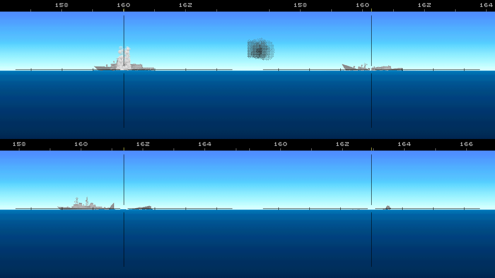

# E2. Danni e affondamento delle navi

*Autore: kit. Revisione del 28/10/2026. Stato: rivisto (curatore: kit).*

## 1. A che serve

Decide cosa succede a una nave colpita: quanta acqua entra e dove va, come sbanda e si apprua, se la trave dello
scafo regge, se prende fuoco e se il fuoco arriva ai depositi, se l'equipaggio la salva o la abbandona. Da questa
fisica escono il modo e il tempo dell'affondamento, l'immagine al periscopio (la nave disegnata nell'assetto
calcolato) e il comportamento della nave nella missione (rallenta, si ritira, chiede soccorso). Una sola fisica per
meccanica, immagine e suono.

## 2. Il modello

Il codice è in `nucleo/danni.hpp` e `nucleo/src/danni.cpp` (`DanniNave`); l'adattatore per le missioni è
`missioni/src/danni_missione.cpp` (`DanniMissione`). Lo scafo viene da `data/motore/scafi/<classe>.toml`. Passi:
dinamica 0,1 s, livelli dell'acqua 0,5 s; incendi, controllo danni, paratie e trave 1 s.

### 2.1 Lo scafo

- **Sezioni**: 60 stazioni lungo lo scafo, con la sezione vera del modello 3D del kit compresa l'opera viva
  (`tools/navi/compartimenti.py`), la semilarghezza ogni 0,25 m di quota. Il dislocamento della fisica è quello della
  carena del modello, che sta entro il 2% di quello pubblicato.
- **Celle stagne**: dalla compartimentazione della classe (paratia di collisione, locali, casse laterali, macchine,
  depositi, stive o cisterne), ognuna con permeabilità, uso, combustibile e, per i depositi, il tipo di munizioni,
  l'esplosivo (kg di TNT), il propellente e la protezione (0-1: corazza, paratie, sprinkler). Le celle dei
  serbatoi hanno anche il carburante (nafta, gasolio, JP-5, benzina avio, il carico liquido) in tonnellate. I dati
  per classe stanno in `tools/navi/danni_critici.py` (37 classi).
- **Aperture**: le paratie fra celle vicine, con la loro perdita (0,002 m² sulle navi militari con le porte stagne
  chiuse, 0,02 sui mercantili) e la loro soglia di cedimento; le aperture di coperta (0,15 m² sulle militari, 0,4 sui
  mercantili, nessuna sui sottomarini), che allagano quando la coperta va sott'acqua.
- **Baricentro**: la quota viene dal GM intatto della classe.
- **Masse**: per stazione, il 75% in proporzione al volume immerso e il 25% distribuito in parti uguali su un tratto
  simmetrico attorno al centro di carena.

<!-- generato: scafi_navi -->
| Classe | Tipo | Dislocamento (t) | Lunghezza × larghezza (m) | GM (m) | Squadre | Qualità del CD | Resistenza della trave | Celle stagne |
|---|---|---|---|---|---|---|---|---|
| AGI classe Okean (LINZA) | militare | 760 | 50,8 × 8,8 | 0,70 | 1 | 0,50 | 0,60 | 7 |
| Grande peschereccio sovietico (BMRT) | mercantile | 4240 | 94,5 × 15,1 | 0,80 | 1 | 0,50 | 1,00 | 9 |
| Portacontainer (Cpl. Louis J. Hauge Jr., ex Estelle Maersk) | portacontainer | 46000 | 230,2 × 27,4 | 1,50 | 2 | 0,50 | 1,00 | 26 |
| Cianciolo | mercantile | 1860 | 50,0 × 12,5 | 0,80 | 1 | 0,50 | 1,00 | 7 |
| Grisha III (Progetto 1124M) | militare | 1120 | 71,1 × 9,8 | 0,80 | 2 | 0,80 | 0,80 | 9 |
| Hauk (motocannoniera norvegese) | militare | 148 | 36,5 × 5,7 | 0,70 | 1 | 1,00 | 0,40 | 7 |
| Iowa (BB-61) | militare | 57500 | 270,4 × 33,0 | 2,80 | 8 | 1,00 | 1,60 | 51 |
| Kara (Progetto 1134B) | militare | 9700 | 173,2 × 18,6 | 1,30 | 4 | 0,80 | 0,80 | 21 |
| Kidd (DDG-993) | militare | 9574 | 171,7 × 16,8 | 1,40 | 5 | 1,00 | 0,80 | 25 |
| Kirov (Progetto 1144) | militare | 24300 | 252,0 × 25,0 | 2,00 | 6 | 0,80 | 1,00 | 33 |
| Kitty Hawk (CV-63) | militare | 81800 | 323,6 × 40,8 | 3,00 | 10 | 1,00 | 1,30 | 73 |
| Knox (FF-1052) | militare | 4065 | 134,0 × 14,2 | 1,00 | 4 | 1,00 | 0,80 | 19 |
| Koni (Progetto 1159) | militare | 1900 | 96,5 × 12,5 | 0,90 | 2 | 0,80 | 0,80 | 10 |
| Krivak II (Progetto 1135M) | militare | 3900 | 123,5 × 14,0 | 1,00 | 3 | 0,80 | 0,80 | 18 |
| Mercantile (Ravenstvo, tipo Leninskiy Komsomol) | mercantile | 22000 | 169,9 × 21,8 | 0,80 | 2 | 0,50 | 1,00 | 9 |
| Nanuchka I (Progetto 1234) | militare | 670 | 59,3 × 11,1 | 0,80 | 1 | 0,80 | 0,60 | 7 |
| Nave oceanografica | mercantile | 2450 | 75,0 × 14,2 | 0,70 | 1 | 0,50 | 0,60 | 8 |
| Nimitz (CVN-68) | militare | 100000 | 332,8 × 40,8 | 3,00 | 10 | 1,00 | 1,30 | 73 |
| Oslo (F300) | militare | 1745 | 96,6 × 11,1 | 0,90 | 3 | 1,00 | 0,70 | 15 |
| Oliver Hazard Perry (FFG-7) | militare | 4100 | 138,1 × 13,7 | 1,10 | 4 | 1,00 | 0,80 | 21 |
| Peschereccio d'altura (Atlantic Peace, 1987) | mercantile | 2000 | 57,0 × 13,0 | 0,80 | 1 | 0,50 | 1,00 | 7 |
| Peschereccio costiero (palangaro, reti da posta) | mercantile | 360 | 30,0 × 7,5 | 0,80 | 1 | 0,50 | 1,00 | 6 |
| Petroliera (Sea Isle City, 1981) | petroliera | 100000 | 231,8 × 44,0 | 4,00 | 2 | 0,50 | 1,00 | 27 |
| Petroliera costiera e chimichiera | petroliera | 12100 | 120,0 × 19,2 | 1,20 | 1 | 0,50 | 1,00 | 19 |
| Portarinfuse | mercantile | 60000 | 225,0 × 33,8 | 1,00 | 2 | 0,50 | 1,00 | 10 |
| Rimorchiatore d'altura | mercantile | 1800 | 50,0 × 13,5 | 0,90 | 1 | 0,50 | 1,00 | 7 |
| Rompighiaccio diesel-elettrico | mercantile | 15000 | 130,0 × 26,0 | 1,50 | 2 | 0,60 | 1,30 | 11 |
| Sacramento (AOE-1) | militare | 53600 | 241,7 × 32,6 | 2,00 | 6 | 1,00 | 1,00 | 37 |
| Slava (Progetto 1164) | militare | 11500 | 186,4 × 19,3 | 1,50 | 4 | 0,80 | 0,80 | 24 |
| Spruance (DD-963) | militare | 8040 | 171,7 × 16,8 | 1,40 | 5 | 1,00 | 0,80 | 25 |
| Stockholm (K11) | militare | 372 | 50,0 × 7,0 | 0,80 | 2 | 1,00 | 0,50 | 8 |
| Ticonderoga (CG-47) | militare | 9800 | 172,5 × 16,8 | 1,30 | 5 | 1,00 | 0,80 | 25 |
| Traghetto ro-ro e passeggeri | mercantile | 14000 | 150,0 × 24,0 | 1,20 | 2 | 0,50 | 0,90 | 11 |
| Type 22 Broadsword (Batch 1) | militare | 4400 | 131,2 × 14,8 | 1,10 | 4 | 1,00 | 0,80 | 21 |
| Type 22 Boxer (Batch 2) | militare | 4800 | 146,5 × 14,7 | 1,10 | 4 | 1,00 | 0,80 | 20 |
| Udaloy (Progetto 1155) | militare | 7620 | 163,5 × 18,9 | 1,30 | 4 | 0,80 | 0,80 | 21 |
| Ugra (Progetto 1886) | militare | 9650 | 141,4 × 17,7 | 1,20 | 4 | 0,80 | 0,90 | 19 |
<!-- fine: scafi_navi -->

### 2.2 Idrostatica e dinamica

L'idrostatica è **per stazioni a qualunque assetto**: ogni sezione si taglia col piano del mare, anche con la nave sul
fianco, capovolta o in verticale. Per ogni stazione si ha l'area immersa e il suo centro, quindi la spinta e il suo
momento.

L'**acqua imbarcata** è un peso con il pelo libero orizzontale nel mondo: si sposta con lo sbandamento, quindi le
superfici libere tolgono stabilità da sole, senza correzioni a parte. I livelli dell'acqua di ogni cella si trovano
sul volume col metodo della falsa posizione (variante dell'Illinois), partendo dal livello precedente.

La **dinamica** ha tre gradi di libertà (sussulto, rollio, beccheggio), con le masse aggiunte e lo smorzamento:
`ζ = 0,6` per sussulto e beccheggio, `0,15` per il rollio; momenti d'inerzia `M (0,4 B)² · 1,2` e `M (0,27 L)² ·
1,3`; nel sussulto la massa aggiunta è pari a quella della nave. Lo smorzamento viene dalle frequenze proprie della
nave intatta. Un corpo è **affondato** quando anche il suo punto più alto è 2 m sotto la superficie.

### 2.3 I flussi

```
Q = C_d · A · sqrt(2 g Δh),   C_d = 0,6
```

attraverso falle, perdite delle paratie, paratie squarciate o cedute, aperture di coperta. `Δh` è la differenza fra
i livelli dell'acqua (o fra il mare e la cella) alla quota dell'apertura.

**Le paratie trasversali cedono** quando la differenza di livello supera la loro soglia: l'altezza dello scafo sulle
navi militari, l'80% sui mercantili, ±20% per paratia (**STIMA**). Da quel momento il varco è di almeno 3 m².

### 2.4 Le esplosioni

`DanniNave::colpo(Esplosione)`: tipo (siluro, mina, missile, bomba, deposito, proietto), punto nello scafo, carica in
TNT, a contatto o no.

**Sott'acqua.** La bolla ha raggio `A_max = 3,5 · W^(1/3) / (d + 10)^(1/3)` (capitolo E1).
- **Falla**: a contatto di diametro `D = 1,25 · W^(1/3)`; a distanza `s` più piccola, `D · max(0,3; 1 − s/A_max)`, e
  nulla oltre il raggio della bolla. La falla si divide fra le celle che attraversa.
- **Paratie**: quelle trasversali dentro la falla si squarciano (un quarto dell'area); porte e passaggi entro 1,5 D si
  deformano (0,1 m²); dai 64 kg la paratia interna della cassa laterale colpita si sfonda verso il centro.
- **Depositi e macchine** nella falla: il deposito esplode con il `10% · S · (1 − protezione)`, con la sensibilità S del §2.6; le macchine e le casse
  laterali prendono fuoco col 30%.
- **La bolla sotto la chiglia** (senza contatto, entro `1,5 A_max`) solleva la nave (fino a 3 m/s,
  `15 · W^(1/3) / (s + 5)`) e poi la lascia: la **frusta**, inarcamento e insellamento, con ampiezza
  `min(0,4 A_max; 5 m) · (1 − s / 1,5 A_max)` (solo per il disegno).
- **Rottura della chiglia** (carica entro `1,5 A_max` sotto la chiglia, nel tratto centrale di metà nave):

  | Nave | Probabilità |
  |---|---|
  | lunga meno di 130 m | `min(1, W/150)` |
  | fra 130 e 200 m | `0,7 · min(1, W/400)` |
  | oltre 200 m o 20.000 t | `0,08 · min(1, W/400)` |

  Una nave oltre le 20.000 t sta nella terza riga anche se è corta. Se non si spezza, la trave
  perde il 40% della resistenza. Oltre il 30% della lunghezza dal centro, dai 150 kg, la prua o la poppa possono essere
  asportate con probabilità `0,5 · min(1, W / (0,03 · dislocamento in t))`.

**Sopra il galleggiamento** (missili, proietti):
- falla sul fianco di area `(0,7 · W^(1/3))²` per il missile, `(0,35 · W^(1/3))²` per il proietto (0,1 m² col 76 mm,
  0,3 col 5");
- incendio nel locale dello scoppio (intensità 0,6): missile 80% sotto le 5000 t e 50% sopra (il carburante che
  resta); proietto 12% e 5%. Il greggio nelle cisterne della petroliera prende fuoco col 30% dei missili (dossier 07
  §5.3: 20-40%). Nei serbatoi di JP-5 o benzina avio la probabilità è una volta e mezza e il fuoco parte
  da 0,8;
- deposito: il missile lo fa esplodere col `4% · S`, il proietto col `4% · S · min(1, W/25 kg)` (0,1% col 76 mm, 4% col 16", a
  S = 1), con la sensibilità S del contenuto (§2.6),
  sempre per `(1 − protezione)`;
- incendi sopra coperta (hangar, lanciatori): sempre col missile, col 10% col proietto. I lanciatori con i missili in
  coperta (la zona ha la sua carica) saltano con le stesse probabilità di un deposito, senza protezione.

**Una falla sola non affonda una nave ben compartimentata.** L'acqua riempie il locale colpito e si ferma alle
paratie; la nave si appesantisce e sbanda poco. Le falle piccole (fino a 1 m²) il controllo danni le tampona. Le prove
del motore lo confermano: una Perry, un Kara, un mercantile e una petroliera, con una falla sul fianco a centro nave da
0,25 a 32 m², restano a galla per sei ore. Va così anche nei casi veri del dossier 07 (§2):
- la *Stark* (1987): due Exocet sopra il galleggiamento, un foro di circa 3 × 4,6 m e incendi gravi, salva;
- la *Samuel B. Roberts* (1988): una mina sotto la sala macchine, 4,5-7 m di falla e la chiglia rotta, salva dopo
  cinque ore di lotta, col ripristino della corrente.

Una nave affonda quando le falle prendono più locali, quando la trave si spezza o quando il fuoco e la mancanza di
corrente fermano le pompe.



*Una Perry e un Mk 48 sotto la chiglia, al periscopio (`melchior688 --colpo siluro_chiglia --bersaglio perry`, seme 2).
Dopo 1 s la colonna d'acqua; a 40 s la nave è spezzata in due; a 200 s la prua va giù (a sinistra un'altra nave della
scena); a 460 s resta la poppa a candela, che affonda a circa mezz'ora.*

### 2.5 La trave dello scafo

Il momento flettente si calcola stazione per stazione con i carichi d'inerzia (d'Alembert): la nave che imbarca acqua
non è in equilibrio, e l'accelerazione di sussulto e beccheggio distribuita sulle masse annulla taglio e momento alle
estremità. La resistenza viene dal modulo minimo di regolamento (IACS):

```
M_res = 300·10⁶ · C_n · L² · B · (C_b + 0,7) · 10⁻⁶ · k_classe   [N·m]
C_n = 0,0412 L + 4           (L < 90 m)
C_n = 10,75 − ((300 − L)/100)^1,5   (90-300 m)
C_n = 10,75                  (oltre 300 m)
```

con `C_b` il coefficiente di blocco (fra 0,35 e 0,9) e `k_classe` la resistenza della trave della classe (tabella
sopra). Oltre `M_res` la nave si spezza nella stazione peggiore. Al più tre tronconi, e cedono ancora solo pezzi lunghi
almeno il 30% della nave. Ogni troncone prosegue per conto suo:
- la sezione del taglio è aperta al mare (0,8 della sezione di ogni cella tagliata);
- le paratie entro il 25% della lunghezza dal taglio sono squarciate (2 m²), le altre perdono (0,05 m²);
- il fondo è aperto entro il 15% della lunghezza (3 m² per cella); boccaporti e prese d'aria sono divelti (0,6 m²);
- i tronconi si allontanano piano (0,15 m/s, che si smorza in un minuto); un troncone di meno di 5 stazioni affonda
  subito.

Una nave spezzata è condannata: l'equipaggio la abbandona.

### 2.6 Gli incendi

Per locale e per zona sopra coperta, come nel battello (capitolo B3), ma senza l'ossigeno: `dF/dt = (ln 2 / 120) · F
(1 − F)` finché c'è combustibile, poi cala di 0,01/s; oltre il 40% d'acqua il locale si spegne. Il combustibile, in
secondi di fuoco pieno:
- macchine 3600, deposito 1500, casse laterali 600, altri locali 1800, casse zavorra dei sottomarini 0;
- stive 7200, cisterne della petroliera 40.000;
- zone sopra coperta: hangar col carburante avio 3000, lanciatori 1200;
- il carburante nel locale si aggiunge: 20 s per tonnellata di nafta o gasolio, 30 di JP-5 o benzina avio, 10 per i
  veicoli del garage, al più 20.000 s; il carico liquido di petroliere e rifornitrici vale 40.000 s come le cisterne.

Sopra 0,6 il fuoco si estende ai locali vicini, con combustibile e meno del 40% d'acqua, con probabilità `peso/400` al
secondo (parte da 0,1). Il peso guarda il locale che riceve (`peso_propagazione`, **STIMA**):

| Locale che riceve | Peso |
|---|---|
| garage coi veicoli | 4 |
| JP-5, benzina avio, prodotti leggeri | 3 |
| deposito | 2 · (1 − protezione): 2 senza protezione, 0,3 col deposito corazzato dell'Iowa |
| altro carburante, macchine | 1,5 |
| locale comune | 1 |
| cassa laterale senza carburante | 0,5 |

Il fuoco passa anche in verticale, fra il locale e la zona sopra coperta che lo copre: in giù col peso del locale, in su
con `3/400` verso l'hangar e `1/400` verso i lanciatori. I locali si anneriscono in un quarto d'ora (per il disegno).

**I depositi**: con il fuoco oltre 0,2 parte l'allagamento d'emergenza, 120 s divisi per la qualità del controllo
danni, il doppio a mano senza energia; alla fine il deposito è pieno all'80% e il fuoco è spento. Le pompe lo lasciano allagato; l'acqua cala
solo per le perdite delle paratie (0,03 m³/s sulla Perry). Nel frattempo, con
il fuoco oltre 0,5, il rischio d'esplosione è `0,006 · S · F · (1 − protezione)` al minuto (circa il 30% in un'ora a
fuoco pieno, senza protezione e con S = 1), il doppio con un locale vicino oltre 0,6, che lo scalda da fuori. La
sensibilità S (`sensibilita_deposito`, **STIMA** nella forchetta del 2-5% per colpo del dossier 07) dipende dal contenuto:
missili e razzi 1,25, proietti 1, siluri 0,75, bombe 0,5; nei depositi misti decide il più sensibile. Uno scoppio è un locale solo: la catena fra i depositi la fa il fuoco. Il deposito che
esplode vale il suo esplosivo più 0,3 kg di TNT per kg di propellente, al più 30.000 kg; senza dati, la vecchia stima
`clamp(0,5 · dislocamento in t, 500, 30.000)` kg:
- falla sul fondo di diametro `1,25 · W^(1/3)`;
- paratie entro un diametro squarciate, fuoco a 0,6 nei locali entro due diametri;
- la rottura dipende dallo scoppio per tonnellata di dislocamento, `r = W / t`. Da 2 kg/t la nave salta in aria e
  sparisce: va a fondo subito e resta il fungo. È il caso di Hauk, Stockholm e Nanuchka coi missili in coperta. Sotto i
  2 kg/t si spezza nel punto del deposito con probabilità `(r − 0,1) / 0,6`, tra 0 e 1: una fregata quasi sempre,
  Nimitz e Kitty Hawk di rado. Altrimenti resta intera, con la falla e il fuoco. Sono tutte soglie STIMA.

**I lanciatori in coperta** in fiamme oltre 0,5 hanno lo stesso rischio, `0,006 · F` al minuto, senza allagamento:
i missili saltano una volta sola, sopra la coperta, col fuoco pieno nella zona. Lo scafo sotto non si apre, ma il
locale sotto lo scoppio prende fuoco a 0,6.

**Il carico che brucia esce in mare**: da una falla sotto il galleggiamento di una cisterna in fiamme (petroliere,
rifornitrici) il carico brucia sul mare attorno alla falla, in una chiazza di 20-40 m. Se la nave affonda col carico
che aveva bruciato, la chiazza resta in fiamme per mezz'ora (STIMA). Sono effetti grafici: la fisica della nave non
cambia.

**La petroliera in zavorra** (dossier 07 §5.3): la missione può dichiarare le cisterne vuote con la chiave d'unità
`cisterne` (F7): `zavorra`, o `zavorra_inerte` col gas inerte. Senza la chiave sono cariche, e così le petroliere del
traffico e delle missioni rapide. In zavorra i vapori esplodono col 30% dei colpi nella zona del carico, cisterne centrali e
laterali (il dossier dà il 20-40%), col 5% se c'è il gas inerte, una sola estrazione per colpo; coi proietti la probabilità scala con la carica,
fino a 25 kg, come per i depositi (STIMA). Lo scoppio vale tre volte la testata: squarcia il fondo e apre le paratie
attorno, e la nave si spezza una volta su tre (STIMA: delle tre petroliere del dicembre 1969 ne affondò una). Le cisterne
vuote hanno solo residui, 10 minuti di fuoco pieno (STIMA), e non versano greggio in fiamme.

**Il fuoco in coperta scende**: una zona sopra coperta (hangar, lanciatori) che brucia oltre 0,6 accende i locali sotto
di sé, con combustibile e meno del 40% d'acqua, con probabilità `1/400` al secondo, come fra locali vicini.
L'**hangar** che brucia oltre 0,5 segna l'elicottero come perso (`ZonaIncendio::elicottero_perso`) e la nave non ne fa
più decollare (`Missione::perdi_elicottero`): quello in volo torna a bordo e non riparte.

**Il sottomarino in superficie** porta nella fisica delle navi anche i contenitori dei missili fra i due scafi (Oscar
II, Charlie II): sono zone come i lanciatori in coperta, con la loro carica (capitolo B3 §2.4).

**L'energia** si perde se tutti i locali macchine sono allagati per metà o in fiamme oltre 0,7: le pompe fisse si
fermano, le squadre scendono al 70% e spengono il fuoco al 40% del ritmo (§2.7).

### 2.7 Il controllo danni

Squadre: quelle della classe, il 70% senza energia, nessuna dopo l'abbandono. In ordine:

1. **tamponare** le falle sotto il mare fino a 1 m²: 0,002 · q m²/s per squadra (le aperture di coperta non si
   tamponano);
2. **spegnere** i locali e poi le zone sopra coperta: 0,0004 · q al secondo per squadra (il 40% senza energia);
3. **pompare**: pompe fisse `0,02 · q` m³/s ogni 1000 t con l'energia, più `0,016 · q` per squadra libera
   (motopompe), nelle celle senza falle aperte sotto il mare, salvo il deposito allagato contro l'incendio;
4. **controallagare** (navi militari con energia): fra 4° e 30° di sbandamento si apre una valvola da 0,15 m² sulla
   cassa laterale più vuota del lato alto; si richiude quando quel lato non è più alto di almeno 1,5°.

Ogni lavoro tiene una squadra. `q` è la qualità del controllo danni della classe.

**Sottomarini in superficie** (lo stesso modello, capitolo B3 §2.11): appena imbarcano più di 1 m³ esauriscono le casse
zavorra integre, a 10 m³/s per cassa, senza squadre né energia. I portelli sono chiusi: niente aperture di coperta, e
le casse non perdono verso i compartimenti.

**Abbandono nave**: sbandamento oltre 25°, assetto oltre 8°, nave spezzata, oppure deciso dalla missione. Da lì
nessuno lavora più.

### 2.8 Nella missione

`DanniMissione` dà il suo `DanniNave` a ogni nave colpita che ha uno scafo per i danni, con tutte e due le regole (§4).
I colpi della regola d'impatto diventano esplosioni, in un punto dello scafo scelto dal seme:

| Colpo | Esplosione |
|---|---|
| Mk 48 | 544 kg, 3-6 m sotto la chiglia, entro il 15% della lunghezza dal centro |
| gli altri siluri (i sovietici da 533 mm) | 300 kg a contatto sul fianco, entro il 30% della lunghezza dal centro |
| mina a influenza | 150 kg (o la carica vera); alla distanza vera se c'è, altrimenti 5-15 m sotto la chiglia |
| carica di profondità, razzo | 135 kg, 8 m sotto la chiglia |
| missile antinave | la testata, 2,5 m sopra il galleggiamento sul fianco |
| proietto d'artiglieria (diretto su scafo o sovrastrutture) | la carica del pezzo, nel punto colpito, almeno 1 m sopra il galleggiamento |

La testata del missile viene dall'arma (Tomahawk antinave 454 kg, Harpoon 221) o dalla classe del lanciatore (Oscar e
Kirov 750, Slava 1000, Charlie II 500, sottomarini occidentali 221), altrimenti 500 kg. I proietti valgono solo nelle
battaglie fra navi (`artiglieria.fra_navi`, capitolo E4); le schegge non aprono falle.

**Navi senza scafo per i danni**: perdono integrità dell'originale. Un proietto toglie `2,6 · W^0,6` punti (**STIMA**:
circa 6 col 5", 33 col 16"); una collisione la frazione del capitolo E3 §2.5.

**La nave reagisce** (solo con la regola di simulazione):
- velocità massima: ferma senza energia o abbandonata; 5 nodi con più del 15% del dislocamento in acqua o oltre 15° di
  sbandamento; 12 nodi oltre il 5% o 5°;
- **ritirata** per 20 minuti verso un punto a 20 km da chi l'ha attaccata, alla velocità che resta;
- **soccorso**: dopo l'abbandono, le navi amiche illese entro 20 miglia vanno sul punto a 15 nodi al più, per un'ora;
- **fuori combattimento** («menomata»): senza energia, spezzata, con fuoco oltre 1,5 in totale, più del 5% del
  dislocamento in acqua o più di 8° di sbandamento;
- **distrutta per la missione**: quando è condannata o affondata, o quando l'integrità dell'originale è finita e la
  nave è menomata. Gli script non la bersagliano più;
- affondata: tutti i corpi sotto la superficie.

## 3. Fonti e confidenza

| Parametro | Fonte | Confidenza |
|---|---|---|
| Falle (D = 1,25 W^(1/3)), bolla | dossier 07 §1-3 | media |
| Rottura della chiglia per lunghezza e carica | dossier 07 §3.4 e §11.3, casi storici | media, tarata |
| Resistenza della trave (modulo IACS) | regolamenti IACS; fattore della classe | **STIMA** il fattore |
| Soglie delle paratie | | **STIMA**, tarate sui casi |
| Incendi, depositi, energia | dossier 07 §4, §11 | **STIMA** i ritmi |
| Controllo danni | dossier 02 §9.2 per l'ordine | **STIMA** i ritmi |
| GM, dislocamenti, dimensioni | dossier 01, kit 3D | media-alta |
| Compartimentazione e permeabilità per classe | schede e piani pubblici, valori SOLAS indicativi | bassa |
| Testate dei missili | dossier 07 §4.1, doc 05 §3.1 | media |
| Integrità persa dalle navi senza scafo | | **STIMA** |
| Rottura della nave sentita a bordo: 50 kg a 30 m; scoppio del deposito sentito da 3 m | scelta di gioco | **STIMA** |

## 4. Classico ed Enhanced

La regola d'impatto (se un colpo è a segno) è quella dell'originale in tutti e due i casi. La fisica vale solo per le
unità di categoria «nave» che hanno uno scafo per i danni.
- **Regola classica** (relitti realistici con gli script fedeli): decide l'integrità dell'originale, l'immagine viene
  dalla fisica. Quando gli script danno la nave per distrutta, diventa un relitto fermo, staccato dagli script.
  Se la fisica non l'ha già condannata, riceve il «colpo di grazia»: falle sul fondo di tutti i locali, in tutto 1 cm²
  per tonnellata, e l'equipaggio la abbandona. Così affonda davvero, nel modo che la fisica sceglie. Se invece la
  fisica l'affonda prima, l'unità degli script continua invisibile.
- **Regola di simulazione** (Enhanced): decide la fisica (§2.8); le navi non perdono integrità per i colpi.

## 5. Come si vede in gioco

- **Al periscopio**: la nave colpita è disegnata dal modello 3D del kit nell'assetto calcolato (sbandamento,
  appoppamento, immersione, tronconi), con le falle nere, la fuliggine sui locali anneriti, gli alberi che cadono, le
  fiamme e il fumo, il vapore, gli spruzzi e i resti dopo l'affondamento (capitolo E9). La frusta della bolla solleva e
  inarca lo scafo.
- **Al sonar**: i rumori di rottura e di allagamento della nave colpita.
- **A bordo** (regola di simulazione): lo scoppio di un deposito o dei missili in coperta si sente nello scafo una volta,
  alla sua distanza e coi suoi chili; la rottura della nave come una carica di 50 kg a 30 m (**STIMA**).
- **Messaggi** del sonar e della radio sulle navi colpite entro 20 miglia:
  - 200 rumori di rottura (nave spezzata, o che affonda intera);
  - 201 esplosione secondaria (un deposito);
  - 202 il bersaglio si è fermato (senza energia; solo con la regola di simulazione);
  - 203 sbanda e imbarca acqua (oltre 10° di sbandamento o 3° d'assetto);
  - 204 affondato; 205 richiesta di soccorso (abbandono); 206 unità nemiche dirigono sul punto (soccorso);
  - 207 incendio nel deposito (fuoco oltre 0,2) e 208 deposito allagato (finito l'allagamento d'emergenza): radio
    intercettata, solo con la regola di simulazione, una volta per nave. Se il deposito lo allaga il mare prima, il 208 non
    c'è. Come per gli altri messaggi conta solo la distanza: non serve l'antenna alzata.
- **Debriefing** (volume 1, cap. 10): affondamenti, navi menomate, minicartoline.

Il volume 1 ne parla al cap. 7 §7.5.

## 6. Taratura e prove

Con lo strumento `prova_danni CLASSE CASO [SEME] [SECONDI]` (`strumenti/prova_danni.cpp`; casi `siluro_chiglia`,
`siluro_fianco`, `siluro_prua`, `siluro_poppa`, `due_siluri`, `missile`, `mina`, `intatta`), 15 classi per 6 casi,
6 ore (la campagna è in `engine/README.md`; l'ultima riga viene dalla prova dei proietti):

| Caso | Esito tipico | Dossier 07 |
|---|---|---|
| Mk 48 sotto la chiglia, fregate e corvette | spezzate; poppa a fondo in 3-8 min, prua in 4-9 | poppa 0,3-5 min, prua 2-120 (Cheonan, Torrens) |
| un siluro a contatto, corvette | capovolte, a fondo in 12-21 min | fregate con falla grave 3-30 min |
| due siluri, Perry | capovolta in 2 min, a fondo in 23 | Royal Oak 13 min, Coventry sotto i 20 |
| due siluri, incrociatori | a fondo in 25 min - 4 ore | Belgrano circa un'ora |
| un siluro, cacciatorpediniere | a galla, gravemente danneggiati | |
| Iowa, Nimitz, Sacramento, Kirov | a galla con uno o due siluri | portaerei: 3-4 siluri |
| petroliera carica | a galla anche con due siluri | 11 affondate su circa 451 attacchi |
| mercantile | a galla con uno, a fondo con due in circa 3 ore | 10 minuti - 2 ore |
| missile da 165 kg su una nave militare | incendio di 1-2 ore in 5-9 locali, quasi sempre salva | Stark salva, Sheffield persa |
| 40 colpi da 76 mm su un Kara in due minuti | a galla e non condannato dopo 20 minuti | dossier 22: servono molti colpi |

Prove in `test/prove_danni.cpp`:
- «danni: chiatta intatta in equilibrio», «danni: locale centrale allagato (metodo della spinta perduta)», «danni:
  cassa laterale allagata, sbandamento sulla dritta»: l'idrostatica contro i conti a mano;
- «danni: navi del dossier»: la Perry in equilibrio, il Mk 48 che la spezza e l'affonda in mezz'ora, il siluro che
  affonda una Koni in un'ora, la Nimitz e la petroliera che restano a galla, il missile che incendia la Perry senza
  affondarla, il determinismo col seme;
- «danni: sottomarini in emersione»;
- «danni: proietti d'artiglieria sopra il galleggiamento (G3, fra navi)»: il foro del 5", meno incendi del missile, il
  Kara sotto 40 colpi da 76 mm.

E in `test/prove_effetti.cpp`: «danni: la bolla sotto la chiglia solleva la nave e la inarca», «deformazioni: falla
nera, fuliggine, albero caduto e inarcamento sul modello». In `test/prove_danni_missione.cpp`, con l'interfaccia vera e
un mixer senza dispositivo: «a bordo: lo scoppio del deposito di una nave si sente una volta, e non dopo una
ricostruzione». La rottura sentita a bordo non ha una prova automatica.

## 7. Limiti noti e in arrivo

- Le sovrastrutture non danno spinta.
- Nessun moto orizzontale, tranne la separazione dei tronconi.
- L'acqua dei pompieri non si accumula.
- La petroliera in zavorra ha la massa, l'immersione e la permeabilità della nave carica: cambiano solo i vapori e il
  greggio che manca. Non c'è il bordo libero alto della nave scarica.
- La resistenza della trave e le soglie delle paratie sono stime tarate sui casi: per le navi militari non ci sono dati
  pubblici.
- Negli incendi delle navi non c'è l'ossigeno: un locale chiuso brucia finché ha combustibile.
- Il punto del colpo lo sceglie il seme, non la geometria dell'arma: la missione sa solo che il colpo è a segno (salvo
  le mine con la distanza vera e i proietti).
- Le navi non si urtano fra loro (capitolo E3).
- Il deposito di una nave non cala quando spara: anche se ha tirato tutto, salta con la carica piena. Il carico vivo c'è solo per
  i sottomarini (capitolo B3).
- Lo scafo non ha ponti: il fuoco passa fra i locali in lunghezza e in larghezza e sale alla zona sopra coperta, non di ponte in
  ponte.

## 8. Riferimenti

- Codice: `nucleo/danni.hpp`, `nucleo/src/danni.cpp`, `nucleo/scafo.hpp`, `missioni/danni_missione.hpp`,
  `missioni/src/danni_missione.cpp` (`colpisci`, `reazioni`, `menomata`, il colpo di grazia),
  `strumenti/prova_danni.cpp`.
- Dati: `data/motore/scafi/<classe>.toml` (da `tools/navi/compartimenti.py`), `data/motore/testi/messaggi_bordo.tsv`.
- Progetto: `docs/10_danni_affondamento_esplosioni.md` §2-§5 e §7; `engine/README.md`, «Danni nelle missioni».
- Ricerca: dossier 07 (tutto), dossier 02 §9.2, dossier 22 per l'artiglieria.
- Volume 1: cap. 7 §7.5. Volume 2: capitoli B3, E1, E3, E4, E9.
