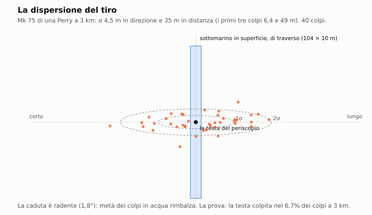

# E4. Artiglieria

*Autore: kit, per il runtime. Revisione del 27/10/2026. Stato: rivisto (runtime, 27/10/2026), curatore: kit.*

## 1. A che serve

Decide quando una nave apre il fuoco col cannone sul battello, dove cadono i colpi e che cosa colpiscono. Il cannone
non affonda un sottomarino immerso: un proietto si ferma nei primi metri d'acqua. Punisce due errori: il periscopio
alzato troppo a lungo vicino a una scorta in allarme, e il battello sorpreso in superficie. In pace e in crisi le navi
sparano solo colpi d'avvertimento, mai sul bersaglio. Nelle missioni che lo prevedono, le navi si sparano anche fra
loro, e la battaglia si sente al sonar da lontano. Il modello è lo stesso per il giocatore e per i sottomarini
dell'IA.

## 2. Il modello

Il codice sta in due parti:
- `nucleo/artiglieria.hpp` e `nucleo/src/artiglieria.cpp`: il modulo puro del tiro (pezzo G1 di `docs/16`). Riceve il
  generatore casuale dal chiamante, quindi è deterministico;
- `missioni/src/missione_artiglieria.cpp` (`Missione::passo_artiglieria`): la regola di fuoco delle navi (pezzo G2),
  il primo pezzo di dottrina navale dell'Enhanced.

I dati sono in `data/motore/artiglieria.toml`, generato da `tools/pipeline/artiglieria.py`: dieci pezzi, dieci classi
armate, le sagome dei sottomarini in superficie. Se il file manca, l'artiglieria resta spenta.

### 2.1 I pezzi e le classi

Ogni pezzo (`DatiPezzo`) ha calibro, canne, cadenza per canna, colpi pronti e pausa di ricarica, carica di scoppio
(TNT equivalente), velocità iniziale, portata minima, portata contro il battello in superficie e contro teste e
alberi, tempi di reazione, dispersione, raggio delle schegge, spoletta e tavola di volo. Valori dal file:

| Pezzo | Calibro, canne | Cadenza (colpi/min per canna) | Portata superficie / periscopio (km) | Reazione combatt. / cond. III (s) | Navi |
|---|---|---|---|---|---|
| Mk 75 76/62 | 76 mm, 1 | 80 | 8 / 4 | 15 / 90 | Perry |
| Mk 45 5"/54 | 127 mm, 1 | 20 | 10 / 5 | 20 / 120 | Spruance, Kidd |
| 5"/38 Mk 12 | 127 mm, 2 | 15 | 10 / 5 | 20 / 120 | Iowa |
| 16"/50 Mk 7 | 406 mm, 3 | 2 | 20 / mai | 60 / 300 | Iowa |
| AK-100 | 100 mm, 1 | 50 | 10 / 5 | 20 / 120 | Krivak II, Kirov |
| AK-130 | 130 mm, 2 | 30 | 10 / 5 | 15 / 90 | Slava |
| AK-726 | 76 mm, 2 | 22,5 | 8,2 / 4 | 20 / 120 | Kara, Koni |
| AK-725 | 57 mm, 2 | 35 | 6 / 3 | 15 / 90 | Nanuchka |
| AK-630 | 30 mm, raffiche | 12 raffiche | 4 / 2 | 15 / 60 | Kara, Kirov, Slava |
| AK-230 | 30 mm, 2, raffiche | 12 raffiche | 4 / 2 | 15 / 60 | Koni |

Fonte: `data/motore/artiglieria.toml [pezzi.*]` e `[classi.*]`; la tabella completa è nell'appendice G9. Il
Phalanx delle navi americane non c'è: nel 1989 non sparava a bersagli di superficie, quindi nessuna classe USA ha un
pezzo da 20 mm contro il battello. Le classi senza voce in `[classi]` sono disarmate per questo modello.

Portate minime: 30-40 m per i pezzi moderni, 85 m per l'AK-725, 230 m per l'AK-726 (depressione di −2° con
l'idraulica), 2000 m per il 16" (`portata_minima_m`). Sotto la portata minima il pezzo non batte il pelo dell'acqua.

### 2.2 Il bersaglio esposto

Il proietto colpisce solo quello che sta fuori dall'acqua. `sagoma_sottomarino` costruisce la sagoma esposta
(`SagomaEsposta`):
- **in superficie** (quota fino a 1 m, `QUOTA_SUPERFICIE_M`): lo scafo (lunghezza, larghezza, bordo libero), la vela
  (la falsatorre) come una scatola con la sua altezza e il suo spostamento verso prua, gli alberi alzati sopra la vela.
  La cima della vela, gli ultimi 1,5 m (`PLANCIA_M`), è la plancia con le vedette;
- **immerso**: solo le teste dei periscopi e gli alberi alla loro altezza sull'acqua, come cilindri verticali. Col
  mare grosso, quando la vela del giocatore affiora (capitolo E7), anche la cima della vela fino a 0,8 m
  (`VELA_AFFIORATA_M`);
- **niente fuori**: la sagoma è vuota e nessuno spara. Tutto ciò che sta 3 m o più sotto la superficie è al sicuro
  (dossier 22 §5.2).

Le misure delle vele vengono dai modelli 3D del kit (`[sagome.*]`: per il 688 vela di 8,3 × 1,5 m, alta 7,6 m, bordo
libero 1,9 m). Dal 31/10/2026 le hanno anche Victor I, Delta III, Sierra, Ohio, Type 206 e Nacken, che prima
prendevano la sagoma predefinita (vela a 6 m sull'acqua). Per il giocatore la testa del periscopio ha l'altezza vera del modello dei periscopi (capitolo C9),
col diametro della testa; senza i periscopi dell'Enhanced la testa è alta 1,5 m, meno quanto il battello sta sotto
la quota periscopica. La testa alzata di un sottomarino dell'IA è alta 1,5 m. L'antenna radio è alta 1,2 m. Oggi la
sagoma ha solo queste due parti sopra la vela (`Missione::sagoma_esposta`): l'albero ESM, il radar e lo snorkel non
ci entrano. Le
navi bersaglio, nel tiro fra navi, hanno un bordo libero di 0,8 volte il pescaggio (almeno 3 m) e le sovrastrutture
alte 8 m sopra il ponte (STIMA).

Il punto di mira (`punto_di_mira`) è la testa o l'albero più alto per il battello immerso, la vela per quello in
superficie.

### 2.3 Il tiro di un colpo

`spara()` fa un colpo (o la salva di una canna, o una raffica), in quest'ordine:

1. **La mira con l'anticipo.** La nave mira sulla posizione stimata del bersaglio, portata avanti con la velocità
   stimata per il tempo di volo. Il tempo di volo viene dalla tavola del pezzo (`volo`, interpolata), e si ricalcola
   una volta sulla distanza nuova.
2. **L'errore.** Il punto di caduta si sposta con un errore gaussiano in direzione e in distanza (dossier 22 §3.6):

   ```
   σ_dir  = σ_mrad · r / 1000 / √k
   σ_dist = (σ_m + f · r) / √k
   ```

   `r` è la distanza in metri; `σ_mrad`, `σ_m` e `f` sono del pezzo (1,5 mrad, 20 m e 0,005 per quasi tutti; 2 mrad e
   25 m per il 5"/38 con la vecchia direzione del tiro; 2,5 mrad e 15 m per i 30 mm; 1 mrad e 100 m per il 16"). `k` è
   il fattore delle correzioni (§2.4).
3. **Il bersaglio vero si sposta** col suo moto per il tempo di volo. Il colpo si confronta con la sagoma in quel
   punto, non con la stima.
4. **La caduta.** La traiettoria scende con l'angolo di caduta della tavola. Se incontra la sagoma prima di toccare
   l'acqua, è un **colpo diretto** sulla parte toccata (la prima lungo la traiettoria). Col tiro radente lo «spazio
   pericoloso» è lungo: un errore in distanza finisce spesso sui 110 m di scafo.
5. **Se tocca l'acqua:**
   - la spoletta a percussione fallisce nel 3% dei casi (`PD_FALLITA`, STIMA): un tonfo senza scoppio;
   - sotto 8° di caduta (`ANGOLO_RIMBALZO_GRADI`) metà dei proietti **rimbalza**: il proietto riparte a metà
     velocità e ricade 50-300 m più avanti (STIMA), dove può colpire la sagoma o scoppiare;
   - altrimenti scoppia sull'acqua;
   - la spoletta di prossimità (VT) scoppia 3-15 m sopra l'acqua, ma solo contro il battello in superficie. Nessun
     pezzo del file la usa oggi.
6. **Le schegge.** Uno scoppio vicino a una parte esposta la raggiunge se la distanza è entro `r_eff_m` del pezzo
   (1 m col 30 mm, 1,5 m col 57 mm, 2 m col 76 mm, 3 m col 100 mm, 4 m col 5" e il 130 mm, 8 m col 16"; dossier 22
   §5.3). L'impatto porta con sé questo raggio (`ImpattoArtiglieria::r_eff_m`), e i danni usano lo stesso (§2.10). Le schegge di uno scoppio radente
   vanno avanti lungo la traiettoria: una testa fino a 50 m oltre lo scoppio, sulla linea di tiro, conta come una a
   `r_eff` (`SCHEGGE_AVANTI_M`, STIMA tarata sulle probabilità per colpo del dossier).

**Le raffiche** (AK-630, AK-230). Il centro della raffica ha l'errore pieno; ogni proietto si sparge attorno al centro
con metà delle sigma. L'AK-630 tira 100 proietti in 1,5 s, una raffica ogni 5 s, poi una pausa di 30 s ogni 20
raffiche (STIMA). Si registrano solo i proietti che toccano una parte, ma dal deposito si scalano tutti quelli sparati: 100
a raffica per l'AK-630, 50 a canna per l'AK-230, che è binato.

**Il risultato** è un `ImpattoArtiglieria`: tiratore, bersaglio, pezzo, calibro, carica, tempi di sparo e d'impatto,
punto, quota, esito (`acqua`, `rimbalzo`, `tonfo`, `aria`, `diretto`, `schegge`), parte colpita e sua distanza. È il
contratto per i danni, per l'app e per il registro.

**Esempio.** Mk 75 di una Perry a 3 km da una testa di periscopio. La tavola dà 3,9 s di volo e 1,8° di caduta. Le
sigma piene sono 4,5 m in direzione e 35 m in distanza. Sui primi tre colpi (`primo_colpo`, k = 0,5) diventano 6,4 m
e 49 m. La caduta è radente, quindi metà dei colpi in acqua rimbalza. La prova misura la testa raggiunta (diretto o
schegge) nel 24% dei colpi a 1 km e nel 6,7% a 3 km (`docs/16`, G1).



### 2.4 Le correzioni del tiro

`CorrezioniTiro::fattore()` moltiplica la probabilità per colpo; le sigma si dividono per la sua radice (dossier 22
§3.6):

| Condizione | Fattore |
|---|---|
| mare 4 | × 0,6 |
| mare 5 e oltre | × 0,3 |
| nave oltre 20 nodi o in accostata (rateo oltre 0,5°/s) | × 0,5 |
| primo colpo: i primi 3 colpi di un pezzo sul bersaglio (`COLPI_AGGIUSTAMENTO`, STIMA) | × 0,5 |
| notte con illuminante acceso entro 2 km dal punto, o col radar di tiro | × 0,8 |
| notte senza illuminante e col radar spento (EMCON in silenzio) | × 0,3 |
| principiante, contro il giocatore in superficie | × 0,5 |

Il prodotto resta fra 0,02 e 4. Lo stato del mare è quello del meteo nel punto del giocatore (capitolo E7).

### 2.5 Quando una nave apre il fuoco

`Missione::passo_artiglieria` gira a ogni passo della missione, per ogni nave armata. La regola del dossier 22 §9.2:

1. **La situazione.** Viene dal blocco carriera della missione, o da `carriera.toml` per le 22 originali. Con le forze
   dell'Enhanced è quella fra la parte della nave e l'altra (capitolo E6 e `docs/18`). Un lancio del giocatore
   trasforma la crisi in guerra (`provocati`): è l'autodifesa delle navi.
2. **In pace** la nave non spara, salvo nelle acque territoriali dichiarate (§2.7). Nella sandbox valgono le ROE della
   parte (`Missione::roe_parte`, capitolo E6 §2.17): con le armi libere i pezzi sparano come in guerra; con le armi
   trattenute non sparano, nemmeno i colpi d'avvertimento.
3. **Il bersaglio**, in quest'ordine:
   - il giocatore esposto, se la nave è ostile e lo vede con una traccia solida (qualità almeno 800) dal radar o dalla
     vedetta, con una scoperta degli ultimi 10 s (`VISTO_RECENTE_S`);
   - con la difficoltà «minaccia percepita», in guerra, la piuma della testa alzata anche senza la testa vista
     (`vede_la_piuma`): entro 1 km di giorno e 300 m di notte, con mare fino a 4 e piuma almeno 0,2. L'errore sul
     punto è uniforme, fino a 25 m per asse (STIMA);
   - in guerra, il sottomarino dell'IA ostile più vicino, esposto e visto allo stesso modo;
   - in guerra e con `artiglieria = { fra_navi = true }` nella missione, la nave ostile più vicina con traccia solida
     e posizione nota.
4. **L'allarme.** Il primo contatto in guerra accende l'allarme. Una nave in condizione III passa al posto di
   combattimento dopo 120 s (`ALLARME_A_COMBATTIMENTO_S`, STIMA). Gli script possono mettere subito una nave al
   posto di combattimento (`m688.posto_di_combattimento(u)`). Con le forze dell'Enhanced ci va da sola una nave con
   l'allerta della forza almeno 2 (`interazioni.toml [allerta] posto_combattimento`, `missione_forze.cpp`). In guerra
   l'allerta minima è 2 (`minimo_guerra`): le navi partono già al posto di combattimento.
5. **La reazione.** Quando un bersaglio nuovo è designato, ogni pezzo spara il primo colpo dopo la sua reazione
   (combattimento o condizione III) per un fattore casuale fra 0,9 e 1,7 (STIMA tarata su G7.1), per il fattore della
   difficoltà: × 2 col principiante, × 0,7 con la minaccia percepita.
6. **La portata.** Contro la sagoma in superficie la portata di superficie, contro teste e alberi quella del
   periscopio (zero per il 16"). Il principiante non spara mai alla testa del giocatore. Sotto la portata minima non
   si spara.
7. **Il fuoco amico.** Nessun colpo se una nave non ostile (amica o neutrale), o un sottomarino non ostile in
   superficie, sta entro 15° dalla linea di tiro e non oltre 1 km dietro il bersaglio (`FUOCO_AMICO_GRADI`,
   `FUOCO_AMICO_OLTRE_M`).
8. **La cadenza e le munizioni.** Il pezzo spara una salva, un colpo per canna, al suo intervallo (60 / cadenza).
   Finiti i colpi pronti (contati a salve), il pezzo si ferma per `ricarica_s` (il tamburo del Mk 45, il
   raffreddamento dell'AK-726). Il deposito è finito. Contro un sottomarino il pezzo smette con un quarto del deposito
   ancora a bordo, per difendersi (**STIMA**, dal 04/11/2026): una Perry tira 450 Mk 75 su 600. Contro una nave lo vuota.
   Il deposito conta i proietti sparati: un rimbalzo è un proietto solo, anche se fa due impatti. Un AK-630 tira così 15
   raffiche contro un sottomarino e 20 contro una nave, poi tace: dai 75 ai 100 s di fuoco, e la pausa ogni 20 raffiche non
   arriva a contare. L'AK-230, con 1000 proietti, tira 8 salve contro un sottomarino e 10 contro una nave. Prima del
   05/11/2026 si scalavano solo i proietti a segno, e contro un periscopio un affusto sparava fino a 20 volte la sua dotazione.
9. **Il cessate il fuoco.** Sparito il bersaglio, si continua per 5 s (`CESSATE_S`), poi un ultimo colpo sul punto.
   Dopo 120 s senza vederlo la designazione si perde, e un bersaglio nuovo rifà la reazione.

**Gli illuminanti.** Di notte (luce sotto 0,2), una nave che ha un bersaglio lancia un illuminante ogni 50 s sopra il
punto stimato, da un pezzo di almeno 100 mm già pronto (STIMA). Si apre a 450 m, sparso di ±300 m, e dura 50 s
(dossier 22 §6.3). La Perry, col suo 76 mm, non ne lancia.

**Il sottomarino dell'IA sotto il tiro.** Un colpo vero sparato a un sottomarino dell'IA che cade entro 300 m da lui
(`TIRO_VICINO_M`) gli fa ammainare gli alberi e scendere ad almeno 60 m (`QUOTA_SICURA_IA_M`; dossier 22 §9.8,
STIMA). È la stessa reazione che ci si aspetta dal
giocatore (capitolo E6, simmetria dell'IA).

### 2.6 I colpi d'avvertimento

In crisi (e nelle acque territoriali in pace) i colpi sono d'avvertimento: cadono 300-500 m di lato al punto di mira,
mai sul bersaglio (`AVVERTIMENTO_MIN_M`, `AVVERTIMENTO_MAX_M`). Una nave tira tre colpi, poi fa una pausa di 120 s
(STIMA). Un colpo d'avvertimento non fa danni e non fa tuffare i sottomarini dell'IA.

### 2.7 Le acque territoriali

La missione può dichiarare zone di acque territoriali (chiave `acque_territoriali`, `docs/09` §4), con un cerchio o un
poligono e il paese costiero. Valgono in pace, col giocatore straniero dentro, e solo per le navi di quel paese
(dossier 22 §2.4; i precedenti sono quelli svedesi del 1982-83):
- battello esposto e visto: i colpi d'avvertimento della crisi;
- battello immerso con la posizione nota (qualità almeno 800, per esempio dopo un ping) ed entro 3 km dalla nave: due
  bombe d'avvertimento ogni 2 minuti, a 500-1000 m dalla stima; dopo 20 minuti dentro, a 200-400 m;
- le bombe sono impatti d'avvertimento (`pezzo = "bomba_avvertimento"`, 1 kg) che scendono in 8 s e scoppiano: si
  sentono e si vedono, ma non fanno danni.

Nessuna delle 22 missioni originali dichiara acque territoriali.

### 2.8 L'artiglieria fra navi

Con la chiave `artiglieria = { fra_navi = true }`, in guerra, una nave che non ha un sottomarino da colpire spara alla
nave ostile più vicina di cui ha traccia solida e posizione. La sagoma della nave bersaglio è quella del §2.2. Gli
impatti sulle navi vanno ai danni delle navi (capitolo E2). Le 22 originali non hanno la chiave.

### 2.9 Gli effetti per audio e grafica

`eventi_di()` traduce un impatto in eventi (`EventoArtiglieria`, `nucleo/acustica_artiglieria.hpp`): la partenza
alla nave, poi lo scoppio sull'acqua, lo scoppio in aria, il tonfo, il rimbalzo, la raffica o il colpo sulla testa.
Ogni evento diventa una sorgente transitoria della scena acustica (`transitori_artiglieria`, id da 990000 + 10·n):
- **lo scoppio sull'acqua** è un colpo secco: lo specchio della superficie ne taglia il basso. Il picco in acqua segue
  la formula di Cole con lo specchio di Lloyd (`picco_scoppio_db`, dossier 22 §7.1):

  ```
  P = 52,4 · (W^⅓ / R)^1,13  MPa        θ = 0,084 · W^⅓ · (W^⅓ / R)^−0,23  ms
  picco = P · (1 − exp(−Δt / θ))        Δt = 2 d_s d_r / (R c)
  ```

  `W` è la carica in kg di TNT, `R` la distanza in m, `d_s` = 0,5 m la quota dello scoppio, `d_r` quella di chi
  ascolta, `c` = 1500 m/s. Il livello della voce in `acustica.toml` è tarato sul 5" a 1 km e scala di 2,4 log(W / 3,5)
  dB;
- **la partenza** è un tonfo sordo a 40-150 Hz alla cadenza del pezzo, che scala col calibro come 30 log(cal / 127) dB
  (STIMA);
- **il tonfo** dell'inerte ha la stessa scala; **il rimbalzo** 3 dB meno;
- **la raffica** è una serie di voci di mezzo secondo, al più sette.

Gli illuminanti e i passaggi dei proietti non si sentono in acqua: solo a bordo, in plancia (capitolo C8).

### 2.10 I danni, in sintesi

I danni del battello colpito sono del modello dei danni (capitolo B3; `DanniSottomarini::colpo_artiglieria`, pezzo
G3 del kit). Contano solo i colpi diretti e le schegge su una parte; gli avvertimenti no.

| Parte | Effetto |
|---|---|
| Testa del periscopio | colpo diretto: cieca 50%, bloccata 30%, degradata 20%; schegge: 25%, 15%, 60%. La testa peggiora soltanto. Cieca: vetro rotto e canna che si allaga. Col periscopio di ricerca Type 18 si perde anche l'ESM nella testa |
| Albero ESM, radar, snorkel | fuori uso (la sagoma oggi non li porta, §2.2) |
| Antenna radio | fuori uso, e il guasto del sistema antenna |
| Vela | timoni della vela bloccati 10-25% (688 e Sturgeon), infiltrazione 5-15%, per un colpo da 100-130 mm; × 0,3 col 57-76 mm, × 0,05 col 30 mm, × 3 col 16" |
| Plancia | feriti fra le vedette (1-4 col colpo diretto da 100 mm in su, 1-3 sotto); le schegge meno |
| Scafo in superficie | falla piccola 5-10% per colpo da 100-130 mm, 1-2% col 57-76 mm, niente col 30 mm. Il 16" apre sempre una falla e il battello non si immerge più. Alle estremità, fuori dallo scafo resistente, il colpo squarcia la cassa zavorra di quella parte (16" sempre, 100-130 mm 70%, 57-76 mm 40%, 30 mm 15%): la cassa non tiene l'aria e imbarca (capitolo B3 §2.4) |

Le schegge riducono la probabilità con la distanza dalla parte:

```
f = 1 − d / r_eff,   fra 0,2 e 1
```

`d` è la distanza dello scoppio dalla parte, `r_eff` il raggio del pezzo, lo stesso del tiro (§2.3), che l'impatto
porta con sé. Solo un impatto senza raggio usa i valori per calibro (4 m da 100 mm in su, 2 m da 57 mm, 1 m sotto).
Le schegge su una testa la mancano con probabilità 1 − `f`; sulla vela, sulla plancia e sullo scafo `f` moltiplica
le probabilità della tabella.

**I colpi diretti si sommano** (`DanniSottomarini::avanza`, dal 04/11/2026, **STIMA**). Ogni colpo diretto sullo scafo,
sulla vela o sulla plancia di un sottomarino consuma l'integrità dell'originale:

| Calibro | Integrità per colpo diretto |
|---|---|
| sotto i 57 mm (30 mm, 40 mm) | 0 |
| 57-76 mm | 0,2 (un punto ogni cinque colpi diretti) |
| 100-130 mm | 1 |
| 16" | 5 |

Le schegge, i colpi sugli alberi e sui periscopi e gli avvertimenti non consumano integrità. Il colpo che la porta a
zero manda il battello fuori combattimento: è la fine del battello perduto, con la stessa regola per l'IA, il giocatore
e il comandante IA (capitolo B3 §2.11). Il danno non passa dall'acqua a bordo: il battello può uscire con pochissima
acqua e i sistemi in ordine. La soglia è una **STIMA** e dipende dall'integrità della classe nella missione: col 76 mm,
cinque colpi diretti per punto.

Misura con tre Perry a 3 km, un battello che non si può immergere e integrità 100, semi da 1 a 3:

| Battello | Colpi diretti alla fine | Tempo (s) |
|---|---|---|
| Victor III dell'IA | 500 nei semi 1 e 2 | 616-668 |
| Alfa del giocatore | 500-507 | 624-655 |
| Victor III del giocatore | 500-501 | 622-644 |
| comandante IA su Victor III o Alfa, tenuto a galla dalla prova | 500 | 651-983 |

Nel seme 3 il Victor dell'IA non arriva alla soglia: con due casse squarciate va a fondo a 195 colpi diretti.

Il conto dei cinque colpi è sui colpi diretti di tutti i calibri. Dove sparano anche i 30 mm (la Koni, col Los Angeles
del giocatore o col comandante IA) la soglia oscilla: 423-503 colpi da 76 mm, su oltre 4000 diretti.

Nella scena `scoppio_nel_transito`, seme 10, il Victor colpito da un Mk 48 scende a integrità 85 e arriva a zero dopo
425 colpi diretti, in 16 minuti di fuoco.

I proietti sulle navi (tiro fra navi) diventano esplosioni della carica del pezzo almeno 1 m sopra il galleggiamento
(capitolo E2, §2.8).

## 3. Fonti e confidenza

| Parametro | Fonte | Confidenza |
|---|---|---|
| Pezzi: calibro, cadenza, colpi pronti, v0, carica | dossier 22 §3.1, per pezzo nel file | alta (USA), media (URSS) |
| Portate contro la superficie | dossier 22 §3.1 e §10 | media |
| Portate contro il periscopio, reazione | dossier 22 §4.2 e §9.2 | **STIMA** (nessun dato pubblico) |
| Depressione e portata minima | dossier 22 §3.3 [CALC] | media |
| Tavole di volo | dossier 22 §3.4 [CALC] | media-bassa |
| Dispersione, correzioni del tiro | dossier 22 §3.6 | **STIMA** su dati scarsi |
| Rimbalzo sotto 8°, profondità di sicurezza | dossier 22 §5.1-5.2 | media |
| Schegge su teste e alberi (`r_eff`), cono in avanti 50 m | dossier 22 §5.3; taratura | **STIMA** |
| Sagome dei battelli in superficie | modelli 3D del kit, dossier 22 §5.4 | media |
| Regola di fuoco, avvertimenti, fuoco amico, cessate il fuoco | dossier 22 §2.4 e §9.2 | **STIMA** di gioco su dottrina |
| Tre colpi d'aggiustamento, reazione 0,9-1,7, posto di combattimento a 120 s | taratura G7 (`docs/16`) | **STIMA** |
| Acque territoriali, bombe d'avvertimento | dossier 22 §2.4 e §9.2 (Svezia 1982-83) | media (fatti), **STIMA** (tempi) |
| Acustica degli scoppi (Cole, Lloyd) | dossier 22 §7.1 [CALC] | media-bassa |
| Danni a teste, vela, scafo | dossier 22 §5.3 e §9.5 | **STIMA** |
| Integrità consumata dai colpi diretti, soglia del fuori combattimento | scelta di gioco (04/11/2026): i colpi singoli non fermavano un battello a galla | **STIMA** |
| Un quarto del deposito tenuto contro un sottomarino | scelta di gioco (04/11/2026) | **STIMA** |
| Difficoltà | dossier 22 §9.9 | scelta di gioco |

Le STIME del tiro sono tarate perché il cannone resti un rischio di contorno (dossier 22 §9.1): un periscopio alzato
30 s a 3 km da una scorta in allarme viene colpito circa una volta su due; un battello sorpreso in superficie a 8 km
quasi sempre si immerge prima dei danni gravi.

## 4. Classico ed Enhanced

Nel classico il modello non esiste. Nel gioco del 1989 i cannoni stanno solo nelle schede delle classi, come difesa
antimissile, e gli script non sparano al sottomarino (dossier 22 §8). Il rilievo delle partite classiche resta
identico.

Nell'Enhanced l'artiglieria si accende con la regola di simulazione (`DanniMissione::avanza` chiama
`Missione::artiglieria_enhanced`), se c'è il file dei dati.

## 5. Come si vede in gioco

- **Volume 1**, cap. 8 §8.3 (l'artiglieria e la risposta: l'immersione d'emergenza, Ctrl+D); cap. 4 per il
  periscopio; cap. 7 per i danni.
- **La difficoltà** è l'opzione K nella scelta della missione, «NEMICI (ASW, CANNONI)»: facile (il principiante del
  dossier), normale, realistico, minaccia percepita.
- **Messaggi di bordo** (composti dall'app, `app/partita.cpp`, col rilevamento al posto di `{RIL}`). «Esposto» vuol
  dire con un albero alzato o a quota fino a 2 m:
  - 420 il sonarista che sente gli scoppi (battello non esposto, entro 15 km, al più ogni 2 minuti);
  - 421 le vampe dei cannoni (esposto, entro 25 km, al più una volta al minuto per nave);
  - 422 le colonne d'acqua vicine (esposto, caduta entro 150 m, al più una volta al minuto);
  - 429 gli illuminanti (esposto, entro 15 km, al più ogni 2 minuti; senza rilevamento se sono sopra di noi);
  - 423 i colpi d'avvertimento sulla prua, al più ogni 5 minuti;
  - 424 e 425 i periscopi d'attacco e di ricerca colpiti, 426 le schegge sulla testa, 427 un albero, 428 un colpo
    diretto sulla vela, sulla plancia o sullo scafo; lo stesso rapporto al più ogni 30 s;
  - 453 e 454 l'entrata e l'uscita dalle acque territoriali, 455 le bombe d'avvertimento (dalla missione).
- **Al periscopio**: le vampe sulle navi, le colonne d'acqua per calibro, gli spruzzi dei rimbalzi, i traccianti
  dell'AK-630, la luce degli illuminanti sul mare; l'acqua delle colonne sul vetro; l'immagine spenta o il vetro
  incrinato con la testa colpita (capitolo E9).
- **Al sonar e a bordo**: gli scoppi e le partenze nella cascata e in cuffia; a bordo lo schiocco sullo scafo e, in
  superficie, il boato col suo ritardo (capitolo C8).
- **Sulla carta**: le cadute viste (battello esposto, entro 10 km) come piccole croci ostili, le ultime 40.
- **Registro e debriefing** (capitolo F1): `artiglieria_salva` (la prima salva di ogni nave su di noi, d'avvertimento
  o no), `artiglieria_colpo` (diretto o schegge su di noi, col pezzo e il calibro), `artiglieria_vicino` (il primo
  colpo caduto entro 50 m), `artiglieria_ia` (una nave che apre il fuoco su un'altra unità), `acque_territoriali`.
  Una salva d'artiglieria ferma la compressione del tempo. Nel registro c'è un `artiglieria_colpo` per proietto, col numero
  dello sparo in `codice`. Nell'esito, e quindi nei riconoscimenti e nella carriera (capitoli F3 e F2), vale uno sparo:
  l'uscita di una canna che ha toccato almeno una volta. Una raffica vale un colpo subito, un colpo singolo uno, un rimbalzo
  non conta doppio, ogni canna di un binato conta per sé. Il danno resta per proietto.

## 6. Taratura e prove

**Taratura G7** (`docs/16`; missioni `tools/taratura/missioni/g7_*.lua`, risultati in
`tools/taratura/risultati/artiglieria_g7_*.tsv`, strumento `taratura artiglieria`):

| Prova | Scena | Risultato | Atteso (dossier 22 §9.10) |
|---|---|---|---|
| G7.1 | Alfa che alza il periscopio 30 s a 3 km da una Perry al posto di combattimento | testa colpita 0,41 su 100 semi (era 0,63); primo colpo mediano 22,6 s dopo la testa fuori | circa 0,5 |
| G7.2 | 688 in superficie a 8 km da un Kara partito in condizione III (l'allarme lo porta al posto di combattimento: primo colpo in mediana a 25,5 s), immersione d'emergenza 10 s dopo il primo colpo | sempre sotto, in media 18 s dopo il primo colpo; colpi diretti in 0,49 delle partite (0,8 in media); scafo colpito 0,42; danni gravi 0,02 | quasi sempre sotto prima dei danni gravi |
| G7.3 | Kara contro Perry a 7 km con `fra_navi`, 688 a 100 m che ascolta | colpi sentiti nel 75-76% dei campioni a 10, 20 e 40 km (91% senza le forze); SE massimo 62,8, 49,3 e 36,3 dB | la battaglia si sente al sonar |

I risultati sono quelli della sera del 27/10/2026, con la perdita al fondo nuova e l'esito delle granate verificato
all'arrivo (`tools/taratura/risultati/fondo_2710/`, LEGGIMI.md). La G7.1 scende da 0,63 a 0,41 perché una granata che
arriva quando il periscopio è già sceso va in acqua: prima contava la testa fuori al momento del tiro. I risultati
precedenti sono in `tools/taratura/risultati/fase4/` (dopo le fasi 3 e 4 dell'IA) e in
`tools/taratura/risultati/artiglieria_g7_*.tsv` (i primi).

**Perché la G7.3 è scesa.** Alla prima taratura i colpi si sentivano nel 97% dei campioni, dopo la fase 2 dell'IA nel
91%. Con le fasi 3 e 4, cioè con le forze dell'Enhanced, sono il 75%. Non è l'acustica:
- senza le forze la prova torna identica, 0,91 (`g7_3_senza_forze_20semi.tsv` contro `g7_3_base_20semi.tsv`);
- in guerra le forze portano le due navi al posto di combattimento da subito (§2.5, punto 4);
- il Kara spara a 33 s, prima che la Perry abbia la posizione al radar. La Perry spara 37 colpi invece di 213 (seme
  1): la battaglia è un'altra, con meno colpi vicino a chi ascolta.

È voluto: la guerra mette le navi in allarme (docs/18, §Stato del 27/10). Resta da riguardare la quota dei campioni
sentiti quando spara poco la nave più vicina all'ascoltatore.

Il dossier stimava il 688 in superficie a 3 km colpito nel 60-80% dei colpi di traverso e nel 25-40% di prora. La
prova misura 68% e 72%: col tiro radente lo spazio pericoloso assorbe l'errore in distanza anche di prora.

**Prove automatiche:**
- `test/prove_artiglieria.cpp`: «artiglieria: i dati G0 (pezzi, classi, sagome, tavole di volo)», «la sagoma esposta
  di un sottomarino», «probabilita' per colpo contro la testa del periscopio e contro il battello in superficie»,
  «avvertimenti lontani, raffiche e eventi per audio e grafica»; «artiglieria G2: in guerra il Krivak spara al 688 in
  superficie; in crisi solo avvertimenti, in pace mai», «il battello immerso senza alberi e' al sicuro; il classico non
  spara», «di notte l'illuminante parte da un pezzo pronto», «con fra_navi in guerra un Kara e una Perry si
  cannoneggiano; senza no»; «in guerra il Krivak spara anche al sottomarino dell'IA in superficie, che si immerge»,
  «acque territoriali in pace, avvertimenti al battello in superficie e bombe a quello immerso», «l'esperto spara
  sulla piuma della testa alzata, entro 1 km e col mare fino a 4»; «i colpi diretti del 76 mm si sommano, e a integrita'
  zero il battello e' fuori combattimento, anche il giocatore e il comandante IA», «sotto i 57 mm i colpi non consumano
  integrita', e non finiscono un battello gia' a zero per un siluro», «contro un sottomarino la nave tiene un quarto del
  deposito»; «i colpi non moltiplicano le fotografie del debriefing, e i momenti salienti restano», «il limite delle
  fotografie vale per tutti, e la fine e gli affondamenti passano», «una raffica vale un colpo subito, ogni canna di un binato
  per se', ogni proiettile resta nel registro, e i riconoscimenti non cambiano», «una raffica scala dal deposito i proietti
  sparati, anche quelli a vuoto», «i conti degli spari, e una traccia vecchia senza numeri non si riduce a un colpo»;
- `test/prove_acustica_artiglieria.cpp`: «il picco degli scoppi in superficie», «le sorgenti della scena», «una salva
  di Mk 45 a 3 km si sente al sonar del 688 a 18 m», «a bordo, immerso e in plancia»;
- `test/prove_artiglieria_grafica.cpp`: colonne per calibro, rimbalzi, raffiche, illuminanti, acqua sul vetro;
- `test/prove_danni_sottomarini.cpp`: «artiglieria sul battello (G3): teste, alberi, falsatorre, plancia e scafo»;
- `test/prove_danni.cpp`: «danni: proietti d'artiglieria sopra il galleggiamento (G3, fra navi)»;
- `test/prove_periscopi.cpp`: «periscopi: la testa colpita dall'artiglieria, bloccata (non scende) o cieca con la
  canna che si allaga».

## 7. Limiti noti e in arrivo

- **Non c'è un CIWS americano contro la superficie**: è una scelta storica (il Phalanx del 1989), non una mancanza.
- **La spoletta di prossimità** è nel modello ma nessun pezzo del file la usa.
- **Gli illuminanti** partono solo dai pezzi da 100 mm in su; nessuna nave usa i razzi illuminanti.
- **La reazione e la dispersione** non dipendono dall'addestramento dell'equipaggio della nave, solo dalla
  difficoltà.
- **Gli alberi ESM, radar e snorkel** hanno i loro danni (§2.10) ma la sagoma non li porta: oggi un colpo non li
  trova mai (§2.2).
- **Le navi dell'IA non manovrano** per sparare: tirano dalla rotta che hanno. Non mettono la prua sul battello e non
  speronano.
- **I sottomarini dell'IA non hanno cannoni**, e il giocatore non spara col cannone.
- **Lo stato del mare** nelle correzioni del tiro è quello nel punto del giocatore, anche nel tiro fra navi lontane.
- **Il fuori combattimento dal cannone è un conto a parte**: non passa dall'acqua, dal fuoco o dall'equipaggio
  (§2.10). Un battello già a integrità zero per i siluri esce al primo colpo diretto che consuma integrità.

## 8. Riferimenti

- Codice: `nucleo/artiglieria.hpp`, `nucleo/src/artiglieria.cpp`, `nucleo/acustica_artiglieria.hpp`,
  `nucleo/src/acustica_artiglieria.cpp`, `missioni/src/missione_artiglieria.cpp`,
  `missioni/include/missioni/artiglieria_missione.hpp`, `missioni/src/danni_sottomarini.cpp`
  (`colpo_artiglieria`), `missioni/src/missione_forze.cpp` (posto di combattimento con l'allerta),
  `missioni/src/registro_missione.cpp`.
- Dati: `data/motore/artiglieria.toml` (da `tools/pipeline/artiglieria.py`), `[allerta]` di
  `data/motore/interazioni.toml` (posto di combattimento), voci `[transitori.art_*]` di `data/motore/acustica.toml`, messaggi 420-429 e 453-455 in `data/motore/testi/messaggi_bordo.tsv`.
- Ricerca: dossier 22 (`docs/ricerca/22_artiglieria_contro_sottomarini.md`), §2-§10.
- Progetto: `docs/16_artiglieria.md` (pezzi G0-G7), `docs/09_schema_missioni.md` §4 (chiavi `artiglieria` e
  `acque_territoriali`), `docs/18_interazioni_ia.md` §Stato (G7 dopo le fasi 3 e 4),
  `tools/taratura/risultati/fase4/LEGGIMI.md`.
- Capitoli: B3 (danni del battello), E2 (danni delle navi), E7 (mare), C8 (audio), C9 (periscopi), E6 (IA), E9
  (grafica), F1 (registro), G9 (tabella dei pezzi), volume 1 cap. 8 §8.3.
