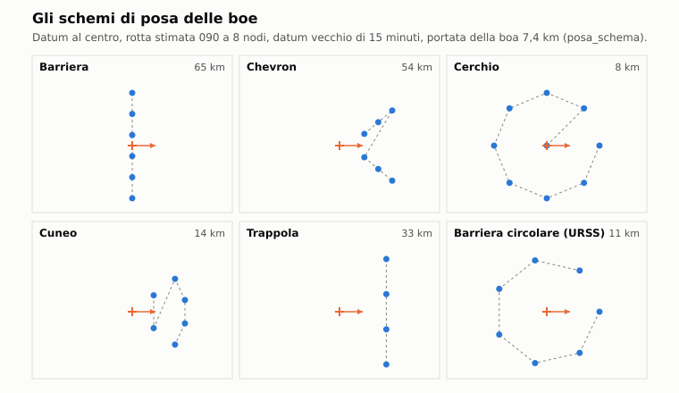
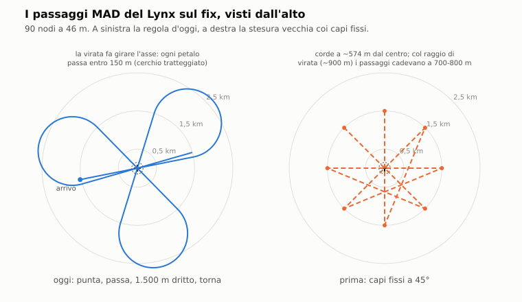

# E5. ASW aereo

*Autori: kit (bozza), runtime (revisione sul codice). Revisione del 04/11/2026 (limite degli abbattimenti). Stato: rivisto (runtime,
27/10/2026), curatore: kit.*

## 1. A che serve

Decide come cacciano gli elicotteri e i pattugliatori antisommergibile, e che cosa ne sente e ne vede il battello.
Un aereo arriva su un'area, posa le boe sonore secondo uno schema, ascolta, conferma con le boe attive, col sonar a
immersione o col MAD, e attacca col siluro col paracadute o con le bombe. Ogni passo segue la dottrina del suo paese:
gli americani con boe direzionali e attive, i sovietici con campi di boe omnidirezionali e con meno successo. Il
battello non vede arrivare il cacciatore, ma lo tradiscono i tonfi delle boe, i ping, il rotore che passa sopra, i
fumogeni. L'ASW aereo vince col datum fresco, col battello rumoroso o in superficie; contro un SSN lento, profondo e
silenzioso vince di rado.

## 2. Il modello

Il codice sta in tre parti:
- `nucleo/asw_aereo.hpp` e `nucleo/src/asw_aereo.cpp`: dati, boe, schemi di posa, MAD, ciclo del sonar a immersione
  e il controllore di ogni aereo (`ControlloreAsw`). Modulo puro: le estrazioni casuali usano il flusso `caso_asw_`
  della missione;
- `nucleo/acustica_asw.hpp` e `nucleo/src/acustica_asw.cpp`: boe e sonar a immersione come ricevitori
  dell'equazione del sonar (capitolo C1), l'aereo come sorgente, i transitori;
- `missioni/src/missione_asw.cpp`: la missione che esegue le azioni del controllore e gli dà la percezione.

I dati sono in `data/motore/asw_aereo.toml` (da `tools/pipeline/asw_aereo.py`): 17 boe, 4 marcatori, 4 sonar a
immersione, 11 mezzi, i moltiplicatori di equipaggio e di difficoltà, le probabilità e gli schemi. Ogni voce porta
la fonte, la confidenza e l'elenco delle stime. La tabella completa è nell'appendice G8.

**Il principio.** La scoperta acustica resta del motore acustico: il controllore riceve solo «la boa N sente qualcosa
a questo livello, con questo rilevamento». Non c'è un tiro di dado parallelo per la scoperta. Il MAD invece è
geometria e magnetismo, e sta nel modulo dell'ASW.

### 2.1 I mezzi

<!-- generato: mezzi_asw -->
| Mezzo | Parte | Sensori | Carico predefinito | Armi | TOS a 0 nm (h) | Equipaggio |
|---|---|---|---|---|---|---|
| SH-60B Seahawk (LAMPS III) | NATO (USA) | boe (8 canali), MAD, radar APS-124 | 15 SSQ-53B, 5 SSQ-62B, 4 SSQ-41B, 1 SSQ-36 | 2 Mk 46 | 4,0 | medio |
| SH-2F Seasprite (LAMPS I) | NATO (USA) | boe (4 canali), MAD | 9 SSQ-41B, 5 SSQ-47B, 1 SSQ-36 | 2 Mk 46 | 2,5 | medio |
| SH-3H Sea King | NATO (USA) | sonar a immersione AQS-13B, boe (4 canali), MAD | 6 SSQ-53B, 2 SSQ-62B, 2 SSQ-41B | 2 Mk 46 | 3,0 | medio |
| Hkp 4 (Vertol 107) | Svezia (neutrale; dal lato NATO nel gioco) | sonar a immersione HS-73 | — | 2 Tp 42 | 2,5 | medio |
| Lynx HAS.3 | NATO (Regno Unito) | MAD, radar Sea Spray | — | 2 Sting Ray | 2,0 | medio |
| SH-60F Ocean Hawk | NATO (USA), dal 1990 | sonar a immersione AQS-13F, boe (4 canali) | 4 SSQ-53B, 2 SSQ-62B | 2 Mk 46 | 3,5 | medio |
| P-3C Orion | NATO (USA) | boe (16 canali), MAD, radar APS-115 | 45 SSQ-53B, 10 SSQ-41B, 5 SSQ-77A, 9 SSQ-62B, 3 SSQ-36, 3 SSQ-57A | 4 Mk 46 | 8,1 | esperto |
| S-3A Viking | NATO (USA) | boe (16 canali), MAD, radar APS-116 | 40 SSQ-53B, 6 SSQ-41B, 8 SSQ-62B, 2 SSQ-36, 3 SSQ-57A | 4 Mk 46 | 5,0 | medio |
| S-3B Viking | NATO (USA) | boe (16 canali), MAD, radar APS-137 | 38 SSQ-53B, 4 SSQ-41B, 4 SSQ-77A, 8 SSQ-62B, 2 SSQ-36, 3 SSQ-57A | 4 Mk 46 | 5,0 | esperto |
| Ka-25PL Hormone-A | Patto di Varsavia | sonar a immersione VGS-2, boe (18 canali), radar Initsiativa-2K | 36 RGB-NM, 3 RLB | — | 1,33 | scarso |
| Ka-27PL Helix-A | Patto di Varsavia | sonar a immersione VGS-3, boe (18 canali), MAD, radar Initsiativa-2KM | 36 RGB-NM-1 | — | 2,0 | medio |
| Be-12 Mail | Patto di Varsavia | boe (18 canali), MAD, radar Initsiativa-2B | 32 RGB-NM | 1 AT-1 | 5,5 | medio |
| Il-38 May | Patto di Varsavia | boe (24 canali), MAD, radar Wet Eye | 144 RGB-1, 10 RGB-2 | 2 AT-2, 10 PLAB-250 | 10,3 | scarso |
| Tu-142MK Bear-F | Patto di Varsavia | boe (24 canali), MAD, radar Korshun | 66 RGB-75, 44 RGB-15, 10 RGB-25, 10 RGB-55A | 3 AT-2 | 14,0 | medio |
<!-- fine: mezzi_asw -->

Fonte: `data/motore/asw_aereo.toml [mezzi.*]`. L'SH-60B del 1989 non ha il sonar a immersione, anche se il manuale
dell'originale lo elenca (dossier 17 §2.1). Alcuni mezzi hanno carichi alternativi (`carichi`): il P-3C «sosus»,
«barriera» e «guerra»; il Tu-142MK «eco», con 200 cariche esplosive MGAB; il Ka-27PL «kiev_1987»; il Be-12
«ricerca», senza AT-1 e con 40 boe.

**Il carico del Be-12** è della taratura del 27/10/2026 (**STIMA**, `tools/pipeline/asw_aereo.py`). Il campo storico
di 60-70 RGB lo posa la coppia (dossier 17 §9 [ART-Be12], fonte alta), quindi 32 boe per aereo con l'AT-1. Con 60 boe
per aereo la coppia ne posava 113 e la scoperta saliva a 0,73, sopra la fascia del dossier (§6).

**Il tempo in zona** (TOS, dossier 17 §6.8):

```
TOS(d) = tos_base_h − d_nm / tos_nm_per_h
```

`d` è la distanza della zona (o del datum) dalla base. Un P-3C a 500 nm da Keflavik resta in zona 8,1 − 500/165 =
4,1 ore. Mezz'ora prima della fine (`riserva_h`) l'aereo passa al cambio: riferisce il contatto e rientra. Finiti boe
e armi, senza sonar e senza boe in ascolto, rientra anche lui.

### 2.2 Le boe sonore

Una boa (`Sonoboa`) cade col paracadute a 30 m/s (34 per la RGB-1), tocca l'acqua, cala l'idrofono alla sua quota e
si stabilizza. La stabilizzazione dipende dalla quota (`stabilizzazione_s`, dossier 17 §4.1): 100 s a 30 m, 125 s a
60 m, 160 s a 120 m, 240 s a 300 m, interpolata. Le boe sovietiche hanno un tempo fisso dove il dossier lo dà (RGB-NM:
90 s). Poi la boa ascolta fino alla fine della sua vita.

| Boa | Funzione | Quota (m) | Vita | Portata indicativa (km) | Mare max | Guasto |
|---|---|---|---|---|---|---|
| SSQ-41B LOFAR | passiva omni | 18 / 305 | 1-8 h | 5,6 | 9 | 5% |
| SSQ-53B DIFAR | passiva direzionale, σ 7° | 27 / 305 | 1-8 h | 7,4 | 6 | 5% |
| SSQ-77A VLAD | passiva direzionale, σ 7° | 152 / 305 | 1-8 h | 9,3 | 9 | 5% |
| SSQ-47B | attiva, ping ogni 10 s, solo distanza | 18 / 244 | 30 min | 1,5 | 9 | 5% |
| SSQ-62B DICASS | attiva a comando, distanza e rilevamento | 27 / 122 / 457 | 30 min | 1,8 | 9 | 5% |
| RGB-NM, RGB-NM-1 | passiva omni, con soglia di 12 s | 20 (NM-1 fino a 100) | 6 h | 2,7 | 3 | 25% |
| RGB-1 | passiva omni, soglia di 10 s | 35 / 70 | 3 h | 2,8 | 9 | 25% |
| RGB-2 | passiva direzionale, σ 6° | 20 | 45 min | 1,75 | 9 | 20% |
| RGB-75 | passiva omni infrasonora (2-60 Hz) | 150 | 5 h | 1,0 | 2 | 20% |
| RGB-15 | passiva omni | 150 | 2 h | 0,75 | 9 | 20% |
| RGB-25 | passiva direzionale, σ 6° | 150 / 50 | 1 h | 2,0 | 2 | 20% |
| RGB-55A | attiva a comando, distanza | 150 | 1 h | 5,0 | 9 | 20% |

Fonte: `asw_aereo.toml [boe.*]`, dossier 17 §4.1-4.2. La portata indicativa serve solo a disegnare gli schemi: la
scoperta vera la fa l'equazione del sonar. Le altre voci: SSQ-57A (tarata, per il rumore ambiente), SSQ-36
(batitermografo: dà la quota dello strato), MGAB (sorgente esplosiva da 215 dB per l'eco delle RGB-15), RLB
«Poplavok-1A» (radar-faro che marca il punto).

**Le attive.**
- La SSQ-47B pinga da sola ogni 10 s da quando si attiva, ognuna per conto suo, anche se nessun canale dell'aereo la
  segue. La distanza la misurano solo le boe seguite.
- La DICASS e la RGB-55A pingano a comando.
- La DICASS ha 100 ping-secondi d'energia (dossier 17 §4.1). Ogni comando ne consuma la durata dell'impulso (0,25 s,
  dal sensore di `acustica.toml`): fanno 400 ping. Finita l'energia, il controllore comanda un'altra boa. Con un
  comando ogni 30-60 s il limite non si raggiunge nei 30 minuti di vita della boa (`ping_disponibile`,
  `DatiBoa::impulso_s`).

**Che cosa succede alla boa:**
- **la deriva**: con le difficoltà «realistico» e «minaccia percepita» la boa deriva a 0,5-2 nodi in una direzione a
  caso (dossier 17 §4.1, STIMA);
- **il guasto**: con tutte le difficoltà tranne «facile» una boa su 20 (USA) o su 4-5 (URSS) non funziona;
- **il mare**: oltre `mare_max` la boa non ascolta. Le RGB-NM e NM-1 si perdono oltre mare 3, la RGB-75 e la RGB-25
  oltre mare 2, la SSQ-53B oltre mare 6 (dossier 21 §8, punti 4 e 5);
- **i canali**: l'aereo segue al più `canali_boe` boe insieme (4 SH-3H e SH-60F, 8 l'SH-60B, 16 P-3C e S-3, 18
  Ka-25, Ka-27 e Be-12, 24 Il-38 e Tu-142), le più recenti.
  Le altre restano in acqua, ma le loro rivelazioni non arrivano.

**L'ascolto** (`ascolta_boe`, ogni 5 s): per ogni boa seguita e ogni sorgente vicina (i sottomarini bersaglio, e le
navi e i biologici entro 30 km come falsi allarmi; coppie fino a 40 km), il motore calcola l'eccesso di segnale. Con
SE ≥ 0 la boa dà una rivelazione: per le direzionali il rilevamento con l'errore del sensore, per le attive la
distanza. Le boe sovietiche trasmettono solo un segnale che resta sopra soglia per 10-12 s (`SogliaBoa`): un tonfo,
un ping o un passaggio veloce non le fanno parlare (dossier 17 §4.2).

**I falsi allarmi spontanei.** Ogni boa seguita ne dà alcuni per ora (0,02-0,03 le USA, 0,15-0,5 le sovietiche),
moltiplicati per l'equipaggio e per il mezzo (l'Il-38 × 3, §2.10). Un falso allarme è una rivelazione debole con un
rilevamento a caso.

### 2.3 Il sonar a immersione

Il ciclo (`CicloDip`, dossier 17 §6.4-6.5) ha sei fasi:

```
avvicinamento → calata → ascolto → ping → recupero → salto alla stazione dopo
```

| Fase | AQS-13B (SH-3H) | VGS-3 (Ka-27) |
|---|---|---|
| hover | 12,2 m | 30 m |
| avvicinamento | 45 s | 45 s |
| calata e recupero | 2 m/s | 2 m/s |
| ascolto in inseguimento | 30-60 s | 180-240 s |
| ping | 3-4, ogni 8 s | 2-3, ogni 15 s |
| attivo senza contatto | sempre | 1 volta su 10 |
| stazione di ricerca | 900 s | 420 s |
| salto | 18,5 km in ricerca, 9,3 km in caccia | 5 km |

Fonte: `asw_aereo.toml [sonar_immersione.*]`; ci sono anche l'AQS-13F dell'SH-60F (cavo fino a 442 m) e il VGS-2 del
Ka-25. Nella stazione di ricerca l'ascolto riempie il tempo che resta. Un contatto durante l'ascolto fa passare
subito ai ping (`forza_attivo`).

La quota del trasduttore viene dallo strato dato dal batitermografo: metà delle volte 20 m sopra, metà 30 m sotto
(l'operatore non sa a che quota sta il battello, STIMA); senza strato a 60 m.

**Quando non si cala** (`dip_possibile`, dossier 21 §8 punto 6):
- oltre mare 5, o a mare 5 con onde oltre 3 m per l'AQS-13;
- col vento oltre 35 nodi (30 il VGS-2);
- con un temporale entro 5 miglia;
- di notte per i Ka-25 e Ka-27 (prima delle 6 e dopo le 19 locali, `notte_asw`), che allora usano solo le boe;
- per l'SH-3H con 40 °C, perché non tiene l'hover.

**Esempio.** Un SH-3H in caccia cala l'AQS-13B a 60 m: avvicinamento 45 s, calata (12,2 + 60) / 2 = 36 s, ascolto
30-60 s, 3-4 ping in 24-32 s, recupero 36 s. Una stazione dura circa tre minuti, poi un salto di 9,3 km.

### 2.4 Il MAD

Il rilevatore di anomalie magnetiche vede il ferro dello scafo a poche centinaia di metri, a qualunque quota e anche
posato sul fondo. La portata segue il modello OPTEVFOR (dossier 17 §6.3; `portata_mad_m`):

```
R50 = F · 376 m · (D / 4000)^⅓ · (0,1 / N)^⅓
P(r) = Φ((R50 − r) / (0,2 · R50))
```

- `D`: dislocamento in immersione in tonnellate (`[dislocamenti]`: 6900 per il 688, 3200 per l'Alfa);
- `N`: rumore magnetico in gamma, 0,1 di base. Col mare 4-5 la portata scende a × 0,8, da mare 6 a × 0,6 (dossier 21
  §8 punto 7; `rumore_mad_col_mare`);
- `F`: il fattore del sensore del mezzo (1 per gli americani, 0,9 Ka-27 e Il-38, 0,75 Tu-142, 0,7 Be-12) per il
  fattore dello scafo (0,65 per l'Alfa in titanio, STIMA). Il fattore del Be-12 era 0,9 fino alla taratura del
  27/10/2026: col MAD a 85 m il solo MAD spazzava un quinto dell'area del campo, mentre il dossier 17 §9 gli dà
  0,01-0,02 (**STIMA**);
- `r`: la distanza obliqua fra il sensore e il battello. Il MAD rimorchiato degli elicotteri sta a metà del cavo
  sotto l'aereo.

Il sensore segue ogni passaggio e tira una volta sola, al punto di minima distanza. Il MAD lavora sotto i 600 m di
quota dell'aereo, contro i bersagli sotto i 3 m.

**Esempio.** P-3C a 76 m sopra un 688 a 150 m: R50 = 376 · (6900/4000)^⅓ = 451 m. La differenza di quota è 226 m,
quindi la striscia spazzata è larga ±390 m. Contro un'Alfa la R50 scende a 227 m: a 150 m di quota il P-3C non la
sente quasi mai.

Una conferma MAD dà la posizione sulla verticale dell'aereo con un errore di 250 m, e un fumogeno sul punto.

### 2.5 Gli schemi di posa



`posa_schema` dà i punti di uno schema nell'ordine di volo, dal datum, dalla sua età, dalla rotta e dalla velocità
stimate e dalla portata della boa. L'incertezza del datum cresce come `r(t) = r0 + u·t` (dossier 17 §5.2). La scelta
dello schema è una tabella di probabilità per situazione (§7.3 del dossier; `[schemi.*]`):

| Parte | Situazione | Schemi e probabilità |
|---|---|---|
| USA | ricerca d'area | barriera 0,6, campo 0,4 |
| USA | datum fresco, rotta ignota | cerchio 0,6, cuneo 0,4 |
| USA | datum fresco, rotta nota | chevron 0,6, trappola 0,4 |
| USA | datum medio (15-60 min) | trappola 0,5, cerchio 0,3, barriera 0,2 |
| USA | datum vecchio (oltre 1 h) | barriera 0,7, campo 0,3 |
| USA | contatto DIFAR singolo | cuneo 0,5, incrocio 0,5; lontano: lungo il rilevamento |
| USA | fix | box DICASS 0,7, passaggio MAD 0,3 |
| USA | contatto perso | cerchio 0,5, trappola 0,5 |
| URSS | arrivo in zona | barriera 0,7, scacchiera 0,3 (Tu-142: campo) |
| URSS | datum | barriera circolare (se l'anello si chiude, altrimenti campo) |
| URSS | boa che reagisce | barriera circolare 0,6, barriera stretta 0,4 |
| URSS | contatto perso | barriera circolare 0,6, intercettazione 0,4 |

L'errore di posa segue una distribuzione di Rayleigh con la media dell'equipaggio: 91 m esperto, 183 m medio, 366 m
scarso (dossier 17 §7.4). L'ala fissa non si ferma sui punti: posa quello che le passa sotto e va verso il più
comodo dalla prua. Il Be-12 posa al più una boa ogni 2 minuti nella ricerca d'area.

### 2.6 La macchina a stati

Ogni aereo ha un controllore che pensa ogni 5 s (`pensiero_s`) con gli 11 stati del dossier 17 §7.1:

| Sigla | Stato | Che cosa fa |
|---|---|---|
| T | transito | va alla zona o al datum, alto e veloce |
| R | ricerca | schema di ricerca o dip in linea; rifà uno schema ogni 10 minuti al più, se non ha boe in ascolto |
| D | datum | arrivato sul datum, sceglie lo schema o la spirale di dip; dopo il doppio del tempo di perdita senza contatto passa a P |
| K | contatto | una rivelazione: conferma con boe, dip attivo o MAD, o la scarta |
| L | localizzazione | stringe l'errore: box DICASS, dip sul fix, boe attive comandate ogni 30 s; senza boe direzionali (l'SH-2F) le omni e la trilaterazione delle SSQ-47B (§2.6.1) |
| I | inseguimento | segue il bersaglio senza attaccare: in pace, in ricognizione, o senza armi |
| A | attacco | va sul punto e sgancia |
| V | verifica | aspetta la corsa del siluro (6-9 min) |
| P | perso | spirale di dip, salto avanti o schema; rinuncia dopo un'ora |
| C | cambio | carburante o carico finito: passa il contatto e rientra |
| X | rientro | torna alla base |

**Le transizioni** (§7.2 del dossier; `[probabilita.*]`, tutte STIMA). Una probabilità «P in una finestra di T
secondi» diventa un rischio per passo (`probabilita_passo`):

```
p_passo = 1 − (1 − P)^(dt / T)
```

| Transizione | USA | URSS |
|---|---|---|
| K → L, conferma in 10 min | 0,7 | 0,5 |
| L → A o I, fix in 10 min (errore ≤ 914 m) | 0,7 | 0,5 |
| K scarta un sottomarino vero | 0,05 | 0,1 |
| K crede a un falso contatto | 0,03 | 0,15 |
| I passa il contatto alle navi | 0,5 | 0,16 |
| P: spirale di dip invece del salto | 0,5 | 0,6 |
| A: attacco dall'hover (USA) / attacca un altro del gruppo (URSS) | 0,4 | 0,7 |

Senza rivelazioni per 10 minuti (diviso per il fattore di perdita dell'equipaggio) il contatto è perso. Con un passo
di 5 s la conferma americana vale circa l'1% a passo: in media il contatto si conferma in 7 minuti. Un falso contatto
si giudica una volta sola, dopo 1-10 minuti per il ritardo dell'equipaggio: se l'equipaggio ci crede, si insegue il
nulla (come alle Falkland); se no, la sorgente si scarta per 30 minuti e il lavoro di prima riprende. Con la traccia
confermata l'operatore riconosce dalle righe una nave o un biologico, e li ignora.

**I gruppi.** Ka-27 in linea a 3-3,5 km l'uno dall'altro nella ricerca col dip (`distanza_gruppo_m`); il Be-12 sempre
in coppia. In attacco, un elicottero sovietico del gruppo passa il contatto a un compagno già armato, invece di
attaccare lui.

#### 2.6.1 La localizzazione senza boe direzionali: il LAMPS I

Un mezzo senza boe direzionali nel carico, né DIFAR né DICASS, localizza come il LAMPS Mk I (dossier 37). Oggi è
l'SH-2F, con 9 SSQ-41B e 5 SSQ-47B. I passi:
1. **Le omni che sentono insieme.** Le SSQ-41B che sentono lo stesso contatto entro 90 s danno la media delle loro
   posizioni, pesata col segnale (10^(dB/20)). L'errore è la portata della boa divisa per il numero delle boe, almeno
   1.200 m: con due boe si scende sotto i 2 nm dello schema del fix.
2. **Il box di SSQ-47B.** Lo schema del fix americano (box di 4 boe attive a 1,5 kyd di lato al 70%, passaggio MAD al
   30%) senza DICASS ripiega sulle SSQ-47B.
3. **La trilaterazione.** Le distanze delle SSQ-47B lette insieme, entro 8 s (il controllore pensa ogni 5 s), si combinano coi minimi quadrati
   sulle differenze dei cerchi:
   - con tre o più boe non allineate l'errore è il doppio del residuo più 100 m, e sotto i 914 m il fix è possibile;
   - con due boe si sceglie l'incrocio più vicino alla traccia, con almeno 1.200 m d'errore.

Prima del 31/10/2026 la traccia restava sulla prima omni che sentiva (errore 5,6 km), e l'SH-2F non arrivava al fix.
Il data link ASK-22 con la nave non c'è: il controllore elabora da sé quello che nel 1989 elaborava la nave.

#### 2.6.2 Il solo MAD: il Lynx del MATCH

Il Lynx HAS.3 della Type 22 (dossier 38) non ha né boe né sonar: il contatto glielo dà la nave, col suo sonar, ed
è la dottrina britannica del MATCH (*Medium-range Anti-submarine Torpedo Carrying Helicopter*). Un mezzo così, col MAD e
senza boe né sonar a bordo (`solo_mad`):
- **cerca col MAD** già sul datum e sul contatto, non solo in localizzazione: a girasole attorno al punto che la nave
  gli passa, fino a 6 km di raggio;
- **riceve il contatto della nave** di continuo: un cue `contatto_nave` (ogni 45 s nella prova della Type 22) in
  contatto, localizzazione o inseguimento aggiorna la traccia (punto, istante, rotta e velocità) senza ricominciare;
- **fa i passaggi MAD sul fix a quadrifoglio**: punta il punto e lo attraversa sotto i 150 m, tira dritto fino a 1.500 m
  e torna a puntarlo, e la virata fa girare l'asse. Così il MAD chiude il passaggio e ne apre un altro. Con i capi fissi a
  45° (la prima stesura, 31/10/2026), a 90 nodi il raggio di virata di circa 900 m lo faceva passare a 700-800 m dal
  bersaglio, e un tratto su due era una corda;

  

- **attacca con lo Sting Ray** dopo il fix col MAD: nella prova della Type 22, fix a 630 s e lancio a 635 s.

#### 2.6.3 L'Hkp 4 svedese

L'Hkp 4 (Vertol 107) della marina svedese ha il sonar a immersione HS-73 e due siluri Tp 42, senza boe né MAD. Caccia
col dip come i Sea King. La Svezia nel 1989 era neutrale: nel gioco l'elicottero sta dal lato NATO, ma le missioni del
Baltico e dei fiordi (S16, S18) lo mettono con la parte del paese costiero, neutrale.

### 2.7 I cue

Il controllore va su un datum quando riceve un cue (`Cue`), con la posizione, l'istante e l'incertezza:
- **dalla missione**: la chiave `aereo_asw` della missione, o `data/missioni/asw/<ID>.lua` per le originali, dà
  zona, base, rotta presunta e un elenco di cue (`sosus`, `nave_colpita`, `siluro_sentito`, `radar_esm`,
  `contatto_nave`, `immersione_vista`, `zona`); lo script può darne uno nuovo con `cue_asw(u, aereo, x, y, ...)`;
- **dallo script dell'originale**: quando l'elicottero va sul bersaglio (`GOTO_TGT`), il punto diventa un datum di
  1 nm, «nave colpita» se il bersaglio era colpito;
- **dal radar dell'aereo**: un albero o un battello in superficie visto al radar è un datum fresco di 500 m;
- **dalle forze e dalle reazioni dell'IA** (capitolo E6 §2.8 e §2.10): un rapporto di contatto con la posizione di un
  sottomarino o di uno sconosciuto, arrivato all'aereo, diventa un datum di 1852 m all'istante del fix; un alleato
  scoperto, attaccato o affondato entro 60 km dà subito un datum di 1852 m sul punto. Se il rapporto è il fix di un
  sottomarino che ha trasmesso, il datum è largo quanto il suo errore, 65 o 185 km (capitolo E6 §2.8). Il ramo è provato
  su una scena costruita; quanto spesso parta in partita e che cosa renda non è misurato (capitolo E6 §7).

### 2.8 Le armi e l'attacco

L'aereo attacca solo **in guerra**, con le armi a bordo, e con un fix entro 914 m. Attacca solo un sottomarino: una
traccia delle boe che finisce su una nave, per esempio un mercantile, non si attacca (correzione delle scene sandbox,
27/10: in S5, col seme 2, un SH-60B lanciava il Mk 46 sul mercantile amico). Nella sandbox valgono le ROE della parte
(`Missione::roe_parte`, capitolo E6 §2.17): con le armi libere l'aereo sgancia, con le armi trattenute caccia senza
sganciare. L'arma è la prima disponibile in
quest'ordine: Mk 46, APR-2, UMGT-1, AT-2, AT-1M, PLAB-250, PLAB-50; poi le altre a bordo, come l'AT-1 del Be-12 e del
Ka-25 (`ControlloreAsw::arma_adatta`). Un'arma col fondale minimo (l'AT-1 sotto 60 m) non si usa sopra fondali più
bassi.

- **Il punto**: 366 m (400 yd) davanti al sottomarino sulla rotta stimata (dossier 17 §6.2), dal punto previsto ora,
  con l'errore di posa dell'equipaggio; dall'hover sul proprio contatto l'errore è dimezzato.
- **Il fix vecchio**: se la strada incerta fatta dal fix supera i 1463 m (1600 yd) dell'acquisizione del Mk 46, non si
  sgancia: si torna alla localizzazione.
- **Le zone amiche** (capitolo E6 §2.9; `Missione::sgancio_vietato`): col punto di sgancio dentro l'area d'azione di un
  sottomarino amico, o in quella che la radio ha dichiarato al giocatore, l'equipaggio non sgancia. Salvo il contatto
  classificato per classe, e la P di fuoco amico nella prima ora dopo un attacco nemico alla parte, estratta per
  coppia (`ignora_zona_amica`).
- **Il siluro** entra in acqua col paracadute sul punto, a 15 m, e corre col modello dell'Enhanced (capitolo D1). Un
  marcatore segna il punto.
- **L'ingresso in acqua col mare** (dossier 21 §7.4): il siluro aviolanciato si guasta nel 3% dei casi fino a mare 4,
  6% a mare 5, 10% a mare 6, 25% oltre. Il tonfo c'è, il siluro no.
- **Le bombe PLAB** affondano a 3,5 m/s e scoppiano a 100 m: 120 kg la PLAB-250, 30 kg la PLAB-50 (STIMA). Colpiscono
  il sottomarino più vicino entro 100 m con la fisica delle esplosioni (capitolo E1).
- **La verifica**: dopo 6-9 minuti, se il contatto c'è ancora, nuovo attacco o nuovo fix; se il colpo è andato a
  segno, la ricerca riprende.

### 2.9 Pace, crisi e guerra

La situazione viene dalla configurazione della missione, poi dal blocco carriera. Un aereo senza configurazione e
senza blocco carriera è in guerra, come le missioni del 1989. Con le forze dell'Enhanced la situazione può salire
durante la missione (una provocazione, una guerra dichiarata, la situazione di partenza regolata per parte nella
sandbox), mai scendere: a ogni pensiero il controllore prende quella che la sua parte conosce con l'altra
(`situazione_nota`), se è più grave. Bersagli: quelli della configurazione, altrimenti i sottomarini
dell'altra parte.

- **In pace e in crisi** non si lanciano armi (dossier 17 §5.5). Il contatto si insegue (stato I). In pace un aereo
  americano con un SUS Mk 84 lo lancia sul punto: è l'«attacco simulato». Senza SUS, un rapporto.
- **In ricognizione** (`missione = "ricognizione"`) niente armi: l'aereo posa una boa attiva sul fix, la fa pulsare
  ogni minuto (la sente anche il giocatore) e passa le coordinate ogni 5 minuti. Al giocatore amico arriva il
  contatto con la posizione (messaggio 389). È la boa marcatrice della missione 7.
- **L'INCSEA** (capitolo E6 §2.11, **STIMA**): fuori dalla guerra l'aereo non scende sotto i 500 piedi entro 1 nm da
  una nave dell'altra parte. Da 2 nm sale a 600 piedi, 182 m (`quota_minima_m`); l'elicottero in hover col sonar a
  immersione non sale. Una violazione va nel registro come `incsea`.
- **Un aereo neutrale** (la parte del paese costiero, l'Orion norvegese della S23) caccia e osserva, ma non lancia
  mai: né armi né SUS. Le boe passive le posa.
- **Un aereo senza configurazione e senza voce** nella missione prende la situazione della missione (il blocco
  carriera), come le navi.
- **In guerra**: l'attacco, e le luci di navigazione spente in caccia (in transito, al cambio e al rientro restano
  accese).
- **Il radar** (`ComandoVolo::radar`, letto da `passo_elettronica` dal 04/11/2026): in hover col sonar calato è sempre
  spento. Il controllore lo vuole acceso in transito, in ricerca, sul datum e sul contatto perso; sul contatto sonar,
  nell'inseguimento, nell'attacco e al rientro lo spegne, salvo che abbia visto un albero o un battello in superficie
  negli ultimi 20 minuti (dossier 11 §6.2). Quando è acceso decide l'EMCON (C10 §2.6): anche i suoi giri a intermittenza.

### 2.10 Equipaggio e difficoltà

| Equipaggio | Errore di posa | Falsi allarmi | Ritardo | Perdita del contatto |
|---|---|---|---|---|
| esperto | 91 m | × 0,7 | × 0,7 | × 0,7 |
| medio | 183 m | × 1 | × 1 | × 1 |
| scarso | 366 m | × 1,5 | × 1,5 | × 1,5 |

| Difficoltà (opzione K) | Scoperta | Equipaggio | Boe guaste | Deriva |
|---|---|---|---|---|
| facile | × 0,5 | scarso per tutti | no | no |
| normale (predefinita) | × 1 | medio per tutti | sì | no |
| realistico | × 1 | quello del mezzo | sì | sì |
| minaccia percepita | × 1, i sovietici × 5 | quello del mezzo | sì | sì |

Fonte: `asw_aereo.toml [equipaggi]` e `[difficolta]`, dossier 17 §7.4 e §10.3. Il moltiplicatore di scoperta vale
sulle transizioni di conferma e di fix, non sull'acustica. Con «facile» l'equipaggio annuncia l'aereo ASW in zona
(messaggio 380), e niente operazioni notturne (chiave `notte = false`): di notte, prima delle 6 e dopo le 19 locali,
l'aereo viene richiamato e rientra (`Missione::pensa_asw`, corretto il 27/10/2026). La stessa opzione regola i
cannoni delle navi (capitolo E4).

L'Il-38 ha due moltiplicatori suoi (taratura A6.2): conferma × 0,08 e falsi allarmi delle boe × 3. Rendono l'«8-10
volte peggio» del P-3C (dossier 17 §9), che viene dall'elaborazione del sistema «Berkut», non dal carico di boe.

### 2.11 L'elicottero imbarcato

Una nave con un elicottero ASW nel suo modello (la Perry e l'SH-60B, la Knox e l'SH-2F, la Type 22 e il Lynx) lo fa
decollare oltre la portata dei suoi tubi, con un contatto su un sottomarino entro 60 km: è un'arma della nave come il
siluro antisom (capitolo E6). Da lì è un aereo ASW come gli altri, col controllore, le boe, il MAD e le armi. Oltre mare 5
dal ponte non decolla (oltre mare 4 SH-2F e Ka-25; `missione_antisom_navi.cpp`). Se la missione ha già un elicottero su quella nave, non se ne fa un altro.

Le navi che dirigono l'elicottero (il Lynx, §2.6.2) gli passano il contatto di continuo, come cue `contatto_nave`.

I contatti degli aerei stanno nella loro lista dei contatti, come quelli delle navi. Li vedono lo spettatore della
sandbox e la storia dei contatti del replay.

### 2.12 I sensori guasti (vetrino di Dio)

Un guasto dei sensori dell'aereo, intervento `sensore` del vetrino di Dio (F8), vale per il suo processore acustico.
Attenua di 20 log₁₀ del fattore l'ascolto delle boe che segue, l'eco delle SSQ-47B, il sonar a immersione e gli echi
attivi; spento, non sente niente (`attenuazione_db` di `ascolta` e `ascolta_boe`).

### 2.13 Che cosa sente il battello

`nucleo/acustica_asw` (pezzo A2, del disassemblatore):
- **l'aereo** entra in acqua solo nella finestra di Snell (dossier 17 §8.3), una zona attorno alla verticale larga

  ```
  x = 0,18 · h + 1,2 · d   [+ 250 m per stato del mare, vicino alla superficie]
  ```

  con `h` la quota dell'aereo e `d` quella del ricevitore; l'allungamento del mare sparisce fra 30 e 60 m (STIMA). Il
  livello della libreria è riferito a 91 m di quota e scala di −20 log(h / 91). Un passaggio nella finestra diventa
  l'avviso «aereo in sorvolo» con probabilità 0,95 a quota periscopica e 0,8 in profondità;
- **l'elicottero in hover** fa rumore di rotore e di spruzzi che entra in acqua senza finestra;
- **i transitori**: tonfo di boa, di trasduttore e di siluro; ping dell'AQS-13, del VGS, della DICASS, della SSQ-47B
  e della RGB-55A; esplosioni MGAB; SUS Mk 84. Il giocatore li sente col suo sonar, una volta al secondo, col
  rilevamento e il suo errore. Dal 30/10/2026 anche i ping a comando della DICASS e della RGB-55A arrivano agli
  intercettatori; prima solo quelli della SSQ-47B e del dip;
- **l'asimmetria del ping**: il ping del sonar a immersione si intercetta 7,4 volte più lontano (AQS-13B) e 10,6
  volte (DICASS) di quanto la sua eco scopra il battello. Esce dall'equazione, non è una regola a parte;
- **all'ESM**: i radar degli aerei, e il modo periscopio dell'APS-116 e APS-137 (300 giri al minuto) col suo avviso.

**I sottomarini dell'IA** cacciati da un aereo sentono le stesse cose e reagiscono (`nucleo/evasione`,
`Missione::passo_evasione`, ogni passo, solo dai transitori dei loro cacciatori):
- un tonfo entro 2,8 km, sentito con probabilità 0,8 (`TONFO_M`, `P_TONFO`); il tonfo di un siluro vale come siluro;
- un ping intercettato: fino a 27 km per l'AQS-13, 20 km per VGS e DICASS, 15 km per SSQ-47B, RGB-55A e MGAB; vicino
  entro 5 km;
- un siluro aviolanciato in corsa entro 3 km, vicino entro 1,5 km;
- un sorvolo nella finestra di Snell, una volta per passaggio, con la probabilità del giocatore.

Li fanno manovrare per sfuggire (rotta, quota, velocità, sotto lo strato; tabella in E6 §2.12). Col siluro lanciano
anche le esche: al più 4 sul modello dell'ADC Mk 2, una ogni 45 s, e 2 MG-74 semoventi per i nucleari sovietici, una
ogni 120 s. Dalla fase 4 (difesa dell'IA, capitolo E6 §2.12) evadono anche dai siluri e dai ping di navi e
sottomarini, e dal transitorio di lancio. È la simmetria dell'IA.

## 3. Fonti e confidenza

| Parametro | Fonte | Confidenza |
|---|---|---|
| Mezzi, carichi, quote, velocità | dossier 17 §2-§3 | media-alta; carichi e canali **STIMA** |
| TOS(d) | dossier 17 §6.8 [CALC] | media |
| Boe: quote, vite, discesa, stabilizzazione | dossier 17 §4.1-4.2 | alta |
| Guasti delle boe, deriva 0,5-2 kn | dossier 17 §4.1-4.2 | **STIMA** (URSS 20-25%) |
| Soglia delle boe sovietiche | dossier 17 §4.2 | alta (esistenza), media (tempi) |
| Falsi allarmi per ora | dossier 17 §7.2 e §9 | **STIMA** |
| Ciclo del sonar a immersione | dossier 17 §6.4-6.5 | alta (AQS-13B), media (VGS), molte voci **STIMA** |
| Limiti di mare, vento e temporale | dossier 21 §7.1 e §8 | media |
| MAD (OPTEVFOR, R50 376 m a 4000 t) | dossier 17 §6.3 | media; fattore dell'Alfa **STIMA** |
| Be-12: 32 boe per aereo, MAD 0,7 | dossier 17 §9 [ART-Be12] (campo di 60-70 boe della coppia); taratura del 27/10 | campo alta; carico e fattore **STIMA** |
| Intercettazione dei ping dal battello | dossier 17 §8.3 (DICASS 20 km, AQS-13 27 km) | media; le altre **STIMA** |
| Schemi e scelta della manovra | dossier 17 §6.1, §6.6, §7.3 | bassa (**STIMA** di gioco su dottrina) |
| Probabilità delle transizioni | dossier 17 §7.2 | bassa (**STIMA**) |
| Equipaggi, difficoltà | dossier 17 §7.4 e §10.3 | scelta di gioco |
| Attacco 400 yd avanti, acquisizione 1600 yd | dossier 17 §6.2 e §6.7 | media |
| Guasti all'ingresso in acqua col mare | dossier 21 §7.4 | media |
| PLAB, carica e quota di scoppio | dossier 17 §6.7 | **STIMA** |
| Finestra di Snell, sorvolo | dossier 17 §8.3 | media; allungamento col mare **STIMA** |
| Moltiplicatori dell'Il-38 | dossier 17 §9, taratura A6.2 | **STIMA** |
| LAMPS I: SSQ-41A e SSQ-47B, dati alla nave via ASK-22, MAD prima del Mk 46; localizzazione a distanza coi cerchi di più boe; SSQ-15 a 2.500 iarde | dossier 37 (Plane Encyclopedia; Holler 2014, JUA_2014_025_N) | media; la tattica del gioco **STIMA** |
| Lynx HAS.3 e MATCH: il solo MAD, la nave che dà il contatto, lo Sting Ray; l'Hkp 4 svedese col HS-73 e il Tp 42 | dossier 38 [WP-LYNX] [NAVYLOOKOUT]; i dati del MAD come l'SH-2F | media; la tattica e il quadrifoglio **STIMA** |

## 4. Classico ed Enhanced

Nel classico l'unico aereo ASW è l'SH-60B delle originali, mosso dallo script (`docs/originale/comportamenti_ia.md`
§3.C). Pattuglia avanti e indietro; quando una nave amica è colpita vola sul punto e ci gira intorno. La scoperta è
la traccia solida del sensore classico, un numero. Nella missione 7 fa comparire sul bersaglio una boa marcatrice
rumorosissima che pulsa, senza lancio. I siluri da elicottero compaiono vicino al bersaglio. Le quote degli aerei
sono finte: 150 m gli elicotteri, 300 m gli aerei, solo per radar ed ESM (`QUOTA_ELICOTTERO_M`, `QUOTA_AEREO_M`). Il
classico resta identico.

Nell'Enhanced, con la regola di simulazione e il file dei dati, ogni aereo la cui classe è fra i mezzi ha un
controllore. Nelle originali:
- l'SH-60B passa al controllore con la dotazione vera (boe, MAD rimorchiato, 2 Mk 46, niente sonar a immersione). Lo
  script decide quando (pattuglia, datum sulla nave colpita), il controllore come;
- nella 1A (TORPEX, in pace) caccia il giocatore con boe, MAD e il SUS, senza armi;
- nella 7 è in ricognizione: la boa marcatrice dello script diventa una DICASS posata davvero, che il giocatore sente
  pulsare come nell'originale;
- con `sensore_classico` lo script decide ancora col suo sensore classico, tarato sulla missione.

Nelle 22 originali gli aerei ASW sono tutti amici del 688. Gli altri mezzi compaiono nelle missioni rapide,
dell'editor e di prova.

## 5. Come si vede in gioco

- **Volume 1**, cap. 8 §8.2 (l'ASW aereo: mezzi, come cacciano, che cosa si vede e si sente); cap. 9 §9.2 (il mare
  sulle boe e sul sonar a immersione); cap. 3 per il sonar, cap. 4 per periscopio ed ESM.
- **La difficoltà** è l'opzione K nella scelta della missione («NEMICI (ASW, CANNONI)»), o `--asw
  facile|normale|realistico|minaccia` da riga di comando.
- **Messaggi di bordo** (fascia 380-389, `missioni/include/missioni/asw_missione.hpp`): 380 aereo ASW in zona (solo
  facile); 381 tonfo in superficie; 382 aereo in sorvolo; 383 sonar a immersione; 384 fumogeno in vista del
  periscopio; 385 SUS, attacco simulato; 386 ping di boa attiva; 387 siluro aviolanciato in acqua; 388 radar d'aereo in
  modo periscopio all'ESM; 389 contatto passato dall'aereo amico. Lo stesso avviso al più una volta al minuto
  (`AVVISO_OGNI_S`).
- **Al periscopio**: l'elicottero in hover con l'anello di spruzzi, il cavo, il MAD che pende, le boe col paracadute,
  il colorante e il galleggiante (solo le americane), i marcatori Mk 25, Mk 58 e OMAB, le luci di notte spente in
  caccia, il siluro col paracadute (capitolo E9).
- **Sulla carta**: ogni avviso con un rilevamento è una linea sul lucido dalla posizione del battello (TONFO, SUS,
  FUMOG., DIP, BOA ATT., SIL.AER., ESM AER.). La boa non compare mai: la sua posizione resta ignota, come a bordo.
- **Briefing**: il livello «PORTATE ASW NEMICHE» con le zone di pattuglia e le basi (`Missione::aerei_asw_previsti`).
- **Registro e debriefing** (capitolo F1): `aereo_in_sorvolo`, `ping_sonar_immersione`, `marcatore_avvistato`,
  `attacco_simulato`, `ping_subito` (dalla boa attiva), `boa_vicina` (una boa ostile entro 2 nm). Nella «Verità» le
  tracce degli aerei e le boe posate (croce bianca in vita, grigia finita).

## 6. Taratura e prove

**Taratura A6** (`engine/strumenti/taratura.cpp`, missioni in `tools/taratura/missioni`). Il confronto è con
l'efficacia storica del dossier 17 §9. La storia, in breve:
- la prima taratura (25/10) ha corretto cinque errori (dip in localizzazione, orbite a 130 nodi, incrocio DIFAR mal
  condizionato, distanza dal rilevamento singolo, siluro aviolanciato senza ricerca) e ha portato l'evasione dei
  sottomarini dell'IA: l'SH-60F sul datum di 10 minuti scopriva 0,95 delle volte senza;
- sono stati approvati la Pk dell'AT-1 a 0,15-0,18, lo schema lungo il rilevamento, la scena col traffico per i
  falsi allarmi, i due moltiplicatori dell'Il-38 (§2.10), lo sparpaglio e l'anticipo del bersaglio nel cue;
- dopo le fasi 3 e 4 delle interazioni fra IA (capitolo E6) le scene si sono rigiocate, e il Be-12 si è ritarato.

**Le ritarature del 27/10/2026**, 100 semi per scena (riepilogo in `docs/18_interazioni_ia.md`, Stato):
- **fase 4:** il motore delle fasi 3 e 4 dell'IA (`tools/taratura/risultati/fase4/`, LEGGIMI.md);
- **fondo:** lo stesso motore la sera, con la perdita al fondo nuova del disassemblatore (sotto l'angolo critico
  sabbia e roccia riflettono quasi tutto: capitolo C2) e il mese dell'acustica dalla data della missione
  (`tools/taratura/risultati/fondo_2710/`, LEGGIMI.md).

Scoperta e colpito sono per sortita; la Pk è per lancio, con la perdita al fondo:

| Scena | Fase 4 | Fondo | Pk | Riferimento storico (dossier 17 §9) |
|---|---|---|---|---|
| a6_1 SH-60F, datum di 10 min | 0,65 / 0,08 | 0,85 / 0,10 | 0,30 | P ≈ 0,14 (NPS) |
| a6_1p datum profondo, Victor | 0,89 / 0,16 | 0,84 / 0,17 | 0,28 | 0,2-0,4 contro un SSN allertato con esche |
| a6_2 Il-38 dal cue SOSUS | 0,17 / 0,05 | 0,31 / 0,02 | 0,33 | l'Il-38 8-10 volte peggio del P-3C |
| a6_2 P-3C dal cue SOSUS | 0,69 / 0,18 | 0,88 / 0,31 | 0,79 | |
| a6_3 688 silenzioso, piana di Porcupine (fango, oltre 3000 m) | 0,08 / 0 (sulla scarpata) | 0,02 / 0 | — | 0,05: un SSN lento, profondo e silenzioso sopravvive quasi sempre |
| a6_3s lo stesso SSN sulla scarpata delle Fær Øer (sabbia, 1000 m) | — | 0,39 / 0,04 | 0,17 | nessuno: fascia fisica |
| a6_4 Foxtrot | 0,65 / 0,27 | 0,90 / 0,24 | 0,52 | |
| a6_5 Be-12 solo, tarato | 0,35 / 0,01 | 0,34 / 0,03 | 0,18 (AT-1) | |
| a6_5p Be-12 in coppia, tarato | 0,63 / 0,11 | 0,66 / 0,10 | 0,17 (AT-1) | 0,5-0,6 col campo di 60-70 boe su 5000 km² |
| a6_7 P-3C nel traffico | 0,32 / 0,07 | 0,49 / 0,13 | 0,59 | falsi allarmi |

- **La perdita al fondo** allunga le portate passive su piattaforma e scarpata, dove sabbia e roccia riflettono, e
  lascia com'erano quelle sul fango profondo. Per questo la scena «come la storia» (a6_3) si gioca ora nella piana di
  Porcupine, dove torna allo 0,02 contro lo 0,05 storico. La scena di prima, sulla scarpata delle Fær Øer, resta come
  a6_3s: lì il silenzioso si scopre 0,39 delle volte, una fascia fisica senza riferimento storico. **Le fasce del
  dossier 17 §9 vanno lette per fondale.**

- Le fasi 3-4 non spostano le scene a bersaglio singolo: sono dentro il rumore di 100 semi, salvo il datum profondo.
- **Il Be-12.** Prima della ritaratura la coppia era a 0,73 (posava 113 boe), anche con forze, reazioni, difesa o armi
  spente. Con 32 boe per aereo (circa 63 per la coppia) e il MAD a 0,7 è tornata a 0,63, l'AT-1 a 0,22 per lancio;
  l'aereo solo a 0,35. La spaziatura del campo sulla portata contro il bersaglio non serve: il campo storico è ancora
  più rado (circa 8,5 km).
- **Il Mk 46 contro chi evade.** Il Victor del datum profondo dà 0,28 a lancio (0,36 in fase 4), dentro la fascia. Nella scena S7
  delle interazioni (capitolo E6 §6) gli SH-3H non colpiscono mai un Victor allertato da un'ora di ping, che al primo
  sgancio mette in acqua tutte le esche: è il caso peggiore, non un errore del motore.
- Sortite per scoperta (1 / scoperta): circa 1,1 il P-3C e 3 l'Il-38 col fondo nuovo (1,4 e 6 in fase 4), contro le 3
  del Tu-142M nel 1983.

**Prove automatiche:**
- `test/prove_asw_aereo.cpp`: «asw aereo: dati, classi ed emettitori coerenti», «sonoboe, discesa, stabilizzazione,
  guasti e deriva in proporzione», «geometria degli schemi di posa», «MAD sulla tabella del §6.3», «tempi del ciclo del
  sonar a immersione», «P-3C in guerra su un datum SOSUS, dal datum all'attacco, deterministico», «in pace niente
  armi, attacco simulato col SUS e inseguimento», «elicotteri col sonar a immersione, il Ka-27 non cala di notte»,
  «falsi allarmi in proporzione al tasso delle boe, creduti con crede_falso», «il mare del meteo sul MAD e sul sonar a
  immersione (dossier 21 §8)», «evasione dell'IA: tonfo, priorita' degli stimoli, durata e fondo in acque basse»,
  «la DICASS pinga a comando finche' ha i suoi ping-secondi (§4.1)» (coi dati veri al più 57 comandi per boa in 4 ore;
  con 1 ping-secondo, 4), «l'SH-2F (LAMPS I) localizza con le omni e le SSQ-47B, fino al fix e al Mk 46» (12 semi:
  SSQ-47B in 9, fix e Mk 46 in 3, errore minimo 150 m);
- `test/prove_acustica_asw.cpp`: i sensori, i ricevitori, «DIFAR da' il rilevamento, l'omni solo il contatto,
  l'attivo la distanza», «portate delle boe come il dossier 17 §4», «la boa sovietica trasmette solo un segnale che
  dura», «finestra di Snell e sorvolo», «transitori nel tempo e a distanza», «il ping si sente 5-12 volte piu' lontano
  della scoperta dell'eco (§8.3)», «riga di pala infrasonora (Ross, 60 log V) e RGB-75», «riverberazione di superficie
  e di fondo negli attivi»;
- `test/prove_asw_missione.cpp` («asw missione: …»): «il classico non cambia, quote degli aerei per la vista», «P-3C
  in guerra dal cue SOSUS al Mk 46 col paracadute, deterministico», «in pace e in ricognizione niente armi», «la boa
  marcatrice dello script diventa una DICASS, cue dallo script», «missione 7 nell'Enhanced, il LAMPS in ricognizione
  col controllore», «gli aerei previsti per il briefing prima del primo passo, la difficolta' scelta», «l'Alfa
  dell'IA evade la caccia del P-3C, e senza evasione no», «l'ala fissa non scende sotto la velocita' d'attesa,
  nemmeno posando il box DICASS», «il Mk 46 aviolanciato pinga nella scena acustica del giocatore (R7)», «col Mk 46
  in coda l'Alfa lancia un'MG-74 semovente sulla rotta che lascia», «l'SH-2F posa le SSQ-47B, che pingano ognuna ogni
  10 s» (12 ping in 60 s con 2 boe);
- `test/prove_effetti_asw.cpp` («ASW aereo: …»): hover, cavo, luci, MAD, boe, paracadute, marcatori, determinismo;
- `test/prove_difesa.cpp`: l'evasione e le esche dell'IA fuori dalla caccia aerea (capitolo E6).
- `test/prove_asw_aereo.cpp` («Lynx MATCH»): su 6 semi, col contatto della nave ogni 60 s, attacca in 6, con lo
  Sting Ray in 6;
- `test/prove_armi_ia_missione.cpp` («la nave fa decollare il suo elicottero ASW»): la Perry e l'SH-60B, la Knox e
  l'SH-2F, la Type 22 e il Lynx contro un Victor III a 100 m, col contatto della nave ogni 10 s (2 lanci in 30 min);
- `test/prove_armi_ia_missione.cpp`, la fine del volo (§7): «l'elicottero della missione torna sulla nave che si e' mossa,
  apponta e poi riparte», «l'elicottero della missione con l'hangar bruciato apponta e non riparte; con la nave persa
  ammara», «l'elicottero che entra per evento non parte dalla nave con l'hangar bruciato», «l'aereo con la base fissa, o
  senza base, esce di scena all'arrivo».

Il rientro notturno in «facile» e il carico tarato del Be-12 non hanno una prova automatica: li tiene la taratura.

## 7. Limiti noti e in arrivo

- **La notte** ferma il dip dei Ka-25 e Ka-27, alza le corse MAD dell'Il-38 e in «facile» fa rientrare gli aerei
  (§2.10).
- **L'SH-60F sul datum di 10 minuti** scopre 0,85 delle volte (0,65 prima della perdita al fondo nuova), contro lo
  0,14 del riferimento NPS: la scoperta dipende dalla portata del dip e dal ciclo, non dall'evasione (§6).
- **I cue `siluro_sentito` e `immersione_vista`** esistono nel contratto, ma la missione non li produce da sola:
  arrivano solo dalla configurazione o dallo script.
- **Aerei ed elicotteri non si possono abbattere.** Le navi non sparano agli aerei e nessuna arma del gioco li prende
  di mira, quindi non c'è nemmeno un aereo che cade o che brucia.
- **Come finisce il volo.** Con `base_unita` la base segue la nave madre finché è viva, anche per il tempo in zona. In
  rientro, entro 1500 m dalla base (`APPONTAGGIO_M`, STIMA):
  - nave viva, hangar intatto: l'elicottero apponta ed esce dalle unità. Se era l'ultimo della missione su quella nave, dopo
    30 minuti (`RIFORNIMENTO_S`, STIMA) la nave può farne ripartire uno, solo su contatto oltre i tubi (capitolo E6 §2.13);
  - nave viva, hangar bruciato: apponta e non riparte;
  - nave persa: ammara dov'era la nave l'ultima volta, e il registro lo dice: «X ammara: la nave madre non c'è più»;
  - base fissa, o nessuna base (il punto di partenza): l'aereo esce di scena all'arrivo, senza riga nel registro. Vale anche
    per gli aerei richiamati di notte a «facile» (§2.10).
- **Gli aerei non appontano col mare grosso** (dossier 21 §7.1). Il cambio del turno è un rientro, senza un aereo che
  arriva a sostituire.
- **Gli aerei non girano al largo dei temporali**: il temporale ferma il dip, non il volo.
- **Le cariche di profondità nucleari** e le bombe dagli elicotteri americani non ci sono (la US Navy degli anni '80
  non usava più cariche convenzionali dagli elicotteri).
- **Il data link della nave** (ASK-22 del LAMPS I, e il collegamento del MATCH) non c'è: il contatto della nave arriva all'elicottero come cue, senza il ritardo del passaggio dei dati, di cui nessuna
  fonte aperta dà il valore (dossier 37).
- **La ricerca A7** sulle fonti della §12 del dossier (DTIC, CIA, Proceedings) aspetta che i siti tornino
  raggiungibili: può cambiare solo i valori di `asw_aereo.toml`.

## 8. Riferimenti

- Codice: `nucleo/asw_aereo.hpp`, `nucleo/src/asw_aereo.cpp`, `nucleo/acustica_asw.hpp`,
  `nucleo/src/acustica_asw.cpp`, `missioni/src/missione_asw.cpp`, `missioni/include/missioni/asw_missione.hpp`,
  `nucleo/evasione.hpp`, `missioni/src/missione_difesa.cpp` (la difesa dell'IA della fase 4).
- Taratura: `engine/strumenti/taratura.cpp`, `tools/taratura/missioni`, `tools/taratura/risultati/fase4/`
  (LEGGIMI.md); la nota condivisa taratura-a6-esito.md (25/10).
- Dati: `data/motore/asw_aereo.toml` (da `tools/pipeline/asw_aereo.py`), i sensori delle boe e dei sonar a immersione
  e la tabella `[transitori]` di `data/motore/acustica.toml`, `data/missioni/asw/*.lua` (SCENE1A, SCENE7A, 7B, 7C),
  messaggi 380-389 in `data/motore/testi/messaggi_bordo.tsv`.
- Ricerca: dossier 17 (`docs/ricerca/17_asw_aereo.md`), §2-§10; dossier 21 §7.1 e §8 per il mare.
- Progetto: `docs/13_asw_aereo.md` (pezzi A0-A7), `docs/09_schema_missioni.md` §5.4 (configurazione degli aerei),
  `docs/18_interazioni_ia.md` (Stato: la ritaratura del 27/10), `docs/00_ROADMAP.md` punto 13.
- Capitoli: C1 (equazione del sonar), C3 (rumore ambiente), C10 (radar ed ESM), D1 (siluri), E1 (esplosioni), E4
  (artiglieria e difficoltà), E6 (IA), E7 (mare), E9 (grafica), F1 (registro), G8 (tabella dei mezzi), volume 1 cap. 8
  §8.2.
