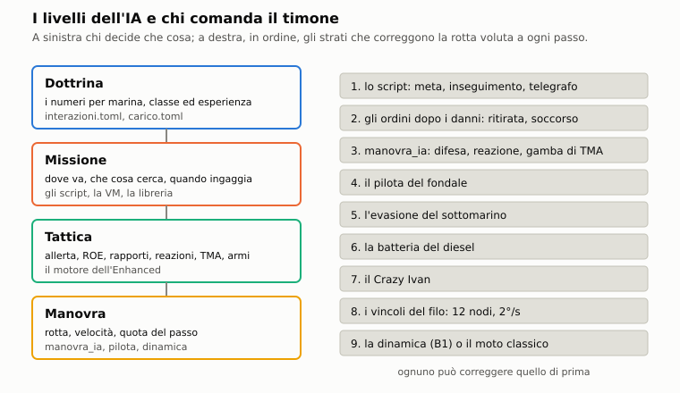

# E6. L'IA

*Autori: kit (bozza), runtime (revisione sul codice), disassemblatore (aggiornamento del 03/11/2026 dalle voci di
`docs/18` dal 29/10). Revisione del 03/11/2026: la navigazione incerta e il fondo creduto, l'IA sotto il pack, il
libretto, l'AOB, i fanali e la Luna dell'IA, il pedinamento ravvicinato, le armi antisom delle navi e l'elicottero
imbarcato, i missili dell'IA, il sonarista senza la parte vera, lo specchio della schiera, i danni ai sensori, il varco
fra le mine, l'anticipo del siluro (prima, 30/10: la rivalutazione del sonarista, il LOFAR della schiera, le mine viste,
il VDS delle navi). Stato: bozza, riletta dal runtime il 03/11/2026 sui punti nuovi, confrontati col codice (l'ultima
revisione completa è del runtime, 27/10/2026). Curatore: kit.*

## 1. A che serve

Decide come pensano e si muovono tutte le unità che non comanda il giocatore: navi, sottomarini, aerei, mercantili.
La regola dell'Enhanced è la **simmetria**: un'unità dell'IA può fare e vedere quello che fa e vede il giocatore,
con i suoi mezzi e nel suo contesto, contro di lui e contro le altre unità dell'IA. Non conosce la verità. Sente col
sonar che usa anche il giocatore. Ricava la posizione dai rilevamenti con una sua TMA. Sbaglia le classificazioni come
il sonarista di bordo. Riceve i rapporti degli amici in ritardo e con un'ellisse d'errore. Ha un'allerta che sale con
gli eventi e scende col tempo, e regole d'ingaggio che dipendono da pace, crisi e guerra. Reagisce quando un alleato è
scoperto, attaccato o affondato. In pace pedina e segnala; in guerra caccia, lancia, evade e lancia esche. Naviga sul
fondale vero senza incagliarsi, e i suoi sottomarini sanno dove sono solo per stima.

Per chi gioca questo significa due cose. Il nemico va ingannato sui sensori, non sulle regole. E intorno al battello
si combatte anche quando il battello non c'entra. Nella sandbox lo stesso modello comanda anche il battello del
giocatore (§2.17).

## 2. Il modello

Il codice è diviso fra il nucleo (moduli puri e deterministici) e la missione (il collegamento):
- nucleo: `nucleo/tma_ia.hpp` (la TMA che risolve da sola), `nucleo/manovre_tma.hpp` (le gambe), `nucleo/armi_ia.hpp`
  (carico, scelta dell'arma, guida a filo), `nucleo/evasione.hpp`, `nucleo/sonarista.hpp`, `nucleo/navigazione.hpp`,
  `nucleo/rotte.hpp`;
- missione: `missioni/src/missione.cpp` (percezione, timone, pilota del fondale), `missione_sonarista.cpp`,
  `missione_forze.cpp` (allerta, situazione, ROE, messaggi, zone), `missione_difesa.cpp`, `missione_armi_ia.cpp`,
  `missione_reazioni.cpp` (reazioni, pace, INCSEA), `missione_navigazione.cpp`, `missione_asw.cpp` (evasione ed
  esche), `missione_diesel.cpp`, `comandante_ia.cpp`;
- dati: `data/motore/interazioni.toml`. Lo scrive `tools/pipeline/interazioni.py`: le sezioni `[tma.*]`,
  `[armi_ia.*]` e `[filo_ia.*]` vengono da lì, `[allerta.*]`, `[messaggi.*]`, `[zone]` e `[roe_ia]` da
  `tools/pipeline/interazioni_forze.py`. Ogni sezione ha fonte e confidenza.

I numeri della difesa, delle reazioni, della pace e del comandante IA non sono nei dati: sono costanti nel codice,
segnate come **STIMA DI GIOCO** nei commenti. Il contratto della fase 4 prevedeva le sezioni `[difesa.*]`,
`[reazioni.*]` e `[pace.*]`; non ci sono.

Tutti i moduli dell'Enhanced si accendono insieme con la regola di simulazione (`DanniMissione::avanza`,
`missioni/src/danni_missione.cpp`). Le forze accendono a loro volta le armi dell'IA e la navigazione incerta
(`Missione::forze_enhanced`). Con le forze spente (`usa_forze(false)`) queste due partono lo stesso, ognuna col suo
interruttore. Ogni generatore casuale parte dal seme della missione: la stessa partita si rigioca uguale. Anche con
le forze spente i generatori della difesa e delle reazioni si seminano dal seme; resta fuori solo il caso limite
delle armi dell'IA spente insieme alle forze. Ogni pezzo ha un interruttore per i confronti (§2.18).

### 2.1 I livelli: dottrina, missione, tattica, manovra



La roadmap (`docs/00_ROADMAP.md`, fase 4) chiede un'IA a quattro livelli. Nel codice non c'è un modulo per livello:
i livelli sono il modo in cui i pezzi si dividono il lavoro.

- **Dottrina**: i numeri per marina, classe ed esperienza (gambe di TMA, guida a filo, carichi, canali e ritardi dei
  messaggi, tabelle d'allerta, zone). Stanno nei dati: `data/motore/interazioni.toml` e `carico.toml`.
- **Missione**: dove va l'unità, che cosa cerca, quando ingaggia e lancia. Sono gli script: la VM delle originali
  (capitolo A3) e le regole della libreria dell'editor.
- **Tattica**: allerta, regole d'ingaggio, rapporti, reazioni, TMA, scelta dell'arma, difesa. È il motore
  dell'Enhanced, fasi 2-4 di `docs/18_interazioni_ia.md`.
- **Manovra**: rotta, velocità e quota del passo. Sono la manovra dell'IA (`manovra_ia`), il pilota del fondale,
  l'evasione, la batteria, il Crazy Ivan e la dinamica.

**Chi comanda il timone.** In `Missione::navigazione` la rotta voluta passa per questi strati, in quest'ordine.
Ciascuno può correggere quello di prima:
1. lo script (meta, inseguimento, telegrafo);
2. gli ordini del motore dopo i danni (ritirata, soccorso: capitolo E2);
3. `manovra_ia`: prima la difesa, poi la reazione, poi la gamba di TMA. Se nello stesso istante lo script ha dato
   rotta o velocità (`ordini_script_`), lo script vince sulla reazione e sulla gamba, non sulla difesa;
4. il pilota del fondale (§2.14);
5. l'evasione di un sottomarino; le secche e il franco restano del pilota;
6. la batteria di un diesel (snorkel, emersione forzata);
7. il Crazy Ivan, se nient'altro è in corso;
8. i vincoli del filo, se l'unità guida un siluro: al più 12 nodi (`Siluro::FILO_VELOCITA_MAX_KN`), la prua ordinata
   al più 10° avanti alla prua (`ANTICIPO_FILO_DEG`), la virata al più 2°/s (`Siluro::FILO_VIRATA_MAX_GRADI_S`);
9. la dinamica del sottomarino (capitolo B1) o il moto classico.

Finita una manovra del motore torna la velocità che lo script aveva dato (`fine_manovra_ia`).

**L'ordine del passo.** Il motore avanza a passi di 1/9 s (`PASSO_S`). In ogni passo, dopo il moto e gli script,
`Missione::avanza` chiama: sensori, sonarista di bordo, sonaristi dell'IA, paesaggio, radio, periscopi, elettronica,
collisioni, batterie, BQS-15, artiglieria, ASW aereo ed evasione, navigazione stimata, armi dell'IA, difesa, reazioni
e pace, registro, forze. Le forze vengono dopo il registro perché leggono gli eventi di quel passo. Difesa e
reazioni leggono invece gli eventi scritti al passo prima.

### 2.2 La simmetria

Il principio è dell'utente (roadmap 31) ed è nel dossier 24 §8.0: un'unità sa solo quello che ha sentito o ricevuto.
Le regole sono della forza (una parte in un teatro); le unità le applicano. Il classico non cambia.

| Il giocatore | L'IA | Dove |
|---|---|---|
| equazione del sonar, fluttuazione, righe LOFAR | la stessa, per ogni coppia | §2.3, capitolo C1 |
| il sonarista riferisce e classifica, sbaglia | un sonarista per unità, stesso modulo | §2.4 |
| TMA alla stazione | una TMA che risolve da sola, con le gambe | §2.5 |
| ESM, radar, periscopio, vedette | gli stessi modelli, anche fra unità dell'IA | §2.3, capitoli C9-C10 |
| meteo nel punto del battello | meteo nel punto di chi ascolta | §2.3 |
| sala radio, rapporti con ritardo | messaggi di contatto con ritardo ed ellisse | §2.8 |
| il broadcast a quota periscopica con l'albero, al ciclo, copiato per intero | la stessa regola per i sottomarini, che salgono apposta alle finestre; niente filo né ELF | §2.8, §7 |
| ogni trasmissione si può localizzare | anche il rapporto del sottomarino che riferisce | §2.8 |
| regole d'ingaggio dalla radio | ROE della forza sulla parte creduta | §2.7 |
| carico, varianti, guida a filo | carico dell'anno, scelta dell'arma, filo | §2.13 |
| esche, evasione | esche, evasione, ritirata, anticollisione, tiro di risposta | §2.12 |
| navigazione stimata, punti nave | la stessa, per i sottomarini | §2.14 |
| il suo radar si fa intercettare | anche quelli dell'IA, da tutti | §2.3 |

Il giocatore è uno dei bersagli, non il centro. Le funzioni che prima guardavano solo lui guardano ogni coppia di
unità ostili. Anche il lancio di un siluro dell'IA alza il rumore del lanciatore per 2 s, come quello del giocatore
(dal 31/10/2026). Le asimmetrie che restano sono nel §7.

### 2.3 La percezione: sensori e contatti

**La visita.** Ogni passo un solo osservatore valuta i bersagli, a turno, con la cadenza dell'originale
(`Missione::passo_sensori`). Nell'Enhanced la valutazione passa all'equazione del sonar
(`Missione::ascolta_con_acustica`). Gli aerei controllati dall'ASW aereo sanno quello che sa il loro controllore
(capitolo E5).

**Il contatto** (`Contatto`) è quello che un'unità sa di un'altra:
- `qualita` da 0 a 1500. Cresce di `QUALITA_PER_DB_S` = 0,55 al secondo per dB di eccesso di segnale, preso fra −10
  e +20 dB. A 800 è una **traccia solida**: gli script accostano, ingaggiano e lanciano solo da lì. Con +10 dB stabili
  ci vogliono circa due minuti e mezzo;
- `durata`: da 800 la categoria, da 1400 la classe. Sale con la riga tonale più forte sopra +3 dB, di
  `dt · (1 + tonale / 5)`. Con più sonar la tonale è quella del sensore che la vede meglio, per ogni unità e anche per il giocatore
  (dal 30/10/2026);
- `rilevamento`, con l'errore del sensore; per l'antenna rimorchiata (la «schiera») anche lo specchio (più sotto);
- `posizione_nota`, `pos_stimata` e `quota_stimata`: la posizione, solo se un sensore la dà;
- `eccesso_db`, `sensore`, `ultima_scoperta`.

L'eccesso di segnale di ogni coppia fluttua con un processo lento: τ = 300 s, σ = 4 dB (`TAU_PASSIVO_S`, `SIGMA_DB`;
dossier 02 §1.6, confidenza media). Il contatto si perde quando la qualità scende a zero senza segnale.

**Lo specchio della schiera** (dal 31/10/2026). Al primo rilevamento della schiera l'IA crede un lato a caso, con P 0,5
dal seme della coppia: come il giocatore, non sa da quale parte dell'asse sta il contatto. Lo risolve un'accostata di
almeno 30° dalla rotta del primo rilevamento (**STIMA**; il rilevamento vero si sposta in modo coerente con la
manovra, lo specchio no), o un ascolto in cui il sensore migliore non ha specchio, come la sfera. L'eco del ping dà la
posizione, ma non risolve il lato. Se il lato creduto era quello falso, la TMA ricomincia e la posizione decade (§2.5).

**I sensori guasti** (dal 31/10/2026, `Missione::sonar_ia`). La cupola e la schiera danneggiate tacciono anche per
l'IA, come per il giocatore (capitolo E2): restano il VDS e gli idrofoni d'intercettazione.

**La traccia solida arriva col rapporto.** Sul passivo dell'IA la qualità resta sotto 800 finché il suo sonarista non
ha una traccia sul contatto, cioè finché non l'ha riferito; se la traccia è persa, torna sotto. La durata resta sotto
800 finché il sonarista non l'ha riferito e sotto 1400 finché non l'ha classificato. Non vale per la vista automatica
né per chi ha il periscopio alzato. Così l'IA non ingaggia prima del suo sonarista (correzione delle scene, 27/10).

**Da dove viene la posizione.** È il punto della simmetria: il passivo non la regala.

| Sensore | Che cosa dà | Note |
|---|---|---|
| Vista automatica | posizione vera | armi proprie; navi e aerei su chi è in superficie entro 9 nm per asse; periscopio alzato su navi e aerei entro 9 nm |
| Eco del proprio ping | posizione e quota, traccia solida | rilevamento con 1° di errore, distanza con l'1% (`impulso_sonar_enhanced`) |
| Radar | posizione, traccia solida | alberi, teste e battelli emersi delle altre parti, neutrali compresi (`radar_contro`); navi in superficie (`radar_contro_nave`) |
| Vedette e periscopio | posizione | teste dell'IA viste dall'IA dell'altra parte, con la regola della testa del giocatore |
| Passivo | solo rilevamento | la posizione dalla TMA (§2.5) |
| Ping intercettato | solo rilevamento | qualità almeno 400, a tutti (`intercetta_impulso`) |
| ESM | solo rilevamento | qualità almeno 200, sensore «esm», solo sugli emettitori ostili |
| Transitorio di lancio | solo rilevamento | §2.12; σ 2°, qualità almeno 400 |
| Rapporto di contatto | posizione riferita | nel quadro radio, con l'ellisse; il sottomarino lo riceve solo a quota d'antenna, e per lui non è una soluzione di tiro (§2.8) |

Prima della fase 2 l'IA aveva dal passivo una posizione col 10% d'errore. È stata tolta: sovrascriveva anche quelle
precise dell'eco e del radar (`docs/18`, 26/10).

**ESM e radar per tutti:**
- **ESM dell'IA**: ogni unità la cui classe ha un ricevitore nel catalogo. Navi e aerei hanno l'antenna sempre fuori;
  i sottomarini sono esposti emersi, con l'albero o con la testa fuori. È lo stesso modulo del giocatore
  (`EsmBattello`, capitolo C10). Gli avvisi restano all'equipaggio del giocatore;
- **radar**: tutti i radar accesi, anche quello del giocatore (ordine `radar`, messaggi 458 e 459), vedono alberi,
  teste e battelli emersi delle altre parti. Le parti sono tre (NATO, Patto, neutrali; `flag & 0x18`): ogni radar
  vede anche i neutrali, e i radar dei neutrali vedono tutti gli altri, in modo simmetrico. Contro le navi in
  superficie vale lo stesso, ma il radar del giocatore le vede tutte. La probabilità per giro è quella del capitolo
  C10, con 0,3 per chi non è allertato, 0,7 con un contatto o l'EMCON d'ingaggio, 0,9 con la posizione (dossier 11
  §6.4). Il radar del giocatore si spegne da solo quando l'albero va sott'acqua. Un albero visto al radar è un evento
  d'allerta (§2.6);
- **periscopio dell'IA**: guardate di 10 s ogni 180-720 s (`nucleo/periscopi.hpp`). Fuori dall'acqua vede le navi
  dell'altra parte entro la portata a vista (`Missione::portata_vista`, `missione_luci.cpp`): la sagoma con la luce del
  momento, la foschia e l'orizzonte, col binocolo 7×; di notte anche i fanali accesi verso di lui. Le portate fisse di
  15 e 3 km non ci sono più: una classe senza configurazione delle luci ha la sagoma dalla categoria e dalla lunghezza.
  La vista automatica di notte vale solo entro la portata notturna (`vista_automatica_di_notte`);
- **la Luna** (dal 30/10/2026, `Missione::cielo_notte_in`): con la data della missione e il GEO1 il cielo di notte ha
  la Luna vera, con la fase, l'altezza, l'estinzione e il controluce. Con la Luna quasi piena ci sono 0,15 lux e una
  sagoma si vede a 9,0 km; con la Luna nuova 0,0018 lux e 5,0 km. Vale per l'IA come per il giocatore (capitolo C9);
- **i fanali** (dal 29/10/2026, `missione_luci.cpp`, `leggi_fanali`): dai fanali l'IA legge lo stato, il tipo (un peschereccio; un sottomarino americano dal faro ambra) e l'aspetto, con σ 5° di prua,
  30° di lato e 20° di poppa (**STIMA**). Oltre la portata della sagoma (`portata_sagoma`) e dentro quella dei fanali
  vede le luci, ma non dà la classe;
- **l'AOB al periscopio** (dal 29/10/2026): al più una stima al minuto per bersaglio (`AOB_IA_OGNI_S`), con σ da 10°
  da vicino a 20° al limite della portata; di notte ×1,5 coi fanali e ×2 sulla sola sagoma, ×1,5 sulla sola vela, al
  più 60° (`nucleo/aob_ia.cpp`, **STIMA**). Entra nella TMA come una rotta osservata (`aggiungi_rotta`, §2.5);
  `Missione::tma_dell_ia(id, contatto)` la mostra;
- **il radar contro un battello emerso** vede fino all'orizzonte della vela vera, non di una vela fissa;
- **gli echi delle chiglie** (dal 31/10/2026, `echi_chiglie_di`, `missione_ghiaccio.cpp`): sotto il pack anche il
  ping dell'IA ha le eco ferme delle chiglie (capitolo E11). Una chiglia più forte del bersaglio nello stesso fascio
  (±3°) e nella stessa cella di distanza (±500 m, **STIMA**) gli dà la sua posizione al posto di quella del bersaglio;
- **i transitori dello scafo**: l'IA sente i colpi metallici degli altri come il sonarista del giocatore
  (`ascolta_transitorio`, capitolo C5 §2.7); su un ostile alzano l'allerta come un POSSUB, o come un
  PROBSUB se il contatto c'era già o se è una soffiata d'emergenza (§2.6). Un'unità dell'IA allertata da A2 in su ne fa
  un quarto (×0,25), come il battello del giocatore in silenzio o ai posti di combattimento;
- **paesaggio sonoro**: le navi e i sottomarini dell'IA dentro il disco del paesaggio del giocatore (100 km) sentono
  le stesse sorgenti (biologici, pescherecci, reti) entro 30 km, ogni 10 s (`PAESAGGIO_IA_M`,
  `ASCOLTO_PAESAGGIO_IA_S`, **STIMA**). Non diventano contatti: vanno al sonarista, che può scambiare un peschereccio
  per un sottomarino.

**Il meteo nel punto di chi ascolta.** `ambiente_acustico` prende il mare e la pioggia nel punto del ricevitore, in
celle di 5 km rinnovate ogni 10 s (`METEO_CELLA_M`, `METEO_CELLA_S`). Entro 2,5 km dal giocatore resta il suo. Col
meteo fisso non cambia niente (capitolo E7).

**La quota.** Dal passivo non si sa: una nave classificata è in superficie, il resto si crede alla propria quota.
Eco e radar danno la quota vera.

### 2.4 Il sonarista dell'IA

Ogni unità dell'IA che ascolta ha un `Sonarista`, lo stesso modulo dell'equipaggio del giocatore (capitolo C5),
creato al primo ascolto. Il livello viene dall'**avversario** del blocco carriera della missione, per le unità ostili
al giocatore: impreparato → recluta, regolare → medio, veterano ed élite → esperto (`esperienza_ia`). Le altre unità
hanno il medio. La chiave d'unità `sonarista` lo sovrascrive. Nella sandbox il livello della parte scelto nelle
regolazioni vince su tutti e due (§2.17). Il seme è distinto per unità (`seme_sonarista_ia`).

| Profilo (`profilo_sonarista`) | Recluta | Medio | Esperto |
|---|---|---|---|
| Soglia per accorgersene (dB) | 3 | 1 | 0 |
| Ritardo del rapporto (s) | 60 | 30 | 15 |
| Analisi fino alla classe (s) | 90 | 45 | 30 |
| Classe sbagliata (P) | 0,30 | 0,15 | 0,05 |
| Biologico preso per sottomarino (P) | 0,25 | 0,10 | 0,03 |
| Rumore in più sul rilevamento (°) | 2 | 1 | 0,5 |
| Traccia persa dopo (s) | 60 | 120 | 180 |
| Scambio di tracce che s'incrociano (P) | 0,40 | 0,20 | 0,05 |
| Righe visibili sopra (dB nel bin) | 6 | 3 | 1,5 |
| Righe del proprio battello mascherate | 0,6 | 1 | 1 |

Fonte: `nucleo/src/sonarista.cpp`, dossier 09 §3.9, **STIMA DI GIOCO**. Le righe proprie che il sonarista non maschera
entrano nella classificazione come righe del contatto (capitolo C5 §2.9). Fra le proprie c'è, dal 03/11/2026, la
vibrazione del cavo della schiera filata (la TB-16 e la SQR-19, capitolo C6 §2.9).
Il biologico preso per sottomarino cresce con
l'allerta (§2.6).

**Che cosa cambia per l'IA** (`ascolta_con_acustica`, `passo_sonaristi_ia`, una volta al secondo per unità):
- la traccia solida e la durata aspettano il sonarista (§2.3);
- le righe LOFAR e il DEMON del fascio (`SonaristaIa::demon`) si calcolano ogni 5 s per ogni contatto con traccia
  solida, di qualunque parte, ma solo per gli 8 più forti di ogni unità (`RIGHE_CONTATTI_MAX`, **STIMA**: il costo dei
  fasci). Fino al 31/10/2026 valevano solo per le coppie ostili: il sonarista sapeva la parte vera prima di
  classificare;
- se la classificazione è giusta o sbagliata si decide sulla sorgente vera (`errata_per_verita`), per gli avvisi 411 e
  per `classificazioni_ia()`; la parte creduta (sotto) usa lo sbaglio del sonarista;
- le classificazioni vanno nel registro (`classificazione_ia`: classe creduta, se giusta, confidenza POSSUB, PROBSUB
  o CERTSUB);
- la **parte creduta** (`lato_creduto`) è quella vera, salvo una classificazione sbagliata: allora è la parte di
  un'unità della missione di quella classe. Un biologico non è di nessuno. Su questa parte l'IA decide le armi, i
  rapporti, le reazioni e il pedinamento. Dopo un cambio di parte del vetrino di Dio, chi non lo sa ancora la crede della
  parte di prima (`parte_nota`, capitolo F8 §2.7b);

- **la rivalutazione** (dal 30/10/2026). Ogni 5 minuti (`RIVALUTA_S`, **STIMA**) una traccia classificata che ha
  righe viste si riguarda col classificatore, senza lo sbaglio voluto del primo colpo d'occhio. Il nuovo giudizio si
  accetta solo se è migliore: una classe dove non c'era, o una confidenza più alta. Mai una classe tolta né un passo
  indietro. Prima un Alfa detto NONSUB a 76 s restava NONSUB finché la traccia non si perdeva;
- **il LOFAR più fine**: il sonarista classifica sulle righe del sensore in ascolto col LOFAR più fine, cioè la
  schiera filata se c'è (capitolo C6 §2.10), non sul sonar di prua che sente di più a banda larga ma non vede le righe
  basse. Dal 03/11/2026 vale anche per il sonarista del giocatore, che prima classificava sul sensore che l'aveva
  sentita meglio, quasi sempre la sfera;
- **la riga sola** (dal 03/11/2026): senza classe la natura la votano le ipotesi dei battelli, solo se pesano almeno
  0,3; sotto, il DEMON a orecchio, e senza DEMON POSSUB (capitolo C5 §2.7). Prima un Victor III vero a 8 nodi e 3,7 km,
  sentito dal 688 dell'IA, dalla Perry e dal giocatore, diventava NONSUB senza classe: le righe del cavo e la sola
  riga a 250 Hz votavano «nave»;
- **il falso contatto** (D3, capitolo C5 §2.7): lo smascherano allo stesso modo il giocatore e l'IA. L'eco d'esca di
  un ping vale per ogni contatto, anche creduto NONSUB senza classe; il falso scadente, sotto fedeltà 0,7, si prova a
  smascherare anche senza classificarlo.

Gli eventi visivi e la vista automatica non passano dal sonarista.

L'identificazione a vista dell'IA (il libretto, `passo_libretto_ia`) entra nelle classificazioni col livello della
natura: NONSUB per una nave, CERTSUB per un sottomarino. Prima era sempre CERTSUB. Un civile (flag 40h o classe
civile) non ha il libretto: vede una nave o un sottomarino, senza la classe. Prima il cargo della S08 diceva «Los
Angeles» di un Foxtrot emerso, perché l'errore pescava fra le classi in mare.

**Il libretto dell'IA** (dal 29/10/2026, `missione_libretto.cpp`, **STIMA**). Su un contatto visto, o al radar entro
la portata della vista (la vela di un sottomarino emerso ha la sua sagoma, più bassa), l'IA dà una classe. La riguarda dopo 300 s (`RIVEDI_S`); prima
solo se aveva sbagliato e si è avvicinata sotto 0,6 della distanza dello sbaglio. Può sbagliare:

| Che cosa | P di sbagliare |
|---|---|
| di base | 0,03 |
| la distanza d sulla portata della vista p (p non sotto 1 km) | + 0,6 · (d / p)² |
| di notte (luce sotto 0,2) | + 0,15 |
| di prua o di poppa, entro 25° | + 0,15 |
| un sottomarino (la sola vela fuori) | + 0,10 |
| al massimo | 0,85 |

La foschia accorcia la portata, e quindi alza la P. Di notte, oltre la sagoma e dentro i fanali, l'IA legge i fanali
(§2.3) e non dà la classe. Lo sbaglio è un'altra classe dello stesso genere fra quelle in mare. Il giudizio va in
`classificazioni_ia()` col campo `visiva`, e per 15 minuti (`VISIVA_VALE_S`) la parte creduta (`lato_creduto`) lo
preferisce a quello del sonarista.

**Le parti nel dubbio** (dal 30/10/2026). Un'unità amica in superficie entro 5 km non cambia di parte per il
sonarista né per la vedetta, nemmeno con una classificazione sbagliata.

Lo script legge il lavoro del sonarista con `m688.classificato(u [, b])`, vero se ha classificato il bersaglio
corrente (o l'unità `b`) o se il contatto è lungo, e con `m688.tempo_contatto(u [, b])`, i secondi da quando è nato il
contatto (`Contatto::prima_scoperta`; 0 senza contatto). Nel classico danno nil. Li usa la libreria per la scena S1G
(`data/missioni/API.md`).

### 2.5 La TMA dell'IA

**La soluzione** (`risolvi_tma`, `nucleo/tma_ia.cpp`, del disassemblatore) usa la stessa `Tma` del giocatore (capitolo
C13): rilevamenti con la posizione propria, bersaglio in moto rettilineo uniforme. Cerca il minimo dello scarto
quadratico dei rilevamenti:
- una griglia di 28 distanze in scala logaritmica da 300 m a 60 km, 24 rotte, 9 velocità da 0 a 13 m/s (0-25 nodi);
- per ogni distanza il miglior accordo su rotta e velocità, poi Levenberg-Marquardt sulla velocità e sull'errore
  dell'ultimo rilevamento, e la sezione aurea sulla distanza. Una gamba sola non dà mai la distanza (capitolo C13 §2.9);
- servono almeno 6 rilevamenti in almeno 120 s (`RILEVAMENTI_MIN_TMA`, `ARCO_MIN_TMA_S`).

La distanza è **osservabile** se l'intervallo delle distanze compatibili è stretto:

```
χ²(d) = N · (s(d)² − s_min²) / σ²        compatibile se χ²(d) ≤ 1
osservabile se  d_max / d_min ≤ 1,6,  nessun secondo minimo,  minimo non sul bordo della griglia
```

- `N`: numero dei rilevamenti; `s(d)`: scarto medio (gradi) col miglior moto a distanza d; `s_min`: il minimo;
- `σ`: il maggiore fra l'errore del sensore, lo scarto minimo e 0,1°.

Senza una manovra propria lo scarto resta piatto su molte distanze e la posizione non si dà: è il problema di
Ekelund (dossier 02 §5.1, confidenza alta per il principio).

**Nella missione** (`ascolta_con_acustica`): per ogni coppia ostile con traccia solida e ascolto passivo, un
rilevamento ogni 20 s e una soluzione al minuto (`TMA_IA_PASSO_S`, `TMA_IA_SOLUZIONE_S`, **STIMA**), con un errore di
almeno 0,3° (`TMA_IA_ERRORE_MIN_DEG`). Se la soluzione è osservabile il contatto prende la posizione.

**Le gambe** (`ManovreTma`, `nucleo/manovre_tma.cpp`). Per rendere osservabile la distanza il sottomarino manovra:
- la gamba dura `base = min + k·(max − min)`, con `k` = distanza / `distanza_gamba_lunga_m` (al più 1), più una
  variazione casuale di ±½ · `variazione_gamba` · (max − min);
- la prima gamba mette il bersaglio sul mascone che costa la virata più corta (45° NATO, 60° sovietico); poi a ogni
  gamba sull'altro mascone, con una virata fra 30° e 90°;
- sotto 4 km il bersaglio va oltre il traverso (100°), così la gamba apre; la virata può superare i 90°;
- con la schiera filata, dopo ogni virata si aspetta che si raddrizzi prima di contare la gamba;
- una gamba verso un fondale a meno di 30 m sotto la quota si scarta (controllo a un quarto, metà e fine gamba); se
  tutti e due i lati sono bassi si tiene la rotta;
- basta quando la soluzione è osservabile e la sua sigma di distanza sta sotto la sigma relativa della dottrina;
- rinuncia: contatto senza rilevamenti da 600 s, specchio della schiera irrisolto dopo 3 gambe, nessuna soluzione
  dopo 8 gambe.

| `[tma.*]` | NATO (usa, uk) | VMF (urss) | Classi |
|---|---|---|---|
| Gamba (s) | 180-360 | 240-480 | |
| Mascone (°) | 45 | 60 | |
| Velocità di TMA (kn), massima | 6, 10 | 8, 12 | Alfa 12, 20; Kilo e Foxtrot 4, 6 |
| Sigma relativa | 0,15 | 0,2 | |
| Raddrizzamento della schiera (s) | 120 | 180 | |
| Fonte, confidenza | 02 §5.1 [WMS] [Hervey]; media | 02 §5.1, 24 §3.3; bassa | STIMA; bassa |

Senza una soluzione osservabile la distanza per la durata è metà di `distanza_gamba_lunga_m` (20 km), cioè 10 km.
**Esempio:** un Victor III senza soluzione su un contatto solido fa gambe di 240 + 0,5 · 240 = 360 s, ±36 s, a
8 nodi, col bersaglio a 60° dalla prua; a ogni gamba lo passa sull'altro mascone.

**Quando le fa** (`passo_armi_ia`, una volta al secondo):
- solo i sottomarini dell'IA immersi (quota oltre 3 m), mai nelle missioni originali (senza blocco `editor`);
- sul bersaglio dello script (l'ingaggio, poi il bersaglio corrente) o, senza, sul contatto ostile più forte con
  traccia solida e senza posizione su cui le armi sono libere;
- sul bersaglio dello script servono le armi libere, salvo che lo script l'abbia agganciato (ENGAGE);
- finiscono appena il contatto ha la posizione (`soluzione`) o con la rinuncia, e il battello torna allo script;
  registro `tma_ia` (gamba nuova, soluzione, rinuncia).

Nella missione la gamba finisce già quando il contatto ha `posizione_nota`, cioè col solo criterio dell'osservabilità
(rapporto 1,6). La sigma relativa della dottrina è più severa, e qui non arriva quasi mai a decidere.

**Quando la posizione decade** (dal 29/10/2026). Dopo 3 soluzioni di fila non osservabili, cioè 3 minuti
(`TMA_IA_NON_OSSERVABILI`, `TmaIa::non_osservabili`), la posizione che la TMA aveva dato si toglie dal contatto, e il
battello ricomincia le gambe. La sigma del rilevamento è la media quadratica degli errori (`TmaIa::sigma_deg`). Anche
lo specchio della schiera risolto dal lato sbagliato la fa ricominciare (§2.3). L'ultima soluzione osservabile
(`TmaIa::ultima_osservabile`) è l'istante della posizione data dalla TMA (`Contatto::t_posizione`, §2.13).

### 2.6 Allerta della forza e della formazione

**La paranoia** è un numero da 0 a 3 dell'editor, per missione e per unità (`paranoia` nello scenario e nei
`parametri` dell'unità): 0 distratta, 1 normale, 2 all'erta, 3 paranoica (`missioni/missione_rapida.hpp`). La libreria
delle regole dell'editor (`COMPORTAMENTI_2`, `missioni/src/scenario_missione.cpp`) la usa così:

| Allerta | Ping per passaggio (P) | Aggiornamenti per l'aggancio | Vigilanza (s) | Avvicinamento | Tracce medie |
|---|---|---|---|---|---|
| 0 | 0,05 | 8 | 60 | no | no |
| 1 | 0,2 | 5 | 180 | sì | no |
| 2 | 0,4 | 3 | 90 | sì | no |
| 3 | 0,7 | 2 | 60 | sì | sì |

Il dossier 24 §0 dà per la vigilanza 180, 90 e 45 s ai livelli 1-3; il codice usa 60 s al livello 3.

**L'allerta della forza** (`missione_forze.cpp`, fase 3) è il valore che sostituisce la paranoia nell'Enhanced. Va
da A0 (routine) ad A3 (combattimento), dossier 24 §8.1:
- c'è un'allerta per **parte** (la forza: NATO, Patto, neutrali) e una per **unità**, quella della sua formazione;
- la **formazione** sono le unità della stessa parte entro 20 km da chi vive l'evento (`raggio_formazione_m`,
  **STIMA**). Il giocatore non ne fa parte: il suo equipaggio non è dell'IA;
- il valore di partenza è la paranoia dello scenario, alzato al minimo della situazione;
- il valore di un'unità è il maggiore fra la forza e la sua formazione, o la sua paranoia se non ha ancora vissuto
  eventi (`allerta_unita`);
- la libreria usa `allerta(u)`, il maggiore fra `m688.allerta(u)` e la paranoia dell'unità: mai sotto l'editor.

**Gli eventi** (`[allerta.eventi.*]`). La formazione che vive l'evento sale subito. Il resto della forza sale quando
arriva il FLASH dalla formazione al teatro: 300-600 s USA, 450-900 s URSS, perso con P 0,05.

| Evento | Chi lo genera | Formazione | Resto della forza |
|---|---|---|---|
| `possub` | classificazione POSSUB del sonarista dell'IA | +1, fino ad A2 | — |
| `probsub` | classificazione PROBSUB o CERTSUB, una volta per coppia | +1, fino ad A3 | +1, fino ad A2 |
| `albero` | periscopio o albero visto al radar o a vista | +1, fino ad A3 | — |
| `ping` | ping nemico intercettato | +1, fino ad A3 | — |
| `arma` | lancio, colpo, salva d'artiglieria a segno: chi agisce e chi subisce | subito A3 | +1 |
| `affondato` | un'unità della stessa parte affondata entro 20 km | subito A3 | almeno A2 |
| `flash` | il FLASH della missione alla parte del giocatore, alla prima messa in onda, anche se il giocatore non lo riceve; vale anche per i sottomarini (**STIMA**) | +1 | +1 |

Fonte: `data/motore/interazioni.toml [allerta]`, dossier 24 §8.1 [FLEETEX 83, Korshun], confidenza bassa.

Dal 30/10/2026 `possub` e `probsub` alzano l'allerta solo se riguardano un sottomarino creduto ostile o di parte
ignota, e non se l'osservatore è neutrale o civile. Un transitorio di scafo sentito su un ostile vale un `possub`,
o un `probsub` se il contatto c'era già o se è una soffiata (§2.3). Un albero visto da un neutrale, o da una parte in
pace con quella del giocatore, porta al più alla vigilanza (A1, `ALBERO_PACE_MAX`, **STIMA**).

**La discesa:** −1 ogni 2700 s senza eventi (`discesa_s`, **STIMA**: il dossier dà 30-60 minuti), fino al valore di
partenza e mai sotto il minimo della situazione: A1 in crisi, A2 in guerra (`minimo_crisi`, `minimo_guerra`).

**Gli effetti:**
- da A2 le navi vanno al posto di combattimento dell'artiglieria (`posto_combattimento`, capitolo E4);
- ad A3 l'EMCON di combattimento (evento `scoperti` della macchina dell'EMCON, `emcon_combattimento`, capitolo C10);
- i falsi contatti dei sonaristi dell'IA (il biologico preso per sottomarino) × 1 / 1,5 / 2 / 3 da A0 ad A3, al più
  0,9 (`falsi_contatti`). Scendendo l'allerta il profilo torna quello di partenza;
- il ping «ti tengo» in pace (§2.11) e quelli della libreria, con la P della tabella;
- l'avvicinamento e la reazione alle tracce medie della libreria.

Lo script legge l'allerta con `m688.allerta(u)` (nil nel classico). Il registro scrive `allerta_forza` a ogni cambio
della forza e a ogni salita di una formazione; la discesa di una formazione non si scrive.

### 2.7 Situazione e regole d'ingaggio dell'IA

**La situazione** è per coppia di parti (`situazione_fra`): pace, crisi, guerra. Quella di partenza viene dal blocco
carriera, o dalla `situazione` dello scenario dell'editor, o per le originali da `carriera.toml`. Senza niente è
guerra, come le missioni del 1989. I neutrali sono in pace con tutti finché qualcuno non li provoca.

**La provocazione.** In crisi un lancio, un colpo o una salva d'artiglieria a segno di una parte sull'altra porta la
coppia in guerra, e le due parti almeno ad A2 (registro `provocazione`). Lo stesso vale per un atto ostile contro un
neutrale o di un neutrale, anche dalla pace. Vale anche fra unità dell'IA: un attacco fra IA fa salire la crisi. Fra
le due parti principali in pace un atto ostile non cambia la situazione. Una salva d'avvertimento non provoca. Una
regola di missione può dichiarare la guerra con `m688.situazione(u, nome [, parte, parte])`, che alza anche i minimi.

**Le armi libere** (`armi_libere_ia`, in Lua `m688.armi_libere(u [, bersaglio])`), sulla parte creduta (§2.4):
- sulla propria parte creduta, o su un biologico, mai;
- su un neutrale, mai, salvo due casi: la parte è in guerra col neutrale, o l'unità è ad A3 su un contatto non
  classificato per classe. Nel secondo caso il tiro si decide una volta per coppia, con P 0,3 (`neutrali_a3`;
  dossier 24 §4.6 e §8.7, confidenza media);
- fuori dalla guerra, mai: in crisi l'IA spara solo dopo l'atto ostile che porta la coppia in guerra;
- in guerra sì, salvo le zone amiche (§2.9). Per i siluri e i cannoni il codice non distingue militari e civili; per
  i missili sì (§2.13.1: niente tiro sui mercantili non identificati né su una classe creduta civile);
- senza bersaglio: libere se la parte è in guerra con l'altra.

**La sandbox** (`Missione::regolazioni`, prima del primo passo) può dare a ogni parte la sua situazione di partenza e
le ROE per categoria. La situazione vale per le decisioni di quella parte (`situazione_di`): le due parti possono
vederla in modo diverso, e chi crede di essere in guerra spara. Le ROE per categoria stanno sopra la situazione: una
categoria trattenuta non si attacca, nemmeno in guerra. Per la parte del giocatore diventano anche le ROE iniziali
della sua sala radio.

**La parte del luogo** (M7, runtime, 28/10/2026; per S08 «Valona» e S11 «Tenete il confine»). Una forza locale
armata, ostile a una sola delle due marine. È una quarta parte, lato 24 (`0x18` nel flag), solo per le unità marcate
con la chiave d'unità `schieramento = 'luogo'`. Nessuna missione del 1989 la usa, quindi il classico e le originali
non cambiano; il traffico resta neutrale.
- Le armi lanciate dal luogo ne ereditano la parte.
- La situazione di partenza viene dalla chiave di missione `situazione_luogo = { usa = 'guerra', urss = 'pace' }`;
  senza, il luogo è in pace con tutti. `m688.situazione(u, 'guerra', 'luogo', 'usa')` cambia una coppia; una
  dichiarazione generale fra USA e URSS non tocca le coppie del luogo.
- Il luogo è ostile a chi è con lui in guerra o in crisi (`ostili()`). Armi libere, ROE dell'IA, allerta per lato,
  zone ed EMCON valgono per lato come per le altre parti; l'allerta della forza ha il codice 24. L'INCSEA resta fra le
  due marine.
- Nel registro, per il giocatore un'unità del luogo è nemica se la coppia è in guerra o in crisi, neutrale se in pace,
  ricalcolato in partita.
- I controlli di nazionalità sul bit `0x10` (marina sovietica, EMCON sovietico, segno occidentale) vedono il luogo come
  sovietico: per una forza locale con armi sovietiche del 1989 va bene.
- Statistiche e serie della sandbox lo chiamano «LUOGO», in giallo (capitolo F8 §7 per quello che manca).

### 2.8 I messaggi di contatto e il quadro radio

Il disturbo del vetrino di Dio (`disturbo_radio`, capitolo F8 §2.7b) aggiunge perdita e ritardo a questi messaggi. Una
volta al secondo ogni unità dell'IA riferisce i contatti ostili che può usare: traccia solida o posizione,
sentiti negli ultimi 60 s, non neutrali. Riferisce quando la classificazione sale (sconosciuto, categoria a 800,
classe a 1400) e, con la posizione, ogni 600 s (`riferire_ogni_s`). Un sottomarino immerso non trasmette: serve la quota
d'antenna, come per ricevere, e il rapporto è una trasmissione che si può localizzare («Quando riferisce», qui sotto). Nella posizione riferita entra l'errore di navigazione di chi riferisce (§2.14).

| `[messaggi.*]` | USA | URSS |
|---|---|---|
| Formazione: voce e Link 11 (s), perdita | 30-120; 0,02 | 60-180 (KPUG); 0,05 |
| Aereo → nave (s), riuscita | 60-180; 1,0 | 720; 0,16 (Be-12 → Ka-25) |
| Teatro FLASH (s) | 300-600 | 450-900 |
| Teatro IMMEDIATE (s) | 900-1800 | 1350-2700 |
| Perdita al teatro | 0,05 | 0,05 |

Fonte: dossier 24 §8.2 e §4.5, [ART-Be12] per il Be-12, confidenza media; il teatro sovietico × 1,5 è **STIMA**.

- la **formazione** riceve da navi e aerei della parte entro 20 km; i sottomarini non hanno link e riferiscono solo
  al teatro;
- il **teatro** riceve un rapporto per parte e bersaglio ogni 600 s, o quando la classificazione sale: FLASH per un
  sottomarino classificato almeno per categoria, IMMEDIATE per il resto. Lo consegna alle navi e agli aerei della
  parte, e ai sottomarini al prossimo **broadcast**. Il ciclo del broadcast di ogni parte si estrae alla partenza fra
  600 e 900 s (`broadcast_ciclo_s`, dossier 24 §8.2). Il sottomarino riceve solo a quota d'antenna (qui sotto), se no
  al ciclo dopo; un rapporto aspetta al più un'ora dal fix;
- il **giocatore** della parte riceve dalla sua sala radio i rapporti con la posizione su altre unità, come contatto
  d'intelligence: sensore «forza», mittente OTC o KP, «CONTACT REPORT», FLASH o IMMEDIATE. Valgono i limiti di
  ricezione della radio (capitolo C11);
- chi ha già un contatto suo fresco e usabile non registra il rapporto.

**Il quadro radio** (`contatto_radio`, `quadro_radio`) sta a parte dai contatti, che il motore classico fa decadere
senza segnale. L'ellisse cresce col tempo:

```
r(t) = r0 + u · (t − t_fix)        r0 = 1852 m;  posizione valida finché r < 10 km
```

`u` è la velocità plausibile della categoria creduta: 20 nodi un sottomarino o uno sconosciuto, 30 una nave, 0 un aereo
(`[messaggi.comuni]`, **STIMA**, confidenza bassa). **Esempio:** il rapporto su un sottomarino vale come posizione per
(10 000 − 1852) / (20 · 0,514) ≈ 790 s, circa 13 minuti dopo il fix. Un aereo dell'ASW aereo che riceve la posizione
di un sottomarino o di uno sconosciuto ne fa un datum di 1852 m. Il registro scrive `messaggio_ia` (canale, ritardo,
arrivato o perso). Dossier 24 §8.2, 17 §5.2.

**Il quadro ai sottomarini dell'IA** (dal 05/11/2026, `passo_radio_sottomarini` in `missione_forze.cpp`; il progetto e
le decisioni sono in `tools/re/prove/quadro_radio/proposta.md`). Vale nell'Enhanced con le armi dell'IA, mai nelle
missioni originali (`armi_ia_->originale`). Lì, e con l'interruttore spento (§2.18), resta la regola di prima: il
battello riceve e riferisce con un albero o fino a 20 m, senza farsi localizzare, e la spia gli consegna a qualunque quota. I numeri sono **STIMA**, salvo i
due misurati (§3). Che cosa ne viene in partita è nel §7: finora poco.

*Quando riceve.* È la regola del giocatore con l'albero e degli ordini radio; un solo predicato (`a_quota_antenna`) serve
quadro, ROE e falso ordine:
- albero o periscopio alzati, oppure quota fino a 6,6 m, e niente banchisa;
- al ciclo della parte. Se non copia, ritenta al ciclo dopo, finché il rapporto ha meno di un'ora dal fix;
- il messaggio si copia tutto: serve restare a quota negli ultimi 80 s prima del ciclo (`COPIA_S`, dai 78 s misurati
  sul giocatore);
- oltre 10 nodi la copia riesce una volta su due, come al giocatore (capitolo C11 §2.4), con un generatore a parte
  (`caso_radio`) perché le altre estrazioni non si spostino.

Il disturbo della parte colpisce chi trasmette, nel passaggio al teatro, come per il giocatore: in ricezione non c'è un
secondo colpo. La **spia**, verso un sottomarino, entra in questo canale: arriva al ciclo, a quota d'antenna, con la
perdita e il ritardo del disturbo, e per ciclo e bersaglio resta l'ultimo quadro. Verso navi e aerei resta immediata
(capitolo F8 §2.7b).

*Quando riferisce* (dal 06/11/2026). Il battello riferisce un contatto solo se è già a quota d'antenna e fuori dalla
banchisa, con lo stesso predicato. Non sale apposta per riferire: sale per ascoltare, e se lassù ha un contatto lo riferisce.
Ogni rapporto che parte per il teatro è una trasmissione vera, con le regole di quelle del giocatore (`radiogoniometria_ia`,
capitolo C11 §2.9):

| Chi trasmette | Durata | Chi la coglie | Probabilità | Che cosa ne viene | Ritardo |
|---|---|---|---|---|---|
| URSS, raffica HF | 0,72 s | la rete strategica | 34% | un fix con 65 km d'errore | da 1 a 3 ore |
| Gli altri, UHF | 1,5 s | la rete strategica | 2% | un fix con 185 km d'errore | da 3 a 6 ore |
| Gli altri, UHF, con una nave o un aereo nemico dell'IA entro 50 km | 1,5 s | quell'unità | 24% | solo il rilevamento | subito |

- **Al più una trasmissione al minuto** per battello (`TRASMISSIONE_OGNI_S`, **STIMA**): più contatti nello stesso giro
  valgono un solo lancio di dado.
- **Il fix** arriva al teatro nemico come rapporto su uno sconosciuto, con il suo errore (`errore_m`) al posto dei 1852 m
  di `r0_m`. Da lì segue la strada di ogni rapporto, fino al giocatore di quella parte, come contatto d'intelligence con
  quell'errore (capitolo C11 §2.8).
- **Con un errore così largo** l'ellisse è già oltre i 10 km: a un battello non basta per cacciare né per lanciare. Un
  aereo dell'ASW aereo che lo riceve ne fa un datum largo quanto l'errore e ci va (capitolo E5 §2.7). Quanto spesso
  succeda in partita non è misurato (§7).
- **Nelle missioni originali non cambia nulla.**

*Quando sale apposta.* Il modello è il comandante IA (§2.17): una finestra ogni 1800 s, mai durante TMA o attacco. I neutrali e i
non combattenti (flag 40h) non salgono.

| Situazione della parte | Che cosa fa |
|---|---|
| Pace | non sale apposta: riceve solo se è già lì per conto suo |
| Crisi | sale alle finestre, ma non va sul dato, perché le armi non sono libere |
| Guerra | sale alle finestre e usa il dato |

- **La finestra:** ogni 1800 s (`ASCOLTO_OGNI_S`), ogni 3600 s in A3, la prima dopo altrettanto dall'inizio della partita.
  Un tentativo per ciclo: una salita chiusa da altri non riparte prima del ciclo dopo (`ciclo_tentato`).
- **Non sale, e se è in salita smette:** con un ordine dello script in quell'istante, una difesa o una reazione in corso,
  un pedinamento, una TMA, un **bersaglio agganciato** (`agganciato`, che dura finché il contatto si perde o l'ingaggio
  scatta), una manovra di lancio, un'evasione, un ordine del vetrino. Sotto la banchisa non comincia.
- **La manovra:** parte in tempo per essere a quota 120 s prima del ciclo, contando 0,25 m/s di salita (`RATEO_SALITA_M_S`,
  misurato da 100 m), va a 5,5 m e alza l'antenna; 5 s dopo il ciclo torna alla quota e alla velocità di prima. Se in
  900 s non è arrivato, rinuncia fino alla finestra dopo.
- **Il costo** è quello del giocatore: ESM e radar nemici vedono l'albero (§2.3), senza alcuna regola nuova.

| Esperienza | Rimanda col contatto ostile solido | Velocità a quota | Velocità sul dato |
|---|---|---|---|
| Recluta | con la posizione entro 5 km | fino a 12 nodi | 15 nodi |
| Medio | con la posizione entro 15 km | fino a 10 nodi | 10 nodi |
| Esperto | qualunque, anche col solo rilevamento | fino a 5 nodi | 8 nodi |

Solido vuol dire qualità almeno 800, sentito negli ultimi 60 s. La recluta fa rumore e corre al punto vecchio, e oltre
10 nodi copia al 50%.

*Che cosa fa col dato.* **Il dato radio orienta il battello, non è mai una soluzione:** per un siluro serve il contatto
proprio, come prima (§2.13.1 per i missili). Va sul dato più vicino fra quelli con la posizione, le armi libere e la
parte creduta ostile. Mai aerei, non combattenti né classi credute civili dalla sua vista o dal suo sonarista; l'esperto
ignora anche gli sconosciuti. **Se ha un contatto proprio solido, a qualunque distanza, o un bersaglio agganciato, il dato
non conta.**

| Dato | Quando | Che cosa fa |
|---|---|---|
| Fresco | `r` sotto 10 km | va sul punto, corretto col suo errore di navigazione (§2.14) |
| Vecchio | `r` fino a 30 km, mai in A3 | lo stesso |
| Scaduto | `r` oltre 30 km, o 3 cicli dall'arrivo come per il giocatore | lo lascia e riprende la rotta dello script |

A 30 km una nave vale 1824 s dal fix e un sottomarino 2736 s: i rapporti IMMEDIATE americani (900-1800 s) restano quasi
sempre usabili, quelli sovietici (1350-2700 s) solo a volte. Sotto i 10 km, com'era, non ne arriverebbe nessuno su una nave.

La caccia finisce quando arriva a 2 km dal punto senza contatto (`ARRIVATO_M`: quel dato non si riusa, ne serve uno più
nuovo), quando trova un contatto suo (comanda lo script, per esempio `R_sottomarino`), quando il dato scade, o con un
ordine dello script, e allora non riparte per 60 s (`CACCIA_DOPO_SCRIPT_S`). Alla finestra dopo può salire e rinfrescare il
dato. La precedenza: script, difesa, reazione, TMA, manovra di lancio, salita, caccia. La caccia sta in fondo a
`manovra_ia` e non tocca la navigazione, quindi la rotta dello script riprende da sola.

### 2.9 Zone dei sottomarini amici e fuoco amico

Ogni sottomarino amico ha un'**area d'azione mobile** attorno a sé: 15 nm avanti, 30 indietro, 5 per lato (`[zone]`;
dossier 24 §8.3 nella scala del gioco, confidenza bassa; storica 50/100/15 [WP-Dorado]). Per il giocatore valgono al
suo posto le aree d'azione che la missione gli dichiara per radio, se ci sono.
- Navi e aerei non usano armi antisom su un contatto subacqueo che credono dentro un'area amica. Contano la posizione
  stimata del contatto, se c'è, se no quella vera;
- salvo un contatto classificato per classe (durata da 1400, anche per errore);
- e salvo, nella prima ora dopo un attacco nemico alla parte, la P di fuoco amico: 0,05 USA, 0,15 URSS, una volta per
  coppia;
- il messaggio della zona si perde con P 0,05, una volta per coppia: quella zona resta ignota a chi spara.

Le stesse regole valgono per l'equipaggio di un aereo dell'ASW aereo: con il punto di sgancio dentro un'area amica non
sgancia (`Missione::sgancio_vietato`, capitolo E5 §2.8).

Il sottomarino stesso può sparare dentro la sua area. Lo script lo chiede con `m688.in_zona_amica(u [, bersaglio])`.
Un'IA che lancia, colpisce o spara su un'unità della propria parte scrive `fuoco_amico_ia`.

### 2.10 Le reazioni per situazione

Fase 4 C (`passo_reazioni`, `missione_reazioni.cpp`; dossier 24 §8.4). Tre eventi del registro:
- **alleato attaccato**: un colpo, o un lancio contro di lui che il bersaglio sente (ha già un contatto sull'arma);
- **alleato affondato**;
- **nemico scoperto**: un sottomarino classificato POSSUB o più da un sonarista dell'IA. Il punto è la posizione
  stimata del contatto o, col solo rilevamento, un punto a 8 km lungo quello.

Reagisce la formazione della parte, per ruolo, dopo il ritardo della voce (30-120 s, KPUG 60-180), secondo la
situazione. In pace non reagisce nessuno: la scoperta è del pedinamento (§2.11). Un affondamento vale come attacco in
guerra.

| Evento | Situazione | Nave antisom più vicina | Altre navi | Sottomarini amici | Aerei |
|---|---|---|---|---|---|
| Scoperto | crisi | la tiene sotto: attivo ogni 30 s | — | coprono (P 0,5) | datum |
| Scoperto | guerra | sul contatto | — | le gambe di TMA (§2.5) | datum |
| Attaccato | crisi | sul datum | si allontanano | fermi ad ascoltare | datum |
| Attaccato | guerra | sul datum entro 1-15 min | via a tutta forza per 10-20 min | fermi ad ascoltare | datum |
| Affondato | — | come attaccato in guerra | | | |

I numeri (`missione_reazioni.cpp`, **STIMA DI GIOCO** sul dossier 24 §8.4):
- **nave antisom**: la più vicina al punto entro 30 km, militare (non mercantile, cargo, petroliera, peschereccio o
  AGI) e con un sonar. Va sul datum o sul contatto per 900 s, a 0,9 dell'avanti tutta. Quando tiene sotto va a 0,6
  e pinga ogni 30 s;
- **altre navi** entro 20 km: verso un punto a 20 km dalla parte opposta; in guerra a tutta forza per 600-1200 s, in
  crisi a 0,7 per 600 s;
- **sottomarini amici** entro 20 km: fermi ad ascoltare a 3 nodi per 600 s; quelli che coprono vanno sul punto a
  10 nodi per 900 s;
- **aerei** dell'ASW aereo entro 60 km: subito un datum di 1852 m al controllore (`cue_asw`; capitolo E5).

Ogni unità reagisce una volta per evento. Una reazione più grave (affondato, poi attaccato, poi scoperto) non si
sostituisce con una più lieve. Le armi restano agli script e alle ROE: qui si decide solo la manovra. Registro
`reazione_ia` (ruolo, reazione, causa).

### 2.11 Pace: pedinamento e INCSEA

Fase 4 D (`passo_pace`, una volta al secondo; dossier 24 §8.5).

**Pedinamento.** Una nave militare o un sottomarino dell'IA segue un sottomarino ostile se ha su di lui una traccia
solida sentita negli ultimi 60 s, e la sua parte è in pace con quella creduta del sottomarino. Sceglie il più vicino e
lo segue alla distanza voluta:

| Chi pedina | Distanza (`missione_reazioni.cpp`) | Dossier 24 §8.5 |
|---|---|---|
| Nave | 3,5 km | 2-5 km, STIMA |
| Sottomarino con la schiera | 6 km | 2-10 km |
| Sottomarino senza schiera | 1,2 km | 500-2000 m |

Con la posizione va al punto a quella distanza dalla sua parte, lungo il rilevamento misurato. La velocità è quella del
bersaglio, più 5 nodi se è oltre 1,5 volte la distanza voluta, fra 3 nodi e l'avanti tutta. Col solo rilevamento va
lungo il rilevamento a 10 nodi, finché la TMA o un ping non danno la posizione. Il registro scrive una reazione
«pedina» all'inizio.

**Il ping «ti tengo».** La nave che pedina fa un ping una volta al minuto con la P della tabella dell'allerta (0,05,
0,2, 0,4, 0,7 da A0 ad A3), se ha un sonar attivo. Un sottomarino dell'IA che riceve un ping ostile entro 2 nm in
pace si allontana con P 0,7, una volta per pinger: 10 km dalla parte opposta, a 12 nodi al più, per 600 s
(`ritirata_ia` «ping»). Il ping lo fa anche evadere (§2.12).

**INCSEA** (l'accordo del 1972, confidenza alta). Due navi di parti diverse non in guerra sotto i 1000 yard (914,4 m)
scrivono l'evento `incsea`. Ogni nave dell'IA coinvolta accosta via: 3 km dalla parte opposta, ad almeno 8 nodi,
rinnovato finché resta sotto 1,2 volte la distanza. L'evento si riarma oltre 1,2 volte la distanza. La chiave di
missione `incsea = false` lo toglie, per lo scenario d'urto voluto.

**INCSEA degli aerei** (dossier 24 §4.2, **STIMA**). Fuori dalla guerra un aereo non passa sotto i 500 piedi entro
1 nm da una nave dell'altra parte. Vale per gli aerei del controllore dell'ASW aereo, che hanno una quota vera; gli
altri aerei, i neutrali e il traffico civile ne restano fuori. Da 2 nm l'aereo sale a 600 piedi (182 m)
(`quota_minima_m`); l'elicottero sale a 5 m/s e arriva in tempo, ma in hover col sonar a immersione non sale. Una
violazione scrive `incsea`, una per passaggio («sorvola … sotto i 500 piedi»). La stessa chiave `incsea = false` la
toglie.

**Chi non pedina** (dal 30/10/2026, `missione_reazioni.cpp`). I sottomarini lanciamissili balistici (Ohio, Typhoon,
Delta III e IV, Yankee, Lafayette) tengono la loro pattuglia. Portaerei, ausiliarie e Iowa non pedinano mai
(`non_pedina_mai`); le altre navi solo se hanno un sonar attivo. I neutrali non pedinano.

**Il pedinamento ravvicinato** (dal 31/10/2026, `missione_pedinamento.cpp`; solo nell'Enhanced). Lo script lo chiede
con `m688.pedina_vicino(u, b [, distanza_m [, sopra_m]])`: un sottomarino, di qualunque parte, si mette dritto a poppa
di un altro sottomarino, sulla rotta che gli vede, a `distanza_m` dietro di lui (400 m di difetto) e alla quota che gli vede più `sopra_m` (negativo: sotto).
- Dritto a poppa si sta dentro ogni cono sordo. `cono_sordo_gradi` calcola il cono (il più stretto fra i baffles della
  classe pedinata e l'endfire della sua schiera: 45° per l'Alfa, 35° per il 688, 25° per il 688 con la schiera filata,
  60° per un pedinato senza sensori in ascolto; **STIMA**), ma il pilota non lo usa ancora.
- Il pedinatore segue quello che sente, non la verità: un cambio di rotta oltre 10°, di quota oltre 10 m o di velocità
  oltre 2 nodi gli arriva dopo 20-60 s; la quota la stima con 8 m d'errore (**STIMA**).
- L'anticollisione dell'IA (§2.12) non guarda la coppia: la fa il pedinatore stesso, sulla geometria che vede e col
  suo ritardo. Se il minimo avvicinamento nei prossimi 2 minuti scende sotto 120 m, entro 30 m di quota, accosta via verso un
  punto a 2 km, ad almeno 5 nodi, e va 40 m sopra la quota che vede (sotto, se `sopra_m` è negativo). Un'accostata brusca del pedinato può quindi portare all'urto, come col Tautog e il K-108 nel 1970.
- Finisce con `m688.pedina_vicino(u, -1)` o dopo 5 minuti (`PERSO_S`) senza contatto. Registro `reazione_ia`
  «pedina_vicino» e «fine_pedina_vicino».

La libreria lo usa nella scena S24 «Quota zero» (la regola `R_pedina_vicino`).

**Il pedinamento dello script.** Un'unità ostile che in pace tiene il giocatore come bersaglio, ne ha il contatto ed è
entro 10 km per 300 s scrive una reazione «pedina» con causa «script» (le regole `R_pedina` della libreria).

### 2.12 La difesa: evasione, esche, ritirata, anticollisione, tiro di risposta

Fase 4 A (`passo_difesa`, `missione_difesa.cpp`; dossier 24 §8.6, 17 §6.7 e §9, 16 §4.3). Vale per ogni sottomarino
dell'IA contro qualsiasi sorgente ostile, non solo contro l'aereo che lo caccia. Le parti contano, non la verità: i
neutrali non evadono e i siluri dei neutrali non spaventano nessuno.

**Un siluro ostile in acqua:**
- un sottomarino immerso evade se il siluro è entro 3 km e ne ha il contatto, o comunque entro 1,5 km
  (`SILURO_SENTITO_M`, `SILURO_VICINO_M`). Sotto 1,5 km lo stimolo è «siluro vicino». I siluri dell'aereo che lo sta
  già cacciando li gestisce l'ASW aereo (capitolo E5);
- una nave che ha il contatto su un siluro entro 4 km si allontana a tutta forza, verso un punto a 10 km dalla parte
  opposta, per 180-300 s, una volta per siluro (`ritirata_ia` «siluro»).

**L'allarme d'intercettazione** (blocco 2 del sonar, capitolo C7 §2.10). Un sottomarino dell'IA con un ricevitore
d'intercettazione (Skat, Rubikon, Rubin, o il WLR-9 dei battelli americani dell'IA) sente le teste dei siluri che
pingano. Quando il suo allarme sale:
- **SILURO IN ACQUA** dà lo stimolo «siluro»;
- **SILURO IN ACQUISIZIONE** dà lo stimolo «siluro vicino».

Il punto da cui evade sta a 3 km sul rilevamento della traccia d'intercettazione (da poppa, se non c'è una traccia).
Con la difesa spenta della sandbox no (`passo_intercettazione`).

**L'evasione** (`Evasione`, `nucleo/evasione.cpp`; **STIMA** sulla dottrina del dossier 17). Uno stimolo più forte
cambia la manovra, uno uguale la prolunga, uno più debole non conta. L'ordine di forza è quello della tabella.

| Stimolo | Rotta | Velocità | Quota | Durata (s) |
|---|---|---|---|---|
| Ping lontano | via dal sonar, ±30° | dosata: 12 kn SSN, 6 SSK | sotto lo strato | 600 |
| Tonfo | 60-90° dalla rotta, non verso il tonfo | silenziosa: 5 kn SSN, 3 SSK | sotto lo strato | 900 |
| Sorvolo | 70-110° dalla rotta | silenziosa | almeno 150 m | 600 |
| Ping vicino | via dal datum, ±20° | dosata | sotto lo strato | 900 |
| Siluro, siluro vicino | poppa al siluro, ±10° | tutta forza | pavimento del siluro + 50 m, o la massima | 480 |

- «Sotto lo strato» è 50 m oltre la quota dello strato del profilo del mese, 150 m senza strato; mai sopra la quota di
  adesso;
- la velocità silenziosa non supera quella di adesso, e nessuna supera l'avanti tutta;
- la quota resta fra 30 m e il minore fra quota massima − 20 m e fondale − 15 m;
- in acque di 50-150 m, contro un sorvolo, un ping vicino o un siluro, il battello si posa sul fondo con P 0,67 (SSK)
  o 0,25 (SSN) e ci resta 1800 s (il San Luis alle Falkland, dossier 17 §9).

L'evasione usa il modulo dell'ASW aereo: c'è con la regola di simulazione e i dati dell'ASW. Registro `evasione_ia`.

**Le esche** (`lancia_esca_ia`, `missioni/src/missione_asw.cpp`; **STIMA** sul dossier 05 §5 e §7). Su uno stimolo di
siluro il sottomarino lancia:
- un'esca acustica col modello dell'ADC Mk 2: al più 4, una ogni 45 s, vita dai dati dell'esca (600 s in
  `siluri.toml [esche.adc_mk2]`; 160 s senza la voce). La lanciano tutti i sottomarini, anche i sovietici;
- un sottomarino nucleare sovietico anche l'esca semovente MG-74: al più 2, una ogni 120 s, sulla rotta che lascia
  (capitolo D2).

Le esche non vengono dal carico dell'unità (§2.13). Registro `esca_ia`.

**Il transitorio di lancio e il tiro di risposta.** Ogni lancio di un'unità non aerea (del giocatore o dell'IA) si
sente entro 20 km. Ogni sottomarino immerso dell'altra parte, con P 0,5 per lancio (`P_OCCHIATA`, **STIMA** sul
dossier 24 §8.6):
- ha un contatto sul lanciatore lungo il rilevamento, con 2° di errore (sensore «transitorio»);
- fa la manovra antisiluro (stimolo «siluro»), con le esche;
- se le armi sono libere su chi ha lanciato, risponde con un siluro dai suoi tubi lungo quel rilevamento
  (`tiro_di_risposta`, `missione_armi_ia.cpp`). È lo *snap shot* del dossier 24 §8.6. Serve un carico (§2.13): l'arma
  è quella della scelta, e il tubo si vuota.

Il tiro di risposta vale anche nelle missioni originali: è una difesa, non una tattica dello script (decisione della
principale, 27/10).

**Il ping intercettato** fa evadere un sottomarino immerso dell'altra parte: «ping vicino» entro 5 km, «ping lontano»
oltre (`intercetta_impulso`).

**Il colpito si ritira.** Un sottomarino dell'IA colpito va verso un punto a 20 km dal lanciatore (o dal punto del
colpo), a 0,8 dell'avanti tutta, per 1200 s (`RITIRATA_S`), come le navi colpite (`ritirata_ia` «colpito»).

**L'anticollisione.** Un sottomarino dell'IA guarda le unità di cui ha il contatto entro 1000 m, a quota vicina (entro
30 m; una nave conta a 10 m di quota). Se il punto di minimo avvicinamento nel futuro è sotto 150 m:
- cambia quota di 40 m: sotto, se il fondo meno 30 m e la quota massima lo consentono, se no sopra, non sopra 20 m;
- accosta via, verso un punto a 3 km dalla parte opposta, ad almeno 5 nodi, per 120 s.

Usa solo quello che i suoi sensori danno da vicino (dossier 16 §4.3, **STIMA**). Registro `ritirata_ia` «collisione».

Dal 30/10/2026:
- anche le navi dell'IA non investono un sottomarino vicino alla superficie, cioè sopra la loro chiglia più l'altezza
  di una vela: con la sua posizione nota, un minimo avvicinamento sotto 150 m entro 1 km le fa accostare via per 120 s.
  Prima la fregata della S16 passava sopra l'Alfa che emergeva;
- dopo un urto le due unità si staccano di 10 m oltre la compenetrazione, e un sottomarino dell'IA cambia quota di
  40 m, per 120 s di manovra (`SEPARA_M`, `SALTO_SEPARA_M`, `SEPARA_S`, **STIMA**);
- gli urti al primo passo (unità create sovrapposte) non contano, e un sottomarino all'ormeggio non fa anticollisione.

**La cassa squarciata** (dal 31/10/2026, `Missione::casse_squarciate_ia`, **STIMA**). Con l'artiglieria dell'Enhanced
(capitolo E4) un sottomarino dell'IA con una cassa squarciata, in superficie o sopra i 10 m, resta a galla anche sotto
il tiro: immergersi lo affonderebbe. Il giocatore sceglie da sé (capitolo E2).

### 2.13 Le armi dell'IA

Fase 4 B (`missione_armi_ia.cpp`, coi moduli del nucleo `nucleo/armi_ia.hpp`).

**Il carico.** Ogni sottomarino dell'IA con i dati ha il carico del suo anno alla prima volta che il motore lo vede
(`carico_ia`):
- 688 e Alfa: i carichi standard di `carico.toml` (capitolo D5);
- le altre classi: `[armi_ia.<classe>]` di `interazioni.toml`;
- le varianti non ancora in servizio o ritirate diventano la predefinita della famiglia, poi la più recente in
  servizio. Le what-if e le nucleari non si caricano. Nei primi due anni di servizio una variante col tetto ne ha al
  più tanti (l'ADCAP nel 1989: 6);
- i tubi da 650 mm restano vuoti: il 65-76 non è nel catalogo.

| Classe | Tubi | Armi (nei tubi e di riserva) | Confidenza |
|---|---|---|---|
| Sturgeon | 4 × 533 | 19 Mk 48, 4 Harpoon | media |
| Trafalgar | 5 × 533 | 20 Tigerfish, 5 Harpoon | media |
| Victor III | 4 × 533 + 2 × 650 | 6 USET-80, 4 TEST-71M, 4 SET-65, 4 53-65K | media |
| Akula | 4 × 533 + 4 × 650 | 10 USET-80, 6 TEST-71M, 6 SET-65, 6 53-65K | media |
| Oscar | 4 × 533 + 2 × 650 | 6 USET-80, 6 SET-65, 8 53-65K | media |
| Typhoon | 6 × 533 | 8 SET-65, 6 USET-80, 4 53-65K | bassa |
| Charlie II | 6 × 533 | 6 SET-65, 6 53-65K | media |
| Kilo | 6 × 533 | 8 SET-65, 6 53-65K, 4 TEST-71M | media |
| Foxtrot | 10 × 533 | 6 SAET-60M, 8 SET-65, 8 53-65K | media |

Fonte: `data/motore/interazioni.toml [armi_ia.*]`, dossier 01 §2 e 14 §1.4; le composizioni sono in parte **STIMA**.

**La scelta dell'arma** (`scegli_arma_ia`, `arma_ia_al_lancio`). Il lancio dello script prende dai tubi, fra i soli
siluri, in quest'ordine di preferenza:
1. quelli in portata (la distanza sotto 0,9 della portata);
2. con più stelle d'efficacia contro il bersaglio, sottomarino o nave (capitolo D5);
3. a parità, il filoguidato;
4. poi il più lungo.

La distanza è quella della posizione stimata, o 8 km col solo rilevamento (`DISTANZA_IGNOTA_M`, **STIMA**). Se nessuno
ha stelle, il primo siluro in tubo. **Senza siluri in tubo l'arma si perde alla nascita** e il registro non la conta
come lancio. Un'unità di una classe senza dati lancia come prima, senza carico. Il tubo si ricarica in 300 s dalla
riserva (`RICARICA_S`, **STIMA**: 4-6 minuti a mano o col sistema idraulico), con la stessa variante se ce n'è ancora,
se no con la più numerosa. `m688.armi_rimaste(u [, famiglia])` dice quanti siluri restano, nei tubi e di riserva.

**Il lancio sul contatto** (`Missione::nuovo_siluro`; fase 1). Il siluro dell'IA parte con quello che sa il lanciatore,
non con la verità:
- con la posizione stimata: rotta verso quella, distanza d'armamento `max(500 m, 0,6 · d)`, quota di ricerca quella
  stimata. Dal 31/10/2026, con l'ultima soluzione osservabile della TMA (§2.5), la rotta e la distanza d'armamento vanno
  al punto d'incontro col moto stimato (`stima_tma_ia`), non alla posizione di adesso;
- col solo rilevamento: quello, distanza d'armamento 2000 m (`RTE_SOLO_RILEVAMENTO_M`, **STIMA**), quota del
  lanciatore;
- la verità solo senza nessun contatto: lo script che lancia alla cieca;
- testa mista, velocità alta.

La libreria dell'editor lancia solo con `m688.soluzione(u)`, cioè con una posizione stimata, e con siluri a bordo.

**Quando l'IA non lancia** (dal 31/10/2026, `missione_armi_ia.cpp`, **STIMA**):
- il siluro resta in tubo se la corsa fino al punto d'incontro (o, senza soluzione, fino alla posizione stimata)
  supera 0,9 della sua portata ad alta velocità (`PORTATA_UTILE`). Lo script classico lanciava su ogni traccia
  solida, a qualunque distanza;
- niente lancio se il bersaglio può essersi spostato più di 2 km dall'ultimo dato (`SPOSTAMENTO_MAX_M`): con la
  velocità della soluzione osservabile, o 15 nodi senza, mai meno di 3 (`VELOCITA_IGNOTA_KN`, `VELOCITA_MINIMA_KN`).
  Il dato è l'istante della posizione (`Contatto::t_posizione`): un'eco, una vista, il radar o l'ultima soluzione
  osservabile della TMA. L'ascolto passivo, che la posizione non la dà, non lo rinnova.

**La guida a filo** (`GuidaFiloIa`; dossier 02 §6.2 e §6.4). I filoguidati lanciati da un sottomarino dell'IA vanno
guidati verso il contatto del lanciatore: sulla posizione stimata, o lungo il rilevamento alla distanza che il siluro
avrà alla correzione dopo. La dottrina segue l'esperienza del sonarista (§2.4):

| `[filo_ia.*]` | Recluta | Medio | Esperto |
|---|---|---|---|
| Correzione ogni (s) | 60 | 20 | 10 |
| Scarto che fa correggere (°) | 15 | 8 | 5 |
| Taglio dopo l'aggancio (s) | 10 | 30 | 60 |
| Taglio vicino alla stima (m) | 1500 | 1500 | 1000 |
| Rifiuta le esche (eco ferma oltre lo scarto) | no | sì, 15° | sì, 10° |
| Contatto perso: testa in attivo e veloce sulla stima | no | sì | sì |

Il filo si taglia anche quando il lanciatore deve evadere o il filo sta per cedere. Mentre guida, il lanciatore non
supera i 12 nodi e non vira oltre 2°/s (`VincoliFilo`, capitolo D1). I vincoli si rifanno a ogni passo e li applica
il moto; finita la guida cadono. Tutti i valori sono **STIMA**, confidenza bassa.

**Le altre armi.** L'artiglieria delle navi (anche fra navi: capitolo E4), le armi dell'ASW aereo (capitolo E5) e le
mine dell'IA, posate anche senza un campo iniziale (capitolo D4), hanno i loro capitoli. Ogni pezzo d'artiglieria ha
il suo deposito (`DatiPezzo::deposito`) e il cannone tira solo su un sottomarino esposto (capitolo E4).

**L'attacco antisom delle navi** (`m688.attacca`). Nell'Enhanced:
- non vale per un aereo guidato dal controllore ASW, né su chi sta già affondando, né su un'unità della propria parte;
- non colpisce oltre la portata dello script (per asse, almeno 2 nm); un lanciarazzi corto tira solo nella sua fascia
  (il Terne III della Oslo fra 425 e 1600 m);
- ogni nave ha una dotazione di salve per classe (`Missione::salva_asw`, **STIMA**): finite le salve, `m688.attacca`
  non fa più niente. Prima erano infinite: in S1G, col seme 2, una nave ne tirava 67 (`docs/19`, Stato).

| Classe | Salve |
|---|---|
| Kara | 20 |
| Kresta II, Udaloy, Spruance | 16 |
| Grisha, Petya | 8 |
| Oslo | 6 |
| le altre | 12 |

**Il siluro antisom vero delle navi** (dal 29/10/2026, `missione_antisom_navi.cpp`, **STIMA** sulle dotazioni del
1989). Le classi della tabella non tirano il dado dell'originale: `m688.attacca` lancia
il siluro vero col modello del capitolo D1, sulla posizione stimata del contatto. Senza posizione, o fuori portata, non
tira, e non ricade mai sul dado. Su un sottomarino in superficie (2 m o meno) nemmeno: la testa cerca sotto e la spoletta
gli passa sotto lo scafo, quindi restano i cannoni (capitolo E4; dal 03/11/2026).

| Classe | Arma | Portata | Tubi o celle | Scorta | Ricarica |
|---|---|---|---|---|---|
| Perry | Mk 46 dai Mk 32 | 7 km | 6 | 18 | un tubo ogni 5 min |
| Type 22 (Batch 1 e 2) | Mk 46 dagli STWS | 7 km | 6 | 12 | un tubo ogni 5 min |
| Spruance, Kidd | ASROC col Mk 46 | 9 km | 8 | 16 | una cella ogni 2 min |
| Ticonderoga | ASROC col Mk 46 | 9 km | 8 | 12 | una cella ogni 2 min |
| Knox | ASROC col Mk 46 | 9 km | 8 | 8 | una cella ogni 2 min |
| Krivak II, Udaloy | SET-65 da 533 | 8 km | 8 | — | — |
| Kara, Kirov, Slava | SET-65 da 533 | 8 km | 10 | — | — |

- L'ASROC posa il siluro sul punto del bersaglio; gli altri partono dalla nave.
- Un'arma alla volta: la seguente parte dopo l'esito della prima più 90 s (`VERIFICA_S`), il tempo di riprendere il
  contatto (la scena S12).
- Le salve della dotazione contano solo per l'attacco a dado: chi ha l'arma vera usa i suoi tubi e la sua riserva
  (dal 03/11/2026; prima le salve si consumavano anche mentre il siluro vero aspettava).
- Le armi che uno script fa lanciare a una nave vengono sempre dalla dotazione del lanciatore, e mai su un amico; un
  antinave mai su un sottomarino immerso.

**L'elicottero imbarcato** (dal 30/10/2026, **STIMA**). Se, a una chiamata di `m688.attacca`, il contatto è oltre i
tubi ed entro 60 km, e la nave potrebbe tirare (un tubo carico, nessuna arma in corsa), fa decollare il suo elicottero, col modello dell'ASW aereo (capitolo E5):

| Classe | Elicottero | Mare al più |
|---|---|---|
| Perry, Spruance, Ticonderoga | SH-60B | 5 |
| Type 22 | Lynx HAS.3 | 5 |
| Knox | SH-2F | 4 |
| Kara | Ka-25 | 4 |
| Udaloy, Kirov | Ka-27 | 5 |

- In volo la nave gli passa il contatto ogni 45 s (`CUE_OGNI_S`), con un raggio fra 300 m (eco o vista) e 3000 m.
- È pronto di nuovo 30 minuti dopo l'appontaggio, entro 1,5 km dalla nave (`RIFORNIMENTO_S`). Aerei ed elicotteri non
  si possono abbattere (E5 §7): il caso dell'elicottero distrutto, che lascerebbe la nave senza ricambio, c'è nel codice
  ma in partita non si presenta. La nave lo perde se le brucia l'hangar (E2 §2.6): quello in volo torna a bordo e non
  riparte.
- Non decolla se la missione ha già un elicottero su quella nave, finché quello non è appontato (la fine del volo è in
  E5 §7).
- Con l'hangar bruciato non decolla più nessuno. Un elicottero della missione che entra per evento con `base_unita` su quella
  nave non entra, e il registro lo dice: «X non decolla: l'hangar di Y è bruciato». Un elicottero senza `base_unita` non è
  coperto.

#### 2.13.1 I missili dell'IA

Dal 29/10/2026 (`passo_missili_ia`, `missione_missili.cpp`). Un'unità dell'IA col missile
antinave della sua classe lo tira da sé, senza script, con lo stesso piano del giocatore (capitolo D3). Solo
nell'Enhanced con le forze e le armi dell'IA, mai nelle missioni originali.

**Chi tira** (`data/motore/missili.toml [[lanciatore]]`, **STIMA**):

| Classe | Missile | Salva | Riserva |
|---|---|---|---|
| Oscar | P-700 | 4 | 24 |
| Kirov | P-700 | 4 | 20 |
| Slava | P-500 | 4 | 16 |
| Iowa | Harpoon | 4 | 16 |
| Nanuchka | P-120 | 3 | 6 |
| Charlie II | P-120 | 2 | 8 |
| Spruance, Kidd | Harpoon | 2 | 8 |
| Perry | Harpoon | 2 | 4 |
| Los Angeles, Sturgeon, Trafalgar | Harpoon dai tubi | 2 | quelli del carico |

Su un sottomarino emerso la salva è di un missile. I sottomarini salgono alla quota e scendono alla velocità di lancio;
dopo 15 minuti senza arrivarci rinunciano, e finita la salva tornano alla quota e alla velocità di prima. Lo script e
la difesa di quell'istante vengono prima.

**Quando:** un minuto dalla scelta del bersaglio al primo lancio (`REAZIONE_MISSILI_IA_S`), con la posizione aggiornata
da 30 s al più e le armi libere (§2.7). Poi aspetta la fine dei missili più 120 s, la valutazione del danno. Fuori
portata o sotto la distanza minima non tira, e riprova dopo 20 s.

**La scatola pulita** (`scatola_pulita`, dal 04/11/2026): non tira nemmeno se nell'area di ricerca, oltre al bersaglio, c'è
un contatto che crede neutrale, amico o di parte ignota, perché il seeker prende il primo eco. Vale anche per il MISSILE
degli script, cioè per le missioni originali: dentro il convoglio le Perry non tirano. Prima una Perry della S5 ha
colpito quella vicina. Il credere è quello di chi lancia, la sua vista e il suo sonarista, non il registro del giocatore.
Una nave sa anche dove sono le navi amiche entro 40 km senza un contatto (`AMICI_SUL_RADAR_M`, **STIMA**: radar e rete;
il suo radar non le mette fra i contatti). Il comandante della sandbox legge gli stessi avvisi nel tiro generico e si
avvicina per il siluro; nell'attacco a terra e nei lanci che la missione chiede no.

**Su chi:** il bersaglio di superficie più vicino con una traccia solida e la posizione, se:
- la classe è nota: dalla vista, dall'ESM che ha identificato il suo radar, dal sonarista, o da un contatto lungo al
  radar. Il contatto lungo del solo passivo non basta: la Perry con la SQR-19 teneva per ore un cargo sovietico a 30 km
  e gli tirava 4 Harpoon;
- oppure la traccia è tenuta da 5 minuti e il contatto si comporta da militare: oltre 18 nodi
  (`VELOCITA_MERCANTILE_KN`), in manovra, o entro 10 km da un'unità militare di classe nota della stessa parte;
- oppure la missione dichiara `zona_di_guerra = true`: allora vale ogni traccia tenuta.

Un sottomarino solo se è in superficie e visto al radar o a vista. Senza un contatto proprio, una nave classificata del
quadro radio con la posizione (il dato oltre l'orizzonte, §2.8). Un sottomarino legge solo quello che ha ricevuto a
quota d'antenna. Col canale vero un rapporto su una nave gli arriva sempre oltre i 10 km (almeno 900 s dal fix contro
528 s di validità), quindi tira sul quadro solo con la spia. Il dato radio non è una soluzione: per il siluro non basta mai.

**Mai:** su chi crede neutrale, sui non combattenti (flag 40h), su una classe creduta civile dalla vista o dal
sonarista. Il `MISSILE` dello script con un piano non valido non parte.

### 2.14 Il pilota del fondale e la navigazione incerta dell'IA

**Il pilota** (`Missione::pilota`, `nucleo/rotte.hpp`) guida navi e sottomarini dell'IA sul fondale vero del teatro
(capitolo C12 §2.3). Il giocatore no: lui si incaglia. Ogni passo:
1. **Rotta per acque navigabili.** Se la via diretta verso la meta passa in acqua bassa, una rotta A* sulle celle
   collegate (8 vicini), tagliata a vista in pochi punti. Acqua minima: pescaggio + 0,5 m. Fra la minima e la comoda
   (pescaggio + 3 m per le navi, + 10 m per i sottomarini) il costo è quadruplo. Si ripianifica quando la meta si
   sposta di oltre 500 m (al più ogni 10 s; ogni 60 s se non è raggiungibile), ogni 30 s per ricontrollare la via
   diretta e dopo un incaglio. Un punto è raggiunto a 100 m, o quando il successivo è già in vista. Se la meta non è
   raggiungibile l'unità si ferma nel punto raggiungibile più vicino, frenando in tempo.
2. **Aggiramento a vista.** Senza rotta pianificata, una secca davanti entro la portata (60 s di moto, 300-3000 m) fa
   scegliere la prima rotta libera a scarti di 15°, dal lato già scelto o da quello con più acqua (`evita_secche`).
3. **Franco.** I sottomarini tengono la chiglia 7,62 m (25 piedi) sopra il fondo, qui e in quattro punti lungo la
   prua (`FRANCO_IA_M`). Se il fondo sale più in fretta di quanto il battello possa risalire, rallenta.
4. **Freno d'emergenza.** Macchine ferme se entro 1,5 volte lo spazio di frenata più 200 m, dritto o lungo l'arco della
   virata, la chiglia incontra un fondo più alto (48 campioni al più).
5. **Mine viste** (dal 30/10/2026). Un sottomarino dell'IA col sonar da mine acceso aggira le mine che ha visto: se la
   rotta passerebbe a meno di 300 m da una mina vista nell'ultima ora entro 2 km, prende la rotta libera più vicina
   (`evita_mine`, capitolo D4 §2.8) e rallenta a 5 nodi; dentro i 300 m va via dalla mina, e chiuso da ogni parte torna
   indietro. Il sonar si accende da solo, salvo in silenzio (A3, o un ostile entro 15 km), entro 5 km dalle mine della
   sua parte o da quelle già viste (`SituazioneFondo::campo_minato`), sotto la banchisa e vicino al fondo in navigazione. Le mine le vede il BQS-15, o
   l'MG-70 e l'MG-24 dei sovietici a ogni spazzata, con gli errori di misura del giocatore (`rileva_mine`,
   `Missione::mine_scoperte_ia(id)`). La rotta libera è quella più vicina alla voluta che passa a 300 m da tutte le mine
   per 2 km, provata a passi di 5° (`PASSO_VARCO_GRADI`), prima a dritta; nella prova passa a 326 m.

Mentre aggira una secca o accosta di oltre 45° l'unità va a 5 nodi (`MANOVRA_IA_KN`). L'IA cambia quota ad almeno
0,5 m/s. Le unità che partono, o che uno script crea, in acqua meno che comoda o in una pozza chiusa sotto 500 celle
(20 km²) vanno nell'acqua comoda più vicina (`colloca`). Un pescaggio ignoto vale 8 m per un sottomarino e 6 m per una
nave. Anche le gambe di TMA, l'evasione e il Crazy Ivan passano dal pilota per le secche.

**La navigazione dello script.** La meta, l'inseguimento e l'arrivo sono quelli dell'originale: soglia d'arrivo per
asse; oltre 3° dalla rotta da prendere l'unità rallenta a un quarto dell'avanti tutta e riprende allineata (capitolo
A3). L'inseguimento accosta sul rilevamento finché la traccia non è solida.

**La posizione incerta dei sottomarini dell'IA** (`passo_navigazione_ia`, `missione_navigazione.cpp`). C'è solo con
l'opzione della navigazione realistica (`usa_navigazione`), insieme a quella del giocatore (capitolo C12):
- ogni sottomarino dell'IA ha il navigatore della sua classe nel teatro (`NavigazioneStimata`), con la sigma
  iniziale della missione, che deriva ogni 10 s. L'inerziale dell'IA si guasta coi danni, come quello del
  giocatore (`inerziale_ia_giu_`, da `DanniSottomarini`);
- esposto (un albero su, o la quota fino a 18 m) prende il punto nave più preciso che marina, teatro e anno
  consentono. Niente punti nave con emissioni né con la carta; un satellite solo se passa adesso;
- al più uno ogni 1800 s (**STIMA**), e solo se è più preciso della stima;
- l'errore entra nelle posizioni dei suoi rapporti di contatto (§2.8);
- sotto la banchisa nessun punto nave, né con l'albero né col filo, nemmeno a quota periscopica (capitolo E11);
- ogni punto nave va nel registro come `punto_nave_ia` (valore: lo spostamento della stima; distanza: la sigma dopo;
  `noto` falso). `Missione::sigma_navigazione_m(id)` dà ora la sigma anche delle unità dell'IA.

**Le navi dell'IA** (dal 29/10/2026), non il traffico, hanno anche loro il navigatore della classe e la sigma della
missione, e prendono un punto nave (Loran-C, Transit, Čajka; il GPS con la chiave `navigazione.gps` o con l'opzione «1990+», come il
giocatore, dal 03/11/2026) al più ogni 10 minuti. Dopo 15 minuti
una Perry sbaglia di 387 m, una Krivak II di 2450 m.

**Il pilota sulla stima** (dal 29/10/2026, `missione.cpp`). Con la navigazione realistica
il sottomarino dell'IA guida sull'acqua che crede di avere:
- **il margine**: chiede 1 m in più sotto la chiglia ogni 20 m di sigma, al più 40 m (`MARGINE_INCERTO_SIGMA_PER_M`,
  `MARGINE_INCERTO_MAX_M`), e guarda avanti 2σ in più, al più 5 km (`PORTATA_INCERTA_MAX_M`);
- **il fondo creduto** (`fondo_creduto`; serve anche l'Enhanced): quello del suo quadro, la carta della sua parte più i
  suoi sondaggi (capitolo C12), nel punto in cui si crede, meno una sigma della cella. Lo usano il pilota, la secca
  davanti e l'aggiramento;
- **le rotte** si pianificano sulla stima, con le secche allargate di 1,5σ, al più 3 km, a passi di 500 m
  (`allarga_secche`). Se l'allargamento chiude uno stretto usa la carta com'è; se è già troppo vicino a una secca prima
  torna al largo, nella cella libera più vicina entro due raggi;
- **il comandante prudente**: con la sigma oltre 500 m e meno di 100 m d'acqua sotto la chiglia va a 5 nodi; niente
  Crazy Ivan verso una secca (la guarda 2σ più lontano). Per risalire guarda la prua alla portata normale.

Gli incagli si calcolano sempre sul fondale vero. Nella prova un SSN con un miglio di sigma passa a 5,2 km dal centro
di un'isola invece che a 2,9.

**Che cosa resta vero dello script** (dal 28/10/2026). La VM dell'originale non ha posizioni stimate, ma nell'Enhanced
con la navigazione realistica:
- sulla stima: le prove di zona sull'unità stessa (`in_rettangolo`, `in_cerchio`, `x_maggiore`), la meta di `vai_a` (vera se
  l'arrivo dà un esito), il primo punto della rotta a punti (dal 29/10) e le mete delle navi;
- vere: i gestori d'esito (`leggi_gestori_esito`), l'inseguimento, `vai_al_bersaglio`, il giocatore e i timer.

Così una rotta a punti porta l'SSN a 8,7 km dal punto vero, e le mine si posano dove il battello è davvero: il campo
risulta spostato del suo errore.

### 2.15 Altre abitudini

- **Crazy Ivan** (`missione_collisioni.cpp`; dossier 03 §C4, confidenza media): i sottomarini sovietici dell'IA in
  moto, immersi, non in caccia né in evasione, ogni 30-120 minuti e 5-15 minuti dopo un'accostata di oltre 30°,
  virano di 120-180°, ascoltano a 4 nodi per 120-300 s e con P 0,3 cambiano quota di 20-40 m (capitolo E3). Dal
  29/10/2026 il ritorno in rotta non ne chiama un altro (in 6 ore un Alfa ne fa 5), e con la navigazione incerta
  nessuno vira verso una secca (§2.14).
- **Guardate al periscopio**: 10 s ogni 180-720 s; i sovietici alzano prima l'avvisatore radar (capitolo C9).
- **Il sonar fuori scafo delle navi** (dal 30/10/2026, `missione_vds.cpp`): le navi col VDS o con la schiera la filano
  da sole, portano il pesce 30 m sotto lo strato, recuperano prima di accelerare oltre la velocità di traino e cacciano
  a sprint and drift tenendo la media dello script (capitolo C6 §2.10).
- **EMCON** dei radar dell'IA: silenzio, navigazione, ricerca, ingaggio (capitolo C10). Una nave con una traccia solida
  su un aereo ostile passa alla «minaccia aerea».
- **Batteria dei diesel** (Foxtrot e Kilo; `missione_diesel.cpp`, **STIMA**): la carica parte a 0,8 e si consuma con
  `P = P_bordo + k v³`, tarata perché la batteria piena duri 175 ore a 2 nodi (Foxtrot) o 133 a 3 nodi (Kilo) e un'ora
  a tutta forza. Sotto 0,3 il battello va a quota periscopica a 6 nodi e ricarica 0,1 l'ora fino a 0,9. Non lo fa se
  è in caccia, finché la carica non scende a 0,05: allora emerge per forza (registro `emersione_forzata`).
- **Il diesel sotto il pack** (dal 29/10/2026, `missione_diesel.cpp`, **STIMA**). Lo
  snorkel e l'emersione forzata si fanno solo in acqua libera. Sotto il ghiaccio il diesel resta a 50 m e va a
  batteria al rifugio, controllato ogni 10 minuti (`RIFUGIO_OGNI_S`): la polynya più recente vista dal suo sondatore
  della volta, entro 20 km e vista da meno di mezz'ora (`POLYNYA_RAGGIO_M`, `POLYNYA_ETA_S`; in silenzio il sondatore
  non sonda); se no il punto più vicino del margine del pack, dove la copertura vera scende a 0,3 o meno, entro 100 km (il motore
  lo prende dal ghiaccio vero, non da quello che il battello ha visto: un limite). Lì aspetta a
  1,5 nodi; se il ghiaccio richiude torna sotto e cerca di nuovo. Sotto il ghiaccio non ricarica. Nella prova un Kilo
  alle Curili, con copertura 0,47, trova l'acqua libera a 2,7 km e ricarica da 0,239 a 0,255 in 6 ore (capitolo E11).

### 2.16 Lo spettatore: il registro dell'IA

Le decisioni dell'IA vanno nel registro (`missioni/registro_missione.hpp`, capitolo F1 §2.1) coi tipi in coda, perché
gli id sono chiavi del replay: `lancio_ia`, `scoperta_ia`, `ingaggio_ia`, `evasione_ia`, `artiglieria_ia`,
`collisione_ia`, `classificazione_ia`, `allerta_forza`, `messaggio_ia`, `provocazione`, `fuoco_amico_ia`, `esca_ia`,
`ritirata_ia`, `tma_ia`, `reazione_ia`, `incsea`, `punto_nave`, `comandante_ia`, `punto_nave_ia` (§2.14). L'elenco
completo dei tipi, anche quelli del giocatore, è nel capitolo F1.
- `scoperta_ia` scatta su un contatto che l'IA può usare (traccia solida o posizione), non sul primo segnale;
- il campo `noto` è vero quando l'equipaggio del giocatore ha un contatto visibile su chi agisce (lancio, salva, urto,
  esca, ritirata, reazione). Scoperte, classificazioni, ingaggi, evasioni, TMA e allerta sono interne: `noto` falso;
- nel gioco il giocatore sa solo quello che il suo equipaggio sente o vede; nel debriefing e nel replay c'è tutto;
- con gli interventi del vetrino di Dio, `reazione_ia` porta anche gli eventi per lo spettatore: `messaggio_perso`,
  `localizza`, `cambio_saputo`, `attribuisce_*` e `ordine_*` (capitolo F8 §2.7b);
- il quadro ai sottomarini (§2.8) scrive in `reazione_ia` `ascolto_broadcast` all'inizio della salita, `dato_radio_usato` e
  `dato_radio_lasciato`, questo col motivo: `scaduto`, `contatto`, `a_vuoto`, `script`.

### 2.17 Il comandante IA della sandbox

Nella sandbox, il «vetrino» dell'IA (`docs/19_sandbox.md` §5), il battello del giocatore lo comanda un comandante IA
(`missioni/include/missioni/comandante_ia.hpp`, `missioni/src/comandante_ia.cpp`). La partita gira senza giocatore
(`Missione::senza_giocatore`) e fuori carriera (`Missione::sandbox`). Il comandante pensa una volta al secondo e
comanda col solo `Ordine` del giocatore, che passa per il registro degli ordini come i tasti. Replay e codice partita
restano validi, e nel replay il comandante non serve: bastano gli ordini registrati.

**Che cosa vede.** Quello che vede il giocatore, mai la verità:
- i contatti come li mostra la carta (`segni_contatti`, `barra_bersaglio`), con la classe solo se nota;
- la parte di un contatto la deduce dalla classe nota, come l'IA. Un contatto senza classe non è ostile, salvo
  un'arma che non è sua;
- la posizione stimata del battello, con la navigazione incerta;
- la stazione armi, gli obiettivi della missione (`RegistroMissione::aree_obiettivi`) e le ROE ricevute dalla sala
  radio. Senza sala radio, le armi sono libere solo in guerra.

**Le casse** (dal 04/11/2026, `DanniSottomarini`). Il comandante ha `giocatore = true` ma non ha Ctrl+E: prende le regole
dell'IA. Tenta l'emersione d'emergenza dopo un allagamento (sopra i 150 m, 30-70% dei casi), dopo 5 minuti di incendio o
fumo, e quando è pesante sul fondo. Con le casse esaurite vale anche l'emersione violenta (capitolo B3), ed emerso
danneggiato va al più a 3 nodi. Il registro non segna come contatto l'esca che ha appena lanciato.

**La sua TMA negli obiettivi.** A ogni soluzione osservabile chiama `Missione::stima_tma_giocatore`, come il MATE del
giocatore: conta per gli obiettivi `rotta_stimata` con `da_tma`. Nella S20 non basta: senza piano non fa la TMA sull'SSBN
(§7).

**La condotta** (`ComandanteIa::passo`; numeri **STIMA DI GIOCO** dal dossier 02 §5):
- **obiettivo**: il primo primario con un'area; le classi da cercare dal primo obiettivo affondare, colpire o
  scoprire. All'avvio quota 120 m, schiera filata sul 688, e l'ordine di armare i tubi carichi di siluri;
- **transito** verso l'area a 8 nodi, fino a 3 km dal centro o a metà del raggio;
- **pattuglia** con gli sprint and drift: 300 s a 14 nodi e 900 s a 5, sui quattro lati di un quadrato di 8 km
  attorno all'area o alla partenza;
- **TMA** sul bersaglio scelto (ostile, armi libere, prima le classi dell'obiettivo): un rilevamento ogni 20 s e una
  soluzione al minuto con `risolvi_tma` (σ 1,5°). Le gambe con `ManovreTma` seguono la dottrina della marina e della classe del
  battello (`Missione::dottrina_tma_ia`, `interazioni.toml [tma]`), come i sottomarini dell'IA (§2.5). Il livello
  delle opzioni (`OpzioniComandante::livello`) decide quanti rilevamenti servono prima di fidarsi della soluzione
  (`rilevamenti_minimi`): recluta 18, medio 12, esperto 8. È il livello scelto nelle regolazioni per la parte del
  battello: il Patto se ha la bandiera del Patto (`flag & 0x10`, l'Alfa), se no la NATO (`app/main.cpp`, dove nasce il
  comandante); con «della missione» è medio. Lo stesso livello dà la
  dottrina del filo. Dopo 5 minuti o due gambe senza soluzione, un impulso attivo al più ogni 2 minuti per la
  distanza;
- **attacco** con la soluzione (valida 2 minuti) o con la posizione: avvicinamento a 12 nodi fino a 15 km, poi
  designazione, rotta, distanza d'armamento `max(500 m, 0,7 · d)`, quota di ricerca (la propria su un sottomarino,
  15 m su una nave) e lancio. Al più due siluri per bersaglio, a 120 s l'uno dall'altro;
- **guida a filo** dei suoi siluri con la dottrina dell'IA del suo livello (`GuidaFiloIa`, `Missione::dottrina_filo_ia`,
  §2.13), coi comandi via filo del giocatore (`comando_filo`, `taglia_filo`, `spegni_siluro`). Mentre guida resta
  sotto i 12 nodi e accosta con 5° di barra (`BARRA_FILO_DEG`), perché il filo regga;
- **ricarica** dei tubi vuoti dalla rastrelliera, con la ricarica realistica (capitolo D5), e armamento di tutti i tubi
  carichi;
- **missili** (Harpoon, TASM) sulle navi di cui ha la posizione, fra 15 km (sotto, i siluri) e 100 km
  (`PORTATA_MISSILE_M`), da quota periscopica;
- **mine** con l'obiettivo `minare` (fase `mine`): va a 12 km dal campo e lancia le Mk 67 dai tubi, una al minuto,
  con rotta e corsa a ventaglio sul cerchio dell'obiettivo (`CORSA_MINA_M`), e ricarica i tubi. Finché ha mine da
  posare non attacca; la difesa resta;
- **difesa** da un'arma nuova che non è sua: per 180 s a tutta forza dalla parte opposta, quota ±60 m, un'esca dal
  tubo se ce n'è una armata, anche l'esca semovente, lanciata di traverso alla minaccia;
- **radio** (fase `radio`): il rapporto di contatto (`radio_trasmetti`) al primo ostile dell'obiettivo o sottomarino
  ostile riconosciuto, a quota periscopica con l'antenna, al più ogni 10 minuti (`RAPPORTO_OGNI_S`); e l'ascolto del
  broadcast alle finestre della sala radio (capitolo C11), al più ogni 1800 s (`ASCOLTO_OGNI_S`), ma non durante la TMA
  né l'attacco. I sottomarini dell'IA salgono con lo stesso intervallo e gli stessi divieti (§2.8); lui però riceve dalla
  sala radio, e loro dal canale delle forze;
- **punto nave** a quota periscopica a 4 nodi, con l'antenna, quando la sigma della stima supera 1 nm: il più preciso
  senza emissioni;
- **ritirata** verso la partenza a 0,7 dell'avanti tutta, se colpito o senza siluri con un obiettivo da affondare.

Senza un'area nell'obiettivo il comandante pattuglia sul posto; nelle missioni originali segue invece il piano del
briefing (`data/motore/sandbox_originali.toml`, capitolo F8 §2.8). È
deterministico dal seme. Le fasi (transito, pattuglia, TMA, attacco, difesa, punto nave, ritirata, radio, mine) passano
al registro (evento `comandante_ia`: fase, motivo, bersaglio, noto) e al
pannello, come «COMANDANTE IA: fase - motivo». Nella TORPEX (SCENE1A) pattuglia, fa la TMA a 5 minuti, attacca a 10 e
lancia tre volte; l'esito è 5, perché in 15 minuti non affonda tutti e tre i Forrest Sherman (`docs/19`, Stato).

**Le regolazioni per parte** (`Missione::RegolazioniParte`), per NATO, Patto e neutrali:
- **livello** (recluta, regolare, esperto, o quello della missione): sonaristi e dottrina del filo di tutte le unità
  dell'IA della parte (`esperienza_di_ia`). Vince sull'avversario della carriera e sulla chiave `sonarista`;
- **allerta di partenza** (A0-A3): quella della forza e delle formazioni della parte. Vince sul minimo della situazione
  solo alla partenza, quindi una forza ad A0 in guerra è una forza sorpresa; poi sale e scende come sempre (§2.6);
- **carico per classe e anno**: l'IA lo ha già; il battello del comandante prende `SalaSiluri::carico_standard()`;
- **ROE per categoria** (`Missione::roe_parte`): valgono anche per l'artiglieria (capitolo E4) e per l'ASW aereo
  (capitolo E5). Con le armi libere i pezzi sparano come in guerra e l'aereo sgancia; con le armi trattenute niente
  tiro, nemmeno d'avvertimento, e l'aereo caccia senza sganciare.

Il codice sandbox di 30 caratteri (`app/codice_partita`, della principale) tiene il codice partita e le regolazioni
del vetrino: situazione, ROE, livello dell'IA, allerta di partenza e carico per parte, durata in quarti d'ora,
fermarsi all'esito, meteo e navigazione, i sei interruttori dell'IA dell'app (forze, difesa, armi, reazioni, ESM
dell'IA, sonaristi dell'IA; `app/regolazioni_sandbox.hpp`).

### 2.18 Gli interruttori di confronto

Ogni pezzo si spegne, prima del primo passo, per i confronti della taratura (`missioni/missione.hpp`). Nella sandbox
`Missione::interruttori_ia` li mette tutti insieme (`InterruttoriIa`: forze, difesa, armi, reazioni, ESM, sonaristi,
evasione, esche mobili).

| Interruttore | Che cosa spegne | Che cosa trascina |
|---|---|---|
| `usa_forze` | allerta, situazione per coppia, provocazioni, ROE dell'IA, messaggi, zone | la difesa e le reazioni, che girano solo con le forze; le armi dell'IA e la navigazione incerta no: partono lo stesso, ognuna col suo interruttore |
| `usa_difesa` | evasione ed esche fuori dalla caccia aerea, navi che si allontanano, transitorio e tiro di risposta, ritirata del colpito, anticollisione | — |
| `usa_armi_ia` | carico, scelta, tubi, gambe di TMA, filo | le reazioni, la pace e il tiro di risposta |
| `usa_reazioni` | reazioni per situazione, pedinamento, «ti tengo», allontanamento sul ping in pace, INCSEA | — |
| `usa_sonaristi_ia` | i sonaristi dell'IA e il paesaggio per l'IA | la traccia solida e la durata non aspettano più il rapporto |
| `usa_esm_ia` | l'ESM delle unità dell'IA | — |
| `usa_evasione` | ogni manovra d'evasione dei sottomarini dell'IA | anche le esche, che partono dall'evasione |
| `usa_esche_mobili` | le MG-74 dell'IA | — |
| `usa_crazy_ivan` | il Crazy Ivan | — |
| `usa_asw` | l'ASW aereo | l'evasione e le esche |
| `usa_navigazione` | accende (spenta di norma) la navigazione incerta del giocatore e dei sottomarini dell'IA | — |
| `usa_quadro_sottomarini` | la ricezione e i rapporti a quota d'antenna, la localizzazione di chi riferisce, la salita alle finestre, la caccia sul dato, la spia nel canale (§2.8) | restano le regole di prima: albero o 20 m, nessuna localizzazione, spia a qualunque quota. Si accende solo con le armi dell'IA e fuori dalle originali; non è fra gli `InterruttoriIa` né fra le levette della sandbox |

Reazioni e pace girano solo con forze e armi accese e fuori dalle missioni originali. La difesa gira solo con le
forze.

## 3. Fonti e confidenza

| Parametro | Fonte | Confidenza |
|---|---|---|
| Principio di simmetria, quadro per unità | roadmap 31; dossier 24 §8.0 | decisione di progetto |
| Fluttuazione per coppia τ 300 s, σ 4 dB | dossier 02 §1.6 | media |
| Traccia solida e classificazione dopo il rapporto | correzione delle scene, `docs/18` 27/10 | decisione di progetto |
| Profili del sonarista | dossier 09 §3.9 | **STIMA DI GIOCO** |
| TMA dell'IA, osservabilità | dossier 02 §5.1 (Ekelund) | alta per il principio |
| Passo della TMA (20 s, 60 s, 0,3°) | runtime | **STIMA** |
| Gambe di TMA, masconi, velocità | dossier 02 §5.1 [WMS] [Hervey]; 24 §3.3 | media (NATO), bassa (VMF) |
| Livelli d'allerta, eventi, falsi contatti × 1-3 | dossier 24 §7.1-7.2, §8.1 [FLEETEX 83, Korshun] | bassa |
| Discesa dell'allerta 45 min, raggio della formazione 20 km | dossier 24 §8.1 (30-60 min) | **STIMA** |
| Canali, ritardi e perdite dei messaggi | dossier 24 §8.2, §4.5; Be-12 [ART-Be12] | media |
| Ellisse r0 + u·t, r0, velocità, soglia; broadcast 10-15 min | dossier 24 §8.2, 17 §5.2, 10 §0 | **STIMA**, bassa |
| Quadro ai sottomarini: quota d'antenna, niente filo, niente salita in pace, spia nel canale, dato vecchio fino a 30 km, niente siluro sul dato, originali fuori | decisioni dell'utente del 05/11/2026 (`tools/re/prove/quadro_radio/proposta.md` §6) | decisione di progetto |
| Copia del messaggio 80 s; salita 0,25 m/s | misurati in gioco: 78 s sul giocatore (S5, seme 1), salita da 100 m | alta per il gioco |
| Finestre 1800 e 3600 s in A3, anticipo 120 s, ritorno 5 s, rinuncia 900 s, 60 s dopo lo script, 2 km dal punto | comandante IA per i 1800 s; il resto runtime | **STIMA** |
| Per esperienza: distanze del rinvio, velocità a quota e sul dato | runtime | **STIMA** |
| Zone 15/30/5 nm, fuoco amico 0,05 e 0,15 | dossier 24 §8.3 [WP-Dorado], 17 §5.4 | bassa |
| Neutrali ad A3 P 0,3 | dossier 24 §4.6, §8.7 (Falkland) | media |
| Reazioni per situazione e ruolo | dossier 24 §8.4 [CIA-REG86] | **STIMA DI GIOCO** |
| Pedinamento, ping «ti tengo» | dossier 24 §8.5, §4.2-4.3; dossier 03 §C4 | media |
| INCSEA 1000 yd | accordo del 1972; dossier 24 §8.5 | alta |
| Snap shot P 0,5 entro 20 km | dossier 24 §8.6 | **STIMA** |
| Evasione e posa sul fondo | dossier 17 §6.7, §8.3, §9 (San Luis) | **STIMA** sulla dottrina |
| Esche dell'IA (4 ADC ogni 45 s, 2 MG-74 ogni 120 s) | dossier 05 §5.1-5.3, §7 | **STIMA** |
| Navi via dal siluro 3-5 min, ritirata 20 min | runtime, come le navi colpite | **STIMA DI GIOCO** |
| Anticollisione 1000 m, CPA 150 m, 40 m | dossier 16 §4.3 | **STIMA** |
| Carichi dell'IA per classe | dossier 01 §2, 14 §1.4 | media; composizioni **STIMA** |
| Ricarica dell'IA 300 s, distanza ignota 8 km, RTE 2000 m | runtime | **STIMA** |
| Guida a filo per esperienza | dossier 02 §6.2, §6.4 [Mk48] | bassa, **STIMA** |
| Punto nave dell'IA ogni 30 min | runtime; dossier 06 §2, §6 | **STIMA** |
| Comandante IA (velocità, quote, tempi) | dossier 02 §5 | **STIMA DI GIOCO** |
| Pilota del fondale, franco 25 piedi | `sensori_e_navigazione.md` §9.3; EMODnet, ETOPO | alta; margini **STIMA** |
| Batteria dei diesel | Jane's, fonti aperte; dossier 23 E02 | **STIMA** |
| Crazy Ivan | dossier 03 §C4, 02 §7.2 | media |

## 4. Classico ed Enhanced

**Nel classico** l'IA è quella del 1989, identica: il rilievo delle 110 partite non cambia.
- Le unità sono guidate dagli script della VM (118 opcode, tre script per unità: all'arrivo, al bersaglio, alla
  perdita). Non c'è dottrina di gruppo: il coordinamento passa da variabili di scena e dalla marcatura dei contatti;
  l'elicottero va dove una nave amica è stata colpita (`docs/originale/comportamenti_ia.md`). I dettagli sono nel
  capitolo A3.
- La scoperta è quella della VM (`Missione::valuta`; `docs/originale/sensori_e_navigazione.md` §3): passivo solo nel
  settore di prua (±30°, ±90° con la schiera), portata additiva per asse fino a 20 nm, termoclini, eventi acustici;
  radar ed ESM di navi e aerei contro periscopio e antenna. Una traccia solida dà la **posizione vera**.
- La libreria delle regole dell'editor gira anche nel classico. Le funzioni dell'Enhanced rispondono così:
  `m688.allerta`, `m688.armi_libere` e `m688.armi_rimaste` danno nil, `m688.situazione` e `m688.in_zona_amica` falso,
  `m688.soluzione` la traccia solida. Valgono la paranoia e la costante `ARMI` della missione (0 pace, 1 crisi: l'IA
  spara solo dopo un lancio del giocatore, 2 guerra). Fa eccezione la cadenza delle salve delle navi (una ogni 20
  passaggi), che vale nei due livelli; nelle 22 originali non cambia niente.
- Il pilota del fondale vale in tutti e due i livelli: il classico ha il fondale vero (capitolo C12 §4). Nel 1989 le
  navi passavano sopra la terra.

**Solo nell'Enhanced**, con la regola di simulazione: l'acustica per coppia, il sonarista e la TMA dell'IA, ESM,
radar e vista fra tutte le unità, allerta, situazione per coppia e ROE, messaggi e zone, quadro radio, difesa ed esche, carico e
filo, reazioni e pace, navigazione stimata, batteria dei diesel, Crazy Ivan, registro dell'IA, comandante IA.

**Le missioni originali nell'Enhanced** (senza blocco `editor`, `armi_ia_->originale`) tengono i loro script e i loro
tempi: niente gambe di TMA, niente reazioni, niente pedinamento, «ti tengo» né INCSEA, nessun sottomarino che sale per il
broadcast o va sul dato radio (§2.8). Valgono la percezione col
sonarista, l'allerta, la situazione e le ROE, i messaggi e le zone, la difesa col tiro di risposta, il carico con la
scelta dell'arma e il filo. Senza siluri in tubo anche un lancio dello script di un'originale si perde. Nell'istante in
cui lo script dà un ordine, lo script vince.

## 5. Come si vede in gioco

- **Volume 1, capitolo 8** («Il nemico»): §8.1 che cosa sa e come si muove l'IA, §8.2 l'ASW aereo, §8.3
  l'artiglieria, §8.5 le collisioni; il §8.6 annuncia le interazioni fra unità dell'IA, che oggi sono nel gioco
  (§2.6-2.13 di questo capitolo).
- **Capitolo 3 §3.5**: il sonarista di bordo, lo stesso modulo dei sonaristi dell'IA.
- **Capitolo 4**: §4.5 l'ESM (i radar dell'IA), §4.6 il radar del battello, che l'IA intercetta (messaggi 458 «radar
  acceso: ci possono intercettare» e 459 «radar spento»), §4.7 la sala radio, dove arrivano i rapporti di contatto
  della forza come contatti d'intelligence (sensore «forza»).
- **Capitolo 5**: la TMA del giocatore, la stessa matematica di quella dell'IA.
- **Al sonar**: il messaggio 312 «ci stanno pingando» per un ping nemico; i ping lontani di chi tiene sotto un altro
  sottomarino; le esche e le esplosioni di una battaglia fra unità dell'IA.
- **Capitolo 10 §10.2 e §10.4**: debriefing e replay mostrano tutti gli eventi dell'IA, noti o no, con le
  minicartoline (capitolo F1); la verità del replay li trova con Tab (capitolo F5).
- **Capitolo 11 §11.2**: nell'editor la paranoia della missione e delle unità, la situazione, le regole `R_nave`,
  `R_sottomarino`, `R_pedina`, `R_aereo`, `R_vigila`, le aree d'azione «dalla radio», la chiave `incsea`.
- **La sandbox** (tasto V, della principale): le regolazioni per parte, gli interruttori, il comandante IA e le sue
  fasi nel pannello.
- **Scene di prova** S1-S7: `--cartella-missioni data/missioni/prove`; non sono nel menu.

## 6. Taratura e prove

**Le scene S1-S7** del dossier 24 §8.9 sono missioni di prova (`data/missioni/prove/PROVA_S*.lua`, scritte da
`engine/strumenti/scene_interazioni.cpp`). `scene_interazioni --semi 3` le gioca col giocatore fermo e scrive chi vede
chi, le armi in acqua e i colpiti (`tools/scene_interazioni_riassunto.txt`). Il riassunto conta solo i contatti che
l'IA può usare, come `scoperta_ia`. Lo stato del 06/11/2026, su tre semi, con la data della scena e col giocatore fermo
(la S5 è del 27/10):

| Scena | Attesa del dossier | Oggi |
|---|---|---|
| S1 KPUG e SSN alleato (crisi) | il KPUG tiene lo Sturgeon in pochi minuti | KPUG sullo Sturgeon a 120-200 s; nessuno lancia |
| S1G (guerra) | attacco dopo il PROBSUB, 15-25 min | prima arma in acqua a 790 s nei tre semi, colpito a 1010-5470 s; la prova chiede il primo lancio fra 780 e 1560 s, e **passa** |
| S2 pedinamento (pace) | il P-3 prende il Victor entro l'ora | il P-3 a 57-62 min; in pace nessuno lancia |
| S3A bastione, dall'Alfa | qualcuno trova l'intruso entro 90 min | il primo del KPUG a 250 s; **passa** |
| S4 due SSN amici | il Trafalgar sente sul confine e non lancia | sente il 688 a 150-560 s, solido a 590-1040 s; il Victor solido a 30 min; lancia sul Victor a 88-108 min, mai sul 688 |
| S5 convoglio | le scorte cercano prima di colpire | petroliera colpita a 310-510 s; **passa** |
| S6 uscita dell'SSBN | trovato solo dopo la nave spia | il Los Angeles ha il Typhoon a 6910 s in un seme, mai negli altri due in 2 ore |
| S7 portaerei, crisi → guerra | il Victor non lancia senza la copia dell'ordine | il Kara lancia a 60 min; il Victor non lancia prima della copia; **passa** |

Al 27/10 le scoperte dell'IA sui sottomarini passavano da 10-130 s (fase 2) a 70-330 s: l'effetto della traccia solida che
aspetta il sonarista e della TMA. Le navi in superficie si vedevano ancora a 10-50 s.

**La ritaratura dopo la fase 4** (100 semi per scena; `tools/taratura/risultati/fase4/`, LEGGIMI.md):
- le scene ASW a6 restano nel rumore dei 100 semi, salvo il datum profondo (scoperta da 0,76 a 0,89) e la coppia di
  Be-12. La coppia era salita a 0,73 per due cause non delle forze: 113 boe posate e il MAD che spazzava da solo un
  quinto dell'area. Con 32 boe per aereo e il MAD a 0,7 è tornata a 0,63, AT-1 a segno 0,22 a lancio, aereo solo 0,35
  (capitolo E5);
- **la sera, con la perdita al fondo nuova** (`tools/taratura/risultati/fondo_2710/`): le scoperte ASW salgono su
  piattaforma e scarpata, dove sabbia e roccia riflettono. L'SH-60F sul datum passa a 0,85, il P-3C dal SOSUS a 0,88,
  l'Il-38 a 0,31, il Foxtrot a 0,90. Il silenzioso «come la storia» si gioca ora nella piana di Porcupine (0,02 contro
  0,05 storico); sulla scarpata delle Fær Øer (a6_3s) è 0,39. Le tabelle per scena sono nel capitolo E5 §6;
- G7.3 (artiglieria sentita) scende da 0,91 a 0,75 per effetto delle forze: la guerra porta le navi al posto di
  combattimento da subito, il Kara spara a 33 s e la Perry spara 37 colpi invece di 213. Senza forze torna a 0,91
  (capitolo E4);
- i Mk 46 degli SH-3H contro un Victor allertato con esche colpiscono 0 volte su 8 semi in S7, anche a difesa spenta;
  senza evasione colpiscono in 7 semi su 8. Il Victor del datum profondo dà 0,36 a lancio, dentro la fascia 0,2-0,4
  del dossier. S7 è il caso peggiore e resta così;
- difetto trovato e corretto: i generatori della difesa e delle reazioni non avevano il seme della missione.

**Le prove automatiche:**
- `test/prove_percezione_ia.cpp` («percezione dell'IA: …»): radar contro l'antenna dell'IA, ESM dell'IA, vedette
  contro il periscopio dell'IA, «dal passivo il rilevamento e la TMA, non una posizione regalata», radar del giocatore
  intercettato, sonarista che riferisce e poi classifica, radar contro le navi, paesaggio sonoro per l'IA;
- `test/prove_sonarista.cpp`, «sonarista: il livello e il seme del sonarista dell'IA»;
  `test/prove_sonarista_missione.cpp` («sonarista missione: …»);
- `test/prove_forze.cpp` («forze: …»): ROE in crisi e provocazione, l'arma porta la formazione ad A3 e la forza al
  FLASH, `m688.situazione`, `attacca` con e senza portata, rapporti alla formazione e alla forza, zone amiche (anche lo
  sgancio vietato dentro la zona e permesso fuori), il FLASH della missione che alza l'allerta USA e non quella
  sovietica, l'IMMEDIATE che non la alza, «la
  parte del luogo (M7) in guerra con gli USA e in pace con l'URSS, finche' uno script non cambia»;
- ancora `test/prove_forze.cpp`, «quadro ai sottomarini: …», 16 casi: a 100 m e a 15 m senza albero non riceve, salito
  10 s prima del ciclo non copia, oltre 10 nodi la metà, sotto la banchisa, il disturbo e la spia, le finestre per
  situazione e allerta, una salita disturbata, il rinvio per esperienza, la caccia e la sua fine, il dato vecchio in A3,
  il rapporto su un aereo, nessun siluro col solo dato, originali e interruttore spento con lo stesso registro. Un
  diciassettesimo caso, 200 semi oltre 10 nodi, è saltato di norma (`--no-skip`, 785 messaggi copiati su 1600, 49,1%).
  Ogni regola è stata anche guastata di proposito: 34 guasti su 34 fanno fallire le prove (`tools/re/prove/quadro_radio/`);
- ancora `test/prove_forze.cpp`, «rapporti dei sottomarini: …», 8 casi: a quota d'antenna sì, a 15 m senza albero no; la
  trasmissione non sposta il `caso` delle forze; il fix al teatro nemico col suo errore e il suo ritardo, che non basta alla
  caccia; il giocatore della parte che lo riceve; le originali come prima; più rapporti nello stesso minuto che valgono una
  trasmissione sola (40 semi, 11 fix, mai due nello stesso minuto); il fix che arriva a un P-3C a 150 km come datum di 65 km,
  e in 300 s l'aereo si avvicina di 33 km. Il caso da 200 semi è saltato di norma (`--no-skip`): URSS 68 su 200, USA senza
  ESM 4 su 199, con ESM 41 su 200. Le regole sono state anche guastate di proposito, e i guasti fanno fallire le prove;
- `test/prove_difesa.cpp`: «difesa: il sottomarino dell'IA evade e lancia esche su un siluro qualsiasi, la nave si
  allontana», «difesa: senza, nessuna evasione ne' esca fuori dalla caccia aerea», «difesa: il sottomarino colpito si
  ritira da chi ha lanciato», «difesa: due sottomarini in rotta di collisione, l'IA cambia quota e accosta»,
  «reazioni: un alleato attaccato in guerra, la nave antisom va sul datum, il sottomarino amico ascolta», «pace: la
  nave pedina il sottomarino che ha classificato, e due navi di parti diverse tengono i 1000 yd» (e un SH-60B che
  caccia un Alfa scortato resta a 182 m entro 1 nm dalla Krivak, senza l'accordo scende a 45,7 m), «pace: il
  pedinamento del giocatore fatto dallo script e' un reazione_ia «pedina»»;
- `test/prove_manovre_tma.cpp` («manovre tma: …»): dottrine, gambe e masconi, osservabilità con e senza gambe,
  soluzione e ripresa, fondale, rinuncia e seme;
- `test/prove_armi_ia.cpp` («armi dell'IA: …»): catalogo, carico dell'anno, scelta dell'arma, guida a filo, esche
  rifiutate; `test/prove_armi_ia_missione.cpp`: «il Victor lancia dai suoi tubi i siluri scelti; col quinto lancio i
  tubi sono vuoti», «col solo rilevamento il sottomarino fa le gambe di TMA, ma non nelle missioni originali», «nel
  classico niente carico»;
- `test/prove_siluro.cpp`, «siluro dell'IA: si lancia sul contatto del lanciatore, non sulla posizione vera»;
- `test/prove_asw_missione.cpp`, «asw missione: l'Alfa dell'IA evade la caccia del P-3C, e senza evasione no»;
- `test/prove_artiglieria.cpp`: con `fra_navi` in guerra un Kara e una Perry si cannoneggiano;
- `test/prove_navigazione_missione.cpp`, «navigazione: anche i sottomarini dell'IA sanno dove sono solo per stima,
  ed esposti la correggono»;
- `test/prove_comandante_ia.cpp`: «comandante IA: nella TORPEX cambia fase, comanda con gli ordini del giocatore e
  finisce la missione», «comandante IA: stesso seme stessi ordini, e gli ordini registrati rifanno la partita senza di
  lui»;
- `test/prove_missioni.cpp`: «fondale: l'IA tiene il franco e aggira la costa, il giocatore si incaglia», «fondale
  reale: l'IA delle scene originali non urta il fondo»;
- `test/prove_collisioni_missione.cpp`: il Crazy Ivan, la batteria del Foxtrot;
- `test/prove_replay_schermo.cpp`: gli eventi dell'IA nella timeline, le scoperte dell'IA non note al giocatore;
- `test/prove_interazioni_scene.cpp`: le scene si leggono, si riscrivono uguali e si giocano su due semi. Le otto
  attese del dossier girano solo con `M688_PROVE_LUNGHE=1`: S5 e S7 passano, le altre sei sono ancora «da
  completare» (`doctest::may_fail`).

Per la diagnosi di una scena: `test/diag_scena_runtime.cpp`, spenta di norma (`DIAG_SCENA`, `DIAG_UNITA`,
`DIAG_SEME`, `DIAG_S`).

**Il quadro ai sottomarini nelle scene** (05/11/2026). Gli attesi sono stati scritti prima di misurare e non si riscrivono
(`tools/re/prove/quadro_radio/proposta.md` §4). La scena M4 (`PROVA_M4_QUADRO`) è stata fatta per questa misura: un Victor a
40 km da un convoglio con una Perry. Resta fra le scene di prova, fuori dai vetrini pronti.

**Queste misure sono del 15 ottobre 1989, ore 9 UTC.** Allora una scena avviata da riga di comando o da codice non prendeva la
data del suo file (corretto il 06/11/2026: `app/data_missione.hpp`, capitolo C2 §2.1). Ora la M4 è in giugno e la S5 il 21 ottobre.
Le righe qui sotto sono delle misure del 05/11. Le partite della S5, della M4, della M3 e della S22 sono state rigiocate il 06/11/2026, con la
data giusta e il sonar a 300 km: le cifre sono nella seconda tabella e nel capitolo T12 §5 e §10.

| Scena | Atteso | Misurato |
|---|---|---|
| M3 con la spia, 10 semi | identica a prima | identica byte per byte, 10/10 |
| S22, 12 semi, in pace | uguale al riferimento | uguale, 12/12; esito 40 in 4 su 12 (05/11, superato) |
| S5 senza spia, 10 semi | divergono 4-8 partite | **0**: identiche a prima. Dentro gli attesi navi 9, siluri a segno 20, lanci 27, Victor affondato 2 |
| S5 con la spia, 10 semi | primo lancio uguale in almeno 9, navi 8-12, Victor 2-6 | primo lancio uguale 10/10, navi 9, Victor 2 |
| M4 A, nessun dato, 10 semi | contatto al più 2/10, lanci in 0-2 | **no:** contatto solido 10/10 a 83 s, lanci in 3/10 |
| M4 B, con la spia, 10 semi | contatto almeno 7/10, lanci in almeno 6 | **no:** identica ad A, stessa impronta 10/10 |
| M4 C, Krivak che riferisce, 10 semi | contatto 3-7/10 | **no:** contatto solido 10/10, lanci in 1/10 |

`dato_radio_usato` non compare in nessuna delle 30 partite della M4. Queste 30 sono di prima della correzione «un tentativo per
ciclo». Rifatti 8 semi (A 1, 2, 3, 5; C 2, 6, 7, 10): contatto solido sempre a 83 s, dato mai usato, Victor che lancia in
2 su 8. Gli eventi sono scesi da un massimo di 335 a partita a 3 al più, uno per Victor e per ciclo. M3 e S22 non hanno salite e non sono
state rigiocate dopo la correzione; la S5 solo sui semi 1 e 2, con `.m688tr` identici. Rilievo del classico 0 partite su 110.
Che cosa vuol dire per la regola è nel §7. Queste misure sono di prima della griglia a 300 km e dello spettro più basso delle
navi civili: i numeri di oggi sono qui sotto e nel §7.

Le stesse scene rigiocate il 06/11/2026, 10 semi:

| Scena | Rigiocata il 06/11 |
|---|---|
| S5 senza spia | navi 8, siluri a segno 15, lanci 24, Victor affondato 5 |
| S5 con la spia | nessuna divergenza 10/10, primo lancio uguale 10/10, navi 8, Victor 5 |
| M4 A | contatto solido 10/10, primo a 85-119 s, sul mercantile a 113-235 s; il Victor lancia in 3/10 (semi 2, 6, 7) |
| M4 B, con la spia | nessuna divergenza 10/10 |
| M4 C, con la Krivak | contatto solido sul mercantile 10/10, a 101-275 s; il Victor lancia in 3/10 (semi 1, 2, 5) |
| M3 con la spia | P-500 90, a segno 56, Perry affondate 20 su 20, primo lancio 62 s, 10/10 |
| S22 da nascosto, 12 semi | liberi 2 2 2 3 1 2 2 2 2 2 1 2, media 1,92, esito 40 in 1 su 12 |

`dato_radio_usato` non è ricontato su queste 30 partite della M4: le righe `QUADRO` non escono da questa serie. Nei semi giocati il 06/11
con la regola dei rapporti (`tools/re/prove/quadro_radio/proposta.md` §9.9), M4 B, M4 C e S5 con la spia hanno 0 partite col dato usato.

## 7. Limiti noti e in arrivo

**Limiti:**
- Il comandante IA non fa il secondario «tre rotte» della S20. Senza piano non fa la TMA sull'SSBN; con un piano di
  pedinamento provato a mano (seme 1, 2 ore) insegue il Victor di scorta su un contatto che va e viene, e non arriva a una
  soluzione osservabile.
- Il comandante IA si fida della soluzione TMA e non controlla la distanza vera: lancia il Mk 48 quando la soluzione lo
  mette entro 15 km, anche se il bersaglio è molto più lontano. Su 10 semi: M3, in 5 semi, a 103-109 km fra 546 e 2433 s, 0 a segno su
  12; M4, in 1 seme, a 100-101 km, 0 su 2. Riguarda solo il vetrino: le armi dell'IA controllano la portata, e in una
  partita umana il comandante non c'è.
- I livelli non sono moduli separati: la dottrina è nei dati, la missione negli script, e non c'è un pianificatore
  che scelga gli obiettivi di un'unità. Lo fanno gli script.
- S1G, il primo attacco è presto rispetto al dossier: `PRIMO_ATTACCO_S` è 780 s, cioè 13 minuti contro i 15 del dossier.
  Resta così: cambiarlo cambierebbe le partite.
- S1G, il colpo arriva tardi e non in tutti i semi allo stesso modo: la prima arma è in acqua a 790 s, ma lo Sturgeon è
  colpito a 1010 s in un seme e a 4510 e 5470 s negli altri. Perché i siluri mancano non è stato indagato, per decisione.
- S6: col sonar nuovo il Typhoon si solidifica tardi: 6910 s in un seme, mai negli altri due nelle 2 ore della scena. Il
  dossier si aspetta che lo si trovi dopo il messaggio della nave spia; la prova controlla solo che prima dei 30 minuti
  non si trovi, e passa.
- Le scoperte dell'IA sulle navi in superficie restano rapide (10-50 s nelle scene) e il LA di S6 sente il Typhoon in
  superficie a 61 km con 15-23 dB di eccesso: è propagazione e sorgente, da guardare con l'acustica (capitolo C2).
- In pace fra le due parti principali un atto ostile non cambia la situazione e non fa reagire nessuno.
- Una reazione a un lancio parte solo se il bersaglio ha già il contatto sull'arma; se no, arriva col colpo.
- Il pedinamento con la posizione usa la velocità vera del bersaglio, non quella stimata (la stima fra due posizioni
  non c'è ancora), e sceglie il bersaglio più vicino con la distanza vera.
- Un diesel decide se è «in caccia» guardando se un'unità ostile ha la sua posizione: un'informazione che il battello
  non ha.
- Le esche dell'IA non vengono dal carico: ogni sottomarino ha 4 esche sul modello dell'ADC Mk 2 e i nucleari
  sovietici 2 MG-74.
- La ricarica dell'IA dura 300 s per tutte le classi, senza rumore né silenzio a bordo (capitolo D5).
- I tubi da 650 mm sono vuoti: il 65-76 non è nel catalogo. Dai tubi da 533 l'IA lancia i siluri e, negli SSN
  occidentali, l'Harpoon (§2.13.1); le navi e i lanciamissili sovietici tirano i loro antinave senza script.
- Per i siluri e i cannoni le ROE dell'IA in guerra non distinguono militari e civili: l'Oscar della SCENE9C tira i
  Type 53 sui cargo. Lo fanno i missili dell'IA (§2.13.1) e le ROE per categoria della sandbox.
- La discesa dell'allerta di una formazione non va nel registro.
- Il pool dei contatti dell'originale (300 record per tutte le unità) vale anche nell'Enhanced: con molte unità può
  riempirsi. Per questo il paesaggio dell'IA non crea contatti.
- Gli aerei ASW non trovano quasi mai un sottomarino silenzioso: è coerente con la taratura dell'Il-38 e del P-3C,
  ma in S3A nessuno trova l'intruso in due ore. L'Il-38 sul datum di 18 km scarta le sue rivelazioni come falsi
  allarmi.

**Il quadro ai sottomarini (§2.8): la regola è provata, ma in partita si vede poco.** Le partite qui sotto erano tutte del 15
ottobre 1989, anche quelle della libreria, non della data della missione (§6): con la data giusta le ha rigiocate P3 (06/11/2026,
`tools/re/prove/quadro_radio/proposta.md` §9.9). Dove una cifra è ancora di ottobre, lo dice la riga.
- **Il dato è usato di rado.** In 18 partite misurate (I02, I05, I06, I07, S03, S07, S08, S11, S15, 2 semi ciascuna, giocate
  fino alla durata scritta o all'esito) le salite d'ascolto sono 10 sotto A2 e 41 da A2 in su, i gruppi di copie 27, ma il dato
  è stato usato **una volta su 18 partite**: I07 seme 1, a 13 923 s, e finisce a 14 393 s senza lanci. I lanci sul solo dato sono 0;
  il giocatore è affondato una volta. Di queste 18, T12 ha rigiocato S03 e I07 seme 1: stesso esito (40 a 9380 s, 21 a 14 400 s). Le
  copie con dati su unità ostili, fra i battelli di USA e URSS, nelle partite di ottobre erano 7 gruppi: tre in I07 seme 1, gli altri
  in I02, S03 e S15. Non sono ricontate con la data giusta.
- **Perché si usa così poco.** Il contatto solido col solo rilevamento e il bersaglio agganciato bloccano il dato, anche senza
  posizione (§2.8): l'aggancio copre un ciclo intero in 21 cicli su 41 nella M4 (8 partite) e in 10 su 11 nella S5 (3 partite).
  Nelle missioni il freno principale è un altro: i rapporti su unità ostili sono pochi (quei 7 gruppi, e solo I02 seme 2 aveva
  un contatto col solo rilevamento), e in crisi le armi non sono libere. Sono letture delle tracce del 05/11, in parte stimate,
  non una misura con la regola cambiata. Il blocco col solo rilevamento resta, per scelta dell'utente: è un limite.
- **Il confronto col quadro spento arriva solo a 7200 s,** e queste partite sono ancora del 15 ottobre: non ci sono numeri
  nuovi. Fin lì nessuna partita è chiaramente peggiorata: 16 esiti su 18
  coincidono, e cambiano i due di S07, dove il giocatore affonda una volta su due in entrambi i casi, ma in semi diversi.
  Oltre quel punto I06, I07, S03, S07 e S15 non hanno un confronto, e il giudizio si basa su perdite, esiti e lanci: nessuna
  perdita nuova, tutte a tempo scaduto tranne S07 seme 2, già affondata a 3888 s. I lanci dell'IA di I07 seme 1 passano
  da 0 a 2, non dal battello che usa il dato. Due semi non bastano per dire altro.
- **La M4 non misura la caccia sul dato.** Il Victor sente il convoglio da solo: nella scena, a 40 km, il primo contatto solido arriva a 85-119 s,
  e sul mercantile a 113-235 s (10 semi). In corse di 3000 s al rilevamento 90°, in giugno, su 3 semi: a 99 km solido sulla petroliera a 264-432 s e sul mercantile a 840-1650 s, con
  perdite di contatto; a 130 km sulla petroliera in 3 semi, sul mercantile in 1. La regola orienta solo chi
  non ha un contatto suo, a qualunque distanza: dove un sottomarino sente navi rumorose, anche molto lontane, il dato
  radio non scatta. La scena resta com'è: la caccia la provano le prove (§6).
- **In S5 il Victor non sale mai.** Lo ferma il bersaglio agganciato: è la regola scritta, non un difetto, ma è più stretta
  di quanto stimato, perché `agganciato` resta su anche con contatti a 30 km. In A3 la prima finestra viene inoltre
  dopo 3600 s. Con e senza spia le partite sono quelle di prima. Il motivo è una lettura del 05/11, non rimisurata; il 06/11 la spia
  non cambia nessuna delle 10 partite.
- **Un tentativo per ciclo.** Una salita chiusa da altri perde quel ciclo. Prima ripartiva dopo 2 s, fino a 335 eventi a partita.
- **Non misurato:** quante salite arrivano davvero a quota d'antenna, oltre a copie e chiusure. I rapporti in più dei
  Victor, misurati prima della correzione, sono pochi: 3 in 10 partite di M4 A, 3 in 10 di M4 C, su 150-180 rapporti a
  partita; 25 nel solo seme 7 della S5, con la partita identica.
- **Sotto la banchisa** l'IA non arriva comunque a quota d'antenna: il motore la tiene a circa 22 m, e la guardia conta poco.

**La copia in ritardo per una sola unità non esiste.** La situazione vale per tutta la parte: alla guerra anche il Victor della S7 ha
le armi libere. La scena lo tiene senza lanci con un comportamento che non tira (`R_pedina_vicino`) fino alla copia a 75 minuti.
Su sei semi a 7200 s il Kara lancia a 3600-3610 s in tutti; il Victor nessun lancio prima della copia, poi a 6510 s nel seme 2 e a
6230 s nel seme 6, mai negli altri quattro.

**I rapporti dei sottomarini (§2.8), misurati il 06/11/2026** sulle 18 partite di prima (`tools/re/prove/quadro_radio/proposta.md`
§9.9 e §9.10):
- **I rapporti** passano da 29 a 22, tutti ad albero: quelli a 20 m senza albero erano 9, e non ci sono più.
- **Le trasmissioni** non hanno dato nessun fix: 0 su 3 per l'URSS, 0 su 13 per gli altri, e nessun contatto al giocatore. Nella S5, semi 4 e 9, 8 fix per
  partita su 23 e 27 trasmissioni, quasi tutti arrivati dopo la fine dei 7200 s.
- **Limite: il ramo fix → aereo ASW** funziona ed è provato su una scena costruita, con un solo seme e in pace. Non è misurato
  quanto spesso parta in una partita né che cosa renda: nelle 30 partite misurate nessun fix ha mandato un aereo (0 righe `datum`).
- **I rapporti pescano ancora dal `caso` delle forze** per la perdita e il ritardo, come prima. Togliere un rapporto
  rimescola il resto: in S03 seme 1 il Foxtrot emerge a t = 9380 (esito 40) invece di arrivare a tempo scaduto. Non è la regola:
  con il `caso` a parte le due regole danno lo stesso stato, secondo per secondo, in 4 semi su 4. Su 10 semi l'esito 40 esce una
  volta per parte.

**Asimmetrie che restano col giocatore, sulla radio:**
- **il filo galleggiante e l'ELF: l'IA non li ha,** né i battelli né il comandante IA. Lui riceve fino a 120 m, il battello
  dell'IA mai in profondità. È una scelta dell'utente (06/11/2026). Il motivo è che il dato non verrebbe usato: con il filo,
  nelle 18 partite misurate, i dati radio in più usati sarebbero 0, perché in A3 un dato vale solo con l'ellisse sotto i 10 km,
  cioè per circa 790 s su un sottomarino, e al ciclo del broadcast è quasi sempre più vecchio. Il filo toglierebbe invece circa
  30 salite, e con loro gli alberi da scoprire: in I02, I05, I06, I07, S03 e S07 la salita d'ascolto è l'unica esposizione. Si
  può riaprire cambiando la regola del dato in A3, dopo la verifica finale;
- la stessa età dà al giocatore un'ellisse di 10 nodi e all'IA di 20 o 30: l'IA è più prudente;
- per l'IA il primo ciclo è allineato al tempo, per il giocatore va in onda subito: in media mezzo ciclo in più;
- il FLASH «avviso radio» arriva all'allerta anche dei sottomarini in profondità (**STIMA**);
- ROE e falso ordine arrivano in qualunque istante a quota, non al ciclo;
- il giocatore non riceve i dati della spia;
- l'IA non isola un compartimento e non cambia le priorità delle riparazioni: è un limite scritto alla simmetria, per scelta
  dell'utente (06/11/2026). Le misure sono in B3 §7.

**In arrivo** (`docs/18_interazioni_ia.md`, `docs/19_sandbox.md`):
La sandbox V3 è chiusa dal 28/10/2026: la tabella per le originali (`data/motore/sandbox_originali.toml`) e le serie su
più semi (`serie_sandbox`, `--serie FILE`) ci sono (capitolo F8).

## 8. Riferimenti

- **Codice, missione:** `missioni/src/missione.cpp` (`passo_sensori`, `valuta`, `ascolta_con_acustica`,
  `impulso_sonar_enhanced`, `intercetta_impulso`, `passo_elettronica`, `radar_contro`, `passo_paesaggio`,
  `navigazione`, `pilota`, `colloca`, `evita_secche`, `nuovo_siluro`, `avanza`), `missione_sonarista.cpp`,
  `missione_forze.cpp`, `missione_reazioni.cpp`, `missione_difesa.cpp`, `missione_armi_ia.cpp`,
  `missione_navigazione.cpp`, `missione_diesel.cpp`, `missione_asw.cpp` (`stimola_evasione`, `lancia_esca_ia`,
  `passo_evasione`), `missione_periscopi.cpp`, `missione_collisioni.cpp`, `comandante_ia.cpp`,
  `scenario_missione.cpp` (libreria delle regole), `danni_missione.cpp`; `missioni/missione.hpp`,
  `missioni/forze_missione.hpp`, `missioni/armi_ia_missione.hpp`, `missioni/comandante_ia.hpp`,
  `missioni/registro_missione.hpp`.
- **Codice, nucleo:** `nucleo/tma_ia.hpp`, `nucleo/manovre_tma.hpp`, `nucleo/armi_ia.hpp`, `nucleo/evasione.hpp`,
  `nucleo/sonarista.hpp`, `nucleo/rotte.hpp`, `nucleo/tma.hpp`, `nucleo/navigazione.hpp`.
- **App:** `app/regolazioni_sandbox.hpp` (la sandbox).
- **Dati:** `data/motore/interazioni.toml` (da `tools/pipeline/interazioni.py` e `interazioni_forze.py`),
  `data/motore/carico.toml`, `data/motore/siluri.toml` (esche), `data/motore/navigazione.toml`; scene in
  `data/missioni/prove/`.
- **Strumenti:** `engine/strumenti/scene_interazioni.cpp`, `tools/scene_interazioni_riassunto.txt`,
  `engine/strumenti/taratura.cpp`, `tools/taratura/risultati/fase4/`.
- **Ricerca:** dossier 24 (tutto, in particolare §4, §7, §8), dossier 02 §5.1, §6.2-6.4, §7; dossier 17 §5-9; dossier
  16 §4.3; dossier 09 §3.9; dossier 05 §5 e §7; dossier 03 §C4; dossier 01 §2 e 14 §1.
- **Progetto:** `docs/18_interazioni_ia.md` (piano e stato delle fasi 1-5), `docs/19_sandbox.md`, `docs/00_ROADMAP.md`
  (voci 31 e 32, fase 4), `docs/04_vm_missioni.md`, `docs/originale/comportamenti_ia.md`,
  `docs/originale/sensori_e_navigazione.md`; note condivise ia-fase3-contratto.md, ia-fase4-contratto.md,
  sandbox-v1-runtime-contratto.md, navigazione-aggancio-contratto.md.
- **Capitoli collegati:** A3, B1, C1, C2, C5, C9, C10, C11, C12, C13, D1, D2, D4, D5, E3, E4, E5, E7, F1, F5, F8.
