# 9. I teatri

I sette teatri del gioco, dall'enciclopedia: dove sono, com'è il fondale, che ruolo avevano nel 1989. Le carte sono quelle d'epoca del gioco.

<!-- generato: unita_teatri -->
### Imboccatura dell'Adriatico (Canale d'Otranto)

*Teatri · neutrale*

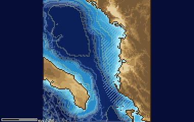

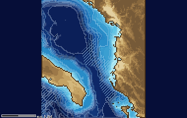

L'imboccatura dell'Adriatico, larga una settantina di chilometri, fra le basi italiane di Taranto e Brindisi e la costa albanese, dove fra il 1958 e il 1961 i Whiskey sovietici ebbero una base. La soglia è a circa 780 metri, oltre si apre la Fossa Sud-Adriatica, a circa 1200; il fondo è quasi tutto fango e argilla, che assorbe il suono. Già fra il 1915 e il 1918 il canale fu sbarrato contro i sommergibili. D'inverno Bora e Scirocco, d'estate un mare calmo e limpido.

**In partita.** D'estate il termoclino a 20-50 metri è violento: sotto i 50 metri sei ben nascosto da chi ascolta sopra, ma il mare calmo aiuta i radar a vedere il periscopio. D'inverno l'acqua si mescola in profondità e lo strato sparisce.

| Dato | Valore | Nel gioco | Confidenza | Fonte |
|---|---|---|---|---|
| Riquadro | 39,50-42,50° N, 17,0° E - 20,5° E | - | alta | tools/pipeline/teatri.yaml (dossier 03) |
| Missioni del 1989 | 6 | - | alta | tools/pipeline/teatri.yaml (dossier 03) |
| Vento medio (gennaio / luglio) | 6,8 / 5,4 m/s | - | media | meteo.toml (ERA5 1981-1990; dossier 21 §3) |
| Onda significativa media (gennaio / luglio) | 0,9 / 0,5 m | - | media | meteo.toml (ERA5 1981-1990; dossier 21 §3) |
| Ore di burrasca ≥ Bft 8 a gennaio | 0,6 % | - | media | meteo.toml (ERA5 1981-1990; dossier 21 §3) |
| Ghiaccio | mai | - | media | meteo.toml (dossier 21 §3.1) |

**Basi:** Taranto, Brindisi, Tivat (Bocche di Cattaro), Pasha Liman (Valona).

**Fonti:** dossier 03 §A4; dossier 21 §3.1-3.2; teatri.yaml (otranto).

### Isole Fær Øer – Mar di Norvegia

*Teatri · neutrale*

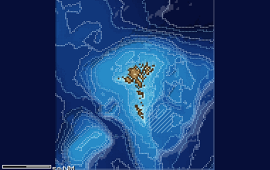

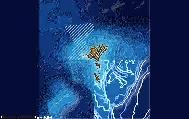

Il varco fra le Isole Fær Øer e il Mar di Norvegia, sulla dorsale che va dalla Groenlandia alla Scozia: di qui dovevano passare i sottomarini sovietici diretti nell'Atlantico, ed era il teatro principale della caccia della NATO. Il fondo alterna la piattaforma delle Fær Øer, sotto i 200 metri, a canali profondi come quello Fær Øer-Shetland e la soglia del Fær Øer Bank Channel a circa 840 metri. D'inverno è il mare più duro del gioco: onde medie di 4 metri, una burrasca circa ogni 6 giorni.

| Dato | Valore | Nel gioco | Confidenza | Fonte |
|---|---|---|---|---|
| Riquadro | 60,50-63,50° N, 10,0° O - 4,0° O | - | alta | tools/pipeline/teatri.yaml (dossier 03) |
| Missioni del 1989 | 1, 2 | - | alta | tools/pipeline/teatri.yaml (dossier 03) |
| Vento medio (gennaio / luglio) | 10,7 / 6,6 m/s | - | media | meteo.toml (ERA5 1981-1990; dossier 21 §3) |
| Onda significativa media (gennaio / luglio) | 4,2 / 1,6 m | - | media | meteo.toml (ERA5 1981-1990; dossier 21 §3) |
| Ore di burrasca ≥ Bft 8 a gennaio | 8,4 % | - | media | meteo.toml (ERA5 1981-1990; dossier 21 §3) |
| Ghiaccio | nessuno in mare aperto | - | media | meteo.toml (dossier 21 §3.1) |

**Basi:** Keflavík, Kinloss.

**Fonti:** dossier 03 §A1; dossier 21 §3.1 (nota A §2.1, ERA5).

### Mar Baltico sud-occidentale

*Teatri · neutrale*

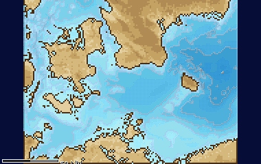

Il Baltico sud-occidentale, fra la costa della Germania Est, la Danimarca e Bornholm: il mare del Patto di Varsavia, con la Flotta del Baltico sovietica, la Volksmarine e la marina polacca, contro le marine danese e tedesca della NATO. Gli SSN americani di fatto non ci entravano. È bassissimo: la soglia di Darss è a 18 metri, quella di Drogden nell'Øresund a 7-9, e i bacini arrivano a 50 metri ad Arkona e a 100 a Bornholm; il fondo è sabbia, till glaciale e massi. In superficie l'acqua è salmastra; ghiaccio negli inverni rigidi del 1985-1987, e mare corto con le burrasche da ovest.

**In partita.** Un 688 ha bisogno di 25-30 metri d'acqua per stare a quota periscopica con margine: negli stretti si passa a quota periscopica o in superficie. Nei bacini profondi abbastanza c'è un canale sonoro a 30-50 metri sopra l'alocline, un buon nascondiglio; altrove guarda il fondo.

| Dato | Valore | Nel gioco | Confidenza | Fonte |
|---|---|---|---|---|
| Riquadro | 53,90-56,40° N, 10,5° E - 16,2° E | - | alta | tools/pipeline/teatri.yaml (dossier 03) |
| Missioni del 1989 | 10 | - | alta | tools/pipeline/teatri.yaml (dossier 03) |
| Vento medio (gennaio / luglio) | 9,2 / 6,4 m/s | - | media | meteo.toml (ERA5 1981-1990; dossier 21 §3) |
| Onda significativa media (gennaio / luglio) | 1,4 / 0,7 m | - | media | meteo.toml (ERA5 1981-1990; dossier 21 §3) |
| Ore di burrasca ≥ Bft 8 a gennaio | 1,0 % | - | media | meteo.toml (ERA5 1981-1990; dossier 21 §3) |
| Ghiaccio | solo negli inverni rigidi (1985, 1986, 1987): banchi e ghiaccio costiero in febbraio-marzo | - | media | meteo.toml (dossier 21 §3.1) |

**Basi:** Baltijsk, Peenemünde, Warnemünde (Rostock), Sassnitz, Gdynia, Kiel, Eckernförde.

**Fonti:** dossier 03 §A7; dossier 21 §3.1-3.2; teatri.yaml (baltico).

### Mare di Barents (approcci a Kola)

*Teatri · neutrale*

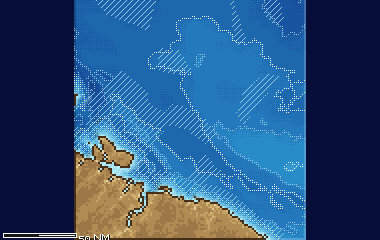

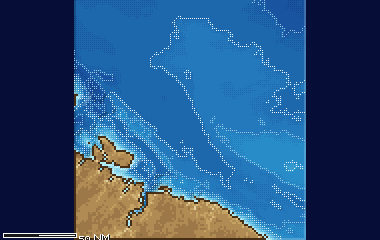

Gli approcci alla Penisola di Kola, cuore della Flotta del Nord: Severomorsk, la base degli Alfa e dei Victor a Zapadnaya Litsa, le basi dei sottomarini lanciamissili. Per l'intelligence occidentale era il «bastione» dei Delta e dei Typhoon, e gli SSN americani vi spiavano e pedinavano, a volte fino alla collisione. Il fondo è basso, 100-350 metri, misto di fango, sabbia e roccia sotto la costa ripida del Murman; la corrente atlantica tiene libera dal ghiaccio la costa di Kola tutto l'anno. D'inverno notte polare, neve e improvvisi cicloni polari.

**In partita.** D'inverno l'acqua è mescolata fino al fondo e non c'è uno strato sotto cui nascondersi; d'estate uno strato caldo di 20-40 metri crea una zona d'ombra sotto. Il fondo è vicino e riflettente: niente zone di convergenza, e occhio alla quota.

| Dato | Valore | Nel gioco | Confidenza | Fonte |
|---|---|---|---|---|
| Riquadro | 68,75-71,55° N, 31,0° E - 39,0° E | - | alta | tools/pipeline/teatri.yaml (dossier 03) |
| Missioni del 1989 | 3 | - | alta | tools/pipeline/teatri.yaml (dossier 03) |
| Vento medio (gennaio / luglio) | 9,2 / 6,3 m/s | - | media | meteo.toml (ERA5 1981-1990; dossier 21 §3) |
| Onda significativa media (gennaio / luglio) | 2,4 / 1,1 m | - | media | meteo.toml (ERA5 1981-1990; dossier 21 §3) |
| Ore di burrasca ≥ Bft 8 a gennaio | 0,6 % | - | media | meteo.toml (ERA5 1981-1990; dossier 21 §3) |
| Ghiaccio | pack fuori dal riquadro; solo baie e fiordi (Kola, Teriberka) | - | media | meteo.toml (dossier 21 §3.1) |

**Basi:** Severomorsk, Poljarnyj, Gadžievo, Zapadnaja Lica, Gremicha, Murmansk.

**Fonti:** dossier 03 §A2; dossier 02 §3.6; dossier 21 §3.1-3.3; teatri.yaml (barents).

### Margine della Piattaforma Celtica

*Teatri · neutrale*

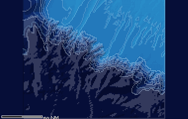

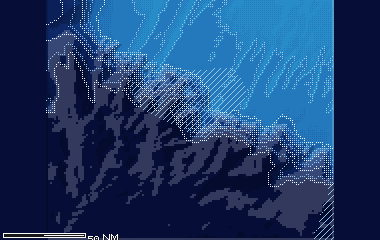

Il margine della piattaforma celtica, le Western Approaches: di qui passavano le linee di comunicazione fra Stati Uniti ed Europa e i convogli dei rinforzi REFORGER, sorvegliati dal SOSUS di Brawdy e dai Nimrod, e qui uscivano i sottomarini lanciamissili francesi da Brest. La piattaforma è a 100-180 metri, con lunghe creste di sabbia; al ciglio, a 200 metri, la scarpata precipita oltre i 4000 in 50-100 km, incisa da canyon come il Whittard. Il traffico è altissimo; d'inverno le burrasche atlantiche arrivano una dopo l'altra, quasi come alle Fær Øer.

**In partita.** D'estate, sulla piattaforma, sotto il termoclino a 30-50 metri sei invisibile a chi trasmette dalla superficie; le onde interne al ciglio fanno andare e venire i contatti. Al largo, in acqua profonda, cerca le zone di convergenza a 30-35 miglia.

| Dato | Valore | Nel gioco | Confidenza | Fonte |
|---|---|---|---|---|
| Riquadro | 47,00-49,50° N, 12,0° O - 7,5° O | - | alta | tools/pipeline/teatri.yaml (dossier 03) |
| Missioni del 1989 | 8, 9 | - | alta | tools/pipeline/teatri.yaml (dossier 03) |
| Vento medio (gennaio / luglio) | 10,2 / 6,0 m/s | - | media | meteo.toml (ERA5 1981-1990; dossier 21 §3) |
| Onda significativa media (gennaio / luglio) | 4,0 / 1,5 m | - | media | meteo.toml (ERA5 1981-1990; dossier 21 §3) |
| Ore di burrasca ≥ Bft 8 a gennaio | 5,2 % | - | media | meteo.toml (ERA5 1981-1990; dossier 21 §3) |
| Ghiaccio | mai | - | media | meteo.toml (dossier 21 §3.1) |

**Basi:** Île Longue (Brest), Brawdy, St Mawgan, Lann-Bihoué.

**Fonti:** dossier 03 §A6; dossier 21 §3.1-3.2; teatri.yaml (celtica).

### Passo di Kunashir – Mare di Okhotsk

*Teatri · neutrale*

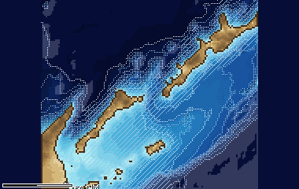

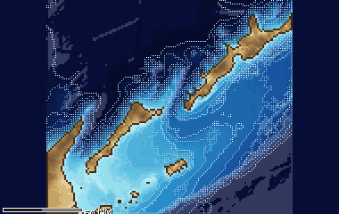

Il passaggio fra le Curili meridionali verso il Mare di Okhotsk, il bastione dei sottomarini lanciamissili della Flotta del Pacifico. Qui l'URSS rimilitarizzò le isole nel 1978, e nell'Okhotsk il sottomarino americano Halibut posò nel 1971 il dispositivo d'intercettazione del cavo sovietico, l'operazione Ivy Bells. I fondali vanno da stretti di poche centinaia di metri al Bacino delle Curili, oltre 3000, e alla fossa del Pacifico, oltre 9000; lo stretto di Nemuro verso Hokkaido è troppo basso per un sottomarino. Le correnti di marea negli stretti arrivano a 6 nodi e mezzo; d'estate c'è la nebbia più frequente del mondo, d'inverno il pack dell'Okhotsk.

**In partita.** Nell'Okhotsk un canale sonoro con l'asse a 80-100 metri porta i suoni molto lontano: chi ci sta dentro sente e si fa sentire. D'inverno il pack impedisce di emergere; d'estate la nebbia nasconde il periscopio agli occhi, non al radar.

| Dato | Valore | Nel gioco | Confidenza | Fonte |
|---|---|---|---|---|
| Riquadro | 43,30-45,60° N, 144,8° E - 148,5° E | - | alta | tools/pipeline/teatri.yaml (dossier 03) |
| Missioni del 1989 | 7 | - | alta | tools/pipeline/teatri.yaml (dossier 03) |
| Vento medio (gennaio / luglio) | 9,4 / 5,2 m/s | - | media | meteo.toml (ERA5 1981-1990; dossier 21 §3) |
| Onda significativa media (gennaio / luglio) | 2,3 / 0,8 m | - | media | meteo.toml (ERA5 1981-1990; dossier 21 §3) |
| Ore di burrasca ≥ Bft 8 a gennaio | 1,4 % | - | media | meteo.toml (ERA5 1981-1990; dossier 21 §3) |
| Ghiaccio | pack sul lato Okhotsk da inizio febbraio a metà aprile, lingue attraverso i passi | - | media | meteo.toml (dossier 21 §3.1) |

**Basi:** Vladivostok, Rybačij (Kamčatka), Wakkanai (radar), Hachinohe, Misawa.

**Fonti:** dossier 03 §A5; dossier 02 §3.6 e §4; dossier 21 §3.1-3.3; teatri.yaml (kunashir).

### Stretto di Gibilterra

*Teatri · neutrale*

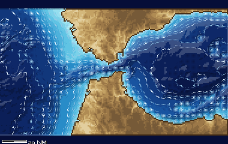

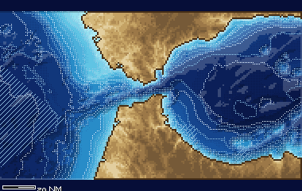

Lo stretto fra Atlantico e Mediterraneo, chokepoint della NATO con la base americana di Rota; secondo alcune fonti la 5ª Squadra sovietica ancorava presso l'isola di Alborán. Il fondo risale fino alla soglia di Camarinal, a 284 metri, con lo stretto di Tarifa oltre gli 800; l'acqua atlantica entra in superficie verso est, quella mediterranea, più salata, esce sotto verso ovest. Onde interne di oltre cento metri e uno dei traffici più fitti del mondo, circa 300 passaggi al giorno. Il vento alterna Levante e Poniente, con nebbie di Levante d'estate.

**In partita.** Per uscire verso ovest stai sotto l'interfaccia fra le due acque, oltre i 150-200 metri, dove la corrente mediterranea ti spinge; attento alle soglie. Il rumore del traffico copre anche te: la scia di un mercantile è un buon nascondiglio.

| Dato | Valore | Nel gioco | Confidenza | Fonte |
|---|---|---|---|---|
| Riquadro | 35,00-36,80° N, 7,5° O - 3,5° O | - | alta | tools/pipeline/teatri.yaml (dossier 03) |
| Missioni del 1989 | 4, 5 | - | alta | tools/pipeline/teatri.yaml (dossier 03) |
| Vento medio (gennaio / luglio) | 7,2 / 6,1 m/s | - | media | meteo.toml (ERA5 1981-1990; dossier 21 §3) |
| Onda significativa media (gennaio / luglio) | 1,0 / 0,7 m | - | media | meteo.toml (ERA5 1981-1990; dossier 21 §3) |
| Ore di burrasca ≥ Bft 8 a gennaio | 0,2 % | - | media | meteo.toml (ERA5 1981-1990; dossier 21 §3) |
| Ghiaccio | mai | - | media | meteo.toml (dossier 21 §3.1) |

**Basi:** Gibilterra, Rota, Ancoraggio di Alborán.

**Fonti:** dossier 03 §A3; dossier 02 §3.6; dossier 21 §3.1-3.2; teatri.yaml (gibilterra).
<!-- fine: unita_teatri -->
