# 11. Sottomarini

Le schede dei sottomarini della simulazione, dall'enciclopedia del gioco (il Museo): storia e impiego fra il 1985 e il 1990, cosa significano in partita, la scheda tecnica con la confidenza e, dove il valore del gioco differisce da quello reale, il valore del gioco. Le immagini in gioco sono lo sprite, il modello 3D, la firma acustica; le foto d'epoca sono a licenza libera, coi crediti.

<!-- generato: unita_sottomarini -->
### Akula I (Progetto 971)

*Sottomarini · Unione Sovietica*

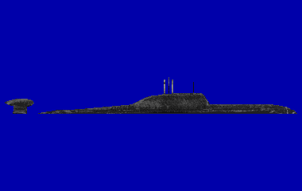

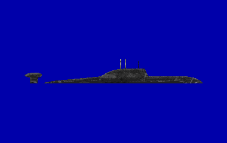

Il Progetto 971 «Shchuka-B», Akula per la NATO, fu lo choc degli anni '80 per la US Navy: la prima unità, K-284, entrò in servizio alla fine del 1984 e nel 1989 ce n'erano circa cinque. Era più silenzioso di ogni sottomarino nucleare sovietico precedente; al salto contribuirono le informazioni passate dalla rete di spie Walker e le fresatrici Toshiba-Kongsberg usate per le eliche. Fila a 33 nodi, lavora fino a circa 500 metri, ha 73 uomini e il sonar digitale Skat-3 con antenne laterali e un'antenna rimorchiata nel bulbo sul timone. Con quattro tubi da 533 e quattro da 650 mm imbarca una quarantina di armi; il suo arrivo rese molto più difficile agli SSN americani la caccia agli SSBN sovietici nei bastioni.

**In partita.** È l'avversario più difficile: a velocità silenziosa fa circa 112 dB, quanto il 688, e chi sente per primo dipende da quota, strato e pazienza. Il suo sonar classifica da solo i contatti e, come il Victor III, può colpire da lontano col Vodopad. Per trovarlo conviene andare piano con l'antenna rimorchiata e cercare le sue righe al LOFAR.

| Dato | Valore | Nel gioco | Confidenza | Fonte |
|---|---|---|---|---|
| Lunghezza | 110,3 m | - | media | extracted/navi/akula/RAPPORTO.md |
| Larghezza | 13,6 m | - | media | extracted/navi/akula/RAPPORTO.md |
| Velocità massima | 33 kn | - | media | extracted/navi/akula/RAPPORTO.md |
| Pescaggio | 9,7 m | - | media | extracted/navi/akula/RAPPORTO.md |
| Eliche: pale | 7 | - | media | acustica.toml: 01 §3.2 (Miasnikov 110); anecoico |
| Inizio della cavitazione | 5,5 kn | - | media | acustica.toml: 01 §3.2 (Miasnikov 110); anecoico |
| Periscopi | «Lebed'-11/21» (del comandante), «Signal-3» (universale TV) | - | media | periscopi.toml: §4.1 [APA] [RW-971] |
| Quota periscopica (chiglia) | 13 m | - | STIMA | periscopi.toml: §4.1 [APA] [RW-971] |

**Periscopi:** «Lebed'-11/21» (del comandante), «Signal-3» (universale TV).

**Sensori:** Bukhta, Snoop Tray / Snoop Pair.

**Armi tipiche:** USET-80, TEST-71M, RPK-2 Vyuga (SS-N-15).

**Altre armi tipiche:** siluri da 650 mm 65-76; missili antisom RPK-6 Vodopad e RPK-7 Veter (SS-N-16); missili da crociera S-10 Granat (SS-N-21).

**Fonti:** dossier 01 §2.6 [WPAkula] [RN971] [RWSkat] [USNI95]; dossier 02 §2.7 [Cote] e §7.1 [CNA18]; dossier 03 §C2 (Toshiba-Kongsberg); dossier 09 §1.2 [RU-SKAT]; dossier 05 §7.4; acustica.toml (firme.akula).

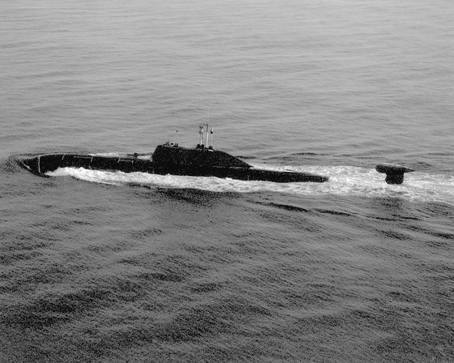

*Foto: [Akula submarine DN-SN-91-00616.JPG](https://commons.wikimedia.org/wiki/File%3AAkula_submarine_DN-SN-91-00616.JPG), pubblico dominio.*

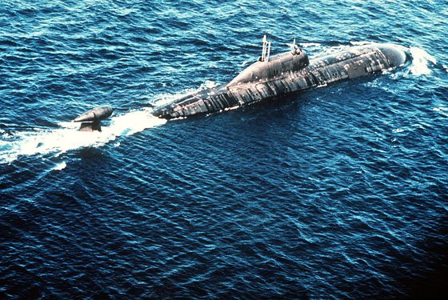

*Foto: [Akula class submarine starboard quarter view.JPEG](https://commons.wikimedia.org/wiki/File%3AAkula_class_submarine_starboard_quarter_view.JPEG), pubblico dominio.*

### Alfa (Progetto 705)

*Sottomarini · Unione Sovietica*

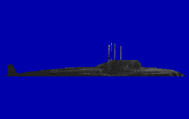

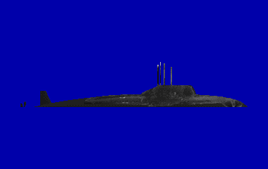

Il Progetto 705 «Lira» fu il sottomarino d'attacco più veloce della Guerra Fredda: scafo in titanio e reattore raffreddato a piombo-bismuto, 41 nodi in servizio. Per l'automazione bastavano poco più di trenta uomini, tutti ufficiali e sottufficiali. In Occidente si credeva scendesse a 600-900 metri: le fonti russe danno 320-350 metri di lavoro e 400 di limite, ma quella paura spinse il programma del siluro Mk 48 ADCAP. Accelerava e virava in modo eccezionale, ma ad alta velocità era molto rumoroso; nel 1989 quasi tutte le unità erano ferme.

| Dato | Valore | Nel gioco | Confidenza | Fonte |
|---|---|---|---|---|
| Lunghezza | 81,4 m | - | media | extracted/navi/alfa/RAPPORTO.md |
| Larghezza | 10 m | 9,5 m | media | dossier 01 §2.4 [DS705] |
| Velocità massima | 41 kn | - | media | extracted/navi/alfa/RAPPORTO.md |
| Pescaggio | 7,6 m | - | media | extracted/navi/alfa/RAPPORTO.md |
| Eliche: pale | 7 | - | media | acustica.toml: 01 §3.2: pompe Pb-Bi; anecoico |
| Inizio della cavitazione | 4 kn | - | media | acustica.toml: 01 §3.2: pompe Pb-Bi; anecoico |
| Periscopi | «Signal» (universale, sistema TV-1) | - | media | periscopi.toml: §4.1 §4.4 [APA] [DS705] [KOL705] |
| Quota periscopica (chiglia) | 13 m | - | STIMA | periscopi.toml: §4.1 §4.4 [APA] [DS705] [KOL705] |
| Tubi lanciasiluri | 5 × 533 mm | - | alta | dossier 14 §1.3 e §4.2 |
| Armi a bordo | 18 (5 nei tubi e 13 in rastrelliera) | - | media | dossier 14 §1.3 e §4.2 |
| Esche | 4 | - | media | dossier 14 §1.3 e §4.2 |

**Armi:** MDT, MG-74 Korund, PMR-2, SAET-60M, SET-65, 53-65K, MG-84 Korund.

**Periscopi:** «Signal» (universale, sistema TV-1).

**Sensori:** Bukhta, Snoop Tray / Snoop Pair.

**Fonti:** dossier 01 §2.4 [DS705] [WPAlfa] [GS705]; dossier 20 §4.4.

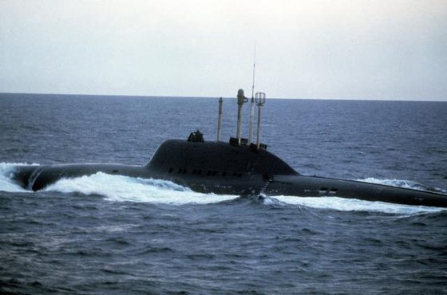

*Foto: [Alfa class submarine.jpg](https://commons.wikimedia.org/wiki/File%3AAlfa_class_submarine.jpg), pubblico dominio.*

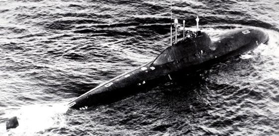

*Foto: [Alfa class submarine 2.jpg](https://commons.wikimedia.org/wiki/File%3AAlfa_class_submarine_2.jpg), Department of Defense. American Forces Information Service. Defense Visual Information Center. 1994, pubblico dominio.*

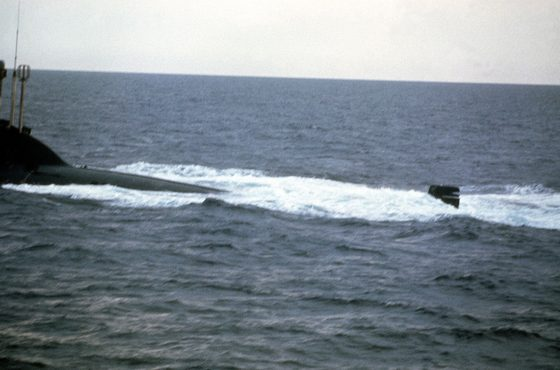

*Foto: [A port quarter view of a Soviet Alfa class nuclear-powered fleet ballistic missile submarine (SSN) underway - DPLA - 80378994ca2135cfdf1eab39887b1190.jpeg](https://commons.wikimedia.org/wiki/File%3AA_port_quarter_view_of_a_Soviet_Alfa_class_nuclear-powered_fleet_ballistic_missile_submarine_%28SSN%29_underway_-_DPLA_-_80378994ca2135cfdf1eab39887b1190.jpeg), Department of Defense. American Forces Information Service. Defense Visual Information Center. 1994, Public domain.*

### Charlie II (Progetto 670M)

*Sottomarini · Unione Sovietica*

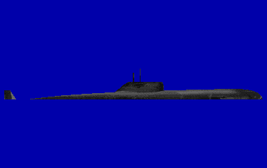

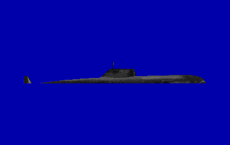

Il Progetto 670M «Chayka», Charlie II per la NATO, è un sottomarino lanciamissili nucleare di seconda generazione, più piccolo e lento dell'Oscar: un reattore, un'elica e 24 nodi in immersione. A prua ha otto contenitori inclinati per i missili antinave P-120 Malakhit (SS-N-9), lanciati in immersione da non più di 50 metri e con una portata di circa 120 km. Il sistema di tiro li sparava tutti e otto in una sola salva, con i dati del sonar Rubikon di bordo: se il bersaglio era in una zona di convergenza, il battello poteva attaccare da solo. Alle prove del 1974 il missile si dimostrò poco affidabile, e come gli altri sovietici di seconda generazione il Charlie II era rumoroso.

**In partita.** È il sottomarino più rumoroso del gioco: circa 132 dB anche a velocità silenziosa e forti righe a 50 Hz, quindi si scopre da lontano. Per lanciare sale a 50 metri e rallenta sotto i 6 nodi, poi scappa a tutta forza: se lo si sente fare così con una formazione amica a 55 o 110 km, la salva è vicina.

| Dato | Valore | Nel gioco | Confidenza | Fonte |
|---|---|---|---|---|
| Lunghezza | 104,5 m | - | bassa | extracted/navi/charlie2/RAPPORTO.md |
| Larghezza | 9,9 m | - | bassa | extracted/navi/charlie2/RAPPORTO.md |
| Velocità massima | 24 kn | - | bassa | extracted/navi/charlie2/RAPPORTO.md |
| Pescaggio | 8 m | - | bassa | extracted/navi/charlie2/RAPPORTO.md |
| Eliche: pale | 5 | - | media | acustica.toml: 01 §3.2: 2a generazione, 50 Hz |
| Inizio della cavitazione | 3,5 kn | - | media | acustica.toml: 01 §3.2: 2a generazione, 50 Hz |
| Periscopi | PZNS-10 (universale, zenitale), MT-70 (complesso TV) | - | media | periscopi.toml: §4.1 [APA] [PAV] |
| Quota periscopica (chiglia) | 13 m | - | STIMA | periscopi.toml: §4.1 [APA] [PAV] |

**Periscopi:** PZNS-10 (universale, zenitale), MT-70 (complesso TV).

**Sensori:** Bukhta, Snoop Tray / Snoop Pair.

**Altre armi tipiche:** 8 missili antinave P-120 Malakhit (SS-N-9); siluri da 533 mm e, secondo fonti russe, da 400 mm (tipi non precisati).

**Fonti:** dossier 01 §2.8 [WPCharlie] [TYL]; dossier 01 §6.4; dossier 05 §0.1, §3.1, §3.4 [RWP120] e §7.4; acustica.toml (firme.charlie2).

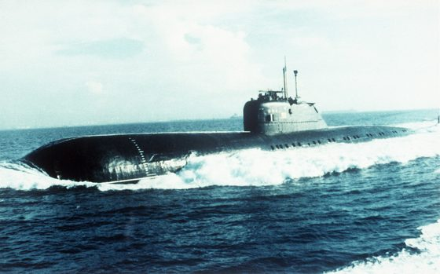

*Foto: [Charlie class submarine.jpg](https://commons.wikimedia.org/wiki/File%3ACharlie_class_submarine.jpg), pubblico dominio.*

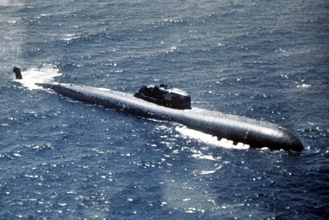

*Foto: [Soviet Charlie I class nuclear-powered missile submarine.jpg](https://commons.wikimedia.org/wiki/File%3ASoviet_Charlie_I_class_nuclear-powered_missile_submarine.jpg), Unknown author, pubblico dominio.*

### Delta III (Progetto 667BDR)

*Sottomarini · Unione Sovietica*

Il Progetto 667BDR «Kal'mar», Delta III per la NATO, è un sottomarino lanciamissili balistici sovietico lungo circa 156 metri, da 13.700 tonnellate in immersione. Dietro la vela, che porta i timoni orizzontali, la gobba dei silos custodisce 16 missili SS-N-18; due reattori VM-4S muovono due eliche a 5 pale, disegnate per un rumore più basso, e in immersione arriva a 24 nodi. Il sonar è l'MGK-400 «Rubikon», tranne su un battello che conserva il vecchio MGK-100 «Kerch»; la sua boa «Paravan» serve a ricevere le comunicazioni ELF e non è un sonar. Negli studi di Miasnikov sta fra 125 e 130 dB a circa 4 nodi: meno dei Delta I e II, più del Delta IV. Con missili di portata intercontinentale non ha bisogno di uscire in oceano: come gli altri SSBN sovietici, in guerra avrebbe atteso nei «bastioni» del Barents e dell'Artico o del Mare di Okhotsk, difeso da sottomarini d'attacco, navi, aerei e mine.

**In partita.** A velocità silenziosa fa circa 127 dB, quanto l'Alfa e un po' più del Typhoon, con le righe di rete a 50 Hz; i due assi con eliche a 5 pale lo distinguono al conteggio delle pale, e lo scafo lungo dà un'eco forte di traverso. Non ha antenna rimorchiata e il suo intercettatore «Rubikon» è meno fine di quelli dei battelli più nuovi: il pericolo vero sono i sottomarini d'attacco che lo scortano. Nel gioco non supera i 24 nodi e il collaudo è a 320 metri; con quattro tubi da 533 mm, però, può rispondere a chi lo pedina.

| Dato | Valore | Nel gioco | Confidenza | Fonte |
|---|---|---|---|---|
| Lunghezza | 156 m | - | media | docs/ricerca/31_firme_lotto1.md |
| Larghezza | 11,7 m | - | media | docs/ricerca/31_firme_lotto1.md |
| Velocità massima | 24 kn | - | media | docs/ricerca/31_firme_lotto1.md |
| Pescaggio | 8,7 m | - | media | docs/ricerca/31_firme_lotto1.md |
| Eliche: pale | 5 | - | media | acustica.toml: 31 §2: Miasnikov 125-130 dB a 4 kn; 2 assi, eliche a 5 pale |
| Inizio della cavitazione | 3,5 kn | - | media | acustica.toml: 31 §2: Miasnikov 125-130 dB a 4 kn; 2 assi, eliche a 5 pale |

**Sensori:** Bukhta, Snoop Tray / Snoop Pair.

**Altre armi tipiche:** 16 missili balistici SS-N-18; siluri da 533 mm da 4 tubi (tipi non precisati nei dossier).

**Fonti:** dossier 31 §0 (Miasnikov) e §2 [dewiki Projekt_667BDR] [navypedia ru_ss_k424]; dossier 01 §3.1 (Miasnikov, tabella A2); dossier 02 §7.3 [CIA-bastion] [NSL-bastion]; dossier 23 E31 [CIMSEC-DIS] [NSL-BAS]; extracted/navi/delta3/RAPPORTO.md; acustica.toml (firme.delta3, suite.delta3, intercettatori.rubikon); scafi/delta3.toml (collaudo).

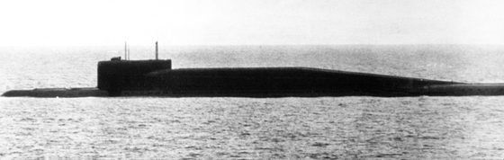

*Foto: [Delta-III nuclear-powered ballistic missle submarine.jpg](https://commons.wikimedia.org/wiki/File%3ADelta-III_nuclear-powered_ballistic_missle_submarine.jpg), ?, pubblico dominio.*

### Foxtrot (Progetto 641)

*Sottomarini · Unione Sovietica*

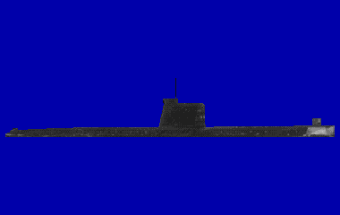

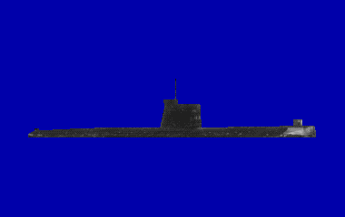

Il Progetto 641, Foxtrot per la NATO, è un sottomarino diesel-elettrico più vecchio e più grande del Kilo: 89,9 metri, 78 uomini, tre diesel e tre assi. In immersione non supera i 15 nodi e a 2 nodi copre circa 380 miglia prima di dover ricaricare. In compenso è armatissimo, con dieci tubi da 533 mm, sei a prua e quattro a poppa, e 22 siluri o 32 mine. Nella crisi di Cuba del 1962 alcuni Foxtrot furono tenuti sotto col sonar attivo dai gruppi antisom americani finché le batterie non li costrinsero a emergere. Nel 1989 era ancora in servizio: quell'anno uno restò impigliato nella rete di un peschereccio norvegese nel Mare di Barents.

**In partita.** In batteria fa circa 122 dB, ben più del Kilo, e a snorkel oltre 20 dB in più, con le righe dei diesel attorno agli 11 Hz; i tre assi lo distinguono al conteggio delle pale. È lento e in immersione dura poco: tenerlo sotto finché la batteria si esaurisce funziona ancora. Ha però tubi anche a poppa, quindi non è inerme verso chi lo insegue.

| Dato | Valore | Nel gioco | Confidenza | Fonte |
|---|---|---|---|---|
| Lunghezza | 89,9 m | 91,3 m | alta | dossier 01 §2.11 [WPFoxtrot] |
| Larghezza | 7,40 m | 7,5 m | alta | dossier 01 §2.11 [WPFoxtrot] |
| Velocità massima | 15 kn | nel gioco del 1989: 16 kn | alta | dossier 01 §2.11 [WPFoxtrot] |
| Pescaggio | 5,90 m | 6 m | alta | dossier 01 §2.11 [WPFoxtrot] |
| Eliche: pale | 6 | - | media | acustica.toml: 01 §3.2: a batteria; snorkel +20-25 |
| Inizio della cavitazione | 3 kn | - | media | acustica.toml: 01 §3.2: a batteria; snorkel +20-25 |
| Periscopi | PK-8,5 (d'attacco), PZNG-8 (zenitale e di navigazione) | - | media | periscopi.toml: §4.1 §7 [APA] [SPR74] |
| Quota periscopica (chiglia) | 13 m | - | media | periscopi.toml: §4.1 §7 [APA] [SPR74] |

**Periscopi:** PK-8,5 (d'attacco), PZNG-8 (zenitale e di navigazione).

**Sensori:** Bukhta, Snoop Tray / Snoop Pair.

**Armi tipiche:** 53-65K, SET-65, SAET-60M.

**Altre armi tipiche:** siluri SET-53M; siluri da 400 mm a poppa su alcune unità (non verificato); fino a 32 mine al posto dei siluri.

**Fonti:** dossier 01 §2.11 [WPFoxtrot] [NWRU]; dossier 01 §3.2-3.3; dossier 03 §C2 (Huchthausen, October Fury); dossier 04 §2.2 [DN89]; dossier 11 §3.3 (radar continuo); acustica.toml (firme.foxtrot).

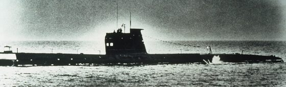

*Foto: [Foxtrot Class submarine.JPEG](https://commons.wikimedia.org/wiki/File%3AFoxtrot_Class_submarine.JPEG), Unknown author, pubblico dominio.*

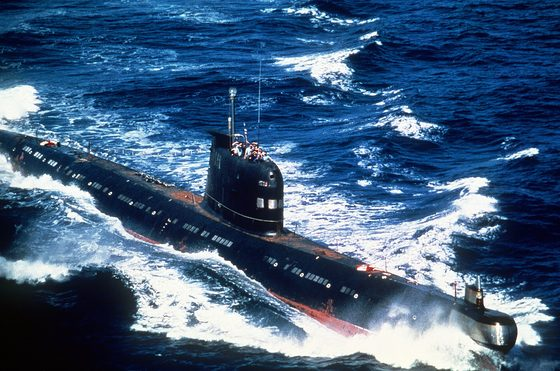

*Foto: [Cuban Foxtrot submarine.jpg](https://commons.wikimedia.org/wiki/File%3ACuban_Foxtrot_submarine.jpg), Unknown, US Navy, pubblico dominio.*

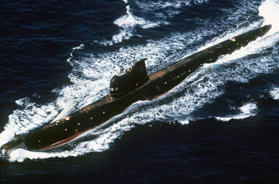

*Foto: [A port bow view of a Soviet-built Cuban Foxtrot class patrol submarine underway.jpg](https://commons.wikimedia.org/wiki/File%3AA_port_bow_view_of_a_Soviet-built_Cuban_Foxtrot_class_patrol_submarine_underway.jpg), Unknown, US Navy, pubblico dominio.*

### Kilo (Progetto 877)

*Sottomarini · Unione Sovietica*

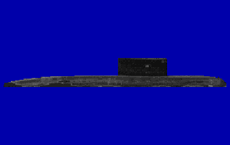

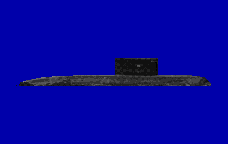

Il Progetto 877 «Paltus», Kilo per la NATO, è il sottomarino convenzionale sovietico degli anni '80: diesel-elettrico, lungo 72,6 metri, con 52 uomini e una quota di lavoro di 240 metri. In immersione tocca i 20 nodi, ma a quella velocità la batteria si scarica in poco più di mezz'ora; a 3 nodi invece copre 400 miglia. In batteria è molto silenzioso; per ricaricare deve salire a quota periscopica e alzare lo snorkel, e allora i diesel lo rendono rumoroso e visibile al radar. Porta sei tubi a prua con 18 siluri o 24 mine e il sonar MGK-400 Rubikon. La dottrina sovietica lo usava in barriere negli stretti e, in acque basse, posato sul fondo a motori fermi.

**In partita.** In batteria e piano è fra i battelli più difficili da sentire, circa 114 dB a 4,5 nodi, ma la batteria lo obbliga a strisciare. A snorkel il rumore sale di oltre 20 dB, con le righe dei diesel attorno ai 12,5 Hz: è il momento di scoprirlo, e col mare forza 6 non riesce più a ricaricare. In acque basse può posarsi sul fondo e sparire dal passivo.

| Dato | Valore | Nel gioco | Confidenza | Fonte |
|---|---|---|---|---|
| Lunghezza | 72,6 m | - | media | extracted/navi/kilo/RAPPORTO.md |
| Larghezza | 9,9 m | - | media | extracted/navi/kilo/RAPPORTO.md |
| Velocità massima | 20 kn | nel gioco del 1989: 17 kn | alta | dossier 01 §2.10 [WPKilo] |
| Pescaggio | 6,2 m | - | media | extracted/navi/kilo/RAPPORTO.md |
| Eliche: pale | 6 | - | media | acustica.toml: 01 §3.2 (Miasnikov); snorkel +20-25 |
| Inizio della cavitazione | 3,5 kn | - | media | acustica.toml: 01 §3.2 (Miasnikov); snorkel +20-25 |
| Periscopi | PK-8,5 (d'attacco), PZNG-8M (zenitale e di navigazione) | - | media | periscopi.toml: §4.1 §7 [APA] [SPR74] |
| Quota periscopica (chiglia) | 13 m | - | media | periscopi.toml: §4.1 §7 [APA] [SPR74] |

**Periscopi:** PK-8,5 (d'attacco), PZNG-8M (zenitale e di navigazione).

**Sensori:** Bukhta, Snoop Tray / Snoop Pair.

**Altre armi tipiche:** 18 siluri da 533 mm (tipi non precisati nei dossier) o 24 mine.

**Fonti:** dossier 01 §2.10 [WPKilo] [MIA1]; dossier 02 §7.2 [CIA-NS] [PM04]; dossier 06 §4 [WATM]; dossier 11 §5; dossier 21 §7.3; acustica.toml (firme.kilo).

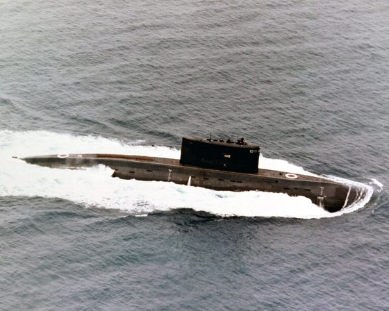

*Foto: [Submarine Kilo class.jpg](https://commons.wikimedia.org/wiki/File%3ASubmarine_Kilo_class.jpg), Unknown author, pubblico dominio.*

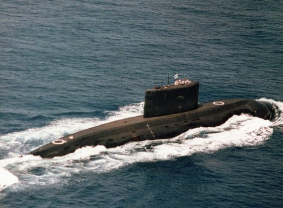

*Foto: [Iranian kilo class submarine.jpg](https://commons.wikimedia.org/wiki/File%3AIranian_kilo_class_submarine.jpg), pubblico dominio.*

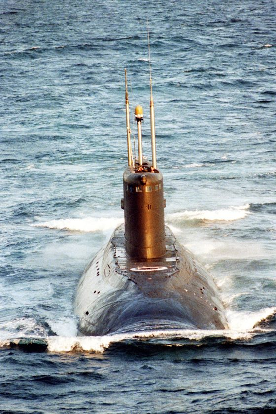

*Foto: [Kilo Submarine DN-SC-96-00528.jpg](https://commons.wikimedia.org/wiki/File%3AKilo_Submarine_DN-SC-96-00528.jpg), ID: DN-SC-96-00528 Service Depicted: Other Service, pubblico dominio.*

### Los Angeles (SSN-688, Flight I)

*Sottomarini · Stati Uniti*

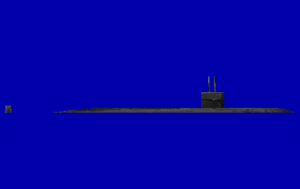

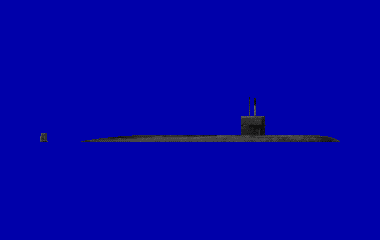

Il sottomarino d'attacco a propulsione nucleare più numeroso della US Navy della Guerra Fredda: la prima unità entrò in servizio nel 1976. Costruito per scortare i gruppi di portaerei e per cacciare i sottomarini sovietici, unisce un reattore S6G, una sfera sonar BQQ-5 con più di mille idrofoni e un'antenna rimorchiata TB-16. I quattro tubi lanciano siluri Mk 48, missili Harpoon e Tomahawk e mine. Nel 1989 era il battello del giocatore: veloce oltre 30 nodi, ma silenzioso solo sotto gli 8 nodi; i Flight I, coi timoni sulla vela, non potevano emergere nel ghiaccio.

| Dato | Valore | Nel gioco | Confidenza | Fonte |
|---|---|---|---|---|
| Lunghezza | 110,3 m | - | media | extracted/navi/los_angeles/RAPPORTO.md |
| Larghezza | 10,1 m | - | media | extracted/navi/los_angeles/RAPPORTO.md |
| Velocità massima | 32 kn | - | media | extracted/navi/los_angeles/RAPPORTO.md |
| Pescaggio | 9,4 m | - | media | extracted/navi/los_angeles/RAPPORTO.md |
| Eliche: pale | 7 | - | media | acustica.toml: 01 §3.2: 688 Flight I, 60 Hz |
| Inizio della cavitazione | 5 kn | - | media | acustica.toml: 01 §3.2: 688 Flight I, 60 Hz |
| Periscopi | Type 2 (attacco), Type 18 (ricerca) | - | alta | periscopi.toml: §2.1 [NSL2] [NTSB] [GRIF] |
| Quota periscopica (chiglia) | 18,3 m | - | alta | periscopi.toml: §2.1 [NSL2] [NTSB] [GRIF] |
| Tubi lanciasiluri | 4 × 533 mm | - | alta | dossier 14 §1.2 |
| Armi a bordo | 25 (4 nei tubi e 21 in rastrelliera) | - | media | dossier 14 §1.2 |
| Esche | 6 | - | media | dossier 14 §1.2 |

**Armi:** UGM-84 Harpoon, Mk 48 Mod 4, Mk 48 ADCAP, Mk 60 CAPTOR, Mk 67 SLMM, UGM-109B Tomahawk TASM, UGM-109C Tomahawk TLAM-C, ADC Mk 2.

**Periscopi:** Type 2 (attacco), Type 18 (ricerca).

**Sensori:** AN/BQQ-5, AN/BQR-15 con la schiera TB-16, AN/WLR-9 (intercettatore acustico), AN/WLR-8(V)2, AN/BPS-15.

**Fonti:** dossier 01 §2.1 [FAS688] [WP688]; dossier 14 §1.2; dossier 20 §2.1.

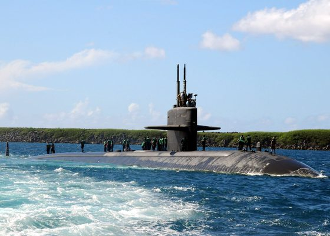

*Foto: [US Navy 091020-N-1722W-210 he fast-attack submarine USS Los Angeles (SSN 688) transits near Apra Harbor, Guam after returning from an underway period. Los](https://commons.wikimedia.org/wiki/File%3AUS_Navy_091020-N-1722W-210_he_fast-attack_submarine_USS_Los_Angeles_%28SSN_688%29_transits_near_Apra_Harbor%2C_Guam_after_returning_from_an_underway_period._Los_Angeles%2C_the_4th_naval_ship_to_be_named_after_the_city_of_Los_Angeles.jpg), U.S. Navy photo by Mass Communication Specialist 3rd Class Trevor Welsh, pubblico dominio.*

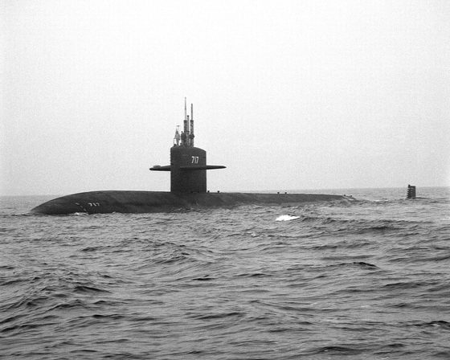

*Foto: [Port bow view of the nuclear-powered attack submarine USS OLYMPIA (SSN 717) underway - DPLA - 1c53983eab9753c69b08dd2514c4fe87.jpeg](https://commons.wikimedia.org/wiki/File%3APort_bow_view_of_the_nuclear-powered_attack_submarine_USS_OLYMPIA_%28SSN_717%29_underway_-_DPLA_-_1c53983eab9753c69b08dd2514c4fe87.jpeg), Department of Defense. American Forces Information Service. Defense Visual Information Center. 1994, pubblico dominio.*

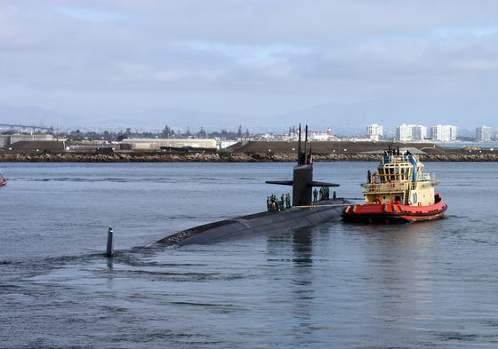

*Foto: [US Navy 101116-N-4047W-005 The Los Angeles-class attack submarine USS San Francisco (SSN 711) departs for its six-month western Pacific Ocean.jpg](https://commons.wikimedia.org/wiki/File%3AUS_Navy_101116-N-4047W-005_The_Los_Angeles-class_attack_submarine_USS_San_Francisco_%28SSN_711%29_departs_for_its_six-month_western_Pacific_Ocean.jpg), U.S. Navy photo by Mass Communication Specialist 2nd Class Shannon Warner, pubblico dominio.*

### Nacken (A14)

*Sottomarini · svezia*

La classe Nacken (A14) è il sottomarino della marina svedese degli anni '80: tre battelli, Nacken, Najad e Neptun, entrati in servizio nel 1980-81. Corto e largo, 49,5 metri per 5,7, sposta circa 1.085 tonnellate in immersione; ha la coda a X, un diesel MTU e un motore elettrico su un solo asse, e in immersione tocca i 20 nodi, con una quota di 300 metri. Il sonar è il CSU-83, quello delle U-Boot tedesche, con il cilindro di prua e una schiera di fianco. Nel 1988-89 il solo Nacken riceve due motori Stirling, che non hanno bisogno d'aria: lo scafo si allunga a 57,5 metri e il battello può restare in immersione per 14 giorni. Negli stessi anni la marina svedese dà la caccia nei suoi arcipelaghi a sottomarini sconosciuti: nel 1982, vicino alla base di Musko, fece esplodere decine di bombe di profondità e alcune mine, in una vicenda che resta controversa.

**In partita.** Battello di una marina neutrale, va riconosciuto con cura. In batteria fa circa 108 dB, meno del 688 e fra i più silenziosi del catalogo; a snorkel sale di 22,5 dB, con le righe dei diesel a 12,5, 25 e 75 Hz. Le righe a 12,5 e 25 Hz le ha anche il Kilo: a distinguerli è la rete di bordo, a 60 Hz sul Nacken (una scelta del gioco) e a 50 sul sovietico. Ha gli stessi sensori del Type 206, senza antenna rimorchiata; nel gioco tocca i 20 nodi, il collaudo è a 300 metri e lo Stirling non c'è: per ricaricare deve salire a snorkel.

| Dato | Valore | Nel gioco | Confidenza | Fonte |
|---|---|---|---|---|
| Lunghezza | 49,5 m | - | media | extracted/navi/nacken/RAPPORTO.md |
| Larghezza | 5,7 m | - | media | extracted/navi/nacken/RAPPORTO.md |
| Velocità massima | 20 kn | - | media | extracted/navi/nacken/RAPPORTO.md |
| Pescaggio | 5,5 m | - | media | extracted/navi/nacken/RAPPORTO.md |
| Eliche: pale | 5 | - | media | acustica.toml: 35: SSK svedese come il 206 ma più grande (STIMA); snorkel +22,5 come gli altri diesel |
| Inizio della cavitazione | 3,5 kn | - | media | acustica.toml: 35: SSK svedese come il 206 ma più grande (STIMA); snorkel +22,5 come gli altri diesel |

**Sensori:** AN/WLR-9 (intercettatore acustico), Terma (radar di navigazione).

**Altre armi tipiche:** 6 tubi da 533 mm e 2 da 400 mm (tipi di siluro non precisati nei dossier); mine.

**Fonti:** dossier 35 §1 [Navypedia sw_ss_nacken] [Wikipedia], §2, §4 e §5; dossier 23 E15 [WP-SWE] [CSM82] [FM08]; extracted/navi/nacken/RAPPORTO.md; acustica.toml (firme.nacken, suite.nacken, firme.kilo); scafi/nacken.toml (collaudo, STIMA).

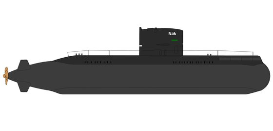

*Foto: [HMS Näcken original appearance.png](https://commons.wikimedia.org/wiki/File%3AHMS_N%C3%A4cken_original_appearance.png), Marcusroos, pubblico dominio.*

### Ohio (SSBN-726)

*Sottomarini · Stati Uniti*

L'Ohio (SSBN-726) è il sottomarino lanciamissili balistici della US Navy: lungo 170,7 metri, sposta 18.750 tonnellate in immersione e porta dietro la vela 24 silos per i missili Trident. Il reattore S8G da 220 MW termici muove due turbine e un solo asse con un'elica a 7 pale; ufficialmente supera i 20 nodi, e se ne riportano circa 25. Il reattore può lavorare a una parte notevole della potenza per circolazione naturale, senza le pompe del primario e quindi senza il loro rumore. Le cifre del rumore sono segrete: si dice solo che a 20 nodi sia silenzioso quanto un Lafayette a 6. Il sonar è il BQQ-6, il BQQ-5 del 688 senza la parte attiva, con a parte l'attivo BQS-13 e l'antenna rimorchiata TB-16.

**In partita.** È un alleato, e il battello più silenzioso del catalogo: circa 105 dB a velocità silenziosa, sette meno del 688, senza righe di pompa sotto i 10 nodi e con le righe d'asse più deboli di tutti; ha le righe di rete a 60 Hz e un'elica a 7 pale. Nel gioco ha i sensori del 688, antenna rimorchiata compresa, non supera i 25 nodi e il collaudo è a 250 metri, una stima. Per chi gioca con l'Alfa è la preda più difficile: lo si sente meglio quando accelera, perché sopra i 10 e i 18 nodi entrano le pompe.

| Dato | Valore | Nel gioco | Confidenza | Fonte |
|---|---|---|---|---|
| Lunghezza | 170,7 m | - | media | docs/ricerca/32_firme_lotto2.md |
| Larghezza | 12,8 m | - | media | docs/ricerca/32_firme_lotto2.md |
| Velocità massima | 25 kn | - | media | docs/ricerca/32_firme_lotto2.md |
| Pescaggio | 10,8 m | - | media | docs/ricerca/32_firme_lotto2.md |
| Eliche: pale | 7 | - | media | acustica.toml: 32 §1: il più silenzioso degli USA, circolazione naturale del S8G, 7 pale |
| Inizio della cavitazione | 6 kn | - | media | acustica.toml: 32 §1: il più silenzioso degli USA, circolazione naturale del S8G, 7 pale |

**Sensori:** AN/BQQ-5, AN/BQR-15 con la schiera TB-16, AN/WLR-9 (intercettatore acustico), AN/WLR-8(V)2, AN/BPS-15.

**Altre armi tipiche:** 24 missili balistici Trident; siluri da 533 mm da 4 tubi (tipo non precisato nei dossier).

**Fonti:** dossier 32 §1 [Wikipedia EN] [seaforces.org] [nuke.fas.org ssbn-726]; dossier 04 §1.1 [NC-BQR15]; extracted/navi/ohio/RAPPORTO.md; acustica.toml (firme.ohio, suite.ohio); scafi/ohio.toml (collaudo, STIMA).

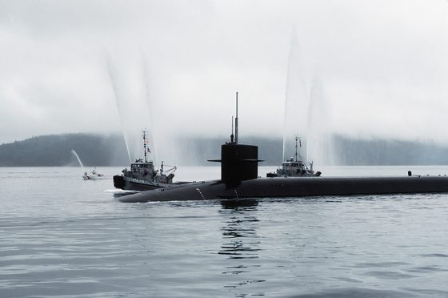

*Foto: [A port beam view of the nuclear-powered strategic missile submarine USS OHIO (SSBN-726) as the large harbor tugs MANHATTAN (YTB-779) and OTTUMWA (YTB-761)](https://commons.wikimedia.org/wiki/File%3AA_port_beam_view_of_the_nuclear-powered_strategic_missile_submarine_USS_OHIO_%28SSBN-726%29_as_the_large_harbor_tugs_MANHATTAN_%28YTB-779%29_and_OTTUMWA_%28YTB-761%29_escort_it_through_the_Hood_-_DPLA_-_d2a8b26a0d3ae87a7e6924db6ecabf65.jpeg), Department of Defense. American Forces Information, pubblico dominio.*

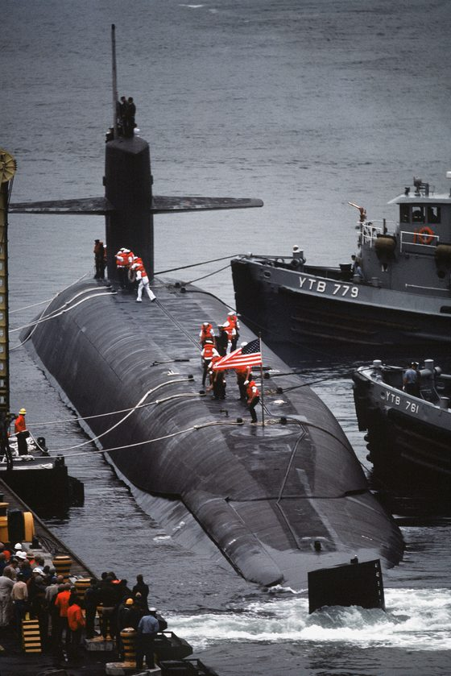

*Foto: [An aerial port quarter view of the nuclear-powered strategic missile submarine USS OHIO (SSBN-726) as the large harbor tugs MANHATTAN (YTB-779) and OTTUMWA](https://commons.wikimedia.org/wiki/File%3AAn_aerial_port_quarter_view_of_the_nuclear-powered_strategic_missile_submarine_USS_OHIO_%28SSBN-726%29_as_the_large_harbor_tugs_MANHATTAN_%28YTB-779%29_and_OTTUMWA_%28YTB-761%29_assist_in_docki_-_DPLA_-_77650abe51d6f373b197267b678dae70.jpeg), Department of Defense. American Forces Information, pubblico dominio.*

### Oscar II (Progetto 949A)

*Sottomarini · Unione Sovietica*

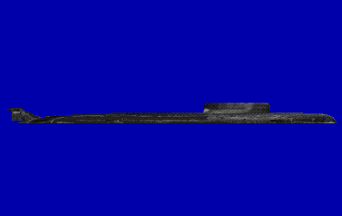

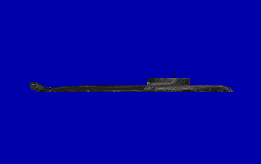

Il Progetto 949A «Antey», Oscar II per la NATO, è un grande sottomarino lanciamissili da crociera nato per la lotta alle portaerei: circa 154 metri di lunghezza, due reattori, due eliche e 32 nodi. Fra lo scafo resistente e quello esterno porta 24 missili P-700 Granit (SS-N-19), che partono in immersione e arrivano a circa 550 km; in una salva i missili si scambiano dati e si dividono i bersagli. Il primo Oscar II entrò in servizio nel 1986 e nel 1989 ce n'erano circa tre, accanto a due Oscar I. Per tirare così lontano servivano però dati dall'esterno, da aerei Tu-95RTs o da satelliti: l'ultimo satellite radar fu lanciato nel marzo 1988, e nel 1989 dallo spazio si vedevano solo le navi che emettevano.

**In partita.** Grande e a due assi, a velocità silenziosa fa circa 120 dB e dà un'eco forte al sonar attivo. Prima della salva allaga i contenitori dei missili: il transitorio si sente in passivo a 5-20 km ed è il momento di attaccarlo. Contro un gruppo in silenzio radar, nel 1989, non ha dati satellitari utili.

| Dato | Valore | Nel gioco | Confidenza | Fonte |
|---|---|---|---|---|
| Lunghezza | 154 m | - | media | extracted/navi/oscar2/RAPPORTO.md |
| Larghezza | 18,2 m | - | media | extracted/navi/oscar2/RAPPORTO.md |
| Velocità massima | 32 kn | - | media | extracted/navi/oscar2/RAPPORTO.md |
| Pescaggio | 9,2 m | - | media | extracted/navi/oscar2/RAPPORTO.md |
| Eliche: pale | 7 | - | media | acustica.toml: 01 §3.2: scafo grande, 2 assi |
| Inizio della cavitazione | 4 kn | - | media | acustica.toml: 01 §3.2: scafo grande, 2 assi |
| Periscopi | PZNS-10 (universale, zenitale), «Signal-3» (universale TV) | - | media | periscopi.toml: §4.1 [RW-949] |
| Quota periscopica (chiglia) | 13 m | - | STIMA | periscopi.toml: §4.1 [RW-949] |

**Periscopi:** PZNS-10 (universale, zenitale), «Signal-3» (universale TV).

**Sensori:** Bukhta, Snoop Tray / Snoop Pair.

**Armi tipiche:** P-700 Granit (SS-N-19).

**Altre armi tipiche:** missili antisom RPK-6 Vodopad e RPK-7 Veter (SS-N-16); siluri da 533 e 650 mm (tipi non precisati nei dossier).

**Fonti:** dossier 01 §2.7 [WPOscar] [WPGranit]; dossier 02 §7.2 [CIA-NS]; dossier 05 §0.1, §3.3 [RWP700] [WPUSA] e §3.5; acustica.toml (firme.oscar).

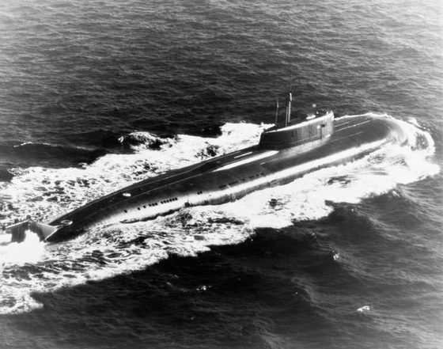

*Foto: [Oscar class submarine 3.jpg](https://commons.wikimedia.org/wiki/File%3AOscar_class_submarine_3.jpg), USN, VP9, pubblico dominio.*

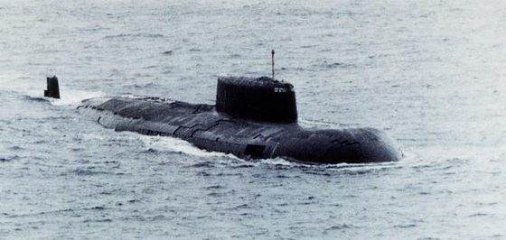

*Foto: [Oscar class submarine 2.JPG](https://commons.wikimedia.org/wiki/File%3AOscar_class_submarine_2.JPG), pubblico dominio.*

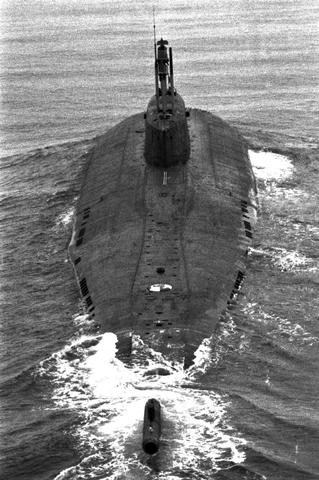

*Foto: [Oscar class submarine 1.JPG](https://commons.wikimedia.org/wiki/File%3AOscar_class_submarine_1.JPG), U.S. Navy, Public domain.*

### Sierra I (Progetto 945)

*Sottomarini · Unione Sovietica*

Il Progetto 945 «Barrakuda», Sierra I per la NATO, è un sottomarino d'attacco nucleare sovietico con lo scafo resistente in titanio, che gli permette di scendere fino a 550 metri. Lungo 107,2 metri e largo 12,3, ha un reattore OK-650A e un solo asse, più due propulsori ausiliari, e in immersione arriva a 35 nodi; sul dislocamento le fonti non concordano. Le macchine poggiano su una piattaforma antivibrante e lo scafo ha un rivestimento anecoico: secondo alcune fonti fa rumore quanto i primi Los Angeles. Con l'Akula e il Mike è una delle tre classi nuove della metà degli anni '80 che per la CIA segnano un salto nel silenziamento sovietico, e che riducono di molto il vantaggio acustico americano. Il sonar è l'MGK-503 «Skat-KS», che secondo le fonti russe scopre a una distanza più che doppia rispetto alla generazione precedente; della sua antenna rimorchiata non si è trovata conferma.

**In partita.** A velocità silenziosa fa circa 117 dB, cinque più del 688 e quanto uno Sturgeon, con le righe di rete a 50 Hz e un'elica a 7 pale (una stima); il rivestimento anecoico rende debole l'eco del sonar attivo. Nel gioco ha i sensori sovietici di terza generazione e l'intercettatore «Skat», ma non l'antenna rimorchiata: il bulbo sul timone c'è, l'antenna no, e il cono cieco a poppa resta largo 40 gradi: da dietro lo si avvicina meglio che un Akula. È più veloce del 688, fino a 35 nodi, e il collaudo è a 450 metri: scendere in profondità non basta a seminarlo.

| Dato | Valore | Nel gioco | Confidenza | Fonte |
|---|---|---|---|---|
| Lunghezza | 107,2 m | - | bassa | docs/ricerca/31_firme_lotto1.md |
| Larghezza | 12,3 m | - | bassa | docs/ricerca/31_firme_lotto1.md |
| Velocità massima | 35 kn | - | bassa | docs/ricerca/31_firme_lotto1.md |
| Pescaggio | 8,8 m | - | bassa | docs/ricerca/31_firme_lotto1.md |
| Eliche: pale | 7 | - | media | acustica.toml: 31 §3: fra Delta III e Akula; rafting e anecoico; «come i primi Los Angeles» |
| Inizio della cavitazione | 5 kn | - | media | acustica.toml: 31 §3: fra Delta III e Akula; rafting e anecoico; «come i primi Los Angeles» |

**Sensori:** Bukhta, Snoop Tray / Snoop Pair.

**Altre armi tipiche:** siluri da 533 e 650 mm (tipi non precisati nei dossier); missili antisom RPK-6 Vodopad (SS-N-16), attestati con riserva; missili da crociera S-10 Granat (SS-N-21).

**Fonti:** dossier 31 §3 [ru.wikipedia 945] [Wikipedia EN]; dossier 02 §1.4 e §7.2 [CIA-NS]; dossier 03 §C2 (Cote); dossier 09 §1.2 [RU-SKAT]; dossier 04 §3 [RU-SKAT] [WP-Sierra]; extracted/navi/sierra/RAPPORTO.md; acustica.toml (firme.sierra, suite.sierra, intercettatori.skat_ogs); scafi/sierra.toml (collaudo, STIMA).

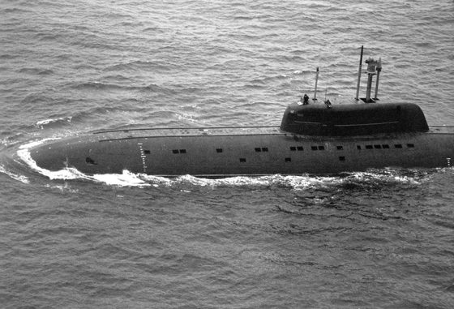

*Foto: [Sierra class submarine.jpg](https://commons.wikimedia.org/wiki/File%3ASierra_class_submarine.jpg), ?, pubblico dominio.*

### Sturgeon (SSN-637)

*Sottomarini · Stati Uniti*

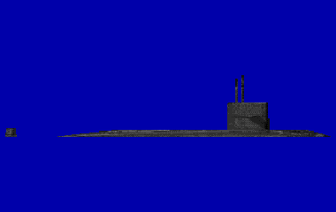

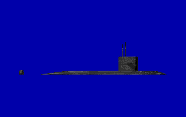

Sottomarino d'attacco nucleare della US Navy, nel 1989 ancora in linea accanto ai 688. Con un solo reattore S5W arriva a 26 nodi in immersione, meno del 688, ma ha una profondità di collaudo di 400 metri; nove unità hanno lo scafo allungato a 92 metri. Negli anni '80 riceve il sonar BQQ-5, un'antenna rimorchiata aggiunta in un secondo tempo e lavori di silenziamento, mentre i timoni sulla vela ruotano in verticale per emergere nel ghiaccio. Dai quattro tubi a centro nave lancia siluri Mk 48, Harpoon, Tomahawk e mine; ha due periscopi, quello d'attacco Type 2 e quello di ricerca, nel 1989 quasi sempre un Type 18.

**In partita.** È un battello della NATO: va riconosciuto bene per non scambiarlo per un sovietico. A velocità silenziosa fa circa 117 dB, cinque più del 688, con un'elica a 5 pale e le righe di rete a 60 Hz come i battelli americani (i sovietici le hanno a 50 Hz). Non supera i 26 nodi.

| Dato | Valore | Nel gioco | Confidenza | Fonte |
|---|---|---|---|---|
| Lunghezza | 89,1 m | - | media | extracted/navi/sturgeon/RAPPORTO.md |
| Larghezza | 9,7 m | - | media | extracted/navi/sturgeon/RAPPORTO.md |
| Velocità massima | 26 kn | - | media | extracted/navi/sturgeon/RAPPORTO.md |
| Pescaggio | 7,44 m | 8,9 m | alta | dossier 01 §2.2 [WPSturgeon] |
| Eliche: pale | 5 | - | media | acustica.toml: 01 §3.2 |
| Inizio della cavitazione | 4,5 kn | - | media | acustica.toml: 01 §3.2 |
| Periscopi | Type 2 (attacco), Type 18 (ricerca) | - | media | periscopi.toml: §2.2 [WIKI-637] [NMVM] |
| Quota periscopica (chiglia) | 18,3 m | - | STIMA | periscopi.toml: §2.2 [WIKI-637] [NMVM] |

**Periscopi:** Type 2 (attacco), Type 18 (ricerca).

**Sensori:** AN/BQQ-5, AN/BQR-15 con la schiera TB-16, AN/WLR-9 (intercettatore acustico), AN/WLR-8(V)2, AN/BPS-15.

**Armi tipiche:** Mk 48 Mod 4, Mk 48 ADCAP, UGM-84 Harpoon, UGM-109B Tomahawk TASM, Mk 67 SLMM, Mk 60 CAPTOR.

**Altre armi tipiche:** razzi antisom UUM-44 SUBROC a testata nucleare (2-4, in ritiro nel 1989).

**Fonti:** dossier 01 §2.2 [WPSturgeon] [FASBQQ5] [PM04]; dossier 01 §3.1-3.2 [MIA1]; dossier 04 §1.2 [SC-forum]; dossier 14 §1.4 [WPSturgeon]; dossier 20 §2.2 [WIKI-637] [NMVM]; acustica.toml (firme.sturgeon).

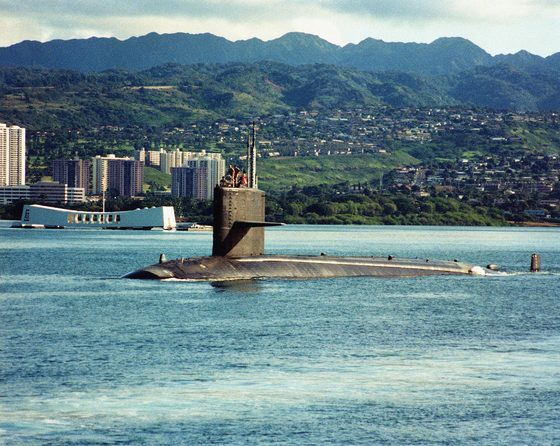

*Foto: [USS Hawkbill (SSN-666) Pearl Harbor.jpg](https://commons.wikimedia.org/wiki/File%3AUSS_Hawkbill_%28SSN-666%29_Pearl_Harbor.jpg), Service Depicted:  Navy, pubblico dominio.*

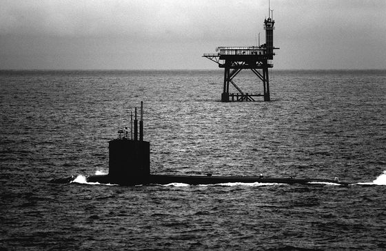

*Foto: [A port quarter view of a Sturgeon class nuclear-powered attack submarine departing the bay for the open sea as seen from the USS GUADALCANAL (not shown) wh](https://commons.wikimedia.org/wiki/File%3AA_port_quarter_view_of_a_Sturgeon_class_nuclear-powered_attack_submarine_departing_the_bay_for_the_open_sea_as_seen_from_the_USS_GUADALCANAL_%28not_shown%29_which_is_also_underway_for_t_-_DPLA_-_825f019e2fc53e26a86cdc7def6704d1.jpeg), Department of Defense. American Forces Information Service. Defense Visual Information Center. 1994, pubblico dominio.*

### Trafalgar (Royal Navy)

*Sottomarini · Regno Unito*

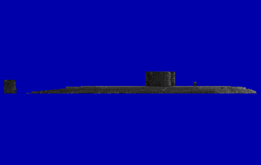

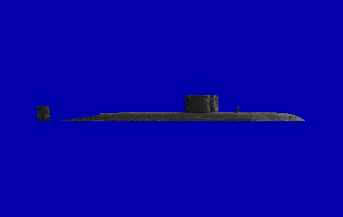

Il sottomarino d'attacco nucleare della Royal Navy degli anni '80: nel 1989 ne sono in servizio cinque, da HMS Trafalgar (1983) a HMS Trenchant (1989). Lungo poco più di 85 metri, supera i 30 nodi; tutte le unità tranne la capoclasse spingono con un pump-jet invece che con un'elica, e questo cancella la riga delle pale che il sonar nemico cerca. Nel 1989 i cinque tubi lanciano siluri Tigerfish, vecchi Mk 8 antinave, missili Sub-Harpoon e mine: Spearfish e Tomahawk arrivano solo negli anni '90. Il periscopio d'attacco CH84, fra i primi elettronici, ha di serie intensificatore d'immagine e camera termica; la profondità di collaudo è segreta, le stime prudenti dicono circa 300 metri.

**In partita.** È un alleato, fra i sottomarini nucleari d'attacco la firma più bassa: circa 110 dB a velocità silenziosa, poco sotto il 688, e niente riga di pala da contare. Al periscopio di notte, grazie al termico del CH84, vede la superficie meglio di chiunque; la sua quota periscopica è di 18 metri.

| Dato | Valore | Nel gioco | Confidenza | Fonte |
|---|---|---|---|---|
| Lunghezza | 85,4 m | - | media | extracted/navi/trafalgar/RAPPORTO.md |
| Larghezza | 9,8 m | - | media | extracted/navi/trafalgar/RAPPORTO.md |
| Velocità massima | 32 kn | - | media | extracted/navi/trafalgar/RAPPORTO.md |
| Pescaggio | 9,5 m | - | media | extracted/navi/trafalgar/RAPPORTO.md |
| Eliche: pale | 0 | - | media | acustica.toml: 01 §3.2: pump-jet |
| Inizio della cavitazione | 5,5 kn | - | media | acustica.toml: 01 §3.2: pump-jet |
| Periscopi | CH84 (attacco), CK34 (ricerca) | - | media | periscopi.toml: §3 [RNS] [SD] |
| Quota periscopica (chiglia) | 18 m | - | media | periscopi.toml: §3 [RNS] [SD] |

**Periscopi:** CH84 (attacco), CK34 (ricerca).

**Sensori:** AN/BQQ-5, AN/BQR-15 con la schiera TB-16, AN/WLR-9 (intercettatore acustico), AN/WLR-8(V)2, AN/BPS-15.

**Armi tipiche:** Tigerfish Mk 24 Mod 1, UGM-84 Harpoon.

**Altre armi tipiche:** siluri antinave Mk 8; mine (tipo non precisato); esche da due lanciatori SSE Mk 8.

**Fonti:** dossier 01 §2.3 [WPTraf] [JFS] [NWBR] [WPTiger]; dossier 01 §3.2; dossier 14 §1.4 [WPTraf]; dossier 20 §3 [RNS] [SD] e §8.3; acustica.toml (firme.trafalgar); periscopi.toml (classi.trafalgar).

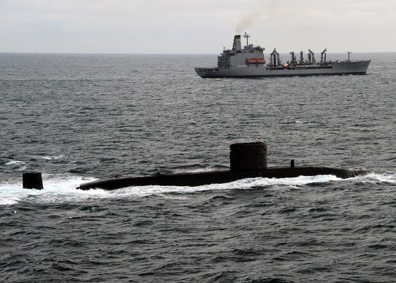

*Foto: [US Navy 110520-N-VQ827-895 The Royal Navy Trafalgar-class submarine HMS Torbay (S90) is underway in formation with the Military Sealift Command fle.jpg](https://commons.wikimedia.org/wiki/File%3AUS_Navy_110520-N-VQ827-895_The_Royal_Navy_Trafalgar-class_submarine_HMS_Torbay_%28S90%29_is_underway_in_formation_with_the_Military_Sealift_Command_fle.jpg), U.S. Navy photo by Mass Communication Specialist 3rd Class Nicholas Hall, pubblico dominio.*

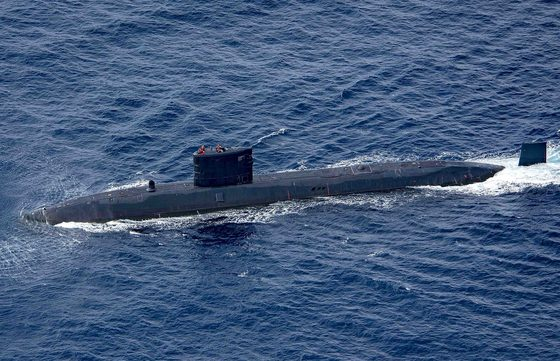

*Foto: [Royal Navy Trafalgar-class submarine HMS Trenchant (2).jpg](https://commons.wikimedia.org/wiki/File%3ARoyal_Navy_Trafalgar-class_submarine_HMS_Trenchant_%282%29.jpg), U.S. Navy photo by Mass Communication Specialist Seaman Zachary Wickline, pubblico dominio.*

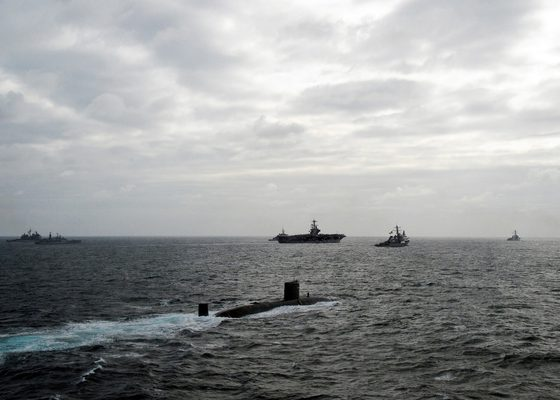

*Foto: [US Navy 110520-N-VQ827-880 The Royal Navy Trafalgar-class submarine HMS Torbay (S90) is underway in formation with the George H.W. Bush Carrier Str.jpg](https://commons.wikimedia.org/wiki/File%3AUS_Navy_110520-N-VQ827-880_The_Royal_Navy_Trafalgar-class_submarine_HMS_Torbay_%28S90%29_is_underway_in_formation_with_the_George_H.W._Bush_Carrier_Str.jpg), U.S. Navy photo by Mass Communication Specialist 3rd Class Nicholas Hall, pubblico dominio.*

### Type 206 (U 13-30)

*Sottomarini · germania*

Il Type 206 è il piccolo sottomarino diesel-elettrico della Bundesmarine per il Baltico: nel 1989 ce ne sono 18, da U 13 a U 30. Lungo 48,5 metri e largo 4,6, sposta circa 500 tonnellate in immersione; lo scafo è d'acciaio amagnetico, contro le mine magnetiche e il MAD degli aerei. Due diesel MTU e un motore elettrico Siemens muovono un solo asse con un'elica a 5 pale, e in immersione tocca i 17 nodi; sulla quota operativa le fonti non concordano, 200 metri o più secondo alcune, 100 secondo altre. Dodici battelli sono destinati alla conversione nel tipo 206A, con un'elica a 7 pale: alla fine del 1989 sono pronti U 29, U 23 e U 16. Il sonar DBQS-21 (CSU 83), attivo e passivo nella cupola alta di prua, provato sui 206 dal 1985, arriva con la conversione, accanto a un passivo DUUX 2 e a un sonar per le mine.

**In partita.** In batteria fa circa 110 dB, un paio meno del 688, ed è così piccolo che l'eco al sonar attivo è debole. A snorkel il rumore sale di 22,5 dB e compaiono le righe dei diesel a 16,5, 33 e 49,5 Hz; la rete di bordo nel gioco è a 60 Hz, come sugli altri battelli NATO, ed è il modo per non scambiarlo per un Kilo. Ha il sonar CSU-83 con un'antenna di fianco, senza antenna rimorchiata, e l'intercettatore occidentale WLR-9. Nel gioco non supera i 17 nodi e il collaudo è a 200 metri.

| Dato | Valore | Nel gioco | Confidenza | Fonte |
|---|---|---|---|---|
| Lunghezza | 48,5 m | - | media | docs/ricerca/32_firme_lotto2.md |
| Larghezza | 4,6 m | - | media | docs/ricerca/32_firme_lotto2.md |
| Velocità massima | 17 kn | - | media | docs/ricerca/32_firme_lotto2.md |
| Pescaggio | 4,3 m | - | media | docs/ricerca/32_firme_lotto2.md |
| Eliche: pale | 5 | - | media | acustica.toml: 32 §5: SSK di 48 m, amagnetico; snorkel +20-25 come Kilo e Foxtrot |
| Inizio della cavitazione | 3,5 kn | - | media | acustica.toml: 32 §5: SSK di 48 m, amagnetico; snorkel +20-25 come Kilo e Foxtrot |

**Sensori:** AN/WLR-9 (intercettatore acustico), DR-2000U, Calypso II (DRUA 33).

**Altre armi tipiche:** siluri da 533 mm da 8 tubi (tipi non precisati nei dossier); mine.

**Fonti:** dossier 32 §5 [seaforces] [Wikipedia EN e DE]; dossier 35 §4 [Military Periscope] [Watts 2000]; extracted/navi/type206/RAPPORTO.md; acustica.toml (firme.type206, suite.type206); scafi/type206.toml (collaudo).

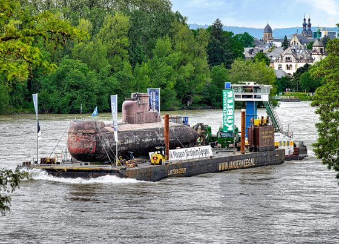

*Foto: [U 17 vor Koblenz.jpg](https://commons.wikimedia.org/wiki/File%3AU_17_vor_Koblenz.jpg), Rolf Kranz, CC BY-SA 4.0.*

### Typhoon (Progetto 941)

*Sottomarini · Unione Sovietica*

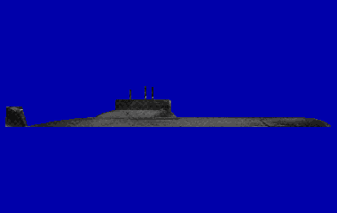

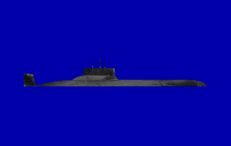

Il Progetto 941, che i sovietici chiamavano «Akula» (da non confondere con l'Akula della NATO, il Progetto 971), è per la NATO il Typhoon: un sottomarino lanciamissili balistici enorme, lungo 175 metri e largo 23, da 48.000 tonnellate in immersione. Porta 20 missili R-39 (SS-N-20) e ha due reattori che muovono due eliche intubate a 7 pale; l'equipaggio è di 160 uomini. Fra il 1981 e il 1989 ne entrarono in servizio sei. Con missili di portata intercontinentale non doveva uscire in oceano: in guerra avrebbe atteso nei «bastioni» del Mare di Barents e dell'Artico, anche sotto il ghiaccio, difeso da sottomarini d'attacco, navi, aerei e campi minati.

**In partita.** Malgrado la mole, fra 4 e 8 nodi resta attorno ai 125 dB: più rumoroso del 688, molto meno di un Charlie II, e il suo scafo enorme dà un'eco forte. Trovarlo e pedinarlo nei bastioni senza farsi scoprire dai sottomarini d'attacco che lo proteggono è una missione tipica del 688; con sei tubi da 533 mm, però, può rispondere.

| Dato | Valore | Nel gioco | Confidenza | Fonte |
|---|---|---|---|---|
| Lunghezza | 175 m | - | media | extracted/navi/typhoon/RAPPORTO.md |
| Larghezza | 23 m | - | media | extracted/navi/typhoon/RAPPORTO.md |
| Velocità massima | 27 kn | - | media | extracted/navi/typhoon/RAPPORTO.md |
| Pescaggio | 12 m | 11 m | alta | dossier 01 §2.9 [WPTyphoon] |
| Eliche: pale | 7 | - | media | acustica.toml: 01 §3.2 (Miasnikov 125) |
| Inizio della cavitazione | 4 kn | - | media | acustica.toml: 01 §3.2 (Miasnikov 125) |
| Periscopi | «Lebed'-11/21» (del comandante), «Signal-3» (universale TV) | - | media | periscopi.toml: §4.1 [APA] |
| Quota periscopica (chiglia) | 13 m | - | STIMA | periscopi.toml: §4.1 [APA] |

**Periscopi:** «Lebed'-11/21» (del comandante), «Signal-3» (universale TV).

**Sensori:** Bukhta, Snoop Tray / Snoop Pair.

**Armi tipiche:** RPK-2 Vyuga (SS-N-15).

**Altre armi tipiche:** 20 missili balistici R-39 (SS-N-20); siluri da 533 mm della famiglia Type 53; missili antisom RPK-6 Vodopad (SS-N-16).

**Fonti:** dossier 01 §2.9 [WPTyphoon] [MIA1]; dossier 02 §7.1 [CNA18] e §7.3 [CIA-bastion]; dossier 03 §A2 (CIA 2017); acustica.toml (firme.typhoon).

*Foto: [Akula (Typhoon) class submarine DD-ST-85-06625.jpg](https://commons.wikimedia.org/wiki/File%3AAkula_%28Typhoon%29_class_submarine_DD-ST-85-06625.jpg), [1], pubblico dominio.*

*Foto: [A stern view of Soviet Typhoon class nuclear-powered fleet ballistic missile submarine underway - DPLA - 205ee28f728020ce2e31a8673f466985.jpeg](https://commons.wikimedia.org/wiki/File%3AA_stern_view_of_Soviet_Typhoon_class_nuclear-powered_fleet_ballistic_missile_submarine_underway_-_DPLA_-_205ee28f728020ce2e31a8673f466985.jpeg), Department of Defense. American Forces Information Service. Defense Visual Information Center. 1994, pubblico dominio.*

*Foto: [Russian Typhoon-class submarine.jpg](https://commons.wikimedia.org/wiki/File%3ARussian_Typhoon-class_submarine.jpg), DTRA photo, pubblico dominio.*

### Victor I (Progetto 671)

*Sottomarini · Unione Sovietica*

Il Progetto 671 «Ersh», Victor I per la NATO, è nel 1989 il sottomarino d'attacco nucleare sovietico più numeroso. Lungo 93 metri, da 4.700 tonnellate in immersione, ha due reattori VM-4 e una turbina da circa 31.000 cavalli su un solo asse, con un'elica a 5 pale e due piccole eliche ausiliarie sui motori elettrici; in immersione arriva a 32 nodi. Fu il primo sottomarino sovietico con la rete di bordo in alternata a 50 Hz. Il sonar è l'MGK-300 «Rubin», senza antenna rimorchiata, e solo due battelli ricevono il Rubikon a metà degli anni '80; le macchine non poggiano su piattaforme antivibranti e i rivestimenti arrivano solo con le unità successive. Il suo mestiere è il pedinamento: per le fonti russe era un Victor I, il K-306, il battello che nel 1974 urtò l'SSBN americano James Madison all'uscita di Holy Loch, e nel marzo 1984 il K-314, risalito alla cieca a quota periscopica sulla rotta della Kitty Hawk che pedinava da giorni, fu investito dalla portaerei, perse un'elica e dovette essere rimorchiato.

**In partita.** È il sottomarino più rumoroso del catalogo: circa 135 dB a velocità silenziosa, oltre venti più del 688, con un tonale forte a 250 Hz e le righe di rete a 50 Hz; vicino alla superficie cavita già a 3 nodi. Ha i sensori sovietici di seconda generazione, senza antenna rimorchiata, e l'intercettatore «Rubin», che ha due sole bande e molti falsi allarmi, e a poppa è sordo: di solito lo si sente molto prima di essere sentiti. Nel gioco non supera i 32 nodi e il collaudo è a 400 metri (una stima); alcune unità possono portare il razzo antisom Vyuga, solo nucleare.

| Dato | Valore | Nel gioco | Confidenza | Fonte |
|---|---|---|---|---|
| Lunghezza | 93 m | - | media | docs/ricerca/31_firme_lotto1.md |
| Larghezza | 10,6 m | - | media | docs/ricerca/31_firme_lotto1.md |
| Velocità massima | 32 kn | - | media | docs/ricerca/31_firme_lotto1.md |
| Pescaggio | 7,2 m | - | media | docs/ricerca/31_firme_lotto1.md |
| Eliche: pale | 5 | - | media | acustica.toml: 31 §1: 1a generazione, «il più rumoroso» (Conway), sopra il Charlie II; senza rafting |
| Inizio della cavitazione | 3 kn | - | media | acustica.toml: 31 §1: 1a generazione, «il più rumoroso» (Conway), sopra il Charlie II; senza rafting |

**Sensori:** Bukhta, Snoop Tray / Snoop Pair.

**Armi tipiche:** RPK-2 Vyuga (SS-N-15).

**Altre armi tipiche:** siluri da 533 mm da 6 tubi (tipi non precisati nei dossier); razzo antisom RPK-2 Vyuga (SS-N-15) solo sui 671V, a testata nucleare.

**Fonti:** dossier 31 §1 [navypedia ru_ss_k38] [ru.wikipedia 671] [naval-encyclopedia, Conway]; dossier 23 E13 [WP-JM], E20 [WP-K314] [NI-K314]; dossier 03 §C3 [WIKI K-314]; dossier 05 §3.1 [RWVyuga]; extracted/navi/victor1/RAPPORTO.md; acustica.toml (firme.victor1, suite.victor1, intercettatori.rubin); scafi/victor1.toml (collaudo, STIMA).

*Foto: [Victor I class submarine.jpg](https://commons.wikimedia.org/wiki/File%3AVictor_I_class_submarine.jpg), ?, pubblico dominio.*

### Victor III (Progetto 671RTM)

*Sottomarini · Unione Sovietica*

Il Progetto 671RTM «Shchuka», Victor III per la NATO, in servizio dal 1979, fu il primo sottomarino d'attacco sovietico davvero silenzioso: negli ambienti della US Navy lo si considerava pari a uno Sturgeon. Si riconosce dal grosso bulbo in cima al timone verticale, che custodisce l'antenna rimorchiata del sonar Skat-KS; ha un'elica tandem, rivestimento anecoico, 30 nodi e 400 metri di quota di lavoro. Oltre ai tubi da 533 mm ne ha due da 650 mm per i siluri pesanti 65-76 e i missili antisom SS-N-16. Nel 1983 il K-324 si impigliò nell'antenna rimorchiata della fregata USS McCloy che stava pedinando; nel 1987 cinque Victor III (operazione Atrina) girarono attorno alla Groenlandia per non passare sopra il SOSUS del varco GIUK.

**In partita.** A velocità silenziosa fa circa 122 dB, una decina più del 688, con le righe di rete a 50 Hz: in ascolto di solito lo si sente per primi, ma il rivestimento anecoico riduce molto l'eco del sonar attivo. È pericoloso anche da lontano: se tiene un contatto fra 10 e 50 km senza una buona soluzione per i siluri, lancia un Vodopad, che fa scendere col paracadute un siluro vicino al bersaglio.

| Dato | Valore | Nel gioco | Confidenza | Fonte |
|---|---|---|---|---|
| Lunghezza | 107,1 m | 106 m | media | dossier 01 §2.5 [WPVictor] |
| Larghezza | 10,6 m | - | media | extracted/navi/victor3/RAPPORTO.md |
| Velocità massima | 31 kn | nel gioco del 1989: 30 kn | media | dossier 01 §2.5 [RW671] |
| Pescaggio | 7 m | - | media | extracted/navi/victor3/RAPPORTO.md |
| Eliche: pale | 4 | - | media | acustica.toml: 01 §3.2; anecoico (02 §1.4) |
| Inizio della cavitazione | 4,5 kn | - | media | acustica.toml: 01 §3.2; anecoico (02 §1.4) |
| Periscopi | PZNG-10M (zenitale e di navigazione), MT-70 (complesso TV) | - | media | periscopi.toml: §4.1 [APA] [PAV] |
| Quota periscopica (chiglia) | 13 m | - | STIMA | periscopi.toml: §4.1 [APA] [PAV] |

**Periscopi:** PZNG-10M (zenitale e di navigazione), MT-70 (complesso TV).

**Sensori:** Bukhta, Snoop Tray / Snoop Pair.

**Armi tipiche:** 53-65K, SET-65, TEST-71M, USET-80, RPK-2 Vyuga (SS-N-15).

**Altre armi tipiche:** siluri da 650 mm 65-76; missili antisom RPK-6 Vodopad e RPK-7 Veter (SS-N-16); missili da crociera S-10 Granat (SS-N-21) sui 671RTMK dal 1988; esche MG-74 Korund-2 al posto di armi; 36 mine al posto delle 24 armi.

**Fonti:** dossier 01 §2.5 [WPVictor] [RW671] [RWSkat] [TYL]; dossier 02 §1.4 [PM04] e §2.7 [Cote]; dossier 03 §C3; dossier 04 §3 [RU-671] [WP-Victor]; dossier 05 §3.2 e §7.4 [DSRM671]; acustica.toml (firme.victor3).

*Foto: [Disabled project 671 submarine 1983.jpg](https://commons.wikimedia.org/wiki/File%3ADisabled_project_671_submarine_1983.jpg), LCDR CARPENTER, pubblico dominio.*

*Foto: [Victor III class submarine.jpg](https://commons.wikimedia.org/wiki/File%3AVictor_III_class_submarine.jpg), Public domain.*
<!-- fine: unita_sottomarini -->
