# 12. Navi

Le schede delle navi da guerra e civili della simulazione, dall'enciclopedia del gioco.

<!-- generato: unita_navi -->
### AGI classe Okean (LINZA)

*Navi di superficie · Unione Sovietica*

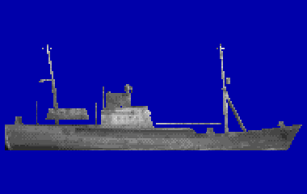

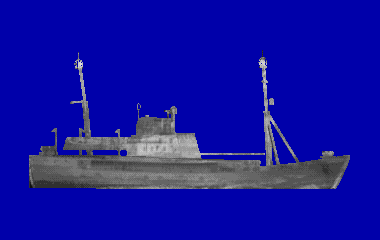

La nave raccolta informazioni del gioco è la LINZA, un'unità sovietica della classe Okean: pescherecci a fiancate trasformati in navi spia, con due alberi carichi di antenne, la cupola di un radar sulla plancia e fili d'antenna tesi fra gli alberi. Lunga circa 51 metri, 760 tonnellate a pieno carico, un solo diesel da 540 cavalli: fila a 11 o 12 nodi. Nel settembre 1986 la US Navy la fotografò mentre seguiva le navi della NATO nell'esercitazione Northern Wedding.

**In partita.** Non ha armi antisommergibile, solo missili portatili contro gli aerei, ma ascolta: segue i gruppi navali e le esercitazioni, intercetta le radio e i radar e riferisce. Va lenta col radar di navigazione acceso, e ferma in deriva si sente quasi solo il generatore. Per le regole d'ingaggio è una nave della Marina sovietica, non un peschereccio.

| Dato | Valore | Nel gioco | Confidenza | Fonte |
|---|---|---|---|---|
| Lunghezza | 50,8 m | - | bassa | extracted/navi/agi/RAPPORTO.md |
| Larghezza | 8,8 m | - | bassa | extracted/navi/agi/RAPPORTO.md |
| Velocità massima | 11,5 kn | - | bassa | extracted/navi/agi/RAPPORTO.md |
| Pescaggio | 3,7 m | - | bassa | extracted/navi/agi/RAPPORTO.md |
| Eliche: pale | 4 | - | media | acustica.toml: STIMA: AGI Okean, diesel da 540 CV; in deriva il solo generatore (kit, extracted/navi/agi) |
| Inizio della cavitazione | 8 kn | - | media | acustica.toml: STIMA: AGI Okean, diesel da 540 CV; in deriva il solo generatore (kit, extracted/navi/agi) |

**Fonti:** extracted/navi/agi/RAPPORTO.md (classi.toml [agi]; foto US Navy 1986); acustica.toml (firme.agi).

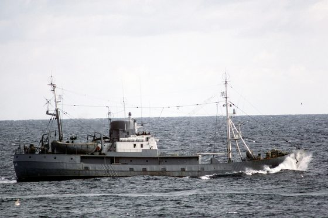

*Foto: [Intelligence collection ship LINZA side view.JPEG](https://commons.wikimedia.org/wiki/File:Intelligence_collection_ship_LINZA_side_view.JPEG), PH1 Jeff Hilton, pubblico dominio.*

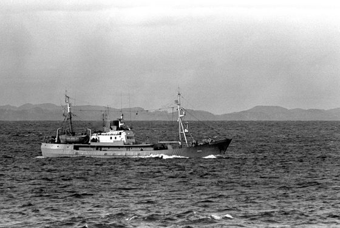

*Foto: [Soviet Okean class intelligence collection ship LINZA.JPEG](https://commons.wikimedia.org/wiki/File:Soviet_Okean_class_intelligence_collection_ship_LINZA.JPEG), PH1 Jeff Hilton, pubblico dominio.*

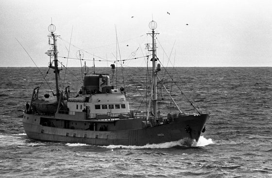

*Foto: [Okean class intelligence collection ship LINZA -3.JPEG](https://commons.wikimedia.org/wiki/File:Okean_class_intelligence_collection_ship_LINZA_-3.JPEG), PH1 Jeff Hilton, pubblico dominio.*

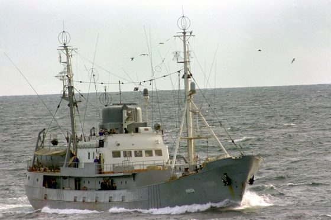

*Foto: [Soviet intelligence collection ship, 1986.JPEG](https://commons.wikimedia.org/wiki/File:Soviet_intelligence_collection_ship,_1986.JPEG), PH1 Jeff Hilton, pubblico dominio.*

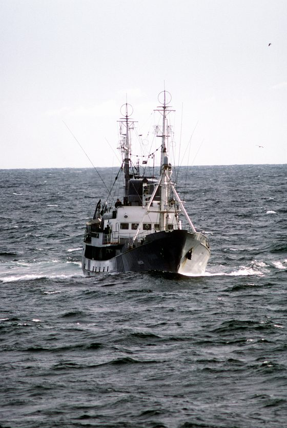

*Foto: [LINZA observing NATO ships participating in exercise Northern Wedding '86.JPEG](https://commons.wikimedia.org/wiki/File:LINZA_observing_NATO_ships_participating_in_exercise_Northern_Wedding_%2786.JPEG), PH1 Jeff Hilton, pubblico dominio.*

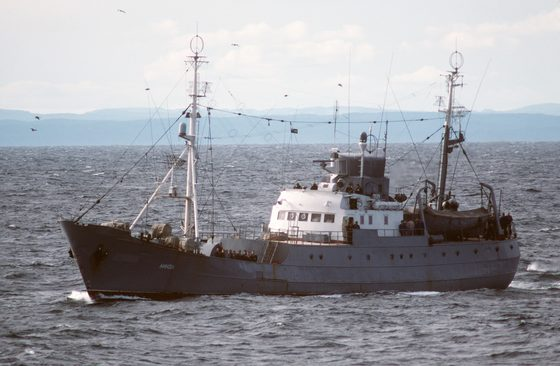

*Foto: [LINZA observing NATO ships during Exercise Northern Wedding 86.JPEG](https://commons.wikimedia.org/wiki/File:LINZA_observing_NATO_ships_during_Exercise_Northern_Wedding_86.JPEG), PH1 Jeff Hilton, pubblico dominio.*

### Cianciolo

*Navi di superficie · neutrale*

Il cianciolo pesca a circuizione: cala attorno al branco una rete lunga, la chiude dal basso come una borsa e la issa a bordo col verricello del braccio. I ciancioli degli anni '80 sono lunghi da 30 a 70 metri e filano a 12-15 nodi, con un diesel medio, un'elica a passo variabile e l'elica di manovra a prua. Il modello del gioco è un tonniero a circuizione francese, un «senneur thonier» fotografato nel 1982: scafo nero col castello alto, sovrastruttura bianca, torre di vedetta col radar e la coffa, braccio lungo con la power block e, sul cielo della plancia, l'elicottero per avvistare i branchi. La nave vera è più lunga; la classe del gioco è riportata a 50 metri e circa 1.860 tonnellate (stima). Nei teatri del gioco i ciancioli cercano sardine e acciughe nel Golfo di Cadice e lungo la costa di Malaga, soprattutto di notte, e lavorano anche sulla piattaforma pugliese e, con le lampare, sul lato greco del Canale d'Otranto.

**In partita.** È una nave civile, fuori dalle regole d'ingaggio, senza armi né sonar. Sulla zona di pesca va piano, a pochi nodi, e non tira una rete a strascico: non minaccia l'antenna rimorchiata come i pescherecci a rampa. Di notte una flotta di ciancioli è un campo di luci, e in pesca mostra il rosso sopra il bianco delle pesche diverse dallo strascico. L'elica a passo variabile gira costante, quindi asse e pala non dicono la velocità; all'ESM ha il radar di navigazione civile come tutto il traffico.

| Dato | Valore | Nel gioco | Confidenza | Fonte |
|---|---|---|---|---|
| Lunghezza | 50 m | - | bassa | tools/pipeline/civili.py (docs/ricerca/26_navi_civili_traffico.md); extracted/navi/cianciolo/RAPPORTO.md |
| Larghezza | 12,5 m | - | bassa | tools/pipeline/civili.py (docs/ricerca/26_navi_civili_traffico.md); extracted/navi/cianciolo/RAPPORTO.md |
| Velocità massima | 16,5 kn | - | bassa | tools/pipeline/civili.py (docs/ricerca/26_navi_civili_traffico.md); extracted/navi/cianciolo/RAPPORTO.md |
| Pescaggio | 5,5 m | - | bassa | tools/pipeline/civili.py (docs/ricerca/26_navi_civili_traffico.md); extracted/navi/cianciolo/RAPPORTO.md |

**Sensori:** radar di navigazione civile (X + S).

**Fonti:** extracted/navi/cianciolo/RAPPORTO.md (classi.toml [cianciolo]; foto 1982); appunti 26_note/rumore_navi.md §3; appunti 26_note/rotte_traffico.md §1.3, §2.3; tools/pipeline/civili.py (TIPI cianciolo); teatri/*.traffico.toml (zone di pesca); acustica.toml (civili.cianciolo); emettitori.toml (suite.cianciolo); luci.toml (classe.cianciolo); docs/27_luci_navigazione.md (regola 26).

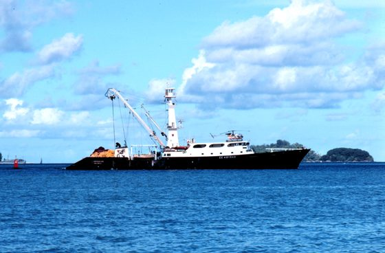

*Foto: [French tuna purse seiner.jpg](https://commons.wikimedia.org/wiki/File%3AFrench_tuna_purse_seiner.jpg), Jose Cort, pubblico dominio.*

### Grande peschereccio sovietico (BMRT)

*Navi di superficie · Unione Sovietica*

Il BMRT è il grande peschereccio sovietico a rampa poppiera, la nave con cui l'URSS pescava sui banchi lontani. Il tipo più diffuso è il Progetto 1288 «Pulkovskiy Meridian», costruito dal 1974 in circa 113 unità: lungo circa 104 metri, ha due diesel da 3.500 cavalli a 520 giri su un riduttore e un'elica a quattro pale a passo variabile in un mantello Kort, e fila a 16 nodi. I BMRT più vecchi, come il Progetto 394 e il tipo Atlantik, sono lunghi circa 84 metri e fanno 12-13 nodi. Il modello del gioco viene dalla foto di un BMRT a fumaioli affiancati, ripreso a Paljassaare nel 1992: castello alto, sovrastruttura a piani, due alberi gemelli e il portale sopra la rampa; la classe è lunga 94,5 metri e sposta circa 4.240 tonnellate (stima). Nel 1989 i BMRT della flotta di Murmansk lavorano sui banchi della costa del Murman, e altri pescano il melù sulla scarpata delle Fær Øer e il merluzzo dell'Alaska nell'Okhotsk, ai margini del ghiaccio.

**In partita.** È un peschereccio civile, fuori dalle regole d'ingaggio, e nel traffico del gioco non ha né armi né sonar. Fra 2 e 5,5 nodi tira la rete a strascico, che gli sta dietro a tre volte il fondale, fra 300 e 1.500 metri, 2 metri sopra il fondo: se la coda della vostra antenna rimorchiata vi passa vicino, la schiera si danneggia o si perde. Con l'elica a passo variabile l'asse gira a giri costanti e le righe di asse e pala non dicono la velocità; la rete di bordo è sempre a 50 Hz. All'ESM mostra il radar di navigazione sovietico (Don-2), lo stesso delle navi da guerra del Patto: da solo non dice se è un peschereccio o una scorta.

| Dato | Valore | Nel gioco | Confidenza | Fonte |
|---|---|---|---|---|
| Lunghezza | 94,5 m | - | bassa | tools/pipeline/civili.py (docs/ricerca/26_navi_civili_traffico.md); extracted/navi/bmrt/RAPPORTO.md |
| Larghezza | 15,1 m | - | bassa | tools/pipeline/civili.py (docs/ricerca/26_navi_civili_traffico.md); extracted/navi/bmrt/RAPPORTO.md |
| Velocità massima | 17,6 kn | - | bassa | tools/pipeline/civili.py (docs/ricerca/26_navi_civili_traffico.md); extracted/navi/bmrt/RAPPORTO.md |
| Pescaggio | 5,5 m | - | bassa | tools/pipeline/civili.py (docs/ricerca/26_navi_civili_traffico.md); extracted/navi/bmrt/RAPPORTO.md |

**Sensori:** Don-2 / Don Kay / Palm Frond.

**Fonti:** extracted/navi/bmrt/RAPPORTO.md (classi.toml [bmrt]; foto Paljassaare 1992); dossier 26 §1; appunti 26_note/rumore_navi.md §3 [korabel.ru] [FAO]; appunti 26_note/rotte_traffico.md §5.3, §6.3, §7.3; tools/pipeline/civili.py (TIPI bmrt); acustica.toml (civili.bmrt); emettitori.toml (suite.bmrt); manuale C6 §2.9 (le reti).

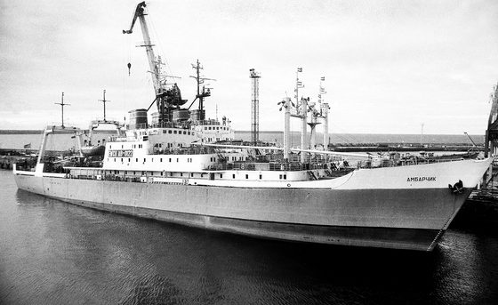

*Foto: [БМРТ АБ-0122 «Амбарчик» Paljassaare sadamas 92.jpg](https://commons.wikimedia.org/wiki/File%3A%D0%91%D0%9C%D0%A0%D0%A2_%D0%90%D0%91-0122_%C2%AB%D0%90%D0%BC%D0%B1%D0%B0%D1%80%D1%87%D0%B8%D0%BA%C2%BB_Paljassaare_sadamas_92.jpg), Jaan Künnap, CC BY-SA 4.0.*

### Grisha III (Progetto 1124M)

*Navi di superficie · Unione Sovietica*

Le corvette antisommergibile del Progetto 1124M «Al'batros» (Grisha III per la NATO) sono piccole: 71,1 metri e 1.120 tonnellate a pieno carico. Hanno tre assi, due diesel su quelli laterali e una turbina a gas su quello centrale: 32 nodi con tutto, 16 con i soli diesel. Sotto la prua c'è il sonar «Platina» («Bull Nose»), con una portata di circa 15 km, e il sonar calabile «Shelon» («Elk Tail») si usa a nave ferma. L'armamento conta due RBU-6000 a prua, quattro tubi da 533 mm, il missile antiaereo SA-N-4, un binato AK-725 da 57 mm e un AK-630. La dottrina le assegna alle acque costiere e alla fascia interna della difesa dei bastioni.

**In partita.** Nel gioco ha il sonar passivo delle navi sovietiche, un attivo a 3,5 kHz come il Titan-2 (228 dB) e lo Shelon: quando si ferma lo cala fino a 150 metri, sotto lo strato, e ascolta o pinga a 10 kHz. Caccia a scatti, ferma o in deriva e poi dieci minuti di corsa: è nello scatto che sente peggio. Non lancia siluri, attacca con le salve degli RBU, che arrivano a circa 5 km: tenetela più lontana. Per una nave così piccola un siluro pesante basta.

| Dato | Valore | Nel gioco | Confidenza | Fonte |
|---|---|---|---|---|
| Lunghezza | 71,1 m | - | media | docs/ricerca/31_firme_lotto1.md |
| Larghezza | 10,2 m | - | media | docs/ricerca/31_firme_lotto1.md |
| Velocità massima | 32 kn | - | media | docs/ricerca/31_firme_lotto1.md |
| Pescaggio | 6,1 m | - | media | docs/ricerca/31_firme_lotto1.md |
| Eliche: pale | 4 | - | media | acustica.toml: 31 §5: CODAG su 3 assi, piccola (come Koni) |
| Inizio della cavitazione | 8 kn | - | media | acustica.toml: 31 §5: CODAG su 3 assi, piccola (come Koni) |

**Sensori:** MG-332 «Titan-2», Don-2 / Don Kay / Palm Frond, Head Net-C / Strut Curve, radar di tiro.

**Altre armi tipiche:** 2 RBU-6000; 4 tubi da 533 mm; SA-N-4 (Osa-M); 1 × 2 da 57 mm AK-725; 1 AK-630.

**Fonti:** dossier 31 §5 (ru.wikipedia, progetto 1124); dossier 33 §1-3; dossier 36 §3; dossier 03 §C4 (9-10); dossier 01 §6.5 [RWRBU6000]; dossier 07 §6.4; extracted/navi/grisha3/RAPPORTO.md; libretto.toml [grisha3]; acustica.toml (firme.grisha3, suite.grisha3, sensori.titan2_attivo, shelon_vds, shelon_vds_attivo); emettitori.toml (suite.grisha3); classi.toml [grisha3]; engine/missioni/src/missione.cpp (salve_asw_classe).

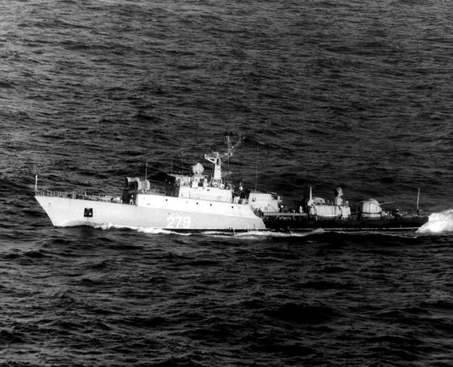

*Foto: [MPK-52-1983.jpg](https://commons.wikimedia.org/wiki/File%3AMPK-52-1983.jpg), Photographer's Name: Unknown, pubblico dominio.*

### Hauk (motocannoniera norvegese)

*Navi di superficie · norvegia*

Le motocannoniere norvegesi della classe Hauk (1977-80) sono unità d'attacco costiere da 148 tonnellate a pieno carico, lunghe 36,5 metri e con appena 1,6 metri d'immersione; due diesel veloci su due eliche le spingono a 34 nodi. L'armamento guarda tutto alla superficie: un Bofors 40/70 a prua, sei missili antinave Penguin e due tubi da 533 mm per siluri filoguidati sul cassero, più un 20 mm secondo fonti deboli. Non hanno sonar antisommergibile, e dei radar portano solo quello di navigazione e quello del tiro. Nella caccia agli intrusi dei fiordi la Norvegia impiega motocannoniere e fregate insieme, con una scala d'escalation che parte dal segnale di emergere e arriva alle bombe di profondità, mentre i siluri restano vietati.

**In partita.** Non vi può sentire: nel gioco non ha alcun sonar, e il suo radar di navigazione coglie un periscopio a circa 3,7 km col mare 2 e a meno di un chilometro col mare 4. Il Bofors da 40 mm tira su un periscopio fino a 2 km. Si sente poco, 130 dB a 5 nodi e 163 a 34, con le righe dei diesel a 30 e 150 Hz. Sotto la quota periscopica non ha modo di colpirvi, e un solo siluro basta.

| Dato | Valore | Nel gioco | Confidenza | Fonte |
|---|---|---|---|---|
| Lunghezza | 36,5 m | - | media | extracted/navi/hauk/RAPPORTO.md |
| Larghezza | 6,3 m | - | media | extracted/navi/hauk/RAPPORTO.md |
| Velocità massima | 34 kn | - | media | extracted/navi/hauk/RAPPORTO.md |
| Pescaggio | 1,6 m | - | media | extracted/navi/hauk/RAPPORTO.md |
| Eliche: pale | 3 | - | media | acustica.toml: STIMA: motocannoniera norvegese Hauk, 36,5 m e 148 t, due diesel veloci su 2 assi, 34 nodi (kit, extracted/navi/hauk) |
| Inizio della cavitazione | 8 kn | - | media | acustica.toml: STIMA: motocannoniera norvegese Hauk, 36,5 m e 148 t, due diesel veloci su 2 assi, 34 nodi (kit, extracted/navi/hauk) |

**Sensori:** radar di navigazione civile (X + S), radar di tiro.

**Altre armi tipiche:** 6 Penguin; 2 tubi da 533 mm (siluri filoguidati); 1 Bofors 40/70; 20 mm (fonti deboli).

**Fonti:** extracted/navi/hauk/RAPPORTO.md; dossier 35 §1, §2 e §6; dossier 36 §1 e §3 [WP-Hauk]; dossier 23 E12 [CIMSEC]; dossier 07 §6.4; acustica.toml (firme.hauk, suite.hauk vuota); emettitori.toml (suite.hauk, radar.nav_civ); artiglieria.toml (classi.hauk, pezzi.bofors40); libretto.toml [hauk].

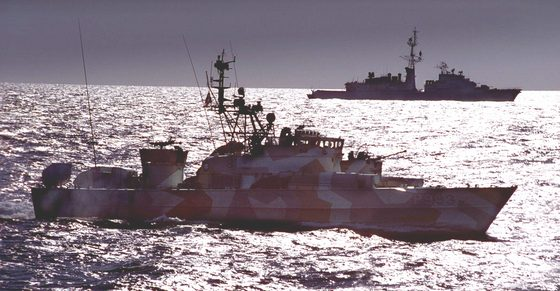

*Foto: [Hauk class MTB LOM.JPG](https://commons.wikimedia.org/wiki/File%3AHauk_class_MTB_LOM.JPG), originally User:Inge edited by WerWil 17:35, 18 April 2007 (UTC), pubblico dominio.*

### Iowa (BB-61)

*Navi di superficie · Stati Uniti*

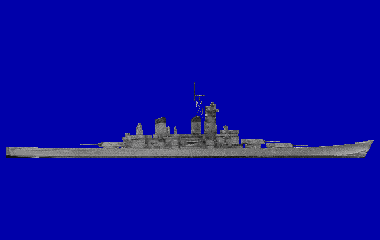

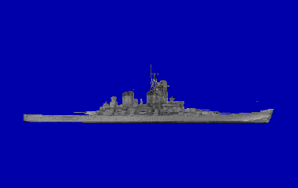

Le quattro corazzate della classe Iowa furono riattivate fra il 1982 e il 1988 e ammodernate: ai nove cannoni da 406 mm e ai dodici da 127 mm si aggiunsero 32 Tomahawk in otto lanciatori corazzati, 16 Harpoon e quattro Phalanx. Il 19 aprile 1989 un'esplosione devastò la torre II della Iowa. Non hanno sonar né armi antisommergibile; la protezione subacquea a quattro compartimenti era calcolata per circa 317 kg di tritolo. La Wisconsin fu nel 1988 la prima nave a ricevere il Phalanx Block 1.

**In partita.** Non ha sonar: da sola non vi sente, ma viaggia sempre scortata. È fra le navi più rumorose del gioco (180 dB alla massima) e si sente da molto lontano. Per affondarla le stime parlano di 4-8 siluri pesanti, perché la sua protezione subacquea è fatta per reggere cariche di quella taglia: preparate una salva.

| Dato | Valore | Nel gioco | Confidenza | Fonte |
|---|---|---|---|---|
| Lunghezza | 270,4 m | - | alta | docs/ricerca/01_piattaforme_e_armi.md |
| Larghezza | 33 m | - | alta | docs/ricerca/01_piattaforme_e_armi.md |
| Velocità massima | 33 kn | - | alta | docs/ricerca/01_piattaforme_e_armi.md |
| Pescaggio | 11,6 m | - | alta | docs/ricerca/01_piattaforme_e_armi.md |
| Eliche: pale | 4 | - | media | acustica.toml: 01 §3.2 portaerei/BB 170-180 |
| Inizio della cavitazione | 11 kn | - | media | acustica.toml: 01 §3.2 portaerei/BB 170-180 |

**Sensori:** AN/SPS-10/67, AN/SPS-49, radar di tiro.

**Armi tipiche:** UGM-84 Harpoon, UGM-109C Tomahawk TLAM-C.

**Altre armi tipiche:** 9 × 406 mm; 12 × 127 mm; Tomahawk TASM; 4 Phalanx.

**Fonti:** dossier 01 §1 e §4.1; dossier 05 §4.1 [NWPhal]; dossier 07 §6.2 [Navypedia] e §6.4; dossier 11 §1.1 [WPSPS49] [WPSPS67]; acustica.toml (firme.iowa); emettitori.toml (suite.iowa).

*Foto: [A starboard beam view of the battleship USS IOWA (BB 61) underway during sea trials - DPLA - 4b14533573f35b608882773af4e9a767.jpeg](https://commons.wikimedia.org/wiki/File:A_starboard_beam_view_of_the_battleship_USS_IOWA_(BB_61)_underway_during_sea_trials_-_DPLA_-_4b14533573f35b608882773af4e9a767.jpeg), Department of Defense. American Forces Information Service. Defense Visual Information Center. 1994, pubblico dominio.*

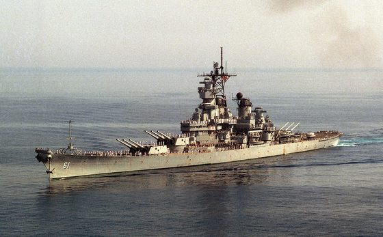

*Foto: [A port bow view of the battleship USS Iowa.jpg](https://commons.wikimedia.org/wiki/File:A_port_bow_view_of_the_battleship_USS_Iowa.jpg), National Museum of the U.S. Navy, pubblico dominio.*

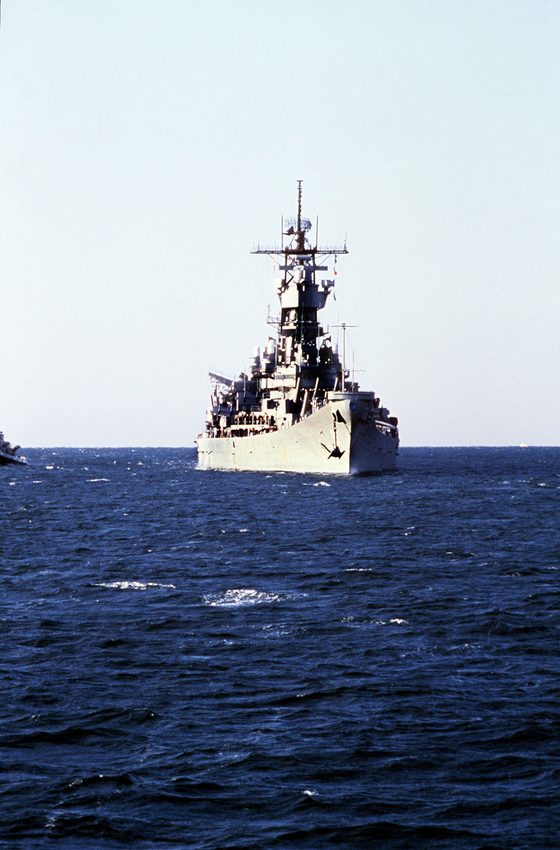

*Foto: [A starboard bow view of the battleship USS IOWA underway - DPLA - 0c86cecfd99e3f21487abd2c24f16d19.jpeg](https://commons.wikimedia.org/wiki/File:A_starboard_bow_view_of_the_battleship_USS_IOWA_underway_-_DPLA_-_0c86cecfd99e3f21487abd2c24f16d19.jpeg), Department of Defense. American Forces Information Service. Defense Visual Information Center. 1994, pubblico dominio.*

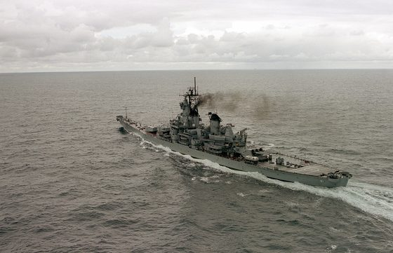

*Foto: [A port quarter view of the battleship USS IOWA (BB-61) underway during NATO Exercise Northern Wedding '86 - DPLA - da69c274312bf4f6447ac72fe4247f70.jpeg](https://commons.wikimedia.org/wiki/File:A_port_quarter_view_of_the_battleship_USS_IOWA_(BB-61)_underway_during_NATO_Exercise_Northern_Wedding_'86_-_DPLA_-_da69c274312bf4f6447ac72fe4247f70.jpeg), Department of Defense. American Forces Information Service. Defense Visual Information Center. 1994, pubblico dominio.*

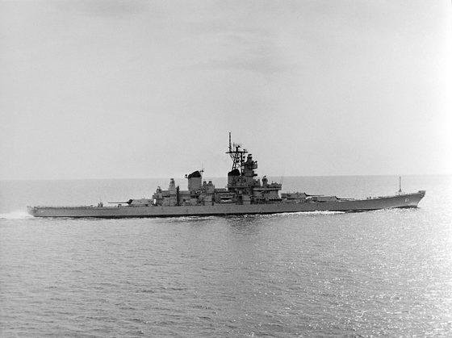

*Foto: [A starboard beam view of the battleship USS IOWA (BB 61) underway during sea trials - DPLA - 4b14533573f35b608882773af4e9a767.jpeg](https://commons.wikimedia.org/wiki/File:A_starboard_beam_view_of_the_battleship_USS_IOWA_(BB_61)_underway_during_sea_trials_-_DPLA_-_4b14533573f35b608882773af4e9a767.jpeg), Department of Defense. American Forces Information Service. Defense Visual Information Center. 1994, Public domain.*

### Kara (Progetto 1134B)

*Navi di superficie · Unione Sovietica*

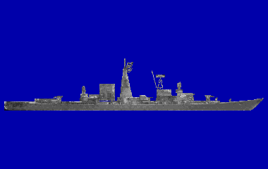

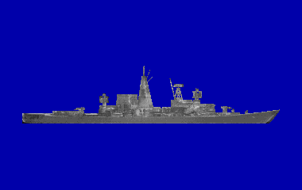

Gli incrociatori antisommergibile del Progetto 1134B (Kara) dislocano quasi 10.000 tonnellate a pieno carico e con le turbine a gas toccano i 34 nodi. Contro i sottomarini schierano otto missili Metel (SS-N-14) con siluro AT-2U, due RBU-6000 e due RBU-1000, dieci tubi da 533 mm caricati con siluri 53-65K e SET-65, e un elicottero Ka-25PL. I sensori sono il sonar di scafo Titan-2 e il sonar a profondità variabile Vega; la difesa aerea conta sui sistemi Shtorm e Osa-M.

**In partita.** Fra le navi sovietiche è la minaccia più completa: sonar attivo Titan-2, missili SS-N-14 a lunga portata, RBU sotto i 5 km e l'elicottero. Il 53-65K segue la scia ed è inutile contro di voi immersi, mentre il SET-65 vi cerca col sonar. Col mare forza 5 tiene ancora 28 nodi; servono uno o due siluri pesanti.

| Dato | Valore | Nel gioco | Confidenza | Fonte |
|---|---|---|---|---|
| Lunghezza | 173,2 m | - | media | docs/ricerca/01_piattaforme_e_armi.md |
| Larghezza | 18,6 m | - | media | docs/ricerca/01_piattaforme_e_armi.md |
| Velocità massima | 34 kn | - | media | docs/ricerca/01_piattaforme_e_armi.md |
| Pescaggio | 6,7 m | - | media | docs/ricerca/01_piattaforme_e_armi.md |
| Eliche: pale | 5 | - | media | acustica.toml: 01 §3.2 |
| Inizio della cavitazione | 8 kn | - | media | acustica.toml: 01 §3.2 |

**Sensori:** MG-332 «Titan-2», Don-2 / Don Kay / Palm Frond, Top Sail / Top Pair / Top Steer, Head Net-C / Strut Curve, radar di tiro.

**Armi tipiche:** AT-2M, 53-65K, SET-65.

**Altre armi tipiche:** SS-N-14 (Metel), 8 missili; 2 RBU-6000; 2 RBU-1000; 2 × 5 tubi da 533 mm; 1 Ka-25PL.

**Fonti:** dossier 01 §4.2, §6.1-6.3, §6.5 e §7.3 [WPKara]; dossier 11 §1.2 [RW1134B]; dossier 17 §3.1; dossier 07 §6.4; dossier 21 §7.2; acustica.toml (firme.kara, suite.kara).

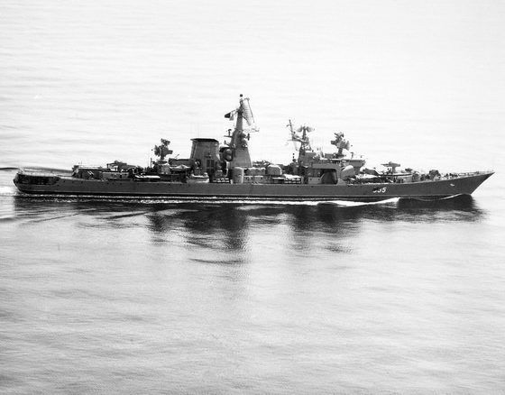

*Foto: [Nikolaev1986b.jpg](https://commons.wikimedia.org/wiki/File%3ANikolaev1986b.jpg), Photographer's Name: UNKNOWN, pubblico dominio.*

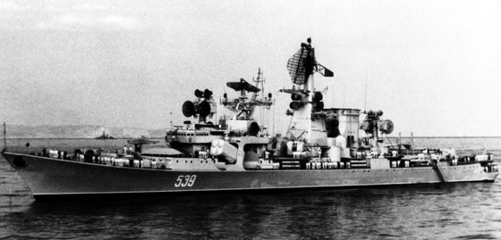

*Foto: [Nikolaev1977.jpg](https://commons.wikimedia.org/wiki/File%3ANikolaev1977.jpg), Photographer's Name: Unknown, pubblico dominio.*

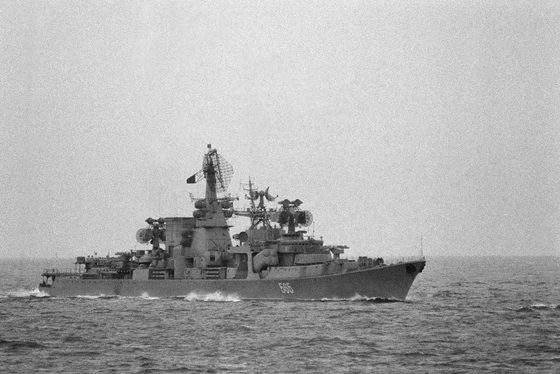

*Foto: [A starboard bow view of a Soviet Kara class guided missile cruiser PETROPAVLOVSK (565) shadowing salvage operations for downed Korean Air Lines Flight 007](https://commons.wikimedia.org/wiki/File%3AA_starboard_bow_view_of_a_Soviet_Kara_class_guided_missile_cruiser_PETROPAVLOVSK_%28565%29_shadowing_salvage_operations_for_downed_Korean_Air_Lines_Flight_007_%28KAL_007%29._The_commercial_-_DPLA_-_92467449ecec4f4686e60ca8ca06f2af.jpeg), Department of Defense. American Forces Information Service. Defense Visual Information Center. 1994, pubblico dominio.*

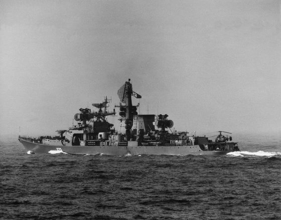

*Foto: [Tashkent1985.jpg](https://commons.wikimedia.org/wiki/File%3ATashkent1985.jpg), Photographer's Name: UNKNOWN, pubblico dominio.*

### Kidd (DDG-993)

*Navi di superficie · Stati Uniti*

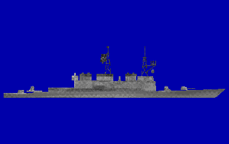

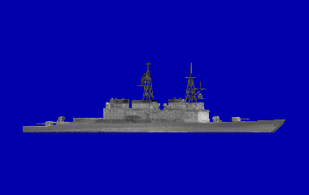

I cacciatorpediniere lanciamissili della classe Kidd (DDG-993), 9.570 tonnellate a pieno carico, filano a 33 nodi con quattro turbine a gas LM2500 e hanno un armamento antiaereo pesante: due lanciatori Mk 26 per missili SM-2MR e razzi ASROC, otto Harpoon, due cannoni da 127 mm e due Phalanx. Contro i sottomarini contano il grande sonar di prua SQS-53A, l'ASROC, i tubi Mk 32 per il siluro leggero Mk 46 e un elicottero SH-2F (LAMPS I). L'antenna rimorchiata SQR-19 fu solo valutata nel 1987: nel 1989 i Kidd ne sono privi. Fra il 1988 e il 1990 la New Threat Upgrade porta i radar SPS-48E e SPS-49. Che imbarcasse l'SH-60B è solo una stima del dossier 17.

**In partita.** Nel gioco ha il sonar SQS-53 in passivo e in attivo a circa 3,5 kHz, il più potente fra le navi (235 dB): il suo ping si sente da molto lontano e avverte che vi sta cercando. Senza antenna rimorchiata ascolta male a poppa e quando corre; l'ASROC e il Mk 46 arrivano a una decina di chilometri, quindi conviene attaccarlo da lontano col Mk 48. Due siluri pesanti dovrebbero bastare.

| Dato | Valore | Nel gioco | Confidenza | Fonte |
|---|---|---|---|---|
| Lunghezza | 171,6 m | - | alta | docs/ricerca/01_piattaforme_e_armi.md |
| Larghezza | 16,8 m | - | alta | docs/ricerca/01_piattaforme_e_armi.md |
| Velocità massima | 33 kn | - | alta | docs/ricerca/01_piattaforme_e_armi.md |
| Pescaggio | 9,6 m | - | alta | docs/ricerca/01_piattaforme_e_armi.md |
| Eliche: pale | 5 | - | media | acustica.toml: 01 §3.2, turbine a gas, Prairie-Masker |
| Inizio della cavitazione | 11 kn | - | media | acustica.toml: 01 §3.2, turbine a gas, Prairie-Masker |

**Sensori:** AN/SQS-53, AN/SPS-55, AN/SPQ-9, AN/SPS-48, radar di tiro.

**Armi tipiche:** Mk 46 Mod 5, UGM-84 Harpoon.

**Altre armi tipiche:** ASROC (Mk 26); SM-2MR; 2 × 127 mm Mk 45; 2 Phalanx; 1 SH-2F (LAMPS I).

**Fonti:** dossier 01 §4.1 e §8.2; dossier 04 §4 [FI-SQR19] [USNI87]; dossier 11 §1.1 [WPKIDD] [WPSPS48]; dossier 02 §1.5 [SQS53]; dossier 07 §6.4; acustica.toml (firme.kidd, suite.kidd, sensori.sqs53_attivo); emettitori.toml (suite.kidd); dossier 17 §2 (SH-60B sui DDG-993: STIMA).

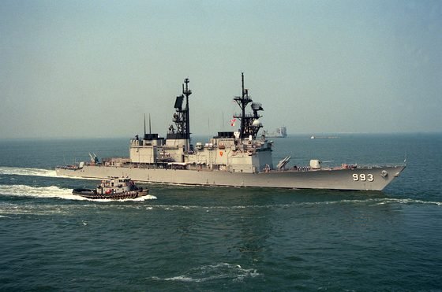

*Foto: [The large harbor tug DAHLONEGA (YTB-770) escorts the guided missile destroyer USS KIDD (DDG-993) as the ship gets underway en route to the Persian Gulf - D](https://commons.wikimedia.org/wiki/File%3AThe_large_harbor_tug_DAHLONEGA_%28YTB-770%29_escorts_the_guided_missile_destroyer_USS_KIDD_%28DDG-993%29_as_the_ship_gets_underway_en_route_to_the_Persian_Gulf_-_DPLA_-_00271fad0f634f0001ca435d808a5a49.jpeg), Department of Defense. American Forces Information Service. Defense Visual Information Center. 1994, pubblico dominio.*

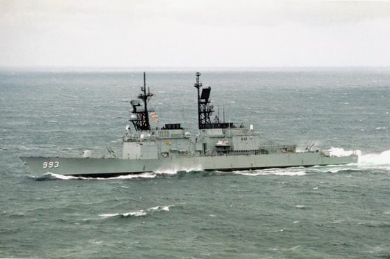

*Foto: [USS Kidd (DDG-993) 1989.jpg](https://commons.wikimedia.org/wiki/File%3AUSS_Kidd_%28DDG-993%29_1989.jpg), PHAA Cinelli, USN, pubblico dominio.*

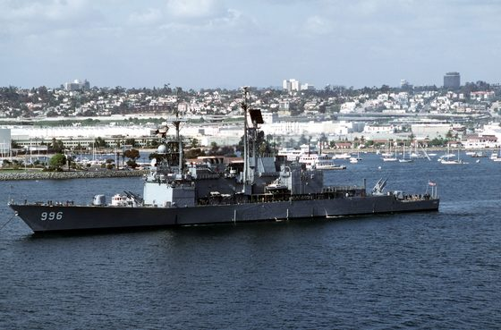

*Foto: [USS Chandler (DDG-996).jpg](https://commons.wikimedia.org/wiki/File%3AUSS_Chandler_%28DDG-996%29.jpg), PH2 Tracy Lee Didas, USN, pubblico dominio.*

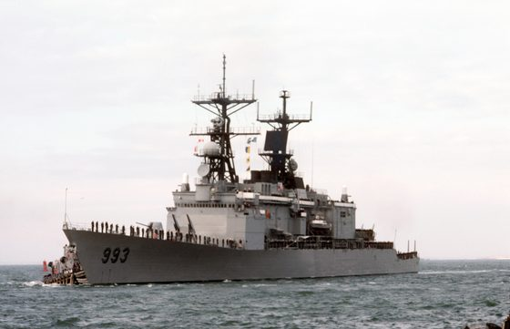

*Foto: [USS Kidd (DDG-993) returning to Norfolk in December 1987.JPEG](https://commons.wikimedia.org/wiki/File%3AUSS_Kidd_%28DDG-993%29_returning_to_Norfolk_in_December_1987.JPEG), PH2 Alexander C. Hicks, USN, pubblico dominio.*

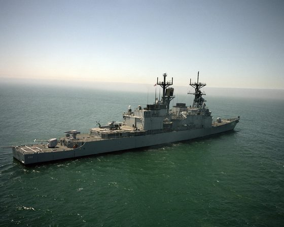

*Foto: [A starboard quarter view of the guided missile destroyer USS CHANDLER (DDG 996) underway - DPLA - 8535a29bac7b3c87225283a05f69bc69.jpeg](https://commons.wikimedia.org/wiki/File%3AA_starboard_quarter_view_of_the_guided_missile_destroyer_USS_CHANDLER_%28DDG_996%29_underway_-_DPLA_-_8535a29bac7b3c87225283a05f69bc69.jpeg), Department of Defense. American Forces Information Service. Defense Visual Information Center. 1994, pubblico dominio.*

### Kirov (Progetto 1144)

*Navi di superficie · Unione Sovietica*

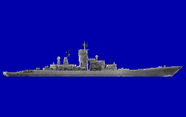

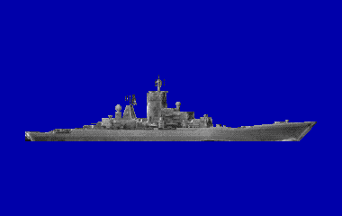

Gli incrociatori a propulsione nucleare del Progetto 1144 (Kirov) sono giganti da circa 24.000 tonnellate, lunghi 252 metri e veloci 32 nodi. L'arma principale sono 20 missili antinave P-700 Granit (SS-N-19), con 96 missili antiaerei S-300F, dieci tubi da 533 mm e tre elicotteri Ka-25 o Ka-27. Le tre unità del 1989 non sono uguali: la Kirov (1980) ha l'SS-N-14 e le RBU, la Frunze (1984) e la Kalinin (1988) il Vodopad-NK (SS-N-16) e l'antisiluro Udav-1. Il grande sonar di scafo Polinom può ascoltare nelle zone di convergenza.

**In partita.** La nave sovietica più rumorosa del gioco (177 dB alla massima): la sentirete prima di tutte le altre, insieme alla sua scorta. Ha sonar attivo, armi antisommergibile a distanza e tre elicotteri; il Granit minaccia le navi amiche, non voi immersi. Nessuna nave di questo tipo è mai stata colpita: per una nave così grande preparate una salva di siluri pesanti.

| Dato | Valore | Nel gioco | Confidenza | Fonte |
|---|---|---|---|---|
| Lunghezza | 252 m | - | bassa | docs/ricerca/01_piattaforme_e_armi.md |
| Larghezza | 28,5 m | - | bassa | docs/ricerca/01_piattaforme_e_armi.md |
| Velocità massima | 32 kn | - | bassa | docs/ricerca/01_piattaforme_e_armi.md |
| Pescaggio | 9,1 m | - | bassa | docs/ricerca/01_piattaforme_e_armi.md |
| Eliche: pale | 5 | - | media | acustica.toml: 01 §3.2 portaerei/BB 170-180 (incrociatore nucleare) |
| Inizio della cavitazione | 8 kn | - | media | acustica.toml: 01 §3.2 portaerei/BB 170-180 (incrociatore nucleare) |

**Sensori:** MG-332 «Titan-2», Don-2 / Don Kay / Palm Frond, Top Sail / Top Pair / Top Steer, radar di tiro.

**Armi tipiche:** P-700 Granit (SS-N-19), AT-2M, UMGT-1 Orlan.

**Altre armi tipiche:** 20 P-700 Granit (SS-N-19); SS-N-14 Metel (Kirov); SS-N-16 Vodopad-NK (Frunze, Kalinin); RBU-6000 e 2 RBU-1000 (Kirov); Udav-1 (Frunze, Kalinin); 10 tubi da 533 mm.

**Fonti:** dossier 01 §1, §4.2-4.3, §6.3-6.4 e §7.3 [WPKirov]; dossier 05 §5.5 [WPRBU12000]; dossier 07 §6.3; dossier 17 §3.2; dossier 11 §1.2; acustica.toml (firme.kirov, suite.kirov).

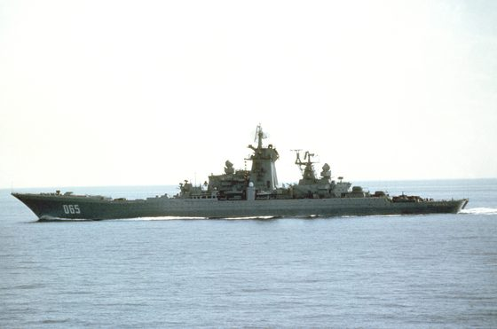

*Foto: [BCGN Kirov 1983.JPG](https://commons.wikimedia.org/wiki/File:BCGN_Kirov_1983.JPG), Camera Operator: PH2 BEECH, pubblico dominio.*

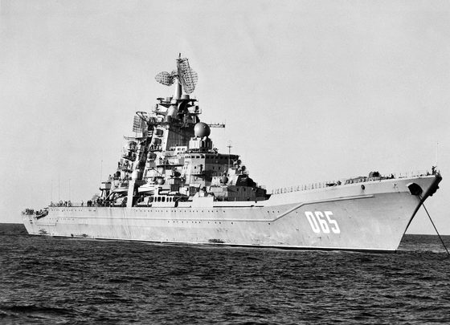

*Foto: [ARKR Kirov 1985 anchored.jpg](https://commons.wikimedia.org/wiki/File:ARKR_Kirov_1985_anchored.jpg), USN, pubblico dominio.*

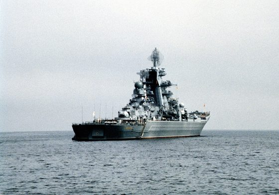

*Foto: [A starboard quarter view of the Soviet Kirov class nuclear-powered guided missile cruiser Frunze at anchor during a U.S. Navy visit to the city - DPLA - e6](https://commons.wikimedia.org/wiki/File:A_starboard_quarter_view_of_the_Soviet_Kirov_class_nuclear-powered_guided_missile_cruiser_Frunze_at_anchor_during_a_U.S._Navy_visit_to_the_city_-_DPLA_-_e69bcfc09cece37f11f18679809ef602.jpeg), Department of Defense. American Forces Information Service. Defense Visual Information Center. 1994, pubblico dominio.*

### Kitty Hawk (CV-63)

*Navi di superficie · Stati Uniti*

La Kitty Hawk (CV-63) è la capoclasse di un gruppo di portaerei a propulsione convenzionale di cui fa parte anche l'America (CV-66): 323,6 metri fuori tutto, circa 81.800 tonnellate a pieno carico, otto caldaie e turbine Westinghouse su quattro assi per 280.000 shp; le fonti danno 32-33 nodi. Non ha sonar: l'America fu l'unica della classe a riceverne uno, l'SQS-23, poi tolto nei primi anni '80. Imbarca circa 85 aerei e si difende con Sea Sparrow e Phalanx; nel 1984 i suoi radar sono l'SPS-43A e l'SPS-48 per la scoperta aerea e l'SPS-10 di superficie. Il 21 marzo 1984, nel Mar del Giappone durante l'esercitazione Team Spirit, il Victor I sovietico K-314, che la pedinava da giorni e l'aveva persa col maltempo, risalì a quota periscopica sulla sua rotta: la portaerei lo urtò, il battello perse un'elica e dovette essere rimorchiato, mentre la nave ne uscì con un'ammaccatura.

**In partita.** Non vi può sentire: nel gioco la sua suite sonar è vuota. In compenso è la nave militare più rumorosa della libreria, 158 dB a 5 nodi e 183 a 32, con le righe della turbina a 80 Hz, del riduttore a 160 e delle pompe a 32: la si sente da molto lontano. Il pericolo sono le scorte e gli elicotteri del gruppo, e la portaerei stessa quando si risale alla cieca: pesca 11,4 metri, quindi non tornate a quota periscopica senza sapere dov'è la sua prora. L'SPS-10 vede un periscopio a circa 7,4 km col mare 2; per affondarla le stime chiedono da 3 a 6 siluri pesanti.

| Dato | Valore | Nel gioco | Confidenza | Fonte |
|---|---|---|---|---|
| Lunghezza | 323,6 m | - | media | extracted/navi/kitty_hawk/RAPPORTO.md |
| Larghezza | 39,6 m | - | media | extracted/navi/kitty_hawk/RAPPORTO.md |
| Velocità massima | 33 kn | - | media | extracted/navi/kitty_hawk/RAPPORTO.md |
| Pescaggio | 11,4 m | - | media | extracted/navi/kitty_hawk/RAPPORTO.md |
| Eliche: pale | 5 | - | media | acustica.toml: 35: portaerei a vapore, 8 caldaie e 4 assi, 280.000 shp, 32 nodi; sopra la Nimitz (caldaie, ventilatori, pompe) |
| Inizio della cavitazione | 11 kn | - | media | acustica.toml: 35: portaerei a vapore, 8 caldaie e 4 assi, 280.000 shp, 32 nodi; sopra la Nimitz (caldaie, ventilatori, pompe) |

**Sensori:** AN/SPS-10/67, AN/SPS-43A, AN/SPS-48.

**Altre armi tipiche:** Sea Sparrow; Phalanx; gruppo aereo di circa 85 velivoli.

**Fonti:** extracted/navi/kitty_hawk/RAPPORTO.md; dossier 35 §1, §2 e §6; dossier 23 E20 [WP-K314] [NI-K314]; dossier 16 §1.2 e §2.1; dossier 07 §6.4; acustica.toml (firme.kitty_hawk, suite.kitty_hawk vuota); emettitori.toml (suite.kitty_hawk, radar.sps10_67); tools/pipeline/emettitori.py (SUITE: la Kitty Hawk nel 1984); libretto.toml [kitty_hawk].

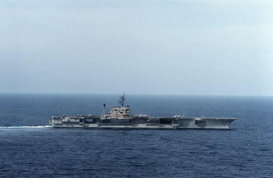

*Foto: [An aerial starboard beam view of the aircraft carrier USS KITTY HAWK (CV 63) underway - DPLA - 6f603b2a3c6b7844547858feeafc59b2.jpg](https://commons.wikimedia.org/wiki/File%3AAn_aerial_starboard_beam_view_of_the_aircraft_carrier_USS_KITTY_HAWK_%28CV_63%29_underway_-_DPLA_-_6f603b2a3c6b7844547858feeafc59b2.jpg), Department of Defense. American Forces Information Service. Defense Visual Information Center. 1994, pubblico dominio.*

### Knox (FF-1052)

*Navi di superficie · Stati Uniti*

Le fregate antisommergibile della classe Knox (FF-1052) sono le più numerose della US Navy: nel 1989 sono in servizio tutte e 46. Su 134 metri e 4.065 tonnellate portano due caldaie da 1.200 psi e una sola turbina Westinghouse da 35.000 shp su un asse, per 27 nodi; il vapore su un solo asse le rende più rumorose delle navi a turbine a gas, e non è confermato che abbiano il Prairie-Masker. Il sonar di prua è il grande SQS-26CX, attivo a circa 3,5 kHz; una parte della classe ha anche il sonar a profondità variabile SQS-35, calato da poppa fino a 180 metri, dal cui pesce si traina la schiera SQR-18A. Contro i sottomarini hanno l'ASROC e un elicottero SH-2F (LAMPS I) nell'hangar di poppa; il resto è un solo pezzo da 127 mm Mk 42, gli Harpoon e il Phalanx.

**In partita.** Nel gioco ha tre orecchie, e il VDS l'ha tutta la classe. Il sonar di prua usa i numeri dell'SQS-53: ascolta fra 1 e 3,5 kHz e pinga a 3,3 kHz ogni 25 secondi con 235 dB. A poppa cala il pesce dell'SQS-35 fino a 180 metri, 30 metri sotto lo strato, e dietro di lui la SQR-18A, che scende fino a 360 metri: lo strato non vi protegge. Col cavo fuori non supera i 20 nodi e procede a scatti, 5 minuti in deriva a 6 nodi e 10 di corsa; durante la corsa sente peggio. L'ASROC posa un Mk 46 fino a 9 km, l'SH-2F decolla fino a mare 4 e il 127 mm tira su un periscopio fino a 5 km; per una nave di 4.000 tonnellate basta un siluro pesante.

| Dato | Valore | Nel gioco | Confidenza | Fonte |
|---|---|---|---|---|
| Lunghezza | 134 m | - | media | docs/ricerca/32_firme_lotto2.md |
| Larghezza | 14,2 m | - | media | docs/ricerca/32_firme_lotto2.md |
| Velocità massima | 27 kn | - | media | docs/ricerca/32_firme_lotto2.md |
| Pescaggio | 7,6 m | - | media | docs/ricerca/32_firme_lotto2.md |
| Eliche: pale | 5 | - | media | acustica.toml: 32 §3: vapore su un asse, Prairie-Masker non confermato |
| Inizio della cavitazione | 11 kn | - | media | acustica.toml: 32 §3: vapore su un asse, Prairie-Masker non confermato |

**Sensori:** AN/SQS-53, AN/SPS-10/67, AN/SPS-40, radar di tiro.

**Armi tipiche:** Mk 46 Mod 5, UGM-84 Harpoon.

**Altre armi tipiche:** ASROC; 1 × 127 mm Mk 42; Phalanx; BPDMS (Sea Sparrow); 1 SH-2F (LAMPS I).

**Fonti:** dossier 32 §3; dossier 33 §1, §2, §3 e §4; dossier 04 §4 [USNI87] [FAS-SQR18]; dossier 02 §1.5 [SQS26]; dossier 17 §2.1b; dossier 36 §2 e §3 [NW-Mk42]; dossier 07 §6.4; extracted/navi/knox/RAPPORTO.md; acustica.toml (firme.knox, suite.knox, emissioni.sqs53_attivo, schiere.sqs35_vds, schiere.sqr18a); emettitori.toml (suite.knox); artiglieria.toml (classi.knox, pezzi.mk42); engine/missioni/src/missione_antisom_navi.cpp (arma_antisom, elicottero_di) e missione_vds.cpp; libretto.toml [knox].

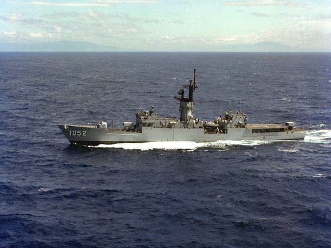

*Foto: [USS Knox (FF-1052) underway at sea on 9 December 1981 (6349375).jpeg](https://commons.wikimedia.org/wiki/File%3AUSS_Knox_%28FF-1052%29_underway_at_sea_on_9_December_1981_%286349375%29.jpeg), PHCS Steven Harris, U.S. Navy, pubblico dominio.*

### Koni (Progetto 1159)

*Navi di superficie · Unione Sovietica*

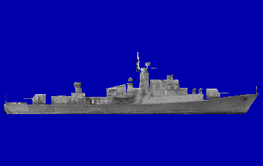

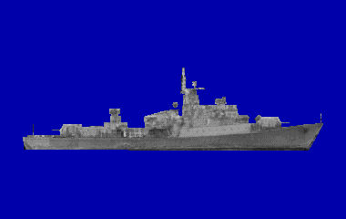

Le fregate del Progetto 1159 (Koni) furono costruite per l'esportazione: nella marina sovietica ne resta una sola, la Delfin, usata per addestrare gli equipaggi stranieri, mentre le altre servono nelle marine di DDR, Bulgaria, Cuba, Libia, Algeria e Jugoslavia. Sono navi piccole, 1.900 tonnellate e 27 nodi con un apparato misto diesel e turbina a gas su tre assi. Contro i sottomarini hanno solo il sonar di scafo Herkules, due RBU-6000 e le bombe di profondità; portano anche 20 mine.

**In partita.** Una minaccia modesta: le sue armi arrivano a circa 5 km, anche se nel gioco ha lo stesso sonar delle altre navi sovietiche, e i diesel la tradiscono con righe basse a 14 e 28 Hz. Tenetevi oltre il raggio delle RBU; un solo siluro pesante la spezza.

| Dato | Valore | Nel gioco | Confidenza | Fonte |
|---|---|---|---|---|
| Lunghezza | 95 m | - | media | docs/ricerca/01_piattaforme_e_armi.md |
| Larghezza | 12,8 m | - | media | docs/ricerca/01_piattaforme_e_armi.md |
| Velocità massima | 27 kn | - | media | docs/ricerca/01_piattaforme_e_armi.md |
| Pescaggio | 5 m | 4,2 m | media | dossier 01 §4.2 [WPKoni] |
| Eliche: pale | 4 | - | media | acustica.toml: 01 §3.2 |
| Inizio della cavitazione | 8 kn | - | media | acustica.toml: 01 §3.2 |

**Sensori:** MG-332 «Titan-2», Don-2 / Don Kay / Palm Frond, Head Net-C / Strut Curve, radar di tiro.

**Altre armi tipiche:** 2 RBU-6000; bombe di profondità; 20 mine; SA-N-4 (Osa-M).

**Fonti:** dossier 01 §1, §4.2, §6.5 e §7.3 [WPKoni]; dossier 07 §6.4; acustica.toml (firme.koni, suite.koni).

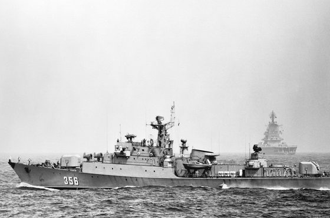

*Foto: [Fragatas-Cubana-356.jpg](https://commons.wikimedia.org/wiki/File:Fragatas-Cubana-356.jpg), Photographer's Name: Unknown (DefenseImagery.mil), pubblico dominio.*

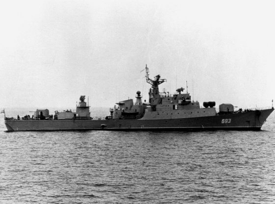

*Foto: [Del'fin1982-2.jpg](https://commons.wikimedia.org/wiki/File:Del'fin1982-2.jpg), Photographer's Name: Unknown (DefenseImagery.mil), pubblico dominio.*

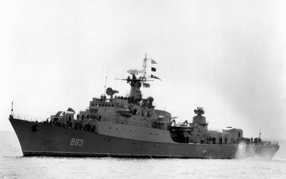

*Foto: [Del'fin1982-1.jpg](https://commons.wikimedia.org/wiki/File:Del'fin1982-1.jpg), Photographer's Name: Unknown (DefenseImagery.mil), pubblico dominio.*

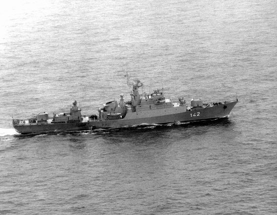

*Foto: [Berlin1982-1.jpg](https://commons.wikimedia.org/wiki/File:Berlin1982-1.jpg), DefenseImagery.mil, pubblico dominio.*

### Krivak II (Progetto 1135M)

*Navi di superficie · Unione Sovietica*

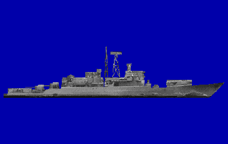

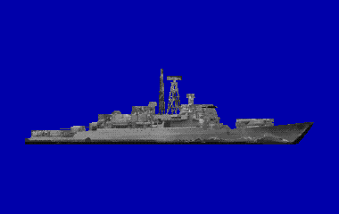

Le fregate del Progetto 1135M (Krivak II per la NATO) sono navi antisommergibile da circa 3.500 tonnellate, spinte da turbine a gas su due assi fino a 32 nodi. L'arma principale è il lanciatore quadruplo del sistema Metel (SS-N-14), che porta a circa 50 km un siluro AT-2U; a questo si aggiungono due lanciarazzi RBU-6000, otto tubi da 533 mm, due cannoni da 100 mm e le mine. Sotto la prua c'è il sonar Titan-2, a poppa il sonar a profondità variabile Vega, calato fino a 100 metri. Non imbarcano elicotteri.

**In partita.** Una cacciatrice vera: sonar di prua in passivo e attivo (Titan-2, 228 dB) e lo SS-N-14 che vi raggiunge ben oltre il raggio delle sue RBU-6000 (circa 5 km). Senza elicotteri dipende dal proprio sonar: avvicinatevi lenti e tiratele da lontano; un siluro pesante basta per una nave di questa stazza.

| Dato | Valore | Nel gioco | Confidenza | Fonte |
|---|---|---|---|---|
| Lunghezza | 123,5 m | - | media | docs/ricerca/01_piattaforme_e_armi.md |
| Larghezza | 14,1 m | - | media | docs/ricerca/01_piattaforme_e_armi.md |
| Velocità massima | 32 kn | - | media | docs/ricerca/01_piattaforme_e_armi.md |
| Pescaggio | 4,60 m | 7,3 m | media | dossier 01 §4.2 [WPKrivak] |
| Eliche: pale | 5 | - | media | acustica.toml: 01 §3.2 fregate senza Masker |
| Inizio della cavitazione | 8 kn | - | media | acustica.toml: 01 §3.2 fregate senza Masker |

**Sensori:** MG-332 «Titan-2», Don-2 / Don Kay / Palm Frond, Head Net-C / Strut Curve, radar di tiro.

**Armi tipiche:** AT-2M.

**Altre armi tipiche:** SS-N-14 (Metel/Rastrub); 2 RBU-6000; 2 × 4 tubi da 533 mm; mine; 2 × 100 mm AK-100.

**Fonti:** dossier 01 §4.2, §6.3, §6.5 e §7.3 [WPKrivak] [RWRBU6000]; dossier 11 §1.2 [RW1135]; dossier 07 §6.4; acustica.toml (firme.krivak2, suite.krivak2, sensori.titan2_attivo).

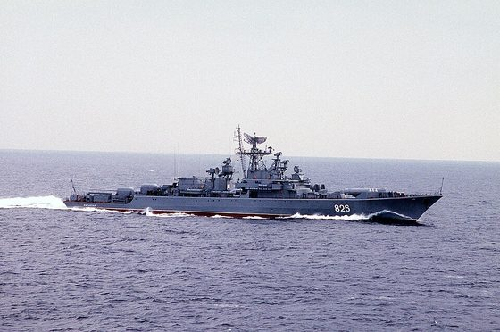

*Foto: [Pytlivyy1986.jpg](https://commons.wikimedia.org/wiki/File:Pytlivyy1986.jpg), Photographer's Name: PH2 Don Koralewski, pubblico dominio.*

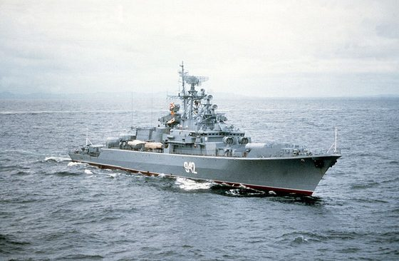

*Foto: [Rezvyy1983.JPEG](https://commons.wikimedia.org/wiki/File:Rezvyy1983.JPEG), Photographer's Name: PH2 D. Beech, pubblico dominio.*

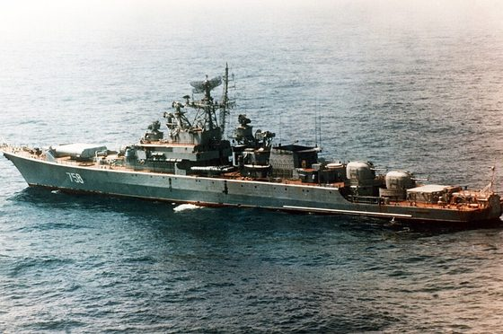

*Foto: [Gordelivyy1985.jpg](https://commons.wikimedia.org/wiki/File:Gordelivyy1985.jpg), Photographer's Name: Unknown, pubblico dominio.*

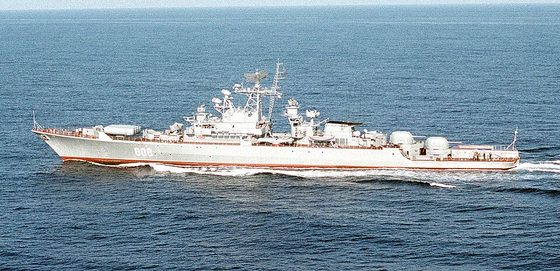

*Foto: [Krivak II class frigate, port beam view.jpg](https://commons.wikimedia.org/wiki/File:Krivak_II_class_frigate,_port_beam_view.jpg), PH2 PAUL A. VISE, Public domain.*

### Mercantile (Ravenstvo, tipo Leninskiy Komsomol)

*Navi di superficie · neutrale*

Il mercantile del gioco è la Ravenstvo, turbonave da carico generale sovietica consegnata dal cantiere di Kherson nel 1963 alla Compagnia di navigazione del Mar Nero di Odessa. È una delle 25 unità del tipo Leninskiy Komsomol (Progetto 567, 1959-1968), la serie di mercantili sovietici più nota: ne facevano parte anche navi della crisi di Cuba come la Metallurg Anosov. Tre isole, sei stive, dodici gru elettriche e due bighi pesanti da 60 tonnellate, circa 16.000 tonnellate di portata e 18 nodi; nel 1989 navi così sono ancora in servizio.

**In partita.** Non ha armi né sensori antisommergibile, e il suo radar di navigazione sempre acceso riempie l'ESM di segnali innocui. Rumorosa (fino a 183 dB), può coprire il vostro avvicinamento; se è un bersaglio, servono uno o due siluri pesanti.

| Dato | Valore | Nel gioco | Confidenza | Fonte |
|---|---|---|---|---|
| Lunghezza | 169,9 m | - | bassa | extracted/navi/mercantile/RAPPORTO.md |
| Larghezza | 21,8 m | - | bassa | extracted/navi/mercantile/RAPPORTO.md |
| Velocità massima | 18 kn | - | bassa | extracted/navi/mercantile/RAPPORTO.md |
| Pescaggio | 9 m | - | bassa | extracted/navi/mercantile/RAPPORTO.md |
| Eliche: pale | 4 | - | media | acustica.toml: 01 §3.2 mercantili 175-185 |
| Inizio della cavitazione | 6 kn | - | media | acustica.toml: 01 §3.2 mercantili 175-185 |

**Sensori:** radar di navigazione civile (X + S).

**Fonti:** extracted/navi/mercantile/RAPPORTO.md (classi.toml [mercantile]); dossier 01 §4.4; dossier 11 §1.3; dossier 07 §5.5 e §6.4; acustica.toml (firme.mercantile).

*Foto: [Soviet ship Ravenstvo, 1979.JPEG](https://commons.wikimedia.org/wiki/File:Soviet_ship_Ravenstvo,_1979.JPEG), PH2 K. Brewer, pubblico dominio.*

*Foto: [P-3A VP-44 over USS Barry (DD-933) and Metallurg Anosov during Cuban Missile Crisis 1962.jpg](https://commons.wikimedia.org/wiki/File:P-3A_VP-44_over_USS_Barry_(DD-933)_and_Metallurg_Anosov_during_Cuban_Missile_Crisis_1962.jpg), U.S. Navy, Public domain.*

### Nanuchka I (Progetto 1234)

*Navi di superficie · Unione Sovietica*

Le piccole corvette lanciamissili del Progetto 1234 (Nanuchka I) dislocano appena 660 tonnellate ma portano sei missili antinave P-120 Malakhit (SS-N-9), con una portata di 110-120 km. Tre diesel per 30.000 cavalli le spingono a 32-35 nodi; per difendersi hanno l'Osa-M e un binato da 57 mm. Non hanno sonar né armi antisommergibile. Il radar Band Stand serve a designare i bersagli per gli SS-N-9.

**In partita.** Per voi immersi è innocua: nel gioco ha solo un ascolto passivo e nessuna arma antisommergibile, ma minaccia le navi amiche. All'ESM la si riconosce dal radar di superficie Peel Pair. Col mare forza 6 cerca riparo e rallenta: è il momento per colpirla, e un siluro basta.

| Dato | Valore | Nel gioco | Confidenza | Fonte |
|---|---|---|---|---|
| Lunghezza | 59,3 m | - | media | docs/ricerca/01_piattaforme_e_armi.md |
| Larghezza | 12,6 m | - | media | docs/ricerca/01_piattaforme_e_armi.md |
| Velocità massima | 35 kn | 33 kn | media | dossier 01 §4.2 [WPNanu] |
| Pescaggio | 2,70 m | 3,1 m | media | dossier 01 §4.2 [WPNanu] |
| Eliche: pale | 4 | - | media | acustica.toml: 01 §3.2 (piccola) |
| Inizio della cavitazione | 8 kn | - | media | acustica.toml: 01 §3.2 (piccola) |

**Sensori:** Peel Pair / Plank Shave, radar di tiro.

**Altre armi tipiche:** 6 P-120 Malakhit (SS-N-9); SA-N-4 (Osa-M); 2 × 57 mm AK-257.

**Fonti:** dossier 01 §4.2 e §6.4 [WPNanu]; dossier 11 §1.2 e §2 [WPNAN]; dossier 21 §7.2; dossier 07 §6.4; acustica.toml (firme.nanuchka, suite.nanuchka); emettitori.toml (suite.nanuchka).

*Foto: [Soviet Nanuchka class guided missile corvette.JPEG](https://commons.wikimedia.org/wiki/File:Soviet_Nanuchka_class_guided_missile_corvette.JPEG), US Navy (autore non indicato), VIRIN DN-SN-86-00965, NARA 6406073, pubblico dominio.*

*Foto: [Nanuchka-I DN-SC-88-09637.jpg](https://commons.wikimedia.org/wiki/File:Nanuchka-I_DN-SC-88-09637.jpg), US military, DN-SC-88-09637, pubblico dominio.*

*Foto: [Nanuchka class corvette.JPG](https://commons.wikimedia.org/wiki/File:Nanuchka_class_corvette.JPG), US military, DN-ST-82-04639, NARA NN33300514, pubblico dominio.*

### Nave oceanografica

*Navi di superficie · Unione Sovietica*

Le navi oceanografiche lavorano per gli istituti di ricerca e per la pesca: misurano le acque, sondano il fondo con gli ecoscandagli e calano gli strumenti dal portale di poppa. Sono lunghe da 50 a 100 metri e fanno 10-14 nodi, con un diesel medio, un riduttore e un'elica a passo variabile, oppure col diesel-elettrico. Il modello del gioco è la Johan Hjort dell'Istituto di ricerca marina di Bergen, del 1990: scafo alto col ponte di riparo fino allo specchio, sovrastruttura lunga a tre piani, albero a traliccio dietro la plancia, fumaiolo col radome e il portale ad A a poppa. La nave vera è lunga 64,4 metri; la classe del gioco è di 75 metri e circa 2.450 tonnellate (stima). Le raccomandazioni dell'ICES per le navi da ricerca silenziose sono del 1995: nel 1989 le navi costruite per il silenzio sono ancora rare.

**In partita.** È civile e disarmata, e non dà la caccia ai sottomarini: nel traffico del gioco non ha sonar. Su navi come la Johan Hjort sotto 1 kHz domina il motore, e con il passo variabile asse e pala girano costanti e non dicono la velocità. Le misure moderne danno alle navi da ricerca in media 167 dB, meno di un mercantile ma più di un peschereccio. All'ESM ha il radar di navigazione civile come tutto il traffico; con 5 metri di pescaggio, a quota periscopica può prendere la vela.

| Dato | Valore | Nel gioco | Confidenza | Fonte |
|---|---|---|---|---|
| Lunghezza | 75 m | - | bassa | tools/pipeline/civili.py (docs/ricerca/26_navi_civili_traffico.md); extracted/navi/nave_ricerca/RAPPORTO.md |
| Larghezza | 14,2 m | - | bassa | tools/pipeline/civili.py (docs/ricerca/26_navi_civili_traffico.md); extracted/navi/nave_ricerca/RAPPORTO.md |
| Velocità massima | 15,4 kn | - | bassa | tools/pipeline/civili.py (docs/ricerca/26_navi_civili_traffico.md); extracted/navi/nave_ricerca/RAPPORTO.md |
| Pescaggio | 5 m | - | bassa | tools/pipeline/civili.py (docs/ricerca/26_navi_civili_traffico.md); extracted/navi/nave_ricerca/RAPPORTO.md |

**Sensori:** radar di navigazione civile (X + S).

**Fonti:** extracted/navi/nave_ricerca/RAPPORTO.md (classi.toml [nave_ricerca]; foto Adventfjorden); dossier 26 §1 (Veirs 2016); appunti 26_note/rumore_navi.md §3 e §4 [Eurofleets2] [ICES CRR 209]; tools/pipeline/civili.py (TIPI nave_ricerca); acustica.toml (civili.nave_ricerca); emettitori.toml (suite.nave_ricerca); dossier 16 §2.7.

*Foto: [Johan Hjort IMG 7563 Adventfjorden.JPG](https://commons.wikimedia.org/wiki/File%3AJohan_Hjort_IMG_7563_Adventfjorden.JPG), Bjoertvedt, CC BY-SA 3.0.*

### Nimitz (CVN-68)

*Navi di superficie · Stati Uniti*

Le portaerei nucleari della classe Nimitz (CVN-68) sono le navi più grandi della US Navy: oltre 330 metri, circa 95.000 tonnellate, due reattori A4W su quattro assi e più di 30 nodi. Imbarcano un gruppo aereo di 85-90 velivoli; per la caccia ai sottomarini contano uno squadrone di 8-10 S-3 Viking, che coprono le zone media ed esterna, e sei elicotteri SH-3H col sonar a immersione nella zona interna. Nel 1989 una portaerei atlantica può già avere gli S-3B col radar APS-137. La nave non ha sonar e si difende con Sea Sparrow e Phalanx.

**In partita.** La portaerei non vi sente, ma il suo schermo sì: elicotteri col sonar a immersione fino a 15-20 miglia, scorte e S-3 sui campi di boe più fuori. Rumorosissima, si sente da lontano; le stime chiedono 3-6 siluri pesanti per affondarla, quindi bisogna arrivare in silenzio sotto lo schermo e lanciare una salva.

| Dato | Valore | Nel gioco | Confidenza | Fonte |
|---|---|---|---|---|
| Lunghezza | 332,8 m | - | media | docs/ricerca/01_piattaforme_e_armi.md |
| Larghezza | 40,8 m | - | media | docs/ricerca/01_piattaforme_e_armi.md |
| Velocità massima | 30 kn | - | media | docs/ricerca/01_piattaforme_e_armi.md |
| Pescaggio | 11,3 m | - | media | docs/ricerca/01_piattaforme_e_armi.md |
| Eliche: pale | 5 | - | media | acustica.toml: 01 §3.2 portaerei/BB 170-180 |
| Inizio della cavitazione | 11 kn | - | media | acustica.toml: 01 §3.2 portaerei/BB 170-180 |

**Sensori:** AN/SPS-10/67, AN/SPS-49, AN/SPS-48.

**Altre armi tipiche:** Sea Sparrow (Mk 29); 3-4 Phalanx; gruppo aereo: S-3 e SH-3H con Mk 46.

**Fonti:** dossier 01 §4.1 e §8.2; dossier 17 §1, §2.2, §2.5 [HARPCVW] e §5.3; dossier 07 §6.1 e §6.4; dossier 11 §1.1; acustica.toml (firme.nimitz); emettitori.toml (suite.nimitz).

*Foto: [A bow view of the nuclear-powered aircraft carrier USS DWIGHT D. EISENHOWER (CVN 69) underway off the coast of St. Thomas, Virgin Islands - DPLA - afe9b912](https://commons.wikimedia.org/wiki/File:A_bow_view_of_the_nuclear-powered_aircraft_carrier_USS_DWIGHT_D._EISENHOWER_(CVN_69)_underway_off_the_coast_of_St._Thomas,_Virgin_Islands_-_DPLA_-_afe9b91218859664d7e31b76bb3079ca.jpeg), Department of Defense. American Forces Information Service. Defense Visual Information Center. 1994, pubblico dominio.*

*Foto: [A starboard quarter view of the nuclear-powered aircraft carrier USS DWIGHT D. EISENHOWER (CVN 69) and the aircraft carrier USS INDENPENDENCE (CV 62) under](https://commons.wikimedia.org/wiki/File:A_starboard_quarter_view_of_the_nuclear-powered_aircraft_carrier_USS_DWIGHT_D._EISENHOWER_(CVN_69)_and_the_aircraft_carrier_USS_INDENPENDENCE_(CV_62)_underway._The_INDENPENDENCE_is_-_DPLA_-_72a4fdb119bf58e0f3c4009083cef756.jpeg), Department of Defense. American Forces Information Service. Defense Visual Information Center. 1994, pubblico dominio.*

*Foto: [A port beam view of the nuclear-powered aircraft carrier USS THEODORE ROOSEVELT (CVN 71) underway - DPLA - 11918d1c1f8c8aa489083a5dc10c9b21.jpeg](https://commons.wikimedia.org/wiki/File:A_port_beam_view_of_the_nuclear-powered_aircraft_carrier_USS_THEODORE_ROOSEVELT_(CVN_71)_underway_-_DPLA_-_11918d1c1f8c8aa489083a5dc10c9b21.jpeg), Department of Defense. American Forces Information Service. Defense Visual Information Center. 1994, pubblico dominio.*

*Foto: [A starboard beam view of the nuclear-powered aircraft carrier USS THEODORE ROOSEVELT (CVN 71) underway - DPLA - da85f279b68fda546efbfe8777a1c8e8.jpeg](https://commons.wikimedia.org/wiki/File:A_starboard_beam_view_of_the_nuclear-powered_aircraft_carrier_USS_THEODORE_ROOSEVELT_(CVN_71)_underway_-_DPLA_-_da85f279b68fda546efbfe8777a1c8e8.jpeg), Department of Defense. American Forces Information Service. Defense Visual Information Center. 1994, pubblico dominio.*

*Foto: [A port bow view of the nuclear-powered aircraft carrier CARL VINSON (CVN-70) underway off the coast of Virginia during sea trials prior to commissioning -](https://commons.wikimedia.org/wiki/File:A_port_bow_view_of_the_nuclear-powered_aircraft_carrier_CARL_VINSON_(CVN-70)_underway_off_the_coast_of_Virginia_during_sea_trials_prior_to_commissioning_-_DPLA_-_22115155fc6cccbf34d341502d3d2117.jpeg), Department of Defense. American Forces Information Service. Defense Visual Information Center. 1994, pubblico dominio.*

### Oliver Hazard Perry (FFG-7)

*Navi di superficie · Stati Uniti*

Le fregate della classe Oliver Hazard Perry (FFG-7) furono costruite in gran numero per scortare convogli e gruppi anfibi a basso costo: due turbine LM2500 su un solo asse, 29 nodi. Portano il sonar di scafo SQS-56 a media frequenza e, sulle unità LAMPS III, l'antenna rimorchiata SQR-19 e due elicotteri SH-60B, che sono la loro arma antisommergibile più temibile. Le armi proprie sono il lanciatore Mk 13 (missili SM-1 e Harpoon), il cannone da 76 mm e i tubi Mk 32 per i siluri leggeri Mk 46.

| Dato | Valore | Nel gioco | Confidenza | Fonte |
|---|---|---|---|---|
| Lunghezza | 135,6 m | - | alta | docs/ricerca/01_piattaforme_e_armi.md |
| Larghezza | 13,7 m | - | alta | docs/ricerca/01_piattaforme_e_armi.md |
| Velocità massima | 29 kn | - | alta | docs/ricerca/01_piattaforme_e_armi.md |
| Pescaggio | 6,7 m | - | alta | docs/ricerca/01_piattaforme_e_armi.md |
| Eliche: pale | 5 | - | media | acustica.toml: 01 §3.2 fregate 150-170, Prairie-Masker -10 |
| Inizio della cavitazione | 11 kn | - | media | acustica.toml: 01 §3.2 fregate 150-170, Prairie-Masker -10 |

**Sensori:** AN/SQS-53, AN/SQS-56, AN/SPS-55, Mk 92 CAS, AN/SPS-49, radar di tiro.

**Fonti:** dossier 01 §4.1 (tabella delle navi USA); dossier 17 §2.1-2.2 (LAMPS III).

*Foto: [A port beam view of the guided missile frigate USS NICHOLAS (FFG 47) underway - DPLA - 42a831060da1fe7e805c65ac7202a866.jpeg](https://commons.wikimedia.org/wiki/File:A_port_beam_view_of_the_guided_missile_frigate_USS_NICHOLAS_(FFG_47)_underway_-_DPLA_-_42a831060da1fe7e805c65ac7202a866.jpeg), Department of Defense. American Forces Information Service. Defense Visual Information Center. 1994, pubblico dominio.*

*Foto: [A bow view of the guided missile frigate SIMPSON (FFG 56) underway off the coast of New England prior to its commissioning - DPLA - 56e300e9537b49cca946f41](https://commons.wikimedia.org/wiki/File:A_bow_view_of_the_guided_missile_frigate_SIMPSON_(FFG_56)_underway_off_the_coast_of_New_England_prior_to_its_commissioning_-_DPLA_-_56e300e9537b49cca946f416175d4845.jpeg), Department of Defense. American Forces Information Service. Defense Visual Information Center. 1994, pubblico dominio.*

*Foto: [A port quarter view of the guided missile frigate ELROD (FFG 55) underway off the coast of New England prior to its commissioning - DPLA - 18734f1a25373448](https://commons.wikimedia.org/wiki/File:A_port_quarter_view_of_the_guided_missile_frigate_ELROD_(FFG_55)_underway_off_the_coast_of_New_England_prior_to_its_commissioning_-_DPLA_-_18734f1a253734482c608db606c68175.jpeg), Department of Defense. American Forces Information Service. Defense Visual Information Center. 1994, pubblico dominio.*

### Oslo (F300)

*Navi di superficie · norvegia*

Le cinque fregate norvegesi della classe Oslo (1966-67) nascono da un progetto derivato dalle Dealey americane: circa 1.750 tonnellate a pieno carico per 96,6 metri, una turbina a vapore con due caldaie su un solo asse, 20.000 shp e 25 nodi. Contro i sottomarini hanno il sonar di scafo SQS-36 e il lanciarazzi Terne III davanti alla plancia; contro aerei e navi il Sea Sparrow, i missili Penguin e i binati da 76 mm. Nel 1989 tre unità su cinque portano ancora due binati, mentre la Trondheim e la Narvik ne hanno già sostituito uno con un Bofors 40/70 e la Stavanger lo fa a giugno. Il nuovo sonar TSM 2633, di scafo e a profondità variabile, arriva fra il 1987 e il 1991, ma non si sa quali navi lo avessero già nel 1989. A fine aprile 1983, all'imboccatura del Hardangerfjord, fregate norvegesi lanciarono razzi e bombe di profondità contro un sottomarino sospetto e trovarono solo una chiazza d'olio.

**In partita.** Nel gioco ascolta con l'SQS-36, in passivo fra 3,5 e 10 kHz, e pinga a 13 kHz con 218 dB ogni 15 secondi: un sonar ad alta frequenza, meno potente di quelli americani. Non ha siluri né elicottero; il Terne III tira solo fra 425 e 1.600 metri, con sei salve in tutto, e i binati da 76 mm colpiscono un periscopio fino a 4 km. Restate oltre i 2 km e sotto la quota periscopica: fuori da quella fascia non ha modo di colpirvi. Si sente bene, 140 dB a 5 nodi con la turbina a 98 Hz e il riduttore a 196, e basta un siluro.

| Dato | Valore | Nel gioco | Confidenza | Fonte |
|---|---|---|---|---|
| Lunghezza | 96,6 m | - | media | extracted/navi/oslo/RAPPORTO.md |
| Larghezza | 11,2 m | - | media | extracted/navi/oslo/RAPPORTO.md |
| Velocità massima | 25 kn | - | media | extracted/navi/oslo/RAPPORTO.md |
| Pescaggio | 5,5 m | - | media | extracted/navi/oslo/RAPPORTO.md |
| Eliche: pale | 5 | - | media | acustica.toml: 35: fregata norvegese (Dealey modificata), 1.760 t, turbina a vapore su 1 asse, 20.000 shp, 25 nodi |
| Inizio della cavitazione | 8 kn | - | media | acustica.toml: 35: fregata norvegese (Dealey modificata), 1.760 t, turbina a vapore su 1 asse, 20.000 shp, 25 nodi |

**Sensori:** DRBV 22, radar di navigazione civile (X + S), radar di tiro.

**Altre armi tipiche:** Terne III; 2 × 2 da 76/50 Mk 33 (un binato e un Bofors 40/70 su Trondheim e Narvik); Sea Sparrow (Mk 29); 6 Penguin; 6 tubi da 324 mm.

**Fonti:** extracted/navi/oslo/RAPPORTO.md; dossier 35 §1 e §2; dossier 36 §1 e §3 [NP-Oslo]; dossier 23 E12 [CSM83N] [CIMSEC]; dossier 07 §6.4; acustica.toml (firme.oslo, suite.oslo, sensori.sqs36, sensori.sqs36_attivo, emissioni.sqs36_attivo); emettitori.toml (suite.oslo); artiglieria.toml (classi.oslo, pezzi.mk33); engine/missioni/src/missione.cpp (fascia_lanciarazzi, salve_asw_classe); libretto.toml [oslo].

*Foto: [Frigate knm trondheim.jpg](https://commons.wikimedia.org/wiki/File%3AFrigate_knm_trondheim.jpg), OS2 John Bouvia, USN, pubblico dominio.*

### Peschereccio costiero (palangaro, reti da posta)

*Navi di superficie · neutrale*

Il peschereccio costiero è la barca da pesca più piccola del traffico: palangari, che calano lenze lunghe cariche di ami, e barche con le reti da posta, fisse sul fondo sotto costa. Sono lunghi da 15 a 45 metri e filano a 9-12 nodi con un diesel veloce e un riduttore. Il modello del gioco è il palangaro argentino Argenova XXI: castello alto, tuga e timoneria a prua, albero a torre con le antenne, gru a braccio snodato a mezzanave e portale a poppa; la classe è di 30 metri e circa 360 tonnellate (stima). Barche così ci sono in quasi tutti i teatri: le reti da posta nella baia di Kiel e attorno a Bornholm, i palangari faroesi sulla piattaforma delle isole e gli spagnoli sul Gran Sol, le barche giapponesi di Nemuro attorno a Kunashir.

**In partita.** È civile, piccolo e fuori dalle regole d'ingaggio. Al lavoro va piano o resta quasi fermo, e si sente poco: le misure moderne danno ai pescherecci in media 164 dB, con uno scarto molto ampio, e il diesel veloce mette le sue righe più in alto di quelle dei mercantili. Nel gioco non tira una rete a strascico e non prende l'antenna rimorchiata. Il pericolo è l'urto: a quota periscopica ogni nave può prendere la vela, e una barca così è facile da non sentire. All'ESM ha il radar di navigazione civile.

| Dato | Valore | Nel gioco | Confidenza | Fonte |
|---|---|---|---|---|
| Lunghezza | 30 m | - | bassa | tools/pipeline/civili.py (docs/ricerca/26_navi_civili_traffico.md); extracted/navi/peschereccio_costiero/RAPPORTO.md |
| Larghezza | 7,5 m | - | bassa | tools/pipeline/civili.py (docs/ricerca/26_navi_civili_traffico.md); extracted/navi/peschereccio_costiero/RAPPORTO.md |
| Velocità massima | 13,2 kn | - | bassa | tools/pipeline/civili.py (docs/ricerca/26_navi_civili_traffico.md); extracted/navi/peschereccio_costiero/RAPPORTO.md |
| Pescaggio | 3 m | - | bassa | tools/pipeline/civili.py (docs/ricerca/26_navi_civili_traffico.md); extracted/navi/peschereccio_costiero/RAPPORTO.md |

**Sensori:** radar di navigazione civile (X + S).

**Fonti:** extracted/navi/peschereccio_costiero/RAPPORTO.md (classi.toml [peschereccio_costiero]; foto Argenova XXI); dossier 26 §1 (Veirs 2016); appunti 26_note/rumore_navi.md §3; appunti 26_note/rotte_traffico.md §0, §3.3, §4.4, §6.3, §7.3; tools/pipeline/civili.py (TIPI peschereccio_costiero); acustica.toml (civili.peschereccio_costiero); emettitori.toml (suite.peschereccio_costiero); dossier 16 §2.7.

*Foto: [Longliner Argenova-XXI.jpg](https://commons.wikimedia.org/wiki/File%3ALongliner_Argenova-XXI.jpg), GeSHaFish, CC BY-SA 3.0.*

### Peschereccio d'altura (Atlantic Peace, 1987)

*Navi di superficie · neutrale*

Il peschereccio d'altura del gioco è l'Atlantic Peace, un peschereccio a rampa poppiera del 1987: scafo blu con la fascia bianca, castello alto, plancia a proravia e a poppa il portale sopra la rampa da cui la rete scende in mare. Lungo 57 metri e largo 13, circa 2.000 tonnellate a pieno carico, un diesel su un'elica a passo variabile: 14 nodi. Navi come questa pescavano nel Mare di Norvegia e nel Barents, dove pattugliavano i sottomarini.

**In partita.** È una nave civile, fuori dalle regole d'ingaggio. Fra 2 e 5 nodi è al lavoro: tira la rete a strascico quasi a piena potenza, con i cavi che vibrano e i verricelli, e fa molto rumore. Il pericolo è la rete, centinaia di metri dietro la poppa: negli anni '80 i sottomarini britannici ne agganciarono una quindicina, e nel 1990 l'Antares affondò con quattro uomini. Restate lontani dalla sua scia.

| Dato | Valore | Nel gioco | Confidenza | Fonte |
|---|---|---|---|---|
| Lunghezza | 57 m | - | bassa | extracted/navi/peschereccio/RAPPORTO.md |
| Larghezza | 13 m | - | bassa | extracted/navi/peschereccio/RAPPORTO.md |
| Velocità massima | 14 kn | - | bassa | extracted/navi/peschereccio/RAPPORTO.md |
| Pescaggio | 5 m | - | bassa | extracted/navi/peschereccio/RAPPORTO.md |
| Eliche: pale | 0 | - | media | acustica.toml: STIMA: peschereccio a rampa poppiera, diesel da 4000 CV, passo variabile; al lavoro a 2-5,5 kn (kit, extracted/navi/peschereccio) |
| Inizio della cavitazione | 6 kn | - | media | acustica.toml: STIMA: peschereccio a rampa poppiera, diesel da 4000 CV, passo variabile; al lavoro a 2-5,5 kn (kit, extracted/navi/peschereccio) |

**Sensori:** radar di navigazione civile (X + S).

**Fonti:** extracted/navi/peschereccio/RAPPORTO.md (classi.toml [peschereccio]; foto CC0 2012); dossier 16 §1.3 [WP-Antares]; acustica.toml (firme.peschereccio).

*Foto: [Trawler Atlantic Peace (5).jpg](https://commons.wikimedia.org/wiki/File:Trawler_Atlantic_Peace_(5).jpg), Tvabutzku1234, CC0.*

*Foto: [Trawler Atlantic Peace (4).jpg](https://commons.wikimedia.org/wiki/File:Trawler_Atlantic_Peace_(4).jpg), Tvabutzku1234, CC0.*

*Foto: [Trawler Atlantic Peace (1).jpg](https://commons.wikimedia.org/wiki/File:Trawler_Atlantic_Peace_(1).jpg), Tvabutzku1234, CC0.*

### Petroliera (Sea Isle City, 1981)

*Navi di superficie · neutrale*

La petroliera del gioco è la Sea Isle City, costruita nel 1981 da Mitsubishi per la compagnia petrolifera kuwaitiana: una petroliera da greggio di medie dimensioni, quasi 97.000 tonnellate di portata, con la sovrastruttura e le macchine a poppa. Nel 1987 passò sotto bandiera americana per l'operazione Earnest Will e il 16 ottobre di quell'anno un missile Silkworm iraniano ne colpì la plancia. Nella «guerra delle petroliere» del Golfo (1980-88) le petroliere furono il 61% delle navi attaccate, ma meno di un quarto di quelle colpite andò perduta.

**In partita.** Disarmata e senza sonar, è la nave più rumorosa del gioco (fino a 186 dB): il suo fragore può coprire un sottomarino che le naviga vicino. Carica è durissima da affondare (2-4 siluri pesanti), perché il greggio pesa quasi quanto l'acqua; in zavorra le cisterne piene di vapori possono esplodere.

| Dato | Valore | Nel gioco | Confidenza | Fonte |
|---|---|---|---|---|
| Lunghezza | 231,8 m | - | media | extracted/navi/petroliera/RAPPORTO.md |
| Larghezza | 44 m | - | media | extracted/navi/petroliera/RAPPORTO.md |
| Velocità massima | 16 kn | nel gioco del 1989: 15 kn | bassa | dossier 01 §4.4 |
| Pescaggio | 14 m | - | media | extracted/navi/petroliera/RAPPORTO.md |
| Eliche: pale | 5 | - | media | acustica.toml: 01 §3.2 petroliere 180-190 |
| Inizio della cavitazione | 6 kn | - | media | acustica.toml: 01 §3.2 petroliere 180-190 |

**Sensori:** radar di navigazione civile (X + S).

**Fonti:** extracted/navi/petroliera/RAPPORTO.md (classi.toml [petroliera]); dossier 07 §5.1-5.3 [CSIS] [Strauss]; dossier 07 §6.4; dossier 01 §4.4; acustica.toml (firme.petroliera).

*Foto: [MV Sea Isle City 1987.jpg](https://commons.wikimedia.org/wiki/File:MV_Sea_Isle_City_1987.jpg), PH2 Tolliver (USN), pubblico dominio.*

### Petroliera costiera e chimichiera

*Navi di superficie · neutrale*

Le petroliere costiere, le petroliere per prodotti raffinati e le chimichiere portano carburanti e prodotti chimici fra le raffinerie e i porti; con le grandi petroliere le cisterne sono negli anni '80 fra il 15 e il 25% del traffico di transito. Lunghe da 60 a 180 metri, filano a 12-15 nodi su un'elica sola, col diesel lento a due tempi o, come nel gioco, con un diesel medio e un riduttore. La classe del gioco è di 120 metri per 19,2, con 7,5 metri di pescaggio e circa 12.100 tonnellate (stima). Il modello del gioco viene dalla foto di una piccola petroliera prodotti, la Pegasus, riportata alle misure della classe: castello e albero a prua, la coperta bassa con la passerella e le tubolature del carico, la gru del manifold, e a poppa la sovrastruttura a quattro piani con l'albero radar e il fumaiolo.

**In partita.** È civile e disarmata, senza sonar, e una delle navi più comuni sulle rotte. Le chimichiere misurate hanno l'energia sotto i 100 Hz e sono un po' più forti delle altre cisterne sopra i 500 Hz. Nel modello dei danni è una petroliera, divisa in 19 celle stagne. Con 7,5 metri di pescaggio, a quota periscopica può prendere la vela; all'ESM ha il radar di navigazione civile come tutto il traffico.

| Dato | Valore | Nel gioco | Confidenza | Fonte |
|---|---|---|---|---|
| Lunghezza | 120 m | - | bassa | tools/pipeline/civili.py (docs/ricerca/26_navi_civili_traffico.md); extracted/navi/petroliera_costiera/RAPPORTO.md |
| Larghezza | 19,2 m | - | bassa | tools/pipeline/civili.py (docs/ricerca/26_navi_civili_traffico.md); extracted/navi/petroliera_costiera/RAPPORTO.md |
| Velocità massima | 16,5 kn | - | bassa | tools/pipeline/civili.py (docs/ricerca/26_navi_civili_traffico.md); extracted/navi/petroliera_costiera/RAPPORTO.md |
| Pescaggio | 7,5 m | - | bassa | tools/pipeline/civili.py (docs/ricerca/26_navi_civili_traffico.md); extracted/navi/petroliera_costiera/RAPPORTO.md |

**Sensori:** radar di navigazione civile (X + S).

**Fonti:** extracted/navi/petroliera_costiera/RAPPORTO.md (classi.toml [petroliera_costiera]; modello sulla Pegasus); appunti 26_note/rumore_navi.md §1.5 [McKenna 2012] e §3; appunti 26_note/rotte_traffico.md §0; tools/pipeline/civili.py (TIPI petroliera_costiera); acustica.toml (civili.petroliera_costiera); emettitori.toml (suite.petroliera_costiera); manuale E2 (scafi delle navi); dossier 16 §2.7.

*Foto: [Tanker Pegasus.jpg](https://commons.wikimedia.org/wiki/File%3ATanker_Pegasus.jpg), Tvabutzku1234, CC0.*

### Portacontainer (Cpl. Louis J. Hauge Jr., ex Estelle Maersk)

*Navi di superficie · neutrale*

La portacontainer del gioco è la Cpl. Louis J. Hauge Jr. (T-AK 3000), già Estelle Maersk: una delle cinque navi portacontainer e ro-ro costruite per la Maersk dal cantiere di Odense nel 1979-80. Dal 1984 il Military Sealift Command le noleggia come navi di preposizionamento, con equipaggi civili della Maersk. Scafo nero, cassero bianco a poppa con un ponte per elicotteri, tre torri gru e container in coperta; lunga 230 metri, fila a 16,4 nodi.

**In partita.** Disarmata e lenta, si sente molto bene (fino a 183 dB) e il suo radar di navigazione è sempre acceso. I grandi ponti garage senza paratie la espongono ad allagamenti rapidi e al capovolgimento: uno o due siluri pesanti dovrebbero bastare.

| Dato | Valore | Nel gioco | Confidenza | Fonte |
|---|---|---|---|---|
| Lunghezza | 230,2 m | - | media | extracted/navi/cargo/RAPPORTO.md |
| Larghezza | 27,4 m | - | media | extracted/navi/cargo/RAPPORTO.md |
| Velocità massima | 18 kn | nel gioco del 1989: 16,4 kn | bassa | dossier 01 §4.4 |
| Pescaggio | 10,5 m | - | media | extracted/navi/cargo/RAPPORTO.md |
| Eliche: pale | 6 | - | media | acustica.toml: 01 §3.2 mercantili 175-185 |
| Inizio della cavitazione | 6 kn | - | media | acustica.toml: 01 §3.2 mercantili 175-185 |

**Sensori:** radar di navigazione civile (X + S).

**Fonti:** extracted/navi/cargo/RAPPORTO.md (classi.toml [cargo]); dossier 07 §5.5 e §6.4; dossier 11 §1.3; acustica.toml (firme.cargo).

*Foto: [A tug boat positions the vehicle cargo ship CPL. LOUIS J. HAUGE, JR. (T-AK-3000). The HAUGE, along with other maritime prepositioning ships, is scheduled t](https://commons.wikimedia.org/wiki/File:A_tug_boat_positions_the_vehicle_cargo_ship_CPL._LOUIS_J._HAUGE,_JR._(T-AK-3000)._The_HAUGE,_along_with_other_maritime_prepositioning_ships,_is_scheduled_to_transport_equipment_that_-_DPLA_-_f36a97bd60156de27bd8f410c50fd827.jpeg), Department of Defense. American Forces Information Service. Defense Visual Information Center. 1994, pubblico dominio.*

*Foto: [1ST LT. ALEX BONNYMAN JR. (T-AK-3003).jpg](https://commons.wikimedia.org/wiki/File:1ST_LT._ALEX_BONNYMAN_JR._(T-AK-3003).jpg), U.S. Navy's Military Sealift Command, pubblico dominio.*

*Foto: [USNS PVT. HARRY FISHER (T-AK 3004).jpg](https://commons.wikimedia.org/wiki/File:USNS_PVT._HARRY_FISHER_(T-AK_3004).jpg), U.S. Navy's Military Sealift Command, pubblico dominio.*

*Foto: [USNS PVT. HARRY FISHER (T-AK 3004) underway.jpg](https://commons.wikimedia.org/wiki/File:USNS_PVT._HARRY_FISHER_(T-AK_3004)_underway.jpg), U.S. Navy's Military Sealift Command, pubblico dominio.*

*Foto: [An aerial starboard quarter view of the maritime prepositioning ship SS PFC. WILLIAM B. BAUGH JR. (T-AK-3001) being maneuvered by tugs - DPLA - 42a4ca71c7e](https://commons.wikimedia.org/wiki/File:An_aerial_starboard_quarter_view_of_the_maritime_prepositioning_ship_SS_PFC._WILLIAM_B._BAUGH_JR._(T-AK-3001)_being_maneuvered_by_tugs_-_DPLA_-_42a4ca71c7edc3ded7d6527c1e7716ea.jpeg), Department of Defense. American Forces Information Service. Defense Visual Information Center. 1994, pubblico dominio.*

### Portarinfuse

*Navi di superficie · neutrale*

Le portarinfuse portano merci sciolte, come minerali e cereali, nelle stive sotto grandi boccaporti; negli anni '80 la loro flotta cresce, mentre calano le petroliere. Sono lunghe da 150 a 300 metri e filano a 13-15 nodi con un diesel lento a due tempi in presa diretta su un'elica sola. La più studiata è la Overseas Harriette, di 173 metri, costruita nel 1978 da Hitachi Zosen: a 16 nodi irradia circa 192 dB; a 8 nodi il suo rumore viene dalle macchine, a 16 dalla cavitazione dell'elica. Il modello del gioco è una portarinfuse con le gru, cinque stive e quattro gru a palo sulla mezzeria, castello a prua e sovrastruttura a poppa, una sagoma che non è cambiata dagli anni '80; la classe è di 225 metri, 12 di pescaggio e circa 60.000 tonnellate (stima).

**In partita.** È civile e disarmata, e fra le navi più rumorose: le portarinfuse misurate stanno fra 184 e 187 dB, con un picco netto vicino ai 100 Hz. Col diesel in presa diretta le accensioni del motore seguono l'asse, e il loro rapporto con la riga di pala resta fisso a ogni velocità: è un indizio per classificarla. Cavita già a 7-10 nodi, quindi in servizio dà la sua modulazione al DEMON. Con 12 metri di pescaggio, a quota periscopica può urtare non solo la vela ma il dorso dello scafo: se vi passa sopra, scendete. All'ESM ha il radar di navigazione civile.

| Dato | Valore | Nel gioco | Confidenza | Fonte |
|---|---|---|---|---|
| Lunghezza | 225 m | - | bassa | tools/pipeline/civili.py (docs/ricerca/26_navi_civili_traffico.md); extracted/navi/portarinfuse/RAPPORTO.md |
| Larghezza | 33,8 m | - | bassa | tools/pipeline/civili.py (docs/ricerca/26_navi_civili_traffico.md); extracted/navi/portarinfuse/RAPPORTO.md |
| Velocità massima | 16,5 kn | - | bassa | tools/pipeline/civili.py (docs/ricerca/26_navi_civili_traffico.md); extracted/navi/portarinfuse/RAPPORTO.md |
| Pescaggio | 12 m | - | bassa | tools/pipeline/civili.py (docs/ricerca/26_navi_civili_traffico.md); extracted/navi/portarinfuse/RAPPORTO.md |

**Sensori:** radar di navigazione civile (X + S).

**Fonti:** extracted/navi/portarinfuse/RAPPORTO.md (classi.toml [portarinfuse]; foto Bulk Destiny); dossier 26 §1; appunti 26_note/rumore_navi.md §1.5 [McKenna 2012], §1.7 [Hildebrand 2009], §2.1 [Arveson e Vendittis 2000], §3, §4; tools/pipeline/civili.py (TIPI portarinfuse); acustica.toml (civili.portarinfuse); emettitori.toml (suite.portarinfuse); manuale C4 §2.10; dossier 16 §2.7.

*Foto: [2023-05-26 BULK DESTINY - IMO 9781994.jpg](https://commons.wikimedia.org/wiki/File%3A2023-05-26_BULK_DESTINY_-_IMO_9781994.jpg), Gordon Leggett, CC BY-SA 4.0.*

### Rimorchiatore d'altura

*Navi di superficie · neutrale*

I rimorchiatori d'altura prendono a rimorchio le navi in mare aperto e le assistono all'uscita dei porti e dei canali. Hanno due eliche, spesso in un mantello Kort, mosse da due o più diesel con riduttore: negli Stati Uniti erano comuni due EMD 645 per 3.000-4.200 cavalli in tutto, in Europa le eliche Voith-Schneider e Schottel. Il modello del gioco viene dalla foto del 1983 di un rimorchiatore d'altura della US Navy della classe Powhatan (T-ATF, 73,2 metri): castello alto, plancia a prua, fumaiolo con l'albero e un lungo cassero basso di lavoro a poppa. La classe del gioco è un rimorchiatore più piccolo con la stessa sagoma, di 50 metri e circa 1.800 tonnellate (stima), che fila a 11-15 nodi.

**In partita.** È civile e senza armi, ma rumoroso per la sua taglia: le misure danno ai rimorchiatori in media 170 dB, più delle navi da pesca e da ricerca, e a tiro pieno l'elica cavita anche da ferma; nel gioco cavita già a 4-7 nodi. Per un sottomarino il pericolo è il cavo di rimorchio: il 14 giugno 1989, a Long Beach, l'USS Houston agganciò il cavo del rimorchiatore Barcona, che affondò con un morto. All'ESM ha il radar di navigazione civile come tutto il traffico.

| Dato | Valore | Nel gioco | Confidenza | Fonte |
|---|---|---|---|---|
| Lunghezza | 50 m | - | bassa | tools/pipeline/civili.py (docs/ricerca/26_navi_civili_traffico.md); extracted/navi/rimorchiatore/RAPPORTO.md |
| Larghezza | 13,5 m | - | bassa | tools/pipeline/civili.py (docs/ricerca/26_navi_civili_traffico.md); extracted/navi/rimorchiatore/RAPPORTO.md |
| Velocità massima | 16,5 kn | - | bassa | tools/pipeline/civili.py (docs/ricerca/26_navi_civili_traffico.md); extracted/navi/rimorchiatore/RAPPORTO.md |
| Pescaggio | 5 m | - | bassa | tools/pipeline/civili.py (docs/ricerca/26_navi_civili_traffico.md); extracted/navi/rimorchiatore/RAPPORTO.md |

**Sensori:** radar di navigazione civile (X + S).

**Fonti:** extracted/navi/rimorchiatore/RAPPORTO.md (classi.toml [rimorchiatore]; foto Powhatan 1983); dossier 26 §1 (Veirs 2016; correzione +13 dB); appunti 26_note/rumore_navi.md §3 [tugboatinformation] e §4; tools/pipeline/civili.py (TIPI rimorchiatore); acustica.toml (civili.rimorchiatore); emettitori.toml (suite.rimorchiatore); dossier 16 §1.3 [PT89].

*Foto: [USNS Powhatan port side.jpg](https://commons.wikimedia.org/wiki/File%3AUSNS_Powhatan_port_side.jpg), Don S. Montgomery, pubblico dominio.*

### Rompighiaccio diesel-elettrico

*Navi di superficie · Unione Sovietica*

I rompighiaccio aprono le rotte d'inverno nei mari gelati. Negli anni '80 l'URSS ha le unità nucleari con base a Murmansk e circa un centinaio fra rompighiaccio diesel minori e mercantili rinforzati, costruiti in URSS e in Finlandia fra il 1959 e il 1989. Il modello del gioco è la classe Kapitan Sorokin (1977-1981), quattro unità: Kapitan Sorokin, Nikolayev, Dranitsyn e Khlebnikov, quest'ultima dell'Okhotsk. Hanno la prua da ghiaccio, il blocco bianco degli alloggi con la plancia in alto, il fumaiolo e la gru sul castello, e sono diesel-elettriche: sei diesel-generatori per 18 MW in tutto alimentano tre motori a corrente continua su tre assi. La classe del gioco è di 130 metri per 26, con 9,5 metri di pescaggio, circa 15.000 tonnellate (stima) e 14-19 nodi in servizio.

**In partita.** È una sorgente fortissima: nella realtà, rompendo il ghiaccio, il rumore sale di circa 10 dB fra 20 Hz e 2 kHz, e quando sperona o va in retromarcia la cavitazione arriva a 190-203 dB. Spesso non è solo: nel Barents passa da novembre a giugno sulle rotte verso il Mar Bianco e la Rotta del Mare del Nord, spesso in testa a un convoglio di mercantili, e nel Baltico compare da gennaio a marzo. I diesel-generatori girano a giri fissi, con la rete a 50 Hz, e non dicono la velocità; all'ESM ha il radar di navigazione civile. Con 9,5 metri di pescaggio, a quota periscopica può urtare il dorso dello scafo.

| Dato | Valore | Nel gioco | Confidenza | Fonte |
|---|---|---|---|---|
| Lunghezza | 130 m | - | bassa | tools/pipeline/civili.py (docs/ricerca/26_navi_civili_traffico.md); extracted/navi/rompighiaccio/RAPPORTO.md |
| Larghezza | 26 m | - | bassa | tools/pipeline/civili.py (docs/ricerca/26_navi_civili_traffico.md); extracted/navi/rompighiaccio/RAPPORTO.md |
| Velocità massima | 20,9 kn | - | bassa | tools/pipeline/civili.py (docs/ricerca/26_navi_civili_traffico.md); extracted/navi/rompighiaccio/RAPPORTO.md |
| Pescaggio | 9,5 m | - | bassa | tools/pipeline/civili.py (docs/ricerca/26_navi_civili_traffico.md); extracted/navi/rompighiaccio/RAPPORTO.md |

**Sensori:** radar di navigazione civile (X + S).

**Fonti:** extracted/navi/rompighiaccio/RAPPORTO.md (classi.toml [rompighiaccio]; foto Kapitan Dranitsyn 2006); appunti 26_note/rumore_navi.md §1.7 [DOSITS] e §3; appunti 26_note/rotte_traffico.md §4.5 e §5.4 [USNI 1999]; manuale E10 §2.1; tools/pipeline/civili.py (TIPI rompighiaccio); acustica.toml (civili.rompighiaccio); emettitori.toml (suite.rompighiaccio); dossier 16 §2.7.

*Foto: [KAPITAN DRANITSYN Icebreaker.jpg (raddrizzata)](https://commons.wikimedia.org/wiki/File%3AKAPITAN_DRANITSYN_Icebreaker.jpg), Mike Dunn, NC State Museum of Natural Sciences, pubblico dominio.*

### Sacramento (AOE-1)

*Navi di superficie · Stati Uniti*

Le rifornitrici veloci della classe Sacramento (AOE-1) sono grandi navi di supporto: 241 metri, circa 53.600 tonnellate a pieno carico, turbine a vapore da 100.000 cavalli e 26 nodi, con circa 600 uomini. Imbarcano due elicotteri UH-46. Non hanno sonar; per difendersi contano sul Sea Sparrow e su due Phalanx.

**In partita.** Nave grande, lenta e rumorosa (177 dB alla massima) e senza sonar: un bersaglio facile se si passa lo schermo della scorta, che però non la lascia mai sola.

| Dato | Valore | Nel gioco | Confidenza | Fonte |
|---|---|---|---|---|
| Lunghezza | 241 m | - | media | docs/ricerca/01_piattaforme_e_armi.md |
| Larghezza | 33 m | - | media | docs/ricerca/01_piattaforme_e_armi.md |
| Velocità massima | 26 kn | - | media | docs/ricerca/01_piattaforme_e_armi.md |
| Pescaggio | 11,6 m | - | media | docs/ricerca/01_piattaforme_e_armi.md |
| Eliche: pale | 5 | - | media | acustica.toml: 01 §3.2 |
| Inizio della cavitazione | 11 kn | - | media | acustica.toml: 01 §3.2 |

**Sensori:** AN/SPS-10/67, AN/SPS-40.

**Altre armi tipiche:** Sea Sparrow; 2 Phalanx.

**Fonti:** dossier 01 §4.1 e §8.2; dossier 11 §1.1 [WPSAC]; acustica.toml (firme.sacramento); classi.toml [sacramento].

*Foto: [USS Sacramento (AOE-1) underway in 1988.jpg](https://commons.wikimedia.org/wiki/File:USS_Sacramento_(AOE-1)_underway_in_1988.jpg), PH3 John Cross, USN (U.S. DefenseImagery VIRIN DN-SC-93-01179), pubblico dominio.*

*Foto: [USS Camden (AOE-2) underway in August 1987.jpeg](https://commons.wikimedia.org/wiki/File:USS_Camden_(AOE-2)_underway_in_August_1987.jpeg), Barrett, U.S. Navy, pubblico dominio.*

*Foto: [USS Seattle (AOE-3) underway in October 1983.jpeg](https://commons.wikimedia.org/wiki/File:USS_Seattle_(AOE-3)_underway_in_October_1983.jpeg), PH2 Wujcik, U.S. Navy, pubblico dominio.*

*Foto: [A starboard quarter view of the fast combat support ship USS SEATTLE (AOE 3) underway - DPLA - 87ff539207eb3b6b50766b05d3afa29a.jpeg](https://commons.wikimedia.org/wiki/File:A_starboard_quarter_view_of_the_fast_combat_support_ship_USS_SEATTLE_(AOE_3)_underway_-_DPLA_-_87ff539207eb3b6b50766b05d3afa29a.jpeg), Department of Defense. American Forces Information Service. Defense Visual Information Center (NARA, College Park), pubblico dominio.*

### Slava (Progetto 1164)

*Navi di superficie · Unione Sovietica*

Gli incrociatori lanciamissili del Progetto 1164 (Slava) sono navi antinave da circa 11.500 tonnellate a pieno carico, 32 nodi con turbine a gas. Portano 16 grandi missili P-500 Bazalt (SS-N-12), con 64 missili antiaerei S-300F, un cannone binato da 130 mm, due RBU-6000, dieci tubi da 533 mm e un elicottero. Nel 1989 ne sono in servizio tre: Slava (1982), Ustinov (1986) e Chervona Ukraina (1989). Il sonar è il Titan-2T di scafo con un sonar a profondità variabile.

**In partita.** È armata soprattutto contro le navi: ha sonar attivo e RBU, ma niente missili antisommergibile. Se scorta un gruppo, la minaccia per voi viene dal suo elicottero e dalle navi vicine; per lei bastano uno o due siluri pesanti.

| Dato | Valore | Nel gioco | Confidenza | Fonte |
|---|---|---|---|---|
| Lunghezza | 186,4 m | - | media | docs/ricerca/01_piattaforme_e_armi.md |
| Larghezza | 20,8 m | - | media | docs/ricerca/01_piattaforme_e_armi.md |
| Velocità massima | 32 kn | - | media | docs/ricerca/01_piattaforme_e_armi.md |
| Pescaggio | 8,4 m | - | media | docs/ricerca/01_piattaforme_e_armi.md |
| Eliche: pale | 5 | - | media | acustica.toml: 01 §3.2 |
| Inizio della cavitazione | 8 kn | - | media | acustica.toml: 01 §3.2 |

**Sensori:** MG-332 «Titan-2», Don-2 / Don Kay / Palm Frond, Top Sail / Top Pair / Top Steer, radar di tiro.

**Altre armi tipiche:** 16 P-500 Bazalt (SS-N-12); 2 RBU-6000; 2 × 5 tubi da 533 mm; S-300F (SA-N-6).

**Fonti:** dossier 01 §4.2, §6.4 e §7.3 [WPSlava]; dossier 11 §1.2 [WPSLAVA]; dossier 07 §6.4; acustica.toml (firme.slava, suite.slava).

*Foto: [A starboard bow view of the Soviet guided missile cruiser SLAVA underway. (SUBSTANDARD) - DPLA - 4faaa449a2d7f0872400c52d0e581bd5.jpeg](https://commons.wikimedia.org/wiki/File:A_starboard_bow_view_of_the_Soviet_guided_missile_cruiser_SLAVA_underway._(SUBSTANDARD)_-_DPLA_-_4faaa449a2d7f0872400c52d0e581bd5.jpeg), Department of Defense. American Forces Information Service. Defense Visual Information Center. 1994, pubblico dominio.*

*Foto: [Slava-Cruiser-DN-SC-86-03642.JPEG](https://commons.wikimedia.org/wiki/File:Slava-Cruiser-DN-SC-86-03642.JPEG), Camera Operator: PH1 PAUL D. GOODRICH, pubblico dominio.*

*Foto: [ChervonaUkraina1990b.jpg](https://commons.wikimedia.org/wiki/File:ChervonaUkraina1990b.jpg), Photographer's Name: UNKNOWN, pubblico dominio.*

*Foto: [ChervonaUkraina1990a.jpg](https://commons.wikimedia.org/wiki/File:ChervonaUkraina1990a.jpg), Photographer's Name: UNKNOWN, pubblico dominio.*

*Foto: [Cruiser Chervona Ukrayina 1990.jpg](https://commons.wikimedia.org/wiki/File:Cruiser_Chervona_Ukrayina_1990.jpg), USN, pubblico dominio.*

*Foto: [MarshalUstinov1991Mayport.jpg](https://commons.wikimedia.org/wiki/File:MarshalUstinov1991Mayport.jpg), Photographer's Name: Don S. Montgomery, pubblico dominio.*

### Spruance (DD-963)

*Navi di superficie · Stati Uniti*

I cacciatorpediniere della classe Spruance (DD-963) sono nel 1989 le navi che hanno preso il posto delle vecchie Forrest Sherman, radiate nel 1982-83. Lunghi quasi 172 metri, filano a 32,5 nodi con turbine a gas LM2500 e portano il sistema Prairie-Masker, che soffia aria attorno allo scafo e alle pale per smorzare le righe di macchina. Il sonar di prua è l'SQS-53; dall'anno fiscale 1987 due unità ricevono l'antenna rimorchiata SQR-19, collaudata nel 1982 sulla Moosbrugger, e il ponte può imbarcare elicotteri SH-60B. Per la difesa aerea hanno il Sea Sparrow e il radar SPS-40.

**In partita.** Nel gioco è acusticamente un gemello del Kidd: SQS-53 in passivo e un attivo da 235 dB che si sente lontano. Col mare forza 5 regge ancora 28 nodi, ma col mare grosso e oltre i 18 nodi il sonar di prua diventa quasi inutile. Per una nave di 8.000 tonnellate servono uno o due siluri pesanti.

| Dato | Valore | Nel gioco | Confidenza | Fonte |
|---|---|---|---|---|
| Lunghezza | 171,7 m | - | media | docs/ricerca/01_piattaforme_e_armi.md |
| Larghezza | 16,8 m | - | media | docs/ricerca/01_piattaforme_e_armi.md |
| Velocità massima | 32,5 kn | - | media | docs/ricerca/01_piattaforme_e_armi.md |
| Pescaggio | 8,8 m | - | media | docs/ricerca/01_piattaforme_e_armi.md |
| Eliche: pale | 5 | - | media | acustica.toml: 01 §3.2, turbine a gas, Prairie-Masker |
| Inizio della cavitazione | 11 kn | - | media | acustica.toml: 01 §3.2, turbine a gas, Prairie-Masker |

**Sensori:** AN/SQS-53, AN/SPS-55, AN/SPQ-9, AN/SPS-40, radar di tiro.

**Altre armi tipiche:** Sea Sparrow (RIM-7M, Mk 29); SH-60B LAMPS III con Mk 46 (imbarco stimato).

**Fonti:** dossier 01 §1 (anacronismi: Forrest Sherman); dossier 09 §5.1 [Masker]; dossier 02 §1.5 [SQS53]; dossier 04 §4 e §7 [FI-SQR19]; dossier 17 §2.1; dossier 05 §4.1; dossier 11 §1.1 [WPSPS40] [WPSPRU]; dossier 21 §7.2; dossier 07 §3.3 e §6.4; classi.toml [spruance]; acustica.toml (firme.spruance, suite.spruance).

*Foto: [US Navy 330-CFD DN-SC-92-06798 Starboard beam view of USS Leftwich (DD-984) underway.jpg](https://commons.wikimedia.org/wiki/File:US_Navy_330-CFD_DN-SC-92-06798_Starboard_beam_view_of_USS_Leftwich_(DD-984)_underway.jpg), National Museum of the U.S. Navy, pubblico dominio.*

*Foto: [A port beam view of the destroyer USS CARON (DD 970) underway - DPLA - bdf3dcc61f8b963b7225faa07207bbbd.jpeg](https://commons.wikimedia.org/wiki/File:A_port_beam_view_of_the_destroyer_USS_CARON_(DD_970)_underway_-_DPLA_-_bdf3dcc61f8b963b7225faa07207bbbd.jpeg), Department of Defense. American Forces Information Service. Defense Visual Information Center. 1994, pubblico dominio.*

*Foto: [USS Ingersoll DD-990.jpg](https://commons.wikimedia.org/wiki/File:USS_Ingersoll_DD-990.jpg), U.S. Navy, pubblico dominio.*

*Foto: [330-CFD-DN-SC-83-06747 (21910535349).jpg](https://commons.wikimedia.org/wiki/File:330-CFD-DN-SC-83-06747_(21910535349).jpg), National Museum of the U.S. Navy, pubblico dominio.*

*Foto: [USS Oldendorf (DD-972) underway.jpg](https://commons.wikimedia.org/wiki/File:USS_Oldendorf_(DD-972)_underway.jpg), PHC KRISTOFFERSEN, pubblico dominio.*

### Stockholm (K11)

*Navi di superficie · svezia*

Le due corvette svedesi della classe Stockholm, la Stockholm e la Malmö, entrano in servizio nel 1985: 372 tonnellate a pieno carico per 50 metri, con una propulsione CODAG su tre assi, due diesel MTU 16V396 e una turbina a gas Allison 570, che le porta a 32 nodi. Ascoltano col sonar di scafo Simrad SA950, ad alta frequenza, e col sonar a profondità variabile TSM 2643 «Salmon». Le armi sono un Bofors 57/70 Mk 2 a prua, un Bofors 40/70, otto missili antinave RBS-15, quattro tubi da 400 mm e i lanciagranate antisommergibile Elma, quattro da nove tubi. Pochi anni prima, nel 1982, la caccia di Hårsfjärden negli arcipelaghi di Stoccolma aveva fatto esplodere decine di bombe di profondità e alcune mine contro un intruso mai confermato.

**In partita.** Nel gioco ha due orecchie: il sonar di scafo SA950, che ascolta fra 10 e 25 kHz e pinga a 24 kHz ogni 5 secondi, e il Salmon calato a poppa, che ascolta fra 3,5 e 10 kHz e pinga a 12 kHz, fino a 120 metri di quota con 150 metri di cavo. Come le altre navi col VDS cala il pesce 30 metri sotto lo strato e procede a scatti, ma con meno di 60 metri d'acqua non lo cala affatto, e oltre i 18 nodi deve recuperarlo. Le Elma restano un attacco a probabilità, come gli RBU sovietici; il 57 mm tira su un periscopio fino a 4 km e il 40 fino a 2. Si sente poco (135 dB a 5 nodi, le righe dei diesel a 31,7 e 63,3 Hz), ma è piccola: basta un siluro.

| Dato | Valore | Nel gioco | Confidenza | Fonte |
|---|---|---|---|---|
| Lunghezza | 50 m | - | media | extracted/navi/stockholm/RAPPORTO.md |
| Larghezza | 7,5 m | - | media | extracted/navi/stockholm/RAPPORTO.md |
| Velocità massima | 32 kn | - | media | extracted/navi/stockholm/RAPPORTO.md |
| Pescaggio | 3,3 m | - | media | extracted/navi/stockholm/RAPPORTO.md |
| Eliche: pale | 4 | - | media | acustica.toml: 35: corvetta svedese, 372 t, CODAG su 3 assi (2 MTU 16V396 e una Allison 570), 32 nodi |
| Inizio della cavitazione | 8 kn | - | media | acustica.toml: 35: corvetta svedese, 372 t, CODAG su 3 assi (2 MTU 16V396 e una Allison 570), 32 nodi |

**Sensori:** Sea Giraffe 50HC, radar di navigazione civile (X + S), radar di tiro.

**Altre armi tipiche:** 8 RBS-15; 4 tubi da 400 mm; lanciagranate Elma (4 × 9 tubi); Bofors 57/70 Mk 2; Bofors 40/70.

**Fonti:** extracted/navi/stockholm/RAPPORTO.md; dossier 35 §1, §2 e §5; dossier 36 §1 e §3 [NP-Stockholm]; dossier 23 E15 [WP-SWE]; dossier 33 §2 e §3; dossier 07 §6.4; acustica.toml (firme.stockholm, suite.stockholm, sensori.sa950, sensori.salmon_vds, schiere.salmon_vds); emettitori.toml (suite.stockholm); artiglieria.toml (classi.stockholm, pezzi.bofors57, pezzi.bofors40); engine/missioni/src/missione_vds.cpp (SOTTO_STRATO_M, FONDALE_FILARE_M); libretto.toml [stockholm].

*Foto: [HMS Stockholm.JPG](https://commons.wikimedia.org/wiki/File%3AHMS_Stockholm.JPG), Marcusroos, CC BY-SA 3.0.*

### Ticonderoga (CG-47)

*Navi di superficie · Stati Uniti*

Gli incrociatori lanciamissili della classe Ticonderoga (CG-47) portano il sistema Aegis, coi pannelli fissi del radar SPY-1A, sullo scafo e sulle macchine della Spruance: 172,5 metri, circa 9.600-10.000 tonnellate, quattro turbine a gas LM2500 su due assi per 80.000 shp e 30-32,5 nodi, col Prairie-Masker che soffia aria sullo scafo e sulle pale. A fine 1989 ne sono in servizio quindici, dal CG-47 al CG-62, e fanno da scorta Aegis ai gruppi portaerei. Il sonar cambia con le unità: le prime sette hanno l'SQS-53A, il CG-54 e il CG-55 vi aggiungono la schiera SQR-19, e dal CG-56 c'è il sistema SQQ-89 con l'SQS-53B e la SQR-19. Le armi comprendono due cannoni da 127 mm, gli Harpoon, due Phalanx, i lanciatori Mk 26 o quelli verticali, e uno o due elicotteri SH-60B (LAMPS III).

**In partita.** Nel gioco è acusticamente una Spruance: 138 dB a 5 nodi e 168 a 32, con la turbina a 121 Hz e il riduttore a 181,5. Ascolta con l'SQS-53 e con la SQR-19, che nel gioco ha tutta la classe: 242 metri di schiera su 1.700 di cavo, fino a 360 metri di quota, che la rende pericolosa da lontano e anche sotto lo strato. L'ASROC posa un Mk 46 fino a 9 km, l'SH-60B decolla sul vostro rilevamento fino a mare 5, e l'SPS-55 vede un periscopio a circa 9 km col mare 2. All'ESM la si riconosce dall'SPY-1A, che ha una firma sua; per affondarla servono uno o due siluri pesanti.

| Dato | Valore | Nel gioco | Confidenza | Fonte |
|---|---|---|---|---|
| Lunghezza | 172,5 m | - | media | docs/ricerca/32_firme_lotto2.md |
| Larghezza | 16,8 m | - | media | docs/ricerca/32_firme_lotto2.md |
| Velocità massima | 32,5 kn | - | media | docs/ricerca/32_firme_lotto2.md |
| Pescaggio | 10,2 m | - | media | docs/ricerca/32_firme_lotto2.md |
| Eliche: pale | 5 | - | media | acustica.toml: 32 §2: scafo e macchine della Spruance, Prairie-Masker |
| Inizio della cavitazione | 11 kn | - | media | acustica.toml: 32 §2: scafo e macchine della Spruance, Prairie-Masker |

**Sensori:** AN/SQS-53, AN/SPS-55, AN/SPQ-9, AN/SPS-49, AN/SPY-1A, radar di tiro.

**Armi tipiche:** Mk 46 Mod 5, UGM-84 Harpoon.

**Altre armi tipiche:** ASROC (nel gioco); 2 × 127 mm Mk 45; 2 Phalanx; Mk 26 o lancio verticale; 1-2 SH-60B (LAMPS III).

**Fonti:** dossier 32 §2; dossier 04 §4 [FI-SQR19] [USNI87]; dossier 33 §1 e §4; dossier 17 §2.1; dossier 02 §1.5 [SQS53]; dossier 07 §6.4; extracted/navi/ticonderoga/RAPPORTO.md; acustica.toml (firme.ticonderoga, suite.ticonderoga, sensori.sqr19, schiere.sqr19); emettitori.toml (suite.ticonderoga, radar.sps55, radar.spy1a); engine/missioni/src/missione_antisom_navi.cpp (arma_antisom, elicottero_di); libretto.toml [ticonderoga].

*Foto: [A port view of the guided missile cruiser USS TICONDEROGA (CG-47) underway on the Atlantic Fleet Weapons Training Facility, Puerto Rico, prior to a missile](https://commons.wikimedia.org/wiki/File%3AA_port_view_of_the_guided_missile_cruiser_USS_TICONDEROGA_%28CG-47%29_underway_on_the_Atlantic_Fleet_Weapons_Training_Facility%2C_Puerto_Rico%2C_prior_to_a_missile_launch_-_DPLA_-_e7ab4fa4f1b4ed775625721bed1d22ba.jpeg), Department of Defense. American Forces Information, pubblico dominio.*

### Traghetto ro-ro e passeggeri

*Navi di superficie · neutrale*

I traghetti ro-ro e passeggeri fanno le linee fisse attraverso gli stretti e i mari chiusi: imbarcano auto, camion e a volte treni, e partono all'ora dell'orario. Hanno di solito due assi con eliche a passo variabile, mossi da due a quattro diesel medi con riduttore, e filano a 17-23 nodi; la Herald of Free Enterprise del 1980, di 132 metri, aveva tre diesel Sulzer su tre assi e faceva 22 nodi. Il modello del gioco è la Pride of Dover della P&O (1987, 169,6 metri), fotografata a Calais nel 1993: scafo scuro fino al ponte garage, sovrastruttura bianca quasi lunga quanto la nave, l'albero alto sopra la plancia e il fumaiolo largo coi quattro scarichi; la classe è di 150 metri e circa 14.000 tonnellate (stima). Nei teatri del gioco le linee più fitte sono nel Baltico, fra Puttgarden e Rødby e sul Grande Belt, e attraverso lo Stretto di Gibilterra; d'estate si moltiplicano le corse fra Brindisi e la Grecia.

**In partita.** È neutrale e carico di passeggeri: le regole d'ingaggio lo proteggono, salvo una guerra coi neutrali, ma un missile in ricerca può agganciarlo al posto del bersaglio. È veloce, ma passa all'ora dell'orario ed è un contatto prevedibile; con le eliche a passo variabile i giri restano costanti e asse e pala non dicono la velocità. Le misure moderne danno ai traghetti e alle navi passeggeri in media 166 dB, con uno scarto ampio. Di notte si riconosce dai fanali, all'ESM ha il radar di navigazione civile; i grandi ponti garage senza paratie lo espongono ad allagamenti rapidi e al capovolgimento.

| Dato | Valore | Nel gioco | Confidenza | Fonte |
|---|---|---|---|---|
| Lunghezza | 150 m | - | bassa | tools/pipeline/civili.py (docs/ricerca/26_navi_civili_traffico.md); extracted/navi/traghetto/RAPPORTO.md |
| Larghezza | 24 m | - | bassa | tools/pipeline/civili.py (docs/ricerca/26_navi_civili_traffico.md); extracted/navi/traghetto/RAPPORTO.md |
| Velocità massima | 25,3 kn | - | bassa | tools/pipeline/civili.py (docs/ricerca/26_navi_civili_traffico.md); extracted/navi/traghetto/RAPPORTO.md |
| Pescaggio | 6 m | - | bassa | tools/pipeline/civili.py (docs/ricerca/26_navi_civili_traffico.md); extracted/navi/traghetto/RAPPORTO.md |

**Sensori:** radar di navigazione civile (X + S).

**Fonti:** extracted/navi/traghetto/RAPPORTO.md (classi.toml [traghetto]; foto Pride of Dover, Calais 1993); dossier 26 §1 (Veirs 2016); appunti 26_note/rumore_navi.md §3; appunti 26_note/rotte_traffico.md §0, §1.4, §2.4, §4.3; tools/pipeline/civili.py (TIPI traghetto); acustica.toml (civili.traghetto); emettitori.toml (suite.traghetto); manuale E10 §2.3 (ROE); dossier 07 §5.5.

*Foto: [Ferry PRIDE OF DOVER, Calais (10509082664).jpg](https://commons.wikimedia.org/wiki/File%3AFerry_PRIDE_OF_DOVER%2C_Calais_%2810509082664%29.jpg), Gary Todd from Xinzheng, China, CC0.*

### Type 22 Boxer (Batch 2)

*Navi di superficie · Regno Unito*

La Batch 2 della Type 22, quella della Boxer, allunga lo scafo a 146,5 metri e 4.800 tonnellate per far posto all'antenna rimorchiata passiva Type 2031Z, lunga circa 500 metri e fatta per le frequenze molto basse. La prua diventa più alta e slanciata, ma armi, sonar di scafo Type 2016 e radar restano quelli della Batch 1: Exocet, due Sea Wolf, due Lynx e nessun cannone. Nel 1989 ne sono in servizio sei, Boxer, Beaver, Brave, London, Sheffield e Coventry; la Brave ha le turbine Spey. La schiera non rese mai quanto si sperava, perché i generatori diesel non poggiavano su un basamento elastico e il loro rumore passava in acqua: lo racconta un comandante della London.

**In partita.** Rispetto alla Batch 1 cambia l'orecchio: nel gioco traina la Type 2031Z, 500 metri di schiera su 1.500 di cavo, fino a 300 metri di quota, con l'analisi LOFAR fine a 0,05 Hz. Vi può sentire da lontano e sotto lo strato, ma solo sotto i 20 nodi, oltre i quali deve recuperarla; e per via dei diesel il suo rumore proprio è più alto di quello della SQR-19 americana. Gli stessi diesel tradiscono la nave anche a voi, con le righe a 22,5 e 45 Hz. Per il resto è come la Batch 1: niente cannone, nessun siluro modellato, e uno o due siluri pesanti per affondarla.

| Dato | Valore | Nel gioco | Confidenza | Fonte |
|---|---|---|---|---|
| Lunghezza | 146,5 m | - | media | docs/ricerca/32_firme_lotto2.md |
| Larghezza | 14,8 m | - | media | docs/ricerca/32_firme_lotto2.md |
| Velocità massima | 30 kn | - | media | docs/ricerca/32_firme_lotto2.md |
| Pescaggio | 6,4 m | - | media | docs/ricerca/32_firme_lotto2.md |
| Eliche: pale | 5 | - | media | acustica.toml: 32 §4: il Batch 2, scafo allungato di 15 m per la 2031Z; le stesse macchine e i diesel senza raft (STIMA) |
| Inizio della cavitazione | 8 kn | - | media | acustica.toml: 32 §4: il Batch 2, scafo allungato di 15 m per la 2031Z; le stesse macchine e i diesel senza raft (STIMA) |

**Sensori:** Type 1006, Type 967/968, radar di tiro.

**Altre armi tipiche:** 4 Exocet; 2 Sea Wolf (lanciatori sestupli); 2 Lynx.

**Fonti:** dossier 32 §4; dossier 04 §4 [Helis-2031] [Dowty-2031Z] [WP-T22]; dossier 33 §3; extracted/navi/type22b2/RAPPORTO.md; acustica.toml (firme.type22b2, suite.type22b2, sensori.type2031z, schiere.type2031z); emettitori.toml (suite.type22b2); libretto.toml [type22b2]; engine/missioni/src/missione_antisom_navi.cpp (nessuna arma né elicottero per la Type 22); dossier 07 §6.4.

*Foto: [A starboard beam view of the British frigate HMS BEAVER (F 93) entering port during Exercise RIMPAC '86 - DPLA - 397f244859eaba6b9adeb6c9b8b1d259.jpeg](https://commons.wikimedia.org/wiki/File%3AA_starboard_beam_view_of_the_British_frigate_HMS_BEAVER_%28F_93%29_entering_port_during_Exercise_RIMPAC_%2786_-_DPLA_-_397f244859eaba6b9adeb6c9b8b1d259.jpeg), Department of Defense. American Forces Information Service. Defense Visual Information Center. 1994, pubblico dominio.*

### Type 22 Broadsword (Batch 1)

*Navi di superficie · Regno Unito*

Le Type 22 sono le fregate antisommergibile della Royal Navy; la Batch 1, quella della capoclasse Broadsword, sposta 4.400 tonnellate su 131,2 metri e non ha cannone. Due turbine a gas Olympus TM3B e due Tyne RM1C, in configurazione COGOG, muovono due eliche a passo variabile fino a 30 nodi. Le armi sono quattro Exocet davanti alla plancia, due lanciatori sestupli di Sea Wolf, uno sul castello e uno sul tetto dell'hangar, e due elicotteri Lynx; il sonar di scafo è il Type 2016, mentre il Type 2050 arriva solo dopo il 1989. Per lo scafo le fonti citano l'Agouti, la versione britannica del Prairie. Nel 1989 sono in servizio tutte e dieci le Type 22 delle due serie.

**In partita.** Nel gioco il Type 2016 prende i numeri dell'SQS-53 della Spruance, in passivo e in attivo a 3,3 kHz, ma la Batch 1 non ha schiera: a poppa e quando corre ascolta male. Si fa riconoscere dalle righe forti dei generatori diesel a 22,5 e 45 Hz, oltre che dalla turbina a 108 Hz, con 140 dB a 5 nodi. Non ha cannone, e nel gioco non ha un siluro modellato né un elicottero che decolli: il suo attacco resta quello generico del gioco originale, a probabilità e entro poche miglia. Il Type 1006 vede un periscopio a circa 7,4 km col mare 2; un siluro pesante, al massimo due, la affonda.

| Dato | Valore | Nel gioco | Confidenza | Fonte |
|---|---|---|---|---|
| Lunghezza | 131,2 m | - | media | docs/ricerca/32_firme_lotto2.md |
| Larghezza | 14,8 m | - | media | docs/ricerca/32_firme_lotto2.md |
| Velocità massima | 30 kn | - | media | docs/ricerca/32_firme_lotto2.md |
| Pescaggio | 6 m | - | media | docs/ricerca/32_firme_lotto2.md |
| Eliche: pale | 5 | - | media | acustica.toml: 32 §4: COGOG, Agouti; diesel dei generatori senza raft |
| Inizio della cavitazione | 8 kn | - | media | acustica.toml: 32 §4: COGOG, Agouti; diesel dei generatori senza raft |

**Sensori:** Type 1006, Type 967/968, radar di tiro.

**Altre armi tipiche:** 4 Exocet; 2 Sea Wolf (lanciatori sestupli); 2 Lynx.

**Fonti:** dossier 32 §4; extracted/navi/type22/RAPPORTO.md; acustica.toml (firme.type22, suite.type22); emettitori.toml (suite.type22, radar.tipo1006); libretto.toml [type22]; engine/missioni/src/missione_antisom_navi.cpp (nessuna arma né elicottero per la Type 22); engine/missioni/src/missione.cpp (f_attacca, salve_asw_classe); dossier 07 §6.4.

*Foto: [A starboard bow view of the British frigate HMS BROADSWORD (F-88) underway (330-CFD-DN-SC-87-01110).jpg](https://commons.wikimedia.org/wiki/File%3AA_starboard_bow_view_of_the_British_frigate_HMS_BROADSWORD_%28F-88%29_underway_%28330-CFD-DN-SC-87-01110%29.jpg), Unknown author, pubblico dominio.*

### Udaloy (Progetto 1155)

*Navi di superficie · Unione Sovietica*

Le grandi navi antisommergibile del Progetto 1155 «Fregat» (Udaloy per la NATO) sono lunghe 163,5 metri e dislocano 7.620 tonnellate a pieno carico; due gruppi COGAG, con turbine di crociera e turbine di potenza su due assi, le portano a 30 nodi. Il sensore principale è il sonar MGK-355 «Polinom»: la grande cupola di prua «Horse Jaw», a bassa frequenza, e il «Horse Tail» a profondità variabile. Contro i sottomarini hanno due lanciatori quadrupli Rastrub (SS-N-14) ai lati della plancia, due RBU-6000, due tubi quadrupli da 533 mm e due elicotteri Ka-27 in due hangar affiancati; i cannoni sono due AK-100 da 100 mm e quattro AK-630. La dottrina le schiera nella zona media della difesa dei bastioni, insieme alle Krivak, agli Il-38 e ai Ka-27.

**In partita.** Nel gioco ascolta col Polinom di prua e col «Horse Tail», che la nave cala circa 30 metri sotto lo strato, fino a 200 metri: contro di lei lo strato termico protegge poco. Il suo ping a 3,5 kHz è forte (232 dB, poco sotto l'SQS-53). Lancia il SET-65 dai tubi fino a circa 8 km; oltre, entro 60 km e con mare fino a 5, fa decollare un Ka-27. All'ESM si annuncia col Top Plate, che nel gioco porta solo lei. È rumorosa quando corre (172 dB a 30 nodi), ma a 5 nodi scende a 145 dB; per una nave di questa stazza mettete in conto uno o due siluri pesanti.

| Dato | Valore | Nel gioco | Confidenza | Fonte |
|---|---|---|---|---|
| Lunghezza | 163,5 m | - | media | docs/ricerca/31_firme_lotto1.md |
| Larghezza | 19 m | - | media | docs/ricerca/31_firme_lotto1.md |
| Velocità massima | 30 kn | - | media | docs/ricerca/31_firme_lotto1.md |
| Pescaggio | 7,8 m | - | media | docs/ricerca/31_firme_lotto1.md |
| Eliche: pale | 5 | - | media | acustica.toml: 31 §4: COGAG su 2 assi, nessuna cortina d'aria nota (come Kara) |
| Inizio della cavitazione | 8 kn | - | media | acustica.toml: 31 §4: COGAG su 2 assi, nessuna cortina d'aria nota (come Kara) |

**Sensori:** Don-2 / Don Kay / Palm Frond, Head Net-C / Strut Curve, Top Plate (Fregat-M), radar di tiro.

**Armi tipiche:** AT-2M, SET-65.

**Altre armi tipiche:** 2 × 4 SS-N-14 (Rastrub); 2 RBU-6000; 2 × 4 tubi da 533 mm; 2 × 100 mm AK-100; 4 AK-630; Kinzhal (SA-N-9), operativo dal 1989 su poche unità; 2 Ka-27.

**Fonti:** dossier 31 §4 (ru.wikipedia, progetto 1155); dossier 33 §1-3; dossier 36 §3; dossier 17 §3.2 [RW-Ka27]; dossier 03 §C4 (9-10); dossier 01 §6.1-6.3 (SET-65, AT-2U e Metel); dossier 05 §4.2 [WPKinz]; dossier 07 §6.4; extracted/navi/udaloy/RAPPORTO.md; libretto.toml [udaloy]; acustica.toml (firme.udaloy, suite.udaloy, sensori.polinom, polinom_attivo, polinom_vds, polinom_vds_attivo); emettitori.toml (suite.udaloy); classi.toml [udaloy]; engine/missioni/src/missione_antisom_navi.cpp (tubi ed elicottero, STIMA).

*Foto: [AdmiralKharlamov1993.jpg](https://commons.wikimedia.org/wiki/File%3AAdmiralKharlamov1993.jpg), Photographer's Name: Unknown, pubblico dominio.*

### Ugra (Progetto 1886)

*Navi di superficie · Unione Sovietica*

Le navi del Progetto 1886 (Ugra per la NATO) sono basi galleggianti per i sottomarini delle squadre (eskadre); nel Mediterraneo lavorano con la 5a Eskadra. Hanno uno scafo lungo da mercantile, 141,4 metri per 17,7, con una grande gru a centro nave, un fumaiolo tondo e circa 9.650 tonnellate a pieno carico. Per difendersi portano quattro impianti binati da 57 mm, due a prua e due a poppa. Le misure vengono da fonti secondarie e vanno prese come una stima.

**In partita.** Nel gioco è grande e lenta, al massimo 17 nodi, con un solo sonar passivo di prua; non insegue mai. Si sente bene (168 dB alla massima), con le righe dei diesel e della rete a 50 Hz delle navi sovietiche. All'ancora con un sottomarino affiancato, come nella missione «L'ancoraggio», il pericolo sono le navi di guardia, non lei. All'ESM porta i radar delle navi sovietiche, compreso quello di tiro dei suoi cannoni.

| Dato | Valore | Nel gioco | Confidenza | Fonte |
|---|---|---|---|---|
| Lunghezza | 141,4 m | - | media | extracted/navi/ugra/RAPPORTO.md |
| Larghezza | 17,7 m | - | media | extracted/navi/ugra/RAPPORTO.md |
| Velocità massima | 17 kn | - | media | extracted/navi/ugra/RAPPORTO.md |
| Pescaggio | 6,4 m | - | media | extracted/navi/ugra/RAPPORTO.md |
| Eliche: pale | 4 | - | media | acustica.toml: STIMA: base galleggiante Progetto 1886, 141 m e 9.650 t, due diesel su 2 assi, 17 nodi (kit, extracted/navi/ugra); fra le combattenti diesel e i mercantili |
| Inizio della cavitazione | 8 kn | - | media | acustica.toml: STIMA: base galleggiante Progetto 1886, 141 m e 9.650 t, due diesel su 2 assi, 17 nodi (kit, extracted/navi/ugra); fra le combattenti diesel e i mercantili |

**Sensori:** Don-2 / Don Kay / Palm Frond, Head Net-C / Strut Curve, radar di tiro.

**Altre armi tipiche:** 4 × 2 da 57 mm.

**Fonti:** extracted/navi/ugra/RAPPORTO.md; docs/17_libreria_missioni.md (LIB-S15); libretto.toml [ugra]; acustica.toml (firme.ugra, suite.ugra); emettitori.toml (suite.ugra); classi.toml [ugra]; engine/missioni/src/missione_reazioni.cpp (le ausiliarie non pedinano).

*Foto: [Ugra-class.jpg](https://commons.wikimedia.org/wiki/File%3AUgra-class.jpg), US Navy, pubblico dominio.*
<!-- fine: unita_navi -->
