# 13. Aerei ed elicotteri

Le schede dei mezzi aerei antisommergibile della simulazione, dall'enciclopedia del gioco.

<!-- generato: unita_aerei -->
### Be-12 Mail

*Aerei · Unione Sovietica*

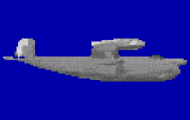

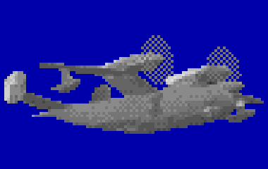

L'anfibio Beriev ad ala di gabbiano è il cacciatore della zona vicina sovietica, dal Barents all'Okhotsk e al Mediterraneo: crociera a 450 km/h, 500 km di raggio tattico con 3 ore in zona e fino a 80 boe. Cercava molto col magnetometro, pilotando a mano a 70-100 m di quota e 300-320 km/h: fra il 1968 e il 1982 fino al 30% delle scoperte venne dal MAD, anche se quasi senza classificazione. Le boe si posavano da 500 m: un campo a scacchiera di 60-70 boe copriva 5000 km² con probabilità 0,5-0,6, mentre il solo MAD su 2500 km² dava appena 0,01-0,02. Preso un contatto, lo inseguiva con barriere davanti alla rotta e sganciava il siluro direttamente sulla boa che reagiva, perché le boe omnidirezionali davano posizioni troppo imprecise. Il Be-12N del 1976 aggiunse la boa direzionale RGB-2 e un data link con navi ed elicotteri; volava sempre in coppia, e nel 1989 i Be-12 di tutte le flotte fecero 29 scoperte.

**In partita.** Arriva in coppia e cerca basso col magnetometro: in profondità la fascia in cui ti scopre si restringe. Le sue boe ascoltano solo a pochi km e non servono più oltre mare 3, quindi col mare mosso è quasi sordo; dopo un contatto posa barriere davanti alla tua rotta, perciò conviene cambiarla di molto. Si posa in mare solo con mare calmo, fino a 3.

| Dato | Valore | Nel gioco | Confidenza | Fonte |
|---|---|---|---|---|
| Lunghezza | 30,2 m | - | media | extracted/navi/be12/RAPPORTO.md |
| Apertura | 29,8 m | - | media | extracted/navi/be12/RAPPORTO.md |
| Velocità massima | 245 kn | - | media | extracted/navi/be12/RAPPORTO.md |
| Radar | Initsiativa-2B | - | alta | asw_aereo.toml: §3.3 §6.6 [ART-Be12] [ART-Be12N] |
| Quota di ricerca | 85 m | - | alta | asw_aereo.toml: §3.3 §6.6 [ART-Be12] [ART-Be12N] |
| Tempo in zona (base) | 5,5 h | - | alta | asw_aereo.toml: §3.3 §6.6 [ART-Be12] [ART-Be12N] |

**Sensori:** Initsiativa-2B.

**Boe:** RGB-NM «Chinara».

**Armi:** AT-1M.

**Marcatori:** OMAB-25-12D/-8N.

**Fonti:** dossier 17 §3.3 [ART-Be12] [ART-Be12N]; dossier 17 §4.2; dossier 17 §5.6; dossier 17 §6.3 e §6.6; dossier 21 §7.1; data/motore/asw_aereo.toml [mezzi.be12].

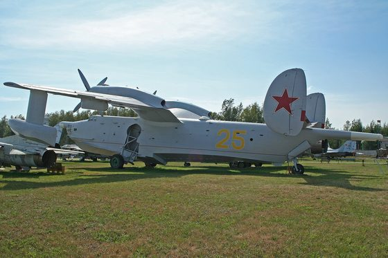

*Foto: [Beriev Be-12 Chayka 25 yellow (10071687574).jpg](https://commons.wikimedia.org/wiki/File:Beriev_Be-12_Chayka_25_yellow_(10071687574).jpg), Alan Wilson, CC BY-SA 2.0.*

### Hkp 4 (Vertol 107)

*Elicotteri · svezia*

L'Hkp 4 è il Boeing Vertol 107-II dell'aviazione e della marina svedesi; la versione navale Hkp 4B vola dal 1973, poi arriva la 4C. Ha due rotori in tandem di 15,24 metri a tre pale e tocca i 137 nodi; opera da basi a terra e da cacciatorpediniere. Per la caccia ai sottomarini cala il sonar a immersione HS-73, a cui le fonti danno 5,6 km di portata, e ha un radar di prua. Porta due siluri leggeri Tp 42 da 400 mm, nella versione Tp 422 per gli elicotteri, che si sgancia senza paracadute, oppure fino a sei bombe di profondità Sjunkbomb 51, giudicate deboli. Le fonti aperte su questo elicottero sono poche e di bassa confidenza.

**In partita.** Nel gioco non posa boe: arriva sul punto, si ferma a 15 metri, cala l'HS-73 fino a 100 metri, ascolta da uno a due minuti e pinga a 10 kHz tre o quattro volte, uno ogni 8 secondi. Se non vi trova salta di circa 5,6 km, o di 3,7 km quando vi insegue, e nel salto sentite i due rotori, una riga di circa 13 Hz. Il Tp 42 nel gioco aggancia a 500 metri in attivo e a 800 in passivo, scende fino a 200 metri e funziona anche con soli 15 metri d'acqua: l'acqua bassa non vi salva. Vola anche di notte e fino a mare 5, e di solito ne arrivano due, uno coi siluri e uno con le bombe.

| Dato | Valore | Nel gioco | Confidenza | Fonte |
|---|---|---|---|---|
| Lunghezza | 13,7 m | - | media | extracted/navi/hkp4/RAPPORTO.md |
| Apertura | 15,2 m | - | media | extracted/navi/hkp4/RAPPORTO.md |
| Velocità massima | 137 kn | - | media | extracted/navi/hkp4/RAPPORTO.md |
| Radar | — | - | bassa | asw_aereo.toml: 35 [AEROSEUM-HKP4] [AVROSYS-HKP4] |
| Quota di ricerca | 50 m | - | bassa | asw_aereo.toml: 35 [AEROSEUM-HKP4] [AVROSYS-HKP4] |
| Tempo in zona (base) | 2,5 h | - | bassa | asw_aereo.toml: 35 [AEROSEUM-HKP4] [AVROSYS-HKP4] |
| Sonar a immersione | HS-73 | - | bassa | asw_aereo.toml: 35 [AEROSEUM-HKP4] [AVROSYS-HKP4] |

**Armi:** Tp 42 (Tp 422).

**Marcatori:** Mk 25 (fumogeno e fiamma).

**Fonti:** dossier 35 §1, §2, §3 e §5 [AEROSEUM-HKP4] [AVROSYS-HKP4]; extracted/navi/hkp4/RAPPORTO.md; data/motore/asw_aereo.toml [mezzi.hkp4] [sonar_immersione.hs73]; acustica.toml (sensori.hs73, emissioni.hs73, transitori.elicottero_hkp4); siluri.toml [siluri.tp42].

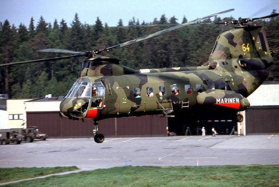

*Foto: [Hkp 4B 01.jpg](https://commons.wikimedia.org/wiki/File%3AHkp_4B_01.jpg), Towpilot, CC BY-SA 3.0.*

### Il-38 May

*Aerei · Unione Sovietica*

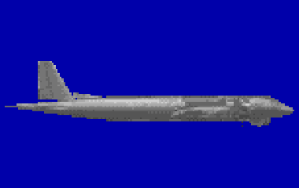

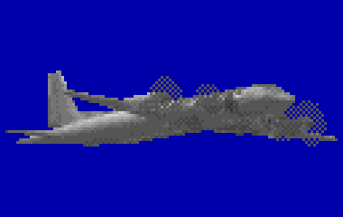

Il pattugliatore antisommergibile a lungo raggio dell'aviazione navale sovietica, col sistema «Berkut-38» e il radar di ricerca «Wet Eye» sotto la fusoliera. Il requisito chiedeva 2200 km di raggio con almeno 3 ore in zona; fra il 1969 e il 1981 volò più di 4000 sortite, di circa 6 ore in media, e scoprì 172 sottomarini stranieri. Il carico tipico è di 144 boe omnidirezionali RGB-1, 10 boe direzionali RGB-2, 10 bombe e 2 siluri; il magnetometro si usa a 100 m di quota di giorno e a 200 m di notte, pilotando a mano. Non ascoltava da lontano come il P-3C: posava una barriera di RGB-1 e, quando una boa superava la soglia a 1-4 km dal battello, il calcolatore ne ricavava rotta e velocità e faceva posare una barriera di precisione di RGB-2. Un centro di valutazione sovietico lo giudicava da 8 a 10 volte meno adatto alla ricerca del P-3C; i reggimenti stavano a Severomorsk al Nord e a Nikolaevka nel Pacifico.

**In partita.** Si annuncia col radar Berkut, acceso a intervalli brevi ma frequenti prima della posa e per mirare; una serie di tonfi a intervalli regolari vuol dire che sta stendendo una barriera. Le sue boe sentono solo a pochi km: lento e silenzioso, lontano dalla barriera, il battello passa spesso inosservato, e andare profondi restringe la fascia in cui il magnetometro lo scopre. Fino a mare 5 boe e MAD lavorano bene; da mare 6 rendono meno.

| Dato | Valore | Nel gioco | Confidenza | Fonte |
|---|---|---|---|---|
| Lunghezza | 39,6 m | - | media | extracted/navi/il38/RAPPORTO.md |
| Apertura | 37,4 m | - | media | extracted/navi/il38/RAPPORTO.md |
| Velocità massima | 351 kn | 330 kn | media | dossier 01 §5.6 [RWIl38] |
| Radar | Wet Eye | - | alta | asw_aereo.toml: §3.4 §6.6 [ART-Il38] [RW-Il38] |
| Quota di ricerca | 1.000 m | - | alta | asw_aereo.toml: §3.4 §6.6 [ART-Il38] [RW-Il38] |
| Tempo in zona (base) | 10,3 h | - | alta | asw_aereo.toml: §6.8 (7 h a 1000 km, 3 h a 2200 km) |

**Sensori:** Wet Eye.

**Boe:** RGB-1, RGB-2.

**Armi:** AT-2M.

**Marcatori:** OMAB-25-12D/-8N.

**Fonti:** dossier 17 §3.4 [ART-Il38] [RW-Il38]; dossier 17 §1 (carico Il-38); dossier 17 §6.3 e §6.6; dossier 17 §8.2-8.3; dossier 11 §1.4 [MPWETEYE]; dossier 21 §7.1; data/motore/asw_aereo.toml [mezzi.il38].

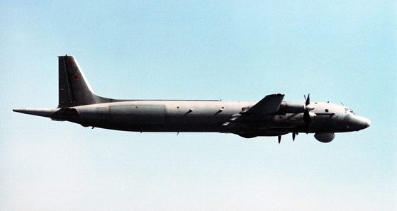

*Foto: [Air-to-air right underside view of the Soviet I1-38 May aircraft. (SUBSTANDARD) - DPLA - d20ef6e5055d46d43429a51deee0cb0a.jpeg](https://commons.wikimedia.org/wiki/File:Air-to-air_right_underside_view_of_the_Soviet_I1-38_May_aircraft._(SUBSTANDARD)_-_DPLA_-_d20ef6e5055d46d43429a51deee0cb0a.jpeg), Department of Defense. American Forces Information Service. Defense Visual Information Center. 1994, pubblico dominio.*

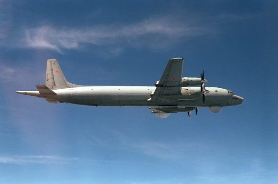

*Foto: [Ilyushin Il-38 from below Apr 1987.JPEG](https://commons.wikimedia.org/wiki/File:Ilyushin_Il-38_from_below_Apr_1987.JPEG), USN, pubblico dominio.*

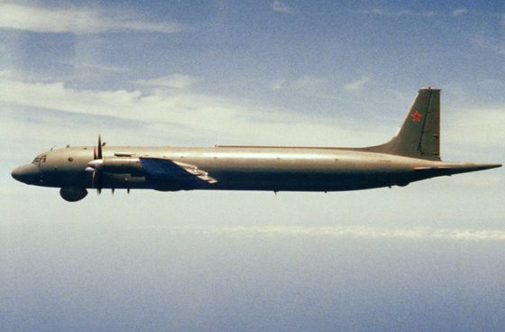

*Foto: [Ilyushin Il-38 side view 1986.JPEG](https://commons.wikimedia.org/wiki/File:Ilyushin_Il-38_side_view_1986.JPEG), Unknown author, pubblico dominio.*

### Ka-25PL Hormone-A

*Elicotteri · Unione Sovietica*

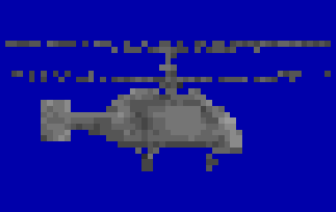

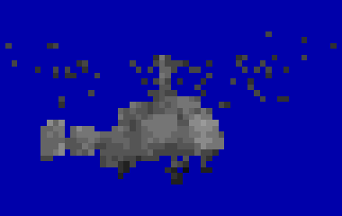

L'elicottero antisommergibile imbarcato che precede il Ka-27, coi rotori coassiali della Kamov e il sistema «Baikal»; nel 1985-1991 resta sui Kresta II, sui Kara, sulle Moskva e Leningrad e in parte sulle Kiev e Minsk, con un raggio di 200 km e circa 2 ore di volo. Il sonar a immersione VGS-2 «Oka» scende con un cavo di 125 m: secondo la CIA trovava un sottomarino a più di 5,5 km in attivo ma solo fino a 2,3 km in ascolto, ed era giudicato inservibile di notte e col maltempo. Il radar Initsiativa-2K, dal nome NATO incerto, vede le navi grandi fino a 220 km e un periscopio a 10-20 km. Porta o 36 boe passive RGB-NM o l'arma (il siluro AT-1M, più tardi l'APR-2, oppure bombe di profondità), oltre a 3 boe radar-faro e 4 marcatori. Per questo si lavorava in coppia: l'elicottero di ricerca segnava il punto con una boa radar-faro e quello d'attacco lo raggiungeva col radar.

**In partita.** Arriva in coppia: uno cerca e marca il punto, l'altro viene a sganciare, quindi il primo che ti trova non è quello che ti colpisce. Il suo ciclo di calata è più lento di quello del Ka-27 e di notte non cala il sonar; il radar è acceso in volo e quasi spento in hover, e scopre un periscopio alzato a 10-20 km. Vola normalmente fino a mare 4, a mare 5 con fatica, da mare 6 o col temporale resta sul ponte.

| Dato | Valore | Nel gioco | Confidenza | Fonte |
|---|---|---|---|---|
| Lunghezza | 9,8 m | - | media | extracted/navi/ka25/RAPPORTO.md |
| Apertura | 15,7 m | - | media | extracted/navi/ka25/RAPPORTO.md |
| Velocità massima | 119 kn | nel gioco del 1989: 105 kn | alta | dossier 01 §5.1 [RWKa25] |
| Radar | Initsiativa-2K «Short Horn» | - | media | asw_aereo.toml: §3.1 [RW-Ka25] [AW-Ka25] [ART-Ka27] |
| Quota di ricerca | 150 m | - | media | asw_aereo.toml: §3.1 [RW-Ka25] [AW-Ka25] [ART-Ka27] |
| Tempo in zona (base) | 1,3 h | - | media | asw_aereo.toml: §3.1 [RW-Ka25] [AW-Ka25] [ART-Ka27] |
| Sonar a immersione | VGS-2 «Oka» | - | media | asw_aereo.toml: §3.1 [RW-Ka25] [AW-Ka25] [ART-Ka27] |

**Sensori:** Initsiativa-2K «Short Horn», VGS-2 «Oka».

**Boe:** RGB-NM «Chinara», RLB «Poplavok-1A» (radar-faro).

**Marcatori:** OMAB-25-12D/-8N.

**Armi:** AT-1M.

**Fonti:** dossier 17 §3.1 [RW-Ka25] [AW-Ka25] [CIA72] [AI79]; dossier 17 §1 (Ka-25) [CIA-REG86]; dossier 17 §4.2 (RLB); dossier 17 §6.5; dossier 17 §8.2; dossier 11 §1.4 [RWKA25]; dossier 21 §7.1; data/motore/asw_aereo.toml [mezzi.ka25].

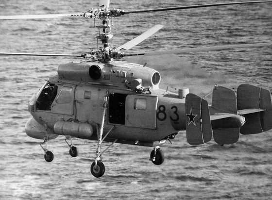

*Foto: [Ka-2583.jpg](https://commons.wikimedia.org/wiki/File:Ka-2583.jpg), Department of Defense. American Forces Information Service. Defense Visual Information Center. 1994, pubblico dominio.*

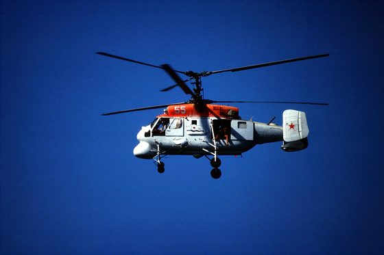

*Foto: [Soviet Ka-25 Hormone-C helicopter.JPEG](https://commons.wikimedia.org/wiki/File:Soviet_Ka-25_Hormone-C_helicopter.JPEG), SK3 Bob Marsh, pubblico dominio.*

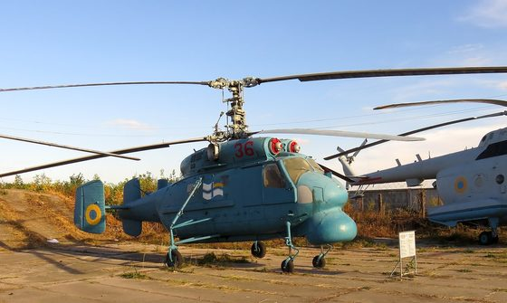

*Foto: [Ka-25 Kiev2.jpg](https://commons.wikimedia.org/wiki/File:Ka-25_Kiev2.jpg), Аимаина хикари, CC0.*

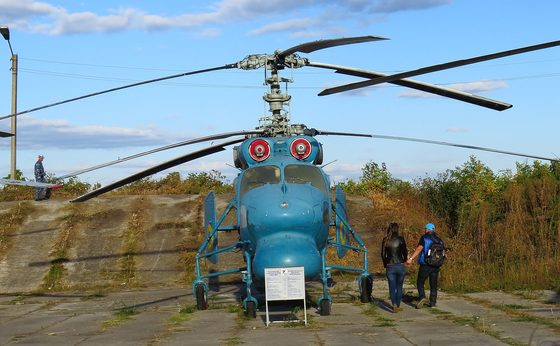

*Foto: [Ka-25 Kiev1.jpg](https://commons.wikimedia.org/wiki/File:Ka-25_Kiev1.jpg), Аимаина хикари, CC0.*

### Ka-27PL Helix-A

*Elicotteri · Unione Sovietica*

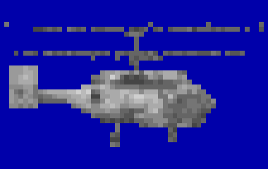

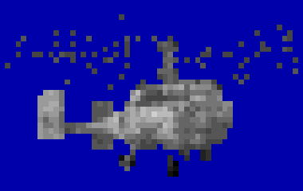

L'elicottero antisommergibile imbarcato della marina sovietica dal 1981, coi due rotori coassiali tipici della Kamov: niente rotore di coda, quindi ingombro minimo sul ponte. Il sistema «Osminog» comprende il sonar a immersione VGS-3, che scende fino a 150 metri, 36 boe, il radar Initsiativa e un magnetometro rimorchiato. In una prova del 1977 il sonar trovò un sottomarino diesel a 8 km in ascolto passivo; il suo ping attivo però si usava di rado, perché tradiva l'elicottero.

| Dato | Valore | Nel gioco | Confidenza | Fonte |
|---|---|---|---|---|
| Lunghezza | 11,3 m | - | media | extracted/navi/ka27/RAPPORTO.md |
| Apertura | 15,9 m | - | media | extracted/navi/ka27/RAPPORTO.md |
| Velocità massima | 157 kn | 120 kn | media | dossier 01 §5.2 [RWKa27] |
| Radar | Initsiativa-2KM | - | media | asw_aereo.toml: §3.2 §6.5 [ART-Ka27] [RW-Ka27] |
| Quota di ricerca | 100 m | - | media | asw_aereo.toml: §3.2 §6.5 [ART-Ka27] [RW-Ka27] |
| Tempo in zona (base) | 2 h | - | media | asw_aereo.toml: §6.8 (1,5 h a 100 km, 1 h a 200 km) |
| Sonar a immersione | VGS-3 «Ros'-V» | - | media | asw_aereo.toml: §3.2 §6.5 [ART-Ka27] [RW-Ka27] |

**Sensori:** Initsiativa-2KM, VGS-3 «Ros'-V».

**Boe:** RGB-NM-1 «Zheton».

**Marcatori:** OMAB-25-12D/-8N.

**Armi:** APR-2 Yastreb-M.

**Fonti:** dossier 17 §3.2 [ART-Ka27] [RW-Ka27].

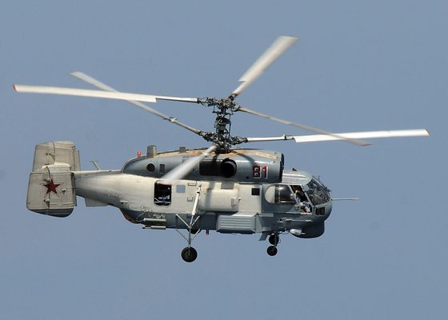

*Foto: [A Russian Helix KA-27.jpg](https://commons.wikimedia.org/wiki/File:A_Russian_Helix_KA-27.jpg), Jason R. Zalasky, U.S. Navy, pubblico dominio.*

### Lynx HAS.3

*Elicotteri · Regno Unito*

Il Westland Lynx HAS.2 e HAS.3 è l'elicottero delle fregate della Royal Navy degli anni '80: le Type 22 ne imbarcano due. Riprende il ruolo del Wasp col concetto MATCH: la nave scopre il sottomarino col suo sonar e guida l'elicottero, che porta l'arma sul punto. I Lynx britannici non hanno né sonar a immersione né boe; hanno il radar Seaspray nel muso, il magnetometro per precisare il contatto prima dell'attacco e, dalla HAS.3, l'ESM «Orange Crop». Contro i sottomarini portano due siluri, Mk 46 o Stingray, o due bombe di profondità; contro le navi quattro missili Sea Skua. Nel 1989 la Royal Navy ne ha poco meno di ottanta, in buona parte HAS.2 convertite in HAS.3 coi motori Gem 42.

**In partita.** Non vi cerca da solo: aspetta il contatto della sua fregata, ci vola sopra e vi cerca col magnetometro, passando basso; poi lancia lo Stingray. Il suo Seaspray all'ESM è un radar d'elicottero in banda I, acceso a intervalli come quello dell'SH-60B: se lo sentite, il Lynx è in volo e la Type 22 vi ha già in mano. Sotto lo strato e lontano dalla nave il MAD non vi trova: il pericolo è restare vicini e poco profondi. Le cifre di velocità e autonomia della HAS.3 non sono pubblicate: nel gioco crociera di 125 nodi, stima.

| Dato | Valore | Nel gioco | Confidenza | Fonte |
|---|---|---|---|---|
| Lunghezza | 13,2 m | - | media | extracted/navi/lynx/RAPPORTO.md |
| Apertura | 12,8 m | - | media | extracted/navi/lynx/RAPPORTO.md |
| Velocità massima | 125 kn | - | media | extracted/navi/lynx/RAPPORTO.md |
| Radar | Seaspray Mk 1 | - | media | asw_aereo.toml: 38 [WP-LYNX] [NAVYLOOKOUT] [REVELL-HAS3] |
| Quota di ricerca | 152,4 m | - | media | asw_aereo.toml: 38 [WP-LYNX] [NAVYLOOKOUT] [REVELL-HAS3] |
| Tempo in zona (base) | 2 h | - | media | asw_aereo.toml: 38 [WP-LYNX] [NAVYLOOKOUT] [REVELL-HAS3] |

**Sensori:** Seaspray Mk 1.

**Armi:** Sting Ray Mod 0, Mk 46 Mod 5.

**Marcatori:** Mk 25 (fumogeno e fiamma).

**Fonti:** dossier 38 §1, §2 e §4 [Wikipedia Westland Lynx] [Navy Lookout] [scheda Revell HAS.3]; extracted/navi/lynx/RAPPORTO.md; classi.toml [lynx]; emettitori.toml (radar.seaspray, intermittente.lynx).

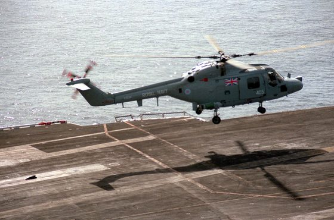

*Foto: [SeaLynxHAS3 CV-59 1988.jpeg](https://commons.wikimedia.org/wiki/File%3ASeaLynxHAS3_CV-59_1988.jpeg), PH1 Caffaro, USN, pubblico dominio.*

### P-3C Orion

*Aerei · Stati Uniti*

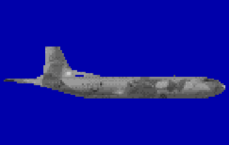

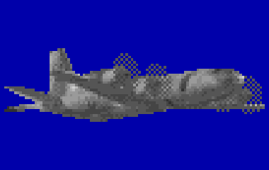

Il pattugliatore marittimo della US Navy e degli alleati, nato dall'aereo di linea Electra. Nel 1989 vola nelle versioni Update II e III, col radar APS-115, il magnetometro ASQ-81 nella coda e fino a 87 boe sonore. Una missione dura circa 9 ore, fino a 13 spegnendo un motore; lontano 500 miglia resta in zona circa 5 ore. Nel varco GIUK, insieme ai sottomarini, teneva i battelli sovietici sotto controllo con turni continui di 4 ore in zona.

| Dato | Valore | Nel gioco | Confidenza | Fonte |
|---|---|---|---|---|
| Lunghezza | 35,6 m | - | media | extracted/navi/p3c/RAPPORTO.md |
| Apertura | 30,4 m | - | media | extracted/navi/p3c/RAPPORTO.md |
| Velocità massima | 411 kn | nel gioco del 1989: 330 kn | alta | dossier 01 §5.5 [FASP3] |
| Radar | AN/APS-115 | - | media | asw_aereo.toml: §2.4 §6.2 [FASP3] [HARP3] [HOLLER] |
| Quota di ricerca | 457,2 m | - | media | asw_aereo.toml: §2.4 §6.2 [FASP3] [HARP3] [HOLLER] |
| Tempo in zona (base) | 8,1 h | - | media | asw_aereo.toml: §6.8 [CALC] su [FASP3] |

**Sensori:** AN/APS-115.

**Boe:** AN/SSQ-53B (DIFAR), AN/SSQ-41B (LOFAR), AN/SSQ-77A (VLAD), AN/SSQ-62B (DICASS), AN/SSQ-36 (batitermografo), AN/SSQ-57A (tarata).

**Armi:** Mk 46 Mod 5.

**Marcatori:** Mk 25 (fumogeno e fiamma), Mk 58 (due candele), Mk 84 SUS (segnalatore acustico).

**Fonti:** dossier 17 §2.4 [FASP3] [HARP3] [AGC13H] [HOLLER]; dossier 11 §1.4 [WPAPS].

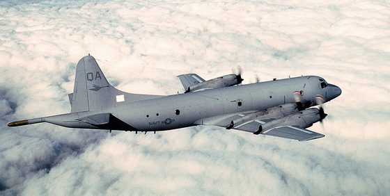

*Foto: [Orion.usnavy.750pix.jpg](https://commons.wikimedia.org/wiki/File:Orion.usnavy.750pix.jpg), SGT. GARY COPPAGE, pubblico dominio.*

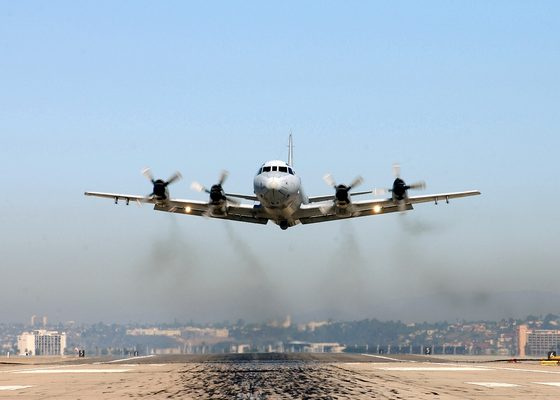

*Foto: [US Navy 030130-N-0226M-001 A P-3C Orion patrol aircraft takes off from Naval Air Station North Island.jpg](https://commons.wikimedia.org/wiki/File:US_Navy_030130-N-0226M-001_A_P-3C_Orion_patrol_aircraft_takes_off_from_Naval_Air_Station_North_Island.jpg), U.S. Navy photo by Senior Chief Photographer’s Mate Mahlon K. Miller, pubblico dominio.*

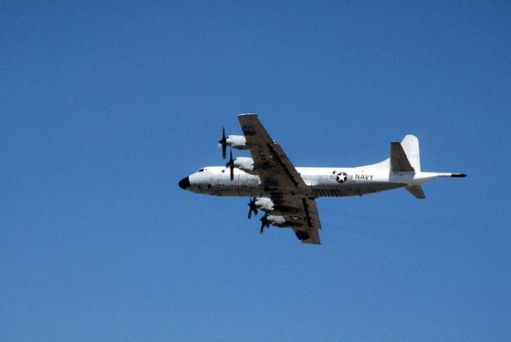

*Foto: [A left side view of a P-3 Orion aircraft in-flight during exercise Gallant Eagle '88 - DPLA - 734a0e2a703aba9df74a1dc291550d8a.jpeg](https://commons.wikimedia.org/wiki/File:A_left_side_view_of_a_P-3_Orion_aircraft_in-flight_during_exercise_Gallant_Eagle_'88_-_DPLA_-_734a0e2a703aba9df74a1dc291550d8a.jpeg), Department of Defense. American Forces Information Service. Defense Visual Information Center. 1994, pubblico dominio.*

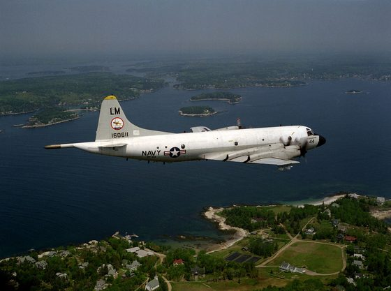

*Foto: [P-3C VP-44 in flight over New England 1980s.JPEG](https://commons.wikimedia.org/wiki/File:P-3C_VP-44_in_flight_over_New_England_1980s.JPEG), USN, Public domain.*

### S-3A Viking

*Aerei · Stati Uniti*

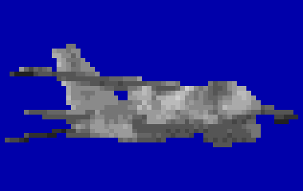

Il Viking è il bireattore antisommergibile delle portaerei americane: ognuna ne imbarca uno squadrone di 8-10, incaricato delle zone media ed esterna attorno al gruppo, mentre gli elicotteri tengono quella interna. L'S-3A porta il radar APS-116, un FLIR, l'ESM ALR-47, il magnetometro ASQ-81 su un'asta retrattile, 60 scivoli per le boe e 4 siluri Mk 46, oltre a mine e alla bomba nucleare B57. Transita in alta quota a circa 345 nodi e resta in zona circa 5 ore senza rifornimento, con quattro uomini d'equipaggio. Nella pratica una sortita durava un ciclo del ponte, circa 2 ore: il radar faceva uno o due giri e poi taceva, e un campo di 12 DIFAR veniva posato alternando le quote di 90 e 200 piedi, sopra e sotto lo strato. Nel 1989 è il Viking delle portaerei del Pacifico; quelle dell'Atlantico passano all'S-3B.

**In partita.** Arriva veloce e da lontano su un contatto già segnalato: i segni sono i tonfi di una serie di boe e, all'ESM, un radar che fa un paio di giri e tace; un ronzio quasi continuo vuol dire il modo periscopio, e allora il periscopio va abbassato. Il suo campo ascolta sopra e sotto lo strato, quindi cambiare quota non basta: conviene allontanarsi piano. Non ha eliche e il sonar quasi non lo sente; dalla portaerei vola male con mare 6 e non vola con mare 7 o col temporale.

| Dato | Valore | Nel gioco | Confidenza | Fonte |
|---|---|---|---|---|
| Lunghezza | 16,3 m | - | media | extracted/navi/s3a/RAPPORTO.md |
| Apertura | 20,9 m | - | media | extracted/navi/s3a/RAPPORTO.md |
| Velocità massima | 350 kn | - | media | extracted/navi/s3a/RAPPORTO.md |
| Radar | AN/APS-116 | - | media | asw_aereo.toml: §2.5 [WPS3] [TWZS3] [USNIS3] |
| Quota di ricerca | 457,2 m | - | media | asw_aereo.toml: §2.5 [WPS3] [TWZS3] [USNIS3] |
| Tempo in zona (base) | 5 h | - | media | asw_aereo.toml: §2.5 [WPS3] [TWZS3] [USNIS3] |

**Sensori:** AN/APS-116.

**Boe:** AN/SSQ-53B (DIFAR), AN/SSQ-41B (LOFAR), AN/SSQ-62B (DICASS), AN/SSQ-36 (batitermografo), AN/SSQ-57A (tarata).

**Armi:** Mk 46 Mod 5.

**Marcatori:** Mk 25 (fumogeno e fiamma), Mk 58 (due candele), Mk 84 SUS (segnalatore acustico).

**Fonti:** dossier 17 §2.5 [WPS3] [TWZS3] [USNIS3]; dossier 17 §1 (S-3 nel 1989) [FASS3]; dossier 17 §5.3; dossier 17 §8.2-8.3; dossier 21 §7.1; data/motore/asw_aereo.toml [mezzi.s3a].

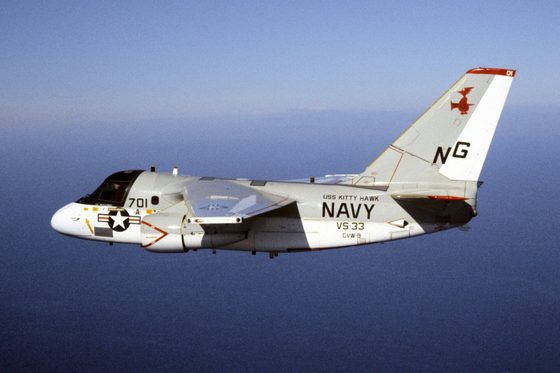

*Foto: [S-3A Viking of VS-33 in flight 1985.JPEG](https://commons.wikimedia.org/wiki/File:S-3A_Viking_of_VS-33_in_flight_1985.JPEG), USN, pubblico dominio.*

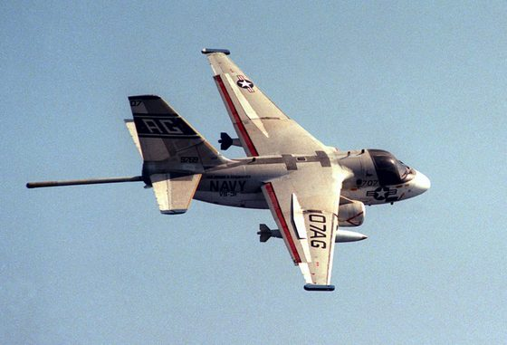

*Foto: [Lockheed S-3A Viking of VS-31 in flight over the Mediterranean Sea on 21 May 1983 (6417630).jpg](https://commons.wikimedia.org/wiki/File:Lockheed_S-3A_Viking_of_VS-31_in_flight_over_the_Mediterranean_Sea_on_21_May_1983_(6417630).jpg), U.S. Navy, pubblico dominio.*

### S-3B Viking

*Aerei · Stati Uniti*

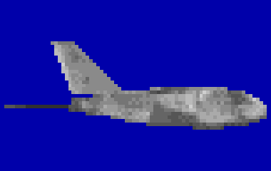

La versione aggiornata del Viking, operativa dal luglio 1988 con lo squadrone VS-30: le S-3A della costa est vengono convertite fra il 1987 e il 1991, quelle della costa ovest solo nel 1992-94. Cambiano i sensori: radar ISAR APS-137, ESM ALR-76, ricevitore di boe ARR-78 e processore AN/UYS-1, e in più il missile Harpoon. L'APS-137 ha un modo periscopio in cui l'antenna fa 300 giri al minuto con 2000 impulsi al secondo, un fascio di 2,4° e una risoluzione di un piede. Restano quelli dell'S-3A la cellula, i 60 scivoli per le boe, i 4 Mk 46 e le circa 5 ore in zona: nel 1989 è il Viking delle portaerei atlantiche.

**In partita.** Il suo modo periscopio si sente all'ESM come un ronzio quasi continuo, modulato a 5 volte al secondo: è la firma del cacciatore di periscopi, e chi resta alzato viene visto. Nel gioco il suo equipaggio è più esperto di quello dell'S-3A, con meno errori nella posa delle boe; per il resto e per i limiti del mare vale quanto detto per l'S-3A.

| Dato | Valore | Nel gioco | Confidenza | Fonte |
|---|---|---|---|---|
| Lunghezza | 16,3 m | - | media | extracted/navi/s3b/RAPPORTO.md |
| Apertura | 20,9 m | - | media | extracted/navi/s3b/RAPPORTO.md |
| Velocità massima | 350 kn | - | media | extracted/navi/s3b/RAPPORTO.md |
| Radar | AN/APS-137 ISAR | - | media | asw_aereo.toml: §2.5 [FASS3] [TWZS3] |
| Quota di ricerca | 457,2 m | - | media | asw_aereo.toml: §2.5 [FASS3] [TWZS3] |
| Tempo in zona (base) | 5 h | - | media | asw_aereo.toml: §2.5 [FASS3] [TWZS3] |

**Sensori:** AN/APS-137 ISAR.

**Boe:** AN/SSQ-53B (DIFAR), AN/SSQ-41B (LOFAR), AN/SSQ-77A (VLAD), AN/SSQ-62B (DICASS), AN/SSQ-36 (batitermografo), AN/SSQ-57A (tarata).

**Armi:** Mk 46 Mod 5.

**Marcatori:** Mk 25 (fumogeno e fiamma), Mk 58 (due candele), Mk 84 SUS (segnalatore acustico).

**Fonti:** dossier 17 §2.5 [FASS3] [TWZS3]; dossier 17 §1 (S-3B dal 1988) [FASS3] [WPS3]; dossier 17 §8.2; dossier 11 §1.4 [APL97]; data/motore/asw_aereo.toml [mezzi.s3b].

*Foto: [S-3A Viking of VS-33 in flight 1985.JPEG](https://commons.wikimedia.org/wiki/File:S-3A_Viking_of_VS-33_in_flight_1985.JPEG), USN, pubblico dominio.*

*Foto: [Lockheed S-3A Viking of VS-31 in flight over the Mediterranean Sea on 21 May 1983 (6417630).jpg](https://commons.wikimedia.org/wiki/File:Lockheed_S-3A_Viking_of_VS-31_in_flight_over_the_Mediterranean_Sea_on_21_May_1983_(6417630).jpg), U.S. Navy, pubblico dominio.*

### SH-2F Seasprite (LAMPS I)

*Elicotteri · Stati Uniti*

Il Kaman SH-2F Seasprite è l'elicottero del LAMPS Mk I, un «sensore remoto» delle scorte: vola dalle fregate Knox e, prima dell'arrivo del LAMPS III, anche da Kidd, Spruance e dalle prime Perry. Non ha sonar a immersione: porta circa 15 boe, passive SSQ-41 e attive SSQ-47 di sola distanza, il radar di superficie LN-66HP e il magnetometro rimorchiato ASQ-81, mentre i due piloni esterni reggono due Mk 46, o un Mk 46 e un serbatoio. L'elicottero non elabora il suono delle boe: lo passa alla nave col data link AN/ASK-22, e la nave gli rimanda i risultati. Le fonti gli danno circa 120 nodi di crociera, 140 di massima e 3,5-4,5 ore d'autonomia. È un mezzo «reattivo»: aspetta che la nave abbia già un contatto, stende un campo di boe sul rilevamento e precisa la posizione col MAD prima di lanciare il Mk 46.

**In partita.** Nel gioco non ha un radar che il vostro ESM possa sentire, quindi arriva in silenzio, e decolla dalla Knox solo fino a mare 4. Porta 9 boe SSQ-41B, 5 SSQ-47B e un batitermografo: con le sole omnidirezionali sa soltanto che siete vicini, e l'errore scende sotto le 2 miglia quando due boe vi sentono insieme. Allora stende un quadrato di SSQ-47B, coi vertici a 970 metri dal centro, che pingano a 16 kHz ogni 10 secondi: con tre distanze vi localizza e passa basso col MAD, a circa 45 metri, prima del Mk 46. Quando sentite quei ping uscite dal quadrato, perché la boa vi misura solo entro 1,5 km; e ricordate che resta in zona circa 2 ore e mezza, meno un'ora ogni 50 miglia di distanza dalla nave.

| Dato | Valore | Nel gioco | Confidenza | Fonte |
|---|---|---|---|---|
| Lunghezza | 16 m | - | media | extracted/navi/sh2f/RAPPORTO.md |
| Apertura | 13,4 m | - | media | extracted/navi/sh2f/RAPPORTO.md |
| Velocità massima | 120 kn | - | media | extracted/navi/sh2f/RAPPORTO.md |
| Radar | — | - | media | asw_aereo.toml: §2.1b [FASSH2] [GSSH2] [ACSH2F] |
| Quota di ricerca | 304,8 m | - | media | asw_aereo.toml: §2.1b [FASSH2] [GSSH2] [ACSH2F] |
| Tempo in zona (base) | 2,5 h | - | media | asw_aereo.toml: §2.1b (autonomia 3,5-4,5 h nelle fonti, STIMA) |

**Boe:** AN/SSQ-41B (LOFAR), AN/SSQ-47B (attiva, distanza), AN/SSQ-36 (batitermografo).

**Armi:** Mk 46 Mod 5.

**Marcatori:** Mk 25 (fumogeno e fiamma).

**Fonti:** dossier 37 §1 e §2 [HOLLER]; dossier 17 §2.1b [FASSH2] [GSSH2] [ACSH2F]; extracted/navi/sh2f/RAPPORTO.md; data/motore/asw_aereo.toml [mezzi.sh2f]; acustica.toml (emissioni.ssq47b); engine/missioni/src/missione_antisom_navi.cpp (elicottero_di).

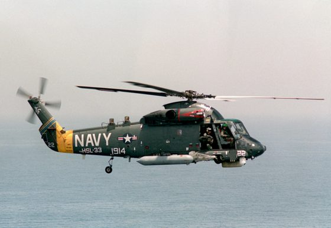

*Foto: [Kaman SH-2F Seasprite of HSL-33 in flight on 18 April 1988 (6430152).jpg](https://commons.wikimedia.org/wiki/File%3AKaman_SH-2F_Seasprite_of_HSL-33_in_flight_on_18_April_1988_%286430152%29.jpg), PH2 Harnar, U.S. Navy, pubblico dominio.*

### SH-3H Sea King

*Elicotteri · Stati Uniti*

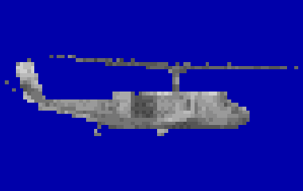

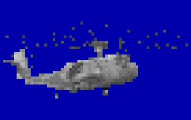

Il Sea King della Sikorsky è nel 1989 l'elicottero antisommergibile delle portaerei americane: uno squadrone di 6 per nave, con 2 macchine sempre nella zona interna, a 10-15 miglia davanti al gruppo e sui fianchi. Il sensore principale è il sonar a immersione AQS-13B, attivo su tre frequenze attorno ai 10 kHz con almeno 211 dB in alta potenza, ma anche passivo e telefono subacqueo; ha inoltre il magnetometro, 12 scivoli per le boe e 2 siluri Mk 46 o la bomba nucleare B57. Il profilo ufficiale prevede un hover a 40 piedi con 15 minuti d'attivo, poi un salto di 10 miglia e una nuova calata, sei volte, in poco meno di 3 ore e mezza di volo. Rende al meglio entro 3000 iarde dal sottomarino, e in inseguimento il ciclo scende a 4-6 minuti. A 40 °C non riesce a tenere l'hover e non cala il sonar, e anche con temperature normali il peso lo limita a 3 calate invece di 6.

**In partita.** Il suo ciclo si riconosce: il tonfo del trasduttore, 1-3 minuti di silenzio, un ping ogni 6-10 secondi, poi di nuovo silenzio e un altro tonfo 5-10 miglia più in là. Il ping si sente a circa 27 km mentre l'eco ti scopre solo a 3-4 km: c'è il tempo di prendere il rilevamento e di allontanarsi durante il salto. Con mare 4-5 lavora male, con onde oltre 10 piedi o da mare 6 non cala il sonar.

| Dato | Valore | Nel gioco | Confidenza | Fonte |
|---|---|---|---|---|
| Lunghezza | 16,7 m | - | media | extracted/navi/sh3h/RAPPORTO.md |
| Apertura | 18,9 m | - | media | extracted/navi/sh3h/RAPPORTO.md |
| Velocità massima | 122 kn | 114 kn | alta | dossier 17 §1 e §2.2 [RUDZIS] |
| Radar | — | - | alta | asw_aereo.toml: §2.2 §6.4 [RUDZIS] [MILAQS13B] |
| Quota di ricerca | 45,7 m | - | alta | asw_aereo.toml: §2.2 §6.4 [RUDZIS] [MILAQS13B] |
| Tempo in zona (base) | 3 h | - | alta | asw_aereo.toml: §6.8 [CALC] da [RUDZIS] |
| Sonar a immersione | AN/AQS-13B | - | alta | asw_aereo.toml: §2.2 §6.4 [RUDZIS] [MILAQS13B] |

**Sensori:** AN/AQS-13B.

**Boe:** AN/SSQ-53B (DIFAR), AN/SSQ-62B (DICASS), AN/SSQ-41B (LOFAR).

**Armi:** Mk 46 Mod 5.

**Marcatori:** Mk 25 (fumogeno e fiamma).

**Fonti:** dossier 17 §2.2 [RUDZIS] [MILAQS13B]; dossier 17 §5.3; dossier 17 §6.4 e §6.8; dossier 17 §8.3; dossier 21 §7.1; data/motore/asw_aereo.toml [mezzi.sh3h].

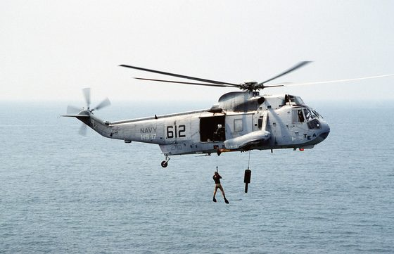

*Foto: [Sikorsky SH-3H Sea King of HS-17 in flight in 1990.jpeg](https://commons.wikimedia.org/wiki/File:Sikorsky_SH-3H_Sea_King_of_HS-17_in_flight_in_1990.jpeg), Don S. Montgomery, USN (Ret.), pubblico dominio.*

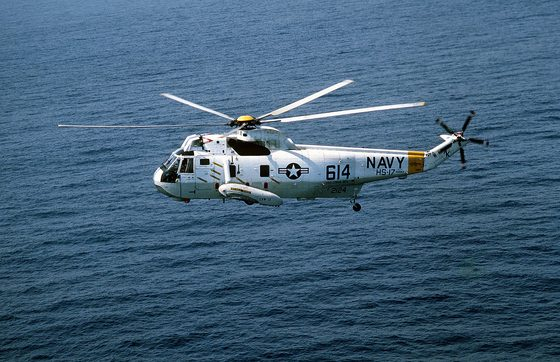

*Foto: [SH-3H Sea King of HS-17 in flight over the Med in April 1986.jpeg](https://commons.wikimedia.org/wiki/File:SH-3H_Sea_King_of_HS-17_in_flight_over_the_Med_in_April_1986.jpeg), PH2 Knepp, USN, pubblico dominio.*

### SH-60B Seahawk (LAMPS III)

*Elicotteri · Stati Uniti*

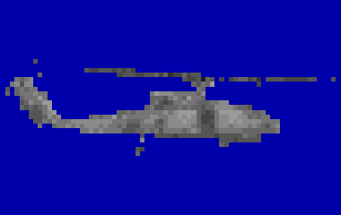

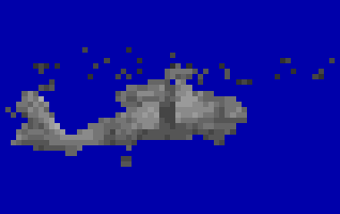

L'elicottero LAMPS III delle fregate Perry, dei cacciatorpediniere Spruance e Kidd e degli incrociatori Ticonderoga, uno o due per nave, fa da «sensore remoto»: la nave scopre il sottomarino lontano, nella seconda o terza zona di convergenza, e l'elicottero vola sul rilevamento per localizzarlo, classificarlo e, se ordinato, attaccarlo. Il data link Hawk Link manda alla nave in tempo reale il suono delle boe e i dati di radar ed ESM, e l'analisi acustica si fa a bordo della nave. Ha 25 tubi per le boe, il radar APS-124, l'ESM ALQ-142, il magnetometro ASQ-81 trainato a circa 180 piedi e 2 siluri Mk 46 Mod 5; nel 1989 non ha FLIR. Resta in zona circa 3 ore a 50 miglia dalla nave e un'ora a 150; davanti a un gruppo portaerei deve bonificare una fascia di circa 30 miglia. Col mare alto le onde zittiscono le boe e interrompono il collegamento radio con la nave, e spesso l'elicottero viene distolto per la sorveglianza di superficie.

**In partita.** Se una fregata ti ha sentito da lontano, l'elicottero arriva in fretta sul rilevamento, posa boe DIFAR e DICASS attorno al punto, poi passa basso col magnetometro e lancia un Mk 46. Non ha sonar a immersione: all'ESM si riconosce dal radar in banda X fino a 120 giri al minuto. Vola normalmente fino a mare 4, a mare 5 è al limite dell'appontaggio, da mare 7 o col temporale resta sul ponte.

| Dato | Valore | Nel gioco | Confidenza | Fonte |
|---|---|---|---|---|
| Lunghezza | 19,8 m | - | media | extracted/navi/sh60b/RAPPORTO.md |
| Apertura | 16,4 m | - | media | extracted/navi/sh60b/RAPPORTO.md |
| Velocità massima | 146 kn | nel gioco del 1989: 125 kn | media | dossier 01 §5.3 [WPSH60] |
| Radar | AN/APS-124 | - | media | asw_aereo.toml: §2.1 [GAOALFS] [SIKS70B] [FASSH60] [NHHCSH60B] |
| Quota di ricerca | 304,8 m | - | media | asw_aereo.toml: §2.1 [GAOALFS] [SIKS70B] [FASSH60] [NHHCSH60B] |
| Tempo in zona (base) | 4 h | - | media | asw_aereo.toml: §6.8 [NHHCSH60B] [CALC] |

**Sensori:** AN/APS-124.

**Boe:** AN/SSQ-53B (DIFAR), AN/SSQ-62B (DICASS), AN/SSQ-41B (LOFAR), AN/SSQ-36 (batitermografo).

**Armi:** Mk 46 Mod 5.

**Marcatori:** Mk 25 (fumogeno e fiamma).

**Fonti:** dossier 17 §2.1 [NAVSRC] [FASSH60] [GAOALFS] [SBIRMAD] [NHHCSH60B] [WPSH60]; dossier 17 §5.3 [SIKS70B]; dossier 17 §8.2; dossier 11 §1.4 [ARMSAPS124]; dossier 21 §7.1; data/motore/asw_aereo.toml [mezzi.sh60b].

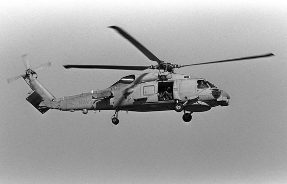

*Foto: [A right side view of the Navy's first operational Mark III LAMPS (Light Airborne Multi-Purpose System) SH-60B Seahawk helicopter hovering over the flight d](https://commons.wikimedia.org/wiki/File:A_right_side_view_of_the_Navy%27s_first_operational_Mark_III_LAMPS_(Light_Airborne_Multi-Purpose_System)_SH-60B_Seahawk_helicopter_hovering_over_the_flight_deck_of_the_guided_missile_-_DPLA_-_addbbdbf36762014f926292090212754.jpeg), Department of Defense. American Forces Information Service. Defense Visual Information Center. 1994, pubblico dominio.*

*Foto: [An SH-60B helicopter from Helicopter Light Anti-Submarine Squadron 42 conducts an in-flight helicopter refueling operation with the guided missile frigate](https://commons.wikimedia.org/wiki/File:An_SH-60B_helicopter_from_Helicopter_Light_Anti-Submarine_Squadron_42_conducts_an_in-flight_helicopter_refueling_operation_with_the_guided_missile_frigate_USS_HALYBURTON_(FFG_40)_du_-_DPLA_-_471f09ca4d65c63d2b69f450396aab0a.jpeg), Department of Defense. American Forces Information Service. Defense Visual Information Center. 1994, pubblico dominio.*

*Foto: [An SH-60B Sea Hawk helicopter of Light Helicopter Squadron 38 (HSL-38) detachment assigned to the destroyer USS CONOLLY (DD-979) is shown in-flight just af](https://commons.wikimedia.org/wiki/File:An_SH-60B_Sea_Hawk_helicopter_of_Light_Helicopter_Squadron_38_(HSL-38)_detachment_assigned_to_the_destroyer_USS_CONOLLY_(DD-979)_is_shown_in-flight_just_after_takeoff_from_the_ship_-_DPLA_-_1de2a5aef8c1a5b18229700972dcb87d.jpeg), Department of Defense. American Forces Information Service. Defense Visual Information Center. 1994, pubblico dominio.*

*Foto: [PH1(AC) Chuck Dutkiewicz ....A Light Helicopter Anti-submarine Squadron 43 (HSL-43) SH-60B Sea Hawk helicopter releases a sonobuoy from its dispenser while](https://commons.wikimedia.org/wiki/File:PH1(AC)_Chuck_Dutkiewicz_....A_Light_Helicopter_Anti-submarine_Squadron_43_(HSL-43)_SH-60B_Sea_Hawk_helicopter_releases_a_sonobuoy_from_its_dispenser_while_taking_part_in_an_anti-su_-_DPLA_-_5ad37d8d881bb985fd931de583a047eb.jpeg), Department of Defense. American Forces Information Service. Defense Visual Information Center. 1994, pubblico dominio.*

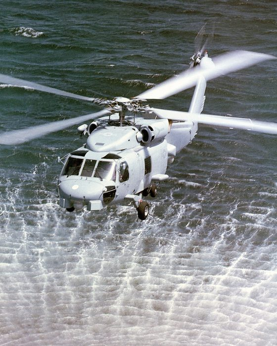

*Foto: [An air-to-air left front view of an SH-60B Seahawk light airborne multi-purpose system (LAMPS III) helicopter from Light Helicopter Anti-submarine Squadron](https://commons.wikimedia.org/wiki/File:An_air-to-air_left_front_view_of_an_SH-60B_Seahawk_light_airborne_multi-purpose_system_(LAMPS_III)_helicopter_from_Light_Helicopter_Anti-submarine_Squadron_(HSL-41)_-_DPLA_-_d99916165908b6c517b55ced32fb7fc8.jpeg), Department of Defense. American Forces Information Service. Defense Visual Information Center. 1994, pubblico dominio.*

### SH-60F Ocean Hawk

*Elicotteri · Stati Uniti*

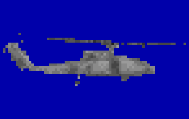

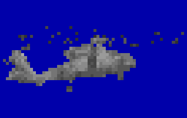

La versione dell'SH-60 per la zona interna della portaerei: monta il sonar a immersione AQS-13F, col cavo da 1575 piedi, l'impulso più lungo, il verricello più rapido e una potenza maggiore dell'AQS-13B del Sea King. Cala il sonar in hover a circa 60 piedi, ha 6 tubi per le boe a caduta e 4 uomini d'equipaggio; non ha radar né magnetometro, e lancia siluri Mk 46. Entrò in linea il 22 giugno 1989, ma solo presso il reparto addestrativo HS-10: come elicottero operativo, nel 1989 è un anacronismo.

**In partita.** Compare solo nelle missioni dal 1990 in poi; prima la portaerei usa l'SH-3H. Caccia come il Sea King, ma cala e recupera il sonar più in fretta e porta il trasduttore fino a circa 440 m (STIMA): nascondersi sotto lo strato serve meno. Con mare 4-5 lavora male, con onde oltre 10 piedi o da mare 6 non cala il sonar.

| Dato | Valore | Nel gioco | Confidenza | Fonte |
|---|---|---|---|---|
| Lunghezza | 19,8 m | - | media | extracted/navi/sh60f/RAPPORTO.md |
| Apertura | 16,4 m | - | media | extracted/navi/sh60f/RAPPORTO.md |
| Velocità massima | 125 kn | - | media | extracted/navi/sh60f/RAPPORTO.md |
| Radar | — | - | media | asw_aereo.toml: §2.3 [WPAQS13] [SIKS70B] [WPSH60] |
| Quota di ricerca | 45,7 m | - | media | asw_aereo.toml: §2.3 [WPAQS13] [SIKS70B] [WPSH60] |
| Tempo in zona (base) | 3,5 h | - | media | asw_aereo.toml: §2.3 [WPAQS13] [SIKS70B] [WPSH60] |
| Sonar a immersione | AN/AQS-13F | - | media | asw_aereo.toml: §2.3 [WPAQS13] [SIKS70B] [WPSH60] |

**Sensori:** AN/AQS-13F.

**Boe:** AN/SSQ-53B (DIFAR), AN/SSQ-62B (DICASS).

**Armi:** Mk 46 Mod 5.

**Marcatori:** Mk 25 (fumogeno e fiamma).

**Fonti:** dossier 17 §2.3 [WPAQS13] [SIKS70B]; dossier 17 §1 (SH-60F) [WPSH60]; dossier 21 §7.1; data/motore/asw_aereo.toml [mezzi.sh60f].

*Foto: [A right side view of the Navy's first operational Mark III LAMPS (Light Airborne Multi-Purpose System) SH-60B Seahawk helicopter hovering over the flight d](https://commons.wikimedia.org/wiki/File:A_right_side_view_of_the_Navy%27s_first_operational_Mark_III_LAMPS_(Light_Airborne_Multi-Purpose_System)_SH-60B_Seahawk_helicopter_hovering_over_the_flight_deck_of_the_guided_missile_-_DPLA_-_addbbdbf36762014f926292090212754.jpeg), Department of Defense. American Forces Information Service. Defense Visual Information Center. 1994, pubblico dominio.*

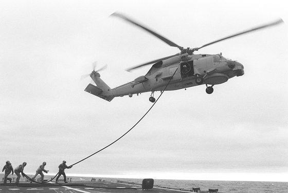

*Foto: [An SH-60B helicopter from Helicopter Light Anti-Submarine Squadron 42 conducts an in-flight helicopter refueling operation with the guided missile frigate](https://commons.wikimedia.org/wiki/File:An_SH-60B_helicopter_from_Helicopter_Light_Anti-Submarine_Squadron_42_conducts_an_in-flight_helicopter_refueling_operation_with_the_guided_missile_frigate_USS_HALYBURTON_(FFG_40)_du_-_DPLA_-_471f09ca4d65c63d2b69f450396aab0a.jpeg), Department of Defense. American Forces Information Service. Defense Visual Information Center. 1994, pubblico dominio.*

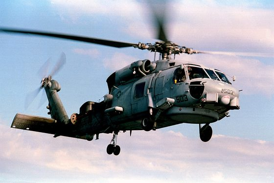

*Foto: [An SH-60B Sea Hawk helicopter of Light Helicopter Squadron 38 (HSL-38) detachment assigned to the destroyer USS CONOLLY (DD-979) is shown in-flight just af](https://commons.wikimedia.org/wiki/File:An_SH-60B_Sea_Hawk_helicopter_of_Light_Helicopter_Squadron_38_(HSL-38)_detachment_assigned_to_the_destroyer_USS_CONOLLY_(DD-979)_is_shown_in-flight_just_after_takeoff_from_the_ship_-_DPLA_-_1de2a5aef8c1a5b18229700972dcb87d.jpeg), Department of Defense. American Forces Information Service. Defense Visual Information Center. 1994, pubblico dominio.*

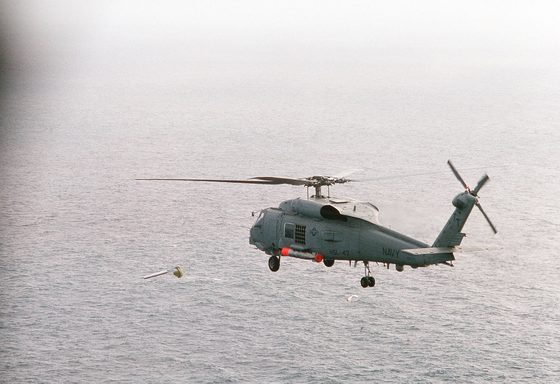

*Foto: [PH1(AC) Chuck Dutkiewicz ....A Light Helicopter Anti-submarine Squadron 43 (HSL-43) SH-60B Sea Hawk helicopter releases a sonobuoy from its dispenser while](https://commons.wikimedia.org/wiki/File:PH1(AC)_Chuck_Dutkiewicz_....A_Light_Helicopter_Anti-submarine_Squadron_43_(HSL-43)_SH-60B_Sea_Hawk_helicopter_releases_a_sonobuoy_from_its_dispenser_while_taking_part_in_an_anti-su_-_DPLA_-_5ad37d8d881bb985fd931de583a047eb.jpeg), Department of Defense. American Forces Information Service. Defense Visual Information Center. 1994, pubblico dominio.*

*Foto: [An air-to-air left front view of an SH-60B Seahawk light airborne multi-purpose system (LAMPS III) helicopter from Light Helicopter Anti-submarine Squadron](https://commons.wikimedia.org/wiki/File:An_air-to-air_left_front_view_of_an_SH-60B_Seahawk_light_airborne_multi-purpose_system_(LAMPS_III)_helicopter_from_Light_Helicopter_Anti-submarine_Squadron_(HSL-41)_-_DPLA_-_d99916165908b6c517b55ced32fb7fc8.jpeg), Department of Defense. American Forces Information Service. Defense Visual Information Center. 1994, pubblico dominio.*

### Tu-142MK Bear-F

*Aerei · Unione Sovietica*

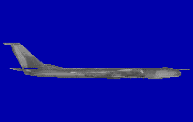

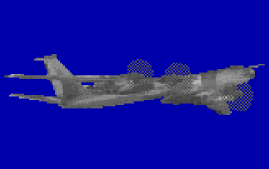

Il «Bear-F» è la versione antisommergibile del grande quadrimotore Tupolev a eliche controrotanti: Tu-142M e Tu-142MK sono lo stesso aereo, col sistema «Korshun-K» accettato nel 1980. Vola in crociera a circa 735 km/h, ha un'autonomia stimata di 14-15 ore e dal 1981 raggiungeva zone fino a 4200 km dalla base: Kipelovo per l'Atlantico del nord e il Mar di Norvegia, Kamennyj Ruchej per il Pacifico. Al posto delle RGB-1 del Tu-142 base porta boe infrasonore RGB-75, passive RGB-15, direzionali RGB-25 e attive RGB-55A, cariche esplosive per la ricerca a eco e 3 siluri. Il magnetometro in cima alla deriva era così delicato che a ogni corsa si spegnevano generatori, autopilota, lampeggiante e torretta di coda. Nel 1983 bastavano in media 3 sortite per una scoperta, ma dopo un'esercitazione del 1985 con fino al 50% di falsi allarmi una decisione del 1987 ammise che parte delle boe non funzionava con mare 3-5 né nel Barents.

**In partita.** Il suo radar cambia frequenza a ogni impulso e all'ESM è difficile da riconoscere; in compenso sente il radar del battello, quindi il tuo va tenuto spento. Esplosioni a 25, 150 o 400 m, ripetute 2-3 volte nello stesso punto a 3-4 minuti l'una dall'altra, vogliono dire che cerca l'eco del tuo scafo: cambia quota e allontanati. Le RGB-75 sentono un battello a 12 nodi a 15-20 km, uno lento a meno di 1 km, e con mare 3-5 rendono poco.

| Dato | Valore | Nel gioco | Confidenza | Fonte |
|---|---|---|---|---|
| Lunghezza | 53,1 m | - | media | extracted/navi/tu142/RAPPORTO.md |
| Apertura | 50 m | - | media | extracted/navi/tu142/RAPPORTO.md |
| Velocità massima | 400 kn | - | media | extracted/navi/tu142/RAPPORTO.md |
| Radar | Korshun | - | alta | asw_aereo.toml: §3.5 §6.6 [ART-Tu142] [RW-Tu142] |
| Quota di ricerca | 600 m | - | alta | asw_aereo.toml: §3.5 §6.6 [ART-Tu142] [RW-Tu142] |
| Tempo in zona (base) | 14 h | - | alta | asw_aereo.toml: §6.8 (8 h a 2000 km, 2 h a 4000 km) |

**Sensori:** Korshun.

**Boe:** RGB-75 (infrasonora), RGB-15, RGB-25, RGB-55A (attiva), MGAB (sorgente esplosiva).

**Armi:** AT-2M.

**Marcatori:** OMAB-25-12D/-8N.

**Fonti:** dossier 17 §3.5 [ART-Tu142] [RW-Tu142]; dossier 17 §1 (Tu-142M/MK); dossier 17 §4.2 e §6.6; dossier 17 §8.2-8.3; dossier 11 §1.4 [RWTU142]; data/motore/asw_aereo.toml [mezzi.tu142].

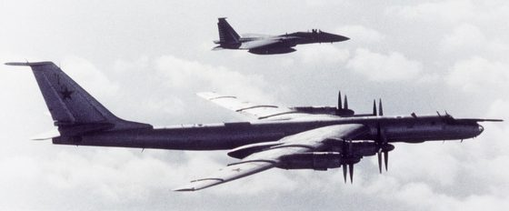

*Foto: [F-15A 48th FIS intercepting Bear F 1987.jpg](https://commons.wikimedia.org/wiki/File:F-15A_48th_FIS_intercepting_Bear_F_1987.jpg), USAF, pubblico dominio.*

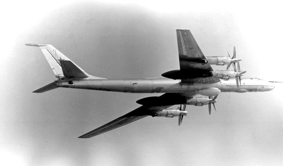

*Foto: [Tu-142M-1982-DN-SN-82-10842-DPLS.jpg](https://commons.wikimedia.org/wiki/File:Tu-142M-1982-DN-SN-82-10842-DPLS.jpg), Photographer's Name: Unknown, pubblico dominio.*

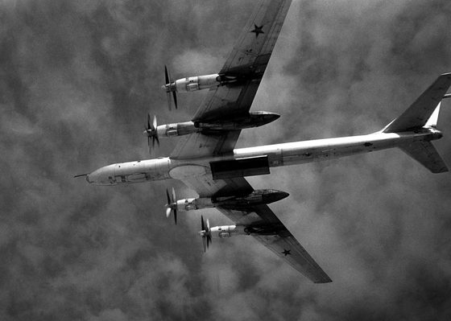

*Foto: [Tu-95 Bear F with open weapons bay 1987.JPEG](https://commons.wikimedia.org/wiki/File:Tu-95_Bear_F_with_open_weapons_bay_1987.JPEG), USN, pubblico dominio.*
<!-- fine: unita_aerei -->
