# 14. Siluri, missili, mine ed esche

Le schede delle armi della simulazione, dall'enciclopedia del gioco: siluri, missili, mine, esche e bersagli. Le sagome sono in scala.

<!-- generato: unita_armi -->
### 53-65K

*Siluri · Unione Sovietica*

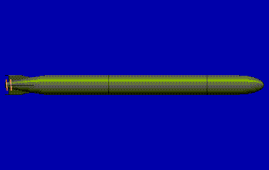

Il 53-65K è un siluro sovietico antinave da 533 mm del 1969 che non insegue il rumore ma la scia della nave: la testa riconosce la scia e la segue fino al bersaglio. Corre a 45 nodi per circa 19 km, con una testata di 300 kg (una fonte dà cifre più alte, giudicate dubbie). Proprio perché ignora i suoni, nessuna esca acustica lo inganna; per lo stesso motivo non serve contro un sottomarino in immersione.

**In partita.** Al comando dell'Alfa è il siluro contro le navi: si carica nei tubi e si lancia con una rotta che attraversi la scia del bersaglio, perché la testa non sente il rumore e aggancia solo la scia. Una sola velocità, 45 nodi per 19 km, e quota di corsa entro i 100 metri. Le esche della nave non lo fermano; la nave si salva solo con un cambio di rotta fatto all'ultimo.

| Dato | Valore | Nel gioco | Confidenza | Fonte |
|---|---|---|---|---|
| Guida | segui-scia, immune alle esche | - | media | dossier 14 §2.9 |
| Lunghezza | 7,2 m | - | media | dossier 14 §2.9 |
| Diametro | 533 mm | - | media | dossier 14 §2.9 |
| Peso | 2.070 kg | - | media | dossier 14 §2.9 |
| Testata | 300 kg | - | media | dossier 14 §2.9 |
| In servizio dal | 1969 | - | media | dossier 14 §2.9 |
| Velocità alta | 45 kn | - | media | dossier 01 §6.1 (alta); segui-scia |
| Portata a velocità alta | 19 km | - | media | dossier 01 §6.1 (alta); segui-scia |
| Velocità bassa | 45 kn | - | media | dossier 01 §6.1 (alta); segui-scia |
| Portata a velocità bassa | 19 km | - | media | dossier 01 §6.1 (alta); segui-scia |
| Quota massima | 100 m | - | media | dossier 01 §6.1 (alta); segui-scia |
| Testa di ricerca | segui-scia | - | media | dossier 01 §6.1 (alta); segui-scia |

**Portata da:** Alfa (Progetto 705).

**Portata da (tipica):** Kara (Progetto 1134B), Foxtrot (Progetto 641), Victor III (Progetto 671RTM).

**Fonti:** dossier 14 §2.9; dossier 01 §6.1 (note di gioco) [WPType53] [NWRU]; dossier 05 §5.3; siluri.toml (siluri.type53_65k); carico.toml (armi.type53_65k).

### ADC Mk 2

*Esche e contromisure · Stati Uniti*

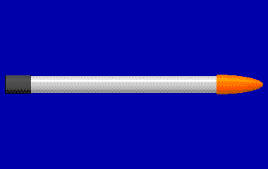

La contromisura acustica espendibile da 3 pollici dei sottomarini statunitensi del 1989, lanciata dall'eiettore interno. In acqua si mette in verticale a una quota preimpostata e, con motore ed eliche intubate, imita il rumore del battello per attirare il siluro nemico mentre il sottomarino si allontana. I lanciatori esterni da 6 pollici e i disturbatori più potenti arrivarono probabilmente dopo il 1989.

**In partita.** Si lancia dai due eiettori (6 esche a bordo del 688) quando un siluro nemico è in acqua. Resta a circa 60 metri e fa rumore per circa 10 minuti, più forte del battello: un siluro che non l'ha ancora scartata la insegue. Funziona meglio se subito dopo il battello cambia rotta e quota e rallenta per diventare silenzioso.

| Dato | Valore | Nel gioco | Confidenza | Fonte |
|---|---|---|---|---|
| Livello di rumore | 150 dB | - | STIMA | dossier 05 §5.1 e §5.3; livello STIMA (più rumorosa del battello); batteria termica 6-45 min nelle fonti: STIMA 10 min |
| Durata | 10 min | - | STIMA | dossier 05 §5.1 e §5.3; livello STIMA (più rumorosa del battello); batteria termica 6-45 min nelle fonti: STIMA 10 min |
| Quota di stazionamento | 60 m | - | STIMA | dossier 05 §5.1 e §5.3; livello STIMA (più rumorosa del battello); batteria termica 6-45 min nelle fonti: STIMA 10 min |
| Diametro | 76 mm | - | media | dossier 14 §2.8, dossier 05 §5.1 |

**Portata da:** Los Angeles (SSN-688, Flight I).

**Fonti:** dossier 05 §0.1 punto 6 e §5.1 [GOVT] [ADC]; siluri.toml (esche.adc_mk2); carico.toml (locali.los_angeles).

### APR-2 Yastreb-M

*Siluri · Unione Sovietica*

L'APR-2 «Yastreb-M» (1976) è un razzo-siluro sovietico da 350 mm aviolanciato, l'arma degli elicotteri e degli aerei antisom nel 1985-91 (l'APR-3 venne dopo). Dopo l'ammaraggio plana in spirale verso il basso, ascoltando in passivo fino a 150 metri; poi accende il motore a razzo e passa in attivo, a 43-60 nodi. Colpisce bersagli fra 15 e 600 metri, ma solo da vicino: la corsa subacquea è di 1,5-2 km. Le fonti russe gli danno una probabilità di colpire del 70-85% con un errore di designazione di 300-500 metri.

**In partita.** Lo sganciano il Ka-27, il Ka-25 e l'Il-38 quasi sopra il battello, ed è il siluro aereo più pericoloso del gioco: velocissimo, profondo e con una testa che vede in un cono ampio. Mentre plana ascolta soltanto: è il momento di lanciare l'esca, rallentare e diventare silenziosi, perché una volta acceso il razzo non lo si distanzia. La sua corsa è breve (3 km nel gioco): allontanarsi in silenzio dal punto in cui è caduto è la difesa migliore.

| Dato | Valore | Nel gioco | Confidenza | Fonte |
|---|---|---|---|---|
| Velocità alta | 60 kn | - | media | dossier 17 §6.7 (media); portata, testata e acquisizione STIMA |
| Portata a velocità alta | 3 km | - | media | dossier 17 §6.7 (media); portata, testata e acquisizione STIMA |
| Velocità bassa | 43 kn | - | media | dossier 17 §6.7 (media); portata, testata e acquisizione STIMA |
| Portata a velocità bassa | 3 km | - | media | dossier 17 §6.7 (media); portata, testata e acquisizione STIMA |
| Quota massima | 600 m | - | media | dossier 17 §6.7 (media); portata, testata e acquisizione STIMA |
| Testa di ricerca | attiva, passiva | - | media | dossier 17 §6.7 (media); portata, testata e acquisizione STIMA |

**Portata da:** Ka-27PL Helix-A.

**Fonti:** dossier 17 §1, §3.1-3.4 e §6.7 [RW-APR2] [ART-Ka27] [ART-Il38]; dossier 01 §6.2 [RWKa25] [NWRU]; dossier 05 §5.4; siluri.toml (siluri.apr2).

### AT-1M

*Siluri · Unione Sovietica*

L'AT-1 (e l'AT-1M) è il siluro aviolanciato sovietico da 450 mm degli anni '60, portato dagli elicotteri Ka-25 e Ka-27 e dal Tu-142. Scende col paracadute, poi gira a sinistra in un cerchio di 60-70 metri a 12 gradi al secondo cercando il bersaglio fra 20 e 200 metri di quota. È lento e corto: 27 nodi per 5 km, acquisizione a circa 500 metri, testata di 70 kg, e si autodistrugge dopo 9 minuti. Alle prove di stato colpì solo il 15-18% delle volte.

**In partita.** Lo sgancia un elicottero o un aereo sovietico; si sente il tonfo e poi i ping che arrivano dall'alto mentre il siluro gira in cerchio. È il siluro nemico più facile da evitare: cerca solo fino a 200 metri, quindi basta scendere sotto quella quota; a 27 nodi, inoltre, un 688 a tutta forza lo lascia indietro. Un'esca e qualche minuto di fuga bastano: dopo 9 minuti si distrugge da solo.

| Dato | Valore | Nel gioco | Confidenza | Fonte |
|---|---|---|---|---|
| Velocità alta | 27 kn | - | media | dossier 01 §5.1 (media); anno di servizio STIMA |
| Portata a velocità alta | 5 km | - | media | dossier 01 §5.1 (media); anno di servizio STIMA |
| Velocità bassa | 27 kn | - | media | dossier 01 §5.1 (media); anno di servizio STIMA |
| Portata a velocità bassa | 5 km | - | media | dossier 01 §5.1 (media); anno di servizio STIMA |
| Quota massima | 200 m | - | media | dossier 01 §5.1 (media); anno di servizio STIMA |
| Testa di ricerca | attiva | - | media | dossier 01 §5.1 (media); anno di servizio STIMA |

**Portata da:** Ka-25PL Hormone-A, Be-12 Mail.

**Fonti:** dossier 17 §3.1-3.2, §3.5, §6.7, §8.3 e §9 [ART-Be12] [RW-Ka25]; dossier 01 §6.2 [RWKa25] [NWRU]; siluri.toml (siluri.at1).

### AT-2M

*Siluri · Unione Sovietica*

L'AT-2 (e le versioni AT-2M e AT-2U) è il siluro aviolanciato sovietico da 533 mm per gli aerei antisommergibile: entrò in servizio nel 1965, la versione migliorata nel 1973. Pesa 1.030 kg, scende con un paracadute a più stadi e aggancia il bersaglio a 600-1.000 metri con la testa attiva e passiva. Le fonti danno circa 40 nodi per 7 km e una testata di 80-150 kg. Lo portano l'Il-38 e il Tu-142, e le navi lo lanciano a circa 50 km col missile Metel (SS-N-14) da Kara, Krivak e Kirov.

**In partita.** Arriva da un aereo da pattugliamento sovietico o in cima a un missile lanciato da una nave: il primo avviso è il tonfo in acqua. Nel gioco fa 40 nodi per 10 km, aggancia a 800 metri in attivo e in passivo e scende fino a 600 metri (STIMA). Si evita come il Mk 46: esca subito, poi velocità, cambio di rotta e di quota oltre lo strato, così che la testa trovi l'esca e non il battello.

| Dato | Valore | Nel gioco | Confidenza | Fonte |
|---|---|---|---|---|
| Velocità alta | 40 kn | - | media | dossier 17 §6.7 (alta per peso e autoguida); velocita, portata, testata e anno STIMA |
| Portata a velocità alta | 10 km | - | media | dossier 17 §6.7 (alta per peso e autoguida); velocita, portata, testata e anno STIMA |
| Velocità bassa | 40 kn | - | media | dossier 17 §6.7 (alta per peso e autoguida); velocita, portata, testata e anno STIMA |
| Portata a velocità bassa | 10 km | - | media | dossier 17 §6.7 (alta per peso e autoguida); velocita, portata, testata e anno STIMA |
| Quota massima | 600 m | - | media | dossier 17 §6.7 (alta per peso e autoguida); velocita, portata, testata e anno STIMA |
| Testa di ricerca | attiva, passiva | - | media | dossier 17 §6.7 (alta per peso e autoguida); velocita, portata, testata e anno STIMA |

**Portata da:** Il-38 May, Tu-142MK Bear-F.

**Portata da (tipica):** Kara (Progetto 1134B), Kirov (Progetto 1144), Krivak II (Progetto 1135M), Udaloy (Progetto 1155).

**Fonti:** dossier 17 §3.4-3.5 e §6.7 [ART-Il38] [ART-Tu142]; dossier 01 §6.2-6.3 [NWRU] [WPKara]; dossier 05 §5.3-5.4; siluri.toml (siluri.at2).

### BQM-74C Chukar (bersaglio)

*Bersagli · Stati Uniti*

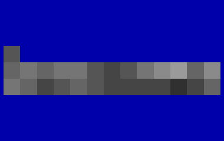

Il BQM-74C Chukar è il bersaglio radiocomandato della US Navy che negli anni '80 imitava i missili antinave a volo radente. È un piccolo aereo senza pilota con un turbogetto J400 in una gondola sotto la fusoliera: lungo 3,87 metri e con 1,76 metri di apertura alare, decolla con un razzo ausiliario e si recupera col paracadute. Non ha un radar proprio, ma può portare amplificatori, passivi o attivi, della sua eco radar.

**In partita.** Nel gioco compare nella missione «Colpisci e fuggi» come bersaglio non combattente: non ha armi né radar e non fa rumore, quindi il sonar non lo sente. Non è una minaccia.

| Dato | Valore | Nel gioco | Confidenza | Fonte |
|---|---|---|---|---|
| Lunghezza | 3,9 m | - | media | extracted/navi/bqm74/RAPPORTO.md |
| Larghezza | 1,8 m | - | media | extracted/navi/bqm74/RAPPORTO.md |
| Velocità massima | 500 kn | - | media | extracted/navi/bqm74/RAPPORTO.md |

**Fonti:** extracted/navi/bqm74/RAPPORTO.md (classi.toml [bqm74]); dossier 11 §1.6 [DSBQM74]; data/missioni/SCENE0A.lua.

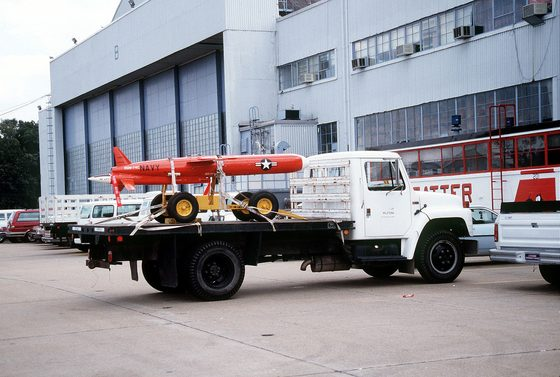

*Foto: [BQM-74C Chukar III.JPEG](https://commons.wikimedia.org/wiki/File%3ABQM-74C_Chukar_III.JPEG), DON S. MONTGOMERY, USN (RET.), pubblico dominio.*

### MDT

*Mine · Unione Sovietica*

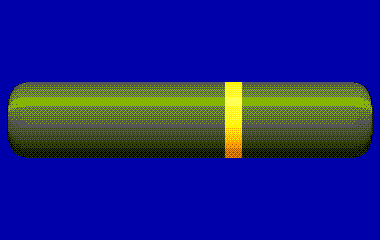

L'MDT è una mina da fondo sovietica che si posa dal tubo da siluro, progettata dal TsKB-145 e in servizio dal 1953: scoppia per influenza acustica e magnetica entro circa 50 metri. È corta, circa 2,57 metri per 534,5 mm e 1.050 kg, con ben 600 kg di esplosivo, e ne entrano due per tubo, unite da un aggancio che si separa al lancio. Funziona solo in acque basse, su fondali fino a 50 metri, e si posa a 4 nodi in superficie o a 8 in immersione. Compare ancora in un testo sovietico del 1984, e con lei l'Alfa può portare 36 mine al posto di 18 armi.

**In partita.** Al comando dell'Alfa occupa mezzo posto: due mine per tubo. Non corre: si posa direttamente sotto il battello, su fondali fra 8 e 50 metri, quindi bisogna entrare nelle acque basse da minare, piano e con prudenza. Dopo 10 minuti si arma e colpisce navi e sottomarini che passano entro circa 50 metri; non distingue gli amici.

| Dato | Valore | Nel gioco | Confidenza | Fonte |
|---|---|---|---|---|
| Tipo | influenza | - | media | dossier 14 §2.12 [WPMDT] [AMMDT]: 600 kg, raggio 50 m, fondali fino a 50 m; minimo STIMA |
| Carica | 600 kg | - | alta | dossier 14 §2.12 [WPMDT] [AMMDT]: 600 kg, raggio 50 m, fondali fino a 50 m; minimo STIMA |
| Raggio d'azione | 50 m | - | STIMA | dossier 14 §2.12 [WPMDT] [AMMDT]: 600 kg, raggio 50 m, fondali fino a 50 m; minimo STIMA |
| Profondità di posa | 8-50 m | - | STIMA | dossier 14 §2.12 [WPMDT] [AMMDT]: 600 kg, raggio 50 m, fondali fino a 50 m; minimo STIMA |
| Tempo d'armamento | 10 min | - | STIMA | dossier 14 §2.12 [WPMDT] [AMMDT]: 600 kg, raggio 50 m, fondali fino a 50 m; minimo STIMA |
| Lunghezza | 2,6 m | - | media | dossier 14 §2.12 [WPMDT] [AMMDT] |
| Peso | 1.050 kg | - | media | dossier 14 §2.12 [WPMDT] [AMMDT] |
| Contro | navi e sottomarini | - | media | dossier 14 §2.12 [WPMDT] [AMMDT]: 600 kg, raggio 50 m, fondali fino a 50 m; minimo STIMA |

**Portata da:** Alfa (Progetto 705).

**Fonti:** dossier 14 §2.12 [WPMDT] [AMMDT]; carico.toml (armi.mdt, mine.mdt, carichi.alfa.minamento).

### MG-74 Korund

*Esche e contromisure · Unione Sovietica*

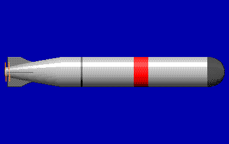

L'MG-74 «Korund» è l'esca semovente sovietica del 1974: ha la forma e la batteria di un siluro elettrico corto, lungo 3,9 metri, e parte dal tubo da 533 mm. Corre fino a 250 metri di quota e fa tre cose: disturba il sonar del siluro, ne imita l'eco del sottomarino o ne imita il rumore. Manovra da sola come un battello, con quota e velocità impostate prima del lancio, e cambia modo secondo i ping che riceve.

**In partita.** Al comando dell'Alfa c'è sempre: prende il posto di un siluro, nel tubo o in rastrelliera. Lanciatela quando un siluro vi ha agganciato, poi virate, cambiate quota e rallentate: l'esca deve restare più interessante del battello. Contro un siluro filoguidato l'operatore può accorgersene, e contro uno sulla scia non serve.

| Dato | Valore | Nel gioco | Confidenza | Fonte |
|---|---|---|---|---|
| Livello di rumore | 140 dB | - | STIMA | MG-74 Korund (URSS, 1974), dossier 05 §5.2 e §7: semovente da tubo da 533, 3,9 m, fino a 250 m; imita rumore ed eco del sottomarino. Durata STIMA 20 min (15-30) |
| Durata | 20 min | - | STIMA | MG-74 Korund (URSS, 1974), dossier 05 §5.2 e §7: semovente da tubo da 533, 3,9 m, fino a 250 m; imita rumore ed eco del sottomarino. Durata STIMA 20 min (15-30) |
| Quota di stazionamento | 0 m | - | STIMA | MG-74 Korund (URSS, 1974), dossier 05 §5.2 e §7: semovente da tubo da 533, 3,9 m, fino a 250 m; imita rumore ed eco del sottomarino. Durata STIMA 20 min (15-30) |
| Diametro | 533 mm | - | bassa | dossier 05 §5.2 e §7 [KREM] |

**Portata da:** Alfa (Progetto 705).

**Fonti:** dossier 05 §5.2 [WARFOR] [KREM]; carico.toml (armi.mg74).

### MG-84 Korund

*Esche e contromisure · Unione Sovietica*

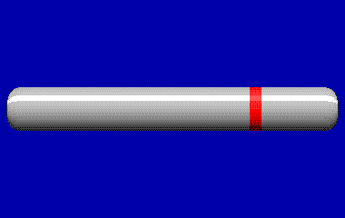

L'MG-84 «Korund-705» è, secondo una fonte divulgativa, l'esca da 400 mm dei sottomarini Alfa (1974), capace di disturbare il sonar del siluro o di imitare la firma del battello. Le fonti sovietiche più solide descrivono una famiglia «Korund» dello stesso anno, l'MG-74: un'esca semovente lanciata dal tubo da 533 mm, lunga 3,9 metri, che corre fino a 250 metri di quota disturbando, imitando l'eco o il rumore del sottomarino e manovrando come lui. Dei dati dell'MG-84 come tale non c'è nulla di pubblico.

**In partita.** Al comando dell'Alfa le esche sono 4 e partono dal sesto tubo, come nel gioco originale; non tolgono posti ai siluri, ma contano fra le armi in acqua (al più 6). Si lancia appena si sente un siluro nemico, poi si cambia rotta e quota e si rallenta per lasciarla più rumorosa del battello. Contro un Mk 48 ancora guidato dal filo vale poco, e contro un siluro sulla scia non serve.

| Dato | Valore | Nel gioco | Confidenza | Fonte |
|---|---|---|---|---|
| Funzionamento | esca che disturba o imita la firma del battello | - | bassa | dossier 14 §2.13 |
| Diametro | 400 mm | - | bassa | dossier 14 §2.13 |
| Lunghezza | 3 m | - | bassa | dossier 14 §2.13 |
| Peso | 0 kg | - | bassa | dossier 14 §2.13 |

**Portata da:** Alfa (Progetto 705).

**Fonti:** dossier 14 §2.13 e §4.2-4.3 [NavEnc705]; dossier 05 §5.2-5.4 [WARFOR] [KREM]; dossier 01 §6.6; carico.toml (armi.mg84, locali.alfa).

### MOSS Mk 70

*Esche e contromisure · Stati Uniti*

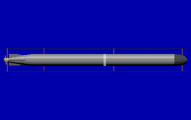

La MOSS Mk 70 (Mobile Submarine Simulator) è l'esca semovente americana dal 1976: un veicolo da 10 pollici costruito sul siluro Mk 37, senza testata, che parte dal tubo da 533 mm dentro un manicotto. Imita il rumore e l'eco del sottomarino e se ne allontana. Negli anni '80 stava sugli SSBN, fino al ritiro a metà anni '90: sul 688 del 1989 non c'era.

**In partita.** Solo nel modo moderno, come scelta «what-if»: occupa il posto di un siluro. Lanciatela verso un lato e allontanatevi dall'altro, lentamente: un siluro passivo segue la firma più forte, uno attivo l'eco più vicina. Nel modo 1989 il 688 ha soltanto le esche ADC Mk 2 dell'eiettore.

| Dato | Valore | Nel gioco | Confidenza | Fonte |
|---|---|---|---|---|
| Livello di rumore | 140 dB | - | STIMA | MOSS Mk 70 (USA, 1976), dossier 05 §5.1: veicolo da 10" senza testata, eco attiva e firma passiva simili al battello; sugli SSBN, non sui 688 del 1989 (what-if). Durata STIMA 20 min |
| Durata | 20 min | - | STIMA | MOSS Mk 70 (USA, 1976), dossier 05 §5.1: veicolo da 10" senza testata, eco attiva e firma passiva simili al battello; sugli SSBN, non sui 688 del 1989 (what-if). Durata STIMA 20 min |
| Quota di stazionamento | 0 m | - | STIMA | MOSS Mk 70 (USA, 1976), dossier 05 §5.1: veicolo da 10" senza testata, eco attiva e firma passiva simili al battello; sugli SSBN, non sui 688 del 1989 (what-if). Durata STIMA 20 min |
| Diametro | 254 mm | - | bassa | dossier 05 §5.1 |

**Portata da:** Los Angeles (SSN-688, Flight I).

**Fonti:** dossier 05 §5.1 [WPMOSS] [GOVT]; carico.toml (armi.moss_mk70).

### Mk 46 Mod 5

*Siluri · Stati Uniti*

Il Mk 46 è il siluro leggero da 324 mm della NATO, lanciato da aerei, elicotteri e navi; nel 1989 la versione in servizio è il Mod 5. Le cifre ufficiali dicevano «oltre 28 nodi», ma corre a circa 45 nodi per 11 km e scende fino a circa 450 metri, con una testa attiva o passiva/attiva e la ricerca a serpentina o a cerchio. La testata è piccola, 44 kg. Lo portano il P-3C (4-8), l'S-3 (4), gli elicotteri SH-60B e SH-3H (2) e le fregate nei tubi Mk 32; è anche il siluro chiuso nella mina Mk 60 CAPTOR.

**In partita.** Arriva dall'alto: un P-3C lo sgancia qualche centinaio di metri davanti al battello, un elicottero dal volo stazionario o in passaggio, sempre col paracadute. Il tonfo in acqua e, 5-10 secondi dopo, il motore e i ping della testa sono l'allarme «siluro in acqua»; poi cerca per 6-8 minuti, agganciando entro circa 1,5 km. La difesa: lancia subito un'esca, accelera e cambia rotta, passa sotto lo strato o oltre i 450 metri; un battello in allerta con le esche ha buone probabilità di cavarsela.

| Dato | Valore | Nel gioco | Confidenza | Fonte |
|---|---|---|---|---|
| Velocità alta | 45 kn | - | media | dossier 01 §6.2 (alta) |
| Portata a velocità alta | 11 km | - | media | dossier 01 §6.2 (alta) |
| Velocità bassa | 45 kn | - | media | dossier 01 §6.2 (alta) |
| Portata a velocità bassa | 11 km | - | media | dossier 01 §6.2 (alta) |
| Quota massima | 450 m | - | media | dossier 01 §6.2 (alta) |
| Testa di ricerca | attiva, passiva | - | media | dossier 01 §6.2 (alta) |

**Portata da:** SH-60B Seahawk (LAMPS III), SH-2F Seasprite (LAMPS I), SH-3H Sea King, Lynx HAS.3, SH-60F Ocean Hawk, P-3C Orion, S-3A Viking, S-3B Viking.

**Portata da (tipica):** Kidd (DDG-993), Knox (FF-1052), Ticonderoga (CG-47).

**Fonti:** dossier 01 §6.2 [FASMk46] [NWUS]; dossier 17 §1, §2.1-2.5, §6.2, §6.7 e §8.3 [FASMK46] [HARPHAAWC] [COTE]; dossier 14 §2.7; dossier 01 §4.1; siluri.toml (siluri.mk46).

### Mk 48 ADCAP

*Siluri · Stati Uniti*

Il Mk 48 ADCAP (Mod 5) è il successore del Mk 48 Mod 4: il programma fu accelerato proprio perché in Occidente si temevano la velocità e la quota dell'Alfa. Prodotto dal 1985, entrò in servizio nel 1988, per cui nel 1989 a bordo dei 688 ce n'erano pochi, accanto ai Mod 4. Resta filoguidato, ma con una testa attiva e passiva digitale a scansione elettronica. Le stime aperte parlano di 55-65 nodi, circa 27 km alla velocità massima e 50 km a 40 nodi, e di una quota oltre gli 800 metri; pesa 1.676 kg, con una testata di circa 295 kg.

**In partita.** Si carica e si lancia come il Mk 48 dalla stazione Armi, con le stesse impostazioni: rotta, modo della testa, velocità (alta: 60 nodi e 32 km; bassa: 40 nodi e 50 km), RTE, tetto, schema di ricerca e anticircolare. Rispetto al Mod 4 la testa aggancia da più lontano (2 km in attivo, 5 in passivo) e il siluro scende fino a 800 metri. Il deposito lo offre solo nelle missioni dal 1988, e nei primi anni al più 6 per carico.

| Dato | Valore | Nel gioco | Confidenza | Fonte |
|---|---|---|---|---|
| Guida | filoguidato, testa attiva o passiva a scansione elettronica | - | media | dossier 14 §2.1 e §5.1 |
| Lunghezza | 5,8 m | - | media | dossier 14 §2.1 e §5.1 |
| Diametro | 533 mm | - | media | dossier 14 §2.1 e §5.1 |
| Peso | 1.676 kg | - | media | dossier 14 §2.1 e §5.1 |
| Testata | 295 kg | - | media | dossier 14 §2.1 e §5.1 |
| In servizio dal | 1988 | - | media | dossier 14 §2.1 e §5.1 |
| Velocità alta | 60 kn | - | media | dossier 01 §6.1 (media); marginale nel 1989 |
| Portata a velocità alta | 32 km | - | media | dossier 01 §6.1 (media); marginale nel 1989 |
| Velocità bassa | 40 kn | - | media | dossier 01 §6.1 (media); marginale nel 1989 |
| Portata a velocità bassa | 50 km | - | media | dossier 01 §6.1 (media); marginale nel 1989 |
| Quota massima | 800 m | - | media | dossier 01 §6.1 (media); marginale nel 1989 |
| Filo (dal siluro / dal battello) | 30 km / 3 km | - | STIMA | dossier 01 §6.1 (media); marginale nel 1989 |
| Testa di ricerca | attiva, passiva | - | media | dossier 01 §6.1 (media); marginale nel 1989 |

**Portata da:** Los Angeles (SSN-688, Flight I).

**Portata da (tipica):** Sturgeon (SSN-637).

**Fonti:** dossier 14 §2.1 e §5.1-5.2 [WPMk48]; dossier 01 §2.4 (nota storica) e §6.1 [WPMk48] [NWUS] [HIS]; siluri.toml (siluri.mk48_adcap); carico.toml (armi.mk48_adcap).

### Mk 48 Mod 4

*Siluri · Stati Uniti*

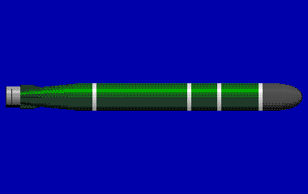

Il siluro pesante da 533 mm della US Navy: il Mk 48 entrò in servizio nel 1972 e il Mod 4, la versione del 1989, nacque per raggiungere sottomarini veloci e profondi come l'Alfa. È filoguidato dal battello e poi cerca da solo il bersaglio con la testa attiva o passiva. Le cifre ufficiali dicevano solo «oltre 28 nodi, oltre 5 miglia»: le stime della letteratura danno 55 nodi e 38 km, o 50 km a 40 nodi. La testata da 293 kg esplode per prossimità sotto la chiglia.

**In partita.** Si lancia dalla stazione Armi da un tubo carico e allagato con la porta aperta. Prima del lancio si impostano rotta, modo della testa (attivo, passivo o tutti e due), velocità (alta: 55 nodi e 38 km; bassa: 40 nodi e 50 km), distanza d'attivazione (RTE), tetto e schema di ricerca, e l'anticircolare. Finché il filo regge (fino a 30 km dal siluro, 3 km dal battello) si può correggere la rotta; tagliato il filo il siluro va da solo. Scende fino a circa 760 metri.

| Dato | Valore | Nel gioco | Confidenza | Fonte |
|---|---|---|---|---|
| Guida | filoguidato, poi testa attiva o passiva | - | alta | dossier 14 §2.1 |
| Lunghezza | 5,8 m | - | alta | dossier 14 §2.1 |
| Diametro | 533 mm | - | alta | dossier 14 §2.1 |
| Peso | 1.558 kg | - | alta | dossier 14 §2.1 |
| Testata | 293 kg | - | alta | dossier 14 §2.1 |
| In servizio dal | 1980 | - | alta | dossier 14 §2.1 |
| Velocità alta | 55 kn | - | media | dossier 01 §6.1 (media); testa e filo STIMA |
| Portata a velocità alta | 38 km | - | media | dossier 01 §6.1 (media); testa e filo STIMA |
| Velocità bassa | 40 kn | - | media | dossier 01 §6.1 (media); testa e filo STIMA |
| Portata a velocità bassa | 50 km | - | media | dossier 01 §6.1 (media); testa e filo STIMA |
| Quota massima | 760 m | - | media | dossier 01 §6.1 (media); testa e filo STIMA |
| Filo (dal siluro / dal battello) | 30 km / 3 km | - | STIMA | dossier 01 §6.1 (media); testa e filo STIMA |
| Testa di ricerca | attiva, passiva | - | media | dossier 01 §6.1 (media); testa e filo STIMA |

**Portata da:** Los Angeles (SSN-688, Flight I).

**Portata da (tipica):** Sturgeon (SSN-637).

**Fonti:** dossier 14 §2.1 [WPMk48]; dossier 01 §6.1; siluri.toml (tools/pipeline/siluri.py).

### Mk 60 CAPTOR

*Mine · Stati Uniti*

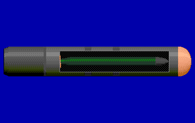

La Mk 60 CAPTOR è una mina americana antisommergibile: un siluro leggero Mk 46 chiuso in un contenitore ormeggiato, che si libera e parte all'inseguimento quando sente passare un sottomarino. La versione posata dai sottomarini è lunga 3,35 metri e pesa 935 kg, quella degli aerei e delle navi 3,68 metri e 1.077 kg; il diametro è di 533 mm. Nel 1989 era in servizio, sui 688, sugli Sturgeon e sugli aerei da pattugliamento P-3C e S-3.

**In partita.** Si carica nei tubi come un siluro (un posto) e si posa dove passeranno i sottomarini nemici, su fondali profondi fra 200 e 900 metri (STIMA). Dopo 10 minuti si arma; ignora le navi di superficie e i battelli sopra i 30 metri, e contro un sottomarino in immersione entro circa 1 km libera il suo Mk 46. Una volta posata non si comanda più: va lontano dalle rotte dei sottomarini amici.

| Dato | Valore | Nel gioco | Confidenza | Fonte |
|---|---|---|---|---|
| Tipo | captor | - | media | dossier 14 §2.7 (Mk 46 in un contenitore ormeggiato); raggio e profondità STIMA |
| Carica | 44 kg | - | alta | dossier 14 §2.7 (Mk 46 in un contenitore ormeggiato); raggio e profondità STIMA |
| Raggio d'azione | 1.000 m | - | STIMA | dossier 14 §2.7 (Mk 46 in un contenitore ormeggiato); raggio e profondità STIMA |
| Profondità di posa | 200-900 m | - | STIMA | dossier 14 §2.7 (Mk 46 in un contenitore ormeggiato); raggio e profondità STIMA |
| Tempo d'armamento | 10 min | - | STIMA | dossier 14 §2.7 (Mk 46 in un contenitore ormeggiato); raggio e profondità STIMA |
| Lunghezza | 3,4 m | - | alta | dossier 14 §2.7 |
| Peso | 935 kg | - | alta | dossier 14 §2.7 |
| Contro | sottomarini | - | media | dossier 14 §2.7 (Mk 46 in un contenitore ormeggiato); raggio e profondità STIMA |

**Portata da:** Los Angeles (SSN-688, Flight I).

**Portata da (tipica):** Sturgeon (SSN-637).

**Fonti:** dossier 14 §2.7 [WPCaptor]; dossier 01 §2.1-2.2 [FAS688] [WPSturgeon]; dossier 17 §2.4-2.5 [FASP3] [TWZS3]; carico.toml (armi.mk60, mine.mk60).

### Mk 67 SLMM

*Mine · Stati Uniti*

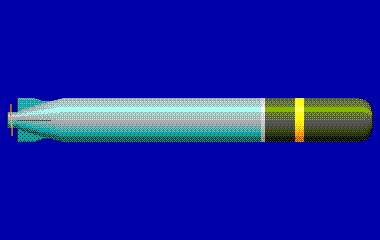

La mina mobile lanciata da sottomarino (SLMM) della US Navy, in servizio dagli anni '80: un siluro Mk 37 modificato fa da veicolo. Esce dal tubo, percorre circa 13 km lungo la rotta impostata e si posa sul fondo, così il battello può minare un porto o uno stretto senza avvicinarsi. La testata è di 150 kg; è lunga circa 4 metri e pesa 750-800 kg.

**In partita.** Si carica nei tubi come un siluro (configurazione «minamento» del carico) e si lancia con rotta e distanza di posa. Dopo l'armamento (10 minuti) resta sul fondo, fra 10 e 100 metri, e scoppia per influenza al passaggio di navi o sottomarini entro circa 60 metri (raggio STIMA). Non si può più comandare: va posata dove passerà il nemico, lontano dalle rotte amiche.

| Dato | Valore | Nel gioco | Confidenza | Fonte |
|---|---|---|---|---|
| Tipo | influenza | - | media | dossier 14 §2.6 (corsa 13 km, testata 150 kg); raggio, profondità e velocità STIMA |
| Carica | 150 kg | - | alta | dossier 14 §2.6 (corsa 13 km, testata 150 kg); raggio, profondità e velocità STIMA |
| Raggio d'azione | 60 m | - | STIMA | dossier 14 §2.6 (corsa 13 km, testata 150 kg); raggio, profondità e velocità STIMA |
| Profondità di posa | 10-100 m | - | STIMA | dossier 14 §2.6 (corsa 13 km, testata 150 kg); raggio, profondità e velocità STIMA |
| Tempo d'armamento | 10 min | - | STIMA | dossier 14 §2.6 (corsa 13 km, testata 150 kg); raggio, profondità e velocità STIMA |
| Corsa fino alla posa | 13 km | - | alta | dossier 14 §2.6 (corsa 13 km, testata 150 kg); raggio, profondità e velocità STIMA |
| Lunghezza | 4,1 m | - | media | dossier 14 §2.6 |
| Peso | 754 kg | - | media | dossier 14 §2.6 |
| Contro | navi e sottomarini | - | media | dossier 14 §2.6 (corsa 13 km, testata 150 kg); raggio, profondità e velocità STIMA |

**Portata da:** Los Angeles (SSN-688, Flight I).

**Portata da (tipica):** Sturgeon (SSN-637).

**Fonti:** dossier 14 §2.6 [WPSLMM] [FASMk67]; carico.toml (mine.mk67).

### P-700 Granit (SS-N-19)

*Missili · Unione Sovietica*

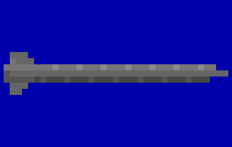

Il P-700 Granit (SS-N-19) è il grande missile antinave sovietico entrato in servizio nel 1983: 24 sugli Oscar, 20 sull'incrociatore Kirov, 12 sulla portaerei Kuznetsov, lanciati da contenitori inclinati e allagati prima del lancio. Vola alto a Mach 2,5 per gran parte della rotta e scende a circa 25 metri, a Mach 1,5-1,6, dopo aver trovato i bersagli; la portata è di circa 550 km, la testata di 750 kg o nucleare. Le fonti descrivono salve fino a 24 missili che si scambiano i dati e si dividono i bersagli, ma su questo punto esistono dubbi. Nel 1989 l'ultimo satellite radar sovietico era già stato lanciato: un gruppo navale in silenzio radar era difficile da localizzare.

**In partita.** Non minaccia il battello, ma le navi che il 688 scorta: nelle missioni di scorta un Oscar o un Kirov può lanciarne una salva sul gruppo. Il lancio si sente bene: transitori regolari ogni 3-5 secondi e il rumore dei razzi, a decine di chilometri (STIMA). In volo il missile si scopre solo quando accende il radar della testa, che l'ESM riconosce: la vera difesa è trovare e affondare l'Oscar prima che spari.

| Dato | Valore | Nel gioco | Confidenza | Fonte |
|---|---|---|---|---|
| Lunghezza | 10 m | - | bassa | extracted/navi/p700/RAPPORTO.md |
| Larghezza | 2,6 m | - | bassa | extracted/navi/p700/RAPPORTO.md |
| Velocità massima | 1.434 kn | nel gioco del 1989: 860 kn | bassa | dossier 01 §6.4 [WPGranit] |

**Portata da (tipica):** Kirov (Progetto 1144), Oscar II (Progetto 949A).

**Fonti:** dossier 01 §6.4 [WPGranit]; dossier 05 §0.1 punto 8, §3.1, §3.3 e §3.5 [RWP700] [NPK206] [WPUSA]; emettitori.toml (radar.granit); classi.toml (p700).

### PMR-1 Kal'mar

*Mine · Unione Sovietica*

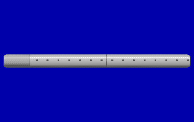

La PMR-1 «Kal'mar» è una mina-razzo antisommergibile sovietica in servizio dal 1970: invece di un siluro, quando rileva acusticamente un sottomarino lancia contro di lui un razzo subacqueo. È lunga come un siluro, 7,8 metri per 533 mm e 1.700 kg, con una carica di 200 kg, e si posa dai tubi dei sottomarini. Colpisce battelli fra 30 e 400 metri che vanno a 6-30 nodi; per coprire tutte le quote servivano due file di mine. Una fonte la descriveva come mina-siluro da 400 mm anche antinave, ma le fonti russe lo smentiscono.

**In partita.** Al comando dell'Alfa si carica nei tubi al posto di un siluro (un posto) e si posa su fondali di 200-1.000 metri; la mina resta intorno ai 300 metri (STIMA). Dopo 10 minuti si arma e attacca solo i sottomarini in immersione che passano sopra di lei entro circa 100 metri, ignorando le navi. Per sbarrare un passaggio ne servono più d'una, vicine fra loro.

| Dato | Valore | Nel gioco | Confidenza | Fonte |
|---|---|---|---|---|
| Tipo | mina_razzo | - | media | dossier 14 §2.12 [RuPMR1] [AMPMR2]: carica 200 kg, bersagli 30-400 m; raggio metà di quello della PMR-2, fondali come la PMR-2, quota ed errore del razzo STIMA |
| Carica | 200 kg | - | alta | dossier 14 §2.12 [RuPMR1] [AMPMR2]: carica 200 kg, bersagli 30-400 m; raggio metà di quello della PMR-2, fondali come la PMR-2, quota ed errore del razzo STIMA |
| Raggio d'azione | 100 m | - | STIMA | dossier 14 §2.12 [RuPMR1] [AMPMR2]: carica 200 kg, bersagli 30-400 m; raggio metà di quello della PMR-2, fondali come la PMR-2, quota ed errore del razzo STIMA |
| Profondità di posa | 200-1.000 m | - | STIMA | dossier 14 §2.12 [RuPMR1] [AMPMR2]: carica 200 kg, bersagli 30-400 m; raggio metà di quello della PMR-2, fondali come la PMR-2, quota ed errore del razzo STIMA |
| Tempo d'armamento | 10 min | - | STIMA | dossier 14 §2.12 [RuPMR1] [AMPMR2]: carica 200 kg, bersagli 30-400 m; raggio metà di quello della PMR-2, fondali come la PMR-2, quota ed errore del razzo STIMA |
| Lunghezza | 7,8 m | - | media | dossier 14 §2.12 [RuPMR1] [AMPMR2] |
| Peso | 1.700 kg | - | media | dossier 14 §2.12 [RuPMR1] [AMPMR2] |
| Contro | sottomarini | - | media | dossier 14 §2.12 [RuPMR1] [AMPMR2]: carica 200 kg, bersagli 30-400 m; raggio metà di quello della PMR-2, fondali come la PMR-2, quota ed errore del razzo STIMA |

**Fonti:** dossier 14 §2.12 [RuPMR1] [AMPMR2] [NavEnc705]; carico.toml (armi.pmr1, mine.pmr1).

### PMR-2

*Mine · Unione Sovietica*

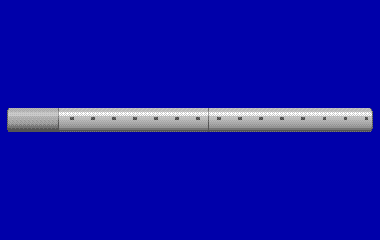

La PMR-2 (in Unione Sovietica PMK-1), del 1972 o 1973, è il successore della PMR-1: una mina-razzo antisom lunga 7,83 metri, 533 mm di diametro e 1.850 kg, con una carica di 175 kg (la versione d'esportazione ne porta di più). Si posa su fondali di 200-1.000 metri e resta a 200-400 metri di quota; quando sente un sottomarino fra 50 e 200 metri, in un settore di 160 gradi verso l'alto, gli lancia contro un razzo a 80-100 metri al secondo e l'attacco dura al più 7 secondi. Il suo raggio, circa 200 metri, è il doppio di quello della PMR-1.

**In partita.** È la mina predefinita dell'Alfa: si carica nei tubi (un posto) e si posa su fondali profondi, 200-1.000 metri. Dopo 10 minuti si arma e attacca solo i sottomarini in immersione che passano sopra di lei entro circa 200 metri; le navi non la fanno scattare. Va posata nei canali dove il nemico deve passare, lontano dalle rotte amiche: una volta in acqua non si comanda più.

| Dato | Valore | Nel gioco | Confidenza | Fonte |
|---|---|---|---|---|
| Tipo | mina_razzo | - | media | dossier 14 §2.12 [AMPMR2] [WFPMR2]: raggio 200 m in un settore di 160 gradi verso l'alto, fondali 200-1000 m, mina a 200-400 m; quota ed errore del razzo STIMA |
| Carica | 175 kg | - | alta | dossier 14 §2.12 [AMPMR2] [WFPMR2]: raggio 200 m in un settore di 160 gradi verso l'alto, fondali 200-1000 m, mina a 200-400 m; quota ed errore del razzo STIMA |
| Raggio d'azione | 200 m | - | STIMA | dossier 14 §2.12 [AMPMR2] [WFPMR2]: raggio 200 m in un settore di 160 gradi verso l'alto, fondali 200-1000 m, mina a 200-400 m; quota ed errore del razzo STIMA |
| Profondità di posa | 200-1.000 m | - | STIMA | dossier 14 §2.12 [AMPMR2] [WFPMR2]: raggio 200 m in un settore di 160 gradi verso l'alto, fondali 200-1000 m, mina a 200-400 m; quota ed errore del razzo STIMA |
| Tempo d'armamento | 10 min | - | STIMA | dossier 14 §2.12 [AMPMR2] [WFPMR2]: raggio 200 m in un settore di 160 gradi verso l'alto, fondali 200-1000 m, mina a 200-400 m; quota ed errore del razzo STIMA |
| Lunghezza | 7,8 m | - | media | dossier 14 §2.12 [AMPMR2] [WFPMR2] |
| Peso | 1.850 kg | - | media | dossier 14 §2.12 [AMPMR2] [WFPMR2] |
| Contro | sottomarini | - | media | dossier 14 §2.12 [AMPMR2] [WFPMR2]: raggio 200 m in un settore di 160 gradi verso l'alto, fondali 200-1000 m, mina a 200-400 m; quota ed errore del razzo STIMA |

**Portata da:** Alfa (Progetto 705).

**Fonti:** dossier 14 §2.12 [AMPMR2] [WFPMR2]; carico.toml (armi.pmr2, mine.pmr2, predefinite.urss).

### RPK-2 Vyuga (SS-N-15)

*Missili · Unione Sovietica*

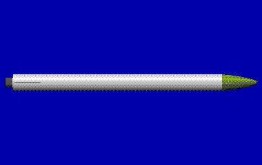

L'RPK-2 Vyuga (SS-N-15) è un missile antisommergibile sovietico lanciato dal tubo da 533 mm, l'equivalente del SUBROC americano: esce dall'acqua, vola senza autoguida sul punto calcolato e vi fa cadere la carica. Entrò in servizio nel 1969 o nel 1973 secondo le fonti, con una portata fra 10 e 45 km; il primo battello armato fu un Pr.705, e lo portavano anche Victor, Akula, Oscar e Typhoon. Nel 1989 portava la testata nucleare (dossier 05), la cui grande area d'effetto compensa la mancanza di guida; la versione con la carica di profondità convenzionale, citata da una sola fonte, nel gioco è una semplificazione.

**In partita.** Non si carica: nel gioco è un'arma del computer e porta una carica di profondità convenzionale, una semplificazione del carico (dossier 14) al posto della testata nucleare vera; la usano soprattutto il Victor III e, solo come variante, l'Alfa. Il battello nemico la lancia da 50-60 metri di quota contro la posizione stimata del 688: si sente il lancio e poi il razzo. Non ha testa, quindi le esche non servono: conta solo allontanarsi in fretta dal punto in cui il nemico ti crede.

| Dato | Valore | Nel gioco | Confidenza | Fonte |
|---|---|---|---|---|
| Guida | razzo antisom dal tubo, carica di profondità | - | bassa | dossier 14 §2.11 |
| Velocità | 0 kn | - | bassa | dossier 14 §2.11 |
| Portata | 45 km | - | bassa | dossier 14 §2.11 |
| Testata | nucleare | carica di profondità convenzionale (semplificazione del carico) | media | dossier 05 §0.1 punto 7 e §3.1 [RWVyuga] |
| Lunghezza | 8,2 m | - | bassa | dossier 14 §2.11 |
| Peso | 1.800 kg | - | bassa | dossier 14 §2.11 |
| In servizio dal | 1969 | - | bassa | dossier 14 §2.11 |

**Portata da (tipica):** Akula I (Progetto 971), Typhoon (Progetto 941), Victor I (Progetto 671), Victor III (Progetto 671RTM).

**Fonti:** dossier 14 §1.3 e §2.11 [WPVyuga]; dossier 05 §0.1 punto 7, §3.1-3.2 e §7.2 [RWVyuga]; dossier 01 §6.3 [WPRPK6]; carico.toml (armi.vyuga).

### SAET-60M

*Siluri · Unione Sovietica*

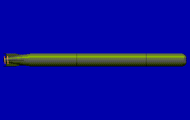

Il SAET-60M è un siluro sovietico da 533 mm del 1969 con testa acustica solo passiva, che ascolta il rumore del bersaglio. Corre a 40 nodi per circa 15 km; la testata è di 300 kg, ma una fonte la dà di 100. Le fonti lo descrivono come arma antinave o mista, antinave e antisom, e alcune lo mettono nella dotazione dell'Alfa accanto al SET-65.

**In partita.** Al comando dell'Alfa si carica nei tubi da siluro e si lancia con rotta, RTE, tetto e schema; la testa è solo passiva e la velocità una sola (40 nodi, 15 km). Va bene contro bersagli rumorosi e veloci, navi o sottomarini lanciati a tutta forza; un battello lento e silenzioso, o un'esca, lo ingannano facilmente. Non scende oltre i 200 metri (STIMA).

| Dato | Valore | Nel gioco | Confidenza | Fonte |
|---|---|---|---|---|
| Guida | testa passiva | - | bassa | dossier 14 §2.9 |
| Lunghezza | 7,5 m | - | bassa | dossier 14 §2.9 |
| Diametro | 533 mm | - | bassa | dossier 14 §2.9 |
| Peso | 1.800 kg | - | bassa | dossier 14 §2.9 |
| Testata | 300 kg | - | bassa | dossier 14 §2.9 |
| In servizio dal | 1969 | - | bassa | dossier 14 §2.9 |
| Velocità alta | 40 kn | - | media | dossier 14 §2.9 (bassa); quota e testa STIMA |
| Portata a velocità alta | 15 km | - | media | dossier 14 §2.9 (bassa); quota e testa STIMA |
| Velocità bassa | 40 kn | - | media | dossier 14 §2.9 (bassa); quota e testa STIMA |
| Portata a velocità bassa | 15 km | - | media | dossier 14 §2.9 (bassa); quota e testa STIMA |
| Quota massima | 200 m | - | media | dossier 14 §2.9 (bassa); quota e testa STIMA |
| Testa di ricerca | passiva | - | media | dossier 14 §2.9 (bassa); quota e testa STIMA |

**Portata da:** Alfa (Progetto 705).

**Portata da (tipica):** Foxtrot (Progetto 641).

**Fonti:** dossier 14 §1.3 e §2.9 [NavEnc705]; dossier 01 §6.1 [NWRU]; dossier 05 §5.3; siluri.toml (siluri.saet60m); carico.toml (armi.saet60m).

### SET-65

*Siluri · Unione Sovietica*

Il SET-65 è il siluro antisommergibile sovietico da 533 mm entrato in servizio nel 1965, con una testa acustica attiva e passiva che aggancia a circa 800 metri. Corre a 40 nodi per 15-16 km fra 20 e 400 metri di quota, con una testata di 205-240 kg. Insieme al 53-65K era il carico principale dell'Alfa nel 1989, una ventina di armi in tutto secondo le fonti.

**In partita.** È il siluro antisom predefinito dell'Alfa: si carica nei cinque tubi da siluro e si lancia dalla stazione Armi. Non ha filo e ha una sola velocità (40 nodi, 16 km): prima del lancio si scelgono rotta, modo della testa, RTE, tetto e schema, poi va da solo. La testa sente poco (800 metri in attivo, 1.500 in passivo): conviene una buona soluzione di tiro e un RTE vicino al bersaglio.

| Dato | Valore | Nel gioco | Confidenza | Fonte |
|---|---|---|---|---|
| Guida | testa attiva o passiva | - | media | dossier 14 §2.9 |
| Lunghezza | 7,8 m | - | media | dossier 14 §2.9 |
| Diametro | 533 mm | - | media | dossier 14 §2.9 |
| Peso | 1.900 kg | - | media | dossier 14 §2.9 |
| Testata | 205 kg | - | media | dossier 14 §2.9 |
| In servizio dal | 1965 | - | media | dossier 14 §2.9 |
| Velocità alta | 40 kn | - | media | dossier 14 §2.9 (media); quota e testa STIMA |
| Portata a velocità alta | 16 km | - | media | dossier 14 §2.9 (media); quota e testa STIMA |
| Velocità bassa | 40 kn | - | media | dossier 14 §2.9 (media); quota e testa STIMA |
| Portata a velocità bassa | 16 km | - | media | dossier 14 §2.9 (media); quota e testa STIMA |
| Quota massima | 400 m | - | media | dossier 14 §2.9 (media); quota e testa STIMA |
| Testa di ricerca | attiva, passiva | - | media | dossier 14 §2.9 (media); quota e testa STIMA |

**Portata da:** Alfa (Progetto 705).

**Portata da (tipica):** Kara (Progetto 1134B), Udaloy (Progetto 1155), Foxtrot (Progetto 641), Victor III (Progetto 671RTM).

**Fonti:** dossier 14 §1.3 e §2.9 [NavEnc705] [Legion705]; dossier 01 §6.1 [RWSET65] [NWRU]; siluri.toml (siluri.set65); carico.toml (armi.set65, carichi.alfa).

### Spearfish

*Siluri · Regno Unito*

Lo Spearfish è il siluro pesante britannico destinato a sostituire il Tigerfish: entrò in produzione piena nel 1988, ma in servizio solo nel 1992-94, quindi nel 1989 non era ancora a bordo. È filoguidato, con la testa attiva e passiva, e la testata di 300 kg è di esplosivo PBX alluminizzato. Il requisito del 1981 chiedeva oltre 60 nodi per circa 21 km; si sono letti anche 80 nodi, e a bassa velocità la portata arriva a circa 56 km. Con la quota la velocità cala.

**In partita.** È un'arma «what-if»: compare solo negli scenari ambientati dopo il 1989, sui battelli britannici guidati dal computer, e non si carica. Nel gioco fa 60 nodi per 21 km o 30 nodi per 56 km, aggancia da 2 km in attivo e 5 in passivo e vira più stretto del Mk 48. Finché è al filo si difende come dal Tigerfish (rompere il filo, poi esche e manovra), ma è troppo veloce per sperare di distanziarlo.

| Dato | Valore | Nel gioco | Confidenza | Fonte |
|---|---|---|---|---|
| Velocità alta | 60 kn | - | media | dossier 01 §6.1 (media); non in servizio nel 1989 |
| Portata a velocità alta | 21 km | - | media | dossier 01 §6.1 (media); non in servizio nel 1989 |
| Velocità bassa | 30 kn | - | media | dossier 01 §6.1 (media); non in servizio nel 1989 |
| Portata a velocità bassa | 56 km | - | media | dossier 01 §6.1 (media); non in servizio nel 1989 |
| Quota massima | 600 m | - | media | dossier 01 §6.1 (media); non in servizio nel 1989 |
| Filo (dal siluro / dal battello) | 30 km / 3 km | - | STIMA | dossier 01 §6.1 (media); non in servizio nel 1989 |
| Testa di ricerca | attiva, passiva | - | media | dossier 01 §6.1 (media); non in servizio nel 1989 |

**Fonti:** dossier 01 §1 e §6.1 [WPSpear] [NWBR]; dossier 14 §5.2; siluri.toml (siluri.spearfish).

### Sting Ray Mod 0

*Siluri · Stati Uniti*

Lo Stingray (Sting Ray) Mod 0 è il siluro leggero britannico entrato in servizio nel 1983; le prime unità furono affrettate per le Falkland nel 1982. Ha il calibro di 324 mm, è lungo 2,6 m e pesa 267 kg, con una carica cava di 45 kg di Torpex pensata per bucare gli scafi doppi dei sottomarini sovietici. Le fonti gli danno 45 nodi, una portata di 8-11 km e una quota fino a 800 m; dopo il lancio cerca in attivo e poi si guida da solo, in attivo e in passivo. Lo lanciano gli elicotteri e gli aerei da pattugliamento; dai tubi STWS delle navi (il Mk 2, perché il Mk 1 è fatto per il Mk 46) entrò più tardi, forse dopo il 1989.

**In partita.** Nel gioco arriva dal Lynx, a due per volo. Va fino a 800 metri contro i 450 del Mk 46, alla stessa velocità di 45 nodi: la quota non vi salva, e non lo seminate. Il suo ping attivo si sente: quando lo sentite, lanciate l'esca e cambiate quota e rotta insieme. La carica cava è forte ma piccola, e il modello dei danni per ora non la distingue da una carica normale.

| Dato | Valore | Nel gioco | Confidenza | Fonte |
|---|---|---|---|---|
| Velocità alta | 45 kn | - | media | docs/ricerca/38 (media); acquisizione STIMA |
| Portata a velocità alta | 11 km | - | media | docs/ricerca/38 (media); acquisizione STIMA |
| Velocità bassa | 45 kn | - | media | docs/ricerca/38 (media); acquisizione STIMA |
| Portata a velocità bassa | 11 km | - | media | docs/ricerca/38 (media); acquisizione STIMA |
| Quota massima | 800 m | - | media | docs/ricerca/38 (media); acquisizione STIMA |
| Testa di ricerca | attiva, passiva | - | media | docs/ricerca/38 (media); acquisizione STIMA |

**Portata da:** Lynx HAS.3.

**Fonti:** dossier 38 §3 e §4 [seaforces] [Naval Technology] [Navy Lookout] [UK Defence Journal] [Wikipedia Sting Ray]; siluri.toml [siluri.stingray].

### TEST-71M

*Siluri · Unione Sovietica*

Il TEST-71 (1971) e la versione TEST-71M (circa 1977) sono i siluri sovietici filoguidati da 533 mm, con il filo KTU-71 e la testa attiva e passiva «Sapfir», che aggancia entro circa 800 metri. Le fonti danno 40 nodi per 15 km; quella russa distingue 35 nodi d'attacco e 24 nodi di crociera per 15 km. Scende fino a 400 metri e porta una testata di 205 kg. Sull'Alfa la sua presenza non è confermata.

**In partita.** Al comando dell'Alfa si carica solo se la missione lo dichiara; è l'unico siluro filoguidato del battello sovietico. Si imposta come il Mk 48 (rotta, testa, velocità alta 40 nodi e 15 km o bassa 24 nodi e 20 km, RTE, tetto, schema) e finché il filo regge, fino a 20 km dal siluro e 2 km dal battello, si corregge la rotta e si scartano le esche. La testa sente poco: conviene portarlo vicino al bersaglio via filo prima di abilitarla.

| Dato | Valore | Nel gioco | Confidenza | Fonte |
|---|---|---|---|---|
| Guida | filoguidato, testa attiva o passiva | - | bassa | dossier 14 §2.9 |
| Lunghezza | 7,9 m | - | bassa | dossier 14 §2.9 |
| Diametro | 533 mm | - | bassa | dossier 14 §2.9 |
| Peso | 1.800 kg | - | bassa | dossier 14 §2.9 |
| Testata | 205 kg | - | bassa | dossier 14 §2.9 |
| In servizio dal | 1977 | - | bassa | dossier 14 §2.9 |
| Velocità alta | 40 kn | - | media | dossier 01 §6.1 (media) |
| Portata a velocità alta | 15 km | - | media | dossier 01 §6.1 (media) |
| Velocità bassa | 24 kn | - | media | dossier 01 §6.1 (media) |
| Portata a velocità bassa | 20 km | - | media | dossier 01 §6.1 (media) |
| Quota massima | 400 m | - | media | dossier 01 §6.1 (media) |
| Filo (dal siluro / dal battello) | 20 km / 2 km | - | STIMA | dossier 01 §6.1 (media) |
| Testa di ricerca | attiva, passiva | - | media | dossier 01 §6.1 (media) |

**Portata da (tipica):** Akula I (Progetto 971), Victor III (Progetto 671RTM).

**Fonti:** dossier 01 §2.4 e §6.1 [RWTEST71] [NWRU]; dossier 14 §2.9; siluri.toml (siluri.test71m); carico.toml (armi.test71m).

### Tigerfish Mk 24 Mod 1

*Siluri · Regno Unito*

Il Mk 24 Tigerfish è il siluro pesante britannico dei sottomarini della Royal Navy, come i Trafalgar del 1989: filoguidato, poi con la testa passiva e, a scelta, attiva. Il primo modello (Mod 0, 1980) era poco affidabile e perdeva spesso il filo al lancio, tanto che funzionava in circa il 40% dei casi; i Mod 1 e 2 del 1987 lo migliorarono. È lento rispetto al Mk 48: circa 35 nodi per 13-21 km, oppure 24 nodi per 27-39 km. Scende fino a 442 metri e porta una carica di Torpex fra 134 e 340 kg secondo le fonti.

**In partita.** Non si carica sul 688 né sull'Alfa: è l'arma dei battelli britannici guidati dal computer. Nel gioco corre a 35 nodi per 17 km o a 24 nodi per 33 km, e via filo l'operatore può correggerne la rotta e scartare le esche. Contro un siluro ancora al filo l'esca da sola vale poco: conviene costringere il lanciatore a manovrare finché il filo si rompe, poi lanciare le esche, virare stretto e cambiare quota.

| Dato | Valore | Nel gioco | Confidenza | Fonte |
|---|---|---|---|---|
| Guida | filoguidato, testa attiva o passiva | - | media | dossier 01 §6.1, §2.3 |
| Lunghezza | 6,5 m | - | media | dossier 01 §6.1, §2.3 |
| Diametro | 533 mm | - | media | dossier 01 §6.1, §2.3 |
| Peso | 1.550 kg | - | media | dossier 01 §6.1, §2.3 |
| Testata | 134 kg | - | media | dossier 01 §6.1, §2.3 |
| In servizio dal | 1987 | - | media | dossier 01 §6.1, §2.3 |
| Velocità alta | 35 kn | - | media | dossier 01 §6.1 (media) |
| Portata a velocità alta | 17 km | - | media | dossier 01 §6.1 (media) |
| Velocità bassa | 24 kn | - | media | dossier 01 §6.1 (media) |
| Portata a velocità bassa | 33 km | - | media | dossier 01 §6.1 (media) |
| Quota massima | 442 m | - | media | dossier 01 §6.1 (media) |
| Filo (dal siluro / dal battello) | 25 km / 3 km | - | STIMA | dossier 01 §6.1 (media) |
| Testa di ricerca | attiva, passiva | - | media | dossier 01 §6.1 (media) |

**Portata da (tipica):** Trafalgar (Royal Navy).

**Fonti:** dossier 01 §2.3 e §6.1 [WPTiger] [NWBR]; dossier 14 §1.4; dossier 05 §5.3-5.4; siluri.toml (siluri.tigerfish).

### Tp 42 (Tp 422)

*Siluri · svezia*

Il Tp 42 è il siluro leggero svedese da 400 mm, del 1975, prodotto dalla FFV. Il Tp 422 è la versione per gli elicotteri antisom, che lo sganciano senza paracadute. Le sue prestazioni non sono mai state pubblicate: velocità, portata, testata e testa acustica restano ignote nelle fonti aperte. Nella marina svedese lo porta l'elicottero Hkp 4, il Vertol 107 in versione navale, che ne imbarca due e cerca i sottomarini col sonar a immersione HS-73.

**In partita.** Nel gioco lo sgancia l'Hkp 4, che non posa boe: prima cala l'HS-73 sul datum e pinga attorno ai 10 kHz, e quel ping è l'allarme. Le cifre sono tutte stime: corre a 30 nodi per 10 km o a 20 nodi per 20 km, non è filoguidato, aggancia entro 500 m in attivo e 800 m in passivo con una testa che guarda 40 gradi per lato, e non segue oltre i 200 metri; non lo si sgancia dove il fondale è sotto i 15 metri. La difesa: esca, virata stretta e tutta forza, perché a 32 nodi il 688 è più veloce del siluro; dove il fondale lo permette, scendere sotto i 200 metri. La testata è piccola, 45 kg, quasi quanto quella del Mk 46.

| Dato | Valore | Nel gioco | Confidenza | Fonte |
|---|---|---|---|---|
| Velocità alta | 30 kn | - | media | docs/ricerca/35 (bassa): 400 mm, 1975; il resto STIMA |
| Portata a velocità alta | 10 km | - | media | docs/ricerca/35 (bassa): 400 mm, 1975; il resto STIMA |
| Velocità bassa | 20 kn | - | media | docs/ricerca/35 (bassa): 400 mm, 1975; il resto STIMA |
| Portata a velocità bassa | 20 km | - | media | docs/ricerca/35 (bassa): 400 mm, 1975; il resto STIMA |
| Quota massima | 200 m | - | media | docs/ricerca/35 (bassa): 400 mm, 1975; il resto STIMA |
| Testa di ricerca | attiva, passiva | - | media | docs/ricerca/35 (bassa): 400 mm, 1975; il resto STIMA |

**Portata da:** Hkp 4 (Vertol 107).

**Fonti:** dossier 35 §5 [Jane's, in sintesi] [Military Periscope]; dossier 35 §1-2 [AEROSEUM-HKP4] [AVROSYS-HKP4]; siluri.toml (siluri.tp42); asw_aereo.toml (mezzi.hkp4).

### UGM-109B Tomahawk TASM

*Missili · Stati Uniti*

L'UGM-109B TASM è la versione antinave del Tomahawk, in servizio dal 1983 e ritirata all'inizio degli anni '90. Dal tubo esce in un contenitore e accende il razzo già sott'acqua; dai pozzi verticali dei Flight II parte senza togliere posti al locale siluri. Vola a circa 245 metri al secondo e ha una portata utile di circa 460 km, con una testata di 450 kg. Era un'arma d'area: dopo fino a mezz'ora di volo cercava a serpentina con l'ESM e il radar, e nelle simulazioni degli anni '80 colpì più spesso altre navi che il bersaglio designato.

**In partita.** È il «Tomahawk» delle missioni originali: si carica in un tubo (un posto) o nei pozzi verticali dei Flight II e 688I, e si lancia contro navi a quota periscopica con un contatto a traccia solida. Con mezz'ora di volo il bersaglio si sposta di parecchie miglia e il missile si accontenta della prima nave che trova: attenti ai neutrali e alle navi amiche nella zona. Dopo il lancio, come con l'Harpoon, conviene lasciare il punto di partenza.

| Dato | Valore | Nel gioco | Confidenza | Fonte |
|---|---|---|---|---|
| Guida | inerziale, radar attivo, volo radente | - | alta | dossier 14 §2.3 |
| Velocità | 475 kn | - | alta | dossier 14 §2.3 |
| Portata | 460 km | - | alta | dossier 14 §2.3 |
| Testata | 450 kg | - | alta | dossier 14 §2.3 |
| Lunghezza | 6,2 m | - | alta | dossier 14 §2.3 |
| Peso | 1.590 kg | - | alta | dossier 14 §2.3 |
| In servizio dal | 1983 | - | alta | dossier 14 §2.3 |

**Portata da:** Los Angeles (SSN-688, Flight I).

**Portata da (tipica):** Sturgeon (SSN-637).

**Fonti:** dossier 14 §2.3 e §3.6 [DSM109]; dossier 05 §0.1 punti 2 e 4, §2.1-2.3 [DS109] [NG2] [GAO95]; dossier 01 §6.4; carico.toml (armi.tasm, predefinite.usa).

### UGM-109C Tomahawk TLAM-C

*Missili · Stati Uniti*

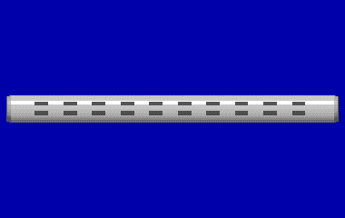

L'UGM-109C TLAM-C è il Tomahawk convenzionale d'attacco a terra, in servizio dal 1986, con una testata di 450 kg. Vola sul mare con la navigazione inerziale, si corregge sulla costa confrontando il radioaltimetro con mappe del terreno (TERCOM) e nell'ultima fase con immagini del bersaglio (DSMAC). Dal sottomarino la portata scende di circa il 30%, da 1.250 a circa 875 km, perché il booster si porta via parte del carburante. Le missioni si preparavano a terra anche per 72 ore e a bordo serviva circa un'ora per lanciare.

**In partita.** Si imbarca solo se la missione prevede un attacco a terra: nei tubi sui Flight I, togliendo posti ai siluri, o nei 12 pozzi verticali sui Flight II e 688I. Non si spara a vista: la missione arriva già pianificata e il battello deve raggiungere l'area di lancio prevista (5-10 miglia di raggio, STIMA) e lì lanciare dopo la preparazione. Il lancio rivela la posizione: poi ci si allontana in fretta.

| Dato | Valore | Nel gioco | Confidenza | Fonte |
|---|---|---|---|---|
| Guida | inerziale, TERCOM e DSMAC | - | alta | dossier 14 §2.3 |
| Velocità | 475 kn | - | alta | dossier 14 §2.3 |
| Portata | 1.250 km | - | alta | dossier 14 §2.3 |
| Testata | 450 kg | - | alta | dossier 14 §2.3 |
| Lunghezza | 6,2 m | - | alta | dossier 14 §2.3 |
| Peso | 1.490 kg | - | alta | dossier 14 §2.3 |
| In servizio dal | 1986 | - | alta | dossier 14 §2.3 |

**Portata da:** Los Angeles (SSN-688, Flight I).

**Portata da (tipica):** Iowa (BB-61).

**Fonti:** dossier 14 §2.3 e §3.6 [DSM109]; dossier 05 §0.1 punto 3, §2.2 e §2.4 [DS109] [GAO95] [FASCMSA]; carico.toml (armi.tlam_c, carichi.los_angeles_flight2).

### UGM-84 Harpoon

*Missili · Stati Uniti*

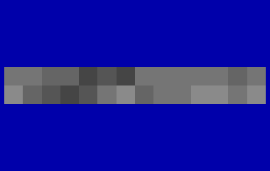

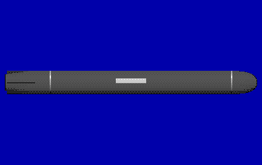

L'UGM-84 Sub-Harpoon è il missile antinave dei sottomarini d'attacco americani dal 1981; nel 1989 a bordo c'erano le versioni A, C (radente, dal 1982) e D (Block 1C, dal 1985). Esce dal tubo in una capsula che sale in superficie per galleggiamento; solo all'affioramento si aprono i tappi e si accende il razzo, poi un turbogetto lo porta a circa Mach 0,85 radente sul mare. Il radar attivo in banda J si accende a una distanza preimpostata dal punto previsto; la testata è di 221 kg e la portata da sottomarino circa 110-140 km. Ogni capsula occupa il posto di un siluro.

**In partita.** Si carica in un tubo come un siluro e si lancia dalla stazione Armi solo contro le navi: servono un bersaglio identificato con traccia solida, almeno 5 miglia di distanza e la quota periscopica. Il missile vola dritto verso il punto previsto e poi cerca col radar, quindi conviene una buona stima di distanza e rotta del bersaglio. Il lancio si vede e si sente (capsula, fumo del razzo), e la rotta dritta tradisce il punto di partenza: dopo la salva bisogna allontanarsi.

| Dato | Valore | Nel gioco | Confidenza | Fonte |
|---|---|---|---|---|
| Guida | inerziale, radar attivo in banda J; capsula dal tubo | - | media | dossier 14 §2.2 |
| Velocità | 467 kn | 560 kn | media | dossier 05 §0 Convenzioni |
| Portata | 140 km | - | media | dossier 14 §2.2 |
| Testata | 221 kg | - | media | dossier 14 §2.2 |
| Lunghezza | 3,80 m | 4,6 m | media | dossier 05 §6.1 |
| Peso | 1.300 kg | - | media | dossier 14 §2.2 |
| In servizio dal | 1981 | - | media | dossier 14 §2.2 |

**Portata da:** Los Angeles (SSN-688, Flight I).

**Portata da (tipica):** Iowa (BB-61), Kidd (DDG-993), Knox (FF-1052), Ticonderoga (CG-47), Sturgeon (SSN-637), Trafalgar (Royal Navy).

**Fonti:** dossier 14 §2.2 e §3.6 [DSM84]; dossier 05 §0.1 punto 1, §1.1-1.7 e §7.2 [DS84] [USNI77]; dossier 01 §6.4; carico.toml (armi.harpoon).

### UMGT-1 Orlan

*Siluri · Unione Sovietica*

L'UMGT-1 «Orlan» è il siluro leggero sovietico da 400 mm del 1981, con la testa attiva e passiva: corre a 41 nodi per 8 km e scende fino a 500-550 metri, con una testata di circa 60 kg. Lo sgancia l'elicottero Ka-27, ed è anche il carico del missile antisom Vodopad (SS-N-16), lanciato dai tubi di Victor III, Akula e Oscar fino a 50 km. Entra in acqua a 60-65 metri al secondo con il motore già acceso, scende a 40-50 metri e comincia a girare a sinistra.

**In partita.** È la minaccia a distanza più seria: un Victor III o un Akula lo lancia col Vodopad da decine di chilometri, e il primo segno è il razzo, poi il tonfo del siluro col paracadute; fra l'ammaraggio e la testa attiva restano 20-40 secondi (STIMA). Va subito in moto: lancia un'esca, accelera via dal punto d'ammaraggio e cambia quota. Scende fino a 550 metri, quindi la profondità da sola non basta.

| Dato | Valore | Nel gioco | Confidenza | Fonte |
|---|---|---|---|---|
| Velocità alta | 41 kn | - | media | dossier 17 §6.7 (alta/media); testata e acquisizione STIMA |
| Portata a velocità alta | 8 km | - | media | dossier 17 §6.7 (alta/media); testata e acquisizione STIMA |
| Velocità bassa | 41 kn | - | media | dossier 17 §6.7 (alta/media); testata e acquisizione STIMA |
| Portata a velocità bassa | 8 km | - | media | dossier 17 §6.7 (alta/media); testata e acquisizione STIMA |
| Quota massima | 550 m | - | media | dossier 17 §6.7 (alta/media); testata e acquisizione STIMA |
| Testa di ricerca | attiva, passiva | - | media | dossier 17 §6.7 (alta/media); testata e acquisizione STIMA |

**Portata da (tipica):** Kirov (Progetto 1144).

**Fonti:** dossier 17 §3.2, §6.7 e §8.3 [ART-Be12] [RW-UMGT1] [ART-Ka27]; dossier 01 §6.2-6.3 [NWRU] [WPRPK6]; dossier 05 §0.1 punto 7, §3.1-3.2 [RWVodopad] [DSRM671]; siluri.toml (siluri.umgt1).

### USET-80

*Siluri · Unione Sovietica*

L'USET-80 è il siluro antisommergibile sovietico da 533 mm della generazione del 1980, con la testa attiva e passiva; le fonti gli attribuiscono anche la guida sulla scia. Le fonti danno 43-50 nodi e 18-20 km, con una testata fra 200 e 300 kg. Sulla quota non concordano: 1.000 metri per la fonte russa, «oltre 400» per un'altra. Nelle fonti aperte non risulta imbarcato sull'Alfa, ed è il «Type 53» antisom del gioco originale.

**In partita.** Al comando dell'Alfa si carica solo se la missione lo prevede. Non è filoguidato: prima del lancio dalla stazione Armi si impostano rotta, modo della testa (attivo, passivo o tutti e due), velocità (alta: 45 nodi e 18 km; bassa: 35 nodi e 24 km), RTE, tetto e schema, poi il siluro va da solo. Scende fino a 1.000 metri, quindi nessun battello gli sfugge andando in profondità.

| Dato | Valore | Nel gioco | Confidenza | Fonte |
|---|---|---|---|---|
| Guida | testa attiva o passiva | - | bassa | dossier 14 §2.9 |
| Lunghezza | 7,9 m | - | bassa | dossier 14 §2.9 |
| Diametro | 533 mm | - | bassa | dossier 14 §2.9 |
| Peso | 2.000 kg | - | bassa | dossier 14 §2.9 |
| Testata | 250 kg | - | bassa | dossier 14 §2.9 |
| In servizio dal | 1980 | - | bassa | dossier 14 §2.9 |
| Velocità alta | 45 kn | - | media | dossier 01 §6.1 (media); bassa velocità STIMA |
| Portata a velocità alta | 18 km | - | media | dossier 01 §6.1 (media); bassa velocità STIMA |
| Velocità bassa | 35 kn | - | media | dossier 01 §6.1 (media); bassa velocità STIMA |
| Portata a velocità bassa | 24 km | - | media | dossier 01 §6.1 (media); bassa velocità STIMA |
| Quota massima | 1.000 m | - | media | dossier 01 §6.1 (media); bassa velocità STIMA |
| Testa di ricerca | attiva, passiva | - | media | dossier 01 §6.1 (media); bassa velocità STIMA |

**Portata da (tipica):** Akula I (Progetto 971), Victor III (Progetto 671RTM).

**Fonti:** dossier 14 §2.9; dossier 01 §6.1 [RWUSET80] [NWRU]; siluri.toml (siluri.uset80); carico.toml (armi.uset80).

### UUM-125 Sea Lance

*Missili · Stati Uniti*

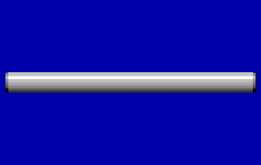

L'UUM-125 Sea Lance fu pensato nel 1980 come successore del SUBROC e dell'ASROC: una capsula da 21 pollici lanciata dal tubo che porta lontano, e vi fa scendere col paracadute, un siluro leggero Mk 50, a sua volta non ancora in servizio nel 1989. La Boeing ebbe il contratto nel 1982; la versione nucleare fu rinviata e quella convenzionale fu cancellata nel 1990, ancora in sviluppo. Nel 1989 quindi non esisteva in servizio, ma il gioco originale lo metteva nella dotazione di due missioni.

**In partita.** È un'arma «what-if»: si carica (un posto, come un siluro) solo con l'opzione relativa o nelle due missioni originali che la prevedono. Si lancia dalla stazione Armi contro un sottomarino con un contatto a traccia solida, alle condizioni dei missili del tubo 7; l'arma arriva in pochi minuti sul punto previsto, dove il Mk 50 comincia a cercare da solo. Portata e prestazioni sono STIMA (circa 185 km nel gioco).

| Dato | Valore | Nel gioco | Confidenza | Fonte |
|---|---|---|---|---|
| Guida | inerziale; capsula, poi siluro leggero Mk 50 a paracadute | - | bassa | dossier 14 §2.5 |
| Velocità | 860 kn | - | bassa | dossier 14 §2.5 |
| Portata | 185 km | - | bassa | dossier 14 §2.5 |
| Testata | 45 kg | - | bassa | dossier 14 §2.5 |
| Lunghezza | 6,2 m | - | bassa | dossier 14 §2.5 |
| Peso | 1.400 kg | - | bassa | dossier 14 §2.5 |
| In servizio dal | 0 | - | bassa | dossier 14 §2.5 |
| Nel 1989 | non ancora in servizio | - | bassa | dossier 14 §2.5 |

**Fonti:** dossier 14 §2.5, §4.2 e §5.2 [WPSeaLance] [DSM125]; dossier 01 §6.2-6.3 [WPSUBROC] [WPMk50]; carico.toml (armi.sea_lance).

### VA-111 Shkval

*Siluri · Unione Sovietica*

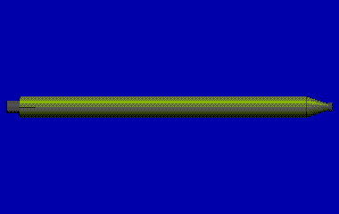

Il VA-111 Shkval è un siluro sovietico supercavitante a razzo da 533 mm: corre a circa 200 nodi, ma solo per circa 11 km, con una testata di 210 kg. Era in servizio dal 1977, ma l'Occidente lo conobbe solo negli anni '90: nel 1989 era un'arma segreta. Le schede dell'Alfa citano «20 Shkval al posto dei siluri», ma nessuna fonte nomina un battello che li abbia davvero imbarcati; una lo descrive come arma non guidata contro i siluri in arrivo.

**In partita.** Non si carica: è un'arma solo per il computer, in missioni scelte, e la libreria americana non la conosce. Non ha testa né filo e va dritto, quindi le esche non servono e non lo si distanzia: l'unica difesa è non trovarsi sulla sua rotta. È pericoloso solo da vicino, entro una decina di chilometri: contro un Alfa conviene tenersi lontani e sparare per primi.

| Dato | Valore | Nel gioco | Confidenza | Fonte |
|---|---|---|---|---|
| Guida | supercavitante a razzo, non guidato | - | bassa | dossier 14 §2.10 |
| Lunghezza | 8,2 m | - | bassa | dossier 14 §2.10 |
| Diametro | 533 mm | - | bassa | dossier 14 §2.10 |
| Peso | 2.700 kg | - | bassa | dossier 14 §2.10 |
| Testata | 210 kg | - | bassa | dossier 14 §2.10 |
| In servizio dal | 1977 | - | bassa | dossier 14 §2.10 |
| Velocità | 200 kn | - | bassa | dossier 14 §2.10 |
| Portata | 11 km | - | bassa | dossier 14 §2.10 |

**Fonti:** dossier 14 §1.3 e §2.10 [WPShkval] [WPAlfa] [GS705] [Legion705] [NavEnc705]; carico.toml (armi.shkval).
<!-- fine: unita_armi -->
