# 15. Sensori

Le schede dei sensori della simulazione, dall'enciclopedia del gioco: sonar, radar, ricevitori ESM, periscopi e boe.

<!-- generato: unita_sensori -->
### AN/APS-115

*Radar · Stati Uniti*

Il radar di ricerca del P-3C Orion nel 1989: due antenne, nel muso e nella coda, danno una copertura a 360 gradi in banda X. Deriva dall'APS-80 dei primi Orion e vede una nave grande a oltre cento miglia; contro un periscopio alzato la portata cala molto, e col mare grosso quasi scompare. Il successore APS-137 arriva sugli Orion solo negli anni '90.

| Dato | Valore | Nel gioco | Confidenza | Fonte |
|---|---|---|---|---|
| Banda | I | - | media | emettitori.toml (dossier 11 §1 e §6.4) |
| Frequenza | 9 GHz | - | media | emettitori.toml (dossier 11 §1 e §6.4) |
| Periodo di rotazione | 6 s | - | bassa | emettitori.toml (dossier 11 §1 e §6.4) |
| Scoperta di un periscopio (R50, mare 2) | 6 nm | - | STIMA | emettitori.toml (dossier 11 §1 e §6.4) |
| Scoperta di un periscopio (R50, mare 4) | 2 nm | - | STIMA | emettitori.toml (dossier 11 §1 e §6.4) |
| Portata contro una nave grande | 100 nm | - | bassa | emettitori.toml (dossier 11 §1 e §6.4) |

**Montato su:** P-3C Orion.

**Fonti:** dossier 11 §1.4 [WPAPS] [RTAPS] [APL97]; dossier 11 §6.4; emettitori.toml (radar.aps115).

### AN/APS-116

*Radar · Stati Uniti*

Il radar del Viking S-3A, l'aereo antisommergibile delle portaerei, in banda X. Ha un modo pensato apposta per i periscopi: l'antenna gira a 300 giri al minuto con 2000 impulsi al secondo, un fascio di 2,4 gradi e una risoluzione di un piede, e un rivelatore automatico conferma il bersaglio se compare in 13 giri su 25. Era la risposta americana all'ESM dei sottomarini: tanti giri in pochi secondi per cogliere anche un'alzata brevissima. Nel 1989 vola ancora sulle portaerei del Pacifico; su quelle atlantiche le S-3A lasciano il posto alle S-3B.

**In partita.** All'ESM la sua firma non si confonde con nessun'altra: un ronzio quasi continuo, un giro ogni 0,2 secondi. Contro questo radar anche cinque secondi d'esposizione valgono 25 occasioni di essere visti: se lo senti, abbassa tutto e scendi. Il Viking lo accende a colpi brevi, uno o due giri, poi tace per minuti.

| Dato | Valore | Nel gioco | Confidenza | Fonte |
|---|---|---|---|---|
| Banda | I | - | media | emettitori.toml (dossier 11 §1 e §6.4) |
| Frequenza | 9 GHz | - | media | emettitori.toml (dossier 11 §1 e §6.4) |
| Periodo di rotazione | 0,2 s | - | bassa | emettitori.toml (dossier 11 §1 e §6.4) |
| Scoperta di un periscopio (R50, mare 2) | 8 nm | - | STIMA | emettitori.toml (dossier 11 §1 e §6.4) |
| Scoperta di un periscopio (R50, mare 4) | 3 nm | - | STIMA | emettitori.toml (dossier 11 §1 e §6.4) |
| Portata contro una nave grande | 150 nm | - | bassa | emettitori.toml (dossier 11 §1 e §6.4) |

**Montato su:** S-3A Viking.

**Fonti:** dossier 11 §3.3 e §5.1 [APL97]; dossier 17 §2.5 [WPS3] [TWZS3] e §8.2; emettitori.toml (radar.aps116).

### AN/APS-124

*Radar · Stati Uniti*

Il radar di ricerca di superficie dell'SH-60B Seahawk, l'elicottero LAMPS III della US Navy, in servizio dal 1983. Lavora in banda X con 350 kW di picco e un fascio stretto di 1,2 gradi, e l'antenna può girare fino a 120 giri al minuto; la portata strumentale è di 160 miglia. Serve soprattutto a scoprire le navi e a designarle oltre l'orizzonte della nave madre; nella caccia ai sottomarini l'elicottero lavora con boe e MAD.

**In partita.** All'ESM è una firma rapida e riconoscibile, un giro ogni mezzo secondo o poco più: un elicottero è vicino. Lo accende per 30-60 secondi e poi lo spegne per qualche minuto, quindi un silenzio non vuol dire che se ne sia andato. Con mare calmo vede un periscopio a circa 5 miglia, con mare 4 a 2.

| Dato | Valore | Nel gioco | Confidenza | Fonte |
|---|---|---|---|---|
| Banda | I | - | media | emettitori.toml (dossier 11 §1 e §6.4) |
| Frequenza | 9 GHz | - | media | emettitori.toml (dossier 11 §1 e §6.4) |
| Periodo di rotazione | 0,8 s | - | bassa | emettitori.toml (dossier 11 §1 e §6.4) |
| Scoperta di un periscopio (R50, mare 2) | 5 nm | - | STIMA | emettitori.toml (dossier 11 §1 e §6.4) |
| Scoperta di un periscopio (R50, mare 4) | 2 nm | - | STIMA | emettitori.toml (dossier 11 §1 e §6.4) |
| Portata contro una nave grande | 60 nm | - | bassa | emettitori.toml (dossier 11 §1 e §6.4) |

**Montato su:** SH-60B Seahawk (LAMPS III).

**Fonti:** dossier 11 §1.4 [ARMSAPS124] [MPAPS124], §3.3 e §6.1-6.2; dossier 17 §8.2; emettitori.toml (radar.aps124).

### AN/APS-137 ISAR

*Radar · Stati Uniti*

Il radar ISAR del Viking S-3B, operativo dal luglio 1988: oltre alla ricerca forma l'immagine di una nave per classificarla. Eredita dall'APS-116 il modo periscopio, con 300 giri al minuto e 2000 impulsi al secondo. Nel 1989 è sulle S-3B delle portaerei atlantiche; i P-3C lo riceveranno solo con gli aggiornamenti della fine degli anni '90, quindi in questo periodo l'Orion monta ancora l'APS-115.

**In partita.** È il radar più pericoloso del gioco per un periscopio: con mare calmo ti vede a circa 10 miglia, e il giro da 0,2 secondi accumula occasioni a ogni secondo d'esposizione. La sua firma all'ESM è unica: quando compare l'aereo sta cercando proprio i periscopi. Abbassa tutto e cambia quota.

| Dato | Valore | Nel gioco | Confidenza | Fonte |
|---|---|---|---|---|
| Banda | I | - | media | emettitori.toml (dossier 11 §1 e §6.4) |
| Frequenza | 9 GHz | - | media | emettitori.toml (dossier 11 §1 e §6.4) |
| Periodo di rotazione | 0,2 s | - | bassa | emettitori.toml (dossier 11 §1 e §6.4) |
| Scoperta di un periscopio (R50, mare 2) | 10 nm | - | STIMA | emettitori.toml (dossier 11 §1 e §6.4) |
| Scoperta di un periscopio (R50, mare 4) | 4 nm | - | STIMA | emettitori.toml (dossier 11 §1 e §6.4) |
| Portata contro una nave grande | 150 nm | - | bassa | emettitori.toml (dossier 11 §1 e §6.4) |

**Montato su:** S-3B Viking.

**Fonti:** dossier 11 §1.4 e §2 [APL97]; dossier 17 §1 e §2.5 [FASS3] [FASP3]; emettitori.toml (radar.aps137).

### AN/AQS-13B

*Sonar · Stati Uniti*

Il sonar a immersione dell'elicottero SH-3H Sea King, che difende il cuore del gruppo portaerei. Dall'hover a circa 12 metri cala il trasduttore e trasmette a 9,23, 10 o 10,77 kHz impulsi brevi da almeno 211 dB, ricevendo su 16 fasci con un filtro Doppler; ha anche il modo passivo e la telefonia subacquea. Contro un sottomarino d'attacco medio la portata attiva è di 3-5 mila iarde, fino a 8-12 mila con buona propagazione sotto lo strato; il passivo è debole. Lavora anche di notte, ma in una giornata a 40 °C l'elicottero non riesce a stare in hover e non può calare il sonar.

**In partita.** Il ciclo si riconosce: il tonfo del trasduttore, uno o tre minuti di silenzio, ping ogni 6-10 secondi, il recupero, poi un altro tonfo 5-10 miglia più in là. Lo senti a circa 27 km mentre lui ti scopre a 3-4: fuggi durante il salto, quando il sonar è fuori dall'acqua.

| Dato | Valore | Nel gioco | Confidenza | Fonte |
|---|---|---|---|---|
| Modo «aqs13b» | attivo | - | media | acustica.toml: AQS-13B (SH-3H): ~10 kHz, >= 211 dB, 3,5 o 35 ms (17 §6.4, §8.3 [MILAQS13B]) |
| Antenna | sfera da 0,5 m | - | media | acustica.toml: AQS-13B (SH-3H): ~10 kHz, >= 211 dB, 3,5 o 35 ms (17 §6.4, §8.3 [MILAQS13B]) |
| Velocità massima d'ascolto | 30 kn | - | media | acustica.toml: AQS-13B (SH-3H): ~10 kHz, >= 211 dB, 3,5 o 35 ms (17 §6.4, §8.3 [MILAQS13B]) |
| Modo «aqs13b_passivo» | passivo | - | media | acustica.toml: AQS-13B in passivo: banda stretta a 10 kHz, solo contro la cavitazione vicina (17 §6.4) |
| Antenna | sfera da 0,5 m | - | media | acustica.toml: AQS-13B in passivo: banda stretta a 10 kHz, solo contro la cavitazione vicina (17 §6.4) |
| Velocità massima d'ascolto | 30 kn | - | media | acustica.toml: AQS-13B in passivo: banda stretta a 10 kHz, solo contro la cavitazione vicina (17 §6.4) |

**Montato su:** SH-3H Sea King.

**Fonti:** dossier 17 §2.2 [MILAQS13B] [RUDZIS]; dossier 17 §6.4 e §8.3; asw_aereo.toml (sonar_immersione.aqs13b); acustica.toml (sensori.aqs13b).

### AN/AQS-13F

*Sonar · Stati Uniti*

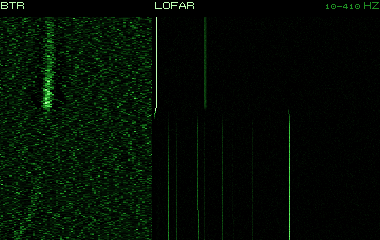

La versione dell'AQS-13 per l'SH-60F Ocean Hawk, il successore dell'SH-3H sulle portaerei, che entra in scena solo nel 1990-91. Rispetto all'AQS-13B ha un cavo di 1575 piedi, un impulso più lungo, più potenza e un verricello più veloce; l'elicottero sta in hover più in alto, a circa 18 metri, e non ha né radar né MAD. Nel 1989 le portaerei usano ancora l'SH-3H.

**In partita.** Stesso ciclo dell'AQS-13B, ma il trasduttore scende fino a circa 440 metri: nascondersi sotto lo strato non basta più. Compare solo nelle missioni dal 1990 in poi.

| Dato | Valore | Nel gioco | Confidenza | Fonte |
|---|---|---|---|---|
| Modo «aqs13f» | attivo | - | media | acustica.toml: AQS-13F (SH-60F): 215 dB come nella tabella dell'asimmetria (17 §8.3) |
| Antenna | sfera da 0,5 m | - | media | acustica.toml: AQS-13F (SH-60F): 215 dB come nella tabella dell'asimmetria (17 §8.3) |
| Velocità massima d'ascolto | 30 kn | - | media | acustica.toml: AQS-13F (SH-60F): 215 dB come nella tabella dell'asimmetria (17 §8.3) |
| Modo «aqs13f_passivo» | passivo | - | media | acustica.toml: AQS-13F in passivo (17 §6.4) |
| Antenna | sfera da 0,5 m | - | media | acustica.toml: AQS-13F in passivo (17 §6.4) |
| Velocità massima d'ascolto | 30 kn | - | media | acustica.toml: AQS-13F in passivo (17 §6.4) |

**Montato su:** SH-60F Ocean Hawk.

**Fonti:** dossier 17 §2.3 [WPAQS13] [SIKS70B]; asw_aereo.toml (sonar_immersione.aqs13f); acustica.toml (sensori.aqs13f).

### AN/BPS-15

*Radar · Stati Uniti*

Il radar di navigazione e di ricerca di superficie dei 688. Lavora in banda X con 35 kW di picco ma appena 13 W medi, impulsi brevissimi e una risoluzione di circa 30 metri. Serve alla navigazione e a una ricerca di superficie rapida: dalla quota periscopica o in emersione vede le navi a 10-12 miglia. Nel gioco lo stesso modello vale anche per gli Sturgeon e le Trafalgar.

**In partita.** Accenderlo in pattuglia è quasi sempre un errore: la sua emissione arriva molto più lontano di quanto il radar veda, e le grandi navi sovietiche hanno stazioni d'intercettazione dedicate. Vicino a un gruppo antisommergibile sovietico verrebbe intercettato quasi di sicuro. Usalo per pochi giri, quando il quadro di superficie vale il rischio.

| Dato | Valore | Nel gioco | Confidenza | Fonte |
|---|---|---|---|---|
| Banda | I | - | media | emettitori.toml (dossier 11 §1 e §6.4) |
| Frequenza | 9 GHz | - | media | emettitori.toml (dossier 11 §1 e §6.4) |
| Periodo di rotazione | 3 s | - | bassa | emettitori.toml (dossier 11 §1 e §6.4) |
| Portata contro una nave grande | 11 nm | - | bassa | emettitori.toml (dossier 11 §1 e §6.4) |

**Montato su:** Los Angeles (SSN-688, Flight I), Sturgeon (SSN-637), Trafalgar (Royal Navy), Ohio (SSBN-726).

**Fonti:** dossier 11 §1.5 [NAVYBPS15] [ARMSBPS] [NT688], §3.4 e §6.1; emettitori.toml (radar.bps15).

### AN/BQQ-5

*Sonar · Stati Uniti*

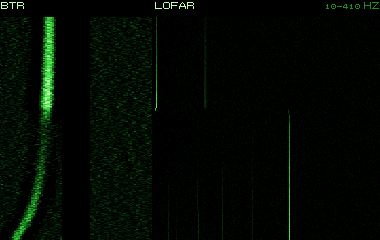

Il sistema sonar integrato dei 688: una sfera di prua da 4,6 metri (BQS-13) con più di mille idrofoni, una schiera conforme lungo lo scafo e l'antenna rimorchiata. In passivo ascolta a bassa frequenza e con l'analisi LOFAR riconosce le righe di macchina dei battelli; in attivo emette impulsi a media frequenza, ma tradisce chi li usa. Sopra i 20-25 nodi il rumore del flusso lo rende sordo, e dietro la poppa c'è un settore cieco.

**In partita.** Nella stazione Sonar si sceglie il modo: la sfera in passivo con la cascata a banda larga e il LOFAR per le righe, l'antenna rimorchiata per l'ascolto lontano, l'attivo per la distanza a un colpo solo. Per sentire bene si va piano: a 5-8 nodi il rumore proprio è minimo. I contatti nel settore di poppa si scoprono solo cambiando rotta.

| Dato | Valore | Nel gioco | Confidenza | Fonte |
|---|---|---|---|---|
| Modo «bqq5_sfera» | passivo | - | media | acustica.toml: 688: sfera BQS-13 del BQQ-5 in passivo a bassa frequenza (FAS) con il LOFAR; sorda oltre 20-25 kn |
| Antenna | sfera da 4,6 m | - | media | acustica.toml: 688: sfera BQS-13 del BQQ-5 in passivo a bassa frequenza (FAS) con il LOFAR; sorda oltre 20-25 kn |
| Velocità massima d'ascolto | 25 kn | - | media | acustica.toml: 688: sfera BQS-13 del BQQ-5 in passivo a bassa frequenza (FAS) con il LOFAR; sorda oltre 20-25 kn |
| Settore cieco di poppa | 70 ° | - | media | acustica.toml: 688: sfera BQS-13 del BQQ-5 in passivo a bassa frequenza (FAS) con il LOFAR; sorda oltre 20-25 kn |
| Modo «bqq5_attivo» | attivo | - | media | acustica.toml: 688: BQQ-5 attivo, ~3,5 kHz, SL 220-230 |
| Antenna | sfera da 4,6 m | - | media | acustica.toml: 688: BQQ-5 attivo, ~3,5 kHz, SL 220-230 |
| Velocità massima d'ascolto | 25 kn | - | media | acustica.toml: 688: BQQ-5 attivo, ~3,5 kHz, SL 220-230 |
| Settore cieco di poppa | 70 ° | - | media | acustica.toml: 688: BQQ-5 attivo, ~3,5 kHz, SL 220-230 |

**Montato su:** Los Angeles (SSN-688, Flight I), Sturgeon (SSN-637), Trafalgar (Royal Navy), Ohio (SSBN-726).

**Fonti:** dossier 01 §2.1 [FAS688] [WP688]; acustica.toml (sensori.bqq5_sfera, bqq5_attivo).

### AN/BQR-15 con la schiera TB-16

*Sonar · Stati Uniti*

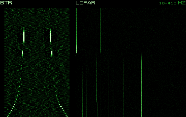

L'antenna rimorchiata «fat line» di tutti i 688, un sottosistema del BQQ-5: 73 metri di idrofoni, 9 cm di diametro e 1.400 libbre, al traino di 731 metri di cavo; l'elaborazione è della famiglia BQR-15/BQR-23, con almeno 64 canali LOFAR e la presentazione frequenza-azimut. È uno strumento a banda stretta: sente da lontano le righe di macchina e d'elica, anche alle distanze della zona di convergenza. Sotto i 3 nodi si incurva, sopra i 15-18 è sorda per il rumore di flusso, in virata è cieca per alcuni minuti e ogni contatto ha un'immagine speculare. Nel 1989 i 688I cominciano ad affiancarle la più lunga TB-23.

**In partita.** Filarla richiede circa un quarto d'ora; in pattuglia la si tiene fuori e la si recupera solo per i transiti veloci o le acque basse. Per ascoltare stai fra 3 e 8 nodi, anche a scatti e derive; vira dolcemente, perché oltre 0,3 gradi al secondo diventa cieca e poi impiega circa 2 minuti a raddrizzarsi. Per sciogliere l'ambiguità sinistra/destra vira di 20-40 gradi: il rilevamento vero resta, quello falso salta. Davanti, lungo il proprio asse, non sente; a 5 nodi lavora circa 165 metri sotto il battello, quindi attento al fondo e non andare mai indietro con la schiera fuori.

| Dato | Valore | Nel gioco | Confidenza | Fonte |
|---|---|---|---|---|
| Modo «tb16» | passivo | - | media | acustica.toml: antenna rimorchiata TB-16, apertura 73 m; inutilizzabile oltre 15-18 kn; cieca in virata oltre 0,3 gradi/s, poi si raddrizza in 2 min (docs/07 §3.4); endfire verso il battello cieco |
| Antenna | lineare da 73,0 m | - | media | acustica.toml: antenna rimorchiata TB-16, apertura 73 m; inutilizzabile oltre 15-18 kn; cieca in virata oltre 0,3 gradi/s, poi si raddrizza in 2 min (docs/07 §3.4); endfire verso il battello cieco |
| Velocità massima d'ascolto | 17 kn | - | media | acustica.toml: antenna rimorchiata TB-16, apertura 73 m; inutilizzabile oltre 15-18 kn; cieca in virata oltre 0,3 gradi/s, poi si raddrizza in 2 min (docs/07 §3.4); endfire verso il battello cieco |

**Montato su:** Los Angeles (SSN-688, Flight I), Sturgeon (SSN-637), Trafalgar (Royal Navy), Ohio (SSBN-726).

**Fonti:** dossier 04 §1.1-1.7, §2.3 e §7 [FAS-TB16] [NC-BQR15] [SBIR-074] [FAS-TB23]; dossier 02 §5.2; dossier 09 §1.1; acustica.toml (sensori.tb16).

### AN/DSQ-28 (Harpoon, TASM)

*Radar · Stati Uniti*

La testa radar attiva AN/DSQ-28 della Texas Instruments, il seeker dell'Harpoon (Block 1B e 1C) e del Tomahawk antinave. Lavora in banda J, è agile in frequenza e muove l'antenna su due assi. Si accende a una distanza impostata prima del lancio oppure subito, con una ricerca in un settore di 45 gradi per lato; il Tomahawk antinave aggiunge un ricevitore passivo e accende la testa solo nella fase finale. Una nave che la sente sa che il missile è già vicino.

**In partita.** Quando il missile è tuo, la testa si accende da sola alla distanza scelta: un'accensione tardiva lascia al nemico meno tempo per reagire. Se giochi dall'altra parte, una firma in banda J che cerca a settore e poi si ferma su di te è un missile in arrivo, non un contatto.

| Dato | Valore | Nel gioco | Confidenza | Fonte |
|---|---|---|---|---|
| Banda | J | - | media | emettitori.toml (dossier 11 §1 e §6.4) |
| Frequenza | 15 GHz | - | media | emettitori.toml (dossier 11 §1 e §6.4) |
| Periodo di rotazione | 0,5 s | - | bassa | emettitori.toml (dossier 11 §1 e §6.4) |
| Portata contro una nave grande | 15 nm | - | bassa | emettitori.toml (dossier 11 §1 e §6.4) |

**Fonti:** dossier 11 §1.6 [DSHARP] [PROC77] e §2; dossier 05 [DS84] [DS109]; emettitori.toml (radar.dsq28).

### AN/SPQ-9

*Radar · Stati Uniti*

Il radar di ricerca e tiro di superficie dei cacciatorpediniere Spruance e Kidd: lavora in banda I/J con una rotazione rapida e una portata utile di 10-20 miglia. Banda, potenza e periodo esatti non sono pubblicati.

**In partita.** All'ESM ha una firma propria, un giro al secondo, e indica un cacciatorpediniere americano. Proprio perché guarda la superficie da vicino, con mare calmo vede un periscopio a circa 4 miglia.

| Dato | Valore | Nel gioco | Confidenza | Fonte |
|---|---|---|---|---|
| Banda | I | - | media | emettitori.toml (dossier 11 §1 e §6.4) |
| Frequenza | 9 GHz | - | media | emettitori.toml (dossier 11 §1 e §6.4) |
| Periodo di rotazione | 1 s | - | bassa | emettitori.toml (dossier 11 §1 e §6.4) |
| Scoperta di un periscopio (R50, mare 2) | 4 nm | - | STIMA | emettitori.toml (dossier 11 §1 e §6.4) |
| Scoperta di un periscopio (R50, mare 4) | 1,5 nm | - | STIMA | emettitori.toml (dossier 11 §1 e §6.4) |
| Portata contro una nave grande | 20 nm | - | bassa | emettitori.toml (dossier 11 §1 e §6.4) |

**Montato su:** Kidd (DDG-993), Spruance (DD-963), Ticonderoga (CG-47).

**Fonti:** dossier 11 §1.1 [WPKIDD] [WPSPRU], §2 e §6.1; emettitori.toml (radar.spq9).

### AN/SPS-10/67

*Radar · Stati Uniti*

I radar di ricerca di superficie in banda G della US Navy: il vecchio SPS-10, da 190-280 kW e 43 miglia di portata, e il suo sostituto SPS-67, da 280 kW e 56 miglia. Li montano le corazzate Iowa, le portaerei Nimitz e le navi rifornimento Sacramento. L'antenna fa un giro ogni 4 secondi; l'SPS-67 anche ogni 2.

**In partita.** Nel gioco la banda G è solo loro: all'ESM vuol dire una grande nave americana, quasi sempre il cuore di un gruppo. Con mare calmo vedono un periscopio a circa 4 miglia, con mare 4 a 1,5.

| Dato | Valore | Nel gioco | Confidenza | Fonte |
|---|---|---|---|---|
| Banda | G | - | media | emettitori.toml (dossier 11 §1 e §6.4) |
| Frequenza | 5 GHz | - | media | emettitori.toml (dossier 11 §1 e §6.4) |
| Periodo di rotazione | 4 s | - | bassa | emettitori.toml (dossier 11 §1 e §6.4) |
| Scoperta di un periscopio (R50, mare 2) | 4 nm | - | STIMA | emettitori.toml (dossier 11 §1 e §6.4) |
| Scoperta di un periscopio (R50, mare 4) | 1,5 nm | - | STIMA | emettitori.toml (dossier 11 §1 e §6.4) |

**Montato su:** Iowa (BB-61), Nimitz (CVN-68), Sacramento (AOE-1), Kitty Hawk (CV-63), Knox (FF-1052).

**Fonti:** dossier 11 §1.1 [WPSPS10] [WPSPS67] [NAVYSPS67], §2 e §6.1; emettitori.toml (radar.sps10_67).

### AN/SPS-40

*Radar · Stati Uniti*

Il radar di ricerca aerea bidimensionale dei cacciatorpediniere Spruance e delle navi rifornimento Sacramento: in banda B, fra 0,40 e 0,45 GHz, con 200-300 kW e circa 250 miglia di portata contro gli aerei. L'antenna fa 7,5 o 15 giri al minuto. A fine anni '80 su alcune Spruance l'SPS-49 lo sostituisce.

**In partita.** Con la sua lunghezza d'onda non vede un periscopio, e uno snorkel solo a un paio di miglia: per te è soprattutto un segnale. All'ESM la firma in banda B è inconfondibile e vuol dire che il gruppo ha rinunciato al silenzio radar.

| Dato | Valore | Nel gioco | Confidenza | Fonte |
|---|---|---|---|---|
| Banda | B | - | media | emettitori.toml (dossier 11 §1 e §6.4) |
| Frequenza | 0,4 GHz | - | media | emettitori.toml (dossier 11 §1 e §6.4) |
| Periodo di rotazione | 6 s | - | bassa | emettitori.toml (dossier 11 §1 e §6.4) |

**Montato su:** Spruance (DD-963), Sacramento (AOE-1), Knox (FF-1052).

**Fonti:** dossier 11 §1.1 [WPSPS40] [WPSPRU], §2, §3.2 e §6.1; emettitori.toml (radar.sps40).

### AN/SPS-43A

*Radar · Stati Uniti*

L'AN/SPS-43A è un radar di ricerca aerea in banda B, la banda della ricerca a lungo raggio dell'SPS-40. Nel gioco lo porta la portaerei Kitty Hawk com'era nel marzo 1984, insieme all'SPS-48C tridimensionale e all'SPS-10 di superficie. L'antenna fa un giro ogni 6 secondi, a circa 30 metri sul mare. Come gli altri radar a onda lunga è fatto per gli aerei lontani, non per i piccoli oggetti sull'acqua.

**In partita.** Non vede un periscopio, e uno snorkel solo a un paio di miglia: per te è soprattutto un segnale. All'ESM la firma in banda B è unica, ma il ricevitore può scambiarla con l'SPS-40; la senti fino a circa 19 miglia, e vuol dire che il gruppo della portaerei ha rinunciato al silenzio radar. Il Bukhta dell'Alfa non sente sotto i 2 GHz: per un battello sovietico questo radar non esiste.

| Dato | Valore | Nel gioco | Confidenza | Fonte |
|---|---|---|---|---|
| Banda | B | - | media | emettitori.toml (dossier 11 §1 e §6.4) |
| Frequenza | 0,4 GHz | - | media | emettitori.toml (dossier 11 §1 e §6.4) |
| Periodo di rotazione | 6 s | - | bassa | emettitori.toml (dossier 11 §1 e §6.4) |

**Montato su:** Kitty Hawk (CV-63).

**Fonti:** dossier 11 §0.1, §3.2, §6.1 e §6.3; dossier 35 §1; extracted/navi/kitty_hawk/RAPPORTO.md (LIB-S17, marzo 1984); libretto.toml [kitty_hawk]; tools/pipeline/emettitori.py (dotazione della Kitty Hawk nel 1984); emettitori.toml (radar.sps43, suite.kitty_hawk, esm.bukhta).

### AN/SPS-48

*Radar · Stati Uniti*

Il radar di ricerca aerea tridimensionale della US Navy: in banda E/F, scansione elettronica in elevazione, oltre 250 miglia di portata. Nel 1989 lo montano i cacciatorpediniere Kidd, nella versione SPS-48C che fra il 1988 e il 1990 diventa SPS-48E con il programma New Threat Upgrade, e le portaerei Nimitz.

**In partita.** All'ESM si può scambiare per l'Head Net sovietico, che sta nella stessa banda. Per il periscopio è poco pericoloso, circa 1,5 miglia con mare calmo; acceso, dice che il gruppo è già stato scoperto o teme un attacco aereo.

| Dato | Valore | Nel gioco | Confidenza | Fonte |
|---|---|---|---|---|
| Banda | E | - | media | emettitori.toml (dossier 11 §1 e §6.4) |
| Frequenza | 2,5 GHz | - | media | emettitori.toml (dossier 11 §1 e §6.4) |
| Periodo di rotazione | 6 s | - | bassa | emettitori.toml (dossier 11 §1 e §6.4) |
| Scoperta di un periscopio (R50, mare 2) | 1,5 nm | - | STIMA | emettitori.toml (dossier 11 §1 e §6.4) |
| Scoperta di un periscopio (R50, mare 4) | 0,5 nm | - | STIMA | emettitori.toml (dossier 11 §1 e §6.4) |

**Montato su:** Kidd (DDG-993), Nimitz (CVN-68), Kitty Hawk (CV-63).

**Fonti:** dossier 11 §1.1 [WPSPS48] [WPKIDD], §2, §3.2 e §6.1; emettitori.toml (radar.sps48).

### AN/SPS-49

*Radar · Stati Uniti*

Il radar di ricerca aerea bidimensionale a lungo raggio della US Navy: in banda C, fra 0,85 e 0,94 GHz, 360 kW di picco e fino a 256 miglia di portata. L'antenna fa un giro ogni 5 o 10 secondi. Lo montano le fregate Perry, le corazzate Iowa e le portaerei Nimitz.

**In partita.** La sua firma all'ESM è chiara e si identifica bene. Contro un periscopio vede poco, circa un miglio con mare calmo e niente con mare 4; uno snorkel lo vede a 4 miglia. Acceso, segnala un gruppo che non si nasconde più.

| Dato | Valore | Nel gioco | Confidenza | Fonte |
|---|---|---|---|---|
| Banda | C | - | media | emettitori.toml (dossier 11 §1 e §6.4) |
| Frequenza | 0,8 GHz | - | media | emettitori.toml (dossier 11 §1 e §6.4) |
| Periodo di rotazione | 5 s | - | bassa | emettitori.toml (dossier 11 §1 e §6.4) |
| Scoperta di un periscopio (R50, mare 2) | 1 nm | - | STIMA | emettitori.toml (dossier 11 §1 e §6.4) |
| Scoperta di un periscopio (R50, mare 4) | 0 nm | - | STIMA | emettitori.toml (dossier 11 §1 e §6.4) |

**Montato su:** Oliver Hazard Perry (FFG-7), Iowa (BB-61), Nimitz (CVN-68), Ticonderoga (CG-47).

**Fonti:** dossier 11 §1.1 [WPSPS49], §2, §3.2 e §6.1; emettitori.toml (radar.sps49).

### AN/SPS-55

*Radar · Stati Uniti*

Il radar di ricerca di superficie delle fregate Perry e dei cacciatorpediniere Spruance e Kidd: in banda I/J, fra 9,05 e 10 GHz, con almeno 130 kW e un fascio di 1,5 gradi. L'antenna fa un giro ogni 3,75 secondi. Anche quando il gruppo tace, la nave sotto attacco lo accende per cercare il periscopio di chi le ha lanciato contro un siluro.

**In partita.** È il radar navale americano più pericoloso per il periscopio: circa 5 miglia con mare calmo, 2 con mare 4. All'ESM si confonde con i radar di navigazione civili e sovietici. Dopo un lancio aspettati che si accenda.

| Dato | Valore | Nel gioco | Confidenza | Fonte |
|---|---|---|---|---|
| Banda | I | - | media | emettitori.toml (dossier 11 §1 e §6.4) |
| Frequenza | 9 GHz | - | media | emettitori.toml (dossier 11 §1 e §6.4) |
| Periodo di rotazione | 3,8 s | - | bassa | emettitori.toml (dossier 11 §1 e §6.4) |
| Scoperta di un periscopio (R50, mare 2) | 5 nm | - | STIMA | emettitori.toml (dossier 11 §1 e §6.4) |
| Scoperta di un periscopio (R50, mare 4) | 2 nm | - | STIMA | emettitori.toml (dossier 11 §1 e §6.4) |

**Montato su:** Oliver Hazard Perry (FFG-7), Kidd (DDG-993), Spruance (DD-963), Ticonderoga (CG-47).

**Fonti:** dossier 11 §1.1 [FASSPS55], §2, §3.2 e §6.1; emettitori.toml (radar.sps55).

### AN/SPY-1A

*Radar · Stati Uniti*

L'AN/SPY-1A è il radar del sistema Aegis degli incrociatori Ticonderoga, quindici in servizio alla fine del 1989. Non ha un'antenna che gira: quattro pannelli ottagonali fissi, due sulla tuga prodiera e due su quella poppiera sopra l'hangar. A bordo lavora con l'SPS-49 di ricerca aerea, l'SPS-55 di superficie e l'SPQ-9. Nel gioco è in banda E, intorno a 2,5 GHz, con i pannelli a 20 metri; il gioco del 1989 non aveva l'SPY-1, che entra con l'Enhanced.

**In partita.** All'ESM il gioco lo rende con un passaggio al secondo: una firma unica, anche se per errore può finire sull'SPS-48 o sull'Head Net-C della stessa banda. Le navi della NATO partono col solo radar di navigazione, quindi se lo senti il gruppo si sa scoperto o è in allarme. Lo senti fino a circa 16 miglia. Se giochi l'Alfa conta anche come minaccia: vede un periscopio a circa 2 miglia con mare calmo e mezzo miglio con mare 4, uno snorkel a 6, e con un passaggio al secondo anche un'alzata di 10 secondi gli dà dieci occasioni.

| Dato | Valore | Nel gioco | Confidenza | Fonte |
|---|---|---|---|---|
| Banda | E | - | media | emettitori.toml (dossier 11 §1 e §6.4) |
| Frequenza | 2,5 GHz | - | media | emettitori.toml (dossier 11 §1 e §6.4) |
| Periodo di rotazione | 1 s | - | bassa | emettitori.toml (dossier 11 §1 e §6.4) |
| Scoperta di un periscopio (R50, mare 2) | 2 nm | - | STIMA | emettitori.toml (dossier 11 §1 e §6.4) |
| Scoperta di un periscopio (R50, mare 4) | 0,5 nm | - | STIMA | emettitori.toml (dossier 11 §1 e §6.4) |

**Montato su:** Ticonderoga (CG-47).

**Fonti:** dossier 32 §2; dossier 11 §1.1 (nota), §3.2, §5.3, §6.2 e §6.3; extracted/navi/ticonderoga/RAPPORTO.md; libretto.toml [ticonderoga]; tools/pipeline/emettitori.py (dotazioni dei lotti 1 e 2); emettitori.toml (radar.spy1a, suite.ticonderoga).

### AN/SQS-53

*Sonar · Stati Uniti*

Il grande sonar di prua dei cacciatorpediniere e degli incrociatori americani del 1989, come i Kidd: discende dall'SQS-26CX e lavora a circa 3-3,5 kHz con un livello nominale di 235 dB. In attivo usa il percorso diretto, il rimbalzo sul fondo e la prima zona di convergenza, intorno ai 55 km in acque profonde; in passivo dà il rilevamento vero. In percorso diretto copre in genere 10-20 km. È il sensore della difesa interna del gruppo portaerei, insieme agli elicotteri SH-3H.

**In partita.** Il suo ping basso e potente lo senti molto prima che lui senta te. Resta fuori dalla portata diretta e fuori dall'anello della zona di convergenza; in acque basse la riverberazione del fondo ne dimezza la portata. Se ti trova, il passo successivo è un elicottero sul rilevamento.

| Dato | Valore | Nel gioco | Confidenza | Fonte |
|---|---|---|---|---|
| Modo «sqs53» | passivo | - | media | acustica.toml: nave: sonar di prua in passivo (SQS-53/26); LOFAR grossolano (1 Hz, 30 s: STIMA, come i sonobe di prima generazione) |
| Antenna | sfera da 5,0 m | - | media | acustica.toml: nave: sonar di prua in passivo (SQS-53/26); LOFAR grossolano (1 Hz, 30 s: STIMA, come i sonobe di prima generazione) |
| Velocità massima d'ascolto | 30 kn | - | media | acustica.toml: nave: sonar di prua in passivo (SQS-53/26); LOFAR grossolano (1 Hz, 30 s: STIMA, come i sonobe di prima generazione) |
| Settore cieco di poppa | 60 ° | - | media | acustica.toml: nave: sonar di prua in passivo (SQS-53/26); LOFAR grossolano (1 Hz, 30 s: STIMA, come i sonobe di prima generazione) |
| Modo «sqs53_attivo» | attivo | - | media | acustica.toml: SQS-53 attivo, ~3 kHz, SL 235 nominale (02 §1.5) |
| Antenna | sfera da 5,0 m | - | media | acustica.toml: SQS-53 attivo, ~3 kHz, SL 235 nominale (02 §1.5) |
| Velocità massima d'ascolto | 30 kn | - | media | acustica.toml: SQS-53 attivo, ~3 kHz, SL 235 nominale (02 §1.5) |
| Settore cieco di poppa | 60 ° | - | media | acustica.toml: SQS-53 attivo, ~3 kHz, SL 235 nominale (02 §1.5) |

**Montato su:** Ticonderoga (CG-47), Knox (FF-1052), Oliver Hazard Perry (FFG-7), Kidd (DDG-993), Spruance (DD-963).

**Fonti:** dossier 01 §4.1 [FASSQS53]; dossier 02 §1.5 [SQS53] e §7.5; dossier 09 §5.1; dossier 17 §8.4; acustica.toml (sensori.sqs53, sqs53_attivo).

### AN/SQS-56

*Sonar · Stati Uniti*

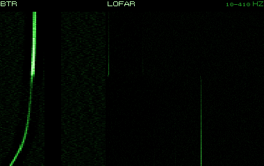

Il sonar di scafo a media frequenza delle fregate Oliver Hazard Perry, intorno ai 7-8 kHz (le frequenze esatte non sono certe) e con un livello stimato di 220-225 dB. È un sonar piccolo, con una portata diretta di 5-10 km. Sulle Perry del 1989 conta meno dell'antenna rimorchiata SQR-19 e dei due elicotteri SH-60B, a cui la nave passa i contatti.

**In partita.** Il sonar di scafo è il pericolo minore di una Perry: se ne senti il ping la fregata è vicina. Il rischio vero è la sua antenna rimorchiata, quindi resta lento, e il suo elicottero che arriva a posare boe sul tuo rilevamento.

| Dato | Valore | Nel gioco | Confidenza | Fonte |
|---|---|---|---|---|
| Modo «sqs56_attivo» | attivo | - | media | acustica.toml: FFG-7: SQS-56, 6,8-8,2 kHz (banda di 10 kHz), SL 220-225 |
| Antenna | sfera da 2,5 m | - | media | acustica.toml: FFG-7: SQS-56, 6,8-8,2 kHz (banda di 10 kHz), SL 220-225 |
| Velocità massima d'ascolto | 30 kn | - | media | acustica.toml: FFG-7: SQS-56, 6,8-8,2 kHz (banda di 10 kHz), SL 220-225 |
| Settore cieco di poppa | 60 ° | - | media | acustica.toml: FFG-7: SQS-56, 6,8-8,2 kHz (banda di 10 kHz), SL 220-225 |

**Montato su:** Oliver Hazard Perry (FFG-7).

**Fonti:** dossier 01 §4.1 e §5.9 (LAMPS III); dossier 02 §1.5; dossier 17 §2.1; acustica.toml (sensori.sqs56_attivo).

### AN/SSQ-36 (batitermografo)

*Boe sonore · Stati Uniti*

La boa batitermografica: cadendo misura la temperatura dell'acqua fino a 300-800 metri e trasmette il profilo all'aereo. Da quel profilo l'equipaggio ricava la velocità del suono alle varie quote, e quindi dove sta lo strato e a che quota calare le boe d'ascolto. Si posa all'inizio della caccia; un P-3C ne porta 2-3, un SH-60B 1-2. Non tutti la usavano: un operatore dei Viking ricorda che la si saltava perché faceva rumore.

**In partita.** Un tonfo isolato all'inizio di una caccia può essere un batitermografo: l'aereo sta studiando lo strato per decidere dove ascoltarti. Non ti ha ancora trovato, ma ti cerca qui.

| Dato | Valore | Nel gioco | Confidenza | Fonte |
|---|---|---|---|---|
| Funzione | batitermografo | - | media | §4.1 [FASSSQ36] |
| Quote dell'idrofono | 305 / 800 m | - | media | §4.1 [FASSSQ36] |
| Durata | 0 h | - | STIMA | §4.1 [FASSSQ36] |
| Stato del mare massimo | nessun limite | - | media | §4.1 [FASSSQ36] |

**Portata da:** SH-60B Seahawk (LAMPS III), SH-2F Seasprite (LAMPS I), P-3C Orion, S-3A Viking, S-3B Viking.

**Fonti:** dossier 17 §4.1 [FASSSQ36]; dossier 17 §2.1, §2.4, §2.5 [TWZS3] e §6.2; dossier 02 §7.6; asw_aereo.toml (boe.ssq36).

### AN/SSQ-41B (LOFAR)

*Boe sonore · Stati Uniti*

La boa sonora passiva omnidirezionale (LOFAR) degli aerei antisommergibile americani. Dopo l'ammaraggio cala l'idrofono a circa 18 o 300 metri e trasmette all'aereo, su uno di 31 canali radio, il suono fra 10 Hz e 10-20 kHz, per 1, 3 o 8 ore. Non misura la direzione: dice solo che un bersaglio è dentro il suo cerchio d'ascolto. Nel 1989 un P-3C su un contatto del SOSUS ne porta 8-12, un SH-60B 2-4; serve per le barriere e per le righe di macchina a bassa frequenza.

**In partita.** Da sola ti colloca solo in un cerchio di qualche chilometro: il pericolo arriva dopo, quando l'aereo ci posa attorno le DIFAR. Una fila di tonfi a intervalli regolari è un aereo che stende una barriera: rallenta e cambia rotta.

| Dato | Valore | Nel gioco | Confidenza | Fonte |
|---|---|---|---|---|
| Funzione | passiva omnidirezionale | - | media | §4.1 [FASSSQ41] [HOLLER] |
| Quote dell'idrofono | 18 / 305 m | - | media | §4.1 [FASSSQ41] [HOLLER] |
| Durata | 1 / 3 / 8 h | - | media | §4.1 [FASSSQ41] [HOLLER] |
| Portata indicativa (R50) | 5,6 km | - | STIMA | §4.1 [FASSSQ41] [HOLLER] |
| Stato del mare massimo | nessun limite | - | media | §4.1 [FASSSQ41] [HOLLER] |

**Portata da:** SH-60B Seahawk (LAMPS III), SH-2F Seasprite (LAMPS I), SH-3H Sea King, P-3C Orion, S-3A Viking, S-3B Viking.

**Fonti:** dossier 17 §4.1 [FASSSQ41] [HOLLER]; dossier 17 §2.1, §2.4 e §8.3; dossier 02 §7.6; asw_aereo.toml (boe.ssq41b).

### AN/SSQ-47B (attiva, distanza)

*Boe sonore · Stati Uniti*

Una boa attiva che misura soltanto la distanza: emette un ping a onda continua ogni 10 secondi, su una frequenza fra 13 e 19 kHz, con il trasduttore a circa 18 o 245 metri. Funziona per circa mezz'ora e non dà la direzione, che l'aereo deve ricavare incrociando più boe. Nel 1989 è ancora fra le boe in dotazione alla US Navy accanto alla più moderna DICASS.

**In partita.** Il suo ping regolare ogni 10 secondi, molto acuto, è inconfondibile: la boa conosce la tua distanza ma non la direzione. Allontanati dal suo cerchio prima che l'aereo ne posi un'altra.

| Dato | Valore | Nel gioco | Confidenza | Fonte |
|---|---|---|---|---|
| Funzione | attiva, solo distanza | - | alta | §4.1 [HOLLER] |
| Quote dell'idrofono | 18 / 244 m | - | alta | §4.1 [HOLLER] |
| Durata | 0 h | - | alta | §4.1 [HOLLER] |
| Portata indicativa (R50) | 1,5 km | - | STIMA | §4.1 [HOLLER] |
| Stato del mare massimo | nessun limite | - | alta | §4.1 [HOLLER] |

**Portata da:** SH-2F Seasprite (LAMPS I).

**Fonti:** dossier 17 §4.1 [HOLLER]; dossier 17 §8.3; asw_aereo.toml (boe.ssq47b).

### AN/SSQ-53B (DIFAR)

*Boe sonore · Stati Uniti*

La boa sonora passiva direzionale (DIFAR) più usata dagli aerei antisommergibile americani, in produzione dal 1969. Dopo l'ammaraggio cala un idrofono a una quota scelta e trasmette via radio all'aereo sia il suono sia la direzione da cui arriva, con un errore misurato in mare di 5-9 gradi. Si posa a schemi, a decine per volta: un P-3C in caccia su un contatto del SOSUS ne porta 40-50.

| Dato | Valore | Nel gioco | Confidenza | Fonte |
|---|---|---|---|---|
| Funzione | passiva direzionale | - | alta | §4.1 [HOLLER] [AAD-DIFAR] |
| Quote dell'idrofono | 27 / 305 m | - | STIMA | §4.1 [HOLLER] [AAD-DIFAR] |
| Durata | 1 / 3 / 8 h | - | alta | §4.1 [HOLLER] [AAD-DIFAR] |
| Errore di rilevamento (σ) | 7 ° | - | alta | §4.1 [HOLLER] [AAD-DIFAR] |
| Portata indicativa (R50) | 7,4 km | - | STIMA | §4.1 [HOLLER] [AAD-DIFAR] |
| Stato del mare massimo | 6 | - | STIMA | §4.1 [HOLLER] [AAD-DIFAR] |

**Portata da:** SH-60B Seahawk (LAMPS III), SH-3H Sea King, SH-60F Ocean Hawk, P-3C Orion, S-3A Viking, S-3B Viking.

**Fonti:** dossier 17 §4.1 [HOLLER] [AAD-DIFAR]; dossier 17 §2.4 e §6.2.

### AN/SSQ-57A (tarata)

*Boe sonore · Stati Uniti*

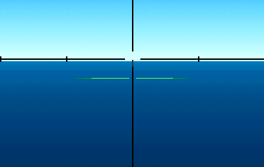

Una boa passiva tarata, che non cerca sottomarini ma misura il livello del rumore ambiente, con l'idrofono a circa 27 o 120 metri. L'equipaggio del P-3C la posa appena arrivato in zona, insieme al batitermografo, per sapere quanto è rumoroso il mare e tarare la ricerca. Nel carico di un P-3C su un contatto del SOSUS ce ne sono 2-4.

**In partita.** Non ti sente, ma vuol dire che un aereo si prepara a cacciare proprio qui: presto arriveranno le boe d'ascolto. È il momento di lasciare la zona senza fretta e senza rumore.

| Dato | Valore | Nel gioco | Confidenza | Fonte |
|---|---|---|---|---|
| Funzione | tarata (per i suoni noti) | - | alta | §4.1 [HOLLER] |
| Quote dell'idrofono | 27 / 122 m | - | alta | §4.1 [HOLLER] |
| Durata | 1 / 3 h | - | STIMA | §4.1 [HOLLER] |
| Stato del mare massimo | nessun limite | - | alta | §4.1 [HOLLER] |

**Portata da:** P-3C Orion, S-3A Viking, S-3B Viking.

**Fonti:** dossier 17 §4.1 [HOLLER]; dossier 17 §2.4 e §6.2; asw_aereo.toml (boe.ssq57a).

### AN/SSQ-62B (DICASS)

*Boe sonore · Stati Uniti*

La DICASS è la boa attiva direzionale a comando degli aerei e degli elicotteri americani: trasmette solo quando l'aereo glielo ordina, su una di quattro frequenze fra 6,5 e 9,5 kHz, con impulsi CW o FM. Misura distanza, rilevamento e Doppler, abbastanza da dare i dati per l'attacco anche con una sola boa. Parte a circa 27 metri e si può far scendere a 120 o 457 metri, ma mai risalire; in tutto ha 100 secondi di trasmissione. Un P-3C ne porta 8-10, un SH-60B 4-6, e si posano in rombo attorno all'ultimo fix per la localizzazione finale.

**In partita.** Un ping DICASS vuol dire che l'attacco è vicino: dopo vengono il passaggio MAD e il siluro Mk 46. Lo senti a circa 20 km mentre la boa ti scopre a 2: prendi il rilevamento, allontanati, cambia quota e tieni pronte le esche.

| Dato | Valore | Nel gioco | Confidenza | Fonte |
|---|---|---|---|---|
| Funzione | attiva direzionale | - | alta | §4.1 [FASSSQ62] [U62G] |
| Quote dell'idrofono | 27 / 122 / 457 m | - | alta | §4.1 [FASSSQ62] [U62G] |
| Durata | 0 h | - | STIMA | §4.1 [FASSSQ62] [U62G] |
| Errore di rilevamento (σ) | 5 ° | - | STIMA | §4.1 [FASSSQ62] [U62G] |
| Portata indicativa (R50) | 1,8 km | - | STIMA | §4.1 [FASSSQ62] [U62G] |
| Stato del mare massimo | nessun limite | - | alta | §4.1 [FASSSQ62] [U62G] |

**Portata da:** SH-60B Seahawk (LAMPS III), SH-3H Sea King, SH-60F Ocean Hawk, P-3C Orion, S-3A Viking, S-3B Viking.

**Fonti:** dossier 17 §4.1 [FASSSQ62] [U62G]; dossier 17 §6.1, §6.2 e §8.3; dossier 02 §1.5; asw_aereo.toml (boe.ssq62b).

### AN/SSQ-77A (VLAD)

*Boe sonore · Stati Uniti*

La VLAD è una boa DIFAR con gli idrofoni disposti su una schiera verticale, in servizio dal 1981. La schiera guadagna 10-15 dB contro il rumore del traffico navale, che arriva quasi in orizzontale, e quindi sente meglio in acque profonde e affollate. Ascolta a circa 150 o 300 metri per 1, 4 o 8 ore e, come ogni DIFAR, dà anche la direzione del suono. Un P-3C su un contatto del SOSUS ne porta 4-6.

**In partita.** Il rumore dei mercantili non ti nasconde: la VLAD lo filtra. Due boe direzionali incrociate fissano la tua posizione, quindi dopo i tonfi cambia rotta e quota e scendi sotto gli 8 nodi.

| Dato | Valore | Nel gioco | Confidenza | Fonte |
|---|---|---|---|---|
| Funzione | passiva direzionale | - | alta | §4.1 [HOLLER] [FASSSQ77] |
| Quote dell'idrofono | 152 / 305 m | - | alta | §4.1 [HOLLER] [FASSSQ77] |
| Durata | 1 / 4 / 8 h | - | alta | §4.1 [HOLLER] [FASSSQ77] |
| Errore di rilevamento (σ) | 7 ° | - | STIMA | §4.1 [HOLLER] [FASSSQ77] |
| Portata indicativa (R50) | 9,3 km | - | STIMA | §4.1 [HOLLER] [FASSSQ77] |
| Stato del mare massimo | nessun limite | - | alta | §4.1 [HOLLER] [FASSSQ77] |

**Portata da:** P-3C Orion, S-3B Viking.

**Fonti:** dossier 17 §4.1 [HOLLER] [FASSSQ77]; dossier 17 §2.4; asw_aereo.toml (boe.ssq77a).

### AN/WLR-8(V)2

*ESM · Stati Uniti*

L'AN/WLR-8(V)2 è il ricevitore ESM tattico dei 688, con le unità tenute in un pool e passate da un battello all'altro. Copre da 50 MHz alla banda J, cioè fino a circa 18-20 GHz, con sette ricevitori supereterodina che scandiscono le bande in sequenza o insieme; una modifica con misura istantanea della frequenza porta quasi al 100% la probabilità d'intercetto in SHF. Le antenne stanno sul periscopio di ricerca Type 18 e su un albero dedicato. Poiché il segnale radar gli arriva con una sola andata, sente un radar d'aereo fino all'orizzonte, 5-20 volte più lontano di quanto quel radar veda un periscopio.

**In partita.** Funziona solo con un'antenna fuori dall'acqua, il Type 18 o l'albero ESM. Ogni passaggio del fascio dà banda e rilevamento; dopo due-tre passaggi propone l'identità del radar, e un'ampiezza che sale dice che si avvicina. Se il rischio passa ad «attenzione» tieni le alzate sotto i 10 secondi, alla contro-scoperta probabile abbassa tutto e scendi; un radar d'aereo che compare a 40-90 miglia ti lascia pochi minuti.

| Dato | Valore | Nel gioco | Confidenza | Fonte |
|---|---|---|---|---|
| Banda coperta | 0,05-20 GHz | - | media | emettitori.toml (dossier 11 §2) |
| Probabilità d'intercetto | 95 % | - | STIMA | emettitori.toml (dossier 11 §2) |
| Errore di rilevamento (banda I/J) | 5 ° | - | STIMA | emettitori.toml (dossier 11 §2) |

**Fonti:** dossier 11 §4.1 [FASWLR8] [FAS688], §4.3, §4.4 e §6.3; dossier 01 §2.1 [FAS688]; dossier 02 §7.7; emettitori.toml (esm.wlr8).

### AN/WLR-9 (intercettatore acustico)

*Sonar · Stati Uniti*

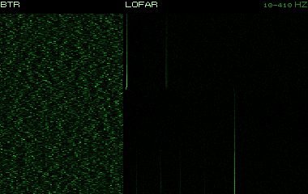

L'AN/WLR-9 è il ricevitore d'intercettazione acustica dei 688: non cerca bersagli, ma avverte quando qualcuno usa un sonar attivo o quando la testa di un siluro a guida acustica comincia a cercare. Sente anche i transitori, come l'apertura dei portelli e i lanci. Funziona perché il ping arriva al bersaglio con la perdita di sola andata: il battello lo sente in genere da una distanza 1,5-3 volte maggiore di quella a cui il sonar può scoprirlo, contro gli elicotteri anche 7-12 volte. Nella sala sonar del 1989 era una spia con un allarme.

**In partita.** Lavora da solo: all'allarme leggi rilevamento e frequenza, che dicono chi ti sta cercando. Intorno a 3 kHz è una nave grande, 6,5-9,5 kHz una DICASS, intorno ai 10 kHz un elicottero col sonar a immersione, 13-19 kHz ogni 10 secondi una SSQ-47B, 20-30 kHz la testa di un siluro: in quel caso esche e manovra d'evasione subito.

| Dato | Valore | Nel gioco | Confidenza | Fonte |
|---|---|---|---|---|
| Modo «wlr9» | passivo | - | media | acustica.toml: WLR-9: intercettazione degli impulsi attivi (contro-scoperta, 02 §5.3); idrofoni a larga apertura, nessun guadagno d'antenna (06 §2: STIMA) |
| Antenna | scafo da 0,3 m | - | media | acustica.toml: WLR-9: intercettazione degli impulsi attivi (contro-scoperta, 02 §5.3); idrofoni a larga apertura, nessun guadagno d'antenna (06 §2: STIMA) |
| Velocità massima d'ascolto | 30 kn | - | media | acustica.toml: WLR-9: intercettazione degli impulsi attivi (contro-scoperta, 02 §5.3); idrofoni a larga apertura, nessun guadagno d'antenna (06 §2: STIMA) |

**Montato su:** Los Angeles (SSN-688, Flight I), Sturgeon (SSN-637), Trafalgar (Royal Navy), Ohio (SSBN-726), Type 206 (U 13-30), Nacken (A14).

**Fonti:** dossier 01 §2.1 [FAS688], §3.3 e §7.1; dossier 02 §1.5 e §5.3; dossier 05 §5.1 [WP688]; dossier 17 §8.3; dossier 19 §2.3 [APL]; acustica.toml (sensori.wlr9).

### Bukhta

*ESM · Unione Sovietica*

«Bukhta» è il nome dell'apparato ESM dei sottomarini sovietici Alfa e Akula; le fonti non concordano nemmeno sul tipo, che alcune danno come radar e altre come ESM. Banda e sensibilità non sono note: il gioco stima 2-18 GHz, un avviso in banda I/J e un rilevamento grossolano, con probabilità d'intercetto ed errore peggiori di quelli del WLR-8. Nel gioco lo montano tutti i sottomarini sovietici.

**In partita.** Un battello sovietico a quota periscopica sente il tuo radar BPS-15 ben oltre la distanza a cui il radar vede lui: accendilo poco e solo quando serve. Se giochi l'Alfa è il tuo ESM, e si usa come il WLR-8, ma con meno precisione.

| Dato | Valore | Nel gioco | Confidenza | Fonte |
|---|---|---|---|---|
| Banda coperta | 2,00-18 GHz | - | media | emettitori.toml (dossier 11 §2) |
| Probabilità d'intercetto | 70 % | - | STIMA | emettitori.toml (dossier 11 §2) |
| Errore di rilevamento (banda I/J) | 7,5 ° | - | STIMA | emettitori.toml (dossier 11 §2) |

**Fonti:** dossier 11 §1.5 e §4.2 [DSRM705] [WPAKULA]; dossier 11 §4.3 e §6.3; emettitori.toml (esm.bukhta, esm_di).

### CH84 (attacco)

*Periscopi · Regno Unito*

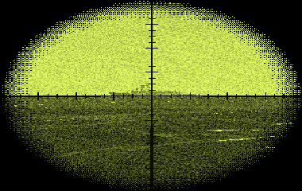

Il periscopio d'attacco delle Trafalgar britanniche, della Barr & Stroud: con il CK34 fu presentato come uno dei primi periscopi elettronici, nel 1983. Rispetto al predecessore CH83 ha di serie l'intensificatore d'immagine, la TV e la camera termica, un tubo più largo e un'ottica che smorza le vibrazioni. Ingrandimenti e campi non sono noti; il gioco usa 1,5× e 6× come gli altri periscopi dell'epoca.

**In partita.** Nel 1989 è l'unico periscopio con la camera termica: di notte una Trafalgar vede meglio di qualunque altro battello del gioco. Se giochi l'Alfa contro un battello britannico, il buio non ti protegge.

| Dato | Valore | Nel gioco | Confidenza | Fonte |
|---|---|---|---|---|
| Ingrandimenti (campo) | 1,5× (32°), 6,0× (8°) | - | STIMA | §3 [RNS] |
| Elevazione | da -10° a +60,0° | - | STIMA | §3 [RNS] |
| Telemetro | stadimetro a immagine sdoppiata | - | media | §3 [RNS] |
| Modi di visione | giorno, intensificatore, TV, termico | - | media | §3 [RNS] |
| ESM nella testa | no | - | media | §3 [RNS] |
| Sezione radar (1 m esposto) | 0,3 m² | - | STIMA | §3 [RNS] |
| Tempo d'alzata | 6 s | - | STIMA | §3 [RNS] |
| Velocità di danno | 15 kn | - | STIMA | §3 [RNS] |

**Montato su:** Trafalgar (Royal Navy).

**Fonti:** dossier 20 §1, §3 [RNS] e §8.3; periscopi.toml (periscopi.ch84).

### CK34 (ricerca)

*Periscopi · Regno Unito*

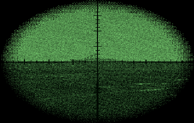

Il periscopio di ricerca delle Trafalgar, della Barr & Stroud: binoculare, con l'ESM «Morthoe» nella testa, la fotocamera, la TV a bassa luminosità e la finestra riscaldata. Il comando a distanza arriverà solo con la coppia CH85 e CK35 degli Upholder. Ingrandimenti e dimensioni non sono noti; un racconto più recente parla di una testa enorme piena di sensori, forse un allestimento successivo.

**In partita.** Come il Type 18, ascolta i radar mentre è alzato e paga questo con una testa grossa: più eco radar e più piuma del periscopio d'attacco. Una Trafalgar a quota periscopica, intorno ai 18 metri, ti sente se accendi il radar.

| Dato | Valore | Nel gioco | Confidenza | Fonte |
|---|---|---|---|---|
| Ingrandimenti (campo) | 1,5× (32°), 6,0× (8°) | - | STIMA | §3 [RNS] (Jane's) |
| Elevazione | da -10° a +60,0° | - | STIMA | §3 [RNS] (Jane's) |
| Telemetro | stadimetro a immagine sdoppiata | - | bassa | §3 [RNS] (Jane's) |
| Modi di visione | giorno, bassa luminosità, TV | - | bassa | §3 [RNS] (Jane's) |
| ESM nella testa | sì | - | bassa | §3 [RNS] (Jane's) |
| Sezione radar (1 m esposto) | 1,5 m² | - | STIMA | §3 [RNS] (Jane's) |
| Tempo d'alzata | 8 s | - | STIMA | §3 [RNS] (Jane's) |
| Velocità di danno | 15 kn | - | STIMA | §3 [RNS] (Jane's) |

**Montato su:** Trafalgar (Royal Navy).

**Fonti:** dossier 20 §3 [RNS] [SD] e §5; periscopi.toml (periscopi.ck34).

### Calypso II (DRUA 33)

*Radar · germania*

Il Calypso II (DRUA 33) è il radar di navigazione dei sottomarini Type 206A della Bundesmarine, e nel gioco lo porta tutta la classe Type 206, i piccoli battelli del Baltico: nel 1989 sono diciotto, e tre hanno già finito la conversione nella versione 206A. Lavora in banda I, con un giro ogni 3 secondi e l'antenna a circa 7 metri sull'acqua. Nel gioco vede le navi fino a circa 10 miglia.

**In partita.** Come gli altri radar dei sottomarini dell'IA resta spento salvo che la missione non lo accenda. All'ESM è una firma di navigazione in banda I come tante, che senti solo fino a circa 10 miglia; se la direzione non porta a nessuna nave, c'è probabilmente un battello a quota periscopica. Non vede la testa del periscopio, ma un battello in emersione sì.

| Dato | Valore | Nel gioco | Confidenza | Fonte |
|---|---|---|---|---|
| Banda | I | - | media | emettitori.toml (dossier 11 §1 e §6.4) |
| Frequenza | 9 GHz | - | media | emettitori.toml (dossier 11 §1 e §6.4) |
| Periodo di rotazione | 3 s | - | bassa | emettitori.toml (dossier 11 §1 e §6.4) |
| Portata contro una nave grande | 10 nm | - | bassa | emettitori.toml (dossier 11 §1 e §6.4) |

**Montato su:** Type 206 (U 13-30).

**Fonti:** dossier 32 §5; dossier 11 §3.4 e §6.3; tools/pipeline/emettitori.py (dotazione del Type 206A); emettitori.toml (radar.calypso, suite.type206); libretto.toml [type206].

### DR-2000U

*ESM · germania*

Il DR-2000U è il ricevitore ESM della Thomson-CSF dei sottomarini Type 206A della Bundesmarine, montato insieme al SARIE. Le sue prestazioni non sono pubbliche: il gioco le stima a metà fra il WLR-8 americano e il Bukhta sovietico. Copre da 2 a 18 GHz, con una probabilità d'intercetto di 0,8 per passaggio e un errore di rilevamento di circa 6 gradi in banda I/J e 10 in E-H; l'antenna sta a 1,5 metri sull'acqua. Nel gioco lo usano tutti i Type 206.

**In partita.** È l'ESM di un battello dell'IA: lavora solo quando il 206 ha la testa o l'albero fuori, e sui radar ostili gli dà un contatto col solo rilevamento. Se giochi l'Alfa e il 206 è dall'altra parte, sente il tuo Snoop più lontano di quanto il tuo radar veda lui: accendilo poco. Come il Bukhta è sordo sotto i 2 GHz, quindi non sente i radar di ricerca aerea in banda B, C e D.

| Dato | Valore | Nel gioco | Confidenza | Fonte |
|---|---|---|---|---|
| Banda coperta | 2,00-18 GHz | - | media | emettitori.toml (dossier 11 §2) |
| Probabilità d'intercetto | 80 % | - | STIMA | emettitori.toml (dossier 11 §2) |
| Errore di rilevamento (banda I/J) | 6 ° | - | STIMA | emettitori.toml (dossier 11 §2) |

**Fonti:** dossier 32 §5; dossier 11 §4.2, §4.3 e §6.3; tools/pipeline/emettitori.py (Type 206A: DR-2000U col SARIE, Seaforces e Los Barcos de Eugenio; prestazioni STIMA); emettitori.toml (esm.dr2000, esm_di); engine/missioni/src/missione.cpp (ESM dell'IA).

### DRBV 22

*Radar · norvegia*

Il DRBV 22 è il radar di scoperta aerea delle fregate norvegesi Oslo, cinque unità del 1966-67 su un progetto derivato dai Dealey americani. Sta sulla sovrastruttura prodiera, e accanto ha un radar di navigazione Decca e il direttore di tiro Mk 91. Nel gioco lavora in banda D, intorno a 1,5 GHz, con un giro ogni 4 secondi e l'antenna a 30 metri.

**In partita.** All'ESM è una firma unica in banda D, un passaggio ogni 4 secondi, che di rado si scambia col Top Plate o col Type 967/968. Il WLR-8 lo sente fino a circa 19 miglia; il Bukhta dell'Alfa no, perché sta sotto i 2 GHz. Contro il periscopio vede un miglio con mare calmo e niente con mare 4, uno snorkel a 4 miglia: alla Oslo, per vederti, serve il radar di navigazione, e per colpirti il sonar e il Terne III.

| Dato | Valore | Nel gioco | Confidenza | Fonte |
|---|---|---|---|---|
| Banda | D | - | media | emettitori.toml (dossier 11 §1 e §6.4) |
| Frequenza | 1,5 GHz | - | media | emettitori.toml (dossier 11 §1 e §6.4) |
| Periodo di rotazione | 4 s | - | bassa | emettitori.toml (dossier 11 §1 e §6.4) |
| Scoperta di un periscopio (R50, mare 2) | 1 nm | - | STIMA | emettitori.toml (dossier 11 §1 e §6.4) |
| Scoperta di un periscopio (R50, mare 4) | 0 nm | - | STIMA | emettitori.toml (dossier 11 §1 e §6.4) |

**Montato su:** Oslo (F300).

**Fonti:** dossier 35 §1; dossier 11 §6.1 e §6.3; extracted/navi/oslo/RAPPORTO.md; libretto.toml [oslo]; tools/pipeline/emettitori.py (dotazione della Oslo); emettitori.toml (radar.drbv22, suite.oslo, esm.bukhta).

### Don-2 / Don Kay / Palm Frond

*Radar · Unione Sovietica*

I radar di navigazione delle navi sovietiche: il Don-2 e il Don Kay («Volga») su Kara, Krivak II e Koni, il Palm Frond (MR-212 «Vaygach») su Kirov e Slava. Lavorano in banda I, intorno ai 9,4 GHz, e girano in 2,5-3 secondi. Le navi sovietiche li tengono accesi quasi sempre, e i gruppi antisommergibile ci aggiungono la ricerca aerea.

**In partita.** All'ESM si confondono con i radar civili: serve qualche giro per capire se è un mercantile o una nave da guerra. Contro il periscopio sono fra i radar navali più pericolosi, circa 4 miglia con mare calmo e 1,5 con mare 4: tieni le alzate brevi.

| Dato | Valore | Nel gioco | Confidenza | Fonte |
|---|---|---|---|---|
| Banda | I | - | media | emettitori.toml (dossier 11 §1 e §6.4) |
| Frequenza | 9 GHz | - | media | emettitori.toml (dossier 11 §1 e §6.4) |
| Periodo di rotazione | 3 s | - | bassa | emettitori.toml (dossier 11 §1 e §6.4) |
| Scoperta di un periscopio (R50, mare 2) | 4 nm | - | STIMA | emettitori.toml (dossier 11 §1 e §6.4) |
| Scoperta di un periscopio (R50, mare 4) | 1,5 nm | - | STIMA | emettitori.toml (dossier 11 §1 e §6.4) |

**Montato su:** Kara (Progetto 1134B), Kirov (Progetto 1144), Slava (Progetto 1164), Krivak II (Progetto 1135M), Koni (Progetto 1159), Grande peschereccio sovietico (BMRT), Udaloy (Progetto 1155), Grisha III (Progetto 1124M), Ugra (Progetto 1886).

**Fonti:** dossier 11 §1.2 [RW1134B] [QSL] [WPNATO], §2, §3.4 e §6.1; emettitori.toml (radar.nav_sov).

### Head Net-C / Strut Curve

*Radar · Unione Sovietica*

Il radar MR-310A «Angara-A», per la NATO Head Net-C: ricerca aerea e di superficie degli incrociatori Kara e delle fregate Krivak II, con una portata di circa 200 km. Sulla banda le fonti non sono d'accordo, E/F per alcune, L per altre. Nel gioco la stessa voce copre lo Strut Curve (MR-302 «Rubka») delle fregate Koni. Contro un periscopio vede poco: è fatto per gli aerei.

**In partita.** All'ESM rivela una nave sovietica di scorta o un gruppo antisommergibile, che lo tiene acceso quasi sempre. Si può confondere con l'SPS-48 americano, che sta nella stessa banda. Contro il periscopio è poco pericoloso, circa 1,5 miglia con mare calmo, ma la nave che lo porta ha anche radar di navigazione più adatti a vederti.

| Dato | Valore | Nel gioco | Confidenza | Fonte |
|---|---|---|---|---|
| Banda | E | - | media | emettitori.toml (dossier 11 §1 e §6.4) |
| Frequenza | 2,5 GHz | - | media | emettitori.toml (dossier 11 §1 e §6.4) |
| Periodo di rotazione | 6 s | - | bassa | emettitori.toml (dossier 11 §1 e §6.4) |
| Scoperta di un periscopio (R50, mare 2) | 1,5 nm | - | STIMA | emettitori.toml (dossier 11 §1 e §6.4) |
| Scoperta di un periscopio (R50, mare 4) | 0,5 nm | - | STIMA | emettitori.toml (dossier 11 §1 e §6.4) |

**Montato su:** Kara (Progetto 1134B), Krivak II (Progetto 1135M), Koni (Progetto 1159), Udaloy (Progetto 1155), Grisha III (Progetto 1124M), Ugra (Progetto 1886).

**Fonti:** dossier 11 §1.2 [RW1134B] [RW1135] [MPHEAD] [RTHEAD], §2, §3.4 e §6.1; emettitori.toml (radar.head_net_c).

### Initsiativa-2B

*Radar · Unione Sovietica*

Il radar centimetrico in banda X dell'anfibio Be-12 «Mail», l'aereo antisommergibile della zona vicina alle coste sovietiche. Il Be-12 lo usa per studiare la superficie prima di posare le boe, che lancia da 500 metri dopo un controllo radar da 2000, per leggere i transponder delle boe e per mirare. Vola sempre in coppia e nel Barents parte da Safonovo.

**In partita.** All'ESM arriva a intervalli ma spesso, e somiglia agli altri radar aerei in banda X. È il meno capace dei radar antisommergibile del gioco: con mare calmo vede un periscopio a 3,5 miglia circa. Se lo senti, aspettati boe in acqua e un passaggio col MAD a bassa quota.

| Dato | Valore | Nel gioco | Confidenza | Fonte |
|---|---|---|---|---|
| Banda | I | - | media | emettitori.toml (dossier 11 §1 e §6.4) |
| Frequenza | 9 GHz | - | media | emettitori.toml (dossier 11 §1 e §6.4) |
| Periodo di rotazione | 4 s | - | bassa | emettitori.toml (dossier 11 §1 e §6.4) |
| Scoperta di un periscopio (R50, mare 2) | 3,5 nm | - | STIMA | emettitori.toml (dossier 11 §1 e §6.4) |
| Scoperta di un periscopio (R50, mare 4) | 1,2 nm | - | STIMA | emettitori.toml (dossier 11 §1 e §6.4) |
| Portata contro una nave grande | 50 nm | - | bassa | emettitori.toml (dossier 11 §1 e §6.4) |

**Montato su:** Be-12 Mail.

**Fonti:** dossier 17 §3.3 [ART-Be12], §5 e §8.2; emettitori.toml (radar.initsiativa2b).

### Initsiativa-2K «Short Horn»

*Radar · Unione Sovietica*

Il radar del Ka-25PL «Hormone-A», parte del sistema «Baikal»: centimetrico in banda X, 55 kW di picco. I dati sovietici gli danno navi e aerei grandi fino a 220 km e un periscopio a 10-20 km. Il nome NATO è incerto: alcune fonti lo chiamano Puff Ball, la CIA nel 1972 Short Horn. Nelle coppie di ricerca e attacco l'elicottero d'attacco raggiunge col radar il punto segnato dal compagno.

**In partita.** È acceso di continuo nelle tratte di ricerca e spento quando l'elicottero è fermo in volo col sonar a immersione: se il segnale sparisce, forse sta ascoltando sopra di te. All'ESM si confonde con un radar di navigazione.

| Dato | Valore | Nel gioco | Confidenza | Fonte |
|---|---|---|---|---|
| Banda | I | - | media | emettitori.toml (dossier 11 §1 e §6.4) |
| Frequenza | 9 GHz | - | media | emettitori.toml (dossier 11 §1 e §6.4) |
| Periodo di rotazione | 4 s | - | bassa | emettitori.toml (dossier 11 §1 e §6.4) |
| Scoperta di un periscopio (R50, mare 2) | 4 nm | - | STIMA | emettitori.toml (dossier 11 §1 e §6.4) |
| Scoperta di un periscopio (R50, mare 4) | 1,5 nm | - | STIMA | emettitori.toml (dossier 11 §1 e §6.4) |
| Portata contro una nave grande | 60 nm | - | bassa | emettitori.toml (dossier 11 §1 e §6.4) |

**Montato su:** Ka-25PL Hormone-A.

**Fonti:** dossier 11 §1.4 [RWKA25] [MPPUFF], §3.4 e §5.1; dossier 17 §1 [CIA72] e §3.1; emettitori.toml (radar.initsiativa2k).

### Initsiativa-2KM

*Radar · Unione Sovietica*

Il radar del Ka-27PL «Helix-A», l'elicottero antisommergibile entrato in servizio nel 1981 col sistema «Osminog». Da 100-500 metri di quota vede un bersaglio di 250 m² oltre 25 km e uno di 2 m² oltre 5 km. Imbarcato in gruppi sugli incrociatori portaerei Kiev e Minsk, e in uno o pochi esemplari su Udaloy, Kirov, Slava e Sovremennyj.

**In partita.** Come quello del Ka-25 resta acceso in volo e tace quando l'elicottero si ferma a calare il sonar. Il Ka-27 usa raramente il sonar attivo: se il radar si spegne e poi senti un impulso, è probabile che abbia già un contatto.

| Dato | Valore | Nel gioco | Confidenza | Fonte |
|---|---|---|---|---|
| Banda | I | - | media | emettitori.toml (dossier 11 §1 e §6.4) |
| Frequenza | 9 GHz | - | media | emettitori.toml (dossier 11 §1 e §6.4) |
| Periodo di rotazione | 4 s | - | bassa | emettitori.toml (dossier 11 §1 e §6.4) |
| Scoperta di un periscopio (R50, mare 2) | 4 nm | - | STIMA | emettitori.toml (dossier 11 §1 e §6.4) |
| Scoperta di un periscopio (R50, mare 4) | 1,5 nm | - | STIMA | emettitori.toml (dossier 11 §1 e §6.4) |
| Portata contro una nave grande | 60 nm | - | bassa | emettitori.toml (dossier 11 §1 e §6.4) |

**Montato su:** Ka-27PL Helix-A.

**Fonti:** dossier 17 §3.2 [RW-Ka27] [ART-Ka27] e §8.2; emettitori.toml (radar.initsiativa2km).

### Korshun

*Radar · Unione Sovietica*

Il radar del sistema di ricerca e attacco «Korshun-K» del Tu-142M «Bear-F», l'antisommergibile a lungo raggio della Flotta del Nord, che parte da Kipelovo verso l'Atlantico settentrionale e il Mar di Norvegia. Sta in un radome sotto la fusoliera e cambia frequenza da un impulso all'altro, il che lo rende difficile da identificare. Il Tu-142M porta anche un ricevitore ELINT: sente a sua volta il radar di un sottomarino.

**In partita.** All'ESM l'identificazione è lenta e spesso resta generica, «radar ASW aereo in banda X». Lo tiene acceso a lungo, minuti alla volta; quando si spegne, l'aereo sta lavorando con boe e MAD. Non accendere il BPS-15 con un Bear in zona.

| Dato | Valore | Nel gioco | Confidenza | Fonte |
|---|---|---|---|---|
| Banda | I | - | media | emettitori.toml (dossier 11 §1 e §6.4) |
| Frequenza | 9 GHz | - | media | emettitori.toml (dossier 11 §1 e §6.4) |
| Periodo di rotazione | 6 s | - | bassa | emettitori.toml (dossier 11 §1 e §6.4) |
| Scoperta di un periscopio (R50, mare 2) | 5 nm | - | STIMA | emettitori.toml (dossier 11 §1 e §6.4) |
| Scoperta di un periscopio (R50, mare 4) | 2 nm | - | STIMA | emettitori.toml (dossier 11 §1 e §6.4) |
| Portata contro una nave grande | 100 nm | - | bassa | emettitori.toml (dossier 11 §1 e §6.4) |

**Montato su:** Tu-142MK Bear-F.

**Fonti:** dossier 11 §1.4 [RWTU142] [MPWETEYE] e §3.4; dossier 17 §3.5 [ART-Tu142] [RW-Tu142] e §8.2; emettitori.toml (radar.korshun).

### MG-332 «Titan-2»

*Sonar · Unione Sovietica*

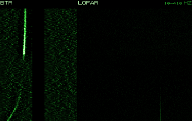

Il sonar di scafo a bassa e media frequenza delle navi antisommergibile sovietiche Kara e Krivak, e dello Slava nella versione Titan-2T; il dossier lo chiama MG-332 e riserva la sigla MGK-335 al Platina. Lavora intorno ai 3-8 kHz con un livello di 220-235 dB, cifre non pubblicate; sulle Kara e Krivak è affiancato dal sonar a profondità variabile Vega, calato fino a 100 metri. Per il gioco si stima una portata diretta di 8-15 km. Le navi lo usano nei gruppi di ricerca e attacco di 2-4 unità in linea di fronte, alternando ricerca attiva e corse veloci.

**In partita.** Una fila di navi sovietiche che pingano è un gruppo di caccia: lo senti da lontano, quindi resta fuori dalla sua portata diretta. Lo strato non basta: il Vega può ascoltare sotto di esso. Se ti prendono, aspettati razzi RBU, missili SS-N-14 o un elicottero.

| Dato | Valore | Nel gioco | Confidenza | Fonte |
|---|---|---|---|---|
| Modo «titan2_attivo» | attivo | - | media | acustica.toml: navi sovietiche: MG-332 Titan-2 e simili, 3-8 kHz |
| Antenna | sfera da 4,0 m | - | media | acustica.toml: navi sovietiche: MG-332 Titan-2 e simili, 3-8 kHz |
| Velocità massima d'ascolto | 30 kn | - | media | acustica.toml: navi sovietiche: MG-332 Titan-2 e simili, 3-8 kHz |
| Settore cieco di poppa | 60 ° | - | media | acustica.toml: navi sovietiche: MG-332 Titan-2 e simili, 3-8 kHz |

**Montato su:** Grisha III (Progetto 1124M), Krivak II (Progetto 1135M), Kara (Progetto 1134B), Slava (Progetto 1164), Kirov (Progetto 1144), Koni (Progetto 1159).

**Fonti:** dossier 01 §4.2 [WPKara] [WPSlava] e §7.3; dossier 02 §1.5 e §7.4; acustica.toml (sensori.titan2_attivo).

### MGAB (sorgente esplosiva)

*Boe sonore · Unione Sovietica*

Le MGAB (nelle versioni OZ, LZ e SZ) sono sorgenti esplosive da 100-800 grammi che il Tu-142M sgancia per far rimbalzare un'eco sul sottomarino verso le boe RGB-15. Esplodono a 25, 150 o 400 metri; la versione SZ, a spirale, produce un treno di colpi a 4 Hz. Un aereo può portarne fino a 240, e per un fix servono 2-3 colpi nello stesso punto a 3-4 minuti l'uno dall'altro. Per gli stessi sovietici, le esplosioni toglievano alla ricerca ogni segretezza.

**In partita.** Esplosioni singole o un treno di colpi rapidi: un Tu-142 ti sta cercando con l'eco. Dopo il primo colpo hai 3-4 minuti prima del successivo: usali per allontanarti dal punto.

| Dato | Valore | Nel gioco | Confidenza | Fonte |
|---|---|---|---|---|
| Funzione | sorgente esplosiva | - | alta | §4.2 [ART-Tu142] |
| Quote dell'idrofono | 25 / 150 / 400 m | - | alta | §4.2 [ART-Tu142] |
| Durata | 0 h | - | alta | §4.2 [ART-Tu142] |
| Stato del mare massimo | nessun limite | - | alta | §4.2 [ART-Tu142] |

**Portata da:** Tu-142MK Bear-F.

**Fonti:** dossier 17 §4.2 [ART-Tu142]; dossier 17 §3.5, §6.6 e §8.3; asw_aereo.toml (boe.mgab).

### Mk 92 CAS

*Radar · Stati Uniti*

Il radar combinato di ricerca e inseguimento del sistema di tiro Mk 92 delle fregate Oliver Hazard Perry, derivato dall'olandese WM-25, che lavora insieme all'illuminatore STIR. La banda, probabilmente I/J, e la portata, stimata in 20-30 miglia, non sono confermate dalle fonti aperte.

**In partita.** Gira molto in fretta, un giro al secondo, e nel gioco ha una firma propria: all'ESM indica una Perry pronta al tiro. Contro un periscopio vede circa 4 miglia con mare calmo; se lo senti, la fregata è in allerta.

| Dato | Valore | Nel gioco | Confidenza | Fonte |
|---|---|---|---|---|
| Banda | I | - | media | emettitori.toml (dossier 11 §1 e §6.4) |
| Frequenza | 9 GHz | - | media | emettitori.toml (dossier 11 §1 e §6.4) |
| Periodo di rotazione | 1 s | - | bassa | emettitori.toml (dossier 11 §1 e §6.4) |
| Scoperta di un periscopio (R50, mare 2) | 4 nm | - | STIMA | emettitori.toml (dossier 11 §1 e §6.4) |
| Scoperta di un periscopio (R50, mare 4) | 1,5 nm | - | STIMA | emettitori.toml (dossier 11 §1 e §6.4) |
| Portata contro una nave grande | 25 nm | - | bassa | emettitori.toml (dossier 11 §1 e §6.4) |

**Montato su:** Oliver Hazard Perry (FFG-7).

**Fonti:** dossier 11 §1.1 [FASMK92], §2 e §6.1; emettitori.toml (radar.mk92_cas).

### Peel Pair / Plank Shave

*Radar · Unione Sovietica*

Il radar di superficie delle corvette lanciamissili Nanuchka III, in banda I/J fra 8 e 10 GHz. Nel gioco la voce copre anche il Plank Shave («Garpun»), in servizio dal 1979, che oltre alla ricerca designa i bersagli ai missili e ha un canale passivo. A designare gli SS-N-9 provvede però un altro radar, il Band Stand.

**In partita.** All'ESM somiglia a un radar di navigazione: una Nanuchka può passare per un peschereccio. Contro il periscopio vale come i radar di navigazione sovietici, circa 4 miglia con mare calmo.

| Dato | Valore | Nel gioco | Confidenza | Fonte |
|---|---|---|---|---|
| Banda | I | - | media | emettitori.toml (dossier 11 §1 e §6.4) |
| Frequenza | 9 GHz | - | media | emettitori.toml (dossier 11 §1 e §6.4) |
| Periodo di rotazione | 3 s | - | bassa | emettitori.toml (dossier 11 §1 e §6.4) |
| Scoperta di un periscopio (R50, mare 2) | 4 nm | - | STIMA | emettitori.toml (dossier 11 §1 e §6.4) |
| Scoperta di un periscopio (R50, mare 4) | 1,5 nm | - | STIMA | emettitori.toml (dossier 11 §1 e §6.4) |

**Montato su:** Nanuchka I (Progetto 1234).

**Fonti:** dossier 11 §1.2 [MPPEEL] [MPPLANK] [WPNAN], §2 e §6.1; emettitori.toml (radar.peel_pair).

### RGB-1

*Boe sonore · Unione Sovietica*

La boa passiva omnidirezionale dell'Il-38, che ne carica 144, usata anche dal Tu-142. Una schiera di cinque idrofoni scende a 35 o 70 metri, poi la boa resta in attesa e si accende da sola quando sente qualcosa; un transponder radar permette all'aereo di ritrovarla. Alle prove del 1965 scoprì un sottomarino diesel a 6-8 nodi, con mare 1-2, a 1,7-4 km. Fino al 30% arrivava guasto già a terra.

**In partita.** Gli Il-38 stendono barriere lineari di RGB-1: quando una reagisce, l'aereo posa subito una barriera di RGB-2 direzionali attorno a te. Dopo una fila di tonfi rallenta e cambia rotta, perché la barriera successiva cadrà davanti alla rotta che stimano.

| Dato | Valore | Nel gioco | Confidenza | Fonte |
|---|---|---|---|---|
| Funzione | passiva omnidirezionale | - | alta | §4.2 [ART-Il38] [RW-Il38] |
| Quote dell'idrofono | 35 / 70 m | - | alta | §4.2 [ART-Il38] [RW-Il38] |
| Durata | 3 h | - | STIMA | §4.2 [ART-Il38] [RW-Il38] |
| Portata indicativa (R50) | 2,8 km | - | alta | §4.2 [ART-Il38] [RW-Il38] |
| Stato del mare massimo | nessun limite | - | alta | §4.2 [ART-Il38] [RW-Il38] |

**Portata da:** Il-38 May.

**Fonti:** dossier 17 §4.2 [ART-Il38] [RW-Il38]; dossier 17 §3.4 e §6.6; asw_aereo.toml (boe.rgb1).

### RGB-15

*Boe sonore · Unione Sovietica*

Una boa passiva a larga banda del Tu-142M, fra 2 e 5000 Hz, che dura 2 ore; l'aereo ne porta 44. Da sola sente poco, 0,5-1 km, e serve a rimpiazzare le RGB-75 nel campo. Il suo vero compito è ricevere l'eco delle cariche esplosive MGAB: in quel ruolo la portata sale a 5-10 km. Nel 1987 si scoprì che il metodo, nel Mare di Barents, non rilevava nulla.

**In partita.** Da sola non è un pericolo serio. Lo diventa quando cominciano le esplosioni: l'eco del tuo scafo le arriva da chilometri, quindi allontanati dal punto delle cariche.

| Dato | Valore | Nel gioco | Confidenza | Fonte |
|---|---|---|---|---|
| Funzione | passiva omnidirezionale | - | alta | §4.2 [ART-Tu142] |
| Quote dell'idrofono | 150 m | - | STIMA | §4.2 [ART-Tu142] |
| Durata | 2 h | - | alta | §4.2 [ART-Tu142] |
| Portata indicativa (R50) | 0,8 km | - | alta | §4.2 [ART-Tu142] |
| Stato del mare massimo | nessun limite | - | alta | §4.2 [ART-Tu142] |

**Portata da:** Tu-142MK Bear-F.

**Fonti:** dossier 17 §4.2 [ART-Tu142]; dossier 17 §3.5 e §6.6; asw_aereo.toml (boe.rgb15).

### RGB-2

*Boe sonore · Unione Sovietica*

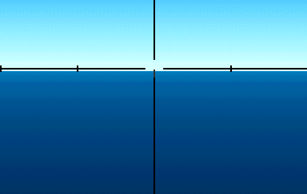

La boa passiva direzionale dell'Il-38 e del Be-12N: un'antenna di 13 elementi, a 20 metri, ruota a 8 giri al minuto e dà la direzione del suono con un errore di 5-7 gradi. Vive 40-45 minuti e sente un sottomarino diesel silenzioso a 1,5-2 km. Si posa dopo che una boa omnidirezionale ha reagito, come barriera di precisione; l'Il-38 ne porta 10.

**In partita.** Le RGB-2 arrivano quando sei già stato sentito: danno la direzione, e due boe bastano a localizzarti. Durano meno di un'ora e sentono a un paio di chilometri: allontanarsi in silenzio è spesso sufficiente.

| Dato | Valore | Nel gioco | Confidenza | Fonte |
|---|---|---|---|---|
| Funzione | passiva direzionale | - | alta | §4.2 [ART-Il38] [ART-Be12N] |
| Quote dell'idrofono | 20 m | - | alta | §4.2 [ART-Il38] [ART-Be12N] |
| Durata | 1 h | - | alta | §4.2 [ART-Il38] [ART-Be12N] |
| Errore di rilevamento (σ) | 6 ° | - | alta | §4.2 [ART-Il38] [ART-Be12N] |
| Portata indicativa (R50) | 1,8 km | - | alta | §4.2 [ART-Il38] [ART-Be12N] |
| Stato del mare massimo | nessun limite | - | alta | §4.2 [ART-Il38] [ART-Be12N] |

**Portata da:** Il-38 May.

**Fonti:** dossier 17 §4.2 [ART-Il38] [ART-Be12N]; dossier 17 §3.4 e §6.6; asw_aereo.toml (boe.rgb2).

### RGB-25

*Boe sonore · Unione Sovietica*

La boa passiva direzionale del Tu-142M, con l'idrofono che scende fino a 150 metri; nel carico di ricerca e attacco ce ne sono 10. Le fonti aperte dicono poco delle sue prestazioni. Nel 1987 la stessa commissione che bocciò la RGB-75 la giudicò inefficace con mare forza 3-5.

**In partita.** Se un Tu-142 posa boe direzionali vicino a te vuole la tua direzione: cambia rotta e quota. Col mare forza 3 o più rende poco.

| Dato | Valore | Nel gioco | Confidenza | Fonte |
|---|---|---|---|---|
| Funzione | passiva direzionale | - | alta | §4.2 [ART-Tu142] |
| Quote dell'idrofono | 150 / 50 m | - | STIMA | §4.2 [ART-Tu142] |
| Durata | 1 h | - | STIMA | §4.2 [ART-Tu142] |
| Errore di rilevamento (σ) | 6 ° | - | STIMA | §4.2 [ART-Tu142] |
| Portata indicativa (R50) | 2 km | - | STIMA | §4.2 [ART-Tu142] |
| Stato del mare massimo | 2 | - | alta | §4.2 [ART-Tu142] |

**Portata da:** Tu-142MK Bear-F.

**Fonti:** dossier 17 §4.2 [ART-Tu142]; dossier 17 §3.5; asw_aereo.toml (boe.rgb25).

### RGB-55A (attiva)

*Boe sonore · Unione Sovietica*

La boa attiva omnidirezionale a comando del Tu-142M, che ne porta 10. Trasmette su quattro frequenze per un'ora al massimo e sente un sottomarino a circa 5 km, misurandone la distanza con un errore di 75-100 metri e il Doppler. Nel 1987 risultò incapace di rilevare nel Mare di Barents.

**In partita.** Un ping da una boa vicina: il Tu-142 cerca la distanza per l'attacco. Lo senti molto prima che la boa senta te: prendi il rilevamento e allontanati.

| Dato | Valore | Nel gioco | Confidenza | Fonte |
|---|---|---|---|---|
| Funzione | attiva omnidirezionale | - | alta | §4.2 [ART-Tu142] |
| Quote dell'idrofono | 150 m | - | STIMA | §4.2 [ART-Tu142] |
| Durata | 1 h | - | alta | §4.2 [ART-Tu142] |
| Portata indicativa (R50) | 5 km | - | alta | §4.2 [ART-Tu142] |
| Stato del mare massimo | nessun limite | - | alta | §4.2 [ART-Tu142] |

**Portata da:** Tu-142MK Bear-F.

**Fonti:** dossier 17 §4.2 [ART-Tu142]; dossier 17 §3.5 e §8.3; asw_aereo.toml (boe.rgb55a).

### RGB-75 (infrasonora)

*Boe sonore · Unione Sovietica*

La boa infrasonora del Tu-142M: ascolta in continuo fra 2 e 60 Hz per un massimo di 5 ore, a caccia delle righe più basse dei sottomarini. L'aereo ne porta 66 e le posa in campi a maglie di 10-20 km. La portata reale era al più di 1 km contro un bersaglio lento, ma di 15-20 km a 12 nodi; nel 1987 una commissione la giudicò inefficace con mare forza 3-5. Nel 1983 servivano 4 RGB-75 per ogni ora d'inseguimento.

**In partita.** Sente le righe d'elica a bassissima frequenza: contro un 688 a 8 nodi arriva a meno di un chilometro, a 12 nodi a circa 3, a 20 nodi a decine di chilometri. In un campo di Tu-142 tieni la velocità sotto gli 8 nodi.

| Dato | Valore | Nel gioco | Confidenza | Fonte |
|---|---|---|---|---|
| Funzione | passiva omnidirezionale | - | alta | §4.2 [ART-Tu142] |
| Quote dell'idrofono | 150 m | - | STIMA | §4.2 [ART-Tu142] |
| Durata | 5 h | - | alta | §4.2 [ART-Tu142] |
| Portata indicativa (R50) | 1 km | - | alta | §4.2 [ART-Tu142] |
| Stato del mare massimo | 2 | - | alta | §4.2 [ART-Tu142] |

**Portata da:** Tu-142MK Bear-F.

**Fonti:** dossier 17 §4.2 [ART-Tu142]; dossier 17 §3.5, §6.6 e §8.4; asw_aereo.toml (boe.rgb75).

### RGB-NM «Chinara»

*Boe sonore · Unione Sovietica*

La boa passiva omnidirezionale «Chinara» dei Be-12 e degli elicotteri Ka-25 e Ka-27, che ne portano fino a 36. Con l'idrofono a 20 metri ascolta fra 7 e 10 kHz e trasmette solo quando il segnale supera una soglia, per un ascolto a orecchio dell'operatore; ignora i picchi più brevi di 10-15 secondi e può attendere fino a 6 ore. La portata va da 0,2 a 5 km (la CIA stimava 2,7 km contro un bersaglio rumoroso) e con mare oltre forza 3 diventa inutile. Nel 1966 il 28% era guasto; più tardi l'affidabilità salì a 0,7-0,8.

**In partita.** Sente solo da vicino e in alta frequenza: lento e silenzioso le passi a qualche chilometro senza farla scattare. Col mare oltre forza 3 è quasi sorda.

| Dato | Valore | Nel gioco | Confidenza | Fonte |
|---|---|---|---|---|
| Funzione | passiva omnidirezionale | - | alta | §4.2 [ART-Be12] [CIA72] |
| Quote dell'idrofono | 20 m | - | alta | §4.2 [ART-Be12] [CIA72] |
| Durata | 6 h | - | alta | §4.2 [ART-Be12] [CIA72] |
| Portata indicativa (R50) | 2,7 km | - | alta | §4.2 [ART-Be12] [CIA72] |
| Stato del mare massimo | 3 | - | alta | §4.2 [ART-Be12] [CIA72] |

**Portata da:** Ka-25PL Hormone-A, Be-12 Mail.

**Fonti:** dossier 17 §4.2 [ART-Be12] [CIA72]; dossier 17 §3.1 e §3.2; asw_aereo.toml (boe.rgb_nm).

### RGB-NM-1 «Zheton»

*Boe sonore · Unione Sovietica*

La «Zheton» è la versione migliorata della Chinara, usata dagli stessi Be-12, Ka-25 e Ka-27. Funziona allo stesso modo, passiva omnidirezionale con soglia e ascolto a orecchio fra 7 e 10 kHz, ma la quota dell'idrofono si sceglie a terra fra 20, 40 e 100 metri. Ha gli stessi limiti: pochi chilometri di portata e niente da fare col mare oltre forza 3.

**In partita.** Come per la Chinara: velocità bassa e distanza di qualche chilometro bastano di solito. Una boa che reagisce attira subito una barriera di altre boe davanti alla tua rotta: se senti posarne una serie, cambia rotta in modo deciso.

| Dato | Valore | Nel gioco | Confidenza | Fonte |
|---|---|---|---|---|
| Funzione | passiva omnidirezionale | - | alta | §4.2 [ART-Be12] [CIA72] |
| Quote dell'idrofono | 20 / 40 / 100 m | - | alta | §4.2 [ART-Be12] [CIA72] |
| Durata | 6 h | - | alta | §4.2 [ART-Be12] [CIA72] |
| Portata indicativa (R50) | 2,7 km | - | alta | §4.2 [ART-Be12] [CIA72] |
| Stato del mare massimo | 3 | - | alta | §4.2 [ART-Be12] [CIA72] |

**Portata da:** Ka-27PL Helix-A.

**Fonti:** dossier 17 §4.2 [ART-Be12] [CIA72]; dossier 17 §6.6; asw_aereo.toml (boe.rgb_nm1).

### RLB «Poplavok-1A» (radar-faro)

*Boe sonore · Unione Sovietica*

La «Poplavok-1A» non è una boa acustica ma un radar-faro: galleggia e risponde al radar per segnare un punto. Il Ka-25 la sgancia da non più di 200 metri e ne porta 3; funziona circa 20 minuti. Nelle coppie di ricerca e attacco l'elicottero di ricerca marca così la posizione del contatto, e quello armato la raggiunge col radar.

**In partita.** Non ti sente: dice all'elicottero armato dove ti ha trovato quello di ricerca. Se ne senti il tonfo dopo un dip, l'attacco sta arrivando: lascia il punto in fretta.

| Dato | Valore | Nel gioco | Confidenza | Fonte |
|---|---|---|---|---|
| Funzione | radar-faro | - | alta | §4.2 [RW-Ka25] |
| Quote dell'idrofono | 0 m | - | alta | §4.2 [RW-Ka25] |
| Durata | 0 h | - | alta | §4.2 [RW-Ka25] |
| Stato del mare massimo | nessun limite | - | alta | §4.2 [RW-Ka25] |

**Portata da:** Ka-25PL Hormone-A.

**Fonti:** dossier 17 §4.2 [RW-Ka25]; dossier 17 §3.1; asw_aereo.toml (boe.rlb).

### Sea Giraffe 50HC

*Radar · svezia*

Il Sea Giraffe 50HC è il radar di scoperta delle corvette svedesi Stockholm, la Stockholm e la Malmö del 1985, che lo affiancano a un radar di navigazione e al direttore di tiro 9LV200. Negli anni '80 sta in cima a un albero sottile; la torre chiusa arriverà con l'ammodernamento del 2000-2002. Nel gioco è un radar di ricerca aerea in banda G, intorno a 5 GHz, con un giro ogni secondo e mezzo e l'antenna a 22 metri.

**In partita.** All'ESM è una firma unica che vuol dire una corvetta svedese: in banda G c'è anche l'SPS-10/67 americano, ma gira molto più lento. Lo senti fino a circa 17 miglia. Gira in fretta e vede un periscopio a circa 2 miglia con mare calmo, mezzo miglio con mare 4, uno snorkel a 6: vicino a una Stockholm che caccia col VDS, alza poco e per poco.

| Dato | Valore | Nel gioco | Confidenza | Fonte |
|---|---|---|---|---|
| Banda | G | - | media | emettitori.toml (dossier 11 §1 e §6.4) |
| Frequenza | 5 GHz | - | media | emettitori.toml (dossier 11 §1 e §6.4) |
| Periodo di rotazione | 1,5 s | - | bassa | emettitori.toml (dossier 11 §1 e §6.4) |
| Scoperta di un periscopio (R50, mare 2) | 2 nm | - | STIMA | emettitori.toml (dossier 11 §1 e §6.4) |
| Scoperta di un periscopio (R50, mare 4) | 0,5 nm | - | STIMA | emettitori.toml (dossier 11 §1 e §6.4) |

**Montato su:** Stockholm (K11).

**Fonti:** dossier 35 §1 e §2; dossier 11 §6.1 e §6.3; extracted/navi/stockholm/RAPPORTO.md; libretto.toml [stockholm]; tools/pipeline/emettitori.py (dotazione della Stockholm); emettitori.toml (radar.sea_giraffe, suite.stockholm).

### Seaspray Mk 1

*Radar · Regno Unito*

Il Seaspray è il radar che il Lynx porta nel muso: un radar di ricerca di superficie in banda I/J, pensato per trovare bersagli piccoli sul mare, come le motocannoniere, e per guidare contro di loro i missili Sea Skua. È il sensore che fa del Lynx una piccola nave da guerra volante contro le unità leggere, e serve anche a seguire la superficie nella caccia ai sottomarini.

**In partita.** All'ESM si sente come un radar d'elicottero in banda I, a firma riconoscibile, acceso a cicli. È fatto per i bersagli piccoli: nel gioco vede la testa del periscopio a circa 7 km con mare 2 e meno di 3 con mare 4, lo snorkel fino a circa 18 km (stime, poco sotto l'APS-124 dell'SH-60B). Se lo sentite, abbassate il periscopio e l'albero dello snorkel: è il segno che un Lynx è in volo da una Type 22.

| Dato | Valore | Nel gioco | Confidenza | Fonte |
|---|---|---|---|---|
| Banda | I | - | media | emettitori.toml (dossier 11 §1 e §6.4) |
| Frequenza | 9 GHz | - | media | emettitori.toml (dossier 11 §1 e §6.4) |
| Periodo di rotazione | 1 s | - | bassa | emettitori.toml (dossier 11 §1 e §6.4) |
| Scoperta di un periscopio (R50, mare 2) | 4 nm | - | STIMA | emettitori.toml (dossier 11 §1 e §6.4) |
| Scoperta di un periscopio (R50, mare 4) | 1,5 nm | - | STIMA | emettitori.toml (dossier 11 §1 e §6.4) |
| Portata contro una nave grande | 50 nm | - | bassa | emettitori.toml (dossier 11 §1 e §6.4) |

**Montato su:** Lynx HAS.3.

**Fonti:** dossier 38 §2 [Wikipedia Westland Lynx] [Seaspray]; emettitori.toml (radar.seaspray: portate STIMA).

### Snoop Tray / Snoop Pair

*Radar · Unione Sovietica*

La famiglia di radar di superficie dei sottomarini sovietici, in banda I, montati su un albero: da Snoop Tray (RLK-101 «Albatros») a Snoop Pair (MRK-50 «Kaskad»), in uso dai Whiskey dei primi anni '50 in poi. Li portano Victor III, Charlie II, Oscar e Typhoon; i diesel Kilo e Foxtrot hanno versioni simili. L'Alfa e l'Akula montano il «Chibis», che nel gioco è trattato allo stesso modo. Le fonti abbinano i nomi alle classi in modo incoerente.

**In partita.** Un sottomarino sovietico in pattuglia non accende quasi mai il radar: se lo senti all'ESM, c'è un battello a quota periscopica o in emersione entro una decina di miglia. Il segnale ti dà un rilevamento senza che tu debba fare rumore.

| Dato | Valore | Nel gioco | Confidenza | Fonte |
|---|---|---|---|---|
| Banda | I | - | media | emettitori.toml (dossier 11 §1 e §6.4) |
| Frequenza | 9 GHz | - | media | emettitori.toml (dossier 11 §1 e §6.4) |
| Periodo di rotazione | 3 s | - | bassa | emettitori.toml (dossier 11 §1 e §6.4) |
| Portata contro una nave grande | 11 nm | - | bassa | emettitori.toml (dossier 11 §1 e §6.4) |

**Montato su:** Victor III (Progetto 671RTM), Akula I (Progetto 971), Oscar II (Progetto 949A), Typhoon (Progetto 941), Kilo (Progetto 877), Alfa (Progetto 705), Charlie II (Progetto 670M), Foxtrot (Progetto 641), Delta III (Progetto 667BDR), Sierra I (Progetto 945), Victor I (Progetto 671).

**Fonti:** dossier 11 §1.5 [MPSNOOP] [WPORANGE] [NAVYP387] [DSRM705], §3.4 e §6.1; emettitori.toml (radar.snoop).

### Terma (radar di navigazione)

*Radar · svezia*

Il Terma è il radar di navigazione dei sottomarini svedesi Näcken (A14), tre battelli del 1980-81, in cima all'albero. Lavora in banda I, con un giro ogni 3 secondi e l'antenna a circa 7 metri sull'acqua. Serve alla navigazione e a uno sguardo rapido sulla superficie: nel gioco vede le navi fino a circa 10 miglia.

**In partita.** Nel gioco un sottomarino dell'IA parte in silenzio radar e lo accende solo se la missione lo vuole: sentirlo è raro. All'ESM si confonde con gli altri radar di navigazione in banda I, e con l'antenna così bassa lo senti solo fino a circa 10 miglia; un rilevamento dove non c'è nessuna nave fa pensare a un battello a quota periscopica. Non vede la testa del tuo periscopio, ma vede le navi e un battello in emersione.

| Dato | Valore | Nel gioco | Confidenza | Fonte |
|---|---|---|---|---|
| Banda | I | - | media | emettitori.toml (dossier 11 §1 e §6.4) |
| Frequenza | 9 GHz | - | media | emettitori.toml (dossier 11 §1 e §6.4) |
| Periodo di rotazione | 3 s | - | bassa | emettitori.toml (dossier 11 §1 e §6.4) |
| Portata contro una nave grande | 10 nm | - | bassa | emettitori.toml (dossier 11 §1 e §6.4) |

**Montato su:** Nacken (A14).

**Fonti:** dossier 35 §1; dossier 11 §3.4 e §6.3; extracted/navi/nacken/RAPPORTO.md; libretto.toml [nacken]; tools/pipeline/emettitori.py (dotazione della Näcken); emettitori.toml (radar.terma, suite.nacken).

### Top Plate (Fregat-M)

*Radar · Unione Sovietica*

Top Plate è il nome NATO del radar tridimensionale di ricerca aerea MR-710/750 «Fregat-M/MA», della stessa famiglia del Top Steer (MR-700 «Fregat»). Lavora in banda D/E, con l'antenna che fa un giro ogni 5 o 10 secondi (12 o 6 giri al minuto) e una portata di 150-300 km contro gli aerei. Nel 1989 è sulle unità sovietiche più nuove: sulla Frunze e sulla Kalinin sta sull'albero poppiero, e il gioco lo monta sugli Udaloy, in banda D intorno a 1,5 GHz, con un giro ogni 5 secondi e l'antenna a 35 metri.

**In partita.** All'ESM la firma è unica: un passaggio ogni 5 secondi in banda D vuol dire un Udaloy, che lo tiene acceso fin dall'inizio come tutte le navi sovietiche in ricerca. Di rado il ricevitore lo scambia con l'altro radar in banda D, il Type 967/968 o il DRBV 22. Sotto i 2 GHz il WLR-8 intercetta un po' meno sicuro, ma con l'antenna a 35 metri lo senti fino a circa 20 miglia. Contro il periscopio vede poco, un miglio con mare calmo e niente con mare 4, uno snorkel a 4 miglia: a vederti sono il radar di navigazione e il Polinom della nave.

| Dato | Valore | Nel gioco | Confidenza | Fonte |
|---|---|---|---|---|
| Banda | D | - | media | emettitori.toml (dossier 11 §1 e §6.4) |
| Frequenza | 1,5 GHz | - | media | emettitori.toml (dossier 11 §1 e §6.4) |
| Periodo di rotazione | 5 s | - | bassa | emettitori.toml (dossier 11 §1 e §6.4) |
| Scoperta di un periscopio (R50, mare 2) | 1 nm | - | STIMA | emettitori.toml (dossier 11 §1 e §6.4) |
| Scoperta di un periscopio (R50, mare 4) | 0 nm | - | STIMA | emettitori.toml (dossier 11 §1 e §6.4) |

**Montato su:** Udaloy (Progetto 1155).

**Fonti:** dossier 11 §1.2 [WPSLAVA] [RTTOP], §2, §3.4, §6.1 e §6.3; dossier 01 §7.4; extracted/navi/kirov/RAPPORTO.md (Frunze e Kalinin); emettitori.toml (radar.top_plate, suite.udaloy, esm.wlr8).

### Top Sail / Top Pair / Top Steer

*Radar · Unione Sovietica*

I grandi radar tridimensionali di ricerca aerea delle unità maggiori sovietiche: il Top Sail (MR-600 «Voskhod») degli incrociatori Kara, in banda D e con circa 300 km di portata; il Top Pair (MR-800), che unisce un Top Sail e un Big Net schiena contro schiena, e il Top Steer (MR-700 «Fregat») della Kirov e delle Slava. Nel gioco sono una sola voce.

**In partita.** All'ESM la firma è unica e lenta, un giro ogni 6-10 secondi: c'è un incrociatore sovietico all'orizzonte. Al periscopio fa poco danno, circa un miglio con mare calmo, ma la nave porta anche radar di navigazione e di tiro.

| Dato | Valore | Nel gioco | Confidenza | Fonte |
|---|---|---|---|---|
| Banda | C | - | media | emettitori.toml (dossier 11 §1 e §6.4) |
| Frequenza | 0,8 GHz | - | media | emettitori.toml (dossier 11 §1 e §6.4) |
| Periodo di rotazione | 8 s | - | bassa | emettitori.toml (dossier 11 §1 e §6.4) |
| Scoperta di un periscopio (R50, mare 2) | 1 nm | - | STIMA | emettitori.toml (dossier 11 §1 e §6.4) |
| Scoperta di un periscopio (R50, mare 4) | 0 nm | - | STIMA | emettitori.toml (dossier 11 §1 e §6.4) |

**Montato su:** Kara (Progetto 1134B), Kirov (Progetto 1144), Slava (Progetto 1164).

**Fonti:** dossier 11 §1.2 [RW1134B] [QSL] [MPTOPSAIL] [WPSLAVA] [RTTOP], §2 e §6.1; emettitori.toml (radar.top_sail).

### Type 1006

*Radar · Regno Unito*

Il Type 1006 è un radar di navigazione e di ricerca di superficie in banda I della Kelvin Hughes. Nel gioco lo portano le fregate Type 22, con l'antenna a 20 metri e un giro ogni 2,5 secondi, ed è il radar che la nave tiene acceso anche in navigazione tranquilla. Il libretto lo elenca anche sui sottomarini Trafalgar, che nel gioco però usano il modello del BPS-15.

**In partita.** All'ESM si confonde con gli altri radar di navigazione in banda I, civili e sovietici compresi, e il ricevitore a volte mostra solo la classe generica. Lo senti fino a circa 15 miglia. Se giochi l'Alfa è il radar più pericoloso della Type 22: vede un periscopio a circa 4 miglia con mare calmo, una e mezza con mare 4, uno snorkel a 9. Quando il rilevamento coincide con una fregata britannica, tieni le alzate brevi.

| Dato | Valore | Nel gioco | Confidenza | Fonte |
|---|---|---|---|---|
| Banda | I | - | media | emettitori.toml (dossier 11 §1 e §6.4) |
| Frequenza | 9 GHz | - | media | emettitori.toml (dossier 11 §1 e §6.4) |
| Periodo di rotazione | 2,5 s | - | bassa | emettitori.toml (dossier 11 §1 e §6.4) |
| Scoperta di un periscopio (R50, mare 2) | 4 nm | - | STIMA | emettitori.toml (dossier 11 §1 e §6.4) |
| Scoperta di un periscopio (R50, mare 4) | 1,5 nm | - | STIMA | emettitori.toml (dossier 11 §1 e §6.4) |

**Montato su:** Type 22 Broadsword (Batch 1), Type 22 Boxer (Batch 2).

**Fonti:** dossier 11 §1.5, §2, §6.1 e §6.3; libretto.toml [type22] [trafalgar]; tools/pipeline/emettitori.py (dotazioni dei lotti 1 e 2); emettitori.toml (radar.tipo1006, suite.type22).

### Type 18 (ricerca)

*Periscopi · Stati Uniti*

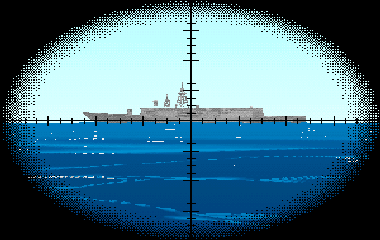

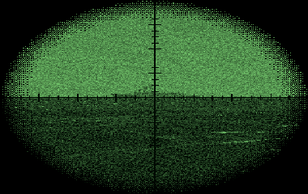

Il periscopio di ricerca dei 688 e degli Sturgeon, costruito dalla Kollmorgen dal 1975: testa grossa con tre ingrandimenti (1,5, 6 e 12×), il modo a bassa luminosità, la telecamera e la fotocamera, e le antenne ESM per ascoltare i radar mentre è alzato. Proprio per questo espone più del periscopio d'attacco Type 2: sezione radar e piuma maggiori. Nel 1989 la sua TV era quasi certamente in bianco e nero.

**In partita.** Nella stazione Periscopio si sceglie il Type 18 e lo si alza (8 secondi). Gli ingrandimenti girano a 1,5, 6 e 12×; la notte si passa alla bassa luminosità; il tasto della foto mette l'immagine nel registro della missione. Si tiene alzato poco, a bassa velocità: sopra i 6 nodi la piuma si vede e l'immagine trema, oltre i 15 si rischia il danno.

| Dato | Valore | Nel gioco | Confidenza | Fonte |
|---|---|---|---|---|
| Ingrandimenti (campo) | 1,5× (32°), 6,0× (8°), 12,0× (4°) | - | media | §2.1 [PAT] [K18] [NSL2] [NOVA-P] |
| Elevazione | da -10° a +60,0° | - | media | §2.1 [PAT] [K18] [NSL2] [NOVA-P] |
| Telemetro | stadimetro a immagine sdoppiata | - | media | §2.1 [PAT] [K18] [NSL2] [NOVA-P] |
| Modi di visione | giorno, bassa luminosità, TV | - | media | §2.1 [PAT] [K18] [NSL2] [NOVA-P] |
| ESM nella testa | sì | - | media | §2.1 [PAT] [K18] [NSL2] [NOVA-P] |
| Sezione radar (1 m esposto) | 1,5 m² | - | STIMA | §2.1 [PAT] [K18] [NSL2] [NOVA-P] |
| Tempo d'alzata | 8 s | - | STIMA | §2.1 [PAT] [K18] [NSL2] [NOVA-P] |
| Velocità di danno | 15 kn | - | STIMA | §2.1 [PAT] [K18] [NSL2] [NOVA-P] |

**Montato su:** Los Angeles (SSN-688, Flight I), Sturgeon (SSN-637).

**Fonti:** dossier 20 §2.1 [PAT] [K18] [NSL2] [NOVA-P] e §8.1; periscopi.toml (periscopi.type18).

### Type 2 (attacco)

*Periscopi · Stati Uniti*

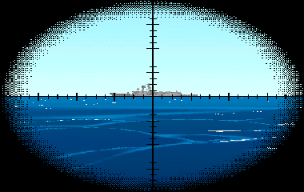

Il periscopio d'attacco dei 688 e degli Sturgeon: è lo stesso progetto descritto nel manuale della US Navy del 1946, aggiornato e ancora in servizio negli anni '90. La testa è sottilissima, poco più di 6 centimetri nella versione 2D del 1959, e lascia poca piuma e poca eco radar. Ha due ingrandimenti, 1,5× con 32 gradi di campo e 6× con 8, lo stadimetro a immagine sdoppiata e una linea di mira che sale fino a 74,5 gradi, cioè tutto il cielo. Non ha né visione notturna né ESM.

**In partita.** Nella stazione Periscopio si sceglie il Type 2 e lo si alza (6 secondi). Per la ricerca aerea si gira tre volte a basso ingrandimento, ai fermi di 14 e 44 gradi e al massimo; per la distanza si porta il galleggiamento dell'immagine fantasma sulla testa d'albero e si legge lo stadimetro. Di notte vede solo ciò che è illuminato. È il periscopio per l'ultimo tratto dell'attacco: esposizioni di una decina di secondi, sotto i 6 nodi.

| Dato | Valore | Nel gioco | Confidenza | Fonte |
|---|---|---|---|---|
| Ingrandimenti (campo) | 1,5× (32°), 6,0× (8°) | - | alta | §2.1 [PSM] [NSL2] [NOVA-P] |
| Elevazione | da -10° a +74,5° | - | alta | §2.1 [PSM] [NSL2] [NOVA-P] |
| Telemetro | stadimetro a immagine sdoppiata | - | alta | §2.1 [PSM] [NSL2] [NOVA-P] |
| Modi di visione | giorno | - | alta | §2.1 [PSM] [NSL2] [NOVA-P] |
| ESM nella testa | no | - | alta | §2.1 [PSM] [NSL2] [NOVA-P] |
| Sezione radar (1 m esposto) | 0,2 m² | - | STIMA | §2.1 [PSM] [NSL2] [NOVA-P] |
| Tempo d'alzata | 6 s | - | STIMA | §2.1 [PSM] [NSL2] [NOVA-P] |
| Velocità di danno | 15 kn | - | STIMA | §2.1 [PSM] [NSL2] [NOVA-P] |

**Montato su:** Los Angeles (SSN-688, Flight I), Sturgeon (SSN-637).

**Fonti:** dossier 20 §2.1 [PSM] [NSL2] [NOVA-P] [KOL], §7 e §8.1; periscopi.toml (periscopi.type2).

### Type 967/968

*Radar · Regno Unito*

Il Type 967/968 è il radar di sorveglianza delle fregate Type 22 della Royal Navy, in cima alla torre prodiera; sulla stessa nave ci sono i due Type 910, a prua e a poppa, e i missili Sea Wolf. Lo portano entrambe le serie della classe, la Batch 1 e la Batch 2. Nel gioco è un radar di ricerca aerea in banda D, intorno a 1,5 GHz, con un giro ogni 2 secondi e l'antenna a 22 metri.

**In partita.** All'ESM è una firma unica in banda D, un passaggio ogni 2 secondi, che di rado si scambia col Top Plate o col DRBV 22. Il WLR-8 lo sente fino a circa 17 miglia; il Bukhta dell'Alfa, che parte da 2 GHz, non lo sente affatto, ed è un guaio, perché contro un periscopio arriva a circa un miglio e mezzo con mare calmo, mezzo miglio con mare 4, e vede uno snorkel a 5. Come sulle altre navi della NATO, si accende quando il gruppo si sa scoperto.

| Dato | Valore | Nel gioco | Confidenza | Fonte |
|---|---|---|---|---|
| Banda | D | - | media | emettitori.toml (dossier 11 §1 e §6.4) |
| Frequenza | 1,5 GHz | - | media | emettitori.toml (dossier 11 §1 e §6.4) |
| Periodo di rotazione | 2 s | - | bassa | emettitori.toml (dossier 11 §1 e §6.4) |
| Scoperta di un periscopio (R50, mare 2) | 1,5 nm | - | STIMA | emettitori.toml (dossier 11 §1 e §6.4) |
| Scoperta di un periscopio (R50, mare 4) | 0,5 nm | - | STIMA | emettitori.toml (dossier 11 §1 e §6.4) |

**Montato su:** Type 22 Broadsword (Batch 1), Type 22 Boxer (Batch 2).

**Fonti:** dossier 32 §4; dossier 11 §3.2, §6.2 e §6.3; extracted/navi/type22/RAPPORTO.md; extracted/navi/type22b2/RAPPORTO.md; libretto.toml [type22] [type22b2]; tools/pipeline/emettitori.py (dotazioni dei lotti 1 e 2); emettitori.toml (radar.tipo967, suite.type22, suite.type22b2, esm.bukhta).

### VGS-2 «Oka»

*Sonar · Unione Sovietica*

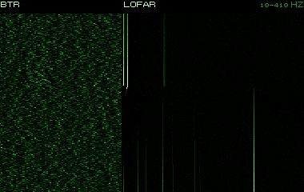

Il sonar a immersione «Oka» del Ka-25PL, l'elicottero antisommergibile sovietico precedente al Ka-27, ancora a bordo di Kresta II, Kara e Moskva e in parte dei Kiev nel 1985-1991. Il cavo è di 125 metri e la portata arriva a circa 6 km; la CIA stimava almeno 5,5 km in attivo e fino a 2,3 km in passivo, con una precisione di circa 100 iarde e 1 grado. Era giudicato inservibile di notte e col maltempo, e il suo ciclo era circa un terzo più lento di quello del Ka-27.

**In partita.** Più lento e meno profondo del VGS-3, e fermo di notte e col mare grosso. Fra un dip e l'altro passa circa un quarto d'ora: è il momento per allontanarti.

| Dato | Valore | Nel gioco | Confidenza | Fonte |
|---|---|---|---|---|
| Modo «vgs2» | attivo | - | media | acustica.toml: VGS-2 (Ka-25): STIMA |
| Antenna | sfera da 0,5 m | - | media | acustica.toml: VGS-2 (Ka-25): STIMA |
| Velocità massima d'ascolto | 30 kn | - | media | acustica.toml: VGS-2 (Ka-25): STIMA |
| Modo «vgs2_passivo» | passivo | - | media | acustica.toml: VGS-2 in passivo: STIMA |
| Antenna | sfera da 0,5 m | - | media | acustica.toml: VGS-2 in passivo: STIMA |
| Velocità massima d'ascolto | 30 kn | - | media | acustica.toml: VGS-2 in passivo: STIMA |

**Montato su:** Ka-25PL Hormone-A.

**Fonti:** dossier 17 §3.1 [RW-Ka25] [CIA72] [ART-Ka27]; dossier 17 §6.5; asw_aereo.toml (sonar_immersione.vgs2); acustica.toml (sensori.vgs2).

### VGS-3 «Ros'-V»

*Sonar · Unione Sovietica*

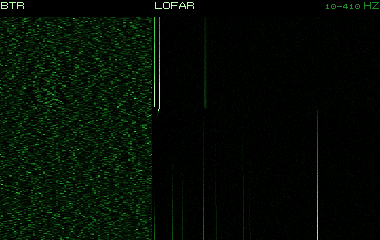

Il sonar a immersione «Ros'-V» del Ka-27PL, in servizio dal 1981 nel sistema «Osminog». Il corpo scende fino a 150 metri, forma i fasci elettronicamente e ha modi di ascolto passivo, eco, ricerca attiva a passi e inseguimento. In una prova del 1977 nel Mar Nero trovò un sottomarino diesel a 8 km in passivo e a 7 km in eco; la frequenza resta sconosciuta. L'attivo si usava raramente perché smascherava l'elicottero, e di notte non si calava affatto. Nel 1987, nel Mediterraneo, un gruppo di Ka-27 seguì due sottomarini stranieri per 11 ore.

**In partita.** Di giorno i Ka-27 ascoltano in silenzio, a gruppi, 3-10 minuti per dip e poi un salto di 4-6 km: contro di loro conta essere lenti e silenziosi. Se senti il loro ping hanno un contatto o un sospetto: allontanati e cambia quota. Di notte non calano il sonar, ed è il momento per passare.

| Dato | Valore | Nel gioco | Confidenza | Fonte |
|---|---|---|---|---|
| Modo «vgs3» | attivo | - | media | acustica.toml: VGS-3 (Ka-27PL): l'attivo solo con un contatto (17 §6.5); frequenza e SL STIMA |
| Antenna | sfera da 0,5 m | - | media | acustica.toml: VGS-3 (Ka-27PL): l'attivo solo con un contatto (17 §6.5); frequenza e SL STIMA |
| Velocità massima d'ascolto | 30 kn | - | media | acustica.toml: VGS-3 (Ka-27PL): l'attivo solo con un contatto (17 §6.5); frequenza e SL STIMA |
| Modo «vgs3_passivo» | passivo | - | media | acustica.toml: VGS-3 in passivo: un giro <= 30 s per 3-10 min (17 §6.5); bande STIMA |
| Antenna | sfera da 0,6 m | - | media | acustica.toml: VGS-3 in passivo: un giro <= 30 s per 3-10 min (17 §6.5); bande STIMA |
| Velocità massima d'ascolto | 30 kn | - | media | acustica.toml: VGS-3 in passivo: un giro <= 30 s per 3-10 min (17 §6.5); bande STIMA |

**Montato su:** Ka-27PL Helix-A.

**Fonti:** dossier 17 §3.2 [ART-Ka27]; dossier 17 §6.5 e §8.3; asw_aereo.toml (sonar_immersione.vgs3); acustica.toml (sensori.vgs3).

### Wet Eye

*Radar · Unione Sovietica*

Il radar di ricerca di superficie dell'Il-38 «May», parte del sistema «Berkut-38», in servizio dal 1959: radome sotto la fusoliera, giro completo o settori di 60 e 150 gradi, e un modo che esplora un quadrato di 20 km di lato. Lo stesso radar è sul Tu-142 di base. Giudicato arcaico nelle fonti russe, secondo la CIA scopriva un albero esposto a 25 miglia nelle condizioni migliori; la banda I è una stima.

**In partita.** All'ESM si confonde con l'APS-115 del P-3C. L'Il-38 lo tiene acceso a lungo, per minuti, e lo usa anche prima di posare le boe: un segnale frequente vuol dire che l'aereo sta preparando un campo. Con mare calmo vede un periscopio a circa 4 miglia.

| Dato | Valore | Nel gioco | Confidenza | Fonte |
|---|---|---|---|---|
| Banda | I | - | media | emettitori.toml (dossier 11 §1 e §6.4) |
| Frequenza | 9 GHz | - | media | emettitori.toml (dossier 11 §1 e §6.4) |
| Periodo di rotazione | 6 s | - | bassa | emettitori.toml (dossier 11 §1 e §6.4) |
| Scoperta di un periscopio (R50, mare 2) | 4 nm | - | STIMA | emettitori.toml (dossier 11 §1 e §6.4) |
| Scoperta di un periscopio (R50, mare 4) | 1,5 nm | - | STIMA | emettitori.toml (dossier 11 §1 e §6.4) |
| Portata contro una nave grande | 80 nm | - | bassa | emettitori.toml (dossier 11 §1 e §6.4) |

**Montato su:** Il-38 May.

**Fonti:** dossier 11 §1.4 [MPWETEYE] [WPIL38] [RWIL38], §3.4 e §6.1; dossier 17 §3.4 [ART-Il38] [CIA72] e §8.2; emettitori.toml (radar.wet_eye).

### radar di navigazione civile (X + S)

*Radar · neutrale*

I radar di navigazione delle navi mercantili: quasi sempre uno in banda X, e sulle navi più grandi e sulle petroliere un secondo in banda S. Hanno potenze modeste, l'antenna a 25-40 metri sull'acqua e una rotazione veloce, un giro ogni 2,5-3 secondi. Restano sempre accesi in navigazione. L'operatore di un mercantile non cerca periscopi, ma lo schermo li mostra comunque.

**In partita.** Sono il rumore di fondo dell'ESM nelle rotte trafficate, e i radar di navigazione sovietici, Don-2 e Palm Frond, stanno nella stessa banda: un contatto «radar di navigazione banda I» può essere un cargo o un incrociatore. Sono poco pericolosi per il periscopio, circa 2 miglia con mare calmo.

| Dato | Valore | Nel gioco | Confidenza | Fonte |
|---|---|---|---|---|
| Banda | I | - | media | emettitori.toml (dossier 11 §1 e §6.4) |
| Frequenza | 9 GHz | - | media | emettitori.toml (dossier 11 §1 e §6.4) |
| Periodo di rotazione | 2,5 s | - | bassa | emettitori.toml (dossier 11 §1 e §6.4) |
| Scoperta di un periscopio (R50, mare 2) | 2 nm | - | STIMA | emettitori.toml (dossier 11 §1 e §6.4) |
| Scoperta di un periscopio (R50, mare 4) | 0,5 nm | - | STIMA | emettitori.toml (dossier 11 §1 e §6.4) |

**Montato su:** Hauk (motocannoniera norvegese), Oslo (F300), Stockholm (K11), Mercantile (Ravenstvo, tipo Leninskiy Komsomol), Portacontainer (Cpl. Louis J. Hauge Jr., ex Estelle Maersk), Petroliera (Sea Isle City, 1981), Peschereccio d'altura (Atlantic Peace, 1987), Portarinfuse, Petroliera costiera e chimichiera, Traghetto ro-ro e passeggeri, Rimorchiatore d'altura, Rompighiaccio diesel-elettrico, Nave oceanografica, Peschereccio costiero (palangaro, reti da posta), Cianciolo.

**Fonti:** dossier 11 §1.3, §2 e §6.1-6.4; emettitori.toml (radar.nav_civ).

### radar di tiro

*Radar · Stati Uniti*

Sotto questa voce il gioco raccoglie tutti i radar di tiro e d'illuminazione: americani come l'SPG-60, lo STIR e l'SPG-51, sovietici come Pop Group, Head Light, Eye Bowl, Top Dome, Front Door, Kite Screech e Bass Tilt. Lavorano nelle bande alte, dalla G alla K, e non ruotano: puntano un bersaglio già scoperto per guidare cannoni e missili. Restano spenti finché non c'è un ingaggio, e la loro portata utile è di 10-40 miglia. L'Eye Bowl delle Krivak e della Kirov guida l'SS-N-14, il missile antisommergibile.

**In partita.** Un radar di tiro acceso vuol dire ingaggio in corso: all'ESM è un allarme di minaccia, non un semplice contatto. Se il fascio è puntato su di te sei già scoperto, qualunque sia la distanza; abbassa tutto e scendi.

| Dato | Valore | Nel gioco | Confidenza | Fonte |
|---|---|---|---|---|
| Banda | J | - | media | emettitori.toml (dossier 11 §1 e §6.4) |
| Frequenza | 15 GHz | - | media | emettitori.toml (dossier 11 §1 e §6.4) |
| Periodo di rotazione | 1 s | - | bassa | emettitori.toml (dossier 11 §1 e §6.4) |
| Portata contro una nave grande | 30 nm | - | bassa | emettitori.toml (dossier 11 §1 e §6.4) |

**Montato su:** Oliver Hazard Perry (FFG-7), Kidd (DDG-993), Spruance (DD-963), Iowa (BB-61), Kara (Progetto 1134B), Kirov (Progetto 1144), Slava (Progetto 1164), Krivak II (Progetto 1135M), Koni (Progetto 1159), Nanuchka I (Progetto 1234), Hauk (motocannoniera norvegese), Oslo (F300), Stockholm (K11), Knox (FF-1052), Ticonderoga (CG-47), Type 22 Broadsword (Batch 1), Type 22 Boxer (Batch 2), Udaloy (Progetto 1155), Grisha III (Progetto 1124M), Ugra (Progetto 1886).

**Fonti:** dossier 11 §1.1-1.2, §2 e §6.1-6.3; emettitori.toml (radar.fc).

### testa del Granit

*Radar · Unione Sovietica*

La testa radar attiva del P-700 Granit (SS-N-19), il grande missile antinave degli Oscar e della Kirov. Ha anche la capacità di dirigersi sulla sorgente di un disturbo elettronico. Si accende nella fase finale del volo; le fonti descrivono una salva in rete in cui un missile sale per cercare e designare mentre gli altri volano bassi, ma la stessa letteratura avverte che su questa meccanica ci sono dubbi. La banda J è una stima.

**In partita.** Per il 688 conta come allarme: una firma da seeker in banda J vuol dire che una salva di Granit è già in volo verso le navi che stai scortando. A quel punto il lanciatore è da qualche parte sotto di te: cercalo col sonar.

| Dato | Valore | Nel gioco | Confidenza | Fonte |
|---|---|---|---|---|
| Banda | J | - | media | emettitori.toml (dossier 11 §1 e §6.4) |
| Frequenza | 15 GHz | - | media | emettitori.toml (dossier 11 §1 e §6.4) |
| Periodo di rotazione | 0,5 s | - | bassa | emettitori.toml (dossier 11 §1 e §6.4) |
| Portata contro una nave grande | 15 nm | - | bassa | emettitori.toml (dossier 11 §1 e §6.4) |

**Fonti:** dossier 11 §1.6 [WPGRANIT] e §2; dossier 05 §3.3 [RWP700] [WPGranit]; emettitori.toml (radar.granit).

### «Lebed'-11/21» (del comandante)

*Periscopi · Unione Sovietica*

Il «Lebed-11» e il «Lebed-21» sono i periscopi del comandante, cioè d'attacco, dei sottomarini sovietici di terza generazione: l'Akula I ha l'uno o l'altro, il Typhoon il 21. Accompagnano il periscopio televisivo «Signal-3». Ingrandimenti, campo e testa non sono pubblicati; nel gioco hanno la testa sottile, due ingrandimenti e l'intensificatore notturno.

**In partita.** È la testa più difficile da vedere fra quelle sovietiche: poca piuma e poca eco radar. Un Akula che ti attacca guarda con questo, per una decina di secondi ogni pochi minuti.

| Dato | Valore | Nel gioco | Confidenza | Fonte |
|---|---|---|---|---|
| Ingrandimenti (campo) | 1,5× (40°), 6,0× (10°) | - | STIMA | §4.1 [APA] [RW-971] |
| Elevazione | da -10° a +45,0° | - | STIMA | §4.1 [APA] [RW-971] |
| Telemetro | reticolo graduato | - | media | §4.1 [APA] [RW-971] |
| Modi di visione | giorno, intensificatore | - | STIMA | §4.1 [APA] [RW-971] |
| ESM nella testa | no | - | media | §4.1 [APA] [RW-971] |
| Sezione radar (1 m esposto) | 0,3 m² | - | STIMA | §4.1 [APA] [RW-971] |
| Tempo d'alzata | 6 s | - | STIMA | §4.1 [APA] [RW-971] |
| Velocità di danno | 15 kn | - | STIMA | §4.1 [APA] [RW-971] |

**Montato su:** Akula I (Progetto 971), Typhoon (Progetto 941).

**Fonti:** dossier 20 §4.1-4.2 [APA] [RW-971] e §8.3; periscopi.toml (periscopi.lebed).

### «Signal-3» (universale TV)

*Periscopi · Unione Sovietica*

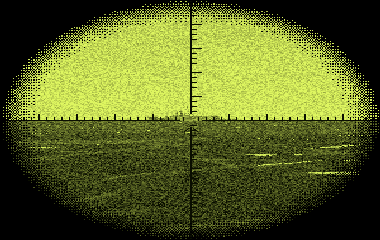

Il «Signal-3» è il periscopio universale con la televisione dei sottomarini nucleari sovietici di terza generazione: Akula I, Oscar II e Typhoon. Lavora in coppia con un periscopio del comandante, il «Lebed» o il PZNS-10. Ruolo noto, dati ottici no; per il gioco ha due ingrandimenti, l'intensificatore notturno e la TV.

**In partita.** Una testa di ricerca nemica è grossa, quindi visibile al tuo periscopio e al tuo radar con le stesse regole che valgono per te. I sovietici alzano prima l'antenna dell'avvisatore radar: se accendi il BPS-15, lo sanno.

| Dato | Valore | Nel gioco | Confidenza | Fonte |
|---|---|---|---|---|
| Ingrandimenti (campo) | 1,5× (40°), 6,0× (10°) | - | STIMA | §4.1 [APA] [RW-971] [RW-949] |
| Elevazione | da -15° a +60,0° | - | STIMA | §4.1 [APA] [RW-971] [RW-949] |
| Telemetro | reticolo graduato | - | media | §4.1 [APA] [RW-971] [RW-949] |
| Modi di visione | giorno, intensificatore, TV | - | STIMA | §4.1 [APA] [RW-971] [RW-949] |
| ESM nella testa | no | - | media | §4.1 [APA] [RW-971] [RW-949] |
| Sezione radar (1 m esposto) | 1 m² | - | STIMA | §4.1 [APA] [RW-971] [RW-949] |
| Tempo d'alzata | 8 s | - | STIMA | §4.1 [APA] [RW-971] [RW-949] |
| Velocità di danno | 15 kn | - | STIMA | §4.1 [APA] [RW-971] [RW-949] |

**Montato su:** Akula I (Progetto 971), Oscar II (Progetto 949A), Typhoon (Progetto 941).

**Fonti:** dossier 20 §4.1-4.2 [APA] [RW-971] [RW-949] e §8.3; periscopi.toml (periscopi.signal3).

### «Signal» (universale, sistema TV-1)

*Periscopi · Unione Sovietica*

Il «Signal» è l'unico periscopio dell'Alfa: universale e automatizzato, in servizio dal 1972, fa parte del sistema televisivo TV-1. Il comandante vede l'esterno su uno schermo del suo pulto e muove il periscopio a distanza; una telecamera verticale nella vela mostra il cielo anche a periscopio abbassato. Una volta il periscopio gelò nell'Artico e si navigò col solo radar. I dati ottici non sono noti: il canale notturno raffreddato esisteva sui sovietici dal 1965 ed è plausibile anche qui.

**In partita.** Con l'Alfa, nella stazione Periscopio, si alza il Signal (8 secondi): ingrandimenti 1,5× e 6×, di notte l'intensificatore dall'immagine verde giallina. La distanza si stima col reticolo, scegliendo l'altezza del bersaglio e contando le divisioni: è meno precisa dello stadimetro americano. La procedura sovietica vuole prima l'antenna dell'avvisatore radar e poi il periscopio, a velocità bassa.

| Dato | Valore | Nel gioco | Confidenza | Fonte |
|---|---|---|---|---|
| Ingrandimenti (campo) | 1,5× (40°), 6,0× (10°) | - | STIMA | §4.1 §4.4 [APA] [DS705] [SOB] [KOL705] |
| Elevazione | da -15° a +60,0° | - | STIMA | §4.1 §4.4 [APA] [DS705] [SOB] [KOL705] |
| Telemetro | reticolo graduato | - | media | §4.1 §4.4 [APA] [DS705] [SOB] [KOL705] |
| Modi di visione | giorno, intensificatore, TV | - | STIMA | §4.1 §4.4 [APA] [DS705] [SOB] [KOL705] |
| ESM nella testa | no | - | media | §4.1 §4.4 [APA] [DS705] [SOB] [KOL705] |
| Sezione radar (1 m esposto) | 1 m² | - | STIMA | §4.1 §4.4 [APA] [DS705] [SOB] [KOL705] |
| Tempo d'alzata | 8 s | - | STIMA | §4.1 §4.4 [APA] [DS705] [SOB] [KOL705] |
| Velocità di danno | 15 kn | - | STIMA | §4.1 §4.4 [APA] [DS705] [SOB] [KOL705] |

**Montato su:** Alfa (Progetto 705).

**Fonti:** dossier 20 §4.1 e §4.4 [APA] [DS705] [SOB] [KOL705] [MM], §7 e §8.2; periscopi.toml (periscopi.signal).

### MT-70 (complesso TV)

*Periscopi · Unione Sovietica*

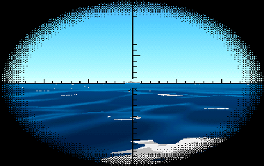

L'MT-70 è il complesso televisivo dei sottomarini nucleari sovietici di seconda generazione, Victor III (MT-70-10) e Charlie II: una telecamera per guardare la superficie e il ghiaccio. Con tempo buono funziona fino a una cinquantina di metri di profondità, guardando la superficie e il ghiaccio da sotto. Forse è lo stesso sistema chiamato «Kefal».

**In partita.** Di giorno e col tempo buono un Victor III o un Charlie II può guardare la superficie e il cielo senza alzare niente: non vedrai il suo periscopio, ma lui può vedere una sagoma in superficie. Contro di loro non affidarti al fatto che il mare sia sgombro di alberi.

| Dato | Valore | Nel gioco | Confidenza | Fonte |
|---|---|---|---|---|
| Ingrandimenti (campo) | 1,0× (30°) | - | STIMA | §4.1 §4.2 [APA] [PAV] |
| Elevazione | da -10° a +30,0° | - | STIMA | §4.1 §4.2 [APA] [PAV] |
| Telemetro | reticolo graduato | - | media | §4.1 §4.2 [APA] [PAV] |
| Modi di visione | TV | - | STIMA | §4.1 §4.2 [APA] [PAV] |
| ESM nella testa | no | - | media | §4.1 §4.2 [APA] [PAV] |
| Sezione radar (1 m esposto) | 0,5 m² | - | STIMA | §4.1 §4.2 [APA] [PAV] |
| Tempo d'alzata | 8 s | - | STIMA | §4.1 §4.2 [APA] [PAV] |
| Velocità di danno | 15 kn | - | STIMA | §4.1 §4.2 [APA] [PAV] |

**Montato su:** Victor III (Progetto 671RTM), Charlie II (Progetto 670M).

**Fonti:** dossier 20 §4.1-4.2 [APA] [PAV] e §8.3; periscopi.toml (periscopi.mt70).

### PZNG-10M (zenitale e di navigazione)

*Periscopi · Unione Sovietica*

Il periscopio zenitale e di navigazione del Victor III, accompagnato dal periscopio del complesso televisivo MT-70-10. Se ne conosce il ruolo, non i dati ottici. Per ordine di grandezza, i periscopi zenitali sovietici di guerra avevano 1,5× e 6× con 40 e 10 gradi di campo e guardavano fino alla verticale, con una testa più grossa di quella del comandante.

**In partita.** Prima di alzare il periscopio un battello sovietico fa un giro col sonar passivo e alza l'avvisatore radar; poi espone una testa grossa, che col mare calmo il tuo radar e il tuo periscopio possono cogliere.

| Dato | Valore | Nel gioco | Confidenza | Fonte |
|---|---|---|---|---|
| Ingrandimenti (campo) | 1,5× (40°), 6,0× (10°) | - | STIMA | §4.1 [APA] |
| Elevazione | da -15° a +90,0° | - | STIMA | §4.1 [APA] |
| Telemetro | reticolo graduato | - | media | §4.1 [APA] |
| Modi di visione | giorno, intensificatore | - | STIMA | §4.1 [APA] |
| ESM nella testa | no | - | media | §4.1 [APA] |
| Sezione radar (1 m esposto) | 1 m² | - | STIMA | §4.1 [APA] |
| Tempo d'alzata | 8 s | - | STIMA | §4.1 [APA] |
| Velocità di danno | 15 kn | - | STIMA | §4.1 [APA] |

**Montato su:** Victor III (Progetto 671RTM).

**Fonti:** dossier 20 §4.1-4.2 [APA] [PAT-RU], §7 [SPR74] e §8.3; periscopi.toml (periscopi.pzng10m).

### PZNG-8 (zenitale e di navigazione)

*Periscopi · Unione Sovietica*

Il periscopio zenitale e di navigazione dei Foxtrot, il secondo dopo il PK-8,5 d'attacco. I dati ottici non sono noti; per ordine di grandezza i periscopi zenitali di guerra avevano 1,5× e 6× e guardavano fino alla verticale, con una testa più grossa di quella del comandante. Nel gioco è solo diurno.

**In partita.** È il periscopio con cui un Foxtrot guarda il cielo, e la sua testa grossa si vede più di quella d'attacco. Il diesel deve poi ricaricare con lo snorkel, che al radar si scopre a 12-15 miglia contro le 4-5 di un periscopio.

| Dato | Valore | Nel gioco | Confidenza | Fonte |
|---|---|---|---|---|
| Ingrandimenti (campo) | 1,5× (40°), 6,0× (10°) | - | STIMA | §4.1 §4.2 [APA] |
| Elevazione | da -15° a +90,0° | - | STIMA | §4.1 §4.2 [APA] |
| Telemetro | reticolo graduato | - | media | §4.1 §4.2 [APA] |
| Modi di visione | giorno | - | media | §4.1 §4.2 [APA] |
| ESM nella testa | no | - | media | §4.1 §4.2 [APA] |
| Sezione radar (1 m esposto) | 1 m² | - | STIMA | §4.1 §4.2 [APA] |
| Tempo d'alzata | 8 s | - | STIMA | §4.1 §4.2 [APA] |
| Velocità di danno | 15 kn | - | STIMA | §4.1 §4.2 [APA] |

**Montato su:** Foxtrot (Progetto 641).

**Fonti:** dossier 20 §4.1-4.2 [APA] e §5 [RW-OBN]; periscopi.toml (periscopi.pzng8).

### PZNG-8M (zenitale e di navigazione)

*Periscopi · Unione Sovietica*

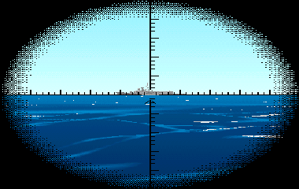

La versione PZNG-8M del periscopio zenitale e di navigazione, montata sui Kilo accanto al PK-8,5 d'attacco. I dati ottici non sono pubblicati; nel gioco, rispetto al PZNG-8 del Foxtrot, ha l'intensificatore notturno.

**In partita.** Di notte un Kilo vede col periscopio grande, quindi espone la testa più visibile. Dal punto di vista sovietico la testa dello snorkel si scopre al radar a 12-15 miglia, un periscopio a 4-5: il momento buono per trovare un Kilo è quando ricarica le batterie.

| Dato | Valore | Nel gioco | Confidenza | Fonte |
|---|---|---|---|---|
| Ingrandimenti (campo) | 1,5× (40°), 6,0× (10°) | - | STIMA | §4.1 §4.2 [APA] |
| Elevazione | da -15° a +90,0° | - | STIMA | §4.1 §4.2 [APA] |
| Telemetro | reticolo graduato | - | media | §4.1 §4.2 [APA] |
| Modi di visione | giorno, intensificatore | - | STIMA | §4.1 §4.2 [APA] |
| ESM nella testa | no | - | media | §4.1 §4.2 [APA] |
| Sezione radar (1 m esposto) | 1 m² | - | STIMA | §4.1 §4.2 [APA] |
| Tempo d'alzata | 8 s | - | STIMA | §4.1 §4.2 [APA] |
| Velocità di danno | 15 kn | - | STIMA | §4.1 §4.2 [APA] |

**Montato su:** Kilo (Progetto 877).

**Fonti:** dossier 20 §4.1-4.2 [APA] e §5 [RW-OBN]; periscopi.toml (periscopi.pzng8m).

### PZNS-10 (universale, zenitale)

*Periscopi · Unione Sovietica*

Il PZNS-10 discende dal primo periscopio universale sovietico, il PZNS entrato in servizio nel 1965 sui battelli della seconda generazione, con un intensificatore raffreddato nel canale notturno. La sigla non è sciolta con certezza: probabilmente zenitale e di navigazione. Lo montano il Charlie II, con il complesso TV MT-70, e nella versione PZNS-10S l'Oscar II come periscopio del comandante.

**In partita.** Guarda fino allo zenit e di notte ha l'intensificatore: un Charlie II o un Oscar a quota periscopica vede anche gli aerei e anche col buio. La testa è grossa: col tuo periscopio e il tuo radar la puoi scoprire.

| Dato | Valore | Nel gioco | Confidenza | Fonte |
|---|---|---|---|---|
| Ingrandimenti (campo) | 1,5× (40°), 6,0× (10°) | - | STIMA | §4.1 §4.2 [APA] [MM] |
| Elevazione | da -15° a +90,0° | - | STIMA | §4.1 §4.2 [APA] [MM] |
| Telemetro | reticolo graduato | - | media | §4.1 §4.2 [APA] [MM] |
| Modi di visione | giorno, intensificatore | - | media | §4.1 §4.2 [APA] [MM] |
| ESM nella testa | no | - | media | §4.1 §4.2 [APA] [MM] |
| Sezione radar (1 m esposto) | 1 m² | - | STIMA | §4.1 §4.2 [APA] [MM] |
| Tempo d'alzata | 8 s | - | STIMA | §4.1 §4.2 [APA] [MM] |
| Velocità di danno | 15 kn | - | STIMA | §4.1 §4.2 [APA] [MM] |

**Montato su:** Charlie II (Progetto 670M), Oscar II (Progetto 949A).

**Fonti:** dossier 20 §4.1-4.2 [APA] [MM] [RW-949]; periscopi.toml (periscopi.pzns10).

### PK-8,5 (d'attacco)

*Periscopi · Unione Sovietica*

Il PK-8,5 è il periscopio del comandante, cioè d'attacco, dei sottomarini diesel sovietici Kilo e Foxtrot, in coppia col periscopio zenitale e di navigazione PZNG-8. I dati ottici non sono pubblicati; nel gioco ha la testa sottile e due ingrandimenti, solo diurni. Come gli altri periscopi sovietici misura la distanza col reticolo graduato, non con l'immagine sdoppiata.

**In partita.** Una testa sottile, poca piuma: un Kilo in agguato è difficile da vedere quando guarda. Nel gioco questo periscopio è cieco di notte, e il Kilo guarda col PZNG-8M, che ha l'intensificatore.

| Dato | Valore | Nel gioco | Confidenza | Fonte |
|---|---|---|---|---|
| Ingrandimenti (campo) | 1,5× (40°), 6,0× (10°) | - | STIMA | §4.1 [APA] [KP] |
| Elevazione | da -10° a +45,0° | - | STIMA | §4.1 [APA] [KP] |
| Telemetro | reticolo graduato | - | media | §4.1 [APA] [KP] |
| Modi di visione | giorno | - | media | §4.1 [APA] [KP] |
| ESM nella testa | no | - | media | §4.1 [APA] [KP] |
| Sezione radar (1 m esposto) | 0,2 m² | - | STIMA | §4.1 [APA] [KP] |
| Tempo d'alzata | 6 s | - | STIMA | §4.1 [APA] [KP] |
| Velocità di danno | 15 kn | - | STIMA | §4.1 [APA] [KP] |

**Montato su:** Kilo (Progetto 877), Foxtrot (Progetto 641).

**Fonti:** dossier 20 §4.1-4.3 [APA] [KP]; periscopi.toml (periscopi.pk85).
<!-- fine: unita_sensori -->
