# 16. Sistemi di bordo

Le schede dei sistemi di bordo della simulazione, dall'enciclopedia del gioco, con lo spaccato che mostra dove stanno.

<!-- generato: unita_sistemi -->
### Antenna a filo galleggiante

*Sistemi di bordo · Stati Uniti*

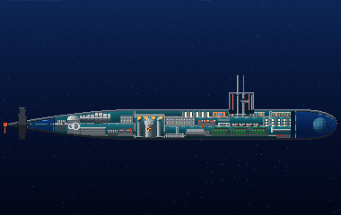

L'antenna a filo galleggiante OE-315 permette al 688 di ricevere VLF e LF restando in profondità. Il cavo, lungo oltre 300 metri, porta l'antenna in superficie, da cui sporge al massimo pochi centimetri. Solo ricezione e niente UHF, e soprattutto il battello deve andare piano e dritto. Sulle antenne dell'Alfa non c'è nessuna fonte aperta.

**In partita.** Si riceve fino a circa 120 metri di chiglia e 8 nodi; fra 8 e 12 nodi metà dei messaggi si perde, e una virata larga lascia il filo senza segnale per un paio di minuti. Sopra i 20 nodi il filo può rompersi e resta perso fino a fine missione.

| Dato | Valore | Nel gioco | Confidenza | Fonte |
|---|---|---|---|---|
| Modello | OE-315, per VLF/LF ed ELF (con il ricevitore OR-279) | - | media | dossier 08 §3.3 [SCMP] |
| Cavo | oltre 305 m di cavo per tenere l'antenna in superficie; sporge al massimo circa 5 cm dall'acqua | - | alta | dossier 08 §3.4 [APL99] |
| Vincolo | il battello deve andare piano e tenere la rotta; solo ricezione, niente UHF | - | alta | dossier 08 §3.4 [NSL99] [ALT]; dossier 10 radio §1.1 |
| Nel gioco | VLF fino a 120 m di chiglia e 8 nodi pieni, al 50% fra 8 e 12 nodi; oltre i 20 nodi il filo può rompersi | - | STIMA | dossier 08 §9.1 |
| Sull'Alfa | nessuna fonte aperta sulle antenne del Pr. 705; i sottomarini sovietici successivi avevano antenne a filo per ELF, VLF e HF | - | bassa | dossier 08 §6.3 [RUSNAVY] |

**Montato su:** Los Angeles (SSN-688, Flight I).

**Fonti:** dossier 08 §3.3 [SCMP], §3.4 [APL99] [NSL99] [ALT], §6.3, §9.1; dossier 10 radio §1.1.

### Antenne e alberi radio

*Sistemi di bordo · entrambe le parti*

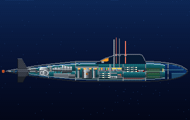

Il 688 ha due alberi multifunzione BRA-34 per HF e UHF in due sensi e per la ricezione VLF e LF; a bordo ci sono il satellitare WSC-3, gli apparati HF e la telescrivente. Per trasmettere deve salire a quota periscopica, circa 18 metri di chiglia, con l'albero alzato. L'Alfa concentrava radio e intercettazione su un solo pulto del posto centrale.

**In partita.** Sotto il 50% l'antenna non si alza più: niente trasmissioni e niente ricezione dall'albero. Fa parte delle comunicazioni, ultime nell'ordine delle riparazioni: anticipala se aspetti un messaggio importante.

| Dato | Valore | Nel gioco | Confidenza | Fonte |
|---|---|---|---|---|
| Alberi (688) | due alberi multifunzione BRA-34: HF e UHF in due sensi, VLF/LF solo in ricezione, a quota periscopica | - | media | dossier 08 §3.3 [SCMP] |
| Apparati (688) | satellitare UHF WSC-3, ricevitore HF R-1051, trasmettitore HF URT-23, telescrivente UGC-136 | - | media | dossier 19 §2.5 [FAS-SCMP]; dossier 08 §3.3 |
| Radio (Alfa) | «Molniya-705» per la radio e «Bulava-705» per l'intercettazione, su un solo pulto del posto centrale | - | alta | dossier 19 §3.1, §3.2 [SOB] |
| Per trasmettere | il 688 deve stare a quota periscopica (circa 18 m di chiglia) con l'albero alzato | - | media | dossier 08 §3.3, §3.4 [FASBRT6] |
| Nel modello dei danni | sotto il 50% l'antenna non si alza più | - | alta | docs/10_danni_affondamento_esplosioni.md §10.7 |

**Montato su:** Los Angeles (SSN-688, Flight I), Alfa (Progetto 705).

**Fonti:** dossier 08 §3.3 [SCMP], §3.4 [FASBRT6]; dossier 19 §2.5 [FAS-SCMP], §3.2 [SOB]; docs/10_danni_affondamento_esplosioni.md §10.7; dossier 02 §9.2.

### Apparato propulsore

*Sistemi di bordo · entrambe le parti*

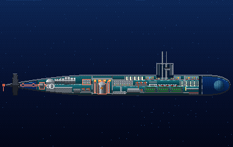

È la catena che va dal reattore all'elica. Sul 688 il reattore S6G alimenta due turbine su un asse; sull'Alfa un reattore a piombo-bismuto alimenta una sola turbina. L'Alfa affidava reattore, rete elettrica e impianti al sistema automatico «Ritm», con centinaia di sensori sorvegliati dal posto centrale.

**In partita.** La velocità massima segue il peggiore fra motori e propulsione. È la prima cosa che l'equipaggio ripara, come vuole la dottrina: senza moto non si risale.

| Dato | Valore | Nel gioco | Confidenza | Fonte |
|---|---|---|---|---|
| Impianto (688) | reattore S6G di circa 150-165 MW termici, due turbine, un asse | - | alta | dossier 01 §2.1 [FAS688] [WP688] |
| Impianto (Alfa) | reattore a metallo liquido piombo-bismuto (OK-550, poi BM-40A), una turbina, un asse | - | media | dossier 01 §2.4 [DS705] [WPAlfa] |
| Sorveglianza (Alfa) | «Ritm» comanda reattore, rete elettrica e impianti, con 226 sensori e 279 segnali | - | alta | dossier 19 §3.1 [SOB] |
| Nel modello dei danni | la velocità massima è il peggiore fra motori e propulsione; prima nella lista delle riparazioni | - | alta | docs/10_danni_affondamento_esplosioni.md §10.7; dossier 02 §9.2 |

**Montato su:** Los Angeles (SSN-688, Flight I), Alfa (Progetto 705).

**Fonti:** dossier 01 §2.1 [FAS688], §2.4 [DS705]; dossier 19 §3.1 [SOB]; dossier 02 §9.2; docs/10_danni_affondamento_esplosioni.md §10.7.

### Aria ad alta pressione

*Sistemi di bordo · entrambe le parti*

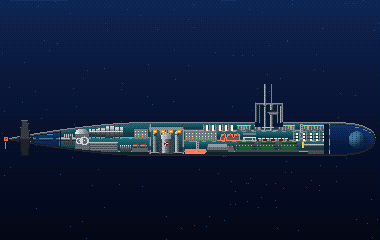

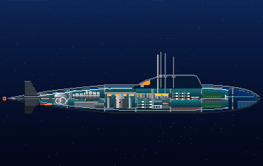

Le bombole d'aria ad alta pressione servono a svuotare le casse e a riportare il battello in superficie. Sul 688 l'esaurimento d'emergenza si comanda da un interruttore del Ballast Control Panel, che usa solo il capo della guardia; l'Alfa aveva invece una stazione a pulsanti. In profondità l'aria rende poco, perché la pressione la comprime: a 300 metri svuota circa un trentesimo di quanto svuoterebbe in superficie. Nel Thresher, nel 1963, il ghiaccio nelle valvole ridusse anche quel poco.

**In partita.** L'aria serve all'esaurimento d'emergenza (Ctrl+E): prima riduci la quota con i piani, poi esaurisci, perché più sali più l'aria rende. In un incendio una tubolatura dell'aria rotta alimenta le fiamme e consuma le bombole.

| Dato | Valore | Nel gioco | Confidenza | Fonte |
|---|---|---|---|---|
| Esaurimento d'emergenza | sul 688 l'interruttore è sul Ballast Control Panel e lo usa solo il capo della guardia | - | alta | dossier 19 §2.2 [SI-637] |
| Rendimento in profondità | la stessa aria svuota a 300 m circa 1/31 del volume che svuoterebbe in superficie; in risalita si espande e la manovra accelera da sola | - | alta | dossier 02 §9.1 |
| La lezione del Thresher | nel 1963 il ghiaccio in filtri e valvole ridusse il flusso dell'aria; ne nacque il programma SUBSAFE | - | media | dossier 02 §9.1 [USNI21] [USNI23] |
| Riserva nel gioco | 2,5 volte il volume delle casse a 1 bar: basta al caso San Francisco, non al Thresher | - | STIMA | docs/10_danni_affondamento_esplosioni.md §10.6, §10.11 |
| Casse (Alfa) | nessuna parete di valvole: una stazione a pulsanti accanto al timoniere, tenuta da un ingegnere | - | media | dossier 19 §3.2 [SUT] |

**Montato su:** Los Angeles (SSN-688, Flight I), Alfa (Progetto 705).

**Fonti:** dossier 19 §2.2 [SI-637], §3.2 [SUT]; dossier 02 §9.1 [USNI21] [USNI23], §9.2; docs/10_danni_affondamento_esplosioni.md §10.3, §10.6, §10.13.

### Boa radio a perdere

*Sistemi di bordo · Stati Uniti*

Una boa a perdere permette di trasmettere senza alzare un'antenna. La SLOT registra un messaggio fino a 5 minuti, sale in superficie e lo trasmette in VHF agli aerei vicini dopo un ritardo; nel 1982 costava poche centinaia di dollari. La boa satellitare BRT-6 arrivò sui 688 dopo alcuni 637, e per il 1989 non è verificata. Il 688 Flight I non aveva boe rimorchiate.

**In partita.** La boa chiede aiuto senza esporre il battello: il messaggio parte quando sei già lontano, ma va solo a un aereo amico in portata e non porta risposte. Se un ESM nemico è vicino, è meglio dell'albero.

| Dato | Valore | Nel gioco | Confidenza | Fonte |
|---|---|---|---|---|
| BRT-6 | boa UHF satellitare a perdere: su tre SSN-637 a metà anni '80, poi sui 688; per il 688 del 1989 non verificata | - | bassa | dossier 08 §3.3, §4.1 [FASBRT6] [SCMP] |
| Boa SLOT | messaggio registrato fino a 5 minuti, lanciato in immersione e trasmesso in VHF dopo un ritardo agli aerei vicini | - | media | dossier 10 radio §1.5 [NSL4604] [WPSLOT] |
| Costo | l'AN/BRT-1 costava 572 dollari nel 1982 | - | media | dossier 10 radio §1.5 [WPSLOT] |
| Boa rimorchiata | il 688 Flight I non aveva boe rimorchiate: la BRR-6 era solo degli SSBN Ohio | - | alta | dossier 08 §3.3 [SCMP] [TWZBRR6] |
| Nel gioco | proposta: 2-4 boe per missione, con un ritardo di 5-30 minuti | - | STIMA | dossier 10 radio §4.4 |

**Montato su:** Los Angeles (SSN-688, Flight I).

**Fonti:** dossier 08 §3.3 [FASBRT6] [SCMP] [TWZBRR6], §4.1; dossier 10 radio §1.5 [NSL4604] [WPSLOT], §4.4.

### Calcolatore del sonar

*Sistemi di bordo · entrambe le parti*

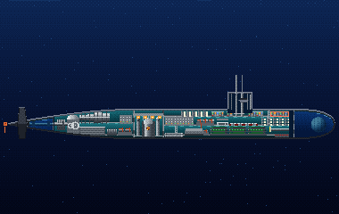

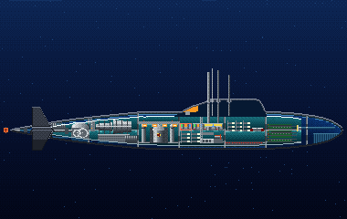

È la parte che trasforma i segnali degli idrofoni in cascate e tracce. Sul 688 del 1989 era il calcolatore UYK-7 del BQQ-5, con tre o quattro consolle a schermi monocromatici; i colori arrivarono solo con il 688I. Sull'Alfa lo stesso lavoro lo faceva il complesso automatizzato Okean, senza nemmeno un registratore per fissare i bersagli.

**In partita.** Sotto il 30% di efficienza il sonar si spegne, anche se la sfera è intatta. Sta nel compartimento prodiero: se devi combattere, sposta la sua riparazione in cima alla lista, altrimenti la squadra lo affronta dopo moto e governo.

| Dato | Valore | Nel gioco | Confidenza | Fonte |
|---|---|---|---|---|
| Calcolatore (688) | UYK-7 nelle prime versioni del BQQ-5 (uno, poi due); tre UYK-44 nel BQQ-5C | - | media | dossier 19 §2.3 [FI-BQQ5] |
| Consolle (688) | nel 1989 tre o quattro consolle OJ con CRT monocromatici; il colore arriva solo col BQQ-5E del 688I | - | media | dossier 19 §2.3 [FI-BQQ5] |
| Complesso (Alfa) | il complesso automatizzato «Okean», con gli schermi nel posto centrale; nessun registratore per fissare i bersagli | - | alta | dossier 19 §3.3 [TTX] [BOG] |
| Nel modello dei danni | uno dei sei sistemi che l'originale poteva guastare; sotto il 30% il sonar si spegne | - | alta | docs/10_danni_affondamento_esplosioni.md §10.1, §10.7 |

**Montato su:** Los Angeles (SSN-688, Flight I), Alfa (Progetto 705).

**Fonti:** dossier 19 §2.3 [FI-BQQ5], §3.3 [TTX] [BOG]; docs/10_danni_affondamento_esplosioni.md §10.3, §10.7.

### Centrale

*Sistemi di bordo · entrambe le parti*

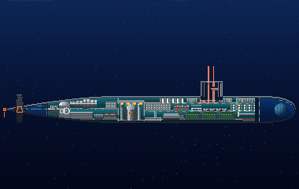

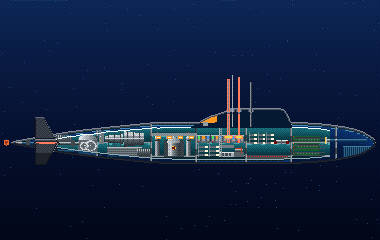

La centrale del 688 sta nel ponte superiore del compartimento prodiero e fa anche da centro d'attacco: al centro la pedana dei periscopi, a sinistra il governo con quattro uomini, a destra la fila delle consolle di tiro. Di notte la sala si oscura o passa alla luce rossa. L'Alfa aveva invece un posto centrale a ferro di cavallo nel compartimento rifugio, senza sale separate per radio, sonar o carteggio, con 8 uomini di guardia.

**In partita.** Non è un sistema danneggiabile, ma ci stanno periscopio, antenna, timone e timoni orizzontali: un allagamento o un incendio nel compartimento li minaccia tutti insieme, e un colpo al centro può toglierti vista e governo.

| Dato | Valore | Nel gioco | Confidenza | Fonte |
|---|---|---|---|---|
| Dove (688) | ponte superiore del compartimento prodiero; fa anche da centro d'attacco, con la sala sonar a parte | - | media | dossier 19 §2.1 [FAS-688] [SI-637] |
| Governo (688) | quattro uomini: timoniere, pianista, ufficiale d'immersione e capo della guardia al Ballast Control Panel | - | alta | dossier 19 §2.2 [NOVA-C] [SR-2004] |
| Luci (688) | bianca di giorno; di notte buio o luce rossa prima delle osservazioni al periscopio | - | media | dossier 19 §2.1 [NOVA-S] |
| Posto centrale (Alfa) | a ferro di cavallo nel compartimento III, quello rifugio; niente sale separate per radio, radar, sonar o carteggio; 8 uomini di guardia | - | alta | dossier 19 §3.1, §3.2 [SOB] [PRJ] [BOG] |
| Compartimenti (688) | pochi compartimenti stagni: prodiero (centrale, alloggi, locale siluri), reattore, sala macchine | - | media | dossier 02 §9.3 [PM04] |

**Montato su:** Los Angeles (SSN-688, Flight I), Alfa (Progetto 705).

**Fonti:** dossier 19 §2.1 [FAS-688] [NOVA-C] [NOVA-S], §2.2, §3.1, §3.2 [SOB] [PRJ] [BOG]; dossier 02 §9.3; docs/10_danni_affondamento_esplosioni.md §10.13.

### Direzione del tiro

*Sistemi di bordo · entrambe le parti*

Sul 688 la direzione del tiro Mk 117, la prima tutta digitale, arrivò col Dallas e sostituì il Mk 113 su molti battelli più vecchi negli anni '80. Gli operatori delle consolle Mk 81 giravano manopole per costruire la soluzione di tiro e preparare le armi; il pulsante rosso stava sul Weapons Control Panel. Sull'Alfa «Akkord» calcolava il moto di tre bersagli e «Sargan» comandava i tubi, ma i dati passavano solo per via elettrica.

**In partita.** Non è fra i sistemi danneggiabili del modello. Nel progetto della stazione Armi dell'Alfa un guasto di Akkord blocca tutte le armi, come avveniva davvero: senza Akkord non si lancia nulla.

| Dato | Valore | Nel gioco | Confidenza | Fonte |
|---|---|---|---|---|
| Sistema (688) | Mk 117, primo tutto digitale, dal Dallas (SSN-700); i battelli più vecchi avevano il Mk 113 e molti furono convertiti negli anni '80 | - | media | dossier 19 §2.4 [SR-1993]; dossier 01 §2.1 |
| Consolle (688) | consolle digitali Mk 81 con encoder rotativi per la TMA e le impostazioni delle armi; pulsante rosso di fuoco sul Weapons Control Panel | - | media | dossier 19 §2.1, §2.4 [WIKI-688] [SR-1984] [NOVA-C] |
| Sistema (Alfa) | «Akkord» calcola il moto di tre bersagli e passa i dati alle armi solo per via elettrica; «Sargan» prepara i tubi e comanda il lancio | - | alta | dossier 19 §3.1, §3.4 [SOB] [KOL] |
| Guasto (Alfa) | se Akkord si guastava, nessuna arma era utilizzabile | - | alta | dossier 19 §3.4 [BAR] |
| Da evitare | il Mk 92 è delle fregate FFG-7, non dei sottomarini | - | alta | dossier 19 §2.4 |

**Montato su:** Los Angeles (SSN-688, Flight I), Alfa (Progetto 705).

**Fonti:** dossier 19 §2.1 [NOVA-C], §2.4 [SR-1993] [WIKI-688] [SR-1984], §3.1, §3.4 [SOB] [KOL] [BAR], §6.5; dossier 01 §2.1.

### Motori

*Sistemi di bordo · entrambe le parti*

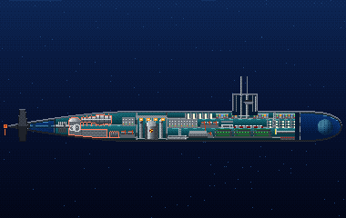

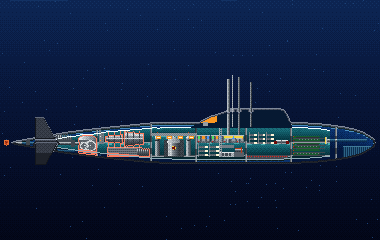

Sul 688 due turbine muovono un solo asse con 30.000-35.000 cavalli, e c'è anche un motore ausiliario retrattile da 325 cavalli. Il battello supera i 30 nodi, ma è silenzioso solo fino a circa 5-8. L'Alfa ha una sola turbina da circa 40.000 cavalli e tocca i 41 nodi, ma ad alta velocità è molto rumoroso.

**In partita.** La velocità massima scende con l'efficienza: con i motori al 75% hai 3/4 della velocità di prima, e il telegrafo rifiuta gli ordini oltre il limite. I motori sono fra i primi nella lista delle riparazioni.

| Dato | Valore | Nel gioco | Confidenza | Fonte |
|---|---|---|---|---|
| Turbine (688) | due turbine su un asse, circa 30.000-35.000 cavalli, più un motore ausiliario retrattile da 325 cavalli | - | alta | dossier 01 §2.1 [FAS688] [WP688] |
| Turbina (Alfa) | una turbina da circa 40.000 cavalli su un asse; 41 nodi in servizio | - | media | dossier 01 §2.4 [DS705] [WPAlfa] |
| Velocità | 688 reale 30-32 nodi, silenzioso solo fino a circa 5-8 | - | media | dossier 01 §2.1 [FAS688] |
| Nel modello dei danni | i motori al 75% danno 3/4 della velocità massima, come nell'originale | - | alta | docs/10_danni_affondamento_esplosioni.md §10.3 punto 5 |

**Montato su:** Los Angeles (SSN-688, Flight I), Alfa (Progetto 705).

**Fonti:** dossier 01 §2.1 [FAS688] [WP688], §2.4 [DS705] [WPAlfa] [GS705]; docs/10_danni_affondamento_esplosioni.md §10.3, §10.8.

### Periscopio

*Sistemi di bordo · entrambe le parti*

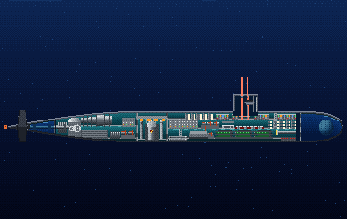

Il 688 ne ha due sulla pedana della centrale: il Type 2 d'attacco, sottile e solo diurno, e il Type 18 di ricerca, stabilizzato, con luce bassa, telecamera e un'antenna ESM, che riceve anche la radio. L'Alfa aveva un solo periscopio universale, il «Signal», più una telecamera nella vela. Ci guardavano solo comandante, secondo e ufficiale di guardia; se si guastava restava il solo sonar.

**In partita.** Sotto il 50% il periscopio non si alza più. Alzarlo a velocità troppo alta lo danneggia: rallenta prima di salire a quota periscopica.

| Dato | Valore | Nel gioco | Confidenza | Fonte |
|---|---|---|---|---|
| Periscopi (688) | due: d'attacco Type 2, solo diurno, e di ricerca Type 18, stabilizzato, con luce bassa, TV ed ESM | - | media | dossier 19 §2.1 [NOVA-C] [SR-2002]; dossier 01 §2.1 |
| Anche antenna | il Type 18 riceve anche VLF, LF, VHF e UHF | - | media | dossier 08 §3.3 [SCMP] |
| Periscopio (Alfa) | uno solo, l'universale «Signal», più la telecamera TV-1 nella vela; ci guardavano solo comandante, secondo e ufficiale di guardia | - | alta | dossier 19 §3.1, §3.2 [MET] [KOL] |
| Nel modello dei danni | sotto il 50% non si alza più | - | alta | docs/10_danni_affondamento_esplosioni.md §10.7 |

**Montato su:** Los Angeles (SSN-688, Flight I), Alfa (Progetto 705).

**Fonti:** dossier 19 §2.1 [NOVA-C] [SR-2002], §3.1, §3.2 [MET] [KOL]; dossier 08 §3.3 [SCMP]; docs/10_danni_affondamento_esplosioni.md §10.7; engine/missioni/src/missione_periscopi.cpp (periscopio piegato dalla velocità).

### Pompe di esaurimento e d'assetto

*Sistemi di bordo · entrambe le parti*

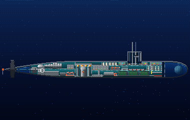

Le pompe di sentina e d'assetto tolgono l'acqua imbarcata e spostano peso fra le casse di compenso per tenere il battello in assetto. Sul 688 le comanda il capo della guardia dal Ballast Control Panel. In profondità rendono pochissimo: al Thresher, alla quota di collaudo, non poterono quasi nulla, e la dottrina le mette all'ultimo posto nella risposta a un allagamento.

**In partita.** La portata cala con l'efficienza e con la quota, e a 200 metri si annulla: per pompare fuori l'acqua bisogna prima risalire. Servono anche per alleggerirsi dopo essersi posati sul fondo.

| Dato | Valore | Nel gioco | Confidenza | Fonte |
|---|---|---|---|---|
| In profondità | al Thresher le pompe d'assetto e di sentina avevano una portata bassissima alla quota di collaudo | - | media | dossier 02 §9.1 [USNI21] |
| Dottrina | le pompe vengono per ultime nella risposta a un allagamento, perché rendono solo a bassa quota | - | media | dossier 02 §9.2 |
| Casse di compenso (688) | il capo della guardia tiene assetto e spinta pompando acqua fra le casse di compenso | - | media | dossier 19 §2.2 [NOVA-C] |
| Nel gioco | a 200 m non rendono più; le valvole d'allagamento per posarsi sul fondo imbarcano circa 3 t al minuto | - | STIMA | docs/10_danni_affondamento_esplosioni.md §10.7, §10.10 |

**Montato su:** Los Angeles (SSN-688, Flight I), Alfa (Progetto 705).

**Fonti:** dossier 02 §9.1 [USNI21], §9.2; dossier 19 §2.2 [NOVA-C]; docs/10_danni_affondamento_esplosioni.md §10.7, §10.10.

### Reattore

*Sistemi di bordo · entrambe le parti*

Il 688 ha un reattore S6G da circa 150-165 megawatt termici; l'Alfa un reattore a metallo liquido piombo-bismuto, l'OK-550 e poi il BM-40A. Un urto violento può farlo spegnere d'emergenza (SCRAM): il battello va avanti a batteria col motore d'emergenza, lentamente, finché il reattore non torna critico, in circa 5-20 minuti.

**In partita.** Non è un sistema da riparare ma uno stato: durante lo SCRAM hai al massimo il 15% della velocità, poi la potenza torna da sola. In quei minuti non puoi né fuggire né reggere un allagamento con i piani, quindi tieni la quota bassa.

| Dato | Valore | Nel gioco | Confidenza | Fonte |
|---|---|---|---|---|
| Reattore (688) | S6G, circa 150-165 MW termici, su un battello con un solo asse | - | alta | dossier 01 §2.1 [FAS688] [WP688] |
| Reattore (Alfa) | a metallo liquido piombo-bismuto: OK-550 sul 705, BM-40A sul 705K | - | media | dossier 01 §2.4 [DS705] [WPAlfa] |
| SCRAM | un urto forte può spegnerlo: si va avanti a batteria col motore d'emergenza, e il reattore torna critico in circa 5-20 minuti | - | bassa | dossier 02 §9.2, §9.4 |
| Nel gioco | SCRAM possibile da un fattore d'urto di 0,1; durante lo SCRAM al massimo il 15% della velocità | - | STIMA | docs/10_danni_affondamento_esplosioni.md §10.7 |

**Montato su:** Los Angeles (SSN-688, Flight I), Alfa (Progetto 705).

**Fonti:** dossier 01 §2.1 [FAS688], §2.4 [DS705] [WPAlfa]; dossier 02 §9.2, §9.4; docs/10_danni_affondamento_esplosioni.md §10.7.

### Schiera rimorchiata

*Sistemi di bordo · Stati Uniti*

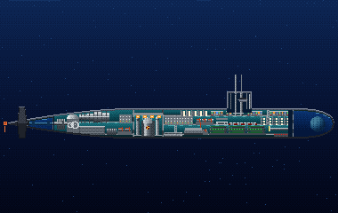

L'antenna rimorchiata TB-16 è un tubo di idrofoni lungo circa 73 metri, trainato a circa 730 metri dietro il 688 per ascoltare lontano dal rumore del battello. Era un sottosistema passivo del BQQ-5, montato su tutti i 688; la più sottile TB-23 arrivò solo a fine anni '80. L'Alfa non ne aveva: la schiera che gli dava il gioco originale era un errore.

**In partita.** Il danno conta solo quando è totale: finché resta qualcosa la schiera funziona, a zero è persa. È il sistema più a poppa, quindi soffre gli incendi e le esplosioni in sala macchine.

| Dato | Valore | Nel gioco | Confidenza | Fonte |
|---|---|---|---|---|
| Modello | TB-16 su tutti i 688, sottosistema passivo del BQQ-5; TB-23 sottile solo a fine anni '80 | - | alta | dossier 04 (tabella delle schiere) [FAS-TB16]; dossier 01 §2.1 |
| Dimensioni | schiera di circa 73 m e 3,5 pollici di diametro, su un cavo di circa 730 m | - | alta | dossier 04 [FAS-TB16] |
| Sull'Alfa | nessuna schiera: nessuna fonte ne attribuisce una al Pr. 705, e la schiera dell'Alfa nel gioco originale è un errore | - | media | dossier 04 [WP-Alfa] [Legion-705] |
| Nel modello dei danni | sta a poppa; nell'originale il guasto faceva perdere la schiera | - | alta | docs/10_danni_affondamento_esplosioni.md §10.1, §10.13 |

**Montato su:** Los Angeles (SSN-688, Flight I).

**Fonti:** dossier 04 [FAS-TB16] [WP-Alfa] [Legion-705]; dossier 01 §2.1; docs/10_danni_affondamento_esplosioni.md §10.7, §10.13.

### Sonar di prua

*Sistemi di bordo · entrambe le parti*

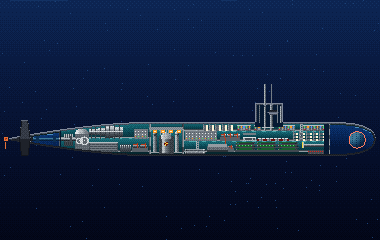

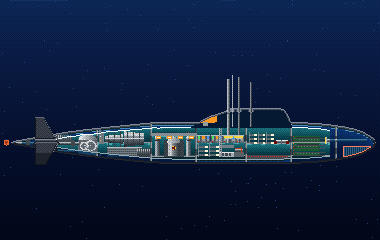

Il sonar principale sta nella prua. Sul 688 è la sfera BQS-13 del BQQ-5, con oltre mille idrofoni, affiancata da una schiera conforme sullo scafo. Sull'Alfa era la stazione passiva «Enisej» del complesso Okean, potente sulla carta ma limitata dal rumore del battello: Victor III e Los Angeles scoprivano più lontano.

**In partita.** Sotto il 30% il sonar si spegne, come per il calcolatore. Un incendio a prua lo danneggia, quindi un colpo a prua può lasciarti cieco proprio mentre combatti.

| Dato | Valore | Nel gioco | Confidenza | Fonte |
|---|---|---|---|---|
| Sfera (688) | sfera BQS-13 del BQQ-5 con oltre mille idrofoni, più una schiera conforme sullo scafo | - | alta | dossier 01 §2.1 [FAS688] [WP688] |
| Sonar (Alfa) | stazione passiva «Enisej» del complesso Okean; il rumore proprio ne limitava la portata a quella del Pr. 671 | - | alta | dossier 19 §3.3 [TTX] [KOL] |
| Confronto | Victor III e Los Angeles scoprivano più lontano dell'Alfa | - | alta | dossier 19 §3.3 [KOL] |
| Nel modello dei danni | sta nel compartimento prodiero; sotto il 30% il sonar si spegne | - | alta | docs/10_danni_affondamento_esplosioni.md §10.7, §10.13 |

**Montato su:** Los Angeles (SSN-688, Flight I), Alfa (Progetto 705).

**Fonti:** dossier 01 §2.1 [FAS688] [WP688]; dossier 19 §3.3 [TTX] [KOL]; docs/10_danni_affondamento_esplosioni.md §10.7, §10.13.

### Sonar di tiro

*Sistemi di bordo · entrambe le parti*

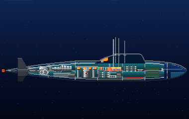

Nel gioco del 1989 il «targeting sonar» era uno dei sei sistemi che un colpo poteva guastare. I dossier non gli assegnano un apparato preciso: i sonar attivi più vicini sono il BQS-15 del 688, ad alta frequenza e a corto raggio per ostacoli, ghiaccio e mine, e i modi attivi dell'Okean dell'Alfa con la stazione antimine «Luch».

**In partita.** Come nell'originale, il guasto viene segnalato nella stazione Stato senza togliere altre funzioni. Sta a prua e la squadra lo ripara dopo moto, governo e sonar principale.

| Dato | Valore | Nel gioco | Confidenza | Fonte |
|---|---|---|---|---|
| Attivo ad alta frequenza (688) | AN/BQS-15, attivo HF a corto raggio per ostacoli, ghiaccio e mine | - | media | dossier 01 §2.1 e tabella dei sonar [FAS688] |
| Attivo (Alfa) | l'Okean ha la stazione antimine «Luch» e diversi modi attivi | - | alta | dossier 19 §3.3 [TTX] [BAR] |
| Corrispondenza col gioco | il «targeting sonar» dell'originale non ha un apparato preciso nei dossier: l'accostamento ai sonar attivi qui sopra è una stima | - | STIMA | docs/10_danni_affondamento_esplosioni.md §10.1 |

**Montato su:** Los Angeles (SSN-688, Flight I), Alfa (Progetto 705).

**Fonti:** dossier 01 §2.1 [FAS688]; dossier 19 §3.3 [TTX] [BAR]; docs/10_danni_affondamento_esplosioni.md §10.1, §10.7.

### Timone

*Sistemi di bordo · entrambe le parti*

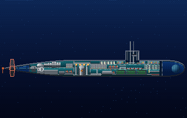

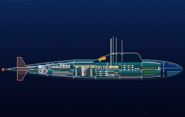

Il timone verticale governa la rotta. Sul 688 il timoniere usa un volante: 3,5 gradi di volante per un grado di timone, con un quadrante che si legge ogni 5 gradi e una barra d'emergenza. Sull'Alfa rotta e quota si tenevano per lo più dal pulto del moto «Boksit», anche in automatico.

**In partita.** Sotto il 30% il timone resta bloccato e il battello gira sempre dalla stessa parte o va dritto. Il governo viene subito dopo la propulsione nella lista delle riparazioni.

| Dato | Valore | Nel gioco | Confidenza | Fonte |
|---|---|---|---|---|
| Volante (688) | 3,5° di volante per 1° di timone, senso orario per accostare a dritta; quadrante a sincro letto ogni 5° | - | alta | dossier 19 §2.2 [NSTM-561] |
| Emergenza (688) | c'è una barra d'emergenza per il timone | - | alta | dossier 19 §2.2 [NSTM-561] |
| Governo (Alfa) | rotta e quota si tenevano per lo più dal pulto del moto «Boksit» | - | alta | dossier 19 §3.2 [FLOT] |
| Diametro di virata (688) | non pubblicato; stima di 4-6 lunghezze a 15-20 nodi con timone tutto | - | STIMA | dossier 01 §2.1 |
| Nel modello dei danni | sotto il 30% resta bloccato | - | alta | docs/10_danni_affondamento_esplosioni.md §10.7 |

**Montato su:** Los Angeles (SSN-688, Flight I), Alfa (Progetto 705).

**Fonti:** dossier 19 §2.2 [NSTM-561], §3.2 [FLOT]; dossier 02 §9.2; docs/10_danni_affondamento_esplosioni.md §10.7.

### Timoni orizzontali (timoni orizzontali)

*Sistemi di bordo · entrambe le parti*

I timoni orizzontali governano la quota. Il 688 Flight I li ha sulla vela e a poppa, senza timoni di prora, e per questo non può emergere rompendo il ghiaccio. Il pianista li muove con una colonna a cloche: avanti per scendere, indietro per salire. Sull'Alfa rotta e quota le teneva il sistema automatico «Boksit», con «Tan» per l'assetto.

**In partita.** Sotto il 30% i piani si bloccano all'angolo che avevano: se erano in discesa, il battello continua a scendere. Contro un allagamento i piani valgono più della zavorra: avanti tutta e barra in salita prima di esaurire.

| Dato | Valore | Nel gioco | Confidenza | Fonte |
|---|---|---|---|---|
| Piani (688 Flight I) | timoni sulla vela e a poppa, nessun timone di prora (arriva col 688I); con i piani sulla vela non si emerge nel ghiaccio | - | alta | dossier 19 §2.2 [NSTM-561]; dossier 01 §2.1 [WP688] |
| Comandi (688) | colonna a cloche: avanti per scendere, indietro per salire, circa 6 pollici di corsa per parte | - | alta | dossier 19 §2.2 [NSTM-561] |
| Quota (Alfa) | «Boksit» tiene rotta e quota a programma, in automatico o a mano; «Tan» tiene l'assetto in moto | - | alta | dossier 19 §3.1 [SOB] [PRJ] |
| Portanza | sul 688 a 10 m/s i piani e lo scafo reggono dell'ordine di 100 t d'acqua imbarcata | - | STIMA | docs/10_danni_affondamento_esplosioni.md §10.3 punto 2, §10.6 |
| Nel modello dei danni | sotto il 30% si bloccano all'angolo che avevano | - | alta | docs/10_danni_affondamento_esplosioni.md §10.3 punto 5, §10.7 |

**Montato su:** Los Angeles (SSN-688, Flight I), Alfa (Progetto 705).

**Fonti:** dossier 19 §2.2 [NSTM-561], §3.1 [SOB] [PRJ]; dossier 01 §2.1 [WP688]; dossier 02 §9.2; docs/10_danni_affondamento_esplosioni.md §10.3, §10.7.
<!-- fine: unita_sistemi -->
