# 17. Basi e marcatori

Le schede delle basi e dei marcatori della simulazione, dall'enciclopedia del gioco.

<!-- generato: unita_basi -->
### Ancoraggio di Alborán

*Basi · Unione Sovietica*

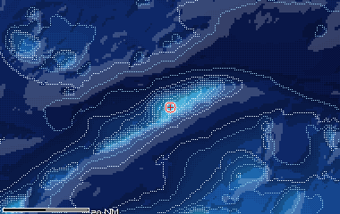

Presso l'isola di Alborán, appena a est della carta, la 5ª Eskadra sovietica del Mediterraneo teneva un ancoraggio. Non era una base a terra ma un punto di fonda. La notizia viene da una fonte amatoriale e va verificata.

**In partita.** Navi sovietiche alla fonda a est dello stretto sono plausibili, non un'invenzione del gioco.

| Dato | Valore | Nel gioco | Confidenza | Fonte |
|---|---|---|---|---|
| Posizione | presso l'isola di Alborán, 35,94°N 3,03°W, appena a est della carta | - | media | dossier 03 §A3 (posizione dell'isola) |
| Ruolo | ancoraggio della 5ª Eskadra sovietica del Mediterraneo, non una base a terra | - | bassa | dossier 03 §A3 (fonte amatoriale, da verificare) |

**Teatro:** Stretto di Gibilterra.

**Fonti:** dossier 03 §A3 (fonte amatoriale; FAS, 5ª Eskadra).

### Baltijsk

*Basi · Unione Sovietica*

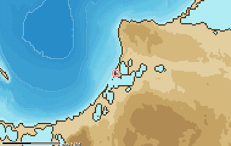

Base principale della Flotta del Baltico sovietica. Sta a est della carta del teatro, lontano dagli stretti danesi.

**In partita.** Nel Baltico le basi del Patto di Varsavia sono a est e a sud: la via d'uscita del 688 è verso ovest.

| Dato | Valore | Nel gioco | Confidenza | Fonte |
|---|---|---|---|---|
| Posizione | 54,65°N 19,90°E, all'ingresso della laguna della Vistola (fuori dalla carta del teatro) | - | STIMA | STIMA: coordinate non nei dossier |
| Ruolo | base principale della Flotta del Baltico sovietica | - | alta | dossier 03 §A7 |

**Teatro:** Mar Baltico sud-occidentale.

**Fonti:** dossier 03 §A7.

### Brawdy

*Basi · Stati Uniti*

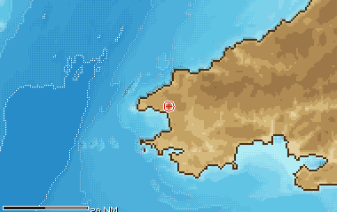

Stazione NAVFAC del SOSUS nel Galles, attiva circa dal 1974 al 1995. Era il punto d'ascolto per gli approcci occidentali, dove passavano i convogli REFORGER fra America ed Europa.

**In partita.** Un Alfa che punta un convoglio qui rischia di essere scoperto da terra prima ancora del contatto.

| Dato | Valore | Nel gioco | Confidenza | Fonte |
|---|---|---|---|---|
| Posizione | 51,88°N 5,12°W, nel Galles sud-occidentale (fuori dalla carta del teatro) | - | STIMA | STIMA: coordinate non nei dossier |
| Ascolto SOSUS | stazione NAVFAC del SOSUS, attiva circa dal 1974 al 1995 | - | media | dossier 03 §A6 (globalsecurity) |

**Teatro:** Margine della Piattaforma Celtica.

**Fonti:** dossier 03 §A6 (globalsecurity).

### Brindisi

*Basi · NATO*

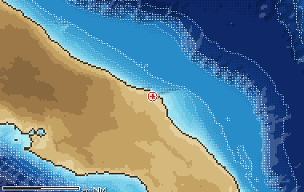

Base della Marina Militare italiana sulla costa pugliese. Dal suo porto e da Bari partivano i traghetti per la Grecia, che negli anni '80 davano al canale un traffico medio-alto, mentre l'Albania restava chiusa.

**In partita.** Il traffico dei traghetti corre lungo il lato italiano: il lato albanese è più silenzioso.

| Dato | Valore | Nel gioco | Confidenza | Fonte |
|---|---|---|---|---|
| Posizione | 40,65°N 17,95°E, sulla costa pugliese dell'Adriatico | - | STIMA | STIMA: coordinate non nei dossier |
| Ruolo | base della Marina Militare italiana | - | alta | dossier 03 §A4 |
| Traffico | traghetti per la Grecia, insieme a quelli di Bari: traffico medio-alto nel canale | - | media | dossier 03 §A4 |

**Teatro:** Imboccatura dell'Adriatico (Canale d'Otranto).

**Fonti:** dossier 03 §A4.

### Eckernförde

*Basi · NATO*

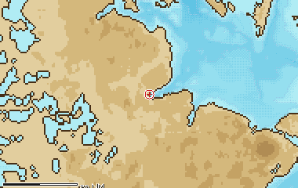

Base degli U-Boot della Germania Occidentale, i Type 205 e 206. Erano i sottomarini NATO del Baltico, perché gli SSN americani di fatto lì non operavano.

**In partita.** Un contatto diesel amico nel Baltico è più probabile di un altro SSN americano.

| Dato | Valore | Nel gioco | Confidenza | Fonte |
|---|---|---|---|---|
| Posizione | 54,47°N 9,84°E, a nord-ovest di Kiel (fuori dalla carta del teatro) | - | STIMA | STIMA: coordinate non nei dossier |
| Ruolo | base degli U-Boot tedeschi Type 205 e 206 | - | alta | dossier 03 §A7 |

**Teatro:** Mar Baltico sud-occidentale.

**Fonti:** dossier 03 §A7.

### Gadžievo

*Basi · Unione Sovietica*

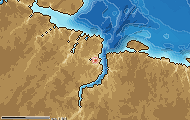

Base dei sottomarini lanciamissili balistici della Flotta del Nord, in una baia accanto all'imboccatura di Kola. I suoi SSBN pattugliavano il Barents, che l'intelligence occidentale chiamava «bastione»: un mare difeso da aerei, navi e sottomarini d'attacco, dove i missili non dovevano più superare le barriere alleate.

**In partita.** Un SSBN uscito da qui è il bersaglio più prezioso del Barents, e il più protetto.

| Dato | Valore | Nel gioco | Confidenza | Fonte |
|---|---|---|---|---|
| Posizione | 69,25°N 33,33°E, in una baia laterale a ovest dell'imboccatura di Kola | - | STIMA | STIMA: coordinate non nei dossier |
| Ruolo | base dei sottomarini lanciamissili balistici (SSBN) della Flotta del Nord | - | alta | dossier 03 §A2 (Polmar & Moore 2004) |
| Bastione | i suoi SSBN pattugliano il Barents, il «bastione» difeso con aerei, navi e SSN | - | alta | dossier 03 §A2 (CIA 2017); dossier 17 §5.6 |

**Teatro:** Mare di Barents (approcci a Kola).

**Fonti:** dossier 03 §A2 (Polmar & Moore 2004; CIA 2017); dossier 17 §5.6.

### Gdynia

*Basi · Unione Sovietica*

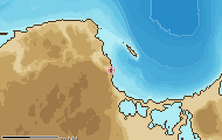

Base della marina polacca, terza marina del Patto di Varsavia nel Baltico dopo quella sovietica e la Volksmarine. Sta fuori dalla carta del teatro, a est.

**In partita.** Per il 688 anche le navi polacche sono del Patto di Varsavia, come quelle sovietiche e della RDT.

| Dato | Valore | Nel gioco | Confidenza | Fonte |
|---|---|---|---|---|
| Posizione | 54,53°N 18,55°E, nel golfo di Danzica (fuori dalla carta del teatro) | - | STIMA | STIMA: coordinate non nei dossier |
| Ruolo | base della marina polacca, nel Patto di Varsavia | - | alta | dossier 03 §A7 |

**Teatro:** Mar Baltico sud-occidentale.

**Fonti:** dossier 03 §A7.

### Gibilterra

*Basi · Regno Unito*

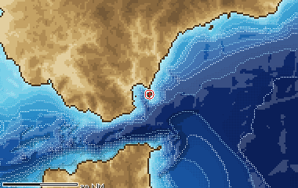

La rocca britannica sul lato nord dello stretto ospitava il comando NATO GIBMED, che sorvegliava il passaggio fra Atlantico e Mediterraneo. Lo stretto è uno dei tratti di mare più trafficati del mondo, con circa 300 transiti al giorno e i traghetti per Tangeri.

**In partita.** Nello stretto il rumore dei mercantili è il tuo miglior nascondiglio, per te e per l'avversario.

| Dato | Valore | Nel gioco | Confidenza | Fonte |
|---|---|---|---|---|
| Posizione | 36,14°N 5,35°W, sul lato nord dello stretto | - | STIMA | STIMA: coordinate non nei dossier |
| Comando NATO | sede del comando NATO GIBMED, sul chokepoint fra Atlantico e Mediterraneo | - | media | dossier 03 §A3 |
| Traffico | circa 300 transiti al giorno nello stretto, più i traghetti per Tangeri da Algeciras e Tarifa | - | media | dossier 03 §A3 |

**Teatro:** Stretto di Gibilterra.

**Fonti:** dossier 03 §A3.

### Gremicha

*Basi · Unione Sovietica*

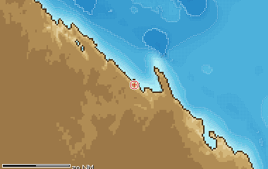

Base di SSBN della Flotta del Nord sulla costa orientale della penisola di Kola, più a est degli altri porti. Insieme a Gadžievo ospitava i sottomarini lanciamissili del bastione del Barents.

**In partita.** Sta fuori dalla carta del teatro: è una delle basi del bastione, non un luogo dove si combatte.

| Dato | Valore | Nel gioco | Confidenza | Fonte |
|---|---|---|---|---|
| Posizione | 68,07°N 39,47°E, sulla costa orientale della penisola di Kola (fuori dalla carta del teatro) | - | STIMA | STIMA: coordinate non nei dossier |
| Ruolo | base di SSBN della Flotta del Nord | - | alta | dossier 03 §A2 (Polmar & Moore 2004) |

**Teatro:** Mare di Barents (approcci a Kola).

**Fonti:** dossier 03 §A2 (Polmar & Moore 2004).

### Hachinohe

*Basi · Giappone*

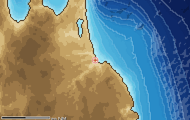

Base aerea nel nord dello Honshu da cui decollavano i pattugliatori marittimi P-3 giapponesi. Con quelli di Misawa sorvegliavano lo stretto di Sōya, l'uscita dell'Okhotsk verso il Mar del Giappone.

**In partita.** Gli aerei di pattuglia alleati arrivano da sud: nel teatro di Kunashir il cielo non è solo sovietico.

| Dato | Valore | Nel gioco | Confidenza | Fonte |
|---|---|---|---|---|
| Ruolo | base dei P-3 giapponesi che pattugliavano lo stretto di Sōya | - | media | dossier 03 §A5 |
| Posizione | Honshu settentrionale, fuori dal riquadro del teatro | - | STIMA | coordinate STIMA |

**Teatro:** Passo di Kunashir – Mare di Okhotsk.

**Fonti:** dossier 03 §A5.

### Keflavík

*Basi · Stati Uniti*

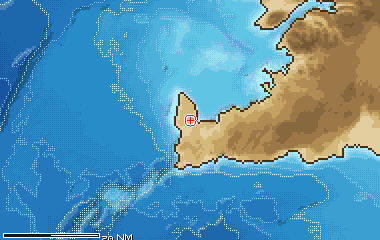

La stazione aeronavale americana in Islanda era il perno della sorveglianza del varco GIUK. Dal 1966 vi lavorava una stazione d'ascolto del SOSUS, e uno squadrone di P-3 vi ruotava da Brunswick, nel Maine. Dai suoi aerei il varco fra Islanda e Fær Øer dista 250-400 miglia, abbastanza vicino da restarci 6-7 ore per sortita.

**In partita.** Quando il SOSUS ti scopre nel varco, il P-3 che arriva sul datum di solito è decollato da qui.

| Dato | Valore | Nel gioco | Confidenza | Fonte |
|---|---|---|---|---|
| Posizione | 63,98°N 22,61°W (Islanda sud-occidentale, fuori dalla carta del teatro) | - | STIMA | STIMA: coordinate non nei dossier |
| Ascolto SOSUS | stazione NAVFAC del SOSUS attiva dal 1966 | - | alta | dossier 03 §A1 |
| Pattugliatori | uno squadrone VP di P-3 a rotazione, con base madre a Brunswick (Maine); per esempio il VP-11 dal novembre 1988 | - | media | dossier 17 §5.1 [WPVP11] |
| Tempo in zona dal varco | varco Islanda-Fær Øer a 250-400 nm: circa 6-7 ore in zona per un P-3 | - | media | dossier 17 §5.1 [CALC] |
| Broadcast VLF | vicino, a Grindavík, la stazione NRK/TFK a 37,5 kHz per il varco GIUK e il Mar di Norvegia | - | media | dossier 08 §2.1 [REEVE] [WPVLFL] |

**Teatro:** Isole Fær Øer – Mar di Norvegia.

**Fonti:** dossier 03 §A1; dossier 17 §5.1 [WPVP11] [HOLLER] [CALC]; dossier 08 §2.1.

### Kiel

*Basi · NATO*

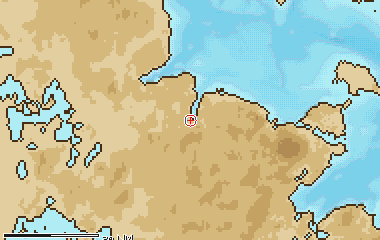

Base della marina della Germania Occidentale, sotto il comando NATO BALTAP insieme alla marina danese. In caso di guerra la NATO contava di minare gli stretti danesi, dove la soglia di Drogden ha solo 7-9 metri d'acqua.

**In partita.** La salvezza del 688 nel Baltico è verso ovest, ma gli stretti si passano solo in superficie o quasi.

| Dato | Valore | Nel gioco | Confidenza | Fonte |
|---|---|---|---|---|
| Posizione | 54,32°N 10,14°E, in fondo al fiordo di Kiel (appena a ovest della carta) | - | STIMA | STIMA: coordinate non nei dossier |
| Ruolo | base della marina tedesca occidentale sotto il comando NATO BALTAP | - | alta | dossier 03 §A7 |
| Gli stretti | la NATO pianificava di minare gli stretti danesi, dove la soglia di Drogden ha solo 7-9 m d'acqua | - | alta | dossier 03 §A7 |

**Teatro:** Mar Baltico sud-occidentale.

**Fonti:** dossier 03 §0 (errori, punto 2), §A7.

### Kinloss

*Basi · Regno Unito*

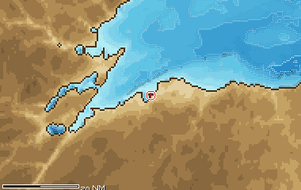

Base della RAF, sede dei pattugliatori Nimrod. Era uno degli anelli della catena con cui la NATO teneva d'occhio i sottomarini sovietici diretti in Atlantico, insieme al SOSUS, ai P-3 di Keflavík e alle barriere di sottomarini alleati. I suoi aerei coprivano anche gli approcci occidentali.

**In partita.** Fra le Fær Øer un aereo britannico può comparire sopra di te anche senza P-3 americani in zona.

| Dato | Valore | Nel gioco | Confidenza | Fonte |
|---|---|---|---|---|
| Posizione | 57,65°N 3,56°W (Scozia nord-orientale, fuori dalla carta del teatro) | - | STIMA | STIMA: coordinate non nei dossier |
| Pattugliatori | Nimrod della RAF, anello della catena di scoperta del varco GIUK | - | alta | dossier 03 §A1 (Cote, The Third Battle) |
| Anche a sud | i suoi Nimrod coprono anche i Western Approaches, insieme a quelli di St Mawgan | - | media | dossier 03 §A6 |

**Teatro:** Isole Fær Øer – Mar di Norvegia.

**Fonti:** dossier 03 §A1 (Cote, The Third Battle); dossier 03 §A6.

### Lann-Bihoué

*Basi · NATO*

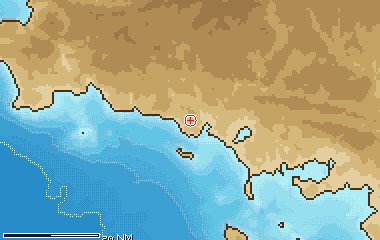

Base aeronavale francese, sede dei pattugliatori Atlantic. Sul margine della piattaforma celtica i suoi aerei affiancavano i Nimrod britannici.

**In partita.** Nella missione del convoglio diretto in Francia gli aerei amici possono essere francesi.

| Dato | Valore | Nel gioco | Confidenza | Fonte |
|---|---|---|---|---|
| Posizione | 47,76°N 3,44°W, in Bretagna meridionale (fuori dalla carta del teatro) | - | STIMA | STIMA: coordinate non nei dossier |
| Pattugliatori | Atlantic della marina francese sulla piattaforma celtica, accanto ai Nimrod britannici | - | media | dossier 03 §A6 |

**Teatro:** Margine della Piattaforma Celtica.

**Fonti:** dossier 03 §0, §A6.

### Misawa

*Basi · Giappone*

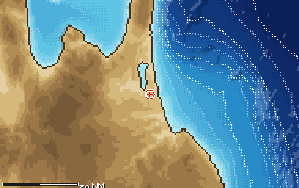

Base aerea nel nord dello Honshu, l'altra sede dei P-3 che sorvegliavano lo stretto di Sōya. Insieme al radar di Wakkanai e agli aerei di Hachinohe teneva d'occhio i passaggi dell'Okhotsk verso sud.

**In partita.** Come Hachinohe: gli aerei di pattuglia alleati arrivano da sud.

| Dato | Valore | Nel gioco | Confidenza | Fonte |
|---|---|---|---|---|
| Ruolo | base da cui partivano i P-3 di sorveglianza dello stretto di Sōya | - | media | dossier 03 §A5 |
| Posizione | Honshu settentrionale, fuori dal riquadro del teatro | - | STIMA | coordinate STIMA |

**Teatro:** Passo di Kunashir – Mare di Okhotsk.

**Fonti:** dossier 03 §A5.

### Mk 25 (fumogeno e fiamma)

*Marcatori · Stati Uniti*

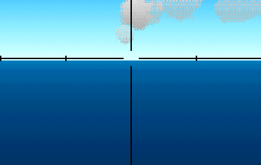

Il marcatore marino degli aerei antisommergibile statunitensi: caduto in mare accende una fiamma gialla e un fumo bianco che durano 10-20 minuti. Segna il punto di un contatto o di un attacco, così l'equipaggio ritrova la posizione a vista. Non si lancia dall'elicottero in volo stazionario.

| Dato | Valore | Nel gioco | Confidenza | Fonte |
|---|---|---|---|---|
| Durata | 15 min | - | alta | §4.3 [AUS-MK25] |
| Visibile fino a | 7,4 km | - | STIMA | §4.3 [AUS-MK25] |

**Portata da:** SH-60B Seahawk (LAMPS III), SH-2F Seasprite (LAMPS I), SH-3H Sea King, Hkp 4 (Vertol 107), Lynx HAS.3, SH-60F Ocean Hawk, P-3C Orion, S-3A Viking, S-3B Viking.

**Fonti:** dossier 17 §4.3 [AUS-MK25]; asw_aereo.toml (marcatori.mk25).

### Mk 58 (due candele)

*Marcatori · Stati Uniti*

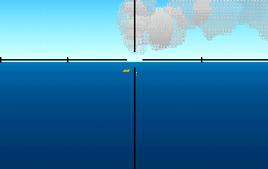

Il marcatore marino a lunga durata degli aerei antisommergibile statunitensi: in acqua accende due candele che bruciano 40-60 minuti e si vedono ad almeno 4,5-5 km, di giorno come di notte. Segna un contatto o il punto di un attacco; quando sgancia il siluro il P-3C lancia un Mk 25 o un Mk 58.

**In partita.** Un Mk 58 in vista vuol dire che il nemico ha già un punto sulla tua posizione stimata: allontanati di 2-3 miglia entro 15-20 minuti.

| Dato | Valore | Nel gioco | Confidenza | Fonte |
|---|---|---|---|---|
| Durata | 50 min | - | alta | §4.3 [AUS-MK58] |
| Visibile fino a | 4,7 km | - | alta | §4.3 [AUS-MK58] |

**Portata da:** P-3C Orion, S-3A Viking, S-3B Viking.

**Fonti:** dossier 17 §4.3 [AUS-MK58]; dossier 17 §6.2 e §8.1; asw_aereo.toml (marcatori.mk58).

### Mk 84 SUS (segnalatore acustico)

*Marcatori · Stati Uniti*

Il SUS Mk 84 è un segnalatore acustico non esplosivo con cui un aereo parla a un sottomarino: in acqua emette toni a circa 3 kHz, con 4-5 codici diversi, parte entro 3 secondi e suona per 45-120 secondi. In esercitazione serviva anche a simulare il lancio di un'arma contro il battello.

**In partita.** Toni a 3 kHz per uno o due minuti: in esercitazione è un attacco simulato contro di te, altrimenti un codice d'ordine da un aereo amico.

| Dato | Valore | Nel gioco | Confidenza | Fonte |
|---|---|---|---|---|
| Durata | 1,3 min | - | media | §4.3 [PRC68SUS] |
| Segnale acustico | 3 kHz | - | media | §4.3 [PRC68SUS] |

**Portata da:** P-3C Orion, S-3A Viking, S-3B Viking.

**Fonti:** dossier 17 §4.3 [PRC68SUS]; dossier 17 §8.3; asw_aereo.toml (marcatori.mk84).

### Murmansk

*Basi · Unione Sovietica*

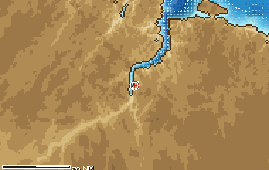

Il grande porto in fondo alla baia di Kola, sede delle flottiglie da pesca e dei rompighiaccio. Grazie alla Corrente di Capo Nord e a quella costiera del Murman non gela mai, come tutta la costa di Kola. D'inverno c'è la notte polare, circa dal 2 dicembre all'11 gennaio; d'estate il sole di mezzanotte e frequenti nebbie.

**In partita.** Pescherecci e rompighiaccio riempiono il sonar di contatti che non sono navi da guerra.

| Dato | Valore | Nel gioco | Confidenza | Fonte |
|---|---|---|---|---|
| Posizione | 68,97°N 33,08°E, in fondo alla baia di Kola | - | STIMA | tools/pipeline/teatri.yaml (latitudine); longitudine STIMA |
| Ghiaccio | libero dai ghiacci tutto l'anno, grazie alla Corrente di Capo Nord e a quella costiera del Murman | - | alta | dossier 03 §A2 |
| Traffico | flottiglie da pesca e rompighiaccio, che si sommano al traffico militare degli approcci | - | media | dossier 03 §A2; dossier 09 (rumore per teatro) |
| Notte polare | circa dal 2 dicembre all'11 gennaio; sole di mezzanotte da fine maggio a fine luglio | - | alta | dossier 03 §A2 |
| Nebbia | nebbia nel 15-16% dei giorni di agosto e settembre | - | media | dossier 21 §3 (tabella dei teatri) |

**Teatro:** Mare di Barents (approcci a Kola).

**Fonti:** dossier 03 §A2; dossier 09 (rumore per teatro); dossier 21 §3.

### OMAB-25-12D/-8N

*Marcatori · Unione Sovietica*

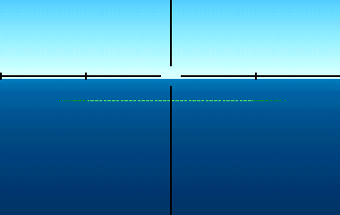

I marcatori marini sovietici OMAB-25-12D e OMAB-25-8N: il primo, per il giorno, colora l'acqua con la fluoresceina; il secondo, per la notte, accende una fiamma di acetilene. Li portano gli aerei e gli elicotteri antisommergibile, per esempio il Ka-25 con 4 marcatori, per segnare un contatto o un punto della ricerca.

**In partita.** Una chiazza colorata in acqua di giorno o una fiamma di notte: il nemico ha segnato un punto su di te. Allontanati di qualche miglio prima che torni.

| Dato | Valore | Nel gioco | Confidenza | Fonte |
|---|---|---|---|---|
| Durata | 30 min | - | STIMA | §4.3 [RW-Ka25] [ART-Il38] |
| Visibile fino a | 5 km | - | STIMA | §4.3 [RW-Ka25] [ART-Il38] |

**Portata da:** Ka-25PL Hormone-A, Ka-27PL Helix-A, Be-12 Mail, Il-38 May, Tu-142MK Bear-F.

**Fonti:** dossier 17 §4.3 [RW-Ka25] [ART-Il38]; dossier 17 §3.1 e §8.1; asw_aereo.toml (marcatori.omab).

### Pasha Liman (Valona)

*Basi · neutrale*

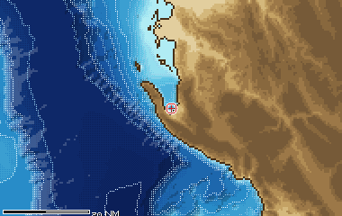

Base nella baia di Valona, dietro l'isola di Saseno. Dal 1958 al 1961 ospitò sottomarini sovietici Whiskey. Quando Mosca e Tirana ruppero, l'Albania si tenne quattro battelli.

**In partita.** Nel 1989 l'Albania è chiusa e fuori dai blocchi: il suo lato del canale non aiuta nessuno.

| Dato | Valore | Nel gioco | Confidenza | Fonte |
|---|---|---|---|---|
| Posizione | 40,33°N 19,45°E, nella baia di Valona dietro Saseno | - | STIMA | STIMA: coordinate non nei dossier |
| Storia | base sovietica di sottomarini Whiskey dal 1958 al 1961 | - | alta | dossier 03 §A4 |
| Dopo la rottura | con la rottura fra Mosca e Tirana l'Albania tenne quattro battelli | - | alta | dossier 03 §A4 |

**Teatro:** Imboccatura dell'Adriatico (Canale d'Otranto).

**Fonti:** dossier 03 §A4.

### Peenemünde

*Basi · Unione Sovietica*

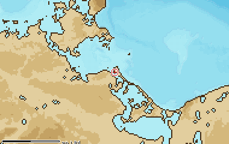

Base della Volksmarine, la marina della Repubblica Democratica Tedesca. Insieme a Warnemünde e Sassnitz schierava la RDT sulla costa più vicina agli stretti danesi.

**In partita.** Lungo la costa della RDT ogni porto può mandare unità di superficie contro di te.

| Dato | Valore | Nel gioco | Confidenza | Fonte |
|---|---|---|---|---|
| Posizione | 54,14°N 13,77°E, sull'isola di Usedom | - | STIMA | STIMA: coordinate non nei dossier |
| Ruolo | base della Volksmarine, la marina della RDT nel Patto di Varsavia | - | alta | dossier 03 §A7 |

**Teatro:** Mar Baltico sud-occidentale.

**Fonti:** dossier 03 §A7.

### Poljarnyj

*Basi · Unione Sovietica*

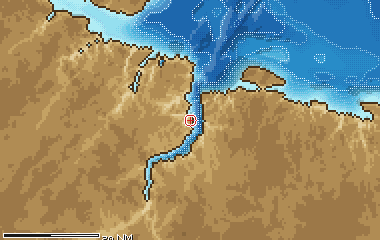

Base navale sulla sponda occidentale della baia di Kola, verso l'imboccatura. Insieme a Severomorsk e Gadžievo alimenta il traffico militare sovietico che rende rumorosi gli approcci di Kola. Nella missione 3 l'Alfa del giocatore pattuglia proprio la sua costa a caccia di intrusi.

**In partita.** Vicino a Poljarnyj il rumore del traffico copre l'intruso, ma copre anche te.

| Dato | Valore | Nel gioco | Confidenza | Fonte |
|---|---|---|---|---|
| Posizione | 69,20°N 33,45°E, sulla sponda ovest della baia di Kola, verso l'imboccatura | - | STIMA | STIMA: coordinate non nei dossier (la heightmap conferma solo che il porto è sulla costa) |
| Traffico | uno dei porti da cui viene l'intenso traffico militare sovietico degli approcci di Kola | - | media | dossier 03 §A2 |
| Nel gioco | missione 3: l'Alfa cerca intrusi lungo la costa di Poljarnyj | - | alta | data/missioni/SCENE3B.lua (testo del briefing); dossier 10 radio §5.4 |

**Teatro:** Mare di Barents (approcci a Kola).

**Fonti:** dossier 03 §A2; dossier 10 radio §5.4; data/missioni/SCENE3B.lua (briefing).

### Rota

*Basi · Stati Uniti*

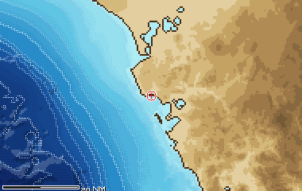

Base navale americana nel Golfo di Cadice, a ovest dello stretto. Fino al 1979 vi stazionavano SSBN americani. Ospitava anche uno dei Fleet Weather Central che preparavano rotte e previsioni per le navi in mare.

**In partita.** Nelle missioni di Gibilterra è la base americana del teatro.

| Dato | Valore | Nel gioco | Confidenza | Fonte |
|---|---|---|---|---|
| Posizione | 36,62°N 6,33°W, nel Golfo di Cadice, sul margine nord-occidentale della carta | - | STIMA | STIMA: coordinate non nei dossier |
| SSBN | sito degli SSBN americani fino al 1979 | - | media | dossier 03 §A3 |
| Meteo di flotta | sede di uno dei Fleet Weather Central che preparavano rotte e previsioni per le unità in mare | - | media | dossier 21 §5.2 |

**Teatro:** Stretto di Gibilterra.

**Fonti:** dossier 03 §A3; dossier 21 §5.2.

### Rybačij (Kamčatka)

*Basi · Unione Sovietica*

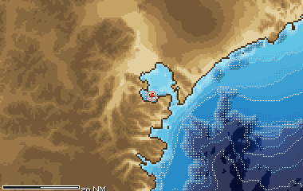

Base sottomarini in Kamčatka. Da qui e dalla Primorye uscivano i Delta della Flotta del Pacifico che pattugliavano il Mare di Okhotsk, il bastione degli SSBN in Estremo Oriente.

**In partita.** Gli stretti di Kunashir sono una delle porte di quel bastione: chi li passa è sorvegliato.

| Dato | Valore | Nel gioco | Confidenza | Fonte |
|---|---|---|---|---|
| Posizione | 52,92°N 158,49°E, nella baia di Avača (molto lontano dalla carta del teatro) | - | STIMA | STIMA: coordinate non nei dossier |
| Ruolo | base dei Delta della Flotta del Pacifico, che pattugliano il bastione dell'Okhotsk | - | alta | dossier 03 §A5 (CIA 2017) |

**Teatro:** Passo di Kunashir – Mare di Okhotsk.

**Fonti:** dossier 03 §A5 (CIA 2017).

### Sassnitz

*Basi · Unione Sovietica*

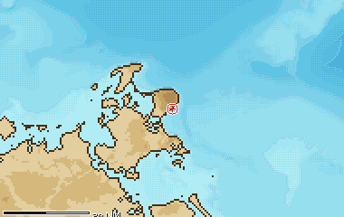

Base della Volksmarine a Rügen, e capolinea dei traghetti per Trelleborg in Svezia. Sta sulla costa della RDT, al largo della quale il 688 lancia i Tomahawk nella missione 10.

**In partita.** Nell'acqua bassa di Arkona il rumore dei traghetti è uno dei pochi ripari.

| Dato | Valore | Nel gioco | Confidenza | Fonte |
|---|---|---|---|---|
| Posizione | 54,51°N 13,64°E, sulla costa orientale di Rügen | - | STIMA | STIMA: coordinate non nei dossier |
| Ruolo | base della Volksmarine | - | alta | dossier 03 §A7 |
| Traffico | capolinea dei traghetti per Trelleborg | - | media | dossier 03 §A7 |

**Teatro:** Mar Baltico sud-occidentale.

**Fonti:** dossier 03 §0, §A7.

### Severomorsk

*Basi · Unione Sovietica*

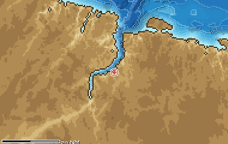

Sede del comando della Flotta del Nord, sulla sponda orientale della baia di Kola. Dall'aeroporto di Severomorsk-1 volavano gli Il-38 antisommergibile, e vicino a Severomorsk-3 sorgeva ZEVS, il trasmettitore a 82 Hz che raggiungeva i sottomarini in profondità. Nella missione 3 del gioco è il porto che l'Alfa deve mettere in sicurezza prima di rientrare.

**In partita.** Negli approcci di Kola il traffico militare è fitto e gli aerei antisommergibile decollano dalla stessa baia.

| Dato | Valore | Nel gioco | Confidenza | Fonte |
|---|---|---|---|---|
| Posizione | 69,07°N 33,42°E, sulla sponda est della baia di Kola | - | STIMA | tools/pipeline/teatri.yaml (latitudine, controllata sulla heightmap, docs/02_pipeline_dati.md); longitudine STIMA |
| Ruolo | sede del comando della Flotta del Nord | - | alta | dossier 03 §A2 (Polmar & Moore 2004) |
| Aerei ASW | Il-38 del 24° reggimento all'aeroporto di Severomorsk-1 | - | alta | dossier 17 §3.4 [RW-Il38] |
| Trasmettitore ELF | presso Severomorsk-3 il trasmettitore ZEVS a 82 Hz, ricevibile anche a 100-160 m di quota | - | media | dossier 08 §6.1 [WPZEVS] [RUCOM] |
| Nel gioco | missione 3 «Sub Ops»: l'Alfa protegge gli approcci del porto prima del rientro a Severomorsk | - | alta | dossier 03 §0 (manuale, cap. 3) |

**Teatro:** Mare di Barents (approcci a Kola).

**Fonti:** dossier 03 §0, §A2 (Polmar & Moore 2004); dossier 17 §3.4 [RW-Il38]; dossier 08 §6.1 [WPZEVS] [RUCOM].

### St Mawgan

*Basi · Regno Unito*

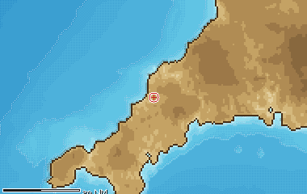

Base della RAF da cui i Nimrod pattugliavano gli approcci occidentali. Con Kinloss copriva le rotte dei rinforzi americani verso l'Europa.

**In partita.** Sulla piattaforma celtica l'Alfa deve aspettarsi aerei britannici sopra i convogli.

| Dato | Valore | Nel gioco | Confidenza | Fonte |
|---|---|---|---|---|
| Posizione | 50,44°N 5,00°W, in Cornovaglia (fuori dalla carta del teatro) | - | STIMA | STIMA: coordinate non nei dossier |
| Pattugliatori | Nimrod della RAF sui Western Approaches | - | media | dossier 03 §A6 |

**Teatro:** Margine della Piattaforma Celtica.

**Fonti:** dossier 03 §A6.

### Taranto

*Basi · NATO*

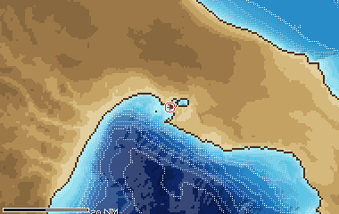

Base della Marina Militare italiana, sul bordo occidentale della carta del Canale d'Otranto. Con Brindisi chiude il lato occidentale dell'imboccatura dell'Adriatico.

**In partita.** Navi italiane della NATO possono comparire nel canale anche in una missione americana.

| Dato | Valore | Nel gioco | Confidenza | Fonte |
|---|---|---|---|---|
| Posizione | 40,47°N 17,23°E, sul bordo occidentale della carta del teatro | - | STIMA | STIMA: coordinate non nei dossier |
| Ruolo | base della Marina Militare italiana | - | alta | dossier 03 §A4 |

**Teatro:** Imboccatura dell'Adriatico (Canale d'Otranto).

**Fonti:** dossier 03 §A4.

### Tivat (Bocche di Cattaro)

*Basi · neutrale*

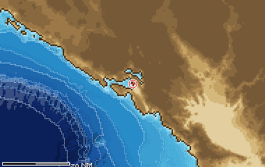

Base della marina jugoslava nelle Bocche di Cattaro: la Jugoslavia era un paese non allineato. Nella missione 6 «Goulash» il 688 scorta sei mercantili fin qui; il manuale scrive «Trivat». Il blocco sovietico della missione è finzione del 1989.

**In partita.** È la meta del convoglio: la missione si vince portandoci i mercantili.

| Dato | Valore | Nel gioco | Confidenza | Fonte |
|---|---|---|---|---|
| Posizione | 42,43°N 18,70°E, nelle Bocche di Cattaro | - | media | dossier 03 §A4 |
| Ruolo | base della marina jugoslava, paese non allineato | - | alta | dossier 03 §A4 |
| Nel gioco | missione 6 «Goulash»: destinazione dei sei mercantili scortati (nel manuale «Trivat»); il blocco sovietico è finzione | - | alta | dossier 03 §0, §A4 |

**Teatro:** Imboccatura dell'Adriatico (Canale d'Otranto).

**Fonti:** dossier 03 §0, §A4.

### Vladivostok

*Basi · Unione Sovietica*

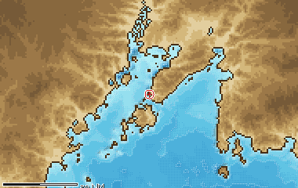

Il grande porto sovietico sul Mar del Giappone, lontano dalla carta delle Curili. Nella missione 7 «Cat Walk» l'SSBN al centro della partita è partito da qui. Il manuale sbaglia la geografia: gli stretti di Kunashir non collegano il Mar del Giappone al Pacifico ma il Mare di Okhotsk.

**In partita.** Spiega da dove viene l'SSBN della missione 7, non dove si combatte.

| Dato | Valore | Nel gioco | Confidenza | Fonte |
|---|---|---|---|---|
| Posizione | 43,11°N 131,88°E, sul Mar del Giappone (molto lontano dalla carta del teatro) | - | STIMA | STIMA: coordinate non nei dossier |
| Nel gioco | missione 7 «Cat Walk»: l'SSBN da proteggere o da cacciare è uscito da Vladivostok | - | alta | dossier 03 §0 |
| Errore del manuale | dal Mar del Giappone si esce da La Pérouse, Tsugaru o Tsushima; gli stretti di Kunashir portano invece dall'Okhotsk al Pacifico | - | alta | dossier 03 §0 (errori storico-geografici, punto 1) |

**Teatro:** Passo di Kunashir – Mare di Okhotsk.

**Fonti:** dossier 03 §0 (manuale, cap. 3; errori, punto 1).

### Wakkanai (radar)

*Basi · Giappone*

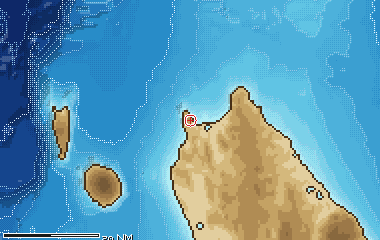

Sulla punta settentrionale dell'Hokkaido il Giappone teneva un radar che sorvegliava lo stretto di Sōya, uno dei passaggi fra l'Okhotsk e il Mar del Giappone. Insieme ai pattugliatori P-3 di Hachinohe e Misawa completava la guardia alleata a sud del bastione sovietico.

**In partita.** Nel teatro di Kunashir il sud è sorvegliato dagli alleati: un battello sovietico che esce verso il Giappone va tenuto d'occhio.

| Dato | Valore | Nel gioco | Confidenza | Fonte |
|---|---|---|---|---|
| Ruolo | radar giapponese che sorvegliava lo stretto di Sōya, all'uscita dell'Okhotsk verso il Mar del Giappone | - | media | dossier 03 §A5 |
| Posizione | punta settentrionale dell'Hokkaido, fuori dal riquadro del teatro | - | STIMA | coordinate STIMA |

**Teatro:** Passo di Kunashir – Mare di Okhotsk.

**Fonti:** dossier 03 §A5.

### Warnemünde (Rostock)

*Basi · Unione Sovietica*

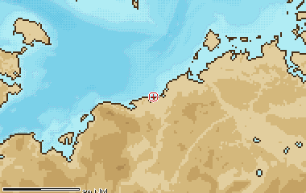

Base della Volksmarine a Rostock. Davanti al porto incrociano i traghetti veloci per Gedser, su rotte e orari fissi.

**In partita.** I traghetti hanno rotte fisse: impara a riconoscerli per non sprecare tempo sui falsi contatti.

| Dato | Valore | Nel gioco | Confidenza | Fonte |
|---|---|---|---|---|
| Posizione | 54,18°N 12,08°E, alla foce del fiume che porta a Rostock | - | STIMA | STIMA: coordinate non nei dossier |
| Ruolo | base della Volksmarine sulla costa della RDT | - | alta | dossier 03 §A7 |
| Traffico | i traghetti veloci Rostock-Gedser incrociano qui su rotte e orari fissi | - | media | dossier 03 §A7; dossier 09 (sorgenti di rumore) |

**Teatro:** Mar Baltico sud-occidentale.

**Fonti:** dossier 03 §A7; dossier 09 (sorgenti di rumore).

### Zapadnaja Lica

*Basi · Unione Sovietica*

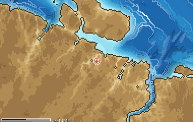

Base sottomarini in un fiordo a ovest della baia di Kola, sede degli Alfa del Progetto 705 e dei Victor. Da qui uscivano i battelli più veloci della Guerra Fredda. Nel 1989 però quasi tutti gli Alfa erano in riserva o fermi, e cinque furono radiati l'anno dopo.

**In partita.** È la casa dell'Alfa del giocatore sovietico.

| Dato | Valore | Nel gioco | Confidenza | Fonte |
|---|---|---|---|---|
| Posizione | 69,43°N 32,43°E, nel fiordo della Zapadnaja Lica, a ovest della baia di Kola | - | STIMA | STIMA: coordinate non nei dossier |
| Ruolo | base degli Alfa (Progetto 705) e dei Victor | - | alta | dossier 03 §A2 (Polmar & Moore 2004) |
| Gli Alfa nel 1989 | quasi tutti in riserva o fermi; cinque radiati nel 1990 | - | media | dossier 01 §2.4 [DS705] |

**Teatro:** Mare di Barents (approcci a Kola).

**Fonti:** dossier 03 §A2 (Polmar & Moore 2004); dossier 01 §2.4 [DS705].

### Île Longue (Brest)

*Basi · NATO*

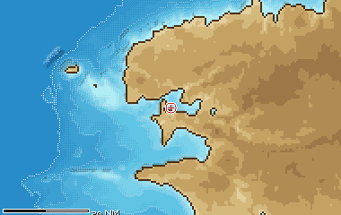

Base degli SSBN francesi nella rada di Brest. I sottomarini sovietici ne sorvegliavano le uscite verso l'Atlantico, dentro o vicino alla carta della piattaforma celtica.

**In partita.** Un SSN sovietico in questo teatro può essere lì per pedinare un battello francese, non per te.

| Dato | Valore | Nel gioco | Confidenza | Fonte |
|---|---|---|---|---|
| Posizione | 48,31°N 4,51°W, nella rada di Brest (fuori dalla carta del teatro) | - | STIMA | STIMA: coordinate non nei dossier |
| Ruolo | base degli SSBN francesi, le cui uscite erano sorvegliate da SSN sovietici | - | media | dossier 03 §A6 |

**Teatro:** Margine della Piattaforma Celtica.

**Fonti:** dossier 03 §A6.
<!-- fine: unita_basi -->
