# 18. Gradi e decorazioni

*Fonti: dossier 13 del progetto (`docs/ricerca/13_carriera_gradi_decorazioni.md`) e i dati della carriera del gioco
(`data/motore/carriera.toml`). Le medaglie sono quelle disegnate dal gioco per le cerimonie.*

## 18.1 I gradi

Le due marine contavano i gradi in modo diverso. Nella US Navy il grado segue l'anzianità e le commissioni di
promozione: si sale «in zona» o in anticipo, e due mancate portano al congedo. Nella VMF **il grado segue l'incarico**:
ogni incarico ha un grado massimo previsto, e il comando di un sottomarino nucleare, nave di primo rango, «vale» capitano
di primo rango (dossier 13 §1.7, §2.2).

Un 688 del 1989 lo comanda di solito un **Commander** (capitano di fregata); un **Captain** comanda la squadriglia. Un
Alfa lo comanda un capitano di secondo o di primo rango.

<!-- generato: gradi -->
| Marina | Sigla | Grado | In italiano | Codice NATO |
|---|---|---|---|---|
| US Navy | ENS | Ensign | guardiamarina | OF-1 |
| US Navy | LTJG | Lieutenant junior grade | sottotenente di vascello | OF-1 |
| US Navy | LT | Lieutenant | tenente di vascello | OF-2 |
| US Navy | LCDR | Lieutenant Commander | capitano di corvetta | OF-3 |
| US Navy | CDR | Commander | capitano di fregata | OF-4 |
| US Navy | CAPT | Captain | capitano di vascello | OF-5 |
| US Navy | RDML | Rear Admiral (lower half) | contrammiraglio | OF-6 |
| Marina sovietica (VMF) | л-т | lejtenant | tenente | OF-1 |
| Marina sovietica (VMF) | ст. л-т | staršij lejtenant | tenente anziano | OF-1 |
| Marina sovietica (VMF) | к-л | kapitan-lejtenant | capitano-tenente | OF-2 |
| Marina sovietica (VMF) | к3р | kapitan 3-go ranga | capitano di 3° rango | OF-3 |
| Marina sovietica (VMF) | к2р | kapitan 2-go ranga | capitano di 2° rango | OF-4 |
| Marina sovietica (VMF) | к1р | kapitan 1-go ranga | capitano di 1° rango | OF-5 |
| Marina sovietica (VMF) | к-адм | kontr-admiral | contrammiraglio | OF-6 |
<!-- fine: gradi -->

Nel gioco la carriera si chiude da Captain o da capitano di primo rango: il contrammiraglio c'è nelle tabelle, ma
nessuna fase della carriera ci arriva (volume 1, capitolo 10).

## 18.2 Le decorazioni

Le decorazioni sono di quattro tipi:
- **personali**, per un'azione: dalla Navy Achievement Medal alla Medal of Honor, dalla medaglia «Per il merito di
  combattimento» all'Eroe dell'Unione Sovietica. Le più alte vogliono il combattimento: in pace non si danno;
- **di reparto**, all'equipaggio: le citazioni presidenziali, la Navy Unit Commendation, l'Ordine della Bandiera Rossa al
  battello;
- **di servizio**: per gli anni, le campagne, le zone (l'Artico);
- **distintivi**: le dolphins dei sommergibilisti, il Command at Sea, il distintivo sovietico di comandante di
  sottomarino.

Si portano in ordine di **precedenza**: la più alta in alto a sinistra della barretta. Le missioni operative più segrete
ebbero motivazioni volutamente vaghe: la *Parche* è la nave più decorata della storia americana, e quasi nessuno sa
perché (capitolo 19).

<!-- generato: decorazioni -->
### US Navy

#### Medal of Honor

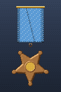

Decorazione personale, precedenza 1. Fonte: dossier 13 §3.1 [alta] (confidenza media).

#### Navy Cross

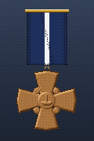

Decorazione personale, precedenza 2. Fonte: dossier 13 §3.1 [alta] (confidenza media).

#### Navy Distinguished Service Medal

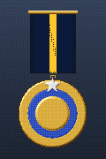

Decorazione personale, precedenza 4. Fonte: dossier 13 §3.1 [alta] (confidenza media).

#### Silver Star

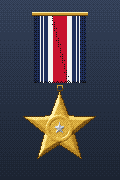

Decorazione personale, precedenza 5. Fonte: dossier 13 §3.1 [alta] (confidenza media).

#### Legion of Merit

Decorazione personale, precedenza 7. Fonte: dossier 13 §3.1 [alta] (confidenza media).

#### Navy and Marine Corps Medal

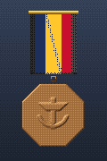

Decorazione personale, precedenza 9. Fonte: dossier 13 §3.1; nastrino non descritto nel dossier (confidenza bassa).

#### Bronze Star Medal

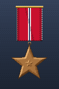

Decorazione personale, precedenza 10. Fonte: dossier 13 §3.1 [alta] (confidenza media).

#### Purple Heart

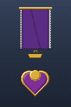

Decorazione personale, precedenza 11. Fonte: dossier 13 §3.1 [media] (confidenza media).

#### Meritorious Service Medal

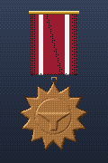

Decorazione personale, precedenza 13. Fonte: dossier 13 §3.1 [alta] (confidenza media).

#### Navy Commendation Medal

Decorazione personale, precedenza 16. Fonte: dossier 13 §3.1 [alta] (confidenza media).

#### Navy Achievement Medal

Decorazione personale, precedenza 18. Fonte: dossier 13 §3.1 [alta] (confidenza media).

#### Combat Action Ribbon

Decorazione di servizio, precedenza 19. Fonte: dossier 13 §3.1 [media] (confidenza media).

#### Presidential Unit Citation (Presidential Unit Citation (Navy))

Decorazione di reparto, precedenza 20. Fonte: dossier 13 §3.1 [alta] (confidenza media).

#### Navy Unit Commendation

Decorazione di reparto, precedenza 21. Fonte: dossier 13 §3.1 [media] (confidenza media).

#### Meritorious Unit Commendation

Decorazione di reparto, precedenza 22. Fonte: dossier 13 §3.1 [media] (confidenza media).

#### Navy «E» Ribbon (Navy "E" Ribbon)

Decorazione di servizio, precedenza 23. Fonte: dossier 13 §3.2 [media] (confidenza media).

#### Navy Expeditionary Medal

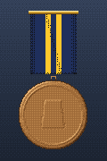

Decorazione di servizio, precedenza 24. Fonte: dossier 13 §3.2 [media] (confidenza media).

#### National Defense Service Medal

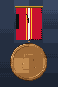

Decorazione di servizio, precedenza 25. Fonte: dossier 13 §3.2 [alta] (confidenza media).

#### Sea Service Deployment Ribbon

Decorazione di servizio, precedenza 26. Fonte: dossier 13 §3.2 [media] (confidenza media).

#### Navy Arctic Service Ribbon

Decorazione di servizio, precedenza 27. Fonte: dossier 13 §3.2; colori da verificare (confidenza bassa).

#### dolphins d'oro (Submarine Warfare Insignia (officer))

Decorazione distintivo, precedenza 90. Fonte: dossier 13 §1.3 [alta] (confidenza media).

#### distintivo Command at Sea (Command at Sea Insignia)

Decorazione distintivo, precedenza 91. Fonte: dossier 13 §3.2 [alta] (confidenza media).

#### distintivo di pattuglia di combattimento (Submarine Combat Patrol Insignia)

Decorazione distintivo, precedenza 92. Fonte: dossier 13 §3.2 [alta]; PROPOSTA per la guerra (confidenza media).

### Marina sovietica (VMF)

#### Eroe dell'Unione Sovietica (Hero of the Soviet Union)

Decorazione personale, precedenza 1. Fonte: dossier 13 §3.4 [alta] (confidenza media).

#### Ordine di Lenin (Order of Lenin)

Decorazione personale, precedenza 2. Fonte: dossier 13 §3.4 [alta] (confidenza media).

#### Ordine della Bandiera Rossa (Order of the Red Banner)

Decorazione personale, precedenza 4. Fonte: dossier 13 §3.4 [alta] (confidenza media).

#### Ordine di Ušakov di 2ª classe (Order of Ushakov, 2nd class)

Decorazione personale, precedenza 5. Fonte: dossier 13 §3.4; PROPOSTA per la guerra, nastrino da verificare (confidenza bassa).

#### Ordine della Stella Rossa (Order of the Red Star)

Decorazione personale, precedenza 6. Fonte: dossier 13 §3.4 [alta] (confidenza media).

#### Ordine «Per il servizio alla Patria» di 1ª classe (Order "For Service to the Homeland", 1st class)

Decorazione personale, precedenza 7. Fonte: dossier 13 §3.4 [alta] (confidenza media).

#### Ordine «Per il servizio alla Patria» di 2ª classe (Order "For Service to the Homeland", 2nd class)

Decorazione personale, precedenza 8. Fonte: dossier 13 §3.4 [alta] (confidenza media).

#### Ordine «Per il servizio alla Patria» di 3ª classe (Order "For Service to the Homeland", 3rd class)

Decorazione personale, precedenza 9. Fonte: dossier 13 §3.4 [alta] (confidenza media).

#### Ordine «Per il coraggio personale» (Order "For Personal Courage")

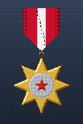

Decorazione personale, precedenza 10. Fonte: dossier 13 §3.4; dal 28/12/1988, nastrino da verificare (confidenza bassa).

#### Medaglia «Per merito in combattimento» (Medal "For Battle Merit")

Decorazione personale, precedenza 12. Fonte: dossier 13 §3.4 (confidenza bassa).

#### Medaglia «Per distinzione nel servizio militare» di 1ª classe (Medal "For Distinction in Military Service", 1st class)

Decorazione personale, precedenza 13. Fonte: dossier 13 §3.4 [alta] (confidenza media).

#### Medaglia «Per distinzione nel servizio militare» di 2ª classe (Medal "For Distinction in Military Service", 2nd class)

Decorazione personale, precedenza 14. Fonte: dossier 13 §3.4 [alta] (confidenza media).

#### Medaglia «70 anni delle Forze armate dell'URSS» (Jubilee Medal "70 Years of the Armed Forces of the USSR")

Decorazione di servizio, precedenza 20. Fonte: dossier 13 §3.4 [media] (confidenza bassa).

#### Medaglia «Per il servizio impeccabile» di 1ª classe (Medal "For Impeccable Service", 1st class)

Decorazione di servizio, precedenza 21. Fonte: dossier 13 §3.4 [alta] (confidenza media).

#### Medaglia «Per il servizio impeccabile» di 2ª classe (Medal "For Impeccable Service", 2nd class)

Decorazione di servizio, precedenza 22. Fonte: dossier 13 §3.4 [alta] (confidenza media).

#### Medaglia «Per il servizio impeccabile» di 3ª classe (Medal "For Impeccable Service", 3rd class)

Decorazione di servizio, precedenza 23. Fonte: dossier 13 §3.4 [alta] (confidenza media).

#### encomio del Comandante in capo della Marina (Commendation of the Commander-in-Chief of the Navy)

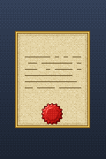

Decorazione di reparto, precedenza 40. Fonte: dossier 13 §3.7 PROPOSTA (senza nastrino) (confidenza media).

#### Ordine della Bandiera Rossa al battello (Order of the Red Banner (ship))

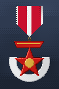

Decorazione di reparto, precedenza 41. Fonte: dossier 13 §3.7 PROPOSTA (confidenza media).

#### distintivo «Comandante di sottomarino» (Submarine Commander badge)

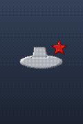

Decorazione distintivo, precedenza 90. Fonte: dossier 13 §3.5 [alta] (confidenza media).
<!-- fine: decorazioni -->
